# Probing Spatial State Representations in Visual Foundation Models

Baiqiao Yin1,2, Zhongang Cai2, Ruisi Wang2, Qiwei Liang3, Lei Yang4, Ziwei Liu2

1New York University, 2Nanyang Technological University, 3The Hong Kong University of Science and Technology, 4The Chinese University of Hong Kong

€ Project Page § Code

## Abstract

An observer sees only part of the surrounding world, yet must keep track of what lies beyond the current view. Spatial perception therefore involves more than recognizing individual images: it calls for a persistent spatial state that is updated under self-motion and used to guide action. Do visual foundation models provide representations that support such a state? We study this question through four levels of spatial capability—spatial structure, object persistence, predictive spatial update, and actionability—using frozenfeature probes on ten representations under streaming egocentric observations of static indoor environments. The resulting capability profiles vary across tasks, network layers, and prefix lengths: strong readout of the visible scene does not ensure accurate object persistence or future-feature retrieval. Matched controls separate readout accuracy from reliance on visual history and motion. Native future prediction retains recoverable spatial structure, but a spatial reader trained on real features does not transfer to predicted features unchanged. Finally, goal-dependent candidate selection does not establish reliable continuous action utility: predicted actions respond to goal changes, yet supplying the correct goal does not reliably improve progress. Across the four levels, object persistence and actionability build on camera-pose readout, whereas feature prediction builds on visible-scene readout. Together, these findings motivate evaluating spatial representations not only by what can be decoded from them, but by whether that information is maintained beyond observation, updated predictively, and used for goal-directed action.

Keywords: visual foundation models, spatial state representations, probing, object persistence, actionability.

## 1 Introduction

Spatial representation is one of the most fundamental capacities of biological perception. Humans and other animals do not experience the world as a sequence of independent retinal images. Through continuous exploration, they maintain information about the surrounding space, keep track of objects that are no longer visible, update their own location as they move, and use this information to guide subsequent behavior. These abilities are not inherently linguistic: they arise from perception and from sensorimotor interaction with the environment.

Several classical ideas in perception and spatial cognition point to this view. Object-file theories describe how objectspecific information remains associated with the same entity across changes in its visual appearance [17]. Spatial updating and path integration describe how an internal estimate of location is continuously revised from self-motion [26]. Sensorimotor contingency theories further emphasize that perception involves knowledge of how sensory input would change under possible actions [30]. Together, these perspectives suggest that a useful representation of space should describe more than what is visible in the current image: it should maintain a state of the surrounding world that persists and evolves as the observer interacts with it.

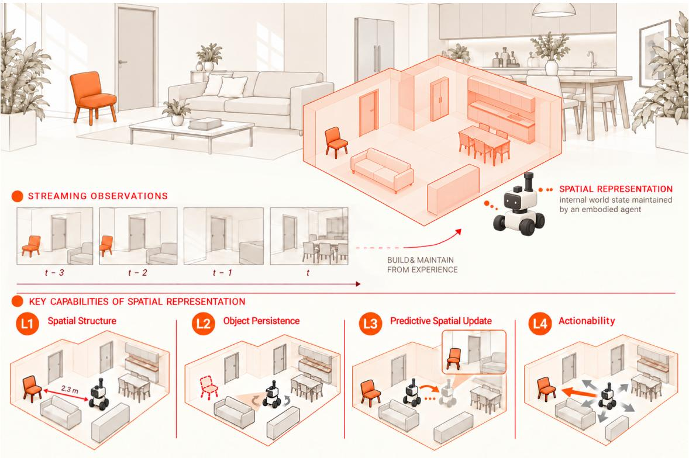  
Figure 1 Spatial state representations from streaming egocentric observations. A moving observer builds an internal spatial representation from partial views of an environment. L1 (spatial structure) captures scene geometry and object identity across views. L2 (object persistence) retains the observer-relative locations of previously seen objects after they leave the field of view. L3 (predictive spatial update) anticipates what the observer would see after an action or a sequence of actions. L4 (actionability) uses the represented state and a specified goal to select an action that makes progress toward that goal.

An observer’s spatial state is the configuration of the surrounding environment relative to the observer, including previously observed objects that are no longer visible. A spatial state representation is an internal encoding of this configuration inferred from the observer’s visual history. We do not prescribe an explicit 3D map, an object-centric scene graph, a coordinate system, or a neural architecture. Instead, we characterize the functional usefulness of a representation through four capabilities:

L1 Spatial structure. Recover the spatial organization of the observed scene through metric geometry, instance identity, and view consistency.

L2 Object persistence. Retain the location of a previously observed object after it has left the field of view.

L3 Predictive spatial update. Anticipate changes in the observer-relative state under ego-motion, evaluated through direct prediction and path integration.

L4 Actionability. Use the represented state and a specified goal to predict an action that makes progress toward that goal.

These capabilities, summarized in Figure 2, are ordered by what each demands beyond the current observation: L1 reads the visible scene; L2 additionally requires information retained from earlier views; L3 requires anticipating views that have not yet been observed; and L4 requires relating the represented state to a goal and an action. Which lower-level ingredients the higher levels actually draw on is an empirical question that we return to in Section 4.6.

We study these functions in a streaming setting: the observer receives past and current visual evidence but no future observations, and representations are extracted from causal visual prefixes of increasing length. Each prefix is encoded independently, so the question is what the representation of a causal prefix affords, not whether the model maintains an online state. Our experimental scope is observer motion through static indoor environments; object dynamics, contact physics, and complete physical world modeling are outside it.

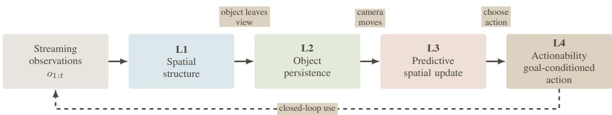  
Figure 2 Functional relationships among the four spatial capabilities. The levels are ordered by what each demands beyond the current observation. L1 grounds the spatial state in observed scene structure. L2 extends the demand from representing what is visible to retaining information after objects leave the field of view, and L3 requires anticipating how the observer-relative state changes under ego-motion. L4 connects the represented state to goal-directed action. The dashed return arrow illustrates potential closed-loop use: actions change the observer’s viewpoint and hence the subsequent observations, while the environment itself remains static.

The question spans the full range of visual foundation models, including image and video encoders, 3D models, multimodal models, video generators, and world models. Strong performance on a model’s training objective does not establish all four spatial functions, and success at one level need not carry over to the next.

We therefore conduct a functional probing study of ten frozen representations. Six main diagnostics yield seven measurements of spatial structure, object persistence, and predictive spatial update, since metric geometry contributes separate depth and camera-pose metrics; goal-conditioned action prediction additionally tests actionability in a candidateselection and a continuous-output setting. Rather than relying on a single extraction point, we organize the analyses along two axes, network depth and streaming context, and add matched controls that alter motion, history, transformation order, or goals while keeping the relevant predictor and target fixed.

Findings. No representation leads on all tasks: Fast3R has the strongest camera-pose and object-persistence readouts, DINOv2 leads direct future-feature prediction, and V-JEPA2 leads path integration (Section 4.1). VideoMAE localizes previously seen objects more accurately than DINOv2 and Qwen2.5-VL despite weaker depth, instance, and viewconsistency readouts; across the ten representations, object persistence aligns with camera-pose readout rather than with these visible-scene metrics. The profiles shift with layer, and longer prefixes worsen persistence for all eight models in the endpoint comparison while their effects on prediction vary (Section 4.2). Separate matched controls distinguish decodability from input use: copying the last feature exceeds learned prediction for V-JEPA2, and visual history helps V-JEPA2 and Wan but shows no clear benefit for VideoMAE (Section 4.3). Native prediction keeps recoverable geometry but not the original readout interface (Section 4.4), and input use is not functional utility: changing the goal rotates predicted actions by 30–46◦, yet the correct goal does not reliably improve progress (Section 4.5). Across levels, the results reveal two ingredient chains: object persistence and actionability build on camera-pose readout, whereas feature prediction builds on visible-scene readout (Section 4.6).

Contributions. We (i) characterize spatial state representations operationally through four functional capabilities; (ii) develop a frozen-feature probing framework covering ten representations, with controls for history, motion, predictive readout, and goal use; and (iii) show that readout accuracy, input use, and goal-specific utility dissociate across models, layers, and prefix lengths, motivating multidimensional evaluation of spatial state.

## 2 Probing Spatial State Representations

We ask what spatial information is accessible in frozen visual features, which inputs support that information, and whether it remains useful for prediction and goal-directed action.

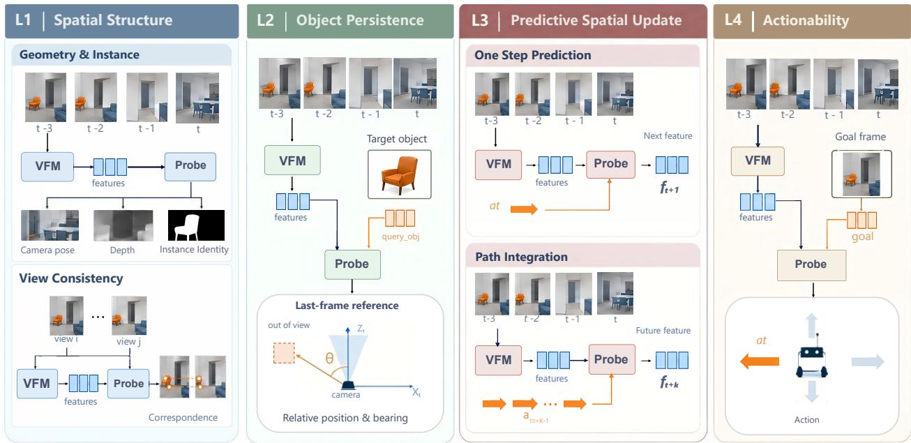  
Figure 3 Probing four spatial capabilities. Probe inputs and targets at each level: prefix features alone (L1), plus an object query (L2), ego-motions and an isolated future feature (L3), or a goal frame and an action (L4).

## 2.1 Four functional capabilities

Figure 3 summarizes the probing tasks that instantiate the four levels of spatial capability.

L1: Spatial structure. We first ask what spatial structure is directly readable from the streaming visual representation. The metric geometry task takes frozen features of an egocentric video prefix and predicts the current camera pose and scene depth, testing whether metric 3D structure is accessible. The instance identity task uses the same features to separate individual object instances, testing whether the representation organizes the visible scene at the object level rather than encoding global geometry alone. The view consistency task matches correspondences between features extracted from two viewpoints of the same scene, testing whether spatial correspondences survive changes in viewpoint.

L2: Object persistence. We then test whether information about an object remains spatially available after the object is no longer visible, through out-of-view object localization. A target object is first observed in an earlier frame and represented by an object query $q _ { \mathrm { o b j } }$ . By the end of the video prefix, camera motion has moved the target outside the observer’s field of view. Given the frozen representation of the whole prefix together with $q _ { \mathrm { o b j } } .$ , the probe predicts the target’s location relative to the final camera, evaluated through its bearing. The task therefore asks whether the representation maintains the spatial state of a previously observed object beyond direct visual evidence, rather than merely detecting or recognizing objects that remain visible.

L3: Predictive spatial update. Next, we ask whether the representation supports motion-conditioned prediction of the observer-relative state. In direct prediction, the probe receives the visual prefix and the relative camera motion from its endpoint to a future observation, and predicts that observation’s feature in a single update. The main evaluation pools targets at observation offsets $h \in \{ 1 , 2 , 4 \}$ ; MiniMax-H3 uses a separately trained next-observation-only probe $( h = 1 )$ which we mark explicitly. In path integration, a recurrent probe instead applies successive relative motions along the same trajectory and is evaluated at the waypoints at offsets 1, 2, and 4. The two tasks test direct endpoint prediction and sequential motion integration, respectively; because their readout architectures differ, the comparison does not isolate recurrence alone.

L4: Actionability. Finally, we test whether the representation can be used for goal-directed action through goalconditioned action prediction. The probe receives the representation of the current visual history together with an independently encoded goal frame $q _ { \mathrm { g o a l } }$ , and predicts an action $a _ { t }$ intended to move the observer toward the goal. This level asks whether the spatial information exposed by the representation is not only descriptive or predictive, but also usable for selecting behavior conditioned on a desired future state.

## 2.2 Causal streaming formulation

For model m and layer ℓ, the frozen encoder $E _ { \ell } ^ { m }$ encodes prefixes that share a start frame and differ only in their endpoint p:

$$
\begin{array} { r } { \mathbf { Z } _ { p } ^ { m , \ell } = E _ { \ell } ^ { m } ( \mathbf { I } _ { 1 : p } ) , \qquad p \in \{ 8 , 1 2 , 1 6 , 2 4 \} . } \end{array}\tag{1}
$$

Each prefix is encoded independently, contains no frame after $p ,$ and is treated as a candidate spatial state representation at every level. For L2, the object query is pooled from frames in which the object was visible, and the target is its bearing in the camera frame at $p ;$ neither the visibility mask nor the target location is given to the probe. No recurrent state update is required, and because a longer prefix also moves the endpoint, comparisons across $p$ do not isolate added history. L3 and L4 additionally use a future frame encoded without access to the prefix or to any later frame,

$$
\begin{array} { r } { \mathbf Z _ { p + h } ^ { m , \ell , \mathrm { t a r } } = E _ { \ell } ^ { m } ( \mathbf I _ { p + h } ) , \qquad h \in \{ 1 , 2 , 4 \} , } \end{array}\tag{2}
$$

which serves as the retrieval target for direct prediction and path integration and as the goal frame for L4. MiniMax-H3’s direct prediction is restricted to $h = 1 \cdot$ ; the other direct probes and all path probes use $h \in \{ 1 , 2 , 4 \}$ . Stochastic encoders use matched noise seeds; further constructions are specified with each experiment.

## 3 Experimental Setup

## 3.1 Data and splits

All temporal experiments use posed ScanNet++ trajectories [42] processed by our pipeline. Each sample provides RGB observations, camera poses, instance geometry, and visibility annotations. Training and validation scenes are disjoint, and scene-level partitions keep related trajectories, objects, and windows together. Fast3R’s training data include ScanNet++ [38], and some of our validation scenes are among its training scenes. Its leading camera-pose, object-persistence, and action results may therefore partly reflect familiarity with these scenes. Task-specific splits, sample counts, and seeds are specified with each experiment and in Section A.7. Views without a meaningful temporal trajectory are used only for tasks that require neither history nor motion.

## 3.2 Models and extraction points

We compare ten frozen representations spanning image encoders, video encoders, 3D models, multimodal models, video generators, and world models (Table 1); all backbone parameters remain frozen. The representations are DINOv2 [29], V-JEPA2 [1], VideoMAE [32], Fast3R [38], Wan [33], CogVideoX [41], MiniMax-H3 [27], LingBot-video [24], Aether [44], and Qwen2.5-VL [2]. Layer indices are model-specific and are not absolute measures of depth across architectures. The designated representative layers are listed in Table 17.

Within a model and task, the readout architecture and objective are shared across layers and prefix lengths. The main comparison averages over the evaluated prefixes at the designated layer; layer and prefix sweeps are analyzed separately rather than contributing their post-hoc maxima as primary scores.

<table><tr><td>Family</td><td>Model</td></tr><tr><td>Image encoder</td><td>DINOv2-Large</td></tr><tr><td>Video encoder</td><td>V-JEPA2 ViT-L VideoMAE-Large</td></tr><tr><td>3D encoder</td><td>Fast3R ViT-L</td></tr><tr><td>Video generator</td><td>Wan2.1-T2V-1.3B CogVideoX-5B-I2V MiniMax-H3</td></tr><tr><td>World model</td><td>LingBot-video MoE-30B-A3B AetherV1</td></tr><tr><td>Multimodal</td><td>Qwen2.5-VL-7B-Instruct</td></tr></table>

Table 1 Ten representations evaluated.

Readout metrics. Instance identity uses a cross-entropy loss on per-pixel embeddings, with prototypes computed from ground-truth instance groups within the evaluated sample; it measures identity separation, not mask quality or segmentation IoU. Direct prediction and path integration retrieve future features within each model’s own target space, so their scores do not lie on a common scale of physical prediction error. Global R@1 is the fraction of predictions whose most similar candidate is the correct future feature. Camera-pose AUC@30 is the area under the pose-accuracy curve up to a 30-degree error threshold. Probes in the main comparison use training seed 42. Intervals are 95% scene-clustered bootstrap intervals over the 69 validation scenes (1,000 resamples shared by all cells, so model, prefix, and coordinate differences are paired); they reflect evaluation sampling, not training-seed variability (Section A.3).

Table 2 Main results for all ten representations. Prefix aggregation follows Eq. (3) at each designated layer. The first header row names the diagnostic task and the second row its metric; metric geometry contributes two metrics. Bold, colored values mark the best result in each column and every result whose paired 95% scene-bootstrap interval of the difference from it contains zero; marked cells are excluded. †: MiniMax-H3 prediction is evaluated on 171 of the 276 validation windows, and its direct predictor uses the next-observation target only. Table 8 gives the intervals of every cell and Table 6 the shared-window comparison.
<table><tr><td></td><td colspan="2">Metric geometry</td><td>Instance identity</td><td>View consistency</td><td>Object persistence</td><td>Direct prediction</td><td>Path integration</td></tr><tr><td>Model (layer)</td><td>Depth loss ↓</td><td>AUC@30 Instance ↑</td><td>loss↓</td><td>Bal. acc.↑</td><td>Ang. err.  $( ^ { \circ } ) \downarrow$ </td><td>Global R@1↑</td><td>Global R@1↑</td></tr><tr><td>DINOv2-L (0)</td><td>0.1422</td><td>0.0412</td><td>1.3828</td><td>0.9557</td><td>65.38</td><td>0.2373</td><td>0.0900</td></tr><tr><td>FAST3R (24)</td><td>0.1386</td><td>0.3870</td><td>1.6072</td><td>0.9808</td><td>32.79</td><td>0.0133</td><td>0.0190</td></tr><tr><td>VIDEOMAE-L (23)</td><td>0.2968</td><td>0.2026</td><td>4.1571</td><td>0.9118</td><td>36.45</td><td>0.0531</td><td>0.0685</td></tr><tr><td>V-JEPA2-L (23)</td><td>0.2708</td><td>0.1854</td><td>2.9211</td><td>0.9256</td><td>45.31</td><td>0.0625</td><td>0.1588</td></tr><tr><td>QWEN2.5-VL (−1)</td><td>0.2244</td><td>0.0269</td><td>2.9476</td><td>0.9385</td><td>68.59</td><td>0.1712</td><td>0.0903</td></tr><tr><td>WAN (20)</td><td>0.3609</td><td>0.0650</td><td>4.9301</td><td>0.8215</td><td>62.38</td><td>0.0260</td><td>0.0405</td></tr><tr><td>COGVIDEOX (20)</td><td>0.4340</td><td>0.0276</td><td>6.6992</td><td>0.8001</td><td>70.62</td><td>0.0088</td><td>0.0160</td></tr><tr><td>AETHER (1)</td><td>0.5270</td><td>0.0185</td><td>7.1847</td><td>0.6928</td><td>61.18</td><td>0.0024</td><td>0.0042</td></tr><tr><td>MINIMAX-H3 (30)</td><td>0.4252</td><td>0.0477</td><td>6.2265</td><td>0.8255</td><td>55.97</td><td>0.0249†</td><td>0.0117†</td></tr><tr><td>LINGBOT-VIDEO (30)</td><td>0.4314</td><td>0.0232</td><td>5.5875</td><td>0.7858</td><td>70.30</td><td>0.0302</td><td>0.0429</td></tr></table>

Evaluation scope. The main table reports final-checkpoint evaluations on 276 validation windows per prefix. The MiniMax-H3 prediction probes are evaluated on 171 of these windows and are marked accordingly. Direct prediction for the other nine models pools three future targets per window into a gallery of 828 candidates, whereas MiniMax-H3 direct prediction uses 171 next-observation candidates. Path integration pools the same three waypoints, giving 828 candidates for the other models and 513 for MiniMax-H3. Object persistence scores only windows with an eligible, previously visible target: 80 windows at prefix 8 and 171 at each of prefixes 12, 16, and 24. Section A.2 reports results on the 171 shared validation windows together with a matched next-observation evaluation. The matched input controls, the native-prediction readout, the motion-composition study, and the action experiments follow their own protocols, described below.

## 4 Experiments

We first compare spatial readouts across the ten representations and examine their dependence on the extraction setting (Sections 4.1 and 4.2). We then test whether the probes use history and motion (Section 4.3), whether spatial readout survives native prediction (Section 4.4), and whether goal information has functional utility for action (Section 4.5).

## 4.1 Spatial capabilities differ across representations

The main results are collected in Table 2. For model m and task t, the reported score averages over the evaluated prefixes $\mathcal { P } _ { m , t }$ at the designated layer $\ell _ { m }$

$$
\bar { s } _ { m , t } = \frac { 1 } { | \mathcal { P } _ { m , t } | } \sum _ { p \in \mathcal { P } _ { m , t } } s _ { m , t } ( \ell _ { m } , p ) .\tag{3}
$$

No best-layer or best-prefix selection enters this aggregation.

Spatial structure exposes distinct task strengths. Fast3R and DINOv2 illustrate that metric geometry, view consistency, and instance identity are not interchangeable readouts. Fast3R has the highest camera-pose AUC@30 and view accuracy in the main table, but its advantage over DINOv2 is far larger for camera pose (0.3870 versus 0.0412) than for depth loss or view accuracy, and DINOv2 has the lower instance-identity loss (1.3828 versus 1.6072). Strong view consistency or instance separation therefore does not imply equally strong camera-pose readout.

Visible-scene accuracy does not determine object persistence. Fast3R achieves the lowest object-persistence error (32.79◦), followed by VideoMAE (36.45◦). VideoMAE localizes far more accurately than DINOv2 (65.38◦) and Qwen2.5-VL (68.59◦), although both outperform it on depth, instance identity, and view consistency. Object persistence thus reveals differences that visible-scene readout alone would miss, without requiring a different winner on every task.

Object persistence aligns with camera-pose readout. The exception among the L1 metrics is camera pose. The three most accurate localizers (Fast3R, VideoMAE, V-JEPA2) are exactly the three representations with the highest AUC@30, and across all ten representations the rank correlation between persistence and camera-pose readout is $\rho = 0 . 7 6 ,$ compared with $\rho \le 0$ .43 for depth, instance identity, and view consistency (Spearman, direction-corrected). Depth, instance identity, and view consistency rank the models almost identically $( \rho \ge 0 . 9 1 $ pairwise), whereas camera pose does not $( \rho \le 0 . 6 2 )$ . Localizing an object that has left the view requires relating the current camera to earlier viewpoints, so a representation that exposes camera pose has the ingredient that persistence demands. The layer sweeps corroborate this within models: in all four multi-layer backbones (VideoMAE, V-JEPA2, Wan, and CogVideoX), the block at which persistence peaks is the block at which metric geometry peaks (Figure 4a).

Persistence and prediction yield different model orderings. DINOv2 leads direct prediction (R@1 0.2373), whereas V-JEPA2 leads path integration (0.1588). Qwen2.5-VL ranks second in direct prediction and ties DINOv2 for second in path integration (0.0903 versus 0.0900) despite a higher object-persistence error than VideoMAE and V-JEPA2, and DINOv2 and V-JEPA2 reverse order between direct prediction (0.2373 versus 0.0625) and path integration (0.0900 versus 0.1588). Over the nine representations evaluated under the common prediction protocol, the two prediction tasks rank models similarly $( \rho = 0 . 9 3 )$ , but neither ordering is related to the persistence ordering $( | \rho | < 0 . 1 )$ . Localization, direct prediction, and sequential integration therefore warrant separate evaluation. MiniMax-H3 is left out of the prediction rankings because its probes use a different window set and, for direct prediction, a different target protocol. Against matched action controls (Table 9), the direct predictor’s gain over both the no-action and the shuffled-action input is above zero for eight models, though small for CogVideoX, Fast3R, and Wan; MiniMax-H3 exceeds only the no-action control, and Aether’s direct prediction is not distinguishable from chance or from either control.

Representationfamilies do not determine capability profiles. VideoMAE and V-JEPA2 have close view-consistency accuracy (0.9118 versus 0.9256) but different strengths: VideoMAE is better on camera pose and object persistence, whereas V-JEPA2 is better on depth and path integration; their direct-prediction scores lie within each other’s interval. Among the generative and world-model representations, Aether has a lower object-persistence error than CogVideoX and matches Wan (61.18◦ versus 62.38◦) despite weaker results on the other six metrics, and MiniMax-H3 localizes best within this group (55.97◦). These comparisons describe the selected representations and extraction points; they do not isolate the effect of the training objective, since architecture and training data differ as well.

## No task-independent model ranking

The observed advantages depend on the spatial function being tested. Strong visible-scene readout does not guarantee accurate object persistence or strong direct prediction and path integration, and the persistence and prediction orderings are unrelated. A single diagnostic therefore cannot summarize a representation’s spatial capability profile.

## 4.2 Spatial accessibility depends on layer and streaming prefix

Different readouts favor different layers. Figure 4a summarizes the best measured layer for the backbones with multi-layer sweeps. V-JEPA2 peaks at block 23 for direct prediction, path integration, and instance identity, but at block 17 for object persistence; VideoMAE instead peaks at block 23 for localization and instance identity and at block 17 for both prediction tasks. The two video generators peak earlier in the network: Wan’s best block is 15 for five of the six readouts, although its designated main-table layer is block 20, and CogVideoX peaks at block 10 or earlier for metric geometry, object persistence, and both prediction tasks. The layer sweeps in Figure 6 show the same contrast in profile shape: the two video encoders improve monotonically with depth on the L1 readouts, whereas the generators’ metric-geometry and view-consistency curves peak at intermediate blocks and decline toward the output. A representative layer selected for one task therefore need not maximize another task’s readout, and cross-model orderings can change with the setting: at block 17 and prefix 8, V-JEPA2 reaches a localization error of 28.8◦, below VideoMAE’s best cell (29.4◦; Figure 7), whereas the designated layers favor VideoMAE by about 9◦.

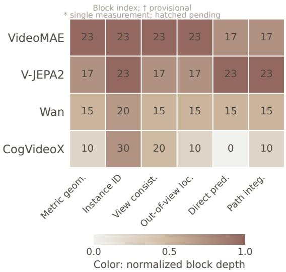  
(a) Best observed layers.

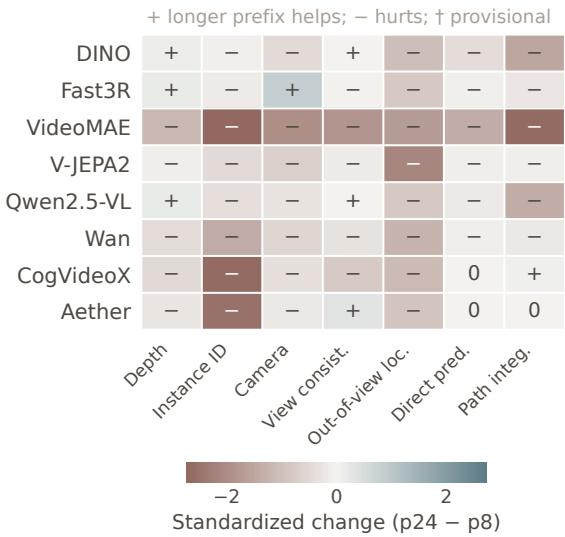  
(b) Effects of a longer prefix.  
Figure 4 Spatial readout depends on both layer and streaming prefix. (a) Four multi-layer backbones: cells give the best measured block, colored by normalized depth. Metric geometry averages the percentile ranks of depth and camera-pose performance. (b) Paired comparisons for eight models at their designated layers: direction-corrected, standardized $\mathsf { p 2 4 - p 8 }$ differences following Eq. (4); + favors the longer prefix and − the shorter. Direct prediction pools horizons 1, 2, and 4 for these models. Full layer curves and joint grids are given in Section A.1.

Longer prefixes do not uniformly improve spatial readout. We compare p24 with p8 using direction-corrected standardized differences:

$$
\Delta _ { m , t } = \frac { d _ { t } \left[ s _ { m , t } ( \ell _ { m } , 2 4 ) - s _ { m , t } ( \ell _ { m } , 8 ) \right] } { \sigma _ { t } } ,\tag{4}
$$

where $d _ { t } = + 1$ for higher-is-better metrics and −1 otherwise, and $\sigma _ { t }$ is the standard deviation of the metric across all model–layer–prefix cells. Among the 56 model–metric endpoint pairs for the eight models in Figure 4b, 45 favor p8, eight favor p24, and three tie; 33 and five of these, respectively, have paired 95% intervals that exclude zero (Table 10). All eight object-persistence pairs worsen with the longer prefix, each beyond its interval, and for path integration six models worsen, three of them (DINOv2, Qwen2.5-VL, and VideoMAE) beyond their intervals, CogVideoX improves within its interval, and Aether ties. For example, VideoMAE’s localization error rises from 29.55◦ to 54.80◦, and DINOv2’s path-integration R@1 falls from 0.1256 to 0.0713. Every pair that favors p24 belongs to a visible-scene readout (depth, camera pose, or view consistency), with the single exception of CogVideoX path integration; Fast3R, for instance, improves on depth and camera pose. The shape of the degradation also differs between models: VideoMAE’s block-23 readouts are stable up to p16 and collapse at $\mathsf { p } 2 4$ (instance loss 2.47 to 9.98, localization 32.1◦ to 54.8◦), whereas V-JEPA2 degrades more gradually across prefixes (Figure 7). Because a longer prefix also moves the endpoint (Section 2.2), these differences do not isolate history alone.

## Spatial accessibility is setting-dependent

Different spatial readouts favor different layers, and longer visual prefixes do not uniformly improve them. The extraction setting is part of the evaluation, not an interchangeable choice of feature interface.

Table 3 Motion and history controls. Motion gain is the correct-minus-wrong-motion R@1 in the matched-candidate protocol; history benefit is the reduction in localization error from full history relative to the current frame alone. Brackets give paired 95% scene-bootstrap intervals.
<table><tr><td>Model</td><td>Motion gain (pp)</td><td>History benefit (°)</td></tr><tr><td>V-JEPA2</td><td>18.84</td><td>10.26</td></tr><tr><td rowspan="2">VideoMAE</td><td>[13.04, 25.36]</td><td>[3.51, 16.80]</td></tr><tr><td>10.51</td><td>2.08</td></tr><tr><td rowspan="2">Wan</td><td>[6.16, 15.22]</td><td>[-6.10, 9.97]</td></tr><tr><td>2.90</td><td>10.01</td></tr><tr><td rowspan="2">CogVideoX</td><td>[-1.45, 7.25]</td><td>[3.42, 16.69]</td></tr><tr><td>4.35 [0.35, 7.97]</td><td>-3.41 [-9.39, 2.39]</td></tr></table>

## 4.3 What do the probes actually use?

We complement the main benchmark with separate baseline comparisons and input controls that examine the contributions of motion and visual history. These matched-control experiments have their own evaluation windows and candidate pools, so their retrieval percentages are not the mixed-horizon global R@1 values of Table 2. In every control, the trained probe and the prediction targets remain fixed, which allows a direct comparison between full and modified conditioning inputs.

One-step prediction controls. In a one-step protocol (Section A.7), we first compare learned prediction with copying the last observed feature as a temporal baseline. In global future-feature retrieval, Wan achieves 15.22% with prediction and 11.96% with copying, whereas V-JEPA2 achieves 13.04% and 19.93%, respectively: for V-JEPA2, copying exceeds learned prediction. We then evaluate motion conditioning with eight pose-displacement-matched candidates. Correct motion improves retrieval over matched wrong motion for V-JEPA2, VideoMAE, and CogVideoX, with gains of 18.84, 10.51, and 4.35 percentage points; Wan’s gain of 2.90 points has an interval spanning zero (Table 3). The copying comparison provides a reference for global retrieval, whereas the matched-candidate comparison quantifies the benefit of the correct motion. A complementary action-set evaluation of the main direct predictors is reported in Section A.6.

Object persistence. We compare localization from the full visual history with localization from the current frame alone, retaining the same historical object query in both conditions. Full history reduces the angular error of V-JEPA2 and Wan by 10.26◦ and 10.01◦, respectively, with both intervals above zero. The corresponding effects for VideoMAE and CogVideoX are smaller and have intervals spanning zero (Table 3); removing the target-visible frames, zeroing all visual tokens, and shuffling or reversing the history are reported in Table 5. Notably, VideoMAE, the most accurate of these four localizers in Table 2, shows no measurable benefit from history beyond the current frame, so a strong localization score does not by itself establish that the probe reads out accumulated history.

Motion-composition consistency. We additionally examine how an external recurrent updater trained on one-step transitions generalizes to the composition of two motions. For Wan and V-JEPA2, updating improves endpoint prediction over copying. Correct-order effects remain inconclusive for both the feature-based updaters and a learned geometric control, whereas an analytic SE(3) reference preserves transformation order. The full comparison is given in Section A.5.

## Benefits from motion and visual history

Correct motion improves matched-candidate prediction for V-JEPA2, VideoMAE, and CogVideoX, and visual history improves localization for V-JEPA2 and Wan, but not measurably for VideoMAE. These controls complement the main capability profiles with measured gains from task-relevant inputs and show that decodability and input use can dissociate.

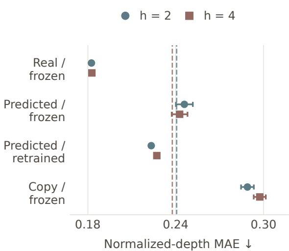  
(a) Readout through native prediction.

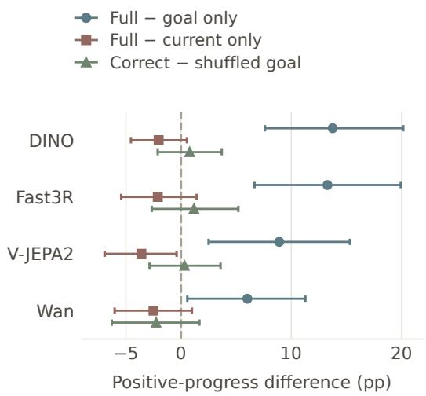  
(b) Goal-specific utility.  
Figure 5 Testing readable structure and goal-specific utility. (a) V-JEPA2 normalized-depth MAE at h = 2 and h = 4 with the same frozen reader, except for the retrained control; dashed lines mark the training-layout priors, and error bars show the SD over three seeds. (b) Positive-progress differences in the continuous-output setting under input restriction (full minus goal-only, full minus current-only) and fixed-weight goal shuffling (correct minus shuffled goal); error bars show paired 95% scene-bootstrap intervals.

## 4.4 Prediction changes the spatial readout interface

As a further L3 analysis, we ask whether the L1 metric geometry that is accessible in real future features remains accessible after native prediction. A probe trained on real V-JEPA2 future states is applied unchanged to the model’s native predictions (Figure 5a). Supporting controls first establish target-specific real-feature readout and motion conditioned utility for an external latent predictor; details are given in Section A.8.

At horizon two, normalized-depth MAE rises from 0.182 on real features to 0.246 on native predictions. Retraining an equal-capacity reader on the predictions improves the MAE to 0.223, better than the 0.241 layout prior but worse than the real-feature readout; horizon four shows the same pattern. Frozen transfer remains better than copied context but slightly worse than the prior (Table 15). The results distinguish recoverable spatial structure from preservation of the original readout interface.

## Recoverable structure is not unchanged readability

Natively predicted features retain some recoverable spatial structure, but a reader trained on real features does not keep its accuracy when applied to them. Prediction supports neither lossless spatial propagation nor the claim that all spatial information has disappeared.

## 4.5 Goal-conditioned action prediction

We test actionability through goal-conditioned action prediction in two complementary settings. The candidateselection setting chooses between supplied actions, whereas the continuous-output setting predicts an action directly. Both use p8 features and an independently extracted goal feature.

Candidate-selection setting. A shallow probe chooses between two 9D camera motions according to their progress toward the goal, where progress is the decrease in the pose distance to the goal, defined as the translation distance plus 0.5 times the rotation angle in radians. Direct selection reaches 75.9–79.9% accuracy, exceeding the 67.8% action-only baseline, and shuffling the goals reduces accuracy by 12.2–20.7 percentage points (Table 4). The readout therefore uses goal information for candidate selection. Predicting each candidate’s outcome before scoring it offers no consistent

Table 4 Goal-conditioned action prediction: candidate-selection setting. Accuracy (%), mean±SD over three training seeds; chance is 50%. Shuffled goal evaluates the trained direct scorer with mismatched goals at fixed weights. The endpoint reference observes realized outcomes and is diagnostic only.
<table><tr><td>Representation</td><td>Action only</td><td>Direct</td><td>Shuffled goal</td><td>Predict- then-score</td><td>Endpoint ref.</td></tr><tr><td>DINOv2-L</td><td>67.8±0.4</td><td> $7 6 . 2 { \pm } 0 . 8 $ </td><td>55.5±0.8</td><td> $7 6 . 2 { \pm } 1 . 2 $ </td><td>85.5</td></tr><tr><td>Fast3R</td><td>67.8±0.4</td><td> $7 9 . 9 { \pm } 1 . 3 $ </td><td>62.4±0.5</td><td> $7 8 . 1 { \pm } 0 . 3 $ </td><td>78.0</td></tr><tr><td>V-JEPA2</td><td>67.8±0.4</td><td> $7 8 . 1 { \pm } 0 . 7 $ </td><td>62.0±1.1</td><td> $7 6 . 7 { \pm } 0 . 8 $ </td><td>78.0</td></tr><tr><td>Wan</td><td>67.8±0.4</td><td> $7 5 . 9 { \pm } 0 . 9 $ </td><td> $6 3 . 7 { \pm } 0 . 5 $ </td><td>63.6±1.1</td><td>68.3</td></tr></table>

advantage and reduces Wan’s accuracy to $6 3 . 6 \%$

Continuous-output setting. Without candidates, a shallow probe predicts the first observed 9D motion of a four-step trajectory from the current p8 feature and an isolated horizon-four goal feature. Separate projections c and g are fused as $[ c , g , g - c , c \odot g ]$ before prediction; the matched-capacity concatenation control is specified in Section A.9. FULL achieves positive progress on 50.2–59.8% of trajectories (Table 16) and exceeds GOAL-ONLY by 6.0–13.8 percentage points, but it does not improve positive progress over CURRENT-ONLY for any backbone (Figure 5b). Beating GOAL-ONLY establishes that the current state is useful; it does not establish a benefit from adding the goal as an input. Fast3R, the representation with the strongest camera-pose and persistence readouts, attains the highest positive-progress rate (59.8%) and is the only representation whose FULL−CURRENT-ONLY interval for goal reduction includes zero.

Changing the goal changes actions, not reliably their utility. Holding the current state and the weights fixed while substituting a difficulty-matched goal from a different scene changes the predicted direction by $2 9 . 8 \substack { - 4 5 . 6 ^ { \circ } }$ . Yet the correct-minus-shuffled-goal effects on positive progress (−2.3 to +1.2 percentage points) and on goal reduction (−0.006 to +0.001) all have 95% intervals containing zero (Figure 5b). Goal sensitivity therefore does not translate into reliable goal-specific utility under this readout. The relational head improves some metrics over concatenation but does not close this gap. These are supervised offline diagnostics, not a demonstration of a closed-loop policy.

## Goal sensitivity is not goal utility

Changing the goal changes the predicted actions, but the correct goal does not reliably improve progress. Success in the candidate-selection setting therefore does not establish reliable goal-conditioned action prediction in the continuous-output setting.

## 4.6 How the four levels relate

Persistence builds on camera-pose readout. As shown in Section 4.1, the three most accurate localizers are the three representations with the highest camera-pose AUC@30, the cross-model rank correlation between the two is $\rho = 0 . 7 6 ,$ and within VideoMAE, V-JEPA2, and Wan the persistence peak coincides with the metric-geometry peak across layers. No representation with weak camera-pose readout localizes well.

Prediction builds on visible-scene readout, not on persistence. Direct prediction and path integration correlate with depth, instance identity, and view consistency $( \rho = 0 . 5 2 – 0 . 6 3$ over the nine representations under the common prediction protocol) but not with camera pose $( \rho \le 0 . 2 5 )$ or persistence $( | \rho | < 0 . 1 )$ . The four best predictors on both tasks (DINOv2, Qwen2.5-VL, V-JEPA2, VideoMAE) are, after Fast3R, the four best representations on depth and view consistency. Fast3R itself, the best on every L1 metric except instance identity, ranks eighth on direct prediction and seventh on path integration: strong visible-scene readout is necessary for feature prediction but not sufficient.

Actionability follows the persistence chain. Among the four representations evaluated at L4, Fast3R leads both action settings (79.9% candidate-selection accuracy and 59.8% positive progress), V-JEPA2 is second in candidate selection (78.1%) and tied with DINOv2 in positive progress (53.8%), and Wan is last in both (75.9% and 50.2%). This is the order of object persistence (32.79◦, 45.31◦, then 62.38◦ and 65.38◦) and of camera-pose readout within the group, not the order of direct prediction, where DINOv2 is first (0.2373) and Fast3R last (0.0133). Goal-conditioned action therefore tracks the pose-and-persistence chain rather than the prediction chain.

Two ingredient chains run through the levels

Camera-pose readout supports object persistence, which in turn supports goal-conditioned action; visible-scene readout supports feature prediction. In each chain the lower level bounds the higher one without guaranteeing it, which is why a single diagnostic cannot stand in for the profile.

## 5 Related Work

Probing spatial and 3D structure infrozen representations. Frozen-feature probing asks what information is already accessible in a representation without updating the backbone. Self-supervised image encoders such as DINO and DINOv2 revealed that semantic organization, object boundaries, and strong local correspondences emerge without dense labels [6, 29]. More recent work extends this methodology to video foundation models: VidFM3D evaluates whether shallow readouts recover depth, camera pose, and 3D point structure from frozen video-model features, and analyzes how these signals vary with network depth and diffusion timestep [15]. Related probes of image foundation models test depth, surface normals, and multi-view correspondence [11], scene-level tasks such as 3D question answering, visual grounding, and registration [25], and novel-view synthesis from features read out as 3D Gaussians [9]. Feed-forward 3D reconstruction models, from DUSt3R to VGGT and Fast3R, provide a geometry-specialized reference point because their training directly targets multi-view reconstruction and camera estimation [35, 37, 38]; streaming variants such as Spann3R and CUT3R carry an explicit spatial memory or a persistent state that is updated with every new frame [34, 36]. Our streaming prefixes ask a related question of general-purpose representations without assuming such a state. Our work starts from the same evidence-first principle but changes the object of evaluation: metric geometry is one functional diagnostic rather than a definition of spatial state, and we also ask whether a representation supports view consistency, object persistence, predictive spatial update, and actionability. Two models with similar depth readout can therefore receive very different spatial-state profiles, and strong future-feature retrieval is not credited as predictive spatial update unless it passes matched motion controls.

Internal representations ofdiffusion and video generation models. Large video generators such as Wan and CogVideoX are optimized for denoising and visual synthesis rather than for downstream readout [33, 41]. Nevertheless, work on image diffusion models has shown that semantic and geometric consistency can be extracted from internal activations, and that useful information is distributed across both network layers and diffusion timesteps [23, 31]. Recent probing of video diffusion transformers similarly reports that physical and 3D-related signals are most accessible at intermediate blocks and nontrivial noise levels [12, 15]. This motivates our layer × generation-coordinate × streaming-prefix analysis: we compare selected extraction settings rather than assuming that one hidden state characterizes an entire model. Such profiles describe accessibility during computation, not when a capability emerges during training.

Spatial representations infoundation models. Spatial ability is often evaluated through language. SpatialVLM and SpatialRGPT improve quantitative and region-level spatial question answering by training vision-language models on large synthetic spatial data [7, 10], and VSI-Bench asks multimodal LLMs to remember and recall the layout of a space from video, finding that generating cognitive maps improves distance estimates [39]. Cambrian-S argues that such training alone does not yield robust implicit spatial representations and proposes predictive sensing, in which latent next-frame prediction decides what to remember [40]. A growing set of studies probes the representations themselves. SeeSE3 finds subspaces of self-supervised vision features that align with 3D Euclidean space, with camera motion linearly accessible from feature displacements [8]; SpaRRTa shows that visual foundation models differ markedly in how well they encode the relative positions of objects [19]; probes of V-JEPA 2 and VideoMAE-v2 decode camera motion best at 60–70% of network depth while intuitive physics stays near chance [28], and in video encoders, motion direction becomes decodable only within an intermediate-depth zone [16]. For multimodal LLMs, the spatial benefit of a visual representation tracks its 3D structure, measured by the cross-view consistency of latent features or the accuracy of explicit geometry [14]. Our study complements these probes by reading several functional levels of spatial state, including object persistence, predictive update, and goal use, from the same ten representations under matched controls.

World models and embodied representations. Video world models aim to support interaction and planning. Genie learns an action-controllable interactive environment from unlabeled Internet videos [5]; Navigation World Models predict future observations from past observations and navigation actions and use them to plan [3]; DINO-WM and V-JEPA 2 plan with predictors in a pre-trained or self-supervised feature space [1, 43]; and Aether jointly learns 4D reconstruction, action-conditioned video prediction, and goal-conditioned visual planning [44]. Whether video generators capture physical regularities remains contested: diffusion models trained on simulated motion generalize within the training distribution but fail outside it [18]. For embodied learning, SPA shows that adding 3D spatial awareness to a vision encoder improves downstream policy learning across many simulated tasks [45]. Our L3 and L4 probes ask a narrower question of frozen features: whether ego-motion updates and goal-conditioned actions can be read out from the represented state.

Object-centric representations and persistence. Object-centric learning explicitly decomposes scenes into entity-level latent variables. Slot Attention learns exchangeable slots that bind to objects, and sequential extensions such as SAVi propagate and correct object slots through video [20, 21]. These approaches build an object-centric format into the architecture, whereas the foundation models we evaluate generally use distributed patch or video tokens, and we do not assume that their internal state is slot-based. Our question is operational: can an object’s bearing be recovered after it is no longer visible? This differs from violation-of-expectation benchmarks such as IntPhys 2, which assess the discrimination of possible from impossible events involving permanence, continuity, solidity, or immutability [4]; V-JEPA surprise scores perform well on several such conditions [13], but plausibility discrimination does not measure object persistence directly. In generated video, current world models usually resume a target that comes back into view in the state it was left in, rather than letting its event progress while it was unseen [22]. We therefore predict an explicit bearing in the current camera frame and use history interventions to test which visual evidence supports that readout.

## 6 Discussion and Conclusion

We characterized spatial state representations through four functional levels: spatial structure, object persistence, predictive spatial update, and actionability. Across ten frozen representations, no model leads on every task, and the readouts vary with the extraction layer and the streaming prefix. The levels are linked by two ingredient chains: camera-pose readout supports object persistence, which in turn supports goal-conditioned action, whereas feature prediction builds on visible-scene readout and is unrelated to persistence. Matched controls show that decodability, input use, and functional utility dissociate: a probe can localize accurately without using history, a natively predicted feature retains recoverable structure but not the original readout interface, and a goal-sensitive action readout need not benefit from the correct goal. Together, these results support multidimensional evaluation of spatial state beyond a single task score. Our conclusions concern frozen feature interfaces, trained probes, and offline indoor trajectories: independently encoded causal prefixes characterize what a representation of the observed history affords rather than an incremental state update, and retrieval scores in different target feature spaces do not share a physical error scale.

Acknowledgments. We thank Saining Xie for valuable suggestions on this paper. We also thank Weiyang Jin, Yuwei Niu, Feiyang Liu, Jiacheng Dong, Yuxuan Cheng, and Yuhao Zhang for helpful discussions.

## References

[1] Mido Assran, Adrien Bardes, David Fan, Quentin Garrido, Russell Howes, Mojtaba Komeili, Matthew Muckley, Ammar Rizvi, Claire Roberts, Koustuv Sinha, Artem Zholus, et al. V-jepa 2: Self-supervised video models enable understanding, prediction and planning. arXiv preprint arXiv:2506.09985, 2025.

[2] Shuai Bai, Keqin Chen, Xuejing Liu, Jialin Wang, Wenbin Ge, Sibo Song, Kai Dang, Peng Wang, Shijie Wang, Jun Tang, et al. Qwen2.5-vl technical report. arXiv preprint arXiv:2502.13923, 2025.

[3] Amir Bar, Gaoyue Zhou, Danny Tran, Trevor Darrell, and Yann LeCun. Navigation world models. In Proceedings of the IEEE/CVF Conference on Computer Vision and Pattern Recognition (CVPR), 2025.

[4] Florian Bordes, Quentin Garrido, Justine T. Kao, Adina Williams, Michael Rabbat, and Emmanuel Dupoux. Intphys 2: Benchmarking intuitive physics understanding in complex synthetic environments. arXiv preprint arXiv:2506.09849, 2025.

[5] Jake Bruce, Michael Dennis, Ashley Edwards, Jack Parker-Holder, Yuge Shi, et al. Genie: Generative interactive environments. In Proceedings ofthe 41st International Conference on Machine Learning (ICML), volume 235 of Proceedings ofMachine Learning Research, pages 4603–4623, 2024.

[6] Mathilde Caron, Hugo Touvron, Ishan Misra, Hervé Jégou, Julien Mairal, Piotr Bojanowski, and Armand Joulin. Emerging properties in self-supervised vision transformers. In Proceedings of the IEEE/CVF International Conference on Computer Vision, 2021.

[7] Boyuan Chen, Zhuo Xu, Sean Kirmani, Brian Ichter, et al. SpatialVLM: Endowing vision-language models with spatial reasoning capabilities. In Proceedings ofthe IEEE/CVF Conference on Computer Vision and Pattern Recognition (CVPR), pages 14455–14465, 2024.

[8] Caroline Chen, Sayna Ebrahimi, Fedor Kitashov, Ming-Hsuan Yang, Leonidas Guibas, Viorica Patr˘ aucean, and Maks Ovsjanikov.˘ SeeSE3: Emergence of 3D space in vision features. arXiv preprint arXiv:2607.14228, 2026

[9] Yue Chen, Xingyu Chen, Anpei Chen, Gerard Pons-Moll, and Yuliang Xiu. Feat2GS: Probing visual foundation models with Gaussian splatting. In Proceedings ofthe IEEE/CVF Conference on Computer Vision and Pattern Recognition (CVPR), 2025.

[10] An-Chieh Cheng, Hongxu Yin, Yang Fu, Qiushan Guo, Ruihan Yang, Jan Kautz, Xiaolong Wang, and Sifei Liu. SpatialRGPT: Grounded spatial reasoning in vision language models. In Advances in Neural Information Processing Systems (NeurIPS), 2024.

[11] Mohamed El Banani, Amit Raj, Kevis-Kokitsi Maninis, Abhishek Kar, Yuanzhen Li, Michael Rubinstein, Deqing Sun, Leonidas Guibas, Justin Johnson, and Varun Jampani. Probing the 3D awareness of visual foundation models. In Proceedings of the IEEE/CVF Conference on Computer Vision and Pattern Recognition (CVPR), 2024.

[12] Parsa Esmati, Somjit Nath, Katja Hofmann, Derek Nowrouzezahrai, Samira Ebrahimi Kahou, and Majid Mirmehdi. The invisible hand of physics: When video diffusion models know more than they show. arXiv preprint arXiv:2606.05328, 2026.

[13] Quentin Garrido, Nicolas Ballas, Mido Assran, Adrien Bardes, Laurent Najman, Michael Rabbat, Emmanuel Dupoux, and Yann LeCun. Intuitive physics understanding emerges from self-supervised pretraining on natural videos. arXiv preprint arXiv:2502.11831, 2025.

[14] Xiaohu Huang, Yumin Guo, and Kai Han. What makes a good visual representation for spatial understanding in MLLMs? arXiv preprint arXiv:2610.17844, 2026. Extended version of a NeurIPS 2025 paper.

[15] Zixuan Huang, Xiang Li, Zhaoyang Lv, and James M. Rehg. How much 3d do video foundation models encode? arXiv preprint arXiv:2512.19949, 2025.

[16] Sonia Joseph, Quentin Garrido, Randall Balestriero, Matthew Kowal, Thomas Fel, Shahab Bakhtiari, Blake Richards, and Mike Rabbat. Interpreting physics in video world models. arXiv preprint arXiv:2602.07050, 2026.

[17] Daniel Kahneman, Anne Treisman, and Brian J Gibbs. The reviewing of object files: Object-specific integration of information. Cognitive Psychology, 24(2):175–219, 1992. ISSN 0010-0285. doi: https://doi.org/10.1016/0010-0285(92)90007-O. URL https://www.sciencedirect.com/science/article/pii/001002859290007O.

[18] Bingyi Kang, Yang Yue, Rui Lu, Zhijie Lin, Yang Zhao, Kaixin Wang, Gao Huang, and Jiashi Feng. How far is video generation from world model: A physical law perspective. In Proceedings of the 42nd International Conference on Machine Learning (ICML), volume 267 of Proceedings ofMachine Learning Research, pages 28991–29017, 2025.

[19] Turhan Can Kargin, Wojciech Jasinski, Adam Pardyl, Bartosz Zieli´ nski, and Marcin Przewi˛e´zlikowski. SpaRRTa: A synthetic´ benchmark for evaluating spatial intelligence in visual foundation models. arXiv preprint arXiv:2601.11729, 2026.

[20] Thomas Kipf, Gamal Elsayed, Aravindh Mahendran, Austin Stone, Sara Sabour, Georg Heigold, Rico Jonschkowski, Alexey Dosovitskiy, and Klaus Greff. Conditional object-centric learning from video. In International Conference on Learning Representations, 2022.

[21] Francesco Locatello, Dirk Weissenborn, Thomas Unterthiner, Aravindh Mahendran, Georg Heigold, Jakob Uszkoreit, Alexey Dosovitskiy, and Thomas Kipf. Object-centric learning with slot attention. In Advances in Neural Information Processing Systems, 2020.

[22] Jinpeng Lu, Dexu Zhu, Haoyuan Shi, Linghan Cai, Guo Tang, Yinda Chen, Jie Cao, Duyu Tang, Yi Zhang, Yong Dai, and Xiaozhu Ju. Current world models lack a persistent state core. arXiv preprint arXiv:2606.20545, 2026.

[23] Grace Luo, Lisa Dunlap, Dong Huk Park, Aleksander Holynski, and Trevor Darrell. Diffusion hyperfeatures: Searching through time and space for semantic correspondence. In Advances in Neural Information Processing Systems, 2023.

[24] Shuailei Ma, Jiaqi Liao, Xinyang Wang, et al. Scaling mixture-of-experts video pretraining for embodied intelligence. arXiv preprint arXiv:2607.07675, 2026.

[25] Yunze Man, Shuhong Zheng, Zhipeng Bao, Martial Hebert, Liang-Yan Gui, and Yu-Xiong Wang. Lexicon3D: Probing visual foundation models for complex 3D scene understanding. In Advances in Neural Information Processing Systems (NeurIPS), 2024.

[26] Bruce L. McNaughton, Francesco P. Battaglia, Ole Jensen, Edvard I. Moser, and May-Britt Moser. Path integration and the neural basis of the ‘cognitive map’. Nature Reviews Neuroscience, 7(8):663–678, 2006. ISSN 1471-0048. doi: 10.1038/nrn1932. URL https://doi.org/10.1038/nrn1932.

[27] MiniMax. MiniMax-H3. https://huggingface.co/MiniMaxAI/MiniMax-H3, 2026. Model release.

[28] Sharon S. Musa, Fereshteh Forghani, Harrish Thasarathan, Sonia Joseph, Matthew Kowal, and Konstantinos G. Derpanis. What, where, and how: Probing spatiotemporal representations in video foundation models. arXiv preprint arXiv:2609.01551, 2026.

[29] Maxime Oquab, Timothée Darcet, Théo Moutakanni, Huy Vo, Marc Szafraniec, Vasil Khalidov, Pierre Fernandez, Daniel Haziza, Francisco Massa, Alaa El-Nouby, et al. Dinov2: Learning robust visual features without supervision. Transactions on Machine Learning Research, 2024.

[30] J. O’Regan and Alva Noë. A sensorimotor account of vision and visual consciousness. Behavioral and Brain Sciences, 24: 939–973, 11 2002. doi: 10.1017/S0140525X01000115.

[31] Luming Tang, Menglin Jia, Qianqian Wang, Cheng Perng Phoo, and Bharath Hariharan. Emergent correspondence from image diffusion. In Advances in Neural Information Processing Systems, 2023.

[32] Zhan Tong, Yibing Song, Jue Wang, and Limin Wang. Videomae: Masked autoencoders are data-efficient learners for self-supervised video pre-training. In Advances in Neural Information Processing Systems, 2022.

[33] Wan Team. Wan: Open and advanced large-scale video generative models. arXiv preprint arXiv:2503.20314, 2025.

[34] Hengyi Wang and Lourdes Agapito. 3D reconstruction with spatial memory. In International Conference on 3D Vision (3DV), pages 78–89, 2025.

[35] Jianyuan Wang, Minghao Chen, Nikita Karaev, Andrea Vedaldi, Christian Rupprecht, and David Novotny. VGGT: Visual geometry grounded transformer. In Proceedings ofthe IEEE/CVF Conference on Computer Vision and Pattern Recognition (CVPR), 2025.

[36] Qianqian Wang, Yifei Zhang, Aleksander Holynski, Alexei A. Efros, and Angjoo Kanazawa. Continuous 3D perception model with persistent state. In Proceedings ofthe IEEE/CVF Conference on Computer Vision and Pattern Recognition (CVPR), pages 10510–10522, 2025.

[37] Shuzhe Wang, Vincent Leroy, Yohann Cabon, Boris Chidlovskii, and Jerome Revaud. DUSt3R: Geometric 3D vision made easy. In Proceedings ofthe IEEE/CVF Conference on Computer Vision and Pattern Recognition (CVPR), 2024.

[38] Jianing Yang, Alexander Sax, Kevin J. Liang, Mikael Henaff, Hao Tang, Ang Cao, Joyce Chai, Franziska Meier, and Matt Feiszli. Fast3r: Towards 3d reconstruction of 1000+ images in one forward pass. In Proceedings ofthe IEEE/CVF Conference on Computer Vision and Pattern Recognition, 2025.

[39] Jihan Yang, Shusheng Yang, Anjali W. Gupta, Rilyn Han, Li Fei-Fei, and Saining Xie. Thinking in space: How multimodal large language models see, remember, and recall spaces. In Proceedings of the IEEE/CVF Conference on Computer Vision and Pattern Recognition (CVPR), pages 10632–10643, 2025.

[40] Shusheng Yang, Jihan Yang, Pinzhi Huang, Ellis Brown, Zihao Yang, Yue Yu, Shengbang Tong, Zihan Zheng, et al. Cambrian-S: Towards spatial supersensing in video. arXiv preprint arXiv:2511.04670, 2025.

[41] Zhuoyi Yang, Jiayan Teng, Wendi Zheng, Ming Ding, Shiyu Huang, Jiazheng Xu, Yuanming Yang, Wenyi Hong, Xiaohan Zhang, Guanyu Feng, et al. Cogvideox: Text-to-video diffusion models with an expert transformer. arXiv preprint arXiv:2408.06072, 2024.

[42] Chandan Yeshwanth, Yueh-Cheng Liu, Matthias Nießner, and Angela Dai. Scannet++: A high-fidelity dataset of 3d indoor scenes. In Proceedings ofthe IEEE/CVF International Conference on Computer Vision, 2023.

[43] Gaoyue Zhou, Hengkai Pan, Yann LeCun, and Lerrel Pinto. Dino-wm: World models on pre-trained visual features enable zero-shot planning. In International Conference on Machine Learning, 2025.

[44] Haoyi Zhu, Yifan Wang, Jianjun Zhou, Wenzheng Chang, Yang Zhou, Zizun Li, Junyi Chen, Chunhua Shen, Jiangmiao Pang, and Tong He. Aether: Geometric-aware unified world modeling. In Proceedings ofthe IEEE/CVF International Conference on Computer Vision (ICCV), pages 8535–8546, 2025.

[45] Haoyi Zhu, Honghui Yang, Yating Wang, Jiange Yang, Limin Wang, and Tong He. SPA: 3D spatial-awareness enables effective embodied representation. In International Conference on Learning Representations (ICLR), 2025.

## A Appendix

## A.1 Additional layer, history, and intervention analyses

The main text keeps compact summaries. Here we provide the full measured layer profiles, the joint instance-identity and localization grids, and the intervention schematic; the generation-coordinate grid follows in Section A.4. Layer scans complement the representative-layer benchmark: they describe extraction-depth profiles, not training-time emergence.

History interventions. Table 5 reports the interventions of Figure 8b together with the current-frame-only condition. Removing the frames in which the target is visible, or zeroing all visual tokens while keeping the object query, increases the error of V-JEPA2 and Wan with intervals above zero, whereas VideoMAE and CogVideoX show no reliable change. Shuffling the frame contents changes the error by at most 0.95◦, with every interval containing zero, and leaves CogVideoX’s predictions unchanged. Reversing the history increases V-JEPA2’s error by 2.15◦ [0.22, 4.56] and changes the other models by less than 2◦, with intervals containing zero. Because shuffling and reversal keep the final frame and the temporal identifiers (Section A.7), these interventions test the use of historical content rather than ordered state updating.

## A.2 Comparison on shared validation windows

Table 6 restricts each model to the 171 validation windows per prefix that are shared with the MiniMax-H3 all-layer experiments. We recompute each metric from the saved per-sample predictions, including the retrieval gallery, before averaging over prefixes; the full-set recomputations reproduce the main-table values. Object persistence still scores only eligible, previously visible targets. This analysis aligns the validation windows, not the training sets or the prediction protocols. In particular, MiniMax-H3 direct prediction uses 171 next-observation candidates, whereas the other models use 513 candidates spanning offsets 1, 2, and 4, so its direct-prediction cell keeps its dagger; all path-integration entries use 513 waypoint candidates. Values differ from the main table because both the window set and the gallery size change, so comparisons are made within each table. The qualitative picture is stable under window alignment: the model orderings for depth, camera pose, view consistency, and direct prediction are identical to those of Table 2, instance identity swaps V-JEPA2 and Qwen2.5-VL, object persistence swaps Qwen2.5-VL and CogVideoX at the bottom of the ranking, and path integration keeps V-JEPA2 first with only adjacent swaps elsewhere.

Matching the prediction horizon as well as the windows. We additionally recompute direct prediction using only the h = 1 target from each of the same 171 windows, so that every model is evaluated against 171 candidates per prefix (Table 7). No predictor is retrained. This matches the evaluation horizon and the gallery while retaining the training difference: MiniMax-H3 was trained on h = 1 and the other models on $h \in \{ 1 , 2 , 4 \}$ . The diagnostic therefore complements the main scores without replacing their protocol. The model ordering is essentially unchanged $( \rho = 0 . 9 6$ against the mixed-horizon column of Table 6), but the two representations without a temporal encoder, DINOv2 and Qwen2.5-VL, reach next-observation R@1 of 0.61 and 0.53, far above every video representation. Because the next observation is visually close to the last prefix frame, part of this advantage may reflect feature continuity between

Table 5 History interventions for object persistence. Increase in localization error (◦) relative to the full history at p12 (165 samples from 65 scenes); brackets give paired 95% scene-bootstrap intervals, and positive values mean that the intervention hurts. Every condition keeps the historical object query (Figure 8b). The current-frame-only column repeats Table 3.
<table><tr><td>Model</td><td>Current frame only</td><td>Remove target-visible</td><td>No visual tokens</td><td>Shuffle order</td><td>Reverse order</td></tr><tr><td rowspan="2">V-JEPA2</td><td>10.26</td><td>9.22</td><td>9.66</td><td>0.04</td><td>2.15</td></tr><tr><td>[3.51, 16.80]</td><td>[3.95, 14.59]</td><td></td><td>[2.74, 16.85][-2.54, 2.98]</td><td>[0.22, 4.56]</td></tr><tr><td rowspan="2">VideoMAE</td><td>2.08</td><td>5.83</td><td>6.06</td><td>0.02</td><td>1.09</td></tr><tr><td></td><td>[-6.10,9.97][-2.09,13.57][-2.36,14.57][-1.95,1.87][-1.25,3.07]</td><td></td><td></td><td></td></tr><tr><td rowspan="2">Wan</td><td>10.01</td><td>6.59</td><td>13.55</td><td>0.95</td><td>1.85</td></tr><tr><td>[3.42, 16.69]</td><td>[0.58, 12.91]</td><td></td><td></td><td>[7.31, 19.61][-1.85, 3.94][-1.00, 4.60]</td></tr><tr><td rowspan="2">CogVideoX</td><td>-3.41</td><td>0.54</td><td>-0.83</td><td>0.00</td><td>-0.13</td></tr><tr><td>[-9.39, 2.39]</td><td>[-4.33,5.53]</td><td>[-6.93, 5.05]</td><td></td><td>[0.00, 0.00] [-0.32, 0.00]</td></tr></table>

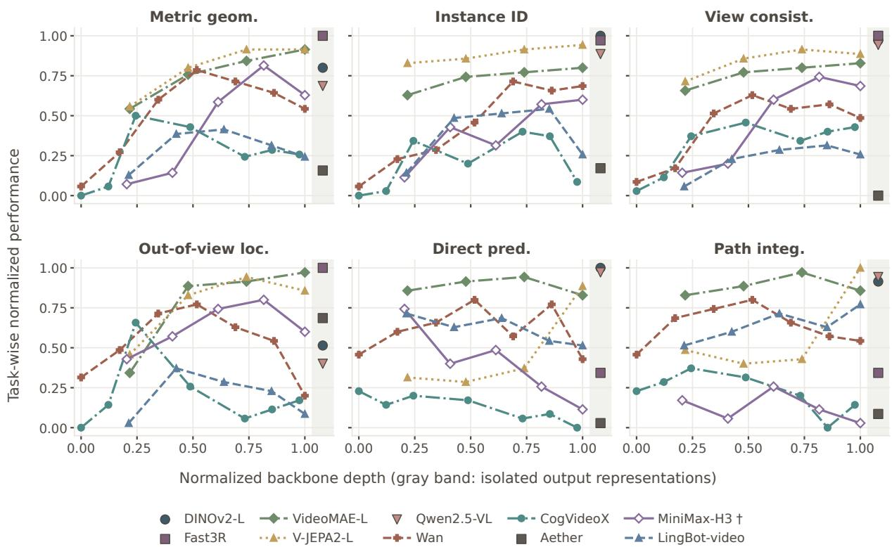  
Figure 6 Capability profiles across measured layers. Prefix means are direction-corrected and converted to percentile ranks across the available model–layer cells within each task; metric geometry averages the depth and camera-pose ranks. The horizontal axis shows normalized backbone depth, and isolated output representations occupy a separate band on the right. Hollow markers denote the MiniMax-H3 points, which are evaluated on the 171-window subset (with h = 1 only for direct prediction).

Table 6 Spatial readout on the 171 shared validation windows per prefix. Designated layers and prefix aggregation match Table 2. †: MiniMax-H3 direct prediction uses only h = 1; the other direct predictors use h ∈ {1, 2, 4}.
<table><tr><td>Model (layer)</td><td>Depth loss ↓</td><td>Camera AUC@30↑</td><td>Instance loss ↓</td><td>View bal. acc. ↑</td><td>Persistence error (°) ↓</td><td>Direct R@1↑</td><td>Path R@1↑</td></tr><tr><td>DINOv2-L (0)</td><td>0.1437</td><td>0.0421</td><td>1.4325</td><td>0.9586</td><td>66.03</td><td>0.2875</td><td>0.1243</td></tr><tr><td>FAST3R (24)</td><td>0.1371</td><td>0.3806</td><td>1.6732</td><td>0.9817</td><td>32.21</td><td>0.0200</td><td>0.0234</td></tr><tr><td>VIDEOMAE-L (23)</td><td>0.3034</td><td>0.2012</td><td>4.2136</td><td>0.9177</td><td>34.98</td><td>0.0682</td><td>0.0838</td></tr><tr><td>V-JEPA2-L (23)</td><td>0.2802</td><td>0.1845</td><td>3.1068</td><td>0.9225</td><td>44.38</td><td>0.0775</td><td>0.1930</td></tr><tr><td>QWEN2.5-VL (−1)</td><td>0.2270</td><td>0.0281</td><td>3.0099</td><td>0.9384</td><td>70.28</td><td>0.2149</td><td>0.1189</td></tr><tr><td>WAN (20)</td><td>0.3720</td><td>0.0653</td><td>5.1248</td><td>0.8126</td><td>60.94</td><td>0.0331</td><td>0.0521</td></tr><tr><td>COGVIDEOX (20)</td><td>0.4469</td><td>0.0287</td><td>6.7726</td><td>0.7913</td><td>69.11</td><td>0.0112</td><td>0.0244</td></tr><tr><td>AETHER (1)</td><td>0.5399</td><td>0.0167</td><td>7.3012</td><td>0.6916</td><td>60.31</td><td>0.0034</td><td>0.0073</td></tr><tr><td>MINIMAX-H3 (30)</td><td>0.4363</td><td>0.0465</td><td>6.3714</td><td>0.8257</td><td>57.27</td><td>0.0249†</td><td>0.0117</td></tr><tr><td>LINGBOT-VIDEO (30)</td><td>0.4432</td><td>0.0232</td><td>5.6061</td><td>0.7765</td><td>70.03</td><td>0.0468</td><td>0.0521</td></tr></table>

adjacent frames rather than motion-conditioned prediction; the copy baseline of Section 4.3 would separate the two for these models.

## A.3 Scene-bootstrap intervals

The intervals resample the 69 validation scenes with replacement (1,000 draws, seed 0). One draw matrix is shared by every cell, so prefix means, model differences, prefix effects, and coordinate differences are paired over the same resampled scenes. Each metric is recomputed from the saved per-sample predictions as a ratio of per-scene sums, and the recomputed point estimates equal the reported values for every cell shown. For retrieval, the gallery stays the full validation set and only the queries are resampled; the action gains in Table 9 are paired per query. The intervals describe evaluation sampling for the single training seed; they do not estimate training-seed variability.

VideoMAE: Instance identity loss ↓  
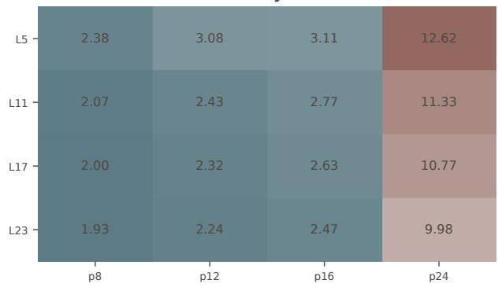  
VideoMAE: Out-of-view localization error (°) ↓

V-JEPA2: Instance identity loss ↓  
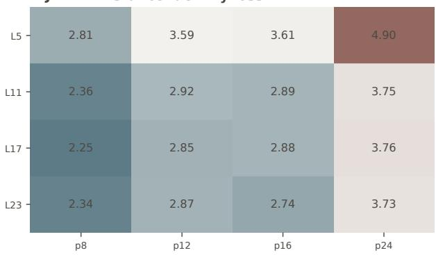  
V-JEPA2: Out-of-view localization error (°) ↓

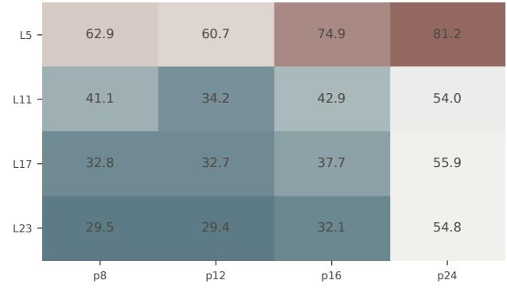

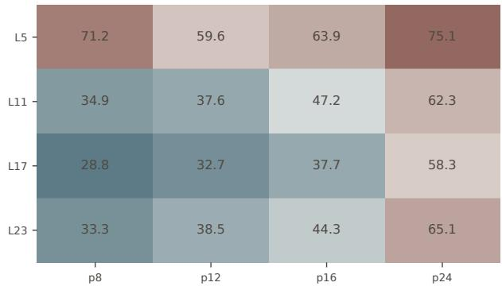  
Figure 7 Layer–prefix structure of instance identity and object persistence. The four panels show instance identity (top) and object persistence (bottom) for VideoMAE (left) and V-JEPA2 (right) across extraction layers and prefix lengths. Colors are normalized within each panel and therefore describe within-model structure rather than absolute cross-model accuracy; raw values accompany the heatmaps. No probe was trained on block 0 of either model, so it is not shown.

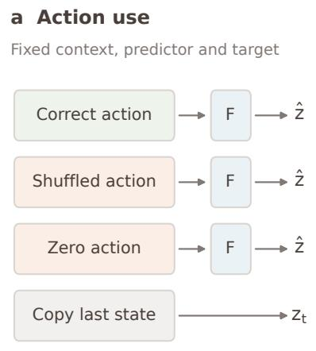  
All outputs scored against the same future

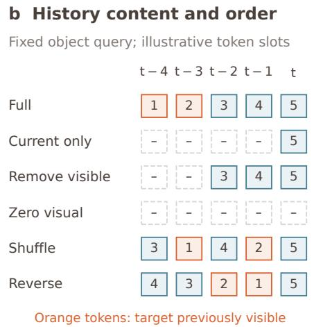

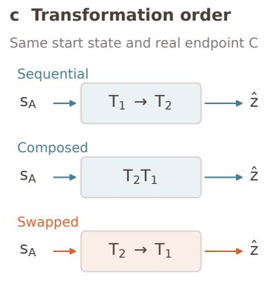  
Compare composition and endpoint errors  
Figure 8 Interventions separate information use from decodability. (a) Change the action supplied to a fixed predictor F, or copy the last state. (b) Remove or reorder visual feature tokens while retaining the object query; five illustrative slots are shown, with temporal identifiers and the final frame fixed during order tests. (c) Compare sequential, composed, and swapped updates against the same real endpoint.

Table 7 Direct prediction with a common next-observation target. Mean global R@1 over four prefixes at the designated layer, using the same 171 windows and 171 h = 1 candidates per prefix for every model. †: next-observation-only training; the other models retain their mixed-horizon training.
<table><tr><td rowspan=1 colspan=1>Model (layer)           h = 1 R@1 ↑</td></tr><tr><td rowspan=1 colspan=1>DINOv2-L (0)                0.6126FAST3R (24)                  0.0585</td></tr><tr><td rowspan=1 colspan=1>VIDEOMAE-L (23)           0.1930</td></tr><tr><td rowspan=1 colspan=1>V-JEPA2-L (23)              0.2281</td></tr><tr><td rowspan=1 colspan=1>QWEN2.5-VL (-1)           0.5322</td></tr><tr><td rowspan=1 colspan=1>WAN (20)                     0.1096</td></tr><tr><td rowspan=1 colspan=1>COGVIDEOX (20)             0.0365</td></tr><tr><td rowspan=1 colspan=1>AETHER (1)                   0.0132MINIMAX-H3 (30)           0.0249†</td></tr><tr><td rowspan=1 colspan=1>LINGBOT-VIDEO (30)         0.1418</td></tr></table>

Table 8 Main results with 95% scene-bootstrap intervals. Same cells as Table 2: designated layer, mean over the evaluated prefixes (Eq. (3)). Intervals resample the 69 validation scenes (1,000 draws, shared by all cells, so differences are paired). Bold: the best complete result in each column and every result whose paired difference from it has an interval containing zero. †: MiniMax-H3 prediction uses 171 of the 276 validation windows and, for direct prediction, the next-observation target; not ranked.
<table><tr><td rowspan="2"></td><td colspan="2">Metric geometry</td><td>Instance identity</td><td>View consistency</td><td>Object persistence</td><td>Direct prediction</td><td>Path integration</td></tr><tr><td>Depth loss ↓</td><td>AUC@30 ↑</td><td>Instance loss ↓</td><td>Bal. acc. ↑</td><td>Ang. err. (°)↓</td><td>Global R@1↑</td><td>Global R@1↑</td></tr><tr><td>DINOv2-L (0)</td><td>0.1422</td><td>0.0412 [0.1330, 0.1516] [0.0370, 0.0454]</td><td>1.3828 [1.2442, 1.5335] [0.9490, 0.9620]</td><td>0.9557</td><td>65.38</td><td>0.2373</td><td>0.0900</td></tr><tr><td>FAST3R (24)</td><td>0.1386</td><td>0.3870</td><td>1.6072</td><td>0.9808</td><td>[61.56, 69.42] 32.79</td><td>[0.2162, 0.2588] 0.0133</td><td>[0.0764, 0.1039] 0.0190</td></tr><tr><td>VIDEOMAE-L (23)</td><td>0.2968</td><td>0.2026</td><td>4.1571</td><td>0.9118</td><td>36.45</td><td>0.0531</td><td>[0.1254, 0.1527] [0.3558,0.4170] [1.4446, 1.7828] [0.9760, 0.9847] [29.83, 35.98] [0.0103, 0.0169] [0.0148, 0.0242] 0.0685</td></tr><tr><td>V-JEPA2-L (23)</td><td>[0.2780, 0.3172] [0.1858, 0.2192] 0.2708</td><td>0.1854</td><td>2.9211</td><td>[3.7571,4.5411] [0.9032, 0.9192] 0.9256</td><td>45.31</td><td>0.0625</td><td>[33.41,39.67] [0.0435, 0.0649][0.0577, 0.0803] 0.1588</td></tr><tr><td>QWEN2.5-VL (−1)</td><td>[0.2529, 0.2888] [0.1696, 0.2026] 0.2244</td><td>0.0269</td><td>2.9476</td><td>[2.6350, 3.2244] [0.9183, 0.9323] 0.9385</td><td>[41.38, 49.32] 68.59</td><td>0.1712</td><td>[0.0537, 0.0716] [0.1449, 0.1739] 0.0903</td></tr><tr><td>WAN (20)</td><td>[0.2104, 0.2387] [0.0244, 0.0295] 0.3609</td><td>0.0650</td><td>4.9301</td><td>0.8215</td><td>62.38</td><td>0.0260</td><td>[2.6158,3.3016] [0.9310,0.9460] [64.48,72.11] [0.1564,0.1875] [0.0776,0.1033] 0.0405</td></tr><tr><td>COGVIDEOX (20)</td><td>[0.3371, 0.3846] [0.0571, 0.0736] 0.4340</td><td>0.0276</td><td>6.6992</td><td>0.8001</td><td>70.62</td><td>0.0088</td><td>[4.3993,5.4499] [0.8058, 0.8350] [59.15, 65.71] [0.0187, 0.0353] [0.0338, 0.0471] 0.0160</td></tr><tr><td>AETHER (1)</td><td>[0.4071, 0.4616] [0.0248, 0.0307] 0.5270</td><td>0.0185</td><td>7.1847</td><td>[6.0549, 7.3510] [0.7856, 0.8129] 0.6928</td><td>61.18</td><td>[66.75,74.61] [0.0057, 0.0124] [0.0112,0.0217] 0.0024</td><td>0.0042</td></tr><tr><td>MINIMAX-H3 (30)</td><td>[0.4938, 0.5601] [0.0163,0.0210] 0.4252</td><td>0.0477</td><td>6.2265</td><td>0.8255</td><td>55.97</td><td>0.0249†</td><td>[6.5741, 7.7540] [0.6808, 0.7049] [57.43, 64.58] [0.0009, 0.0039] [0.0021, 0.0066] 0.0117†</td></tr><tr><td>LINGBOT-VIDEO (30)</td><td>0.4314 [0.4042, 0.4590] [0.0206, 0.0262] [4.9998, 6.2688] [0.7696, 0.7994] [66.38, 74.08] [0.0239, 0.0380] [0.0356, 0.0510]</td><td>0.0232</td><td>5.5875</td><td>0.7858</td><td>70.30</td><td>0.0302</td><td>[0.3985, 0.4535] [0.0408,0.0560] [5.5922,6.8295] [0.8116, 0.8384] [52.19,59.64] [0.0135,0.0374] [0.0059, 0.0185] 0.0429</td></tr></table>

## A.4 Generation coordinate analysis

This separate ScanNet++ extraction study evaluates layers {15, 20, 25} and prefixes {8, 12, 16, 24} at scheduler indices {499, 999} for Wan and CogVideoX and {500, 1000} for MiniMax-H3. The main comparison uses scheduler step 749 for Wan and CogVideoX, which the two indices bracket, and flow coordinate 0.25 for MiniMax-H3. Coordinates are model-specific and are not interpreted as a common physical noise level.

Table 12 reports final-checkpoint evaluations at block 20, averaged over all four prefixes, and Figure 9 shows every layer–prefix pair. Across the twelve layer–prefix pairs per model and metric, Wan favors the lower index on depth, view consistency, and object persistence in every pair. CogVideoX favors the lower index on depth in nine of twelve pairs, on view consistency in ten of twelve, and on persistence in all twelve. MiniMax-H3 favors the higher index on depth in ten of twelve pairs and on instance identity in nine of twelve, but the lower index on view consistency in ten of twelve and on persistence in nine of twelve. The coordinate effect therefore depends on the model and the task, with object persistence the one readout that favors the earlier coordinate for all three models. At block 20, the CogVideoX view-consistency difference and the MiniMax-H3 instance-identity and view-consistency differences lie within their paired 95% intervals (Table 11). The figure and table cover geometry, instance identity, view consistency, and object persistence; the direct-prediction and path-integration results in Table 2 remain measurements at the default extraction coordinates.

Table 9 Direct prediction against matched action controls. Global R@1 at the designated layer, mean over prefixes, with 95% scene-bootstrap intervals. The same frozen probe is evaluated with the true action, without the action input, and with a shuffled action; gains are paired per query. Gray: the interval of the gain contains zero. Chance is 1/828 (1/171 for MiniMax-H3†, next-observation target only).
<table><tr><td rowspan="2">Model (layer)</td><td colspan="3">Global R@1 ↑</td><td colspan="2">Action gain ↑</td></tr><tr><td>Full</td><td>No action</td><td>Shuffled action</td><td>Gain vs. no action</td><td>Gain vs. shuffled</td></tr><tr><td>DINOV2-L (0)</td><td>0.2373</td><td>0.0223</td><td>0.0691</td><td>0.2150</td><td>0.1682</td></tr><tr><td>FAST3R (24)</td><td>[0.2162, 0.2588] [0.0175, 0.0275] 0.0133</td><td>0.0018</td><td>[0.0595, 0.0794] 0.0088</td><td>[0.1929, 0.2373] 0.0115</td><td>[0.1476, 0.1911] 0.0045</td></tr><tr><td>VIDEOMAE-L (23)</td><td>[0.0103, 0.0169] [0.0003, 0.0033] 0.0531</td><td>0.0021</td><td>[0.0060, 0.0121] 0.0133</td><td>[0.0082, 0.0151] 0.0510</td><td>[0.0015, 0.0075] 0.0399</td></tr><tr><td>V-JEPA2-L (23)</td><td>0.0625</td><td>[0.0435, 0.0649] [0.0003, 0.0039] 0.0036</td><td>[0.0094, 0.0175] 0.0223</td><td>[0.0411,0.0631] 0.0589</td><td>[0.0299, 0.0513] 0.0402</td></tr><tr><td>QWEN2.5-VL (−1)</td><td>0.1712</td><td>[0.0537, 0.0716] [0.0015, 0.0057] 0.0471</td><td>[0.0166, 0.0287] 0.0945</td><td>[0.0498, 0.0679] 0.1241</td><td>[0.0323, 0.0483] 0.0767</td></tr><tr><td>WAN (20)</td><td>0.0260</td><td>[0.1564, 0.1875] [0.0396, 0.0556] 0.0082</td><td>[0.0839, 0.1054] 0.0187</td><td>[0.1093, 0.1395] 0.0178</td><td>[0.0643, 0.0912] 0.0072</td></tr><tr><td>COGVIDEOX (20)</td><td>0.0088</td><td>[0.0187, 0.0353] [0.0054, 0.0112] 0.0024</td><td>[0.0139, 0.0248] 0.0057</td><td>[0.0106, 0.0269] 0.0063</td><td>[0.0009, 0.0151] 0.0030</td></tr><tr><td>AETHER (1)</td><td>0.0024</td><td>[0.0057, 0.0124] [0.0009, 0.0045] 0.0009</td><td>[0.0036, 0.0085] 0.0009</td><td>[0.0033, 0.0103] 0.0015</td><td>[0.0003, 0.0060] 0.0015</td></tr><tr><td>MINIMAX-H3 (30)</td><td>0.0249†</td><td>[0.0009, 0.0039] [0.0000, 0.0021] 0.0146</td><td>[0.0000, 0.0018] 0.0190</td><td>[0.0000, 0.0030] 0.0102</td><td>[-0.0000, 0.0033] 0.0058</td></tr><tr><td>LINGBOT-VIDEO (30)</td><td>0.0302 [0.0239, 0.0380] [0.0066, 0.0151] [0.0136, 0.0257]</td><td>[0.0135, 0.0374] [0.0057, 0.0249] 0.0103</td><td>[0.0099, 0.0294] 0.0190</td><td>[0.0029, 0.0195] 0.0199 [0.0133, 0.0275]</td><td>[-0.0044, 0.0163] 0.0112</td></tr></table>

Table 10 Longer versus shorter prefix with 95% scene-bootstrap intervals. Designated layer, prefix 24 minus prefix 8, oriented so that a positive value means the longer prefix is better (losses and errors are negated). Intervals are paired over the same resampled scenes. Gray: the interval contains zero.
<table><tr><td>Model (layer)</td><td>Depth loss</td><td>AUC@30</td><td>Instance loss</td><td>Bal. acc.</td><td>Ang. err. (°)</td><td>Direct R@1</td><td>Path R@1</td></tr><tr><td>DINOV2-L (0)</td><td>0.0134 [0.0084, 0.0188]</td><td>-0.0374 [-0.0455, -0.0290][-0.3108, -0.1162]</td><td>-0.2078</td><td>0.0009 [-0.0093, 0.0125]</td><td>-15.54 [-25.48, -6.25]</td><td>-0.0205 [-0.0568, 0.0133]</td><td>-0.0543 [-0.0845, -0.0229]</td></tr><tr><td>FAST3R (24)</td><td>0.0203 [0.0131, 0.0281]</td><td>0.0657 [0.0279, 0.1030]</td><td>-0.4441 [-0.5860, -0.3110]</td><td>-0.0021 [-0.0083, 0.0030]</td><td>-12.39 [-18.40, -6.44]</td><td>-0.0036 [-0.0145, 0.0072]</td><td>-0.0085 [-0.0217, 0.0049]</td></tr><tr><td>VIDEOMAE-L (23)</td><td>-0.1275 [-0.1441, -0.1100]</td><td>-0.1513</td><td>-8.0407</td><td>-0.1358 [-0.1712, -0.1321][-9.0544,-6.8937][-0.1532, -0.1188]</td><td>-25.25</td><td>-0.0664 [-32.90, -17.39][-0.0894, -0.0447]</td><td>-0.0954 [-0.1232, -0.0700]</td></tr><tr><td>V-JEPA2-L (23)</td><td>-0.0096 [-0.0214, 0.0013]</td><td>-0.0544 [-0.0746, -0.0326] [-1.8088, -0.9595]</td><td>-1.3906</td><td>-0.0104 [-0.0242, 0.0028]</td><td>-31.76 [-40.04, -23.32]</td><td>-0.0048 [-0.0266, 0.0169]</td><td>-0.0036 [-0.0362, 0.0254]</td></tr><tr><td>QWEN2.5-VL (−1)</td><td>0.0196 [0.0131, 0.0263]</td><td>-0.0243 [-0.0296, -0.0191][-1.5449, -0.7944]</td><td>-1.1563</td><td>0.0000 [-0.0127, 0.0125]</td><td>-12.33 [-22.91, -3.11]</td><td>-0.0085 [-0.0386, 0.0229]</td><td>-0.0495 [-0.0797, -0.0241]</td></tr><tr><td>WAN (20)</td><td>-0.0490</td><td>-0.0442 [-0.0636, -0.0345] [-0.0598, -0.0294][-5.0772,-3.2237]</td><td>-4.1312</td><td>-0.0241 [-0.0481, 0.0010]</td><td>-18.42 [-28.93, -8.37]</td><td>-0.0048 [-0.0205, 0.0085]</td><td>-0.0072 [-0.0266, 0.0121]</td></tr><tr><td>COGVIDEOX (20)</td><td>-0.0542 [-0.0692, -0.0392] [-0.0390,-0.0223][-9.2975, -6.4181] [-0.0786, -0.0405]</td><td>-0.0300</td><td>-7.8118</td><td>-0.0594</td><td>-16.50 [-27.61, -5.93]</td><td>0.0000 [-0.0085, 0.0097]</td><td>0.0024 [-0.0097, 0.0145]</td></tr><tr><td>AETHER (1)</td><td>-0.0302</td><td>-0.0171</td><td>-7.4711 [-0.0530, -0.0074][-0.0214, -0.0129] [-8.5960,-6.3471]</td><td>0.0246 [0.0047, 0.0450]</td><td>-13.51 [-22.18, -5.24]</td><td>0.0000 [-0.0048, 0.0048]</td><td>0.0000 [-0.0072, 0.0072]</td></tr></table>

Table 11 Generation coordinate differences with 95% scene-bootstrap intervals. Block 20, mean over prefixes {8, 12, 16, 24}; each cell is the lower-coordinate score minus the higher-coordinate score (499 − 999 for Wan and CogVideoX, 500 − 1000 for MiniMax-H3), paired over the same resampled scenes. Gray: the interval contains zero.
<table><tr><td>Model</td><td>Depth loss ↓</td><td>Instance loss ↓</td><td>View acc. ↑</td><td>Localiz. err. (°) ↓</td></tr><tr><td rowspan="2">WAN (20)</td><td>-0.043</td><td>1.157</td><td>0.049</td><td>-18.8</td></tr><tr><td>[-0.050, -0.036]</td><td>[0.647, 1.660]</td><td>[0.040, 0.058]</td><td>[-22.8, -15.1]</td></tr><tr><td rowspan="2">COGVIDEOX (20)</td><td>-0.018</td><td>-0.537</td><td>0.002</td><td>-6.0</td></tr><tr><td>[-0.024, -0.012]</td><td>[-1.015, -0.092]</td><td>[-0.004, 0.009]</td><td>[-10.5, -1.7]</td></tr><tr><td rowspan="2">MINIMAX-H3 (20)</td><td>0.006</td><td>0.229</td><td>0.003</td><td>-4.1</td></tr><tr><td>[0.002, 0.010]</td><td>[-0.160,0.613]</td><td>[-0.002, 0.008]</td><td>[-8.2, -0.3]</td></tr></table>

Table 12 Spatial readout at two generation coordinates. Depth, instance-identity loss, view consistency, and object persistence at the two scheduler coordinates (block 20, mean over prefixes {8, 12, 16, 24}). Lower/higher coordinates are 499/999 for Wan and CogVideoX and 500/1000 for MiniMax-H3. Bold marks the better coordinate where the paired 95% interval of the difference excludes zero (Table 11). At block 20, instance identity favors the higher coordinate for Wan and the lower coordinate for CogVideoX, while the MiniMax-H3 difference lies within its interval; object persistence favors the lower coordinate for all three models. These separate-coordinate measurements complement the main table, whose generative-model entries use the default coordinates.
<table><tr><td rowspan="2">Model</td><td colspan="2">Depth loss ↓</td><td colspan="2">Instance loss</td><td colspan="2">View acc. ↑</td><td colspan="2">Localiz. err. (°) ↓</td></tr><tr><td>lower</td><td>higher</td><td>lower</td><td>higher</td><td>lower</td><td>higher</td><td>lower</td><td>higher</td></tr><tr><td>WAN (20)</td><td>0.387</td><td>0.430</td><td>6.810</td><td>5.653</td><td>0.823</td><td>0.774</td><td>59.2</td><td>78.0</td></tr><tr><td>COGVIDEOX (20)</td><td>0.449</td><td>0.467</td><td>6.541</td><td>7.078</td><td>0.790</td><td>0.787</td><td>69.4</td><td>75.3</td></tr><tr><td>MINIMAX-H3 (20)</td><td>0.459</td><td>0.454</td><td>6.249</td><td>6.020</td><td>0.792</td><td>0.789</td><td>63.3</td><td>67.4</td></tr></table>

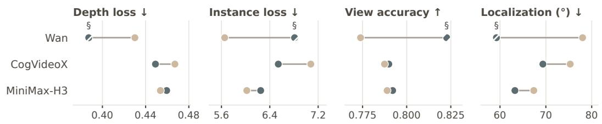

Better coordinate for each layer–prefix pair (E = early, L = late)  
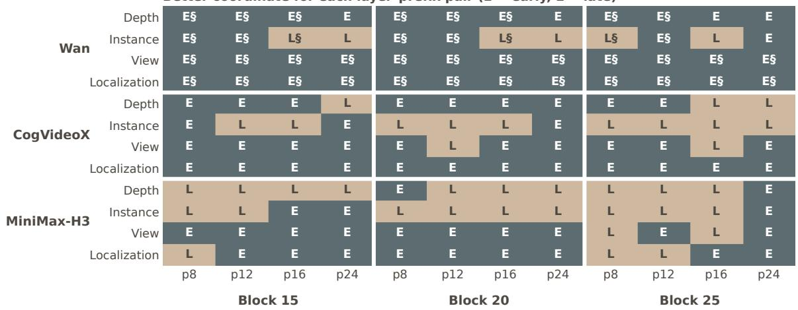  
Figure 9 Spatial readout across generation coordinates. Top: each model at the early (dark) and the late (light) scheduler index at block 20, averaged over prefixes; arrows give the better direction, and the values are listed in Table 12. Bottom: the better coordinate for every layer–prefix pair, E (early) or L (late), grouped by block.

Table 13 One-step-to-two-step structural generalization. Predeclared representative layers; differences are Wan block 15 minus V-JEPA2 block 11 with paired 95% intervals. The four comparisons form one Holm family. Composition distance and order margin are normalized.
<table><tr><td>Metric</td><td>Wan (15)</td><td>V-JEPA2 (11)</td><td></td><td>Difference [95% CI]</td><td>Holm p</td></tr><tr><td>Gain vs. copy ↑</td><td>0.2051</td><td>0.2323</td><td></td><td>-0.0273 [−0.0814, 0.0209]</td><td>0.568</td></tr><tr><td>Gain vs. no-action ↑</td><td>0.0639</td><td>0.0452</td><td></td><td>0.0187 [-0.0050, 0.0414]</td><td>0.384</td></tr><tr><td>Composition distance ↓</td><td>0.0377</td><td>0.0232</td><td></td><td>0.0145 [0.0107, 0.0188]</td><td>&lt; 0.004</td></tr><tr><td>Order margin ↑</td><td>-0.0001</td><td>-0.0007</td><td></td><td>0.0006 [−0.0005, 0.0019]</td><td>0.568</td></tr></table>

## A.5 Motion composition consistency

We train an external recurrent updater U and readout D only on one-step camera transitions. Sequential, composed, and swapped updates start from the same p12 state $s _ { A } \mathrm { { : } }$

$$
\begin{array} { r l } & { \quad \hat { z } _ { \mathrm { s e q } } = D ( U ( U ( s _ { A } , T _ { 1 } ) , T _ { 2 } ) ) , \quad \hat { z } _ { \mathrm { d i r } } = D ( U ( s _ { A } , T _ { 2 } T _ { 1 } ) ) , } \\ & { \quad \hat { z } _ { \mathrm { s w a p } } = D ( U ( U ( s _ { A } , T _ { 2 } ) , T _ { 1 } ) ) , \quad T _ { 1 } = T _ { A B } , \quad T _ { 2 } = T _ { B C } . } \end{array}\tag{5}
$$

The fixed $\mathsf { p } 1 2$ protocol contains 128 training tuples, 32 validation tuples, and 276 evaluation tuples from 69 scenes. The external recurrent head is trained only on observed A→B transitions, with isolated endpoint features as targets, using seeds $4 2 \mathrm { - } 4 6 ;$ it is not either backbone’s native predictor. Cosine endpoint errors are evaluated within each feature space. Relative gains are $( e _ { \mathrm { b a s e l i n e } } - e _ { \mathrm { s e q } } ) / e _ { \mathrm { b a s e l i n e } } ;$ the composition distance is the sequential–direct cosine distance normalized by the copy-to-endpoint error, using scene-macro means. The normalized order margin compares swapped-order with correct-order endpoint errors; a positive value favors the observed order.

All seven evaluated Wan layers and five V-JEPA2 layers improve endpoint prediction over copying the initial state, and all but Wan block 0 also improve over the no-action predictor. At the predeclared layers, V-JEPA2 block 11 has a smaller normalized sequential–direct distance than Wan block 15 (0.0232 versus 0.0377).

Table 13 reports the predeclared representative-layer comparison, not a best-layer search or an overall model ranking. Action-only, matched-shuffle, and additive controls do not reveal a stable order effect, even in strata of high noncommutativity. Identity padding is only a stress test because the identity lies outside the training action support. The analytic SE(3) oracle has a positive order margin of 0.1107 m, whereas a geometric GRU trained on the same one-step objective has a sequential RMSE of 0.7010 m and no reliable order margin. This limits the attribution of weak latent order effects to the representation itself.

## A.6 Action sensitivity of direct future prediction

We also evaluate each frozen direct predictor on an action set that shares the same visual prefix. The set contains the relative motions to three observed endpoints along one trajectory, at offsets 1, 2, and 4. For each supplied motion, we compare the predicted feature with the three endpoint features. Within-set matching accuracy is the fraction of cases in which the highest-similarity endpoint is the one paired with the supplied motion; chance is $1 / 3 .$ . The margin is the correct endpoint’s cosine similarity minus the highest similarity among the other two endpoints.

Table 14 reports designated-layer means over four prefixes for the nine models trained on all three offsets. Each prefix uses 276 action sets with three candidates per set. The results describe sensitivity to the supplied motion among observed endpoints; they do not test executed alternative branches or identify a causal counterfactual effect. The diagnostic also differs from goal-conditioned action selection: the model predicts a feature given an action, rather than selecting an action given a goal.

Matching accuracy exceeds chance for every model, but the cosine margins are small: only DINOv2 (0.029) and V-JEPA2 (0.006) separate the correct endpoint from the best alternative by a margin clearly above zero, and the remaining seven margins lie within ±0.005 of zero. The supplied motion therefore shifts the predicted feature only slightly relative to the distance between neighboring endpoints. Across the nine models, matching accuracy ranks the representations much as global retrieval does $( \rho = 0 . 8 8$ against the direct-prediction column of Table 2), so stronger global retrieval coincides with stronger, though still weak, motion sensitivity.

Table 14 Motion-dependent endpoint matching. Mean over four prefixes at the designated layer. All listed heads were trained on offsets 1, 2, and 4. Matching is within three-candidate sets (chance 33.33%); cosine margins need not be positive even when the mean matching accuracy is above chance.
<table><tr><td>Model (layer) Matching accuracy (%) ↑</td><td>Cosine margin ↑</td></tr><tr><td>DINOv2-L (0) 61.96</td><td>0.0292</td></tr><tr><td>FAST3R (24) 44.57</td><td>-0.0005</td></tr><tr><td>VIDEOMAE-L (23) 54.26</td><td>0.0004</td></tr><tr><td>V-JEPA2-L (23) 54.59</td><td>0.0060</td></tr><tr><td>QWEN2.5-VL (−1) 47.80</td><td>-0.0026</td></tr><tr><td>WAN (20) 42.09</td><td>-0.0010</td></tr><tr><td>COGVIDEOX (20) 40.31</td><td>-0.0003</td></tr><tr><td>AETHER (1) 35.48</td><td>-0.0001</td></tr><tr><td>LINGBOT-VIDEO (30) 41.76</td><td>-0.0049</td></tr></table>

MiniMax-H3 uses an h = 1-trained head, so its response to $h = 2$ and $h = 4$ motions is an additional extrapolation diagnostic. At block 30, its mean within-set accuracy is 40.74% over four prefixes, each with 171 action sets; we report it separately from the mixed-horizon models.

## A.7 Additional protocol details

One-step prediction and history interventions. The correct/copy and matched-wrong-motion tests use 276 samples from 69 scenes per prefix; the restricted retrieval pool contains eight pose-displacement-matched candidates drawn with candidate seed 42. The p12 object-persistence controls use 165 samples from 65 scenes. Both studies use probe training seed 42. Reported intervals are paired 95% scene-clustered bootstrap intervals. The two tested prediction prefixes are not strictly target-paired, so agreement across them does not isolate a history-length effect.

For localization, the appearance query is pooled using a historical object mask; neither that mask nor the camera pose is supplied to the spatial readout. Content-only shuffling and reversal retain the final frame and the temporal identifiers. Moving tokens together with their identifiers is a permutation sanity check, not a distinct temporal-order intervention.

## A.8 Supporting controls for predictive spatial readout

The fixed ScanNet++ protocol uses 612 training scenes, 69 held-out validation scenes, horizons $h \in \{ 2 , 4 \}$ , and three training seeds. The main question is whether a spatial reader trained on real future states transfers unchanged to natively predicted features. Two supporting controls check the specificity and the conditional utility of the spatial readout.

Target-specific real-feature readout. On real target features, Wan’s spatial reader reaches scene-macro normalizeddepth MAEs of 0.155 and 0.152 at $h = 2$ and $h = 4$ , compared with 0.241 and 0.238 for a training-layout prior. Real target features also outperform within-scene wrong targets and copied context, demonstrating sample-specific information beyond the layout prior.

Motion-conditioned external prediction. For Wan’s external predictor, the pooled branch gives a lower downstream depth MAE under the true motion than under identity motion, matched-horizon shuffled motion, or an independently trained context-only predictor. The 0.003–0.007 reductions have paired scene-clustered intervals excluding zero for all three controls at both horizons. This is evidence of conditional prediction utility, not of a physical action intervention.

The same external-predictor analysis on V-JEPA2 gives a normalized-depth MAE of 0.230/0.228 at $h = 2 / 4$ , averaged over three training seeds on the 69 validation scenes. Relative to the independently trained context-only predictor, the true motion reduces the MAE by 0.0081 [0.0048, 0.0116] and 0.0064 [0.0027, 0.0105], respectively (paired 95% scene-bootstrap intervals, 10,000 resamples). The identity-motion and shuffled-motion controls are also worse at both horizons, with all three seeds agreeing in direction. These results concern an external predictor and remain separate from the native-prediction experiment.

Table 15 Spatial readout through V-JEPA2’s native predictor. Scene-macro normalized-depth MAE ↓ on 69 validation scenes, spatial branch; mean±SD over three training seeds. The same reader, trained on real native target states, is used for real, predicted, and copied inputs, except in the explicitly retrained condition. The layout prior uses training labels only.
<table><tr><td>Input / readout condition</td><td> $h = 2$ </td><td> $h = 4$ </td></tr><tr><td>Real future / original reader</td><td> $0 . 1 8 2 4 { \pm } 0 . 0 0 0 3$ </td><td> $0 . 1 8 2 7 { \pm } 0 . 0 0 0 3$ </td></tr><tr><td>Native prediction / frozen reader</td><td> $0 . 2 4 5 9 { \pm } 0 . 0 0 5 8$ </td><td> $0 . 2 4 2 7 { \pm } 0 . 0 0 5 4$ </td></tr><tr><td>Native prediction / retrained reader</td><td> $0 . 2 2 3 3 { \pm } 0 . 0 0 0 8$ </td><td> $0 . 2 2 7 1 { \scriptstyle \pm 0 . 0 0 0 5 }$ </td></tr><tr><td>Copied context / frozen reader</td><td> $0 . 2 8 9 0 { \scriptstyle \pm 0 . 0 0 4 4 }$ </td><td> $0 . 2 9 7 4 { \scriptstyle \pm 0 . 0 0 4 1 }$ </td></tr><tr><td>Training layout prior</td><td>0.2406</td><td>0.2377</td></tr></table>

Table 16 Goal-conditioned action prediction: continuous-output setting. FULL uses the relational head; values are mean±SD over seeds 41–45. Progress is the percentage of trajectories with positive progress, and goal reduction uses the pose-distance metric defined in the text. The final column is the FULL minus CURRENT-ONLY goal reduction with a paired 95% scene-bootstrap interval (5,000 replicates); positive favors FULL. Seed repeats are averaged within each sample before scene resampling.
<table><tr><td>Model</td><td>Direction (°) ↓</td><td>Progress (%) ↑</td><td>Goal reduction ↑</td><td>FULL – CURRENT-ONLY goal reduction</td><td></td></tr><tr><td>DINOv2-L</td><td> $6 5 . 3 { \pm } 1 . 3 $ </td><td>53.8±1.1</td><td>0.008±0.006</td><td>-0.008</td><td>[−0.013, −0.004]</td></tr><tr><td>Fast3R</td><td> $6 4 . 7 { \pm } 1 . 3 $ </td><td>59.8±3.4</td><td>0.025±0.007</td><td>-0.005</td><td>[−0.012, +0.002]</td></tr><tr><td>V-JEPA2</td><td> $6 6 . 2 { \pm } 1 . 8 $ </td><td>53.8±2.4</td><td>0.007±0.007</td><td>-0.009</td><td>[-0.015, −0.002]</td></tr><tr><td>Wan</td><td> $7 0 . 0 { \pm } 1 . 5 $ </td><td>50.2±3.5</td><td> $0 . 0 0 1 { \scriptstyle \pm 0 . 0 0 9 }$ </td><td>-0.011</td><td>[−0.017,-0.004]</td></tr></table>

## A.9 Action readout protocol and controls

Goal-conditioned action prediction: candidate-selection setting. The candidate experiment uses 844 training queries (650 fit and 194 development) from 289 scenes and 227 validation queries from 77 disjoint scenes. A shallow scorer receives the frozen current and goal features plus each candidate 9D action. Ground-truth poses, utilities, realized endpoints, and scene identities are not given to the scorer. Accuracy is summarized across three training seeds. The endpoint reference observes realized outcomes and is diagnostic rather than a candidate-selection method with the same information.

Goal-conditioned action prediction: continuous-output setting. The continuous experiment uses 1,024 training trajectories from 444 scenes (803 fit and 221 development before refitting) and 256 validation trajectories from 108 disjoint scenes. Epoch selection and normalization use the development and fit data, respectively. Features are DINOv2’s final projection output, Fast3R block 24, V-JEPA2 block 23, and Wan block 29 at scheduler step 749; the latter differs from Wan’s main-table block 20. Separate current and goal projections are combined as $[ c , g , g - c , c \odot g ] \mathrm { , }$ ; the concatenation control uses the same optimization budget.

FULL has positive-progress differences of −3.6 to −2.0 percentage points relative to CURRENT-ONLY (Figure 5b); only V-JEPA2’s interval excludes zero. Mean goal reduction is also lower for all four representations, with intervals excluding zero for DINOv2, V-JEPA2, and Wan. The relational head improves progress over concatenation for DINOv2 and Fast3R, but only Fast3R shows a clear goal-reduction gain.

The same-checkpoint intervention substitutes a difficulty-matched goal from another scene while holding the current state and the learned weights fixed. Correct-minus-shuffled effects are computed against the original goal. Five seeds (41–45) are averaged within each sample before paired scene-bootstrap resampling with 5,000 replicates. This measures goal sensitivity and utility under the stated input substitution; the candidate-selection and continuous-output settings remain separate offline evaluations of the same task.

## A.10 Predictive readout and action prediction metrics

Tables 15 and 16 provide the numerical readout and action metrics accompanying Figure 5.

Table 17 Feature extraction details. Layer indices denote the representations used for layer-wise probing. For generative models, features are extracted at the specified denoising or flow coordinate. The table lists the settings of the main sweep; the separate coordinate study additionally uses blocks 15 and 25.
<table><tr><td>Model</td><td>Probed layers</td><td>Primary layer</td><td>Extraction coordinate</td></tr><tr><td>DINOv2-Large</td><td>final hidden state</td><td>0</td><td></td></tr><tr><td>V-JEPA2 ViT-L</td><td>{5, 11, 17, 23}</td><td>23</td><td></td></tr><tr><td>VideoMAE-Large</td><td>{5, 11, 17, 23}</td><td>23</td><td></td></tr><tr><td>Fast3R ViT-L</td><td>{24}</td><td>24</td><td></td></tr><tr><td>Wan2.1-T2V-1.3B</td><td>{0, 5, 10, 15, 20, 25, 29}</td><td>20</td><td>scheduler step 749</td></tr><tr><td>CogVideoX-5B-I2V</td><td>{0, 5, 10, 20, 30, 35, 40}</td><td>20</td><td>scheduler step 749</td></tr><tr><td>AetherV1</td><td>{1}</td><td>1</td><td>scheduler step 749</td></tr><tr><td>MiniMax-H3</td><td>{10, 20, 30, 40, 50}</td><td>30</td><td>flow coordinate 0.25</td></tr><tr><td>LingBot-video MoE-30B-A3B</td><td>{10, 20, 30, 40, 48}</td><td>30</td><td>flow coordinate 0.25</td></tr><tr><td>Qwen2.5-VL-7B-Instruct</td><td>visual merger output</td><td>-1</td><td></td></tr></table>

## A.11 Feature extraction details

Table 17 lists the probed layers, the designated primary layer, and the extraction coordinate of every representation.