# RFW-A: Agentic Procedural Generation of 400K Articulated Assets over 500 Categories

Yuanbo Lyu1,∗, Changjian Pan2,3,∗, Saining Zhang2,4,∗,†, Yi Yang1,∗, Peishuo Li4, Zhiheng Li2, Jialu Liu2, Junhao Chen2, Jiawei Weng1, Yupeng Gao5, Weiqing Xiao5, Wenyi Li1,2, Jiarui Guo1,2, Rui Zhang1,2, Jingrun Du1,2, Weiyi Lin1, Zenan Meng1,‡, Hu Wei1,‡, Lin Qu1, Zongzheng Zhang2, Hao Zhao2, Chaojian Li6,‡

1Alibaba Group 2Tsinghua University 3Peking University 4Nanyang Technological University 5Nanjing University 6The Hong Kong University of Science and Technology

∗Equal contribution., †Project Leader., ‡Corresponding authors.

Email: {mengzenan.mzn, kongwang}@alibaba-inc.com, chaojian@ust.hk Project Page: https://brain-labbb.github.io/RFW\_A\_web/

## Abstract

High-quality articulated assets are essential for embodied perception, simulation, and manipulation, yet constructing them at scale remains dificult. Manual annotation and procedural modeling require substantial human efort. Recent agentic systems automate asset construction through program synthesis, but repeat costly reasoning and refinement for every new asset. Our key observation is that assets within a category can share construction logic despite variations in structure and appearance. Agentic synthesis and procedural generation are therefore complementary: agents can construct reusable programs, while procedural execution reuses the resulting logic across many samples. We therefore present RFW-A, which combines the two in a new articulated-asset generation paradigm. Starting from existing articulated programs, RFW-A organizes reusable components and their dependencies into category-level generators. Agents test and refine these generators across sampled configurations and motion states. Once constructed and validated, the generators produce diverse assets through procedural execution with no further model calls or token charges. The estimated API cost of generator authoring averages \$10.62, amortizing to \$0.05 per asset over 200 assets, versus \$1.24 for the sampled per-asset agentic synthesis baseline. Using RFW-A, we built RFW-A-400K, containing over 400K sim-ready articulated assets across more than 500 categories. Experiments show high structural and kinematic validity and stable execution across physics simulators. Beyond asset validity, training with RFW-A-400K improves part-level articulation estimation on seen and unseen categories, while policies trained in simulation with retrieved and program-edited assets transfer zero-shot to real articulated objects.

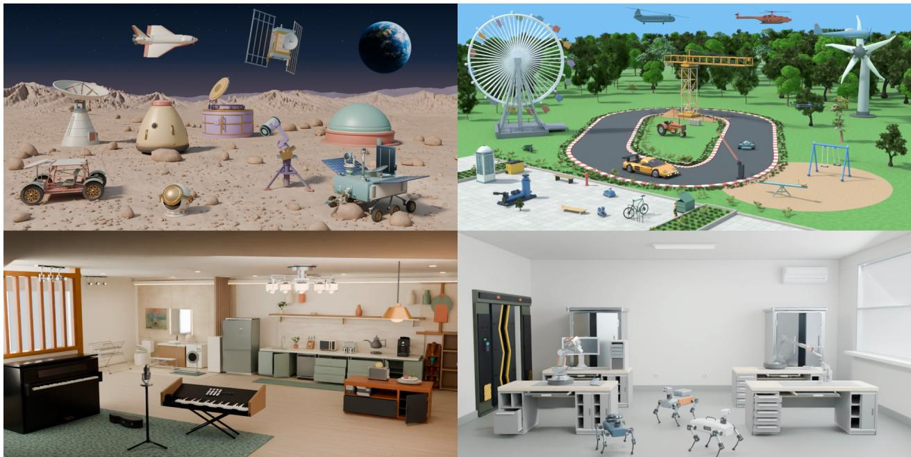  
Figure 1 Overview of RFW-A-400K, which provides 400K procedurally generated articulated assets spanning more than 500 object categories.

## 1 Introduction

Articulated objects are ubiquitous in everyday environments, ranging from cabinets and appliances to tools and mechanisms, as illustrated in Figure 1. Their functionality depends not only on shape, but also on how their parts are connected and move. High-quality articulated assets are therefore essential for learning part semantics, kinematics, and interaction afordances, as well as for training and evaluating manipulation policies in simulation [51, 57, 58, 82, 86, 91, 95]. Compared with static 3D models [2, 16, 17], these assets require additional specifications of part hierarchies, joint parameters, motion ranges, and physical properties. Producing and checking these annotations requires substantial human efort [51, 86, 89]; even with purpose-built interfaces, annotation can take around ten minutes per asset [51].

Procedural generation reduces per-asset efort by encoding construction rules in a reusable program that can produce many object variants [45]. Such generators can eficiently scale asset sampling within an object category, but their construction rules are still manually authored and are dificult to transfer across categories. Agentic program synthesis addresses the authoring problem by using language models to generate, execute, and refine articulated object programs [20, 68, 97]. However, existing systems typically synthesize assets one at a time, requiring a new round of reasoning and correction for every output. Thus, procedural generation scales sampling but not generator authoring, whereas agentic synthesis automates authoring but repeats the process at the asset level.

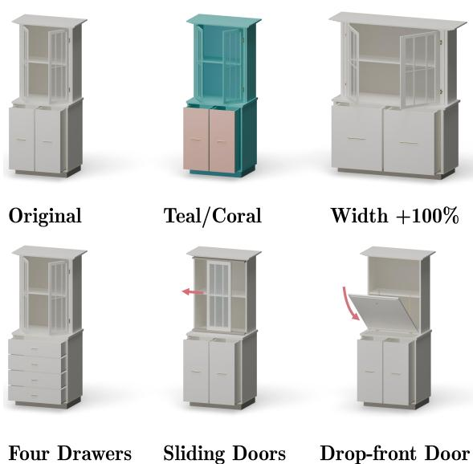  
Figure 2 Cabinet families produced by reusable procedural generators. Across cabinet configurations, the generators vary materials, dimensions, door types, drawer layouts, and appearance while preserving shared rules for panel sizing, part placement, and joint attachment.

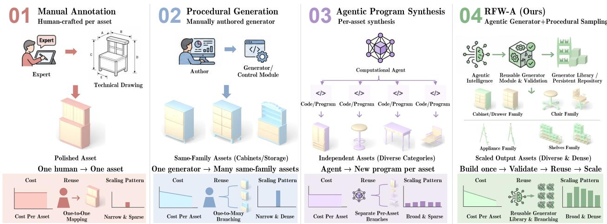  
Figure 3 Comparison of articulated-asset construction paradigms. Manual annotation operates per asset; procedural generation amortizes sampling but requires category-specific generator authoring; and agentic synthesis repeats model inference for each asset. RFW-A uses agentic synthesis to construct a reusable generator for each object family, then produces assets through procedural sampling.

These paradigms are complementary because assets within a category often share construction logic. As shown in Figure 2, cabinets may vary in width, door type, and drawer count while sharing rules for part dimensions, placements, and joint attachments. Such logic can be encoded once in a category-level generator and reused across many configurations; Figure 19 in the appendix extends this example to four cabinet generator families. This motivates our central question: can agentic synthesis automate the construction of reusable category-level articulated object generators?

To answer this question, we present RoboFlywheel-Articulation (RFW-A), an agentic procedural generation framework that shifts agentic synthesis from individual assets to reusable category-level generators (Figure 3). To support variation, each generator specifies both what can change and which structural relationships must remain valid. RFW-A organizes these choices and dependencies into a category blueprint built from reusable components in existing articulated programs. Agents translate the blueprint into executable code, and iteratively test and refine it across sampled configurations and motion states. Once constructed and validated, the generator produces additional assets through procedural execution with no further model calls or token charges. As summarized in Figure 3, this amortizes agentic construction cost across many assets and enables broad and dense scaling across object categories: in our cost comparison, amortizing the mean generator-authoring API cost over 200 assets yields \$0.05 per asset, versus \$1.24 for the sampled per-asset agentic synthesis baseline (Figure 6).

Using RFW-A, we build RFW-A-400K, containing 402,410 articulated assets across more than 500 object categories, approximately 37 times the size of Articraft, the largest existing articulated-object dataset. Each asset includes part structure, kinematics, estimated physical properties, and the parameters needed to reproduce its construction. Our evaluation shows a 100% asset-level kinematic pass rate over the full release. On a 200-asset evaluation subset, 99.5% of assets pass a 1-second passive rollout with the root fixed in all four simulators: Genesis, PyBullet, MuJoCo, and Isaac Sim. Downstream experiments further show that training with RFW-A-400K improves part-level articulation estimation on seen and unseen categories compared with PartNet-Mobility alone and Articraft augmentation. We further evaluate its utility for robot learning: across five manipulation tasks, policies trained from simulated demonstrations using retrieved and program-edited assets transfer zero-shot to real articulated objects.

In summary, our contributions are:

• We introduce RFW-A, an agentic procedural generation framework that constructs and validates reusable category-level generators, enabling asset sampling without per-asset model inference.

• Using RFW-A, we release RFW-A-400K, comprising 402,410 articulated assets across more than 500 object categories. Each asset includes explicit part structure, kinematics, estimated physical properties, and reproducible generation parameters.

• We evaluate asset quality and cross-simulator compatibility, demonstrate improved part-level articulation estimation on seen and unseen categories, and show zero-shot sim-to-real manipulation using policies trained with retrieved and program-edited RFW-A-400K assets.

## 2 Related Work

## 2.1 Articulated Object Datasets

Large-scale 3D repositories provide broad geometric diversity, but most assets are static and lack reliable part and articulation annotations [2, 16, 17]. Datasets for articulated objects address this gap by adding part hierarchies, joint parameters, motion ranges, and actionable part labels to curated CAD models or real scans [22, 51, 75, 86]. More recent releases expand category and structural coverage, and some also include material or physical-property annotations [1, 28, 89]. Complementing these annotated collections, RFW-A-400K provides both assets and their executable construction programs. These programs support resampling and editing within each defined object family.

## 2.2 Articulated Object Reconstruction and Generation

Articulated reconstruction methods recover instance geometry and kinematics from interaction, single- or multi-state images, RGB-D observations, or videos [29, 48, 79, 94]. Recent methods use 3D Gaussian Splatting to improve reconstructed geometry and appearance [15, 19, 27, 53, 54, 67, 80, 81]. These approaches can produce detailed digital twins, but they reconstruct a particular observed object and must infer occluded geometry and ambiguous motion from the available observations.

Generative methods instead learn distributions over part geometry, connectivity, and kinematics using graphbased, difusion, autoregressive, or structured latent representations [4, 18, 24, 30, 38, 49]. Image-, text-, and sketch-conditioned methods provide additional control over articulated asset modeling [50, 55, 74, 89]. Another line of work adds articulation to existing geometry or assembles articulated assets from observed or retrieved components [11, 37, 42–44, 65, 88]. Related work on deformable assets considers skeleton and skinning generation [71, 72]. RFW-A instead constructs explicit category-level programs whose structura choices and parameters can be varied directly to generate new rigid-link object instances.

## 2.3 Programmatic, Procedural, and Agentic Generation

Programmatic representations encode 3D construction as CSG trees, assembly programs, or CAD command sequences. Their explicit operations and parameters support structured generation and editing [3, 31, 32, 35, 40, 66, 83]. Procedural generation reuses such programs across sampled configurations. Arti-PG synthesizes articulated objects by manipulating structure programs and propagating annotations [70], while Infinigen-Articulated and Infinite Mobility provide manually designed category-level generators [34, 45].

LLMs and agents have also been used for code generation and structured 3D or motion synthesis through programmatic interfaces, tool use, and intermediate representations [5, 8, 26, 56, 69, 96]. For static shapes, ShapeLib uses LLMs to construct reusable procedural abstractions and refine a shape-sampling program [33]. Recent systems specialize agentic synthesis to articulated assets by jointly constructing geometry and kinematics as executable programs [20, 68, 97]. These systems broaden the range of objects that can be synthesized, but still run generation and refinement for each asset. RFW-A instead uses agents to construct category-level generators from existing articulated programs and refine them using configuration and motion tests. The resulting generators produce new assets through procedural execution without additional model inference.

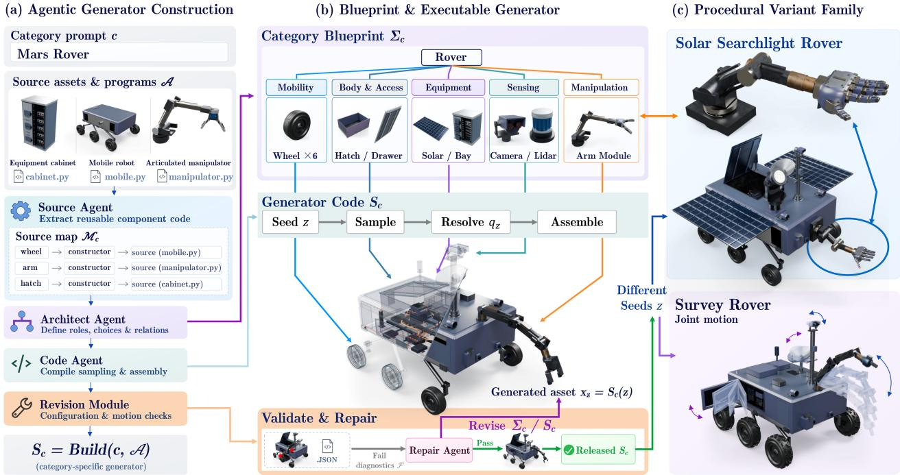  
Figure 4 Overview of the RFW-A generator-construction pipeline. Panel (a) shows how agents extract reusable components from source assets and executable programs, organize them into a category blueprint, and compile the blueprint into a generator. Panel (b) shows procedural execution by sampling choices, resolving dependent parameters, and assembling an asset, followed by validation and repair. Panel (c) shows that a released generator produces a family of articulated variants from diferent seeds, while exposing the joint motion encoded by the generator.

## 3 Method

RFW-A combines agentic program synthesis with procedural generation, as shown in Figure 4. Given a category prompt c and source assets with executable CAD or 3D modeling programs A [97], RFW-A constructs a reusable category-level generator $S _ { c } .$ Four agents implement this workflow: the Source Agent extracts reusable component code, the Architect Agent constructs the category blueprint, the Code Agent implements the executable generator, and the Repair Agent revises the blueprint or generator using structured diagnostics. The Revision Module coordinates configuration and motion checks. We write construction and sampling as

$$
S _ { c } = \mathrm { B u i l d } ( c , \mathcal { A } ) , \qquad x _ { z } = S _ { c } ( z ) ,
$$

where Build includes construction, validation, and release, and z is a random seed. After release, diferent seeds produce diferent assets through procedural sampling without further model inference. Algorithm 1 summarizes the complete loop.

## 3.1 Agentic Generator Construction

To construct $S _ { c } ,$ we first extract reusable component code from A. We then build a category blueprint $\Sigma _ { c }$ to specify the available components, adjustable parameters, and assembly and joint rules. This blueprint guides code generation.

Source component extraction. The Source Agent identifies relevant components in A based on the category prompt c. It extracts their construction code into a source map $\mathcal { M } _ { c } \mathbf { . }$

$$
\begin{array} { r } { \mathcal { M } _ { c } = \mathrm { E x t r a c t } ( c , \mathcal { A } ) . } \end{array}
$$

The map links each component to its construction code and source program. In Figure 4, the rover reuses wheel code from the mobile-robot program and arm code from the manipulator program.

Blueprint construction. The Architect Agent constructs $\Sigma _ { c }$ from the components in $\mathcal { M } _ { c } .$ We represent the blueprint as a graph $G _ { c } = ( V _ { c } , E _ { c } )$ . Each node specifies a component role, its available designs, and adjustable parameters. It also indicates whether the component is optional or repeated. Each edge specifies how two components attach, including joint parameters for movable connections. The blueprint also records rules for computing dependent dimensions and placements when component choices or parameters change. These construction rules are shared across configurations.

## 3.2 Procedural Generator and Variant Sampling

The Code Agent implements the blueprint $\Sigma _ { c }$ as an executable generator $S _ { c } ,$ using the component code in $\mathcal { M } _ { c }$ . Given a seed $z ,$ the generator selects components and samples free parameters. It computes dependent dimensions, placements, and joint parameters from the blueprint’s rules. The program then calls the component construction code to build and assemble the asset. The three execution steps in Figure 4 are

$$
\chi _ { z } = \mathrm { S a m p l e } ( \Sigma _ { c } ; z ) , \qquad q _ { z } = \mathrm { R e s o l v e } ( \Sigma _ { c } , \chi _ { z } ) , \qquad x _ { z } = S _ { c } ( z ) = \mathrm { A s s e m b l e } ( \mathcal { M } _ { c } , q _ { z } ) .
$$

Here $\chi _ { z }$ contains the sampled choices and free parameters, while $q _ { z }$ contains the selected components and all resolved construction parameters. These steps execute the rules encoded in $S _ { c }$ without further model inference. The program exports meshes, rigid links, collision geometry, joints, and a URDF file. It also records the source of each reused component.

## 3.3 Validating, Repairing, and Releasing the Generator

A generator that produces one valid asset may fail under other configurations or joint states. Before large-scale sampling, the Revision Module therefore checks blueprint–code consistency and tests assets across component choices, parameter settings, and joint states.

Blueprint–code consistency. We check that each choice in $\Sigma _ { c }$ has a code path and that its dependent parameters can be computed. We run sampling and parameter resolution across seeds until each choice has been selected multiple times. These checks detect missing branches, unused parameters, and incomplete dependencies without constructing geometry.

Configuration and motion testing. We test progressively larger batches generated with deterministic seeds. Each batch must pass before we increase its size. Additional tests target uncovered component choices, parameter boundaries, and selected component combinations. Each asset is checked for successful geometry construction, part connectivity, URDF export and parsing, and valid articulation. Collision checks cover the rest pose, multiple states across each joint’s range, and selected coupled-joint states.

Let $\mathcal { Z } _ { \mathrm { t e s t } }$ contain the current validation cases and all retained regression cases, and let $\mathcal { V } _ { c }$ collect the component choices declared in $\Sigma _ { c } .$ . The generator is released only when every retained case passes and every declared choice is covered by a passing case:

$$
\mathrm { A c c e p t } ( S _ { c } ) \iff [ \forall z \in \mathcal { Z } _ { \mathrm { t e s t } } , \mathrm { V a l i d } ( x _ { z } ) ] \wedge [ \forall v \in \mathcal { V } _ { c } , \exists z \in \mathcal { Z } _ { \mathrm { t e s t } } : v \in q _ { z } ] ,
$$

where $\mathrm { V a l i d } ( x _ { z } )$ denotes that $x _ { z }$ passes the checks above.

Failure localization and repair. For each failure, we record the failed check, sampled configuration, afected parts or joints, and responsible construction step. The report also includes measurements such as penetration depth. The Repair Agent uses these diagnostics to update the blueprint or generator, or both:

$$
\left( \Sigma _ { c } ^ { ( t + 1 ) } , S _ { c } ^ { ( t + 1 ) } \right) = \mathrm { R e p a i r } \left( \Sigma _ { c } ^ { ( t ) } , S _ { c } ^ { ( t ) } , \mathcal { F } _ { t } \right) ,
$$

where $\mathcal { F } _ { t }$ is the structured diagnostics collected at iteration t. Blueprint errors are returned to the Architect Agent, and blueprint repairs are followed by recompilation of the generator. Implementation errors go to the Code Agent with the blueprint unchanged. The Revision Module then retests both failed and previously passed cases, retaining failures as regression tests until the release criterion is met.

## 4 RFW-A-400K Dataset: Articulated Assets

RFW-A turns the validated generators of Section 3.3 into a dataset by sampling a fixed seed budget for each generator. The release retains both the exported assets and their construction records, linking each sample to the program and configuration that produced it.

## 4.1 Dataset Overview

The RFW-A-400K release contains 402,410 articulated assets covering more than 500 semantic object categories. Alongside visual and collision geometry, each asset retains its selected components, resolved parameters, part hierarchy, joint parameters, and source provenance. Its generator version and seed identify a reproducible sample, while the recorded configuration exposes the choices used to construct it.

Table 1 Release-level comparison of articulated-object datasets, their construction types, and available annotations. Cats. denotes categories, Proc. denotes procedural generation, and Metric denotes metric-scale geometry. Physical Grounding groups the physical-property fields (Section 4.2): E is Young’s modulus, ν is Poisson’s ratio, Friction includes static and dynamic coeficients, and e is the coeficient of restitution. F-mat. marks fine-grained material annotation, i.e., material assignments below the articulated-part level. ✓ indicates that a field or resource is included in the released data or documented format, △ indicates partial or format-dependent availability, and × indicates that it is absent. The RFW-A-400K row follows the release specification and evaluation manifest.
<table><tr><td>Dataset</td><td>Assets Cats. Type</td><td></td><td></td><td></td><td></td><td></td><td colspan="5">Physical Grounding</td></tr><tr><td></td><td></td><td></td><td></td><td></td><td>Metric Texture F-mat. Density</td><td></td><td></td><td>E</td><td></td><td>Friction</td><td>e</td></tr><tr><td>PartNet-Mobility</td><td>2,347</td><td></td><td>46 Manual</td><td>X</td><td>△</td><td>X</td><td>X</td><td>X</td><td>×</td><td>×</td><td>X</td></tr><tr><td>Infinite Mobility</td><td>On-demand</td><td></td><td>22 Procedural</td><td>X</td><td>△</td><td>X</td><td>X</td><td>X</td><td>X</td><td>X</td><td>X</td></tr><tr><td>Infinigen-Articulated</td><td>8,226</td><td></td><td>17 Procedural</td><td>△</td><td>√</td><td>X</td><td>△</td><td>X</td><td>X</td><td>△</td><td>X</td></tr><tr><td>PhysX-Mobility</td><td>2,024</td><td></td><td>45 Manual</td><td>X</td><td>△</td><td>X</td><td>√</td><td>√</td><td>√</td><td>X</td><td>X</td></tr><tr><td>Artiverse</td><td>3,544</td><td></td><td>84 Manual</td><td>X</td><td>√</td><td>X</td><td>√</td><td>×</td><td>×</td><td>×</td><td>X</td></tr><tr><td>LAM</td><td>3,217</td><td></td><td>650 Agentic</td><td>X</td><td>△</td><td>X</td><td>X</td><td>×</td><td>×</td><td>×</td><td>X</td></tr><tr><td>SketchMobility</td><td>4,956</td><td></td><td>47 Manual</td><td>X</td><td>△</td><td>X</td><td>X</td><td>X</td><td>×</td><td>×</td><td>X</td></tr><tr><td>Articraft</td><td>10,787</td><td></td><td>244 Agentic</td><td>X</td><td>X</td><td>X</td><td>X</td><td>X</td><td>X</td><td>X</td><td>X</td></tr><tr><td>RFW-A-400K (Ours)</td><td>402,410</td><td></td><td>531 Agentic + Proc.</td><td>√</td><td>√</td><td>√</td><td>√</td><td>√</td><td>√</td><td>√</td><td>√</td></tr></table>

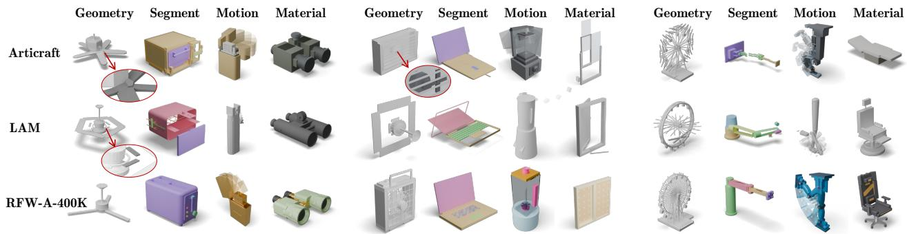  
Figure 5 Qualitative comparison of Articraft, LAM, and RFW-A-400K. The three rows are the compared datasets; each row contains four quality dimensions (geometry, part segmentation, motion, and material appearance).

Compared with existing articulated-object datasets, RFW-A-400K combines this scale with material assignments below the articulated-part level and associated physical-property annotations (Table 1). Each asset is represented through geometry, part structure, joint motion, and surface materials, which provide complementary views of asset quality in the qualitative comparison with Articraft and LAM (Figure 5).

RFW-A pays the agentic authoring cost once per generator, then produces additional assets procedurally without further model calls or token charges. Amortizing the mean generator-authoring cost of \$10.62 over 200 assets yields an API cost of \$0.053 per asset, versus \$1.237 for the sampled per-asset agentic synthesis baseline, a 23-fold cost diference (Figure 6). We estimate these costs using ten category-level generators and 200 successful Articraft synthesis records [97], twenty from each of the same categories.

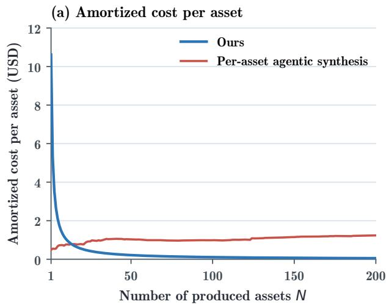

(b) Cumulative cost  
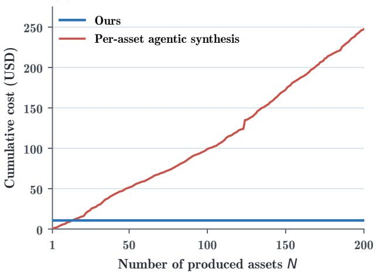  
Figure 6 API-cost scaling of reusable category-level generators versus per-asset agentic synthesis. (a) Our mean generator-authoring cost is amortized over N assets, while the baseline averages N recorded synthesis costs. (b) Our one-time API cost stays fixed, while the baseline accumulates a new charge for each asset.

## 4.2 Material Grounding and Directed Editing

The procedural representation specifies how an asset is built and moves; material grounding extends it to the appearance and physical properties of its surfaces. To apply this grounding across the release, each validated generator records a material-class identifier for each visual surface and connects it to a shared library built once ofline. The library supplies concrete instances that can be reused across generators and sampled across assets. After geometry and articulation validation, a single ofline pass assigns each visual surface a class from the controlled taxonomy; performing this pass after repair ensures that added, removed, or renamed surfaces receive the correct identifiers.

The library contains 8,295 curated PBR materials organized into 124 leaf classes across 18 families. Each entry associates a PBR appearance with six physical properties in SI units: density, Young’s modulus, Poisson’s ratio, static and dynamic friction coeficients, and coeficient of restitution. These properties are estimated ofline under fixed reference conditions; their uncertainty intervals and confidence estimates are retained in the library (Appendix A.9). Keeping appearance and physical annotations in the same entry lets both follow the material selected for a surface.

During asset sampling, each surface’s class identifier selects a frozen material pool, and a seeded draw selects an entry from that pool. The selected appearance is bound to the surface and the corresponding physical properties are copied into the asset’s physics record (Figure 7). This lookup requires no per-asset model inference and is reproducible from the generator and seed. It also provides a direct control for material variation: a surface can receive a diferent entry from its pool or a diferent class assignment, while its appearance and physical annotations are resolved together.

The generator representation also makes the release editable. An edit changes the configuration rather than a finished mesh and then re-executes the same program; no additional per-asset agent call is required. Figure 8 shows four examples: replacing a component, changing the number of repeated parts, assigning a diferent material, and changing a geometric dimension. Dependent placements, dimensions, and joint parameters are resolved again by the generator, keeping the edited asset internally consistent. Section 6 uses this control to adapt retrieved assets to real manipulation targets.

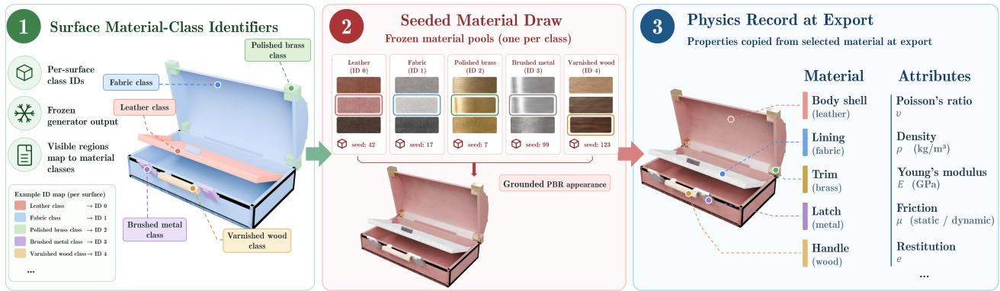

Figure 7 How a frozen generator’s per-surface material-class identifiers become concrete materials and physical properties at export: each identifier selects a frozen material pool, a seeded draw binds one pool member to the surface, and that material’s physical properties are copied into the asset’s physics record.  
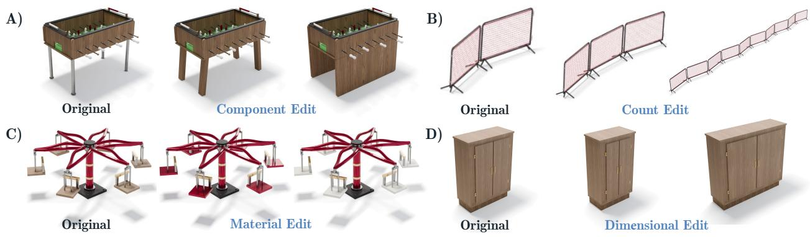  
Figure 8 Directed 3D editing enabled by agent-generated procedural programs: (a) structural editing, (b) count editing, (c) material editing, and (d) dimensional editing.

We evaluate the dataset across five aspects: scale and structural diversity, asset validity, rest-pose assembly geometry, motion-induced collisions, and cross-simulator compatibility. Detailed protocols and results are deferred to Appendices A.3– A.8.

## 5 Experiments

## 5.1 Downstream Articulation Estimation

Experimental setup. We assess whether training with RFW-A-400K improves articulation estimation from a single 3D mesh. Following Articraft [97], we train Particulate-B [42] on PartNet-Mobility (PM) alone, PM+Articraft, and PM+RFW-A-400K. All models are trained from random initialization with identical optimizer settings and a global batch size of 128, and evaluated at 150K updates. For both augmented datasets, PM and the additional source are sampled with probabilities 0.1 and 0.9, respectively.

Evaluation splits and metrics. All models share two evaluation splits. The in-domain split contains 255 objects from PM and Articraft together with additional released objects, covering six categories seen during training. The category out-of-distribution (OOD) split contains 774 objects from nine categories excluded from all three training sets.

Following the Particulate evaluation protocol, we report mean IoU (mIoU), generalized IoU (gIoU), and part-wise Chamfer distance (PC) at rest, and part-wise gIoU, PC, and whole-object Chamfer distance (OC) at maximum articulation. Results aggregate three training seeds × five evaluation seeds per setting. Training and evaluation details are provided in Appendix A.16.

Table 2 Articulation estimation with diferent training datasets. Bold marks the best result for each metric within each evaluation split.
<table><tr><td rowspan="2">Training data</td><td colspan="3">Rest-Pose Segmentation</td><td colspan="3">Articulated Geometry</td></tr><tr><td>mloU↑</td><td>gloU↑</td><td>PC↓</td><td>gloU↑</td><td>PC↓</td><td>OC↓</td></tr><tr><td colspan="7">In-domain</td></tr><tr><td>PM-only</td><td>0.60262</td><td>0.46364</td><td>0.09552</td><td>0.44339</td><td>0.15760</td><td>0.01253</td></tr><tr><td>PM+Articraft PM+RFW-A-</td><td>0.71442</td><td>0.62972</td><td>0.05371</td><td>0.60164</td><td>0.10196</td><td>0.00778</td></tr><tr><td>400K</td><td>0.78873 (+10.4%)</td><td>0.73550 (+16.8%)</td><td>0.03501 (+34.8%)</td><td>0.70295 (+16.8%)</td><td>0.06268 (+38.5%)</td><td>0.00661(+15.0%)</td></tr><tr><td colspan="7">Category OOD</td></tr><tr><td>PM-only</td><td>0.35944</td><td>0.14805</td><td>0.12802</td><td>0.13076</td><td>0.17423</td><td>0.02481</td></tr><tr><td>PM+Articraft PM+RFW-A-</td><td>0.46873</td><td>0.25616</td><td>0.11926</td><td>0.23468</td><td>0.16176</td><td>0.02343</td></tr><tr><td>400K</td><td>0.47630 (+1.6%)</td><td>0.30082 (+17.4%)</td><td>0.09660 (+19.0%)</td><td>0.27985 (+19.2%)</td><td>0.15065 (+6.9%)</td><td>0.02403 (-2.6%)</td></tr></table>

Results. Table 2 shows that both generated datasets improve all six in-domain metrics over PM-only. PM+RFW-A-400K achieves the best in-domain results on all six metrics. Relative to PM+Articraft, restpose mIoU increases by 7.43 percentage points and articulated gIoU by 10.13 points; articulated PC falls from 0.10196 to 0.06268 and whole-object OC from 0.00778 to 0.00661. The larger part-level gains indicate that the added assets provide especially strong supervision for part correspondence and moved-part geometry, while also improving whole-object reconstruction.

On the category-OOD split, PM+RFW-A-400K again leads on all five part-level metrics: articulated gIoU improves by 19.2% and rest-pose PC by 19.0% relative to PM+Articraft. The consistent part-level gains across both splits show that the dataset transfers beyond the categories used for training.

Figure 9 compares articulation estimation results on six category-matched examples. Each column shows one case, with PM-only, PM+Articraft, PM+RFW-A-400K, and the ground-truth reference arranged by row. Red arrows and circles identify local regions where supports, attachments, or movable parts difer from the reference. The highlighted examples show that PM-only and PM+Articraft can omit or misplace articulated geometry, whereas the PM+RFW-A-400K outputs more closely preserve the reference structure.

Generator component ablations are reported in Appendix A.17: the full configuration achieves the highest mean Judge score and passes all strict validity probes.

## 6 Robotic Manipulation

We further evaluate whether RFW-A-400K assets can serve as simulation surrogates for real-world robotic manipulation. For each real target object, we retrieve the most similar asset from RFW-A-400K and optionally edit its exposed procedural parameters to better match the target geometry. The resulting assets are used to train manipulation policies entirely in simulation, which are then deployed on the corresponding real objects without real-world training or fine-tuning.

Tasks. We consider five real-world manipulation tasks with diferent articulation structures and interaction patterns: (1) opening and closing a cabinet door, where the left arm pushes the door open and the right arm closes it; (2) straightening a folding ruler; (3) folding a folding chair to its closed configuration; (4) pushing down the lever of a toaster; and (5) closing a pair of double doors. Together, these tasks cover revolute joints, multi-link articulation, and object-specific interaction geometries. Figure 10 shows the simulation training environments and the corresponding real-world evaluations for these five tasks.

Simulation training. For each task, we compare three simulation-asset configurations (Table 3). Retrieval uses only the single retrieved RFW-A-400K asset. Retrieval + 4 Edit augments the retrieved asset with four edited variants, while Retrieval + 9 Edit augments it with nine edited variants. The edits modify task-relevant

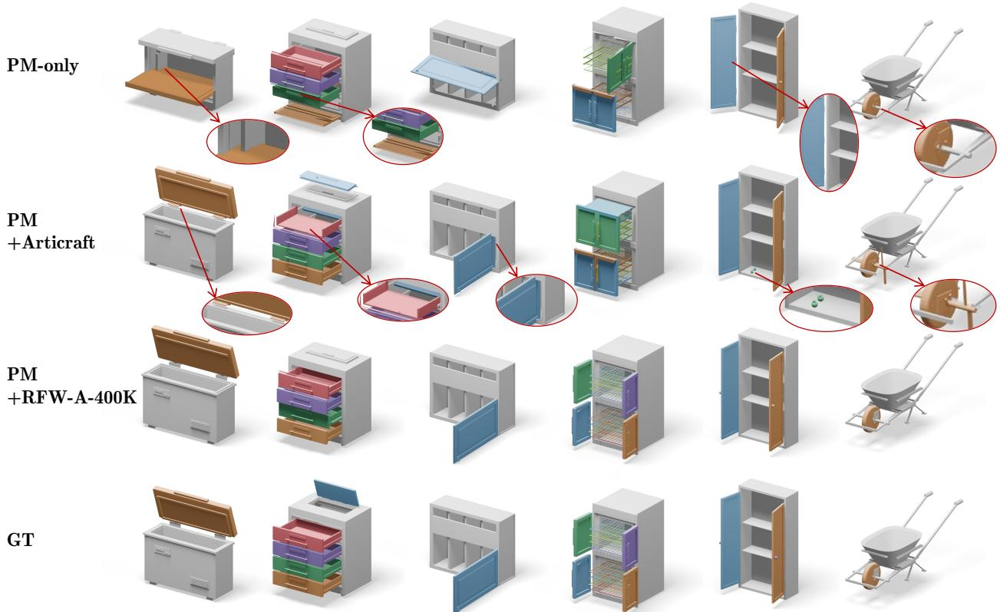

Figure 9 Qualitative comparison of articulation estimation. Rows show PM-only, PM+Articraft, PM+RFW-A-400K, and ground truth (GT). Red arrows and circles highlight local diferences in supports, attachments, and movable parts.

Table 3 Simulation configurations for robotic manipulation. All settings use exactly 500 simulation demonstrations per task.
<table><tr><td>Setting</td><td>Retrieved Asset</td><td>Edited Variants</td><td>Sim. Demos</td></tr><tr><td>Retrieval</td><td>1</td><td>0</td><td>500</td></tr><tr><td>Retrieval + 4 Edit</td><td>1</td><td>4</td><td>500</td></tr><tr><td>Retrieval + 9 Edit</td><td>1</td><td>9</td><td>500</td></tr></table>

dimensions, part placement, and articulation parameters through the corresponding procedural generator while preserving a valid kinematic structure.

Importantly, all three configurations use exactly 500 simulation demonstrations per task and the same policy architecture and training budget.

Real-world evaluation. Each trained policy is evaluated for 10 trials on its corresponding real object. A trial is counted as successful when the task reaches its predefined target configuration. We report the number of successful trials for each task and the average across all five tasks.

Results. Table 4 shows that real-world success improves from 6.2/10 with the retrieved asset alone to 7.2/10 with four edited variants and 8.0/10 with nine edited variants. The gains are largest on the cabinet, toaster, and folding-ruler tasks, whereas the double-door task remains unchanged. Since all settings use the same number of simulation demonstrations, policy architecture, and training budget, these results indicate that generator-based target adaptation and asset variation improve zero-shot sim-to-real transfer without requiring additional training data.

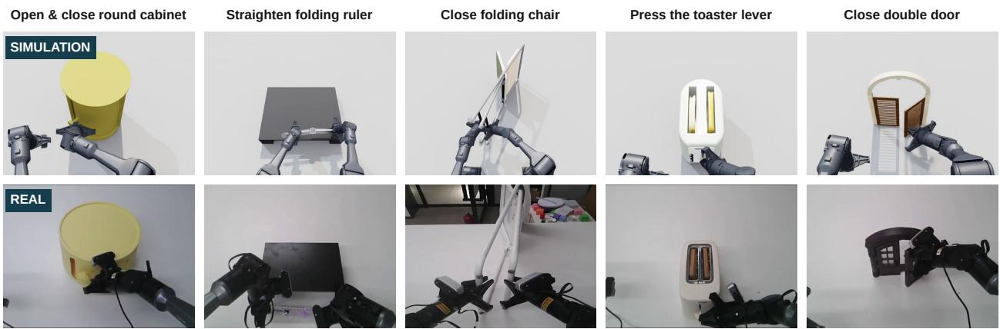  
Figure 10 Sim-to-real robotic manipulation. Simulation training environments (top) and corresponding real-world evaluations (bottom) across five articulated-object manipulation tasks.

Table 4 Zero-shot sim-to-real manipulation. Real-world successes over 10 trials per task. All settings use the same 500 simulation demonstrations per task.
<table><tr><td>Setting</td><td>Cabinet</td><td>Folding Chair</td><td>Double Door</td><td>Toaster</td><td>Folding Ruler</td><td>Avg.</td></tr><tr><td>Retrieval</td><td>5/10</td><td>7/10</td><td>8/10</td><td>7/10</td><td>4/10</td><td>6.2/10</td></tr><tr><td>Retrieval + 4 Edit</td><td>7/10</td><td>7/10</td><td>8/10</td><td>8/10</td><td>6/10</td><td>7.2/10</td></tr><tr><td>Retrieval + 9 Edit</td><td>8/10</td><td>8/10</td><td>8/10</td><td>9/10</td><td>7/10</td><td>8.0/10</td></tr></table>

## 7 Conclusion

We present RFW-A, an agentic procedural generation framework that constructs reusable category-level generators, enabling eficient asset sampling and editing without per-asset model inference. Using RFW-A, we build RFW-A-400K, comprising over 400K articulated assets across 500+ categories with explicit kinematics, fine-grained materials, and estimated physical properties. Our experiments demonstrate substantially reduced generation costs, high structural and kinematic validity, and reliable execution across four simulators. Beyond asset quality, RFW-A-400K improves articulation estimation on seen and unseen categories and enables zeroshot sim-to-real robotic manipulation through retrieved and procedurally edited assets. These results establish RFW-A as a scalable and controllable approach to articulated asset generation for embodied learning.

## References

[1] Ziang Cao, Fangzhou Hong, Zhaoxi Chen, Liang Pan, and Ziwei Liu. PhysX-Anything: Simulation-ready physical 3d assets from single image. In Proceedings of the IEEE/CVF Conference on Computer Vision and Pattern Recognition, 2026.

[2] Angel X. Chang, Thomas Funkhouser, Leonidas Guibas, Pat Hanrahan, Qixing Huang, Zimo Li, Silvio Savarese, Manolis Savva, Shuran Song, Hao Su, Jianxiong Xiao, Li Yi, and Fisher Yu. ShapeNet: An information-rich 3D model repository, 2015. URL https://arxiv.org/abs/1512.03012.

[3] Cheng Chen, Jiacheng Wei, Tianrun Chen, Chi Zhang, Xiaofeng Yang, Shangzhan Zhang, Bingchen Yang, Chuan-Sheng Foo, Guosheng Lin, Qixing Huang, and Fayao Liu. Cadcrafter: Generating computer-aided design models from unconstrained images, 2025.

[4] Honghua Chen, Yushi Lan, Yongwei Chen, and Xingang Pan. Artilatent: Realistic articulated 3d object generation via structured latents, 2025.

[5] Junhao Chen, Xiang Li, Xiaojun Ye, Chao Li, Zhaoxin Fan, and Hao Zhao. Idea23d: Collaborative LMM agents enable 3d model generation from interleaved multimodal inputs. In Proceedings of the 31st International Conference on Computational Linguistics, pages 4149–4166, 2025

[6] Junhao Chen, Mingjin Chen, Henghaofan Zhang, Minglin Chen, Liaoyuan Fan, Boran Zhang, Saining Zhang, Mingze Sun, Hao Zhao, Ruqi Huang, Zhihao Li, and Yufei Wang. Video models as native 4d renderers: Worldgrounded conditioning from animated mesh. arXiv preprint arXiv:2608.00094, 2026.

[7] Junhao Chen, Xinghao Chen, Henghaofan Zhang, Zihao Qiao, Saining Zhang, Yongzhi Li, Ruqi Huang, Sisi Li, Yimin Sheng, Jianyi Zhu, and Hao Zhao. Engine-native editable 3d world reconstruction with objects and lighting. arXiv preprint arXiv:2607.20889, 2026.

[8] Junhao Chen, Xiang Li, Yibin Xu, Yuehan Cui, Fangsheng Weng, Hao Zhao, Fei Ma, and Qi Tian. Paircoder: Pair programming-inspired two-agent collaboration for code generation. In Findings of the Association for Computational Linguistics: ACL 2026, pages 3043–3058, 2026.

[9] Junhao Chen, Boran Zhang, Mingjin Chen, Henghaofan Zhang, Saining Zhang, Congcong Zhu, Hao Zhao, Ruqi Huang, Zhihao Li, and Yufei Wang. One video, one world: Turning monocular video into physical 4d scenes. arXiv preprint arXiv:2606.31388, 2026.

[10] Tianxing Chen, Zanxin Chen, Baijun Chen, Zijian Cai, Yibin Liu, Zixuan Li, Qiwei Liang, Xianliang Lin, Yiheng Ge, Zhenyu Gu, et al. Robotwin 2.0: A scalable data generator and benchmark with strong domain randomization for robust bimanual robotic manipulation. arXiv preprint arXiv:2506.18088, 2025.

[11] Zoey Chen, Aaron Walsman, Marius Memmel, Kaichun Mo, Alex Fang, Karthikeya Vemuri, Alan Wu, Dieter Fox, and Abhishek Gupta. URDFormer: A pipeline for constructing articulated simulation environments from real-world images, 2024.

[12] Yankuan Chi, Xiang Li, Zixuan Huang, and James Matthew Rehg. Vinedresser3d: Towards agentic text-guided 3d editing. In Proceedings of the IEEE/CVF Conference on Computer Vision and Pattern Recognition, pages 12673–12683, 2026.

[13] Erwin Coumans and Yunfei Bai. PyBullet, a python module for physics simulation for games, robotics and machine learning. http://pybullet.org, 2016–2021.

[14] Rongxu Cui, Zongzheng Zhang, Jingrui Pang, Haohan Chi, Jinbang Guo, Saining Zhang, Shaoxuan Xie, Xin Jin, Yao Mu, Jiaolong Yang, Guocai Yao, Xianyuan Zhan, Ya-Qin Zhang, and Hao Zhao. Libero-safety: A comprehensive benchmark for physical and semantic safety in vision-language-action models. arXiv preprint arXiv:2606.23686, 2026.

[15] Hang Dai, Hongwei Fan, Han Zhang, Duojin Wu, Jiyao Zhang, and Hao Dong. Freeartgs: Articulated gaussian splatting under free-moving scenario. In Proceedings of the IEEE/CVF Conference on Computer Vision and Pattern Recognition, pages 11777–11787, 2026.

[16] Matt Deitke, Dustin Schwenk, Jordi Salvador, Luca Weihs, Oscar Michel, Eli VanderBilt, Ludwig Schmidt, Kiana Ehsani, Aniruddha Kembhavi, and Ali Farhadi. Objaverse: A universe of annotated 3d objects, 2022.

[17] Matt Deitke, Ruoshi Liu, Matthew Wallingford, Huong Ngo, Oscar Michel, Aditya Kusupati, Alan Fan, Christian Laforte, Vikram Voleti, Samir Yitzhak Gadre, Eli VanderBilt, Aniruddha Kembhavi, Carl Vondrick, Georgia Gkioxari, Kiana Ehsani, Ludwig Schmidt, and Ali Farhadi. Objaverse-xl: A universe of 10m+ 3d objects, 2023.

[18] Daoyi Gao, Yawar Siddiqui, Lei Li, and Angela Dai. Meshart: Generating articulated meshes with structure-guided transformers. In Proceedings of the IEEE/CVF Conference on Computer Vision and Pattern Recognition, pages 618–627, 2025.

[19] Mingju Gao, Yike Pan, Huan-ang Gao, Zongzheng Zhang, Wenyi Li, Hao Dong, Hao Tang, Li Yi, and Hao Zhao. PartRM: Modeling part-level dynamics with large cross-state reconstruction model. In Proceedings of the IEEE/CVF Conference on Computer Vision and Pattern Recognition (CVPR), pages 7004–7014, 2025.

[20] Yipeng Gao, Yunhao Ge, Peilin Cai, Daniel Seita, and Laurent Itti. LAM: Language articulated object modelers. In Proceedings of the IEEE/CVF Conference on Computer Vision and Pattern Recognition, pages 16010–16020, 2026.

[21] Genesis Authors. Genesis: A universal and generative physics engine for robotics and beyond. https://github. com/Genesis-Embodied-AI/Genesis, December 2024.

[22] Haoran Geng, Helin Xu, Chengyang Zhao, Chao Xu, Li Yi, Siyuan Huang, and He Wang. GAPartNet: Crosscategory domain-generalizable object perception and manipulation via generalizable and actionable parts, 2022.

[23] Jiazhe Guo, Yikang Ding, Xiwu Chen, Shuo Chen, Bohan Li, Yingshuang Zou, Xiaoyang Lyu, Feiyang Tan, Xiaojuan Qi, Zhiheng Li, and Hao Zhao. Dist-4d: Disentangled spatiotemporal difusion with metric depth for 4d driving scene generation. In Proceedings of the IEEE/CVF International Conference on Computer Vision (ICCV), pages 27231–27241, 2025.

[24] Yumeng He, Ying Jiang, Jiayin Lu, Yin Yang, and Chenfanfu Jiang. Spark: Sim-ready part-level articulated reconstruction with vlm knowledge. In Proceedings of the IEEE/CVF Conference on Computer Vision and Pattern Recognition, pages 7233–7243, 2026.

[25] Yumeng He, Yichen Song, Xiaotian Yang, Weijia Zhang, Zanwei Zhou, Junru Gong, Xiaokang Yang, and Yunbo Wang. Neoworld-pro: Programming interactive scenes from monocular images for embodied simulation. arXiv preprint arXiv:2608.24212, 2026.

[26] Ziniu Hu, Ahmet Iscen, Aashi Jain, Thomas Kipf, Yisong Yue, David A. Ross, Cordelia Schmid, and Alireza Fathi. Scenecraft: An LLM agent for synthesizing 3d scenes as blender code. In International Conference on Machine Learning, volume 235, pages 19252–19282, 2024.

[27] Zihao Huang, Tianqi Liu, Zhaoxi Chen, Shaocong Xu, Saining Zhang, Lixing Xiao, Zhiguo Cao, Wei Li, Hao Zhao, and Ziwei Liu. Arthoi: Articulated human-object interaction synthesis by 4d reconstruction from video priors. arXiv preprint arXiv:2603.04338, 2026.

[28] Denys Iliash, Jiayi Liu, Egor Fokin, Qirui Wu, Ali Mahdavi-Amiri, Manolis Savva, and Angel X. Chang. Artiverse: A diverse and physically grounded dataset for articulated objects. In Proceedings of the IEEE/CVF Conference on Computer Vision and Pattern Recognition, pages 8932–8942, 2026.

[29] Zhenyu Jiang, Cheng-Chun Hsu, and Yuke Zhu. Ditto: Building digital twins of articulated objects from interaction, 2022.

[30] Bu Jin, Weize Li, Songen Gu, Yupeng Zheng, Yuhang Zheng, Zhengyi Zhou, and Yao Yao. Uniart: Unified 3d representation for generating 3d articulated objects with open-set articulation, 2025.

[31] R. Kenny Jones, Theresa Barton, Xianghao Xu, Kai Wang, Ellen Jiang, Paul Guerrero, Niloy J. Mitra, and Daniel Ritchie. Shapeassembly: Learning to generate programs for 3d shape structure synthesis, 2020.

[32] R. Kenny Jones, David Charatan, Paul Guerrero, Niloy J. Mitra, and Daniel Ritchie. ShapeMOD: Macro operation discovery for 3d shape programs. ACM Transactions on Graphics, 40(4), 2021. doi: 10.1145/3450626.3459821.

[33] R. Kenny Jones, Paul Guerrero, Niloy J. Mitra, and Daniel Ritchie. Shapelib: Designing a library of procedural 3d shape abstractions with large language models, 2025.

[34] Abhishek Joshi, Beining Han, Jack Nugent, Max Gonzalez Saez-Diez, Yiming Zuo, Jonathan Liu, Hongyu Wen, Stamatis Alexandropoulos, Karhan Kayan, Anna Calveri, Tao Sun, Gaowen Liu, Yi Shao, Alexander Raistrick, and Jia Deng. Procedural generation of articulated simulation-ready assets, 2025.

[35] Mohammad Sadil Khan, Sankalp Sinha, Talha Uddin Sheikh, Didier Stricker, Sk Aziz Ali, and Muhammad Zeshan Afzal. Text2cad: Generating sequential cad models from beginner-to-expert level text prompts, 2024.

[36] Moo Jin Kim, Karl Pertsch, Siddharth Karamcheti, Ted Xiao, Ashwin Balakrishna, Suraj Nair, Rafael Rafailov, Ethan Foster, Grace Lam, Pannag Sanketi, Quan Vuong, Thomas Kollar, Benjamin Burchfiel, Russ Tedrake, Dorsa Sadigh, Sergey Levine, Percy Liang, and Chelsea Finn. Openvla: An open-source vision-language-action model. arXiv preprint arXiv:2406.09246, 2024.

[37] Long Le, Jason Xie, William Liang, Hung-Ju Wang, Yue Yang, Yecheng Jason Ma, Kyle Vedder, Arjun Krishna, Dinesh Jayaraman, and Eric Eaton. Articulate-anything: Automatic modeling of articulated objects via a vision-language foundation model, 2024.

[38] Jiahui Lei, Congyue Deng, William B. Shen, Leonidas Guibas, and Kostas Daniilidis. NAP: Neural 3d articulated object prior. In Advances in Neural Information Processing Systems, volume 36, 2023.

[39] Gen Li, Nan Wang, YunLong Li, Ziyang Yan, Yinghao Shuai, Saining Zhang, Shu Han, Shaocong Xu, Baijun Ye, Lu Zhang, Luan Zhang, Paul Barsch, Zebang Shen, Chaojian Li, Hang Zhao, Ya-Qin Zhang, and Hao Zhao. Gen-ncap: A generative simulator for corner case benchmarking in end-to-end autonomous driving. Proceedings of IASEAI Conference, 2(1):369–381, 2026.

[40] Jiahao Li, Weijian Ma, Xueyang Li, Yunzhong Lou, Guichun Zhou, and Xiangdong Zhou. CAD-Llama: Leveraging large language models for computer-aided design parametric 3d model generation. In Proceedings of the IEEE/CVF Conference on Computer Vision and Pattern Recognition, pages 18563–18573, 2025.

[41] Lin Li, Zehuan Huang, Haoran Feng, Gengxiong Zhuang, Rui Chen, Chunchao Guo, and Lu Sheng. Voxhammer: Training-free precise and coherent 3d editing in native 3d space. arXiv preprint arXiv:2508.19247, 2025.

[42] Ruining Li, Yuxin Yao, Chuanxia Zheng, Christian Rupprecht, Joan Lasenby, Shangzhe Wu, and Andrea Vedaldi. Particulate: Feed-forward 3d object articulation. In Proceedings of the IEEE/CVF Conference on Computer Vision and Pattern Recognition, pages 27708–27718, 2026.

[43] Ruining Li, Yuxin Yao, Matt Zhou, Chuanxia Zheng, Christian Rupprecht, Joan Lasenby, Shangzhe Wu, and Andrea Vedaldi. Instruct-particulate: Scaling feed-forward 3d object articulation with kinematic control, 2026.

[44] Zhe Li, Xiang Bai, Jieyu Zhang, Zhuangzhe Wu, Che Xu, Ying Li, Chengkai Hou, and Shanghang Zhang. Urdf-anything: Constructing articulated objects with 3d multimodal language model, 2025.

[45] Xinyu Lian, Zichao Yu, Ruiming Liang, Yitong Wang, Li Ray Luo, Kaixu Chen, Yuanzhen Zhou, Qihong Tang, Xudong Xu, Zhaoyang Lyu, Bo Dai, and Jiangmiao Pang. Infinite mobility: Scalable high-fidelity synthesis of articulated objects via procedural generation, 2025.

[46] Youtian Lin, Yikang Yang, Zhanpeng Hu, Mengqi Zhou, Feihu Zhang, Xun Cao, Jiaheng Liu, and Yao Yao. Procedura: Agentic 3d modeling with procedural control. arXiv preprint arXiv:2608.26238, 2026.

[47] Bo Liu, Yifeng Zhu, Chongkai Gao, Yihao Feng, Qiang Liu, Yuke Zhu, and Peter Stone. Libero: Benchmarking knowledge transfer for lifelong robot learning. arXiv preprint arXiv:2306.03310, 2023.

[48] Jiayi Liu, Ali Mahdavi-Amiri, and Manolis Savva. PARIS: Part-level reconstruction and motion analysis for articulated objects, 2023.

[49] Jiayi Liu, Hou In Ivan Tam, Ali Mahdavi-Amiri, and Manolis Savva. CAGE: Controllable articulation generation. In Proceedings of the IEEE/CVF Conference on Computer Vision and Pattern Recognition, pages 17880–17889, 2024.

[50] Jiayi Liu, Denys Iliash, Angel X. Chang, Manolis Savva, and Ali Mahdavi-Amiri. SINGAPO: Single image controlled generation of articulated parts in objects. In International Conference on Learning Representations, 2025.

[51] Liu Liu, Wenqiang Xu, Haoyuan Fu, Sucheng Qian, Yang Han, and Cewu Lu. Akb-48: A real-world articulated object knowledge base, 2022.

[52] Tianqi Liu, Zhaoxi Chen, Zihao Huang, Shaocong Xu, Saining Zhang, Chongjie Ye, Bohan Li, Zhiguo Cao, Wei Li, Hao Zhao, and Ziwei Liu. Light-x: Generative 4d video rendering with camera and illumination control. In International Conference on Learning Representations, 2026.

[53] Yu Liu, Baoxiong Jia, Ruijie Lu, Chuyue Gan, Huayu Chen, Junfeng Ni, Song-Chun Zhu, and Siyuan Huang. Videoartgs: Building digital twins of articulated objects from monocular video, 2025.

[54] Yu Liu, Baoxiong Jia, Ruijie Lu, Junfeng Ni, Song-Chun Zhu, and Siyuan Huang. Building interactable replicas of complex articulated objects via gaussian splatting, 2025.

[55] Ruijie Lu, Yu Liu, Jiaxiang Tang, Junfeng Ni, Yuxiang Wang, Diwen Wan, Gang Zeng, Yixin Chen, and Siyuan Huang. Dreamart: Generating interactable articulated objects from a single image, 2025.

[56] Sining Lu, Guan Chen, Nam Anh Dinh, Itai Lang, Ari Holtzman, and Rana Hanocka. LL3M: Large language 3d modelers, 2025.

[57] Kaichun Mo, Shilin Zhu, Angel X. Chang, Li Yi, Subarna Tripathi, Leonidas J. Guibas, and Hao Su. Partnet: A large-scale benchmark for fine-grained and hierarchical part-level 3d object understanding, 2019.

[58] Kaichun Mo, Leonidas Guibas, Mustafa Mukadam, Abhinav Gupta, and Shubham Tulsiani. Where2act: From pixels to actions for articulated 3d objects, 2021.

[59] Yao Mu, Tianxing Chen, Zanxin Chen, Shijia Peng, Zhiqian Lan, Zeyu Gao, Zhixuan Liang, Qiaojun Yu, Yude Zou, Mingkun Xu, Lunkai Lin, Zhiqiang Xie, Mingyu Ding, and Ping Luo. Robotwin: Dual-arm robot benchmark with generative digital twins. In Proceedings of the IEEE/CVF Conference on Computer Vision and Pattern Recognition, pages 27649–27660, 2025.

[60] Rui Nie, Chuang Wang, Haitao Zhou, Jiahe Song, Buyu Li, Sheng Wang, and Qian Yu. Editflow3d: Automated local editing of 3d assets with trajectory preservation. arXiv preprint arXiv:2608.03179, 2026.

[61] Nimra Noor, Muhammad Bilal, Abdullah Hussain, and Hassan Baig. Nova3d: Code-native generation of programmable 3d assets. arXiv preprint arXiv:2607.22738, 2026.

[62] NVIDIA. Isaac sim. https://developer.nvidia.com/isaac/sim, 2025.

[63] Nicholas Pfaf, Thomas Cohn, Sergey Zakharov, Rick Cory, and Russ Tedrake. Scenesmith: Agentic generation of simulation-ready indoor scenes. In International Conference on Machine Learning, 2026.

[64] Minghan Qin, Yuang Wang, Xiuyu Yang, Yushi Long, Yujian Zhang, Ruihuan Wang, Kai Ye, Yangang Zhang, and Hang Li. Lucida: Parse, generate, and place for composable real-to-sim scene modeling. arXiv preprint arXiv:2608.30821, 2026.

[65] Xiaowen Qiu, Jincheng Yang, Yian Wang, Zhehuan Chen, Yufei Wang, Tsun-Hsuan Wang, Zhou Xian, and Chuang Gan. Articulate anymesh: Open-vocabulary 3d articulated objects modeling, 2025.

[66] Gopal Sharma, Rishabh Goyal, Difan Liu, Evangelos Kalogerakis, and Subhransu Maji. Csgnet: Neural shape parser for constructive solid geometry, 2018.

[67] Licheng Shen, Saining Zhang, Honghan Li, Peilin Yang, Zihao Huang, Zongzheng Zhang, and Hao Zhao. Gaussianart: Unified modeling of geometry and motion for articulated objects. In 2026 International Conference on 3D Vision (3DV), pages 384–395. IEEE, 2026.

[68] Yuan Shui, Yandong Guan, Zhanwei Zhang, Juncheng Hu, Jing Zhang, Dong Xu, and Qian Yu. Articad: Articulated cad assembly design via multi-agent code generation, 2026.

[69] Chunyi Sun, Junlin Han, Weijian Deng, Xinlong Wang, Zishan Qin, and Stephen Gould. 3D-GPT: Procedural 3d modeling with large language models, 2023.

[70] Jianhua Sun, Yuxuan Li, Jiude Wei, Longfei Xu, Nange Wang, Yining Zhang, and Cewu Lu. Arti-pg: A toolbox for procedurally synthesizing large-scale and diverse articulated objects with rich annotations. In Proceedings of the IEEE/CVF International Conference on Computer Vision, pages 6396–6405, 2025.

[71] Mingze Sun, Junhao Chen, Junting Dong, Yurun Chen, Xinyu Jiang, Shiwei Mao, Puhua Jiang, Jingbo Wang, Bo Dai, and Ruqi Huang. DRiVE: Difusion-based rigging empowers generation of versatile and expressive characters. In Proceedings of the IEEE/CVF Conference on Computer Vision and Pattern Recognition, pages 21170–21180, 2025.

[72] Mingze Sun, Cheng Zeng, Jiansong Pei, Junhao Chen, Chaoyue Song, Shaohui Wang, Tianyuan Chang, Bin Huang, Zijiao Zeng, and Ruqi Huang. Animator-centric skeleton generation on objects with fine-grained details. In Proceedings of the IEEE/CVF Conference on Computer Vision and Pattern Recognition, 2026.

[73] Emanuel Todorov, Tom Erez, and Yuval Tassa. MuJoCo: A physics engine for model-based control. In 2012 IEEE/RSJ International Conference on Intelligent Robots and Systems, pages 5026–5033. IEEE, 2012. doi: 10.1109/IROS.2012.6386109.

[74] Penghao Wang, Siyuan Xie, Hongyu Yan, Xianghui Yang, Jingwei Huang, Chunchao Guo, and Jiayuan Gu. Artllm: Generating articulated assets via 3d llm, 2026.

[75] Xiaogang Wang, Bin Zhou, Yahao Shi, Xiaowu Chen, Qinping Zhao, and Kai Xu. Shape2motion: Joint analysis of motion parts and attributes from 3d shapes, 2019.

[76] Xinjie Wang, Liu Liu, Taojun Ding, Andrew Choi, Chaodong Huang, Mengao Zhao, Ziang Li, Jackson Jiang, Chunlei Yu, Shengxiang Liu, Wei Xu, and Zhizhong Su. Embodiedgen v2: An agentic, simulation-ready 3d world engine for embodied ai. arXiv preprint arXiv:2607.07459, 2026.

[77] Yufei Wang, Zhou Xian, Feng Chen, Tsun-Hsuan Wang, Yian Wang, Katerina Fragkiadaki, Zackory Erickson, David Held, and Chuang Gan. Robogen: Towards unleashing infinite data for automated robot learning via generative simulation. In International Conference on Machine Learning, 2024.

[78] Jiawei Weng, Saining Zhang, Zhenxin Diao, Peishuo Li, Henghaofan Zhang, Junhao Chen, and Hao Zhao. Feedforward 3d editing learns from semantic-part transformation. arXiv preprint arXiv:2605.27351, 2026.

[79] Yijia Weng, Bowen Wen, Jonathan Tremblay, Valts Blukis, Dieter Fox, Leonidas Guibas, and Stan Birchfield. Neural implicit representation for building digital twins of unknown articulated objects, 2024.

[80] Di Wu, Liu Liu, Linli Zhou, Anran Huang, Liangtu Song, Qiaojun Yu, Qi Wu, and Cewu Lu. REArtGS: Reconstructing and generating articulated objects via 3d gaussian splatting with geometric and motion constraints, 2025.

[81] Di Wu, Liu Liu, Anran Huang, Yuyan Liu, Qiaojun Yu, Shaofan Liu, Liangtu Song, and Cewu Lu. REArtGS++: Generalizable articulation reconstruction with temporal geometry constraint via planar gaussian splatting. In Proceedings of the IEEE/CVF Conference on Computer Vision and Pattern Recognition, pages 1177–1186, 2026.

[82] Ruihai Wu, Yan Zhao, Kaichun Mo, Zizheng Guo, Yian Wang, Tianhao Wu, Qingnan Fan, Xuelin Chen, Leonidas Guibas, and Hao Dong. Vat-mart: Learning visual action trajectory proposals for manipulating 3d articulated objects, 2021.

[83] Rundi Wu, Chang Xiao, and Changxi Zheng. Deepcad: A deep generative network for computer-aided design models, 2021.

[84] Hongchi Xia, Xuan Li, Zhaoshuo Li, Qianli Ma, Jiashu Xu, Ming-Yu Liu, Yin Cui, Tsung-Yi Lin, Wei-Chiu Ma, Shenlong Wang, Shuran Song, and Fangyin Wei. Sage: Scalable agentic 3d scene generation for embodied ai. In Proceedings of the IEEE/CVF Conference on Computer Vision and Pattern Recognition, pages 22358–22368, 2026.

[85] Ruihao Xia, Yang Tang, and Pan Zhou. Towards scalable and consistent 3d editing. arXiv preprint arXiv:2510.02994, 2025.

[86] Fanbo Xiang, Yuzhe Qin, Kaichun Mo, Yikuan Xia, Hao Zhu, Fangchen Liu, Minghua Liu, Hanxiao Jiang, Yifu Yuan, He Wang, Li Yi, Angel X. Chang, Leonidas J. Guibas, and Hao Su. Sapien: A simulated partbased interactive environment. In Proceedings of the IEEE/CVF Conference on Computer Vision and Pattern Recognition, pages 11097–11107, 2020.

[87] Haoran Xu, Saining Zhang, Peishuo Li, Baijun Ye, Xiaoxue Chen, Huan-ang Gao, Jv Zheng, Xiaowei Song, Ziqiao Peng, Run Miao, Jinrang Jia, Yifeng Shi, Guangqi Yi, Hang Zhao, Hao Tang, Hongyang Li, Kaicheng Yu, and Hao Zhao. Cruise: Cooperative reconstruction and editing in v2x scenarios using gaussian splatting. In IEEE/RSJ International Conference on Intelligent Robots and Systems, 2025. doi: 10.1109/IROS60139.2025.11246201.

[88] WenBo Xu, Liu Liu, Li Zhang, Dan Guo, and RuoNan Liu. Motionanymesh: Physics-grounded articulation for simulation-ready digital twins, 2026.

[89] Yi Yang, Hao Pan, Yijing Cui, Alla Shefer, and Changjian Li. Sketch2arti: Sketch-based articulation modeling of cad objects. ACM Transactions on Graphics (TOG), 45(4):1–17, 2026.

[90] Junliang Ye, Kenkun Liu, Guocun Wang, Yang Li, Yansong Qu, Chunshi Wang, Jingwei Xu, Yunhan Yang, Zibo Zhao, Jiachen Xu, Jiaao Yu, Lifu Wang, Zhihao Liang, Zhuo Chen, and Chunchao Guo. Hunyuan3d-bufalo 1.0: A unified multimodal model for scalable 3d generation, understanding, and editing. arXiv preprint arXiv:2608.02711, 2026.

[91] Qiaojun Yu, Junbo Wang, Wenhai Liu, Ce Hao, Liu Liu, Lin Shao, Weiming Wang, and Cewu Lu. Gamma: Generalizable articulation modeling and manipulation for articulated objects, 2023.

[92] Kaizhong Zhang and Dennis Shasha. Simple fast algorithms for the editing distance between trees and related problems. SIAM Journal on Computing, 18(6):1245–1262, 1989. doi: 10.1137/0218082.

[93] Zongzheng Zhang, Jingrui Pang, Zhuo Yang, Kun Li, Minwen Liao, Saining Zhang, Guoxuan Chi, Jinbang Guo, Huan-ang Gao, Modi Shi, Dongyun Ge, Yao Mu, Jiayuan Gu, Rui Chen, Hao Dong, Huazhe Xu, Li Yi, Yixin Zhu, Hang Zhao, Pengwei Wang, Shanghang Zhang, Guocai Yao, Jianyu Chen, Hongyang Li, and Hao Zhao. Dexora: Open-source vla for high-dof bimanual dexterity. arXiv preprint arXiv:2605.18722, 2026.

[94] Mandi Zhao, Yijia Weng, Dominik Bauer, and Shuran Song. Real2code: Reconstruct articulated objects via code generation. In International Conference on Learning Representations, 2025.

[95] Chengliang Zhong, Yuhang Zheng, Yupeng Zheng, Hao Zhao, Li Yi, Xiaodong Mu, Ling Wang, Pengfei Li, Guyue Zhou, Chao Yang, Xinliang Zhang, and Jian Zhao. 3D implicit transporter for temporally consistent keypoint discovery. In Proceedings of the IEEE/CVF International Conference on Computer Vision (ICCV), pages 3869–3880, 2023.

[96] Lei Zhong, Yi Yang, and Changjian Li. SMooGPT: Stylized motion generation using large language models, 2025.

[97] Matt Zhou, Ruining Li, Xiaoyang Lyu, Zhaomou Song, Zhening Huang, Chuanxia Zheng, Christian Rupprecht, Andrea Vedaldi, and Shangzhe Wu. Articraft: An agentic system for scalable articulated 3d asset generation, 2026.

## Appendix Contents

A.1 Generator Construction and Validation 20   
A.2 Dataset Versions and Evaluation Sets 20   
A.3 Experimental Setup 20   
Comparison datasets. 20   
Evaluation protocol. 21   
A.4 Dataset Scale and Structural Diversity 21   
A.5 Asset Validity 21   
A.6 Rest-Pose Assembly Geometry 22   
A.7 Collisions during Articulation 22   
A.8 Cross-Simulator Compatibility 22   
A.9 Material and Physics Annotation Protocol 23   
Taxonomy and library. . 23   
Generator assignment. 23   
Physical-property estimation. 23   
Export-time binding. . 23   
A.10 Structural Statistics and Diversity 23   
Dataset scale and articulation complexity. 23   
Within-category joint-count variation. 23   
Kinematic tree diversity. 24   
A.11 URDF Validity Protocol 24   
A.12 Kinematic Executability Protocol . 25   
A.13 Geometric Support and Collision Protocol 26   
A.14 Simulation Compatibility and Stability Protocol 26   
Genesis import and rollout (panel a1). 26   
Free-root CoM stability (panel a2) 27   
Cross-simulator evaluation (panel b). 27   
Failure and reporting policy. 27   
A.15 All-Available Feature-Space Analysis 29   
A.16 Downstream Articulation Estimation 30   
Training configuration. . 30   
Training and evaluation separation. 32   
In-domain evaluation composition. 33   
Category-OOD evaluation. 33   
Metrics and aggregation. 33   
Original PM evaluation split. 33   
A.17 Generator Component Ablation 34   
Completed Category-Level Results 34   
A.18 Cabinet Generator Families 35   
Future Work . 36   
Discussion and Limitations . 36

## A Appendix A.1 Generator Construction and Validation

Algorithm 1: RFW-A generator construction and validation   
Input: category prompt $c ;$ source assets and programs $\overline { { \mathcal { A } ; } }$ repair budget $\overline { { T ; } }$ coverage quota n   
Output: released generator $S _ { c }$ for inference-free sampling $x _ { z } = S _ { c } ( z )$ , or failure   
1 $\mathcal { M } _ { c }  \mathrm { E x t r a c t } ( c , \mathcal { A } )$ ; $^ { \prime * }$ Component extraction \*/   
2 $\Sigma _ { c } ^ { ( 0 ) }  \mathrm { A r c h i t e c t } ( c , \mathcal { M } _ { c } )$ $^ { \prime * }$ Category blueprint \*/   
3 $\mathcal { V } _ { c } ^ { ( 0 ) }  \mathrm { C h o i c e s } ( \Sigma _ { c } ^ { ( 0 ) } )$ ; $^ { \prime * }$ Declared component choices \*/   
4 $S _ { c } ^ { ( 0 ) } \gets \mathrm { C o m p i l e } ( \Sigma _ { c } ^ { ( 0 ) } , { \mathcal { M } } _ { c } )$ $^ { \prime * }$ Resolve parameters, then assemble \*/   
5 Probe $\chi _ { z } = \mathrm { S a m p l e } ( \Sigma _ { c } ^ { ( 0 ) } ; z )$ and $q _ { z } = \mathrm { R e s o l v e } ( \Sigma _ { c } ^ { ( 0 ) } , \chi _ { z } )$ over seeds until $\# \{ z : v \in q _ { z } \} \geq n$ for every   
$v \in \mathcal { V } _ { c } ^ { ( 0 ) }$   
6 $\mathcal { Z } _ { \mathrm { t e s t } }  \emptyset \ ;$ ; /\* Validation cases and retained regression tests \*/   
7 for ${ \underline { { t  0 } } }$ to $\underline { { \boldsymbol { T } } }$ do   
8 $\mathcal { Z } _ { t }  \mathcal { Z } _ { \mathrm { t e s t } } \mid$ ∪ Batch(t) ∪ Target(V(t)c , Ztest);   
9 foreach $ { \boldsymbol { z } } \in  { \mathcal { Z } } _ { t }$ do   
10 $\chi _ { z }  \mathrm { S a m p l e } ( \Sigma _ { c } ^ { ( t ) } ; z ) ;$   
11 $q _ { z } \gets \mathrm { R e s o l v e } ( \Sigma _ { c } ^ { ( t ) } , \chi _ { z } ) ;$   
12 $x _ { z } \gets S _ { c } ^ { ( t ) } ( z ) ;$   
13 $\mathcal { F } _ { z } \gets \mathrm { C h e c k } ( x _ { z } )$ ; /\* Geometry, URDF, articulation, and collision checks \*/   
14 end   
15 if $\left( \forall z \in \mathcal { Z } _ { t } , \mathcal { F } _ { z } = \emptyset \right) \wedge \left( \forall v \in \mathcal { V } _ { c } ^ { ( t ) } , \exists z \in \mathcal { Z } _ { t } : v \in q _ { z } \right)$ then   
16 $S _ { c } \gets S _ { c } ^ { ( t ) } ;$   
17 Freeze $S _ { c } ;$   
18 return $\underline { { S _ { c } } } ;$   
19 end   
20 $\mathcal { Z } _ { \mathrm { t e s t } }  \mathcal { Z } _ { t }$ ; $^ { \prime * }$ Retain failed cases as regression tests $^ { * / }$   
21 if $t = T$ then return failure;   
22 $( \Sigma _ { c } ^ { ( t + 1 ) } , S _ { c } ^ { ( t + 1 ) } ) \gets \mathrm { R e p a i r } ( \Sigma _ { c } ^ { ( t ) } , S _ { c } ^ { ( t ) } , \{ \mathcal { F } _ { z } \} _ { z \in \mathcal { Z } _ { t } } )$ ; /\* Blueprint or code repair \*/   
23 $\mathcal { V } _ { c } ^ { ( t + 1 ) }  \mathrm { C h o i c e s } ( \Sigma _ { c } ^ { ( t + 1 ) } )$ ; /\* Recompute coverage after blueprint edits \*/   
24 end   
25 return failure;

## A.2 Dataset Versions and Evaluation Sets

Unless noted otherwise, the full-dataset evaluations contain 402,410 RFW-A-400K assets with 1,928,063 declared non-fixed joints, 2,347 PartNet-Mobility assets, 8,226 Infinigen-Articulated assets, 4,956 SketchMobility assets, 10,787 Articraft assets, 2,024 PhysX-Mobility assets, 3,544 Artiverse assets, and 3,217 LAM assets. The Articraft evaluation set combines 9,996 released packages with 791 GitHub-only source reconstructions.

The structural-integrity and runtime evaluations use the same Core-200 set. For each source, we first retain assets with 1–20 declared movable joints and then sample 200 assets before running either test. Failed assets are not replaced. The free-standing center-of-mass panel applies an additional eligibility rule, so its N can be smaller than 200. In that panel, $N _ { \mathrm { p h y s } }$ is the number of eligible assets with valid dataset-provided physics.

## A.3 Experimental Setup

Comparison datasets. We compare RFW-A-400K with seven public datasets spanning three construction paradigms: (a) handcrafted datasets, including PartNet-Mobility [86], PhysX-Mobility [1], Artiverse [28], and

SketchMobility [89]; (b) procedural datasets, represented by Infinigen-Articulated [34]; and (c) agentically generated datasets, including LAM [20] and Articraft [97].

Evaluation protocol. We evaluate (a) dataset scale and structural diversity (Appendix A.4), (b) asset validity (Appendix A.5), (c) rest-pose assembly geometry (Appendix A.6), (d) collisions during articulation (Appendix A.7), and (e) simulation compatibility (Appendix A.8). We further assess the utility of RFW-A-400K as training data for articulation estimation (Section 5.1). Dataset size and asset validity are evaluated on the complete releases. For the more expensive geometry and simulation tests, we randomly sample 200 assets per source with 1–20 declared movable joints, forming a common evaluation subset that we refer to as Core-200. Dataset versions and evaluation sets are detailed in Appendix A.2.

## A.4 Dataset Scale and Structural Diversity

Table 5 Dataset scale and structural variation. Joint statistics are computed over successfully parsed assets. Withincategory joint-count variance is averaged equally across each source’s categories. nTED is averaged over all pairs of 250 valid trees per source, including cross-category pairs. Bold marks the best value in each ranked column, where a larger value indicates greater scale or structural diversity; mean and P-90 movable-joint counts are descriptive and are not ranked.
<table><tr><td rowspan="2">Dataset</td><td colspan="2">Scale</td><td colspan="3">Movable joints</td><td colspan="2">Structural variation</td></tr><tr><td>Assets</td><td>Parsed links</td><td>Mean</td><td>P-90</td><td>Multi-joint (%)</td><td>Within-cat. var.</td><td>nTED</td></tr><tr><td>PartNet-Mobility</td><td>2,347</td><td>16,665</td><td>5.10</td><td>9</td><td>59.86</td><td>24.52</td><td>0.411</td></tr><tr><td>Infinigen-Articulated</td><td>8,226</td><td>48,427</td><td>3.89</td><td>9</td><td>73.86</td><td>2.15</td><td>0.393</td></tr><tr><td>PhysX-Mobility</td><td>2,024</td><td>26,016</td><td>4.89</td><td>7</td><td>55.09</td><td>14.83</td><td>0.354</td></tr><tr><td>Artiverse</td><td>3,544</td><td>28,971</td><td>4.60</td><td>7</td><td>77.65</td><td>12.76</td><td>0.372</td></tr><tr><td>LAM</td><td>3,217</td><td>18,306</td><td>3.00</td><td>5</td><td>53.59</td><td>2.19</td><td>0.373</td></tr><tr><td>SketchMobility</td><td>4,956</td><td>16,733</td><td>2.22</td><td>4</td><td>48.31</td><td>1.05</td><td>0.324</td></tr><tr><td>Articraft</td><td>10,787</td><td>55,107</td><td>3.71</td><td>6</td><td>82.83</td><td>7.63</td><td>0.422</td></tr><tr><td>RFW-A-400K (Ours)</td><td>402,410</td><td>2,682,098</td><td>4.79</td><td>9</td><td>84.65</td><td>31.02</td><td>0.453</td></tr></table>

We characterize dataset scale and articulated structure using asset and parsed-link counts, movable-joint statistics, and kinematic-tree diversity (Table 5). The mean and 90th percentile (P-90) of movable-joint counts describe typical complexity and the upper tail. The multi-joint rate measures the fraction of assets with at least two movable joints, while within-category joint-count variance captures variation under each source’s category labels. Following Infinite Mobility [45], we measure kinematic-tree diversity using normalized tree edit distance (nTED): the number of edits needed to transform one tree into another, divided by their combined node count. We average nTED over all pairs of 250 valid trees per source. This dataset-level measure reflects both category composition and variation within categories. Counting rules, tree construction, and sampling details are provided in Appendix A.10.

RFW-A-400K contains 402,410 assets, approximately 37 times as many as Articraft. The scale is accompanied by structural variation: its 84.65% multi-joint rate, 31.02 within-category joint-count variance, and 0.453 nTED are the highest in the comparison, while its P-90 joint count of 9 matches PartNet-Mobility. Its mean joint count is slightly lower than PartNet-Mobility (4.79 versus 5.10), so the release expands the number and diversity of articulated assets without simply shifting toward higher per-asset joint counts.

## A.5 Asset Validity

We evaluate resource resolution, non-degenerate motion, and kinematic validity on each complete release (Table 6(a)); tree-validity and joint-specification checks are reported in Appendix A.11. Each movable joint is tested at 21 states for valid ranges, finite transforms, non-degenerate motion, and motion confined to descendant links. An asset passes the kinematic test only if all movable joints pass; all released assets remain in the denominator.

RFW-A-400K achieves 100% resource resolution, no degenerate joint motion, and a 100% kinematic pass rate on the complete release, compared with 99.99% for Articraft. These release-level gates confirm reliable parsing and kinematic structure at scale; the geometry and motion tests below characterize how these valid structures behave during articulation. Detailed checks and failure breakdowns are provided in Appendices A.11 and A.12.

Table 6 Asset evaluation across three test groups. (a) File and kinematic validity on each complete release. (b) Rest-pose assembly geometry on Core-200. (c) Import, DoF mapping, inertial completeness, and 1-second numerical stability on Core-200. Values in (a) and (c) are fractions; (b) uses percentages. Lower is better for Joint Gap. Bold marks the best value within each column. See Appendix A.13 for the definitions of the geometry metrics and Appendix Table 9 for the motion-sweep collision results.
<table><tr><td rowspan="2">Dataset</td><td colspan="3">(a) Validity Full release</td><td colspan="2">(b) Geometry Core-200 (%)</td><td colspan="4">(c) Simulation Core-200</td></tr><tr><td>Resource resol. ↑</td><td>Non-deg. ↑</td><td>Kinematic pass ↑</td><td>Joint gap P95 ↓ support ↑ Import ↑ mapping ↑ rollout ↑ Inertials ↑</td><td>Axis</td><td></td><td>DoF</td><td>Stable</td><td></td></tr><tr><td>PartNet-Mobility</td><td>0.9859</td><td>0.9979</td><td>0.9928</td><td>39.138</td><td>57.952</td><td>0.420</td><td>0.258</td><td>0.415</td><td>0.000</td></tr><tr><td>Infinigen-Articulated</td><td>0.9995</td><td>0.8053</td><td>0.6944</td><td>30.223</td><td>50.591</td><td>0.930</td><td>0.903</td><td>0.930</td><td>0.000</td></tr><tr><td>PhysX-Mobility</td><td>1.0000</td><td>0.2664</td><td>0.5924</td><td>45.481</td><td>47.427</td><td>0.995</td><td>0.998</td><td>0.990</td><td>0.000</td></tr><tr><td>Artiverse</td><td>0.9997</td><td>0.9704</td><td>0.9405</td><td>37.433</td><td>35.673</td><td>0.770</td><td>0.724</td><td>0.770</td><td>1.000</td></tr><tr><td>LAM</td><td>0.9714</td><td>0.8574</td><td>0.8775</td><td>54.218</td><td>32.361</td><td>0.415</td><td>0.544</td><td>0.410</td><td>0.000</td></tr><tr><td>SketchMobility</td><td>0.9903</td><td>0.8230</td><td>0.7203</td><td>22.876</td><td>68.828</td><td>0.420</td><td>0.437</td><td>0.420</td><td>0.400</td></tr><tr><td>Articraft</td><td>0.9999</td><td>0.9998</td><td>0.9999</td><td>17.716</td><td>67.755</td><td>0.920</td><td>0.946</td><td>0.915</td><td>0.710</td></tr><tr><td>RFW-A-400K (Ours)</td><td>1.0000</td><td>1.0000</td><td>1.0000</td><td>12.487</td><td>78.828</td><td>1.000</td><td>0.998</td><td>0.995</td><td>1.000</td></tr></table>

Kinematic pass requires every movable joint of an asset to pass; the non-degeneracy rate is joint-level. Joint gap measures a robust nearest-surface separation of each parent–child pair and axis support checks geometry around the declared joint axis; distances are normalized by the rest-pose bounding-box diagonal. Geometry metrics are evaluable for 181/200 LAM assets; non-evaluable assets remain failures in asset-level rates. Simulation import and stable rollout are asset-level and DoF mapping is joint-level, each requiring a pass in all four simulators; inertial completeness is evaluated at Genesis import.

## A.6 Rest-Pose Assembly Geometry

We evaluate rest-pose assembly geometry on Core-200 (Table 6(b)) with two metrics: Joint Gap P95, a robust nearest-surface separation between parent and child parts, and Axis Support, which checks whether parent and child geometry lies within a fixed tolerance of the declared joint axis. Distances are normalized by the rest-pose bounding-box diagonal; Appendix A.13 gives the full protocol.

RFW-A-400K has the lowest joint-gap P95 (12.487%, 5.229 points below Articraft) and the highest axis support (78.828%, 11.073 points above Articraft). The agreement between the two metrics confirms accurate placement around declared joint interfaces and establishes a strong foundation for the dynamic collision analysis below.

## A.7 Collisions during Articulation

We evaluate motion-induced collisions on Core-200 (Appendix Table 9) by sweeping each movable joint through nine uniformly spaced states while keeping other joints at rest. We report the percentage of sampled poses with no new collisions and the 95th percentile (P95) of maximum penetration growth, both measured relative to the rest pose. Penetration growth is normalized by the rest-pose bounding-box diagonal; local connector contacts are masked.

RFW-A-400K records 84.846% collision-free poses and a 15.144% penetration-growth P95. Together with its strong rest-pose support, these results demonstrate controlled contact behavior across articulated motion. The full protocol is given in Appendix A.13.

## A.8 Cross-Simulator Compatibility

We test whether the same Core-200 assets can be imported and run in Genesis [21], PyBullet [13], MuJoCo [73], and Isaac Sim [62]. Table 6(c) reports import success, correspondence between declared and simulator degrees of freedom (DoF), and numerical stability during a 1-second passive rollout with the root fixed. Each asset or joint must pass the corresponding check in all four simulators; the reported rates are not averages across engines. Import and execution failures count as failures. The table also reports the fraction of assets with complete non-placeholder inertial parameters at Genesis import.

RFW-A-400K achieves 1.000 import, 0.998 DoF mapping, and 0.995 stable rollout. Together with Artiverse, it is also one of two datasets with complete inertial parameters. These rates, together with the fixed-root and free-root checks, confirm executable structure and physical parameters across simulation settings. Detailed settings and per-engine results are provided in Appendix A.14.

## A.9 Material and Physics Annotation Protocol

Taxonomy and library. The controlled taxonomy contains 124 leaf material classes grouped into 18 families (for example metal, wood, fabric, and glass). The library contains 8,295 PBR materials normalized from BlenderKit, a public PBR material collection, partitioned into per-class pools; the released snapshot is read-only and pinned by content hash. Materials whose class assignment remains flagged for review are excluded from the released pools

Generator assignment. Material-class assignment runs once over the frozen generator corpus, covering 17,640 visual call sites. For each call site, a large multimodal model proposes candidate classes from the taxonomy, and deterministic rule checks retain at most two candidates; the assignment stored on each visual surface of the generator is a single scalar identifier. Runtime code consumes only this identifier and never interprets free-text class descriptions.

Physical-property estimation. Each library material records six properties in SI units: density $\left( \mathrm { k g / m ^ { 3 } } \right)$ Young’s modulus (Pa), Poisson’s ratio, static and dynamic friction coeficients, and coeficient of restitution. For each property, a large multimodal model conditioned on the material name, class, and a rendered preview estimates a value, an uncertainty interval, a confidence score, and an applicability flag under fixed reference conditions: density and elastic properties at $2 3 ^ { \circ } \mathrm { C }$ and 50% relative humidity under quasi-static small strain; friction against ground low-carbon steel (Ra 0.8 µm) at 10 kPa and 0.1 m/s; restitution from a 25 mm homogeneous specimen impacting a steel plane at 1 m/s. Records must pass hard validity checks (positive density and modulus, $0 \leq \nu < 0 . 5 , \mu _ { s } \geq \mu _ { d } \geq 0 , 0 \leq e \leq 1$ , and low $\leq \mathrm { v a l u e } \leq \mathrm { h i g h } )$ and a risk-tier screen; records in the most severe tier and entries still flagged for review are excluded from the release.

These values and uncertainty intervals are model estimates, not physical measurements. The range checks establish numerical consistency, not accuracy against measured material properties.

Export-time binding. At sampling time, each surface identifier is resolved by a seeded draw from its class pool, so the same generator version and seed reproduce the same material and physical values. The exported physics record contains exactly the six properties above for every bound surface and must align with the surface keys of the appearance record.

## A.10 Structural Statistics and Diversity

Dataset scale and articulation complexity. The scale-summary table 5 reports these statistics for every compared source. Its asset count includes every asset in the evaluated release, while links and movable joints are counted over successfully parsed records. Movable joints are declared non-fixed XML joints, including exporter extension joint types. We report the mean and 90th percentile (P-90) of movable-joint counts. P-90 describes the upper tail of the distribution without relying on a single maximum. The multi-joint rate is the fraction of assets with at least two movable joints and describes how prevalent multi-joint structures are in each dataset.

Within-category joint-count variation. Within-category joint variance is the population variance of movablejoint counts within each category, averaged with equal weight across categories. It measures variation in articulation complexity within object categories, which is not captured by the dataset-wide mean. Because the datasets use diferent category systems, this statistic is computed under each dataset’s own category labels.

Kinematic tree diversity. Diferent kinematic trees can share the same joint count. Following the use of tree edit distance in Infinite Mobility [45], we compare kinematic trees using the minimum number of node insertions, deletions, and relabelings needed to transform one tree into another. We contract fixed joints, label each remaining node by its incoming movable joint type, impose a canonical sibling order, and use Zhang–Shasha unit costs [92]. For trees $T _ { i }$ and $T _ { j }$ with node sets $V _ { i }$ and $V _ { j } ,$ , we compute

$$
\mathrm { n T E D } ( T _ { i } , T _ { j } ) = \frac { \mathrm { T E D } ( T _ { i } , T _ { j } ) } { | V _ { i } | + | V _ { j } | } .\tag{1}
$$

The normalization reduces the dependence of edit distance on tree size. We select 250 assets with valid kinematic trees per source by ascending SHA-256 rank and average nTED over all pairs. Unlike the withincategory comparison in Infinite Mobility, this dataset-wide comparison includes pairs from diferent categories. A higher value indicates larger average structural diferences among the sampled trees, reflecting both within-category variation and category composition.

For RFW-A-400K, the release contains 2,682,098 parsed links, about 49 times the 55,107 in Articraft. Its within-category joint-count variance is 31.02, compared with 24.52 for PartNet-Mobility and 7.63 for Articraft. These counts retain each source’s link representation and category definitions.

## A.11 URDF Validity Protocol

Table 7 evaluates each complete release with the same asset-level rules. Resource Resolution requires every referenced mesh, texture, and material to exist, be readable, and use a supported format. Valid Tree requires exactly one root, an acyclic parent–child structure, no orphan links, and reachability of every link from the root. Joint Specification requires distinct, existing parent and child links, a finite non-zero axis, valid joint types, and consistent limits: bounded joints must have finite limits with lower strictly below upper, whereas continuous joints must not declare a finite bounded interval.

Collision Coverage requires every declared link, including world or base links, to contain loadable collision geometry. This all-link rule gives Infinigen-Articulated zero complete coverage because its dummy world link has no collision geometry; PhysX-Mobility receives zero because its released URDFs declare no collision elements. Strict URDF is the per-asset conjunction of Resource Resolution, Valid Tree, Joint Specification, and Collision Coverage. Parse failures and incomplete records remain failures in the complete-release denominator.

Under this rule, RFW-A-400K has a Strict URDF rate of 1.0000, followed by Articraft at 0.9987 and Artiverse at 0.9715. PartNet-Mobility, Infinigen-Articulated, and PhysX-Mobility have zero complete collision coverage, despite nearly perfect tree and joint checks. For RFW-A-400K, the collision-coverage rate is 1.0000 and the joint-specification rate is 1.0000.

Table 7 URDF validity on the complete release of each dataset. Strict URDF is the per-asset conjunction of resource resolution, tree validity, joint specification, and collision coverage. All values are fractions; the best result in each column is bold. See Appendix A.11 for the complete criteria.
<table><tr><td>Dataset</td><td>Resource resol. ↑</td><td>Valid tree ↑</td><td>Joint spec. valid ↑</td><td>Collision cov. ↑</td><td>Strict URDF↑</td></tr><tr><td>PartNet-Mobility</td><td>0.9859</td><td>1.0000</td><td>0.9979</td><td>0.0000</td><td>0.0000</td></tr><tr><td>Infinigen-Articulated</td><td>0.9995</td><td>1.0000</td><td>1.0000</td><td>0.0000</td><td>0.0000</td></tr><tr><td>PhysX-Mobility</td><td>1.0000</td><td>1.0000</td><td>1.0000</td><td>0.0000</td><td>0.0000</td></tr><tr><td>Artiverse</td><td>0.9997</td><td>0.9949</td><td>0.9989</td><td>0.9757</td><td>0.9715</td></tr><tr><td>LAM</td><td>0.9714</td><td>0.9226</td><td>0.9568</td><td>0.4597</td><td>0.4109</td></tr><tr><td>SketchMobility</td><td>0.9903</td><td>0.9986</td><td>0.9996</td><td>0.3860</td><td>0.3858</td></tr><tr><td>Articraft</td><td>0.9999</td><td>1.0000</td><td>1.0000</td><td>0.9988</td><td>0.9987</td></tr><tr><td>RFW-A-400K (Ours)</td><td>1.0000</td><td>1.0000</td><td>1.0000</td><td>1.0000</td><td>1.0000</td></tr></table>

PhysX-Mobility declares no collision elements in its released URDFs. Infinigen-Articulated resolves resources for 8,222 of 8,226 assets; its zero complete collision coverage results from the dummy world link.

## A.12 Kinematic Executability Protocol

For each declared non-fixed joint, we hold all other joints at their declared initial states and sample the active joint at K = 21 uniformly spaced states. The samples include both limits for bounded joints; continuous joints are evaluated over [−π, π]. Valid Range requires a finite, non-empty interval that the evaluator supports. Joint Sweep requires finite forward-kinematic transforms at every sampled state. Non-degenerate Motion requires the descendant geometry to exhibit translation or rotation above the $1 0 ^ { - 6 }$ numerical tolerance between sampled states. Subtree Consistency requires the motion to remain confined to the active joint’s descendant subtree. Joint-level pass is the conjunction of these four tests, and asset-level pass requires every declared non-fixed joint in an asset to pass.

Valid Range and joint-level pass use all declared non-fixed joints as their denominator, with unsupported joints and evaluation failures counted as failures. Joint Sweep and Non-degenerate Motion are computed on joints for which the corresponding test can be executed; joints excluded from these conditional columns still fail Valid Range or joint-level pass. Asset-level pass uses the full asset denominator. Forward-kinematic round-trip error is retained as a diagnostic but omitted from the headline table because it is numerically negligible on the measured subset.

Table 8 Kinematic executability on the complete release of each dataset. Joint-level pass evaluates individual declared movable joints; asset-level pass requires every movable joint of an asset to pass. All values are fractions; the best resul in each column is bold. See Appendix A.12 for the sweep and denominator rules.
<table><tr><td>Dataset</td><td>Valid range ↑</td><td>Joint sweep ↑</td><td>Non-deg. ↑</td><td>Joint-level pass ↑</td><td>Asset-level pass ↑</td></tr><tr><td>PartNet-Mobility</td><td>0.9960</td><td>1.0000</td><td>0.9979</td><td>0.9939</td><td>0.9928</td></tr><tr><td>Infinigen-Articulated</td><td>1.0000</td><td>1.0000</td><td>0.8053</td><td>0.8053</td><td>0.6944</td></tr><tr><td>PhysX-Mobility</td><td>1.0000</td><td>1.0000</td><td>0.2664</td><td>0.2664</td><td>0.5924</td></tr><tr><td>Artiverse</td><td>0.9993</td><td>0.9939</td><td>0.9704</td><td>0.9697</td><td>0.9405</td></tr><tr><td>LAM</td><td>0.9949</td><td>0.8604</td><td>0.8574</td><td>0.8530</td><td>0.8775</td></tr><tr><td>SketchMobility</td><td>0.9998</td><td>0.9991</td><td>0.8230</td><td>0.8229</td><td>0.7203</td></tr><tr><td>Articraft</td><td>1.0000</td><td>0.9998</td><td>0.9998</td><td>0.9998</td><td>0.9999</td></tr><tr><td>RFW-A-400K (Ours)</td><td>1.0000</td><td>1.0000</td><td>1.0000</td><td>1.0000</td><td>1.0000</td></tr></table>

Sweep and non-degenerate-motion rates use evaluable joints. Unsupported joints and evaluation failures remain failures in Valid Range and joint-level pass.

The joint-level and asset-level pass rates for RFW-A-400K are 1.0000 and 1.0000, respectively, compared with 0.9998 and 0.9999 for Articraft. The largest reduction for Infinigen-Articulated, PhysX-Mobility, and SketchMobility occurs in the non-degenerate-motion check; LAM also has a lower sweep pass rate.

## A.13 Geometric Support and Collision Protocol

Table 9 evaluates Core-200 by computing each metric per asset and then averaging across assets. At the rest pose, Joint Support samples the surfaces of the parent and child near the joint origin and requires support in both directions. The reported value is the mean, across assets, of the fraction of evaluable joints that pass. All-joint Support is a stricter asset-level metric that requires a single root and requires every joint to be evaluable and supported. Joint Gap computes a robust nearest-surface separation for each parent–child pair; Joint Gap P95 reports the 95th percentile over the asset summaries. Axis Support tests whether geometry from both the parent and child lies within the fixed tolerance of a bounded segment along the declared joint axis.

For the motion tests, each movable joint is swept through nine uniformly spaced states while all other joints remain at the rest state. Pose Axis Support is the fraction of those states retaining support around the declared axis, averaged per asset. Collision-Free Pose Rate is the fraction of sampled states without motion-induced collision. To avoid treating existing rest-pose intersections as new failures, this test measures penetration growth relative to the rest state and masks local contacts at the active joint that serve as connector contacts. Penetration Growth P95 reports the 95th percentile of the maximum additional penetration over joints and poses. Distance quantities are divided by the rest-pose bounding-box diagonal. Non-evaluable assets are counted as failures in asset-level metrics; the numbers of evaluable assets for exceptional sources are reported below the table.

Table 9 Geometric support and collision behavior on Core-200. Rest-pose metrics evaluate assembly support, part separation, and axis placement; motion metrics evaluate support retention and additional penetration over nine joint states. All values are percentages. Lower is better for Joint Gap and Penetration Growth; the best result in each column is bold. See Appendix A.13 for definitions.
<table><tr><td rowspan="3">Dataset</td><td colspan="4">Rest-Pose Geometry</td><td colspan="3">Motion Sweep (K = 9)</td></tr><tr><td>Joint Support↑</td><td>All-joint Support↑</td><td>Joint Gap P95↓</td><td>Axis Support↑</td><td>Pose Axis Support ↑</td><td>Collision-free Penetr. Growth Poses ↑</td><td>P95↓</td></tr><tr><td>PartNet-Mobility</td><td>20.124</td><td>15.500</td><td>39.138</td><td>57.952</td><td>48.688</td><td>83.023</td><td>29.402</td></tr><tr><td>Infinigen-Articulated</td><td>60.344</td><td>42.500</td><td>30.223</td><td>50.591</td><td>39.028</td><td>76.840</td><td>37.200</td></tr><tr><td>PhysX-Mobility</td><td>13.148</td><td>9.000</td><td>45.481</td><td>47.427</td><td>39.754</td><td>78.152</td><td>36.497</td></tr><tr><td>Artiverse</td><td>16.657</td><td>5.500</td><td>37.433</td><td>35.673</td><td>17.611</td><td>84.599</td><td>32.763</td></tr><tr><td>LAM</td><td>21.933</td><td>10.500</td><td>54.218</td><td>32.361</td><td>17.623</td><td>71.075</td><td>43.443</td></tr><tr><td>SketchMobility</td><td>28.514</td><td>22.500</td><td>22.876</td><td>68.828</td><td>65.389</td><td>86.711</td><td>11.155</td></tr><tr><td>Articraft</td><td>42.698</td><td>16.000</td><td>17.716</td><td>67.755</td><td>43.965</td><td>87.253</td><td>17.730</td></tr><tr><td>RFW-A-400K (Ours)</td><td>51.424</td><td>21.500</td><td>12.487</td><td>78.828</td><td>53.954</td><td>84.846</td><td>15.144</td></tr></table>

A small number of assets are non-evaluable for individual metrics (LAM: 181/200 for support, gap, and axis, 180/200 for pose-based metrics; PartNet-Mobility and PhysX-Mobility: 199/200 for pose-based metrics); they are counted as failures in the asset-level rates.

RFW-A-400K has the lowest Joint Gap P95 (12.487% of the object diagonal) and the highest rest-pose Axis Support (78.828%) under these diagnostics. Its Joint Support and Pose Axis Support rates are 51.424% and 53.954%. Infinigen-Articulated has the highest Joint Support and All-joint Support, whereas SketchMobility has the highest Pose Axis Support. All-joint Support ranges from 5.5% to 42.5% across sources. These local support tests depend on geometric thresholds and the placement of joint frames; semantic correctness requires evidence beyond this test.

## A.14 Simulation Compatibility and Stability Protocol

Table 10 separates fixed-root execution in Genesis, free-root stability on the eligible subset, and the crosssimulator intersection reported in the main paper.

Genesis import and rollout (panel a1). Each asset is reset three times to its canonical URDF neutral state. Bounded coordinates are clamped to their valid ranges during reset. The asset is then simulated in Genesis for 10 seconds at 240 Hz with gravity, contacts, self-collision, the physical parameters in each asset manifest, a fixed root, and zero applied joint force. Import and DoF mapping require finite simulator states and consistent canonical mappings. Genesis simulation validity additionally requires finite states and observed poses at all 2,400 steps in every reset repetition. Trajectory coverage is the fraction of evaluated articulation trajectories observed for the complete rollout.

Complete non-placeholder inertials require every required non-root dynamic link to have a positive finite mass, a finite center of mass, and a valid positive-definite inertia satisfying the rigid-body triangle inequality. An asset is not counted as complete when all required links use the exact unit placeholder inertia convention.

Free-root CoM stability (panel a2). For this panel, the root is free and all movable joints are held at canonical $q = 0 .$ . The asset is positioned with the collision bounding-box bottom aligned to an infinite plane, with a 2 mm initial clearance. Gravity is $[ 0 , 0 , - 9 . 8 1 ] \mathrm { m / s ^ { 2 } }$ , the timestep is 1/240 s, and the simulation runs for 10 seconds. During the first 0.5 seconds, ground-contact positions within the contact tolerance are deduplicated and used to construct a convex support polygon in the ground plane.

Mass/CoM Coverage is $N _ { \mathrm { p h y s } } / N$ , where valid physical parameters require finite mass and center-of-mass values. CoM Support Coverage is the fraction of $N _ { \mathrm { p h y s } }$ assets with a non-degenerate contact support polygon. CoM Static Stability is also computed with $N _ { \mathrm { p h y s } }$ as its denominator; it requires a non-negative margin (within the prescribed tolerance), an available support polygon, and a passing full 10-second rollout. If $N _ { \mathrm { p h y s } } = 0$ the conditional CoM metrics are reported as $^ { \mathrm { \scriptsize { \cdot 6 } N / A ^ { \prime \prime } } }$ , and these cases are not counted as physical-instability failures. The signed CoM support margin is the distance from the horizontal center-of-mass projection to the support-polygon boundary, positive inside the polygon and negative outside; the normalized form divides by the support-polygon diameter. The rollout criterion limits transient tilt to 60◦, final-window tilt to $1 5 ^ { \circ }$ , and root drop to one object bounding-box height.

The CoM panel is a diagnostic physical-stability evaluation. To support heterogeneous asset formats, the runtime uses visual geometry when collision geometry is unavailable, repairs degenerate collision meshes when needed, and recomputes inertias for simulator execution. Mass/CoM Coverage uses only parameters provided by the source dataset, while the two conditional metrics exclude assets without valid source mass and CoM values. Mass and CoM values filled in by Genesis are retained only in the supplementary diagnostic output. This separation distinguishes physical-parameter coverage from simulator execution.

Cross-simulator evaluation (panel b). The same canonical asset selection and joint mapping are evaluated in Genesis, PyBullet, MuJoCo, and Isaac Sim. For each asset or joint, a pass is recorded only when the corresponding criterion passes in all four simulators. The reported import, DoF-mapping, and stable-rollout rates are computed from the intersection of passing cases across all four simulators. The stable-rollout criterion is a 1-second (240-step at 240 Hz) zero-force passive fixed-root rollout requiring finite states and observed poses throughout. Table 11 reports the per-engine rates behind the intersection.

Failure and reporting policy. Worker errors, incomplete rollouts, and missing mappings are counted as failures. Unavailable contact support and missing source physical parameters are reflected in their corresponding coverage metrics. Detailed per-asset records, protocol hashes, collision-repair logs, and failure categories are retained with the released experiment artifacts.

Table 10 Runtime compatibility and physical stability on Core-200. Panel (a1) evaluates import and rollout behavior in Genesis; panel (a2) evaluates free-root center-of-mass stability in Genesis; and panel (b) requires each asset or joint to pass the corresponding test in Genesis, PyBullet, MuJoCo, and Isaac Sim. All reported rates are fractions.

(a1) Genesis import and rollout
<table><tr><td></td><td></td><td></td><td></td><td>Complete non-placeholder</td><td>Genesis 10 s simulation</td><td></td></tr><tr><td>Dataset</td><td>N</td><td>Import ↑</td><td>DoF mapping ↑</td><td>inertials ↑</td><td>validity ↑</td><td>Trajectory coverage ↑</td></tr><tr><td>PartNet-Mobility</td><td>200</td><td>0.950</td><td>0.920</td><td>0.000</td><td>0.950</td><td>0.000</td></tr><tr><td>Infinigen-Articulated</td><td>200</td><td>0.930</td><td>0.903</td><td>0.000</td><td>0.930</td><td>0.000</td></tr><tr><td>PhysX-Mobility</td><td>200</td><td>1.000</td><td>1.000</td><td>0.000</td><td>0.990</td><td>1.000</td></tr><tr><td>Artiverse</td><td>200</td><td>0.995</td><td>0.992</td><td>1.000</td><td>0.960</td><td>0.955</td></tr><tr><td>LAM</td><td>200</td><td>0.875</td><td>0.989</td><td>0.000</td><td>0.870</td><td>0.958</td></tr><tr><td>SketchMobility</td><td>200</td><td>0.995</td><td>0.990</td><td>0.400</td><td>0.995</td><td>0.801</td></tr><tr><td>Articraft</td><td>200</td><td>0.980</td><td>0.995</td><td>0.710</td><td>0.975</td><td>1.000</td></tr><tr><td>RFW-A-400K (Ours)</td><td>200</td><td>1.000</td><td>1.000</td><td>1.000</td><td>0.995</td><td>0.994</td></tr></table>

(a2) Genesis free-root center-of-mass stability
<table><tr><td>Dataset</td><td>Eligible N</td><td> $N _ { \mathrm { p h y s } }$ </td><td>Mass/CoM cov. ↑</td><td>CoM support cov.† ↑</td><td>CoM static stability† ↑</td></tr><tr><td>PartNet-Mobility</td><td>158</td><td>0</td><td>0.000</td><td>N/A</td><td>N/A</td></tr><tr><td>Infinigen-Articulated</td><td>170</td><td>0</td><td>0.000</td><td>N/A</td><td>N/A</td></tr><tr><td>PhysX-Mobility</td><td>130</td><td>130</td><td>1.000</td><td>0.992</td><td>0.846</td></tr><tr><td>Artiverse</td><td>160</td><td>160</td><td>1.000</td><td>0.994</td><td>0.919</td></tr><tr><td>LAM</td><td>75</td><td>4</td><td>0.053</td><td>1.000</td><td>0.750</td></tr><tr><td>SketchMobility</td><td>163</td><td>67</td><td>0.411</td><td>0.940</td><td>0.836</td></tr><tr><td>Articraft</td><td>159</td><td>114</td><td>0.717</td><td>0.974</td><td>0.886</td></tr><tr><td>RFW-A-400K (Ours)</td><td>156</td><td>156</td><td>1.000</td><td>0.994</td><td>0.891</td></tr></table>

(b) Cross-simulator evaluation
<table><tr><td>Dataset</td><td>Import ↑</td><td>DoF mapping ↑</td><td>Stable rollout ↑</td></tr><tr><td>PartNet-Mobility</td><td>0.420</td><td>0.258</td><td>0.415</td></tr><tr><td>Infinigen-Articulated</td><td>0.930</td><td>0.903</td><td>0.930</td></tr><tr><td>PhysX-Mobility</td><td>0.995</td><td>0.998</td><td>0.990</td></tr><tr><td>Artiverse</td><td>0.770</td><td>0.724</td><td>0.770</td></tr><tr><td>LAM</td><td>0.415</td><td>0.544</td><td>0.410</td></tr><tr><td>SketchMobility</td><td>0.420</td><td>0.437</td><td>0.420</td></tr><tr><td>Articraft</td><td>0.920</td><td>0.946</td><td>0.915</td></tr><tr><td>RFW-A-400K (Ours)</td><td>1.000</td><td>0.998</td><td>0.995</td></tr></table>

†Metrics in (a2) are conditional on $N _ { \mathrm { p h y s } } ;$ best values are not highlighted because the conditional sample sizes difer. Each value in (b) requires passing the corresponding test in all four simulators. Appendix A.14 gives the complete protocol.

Table 11 Per-engine cross-simulator rates on Core-200: native import success, canonical DoF mapping (joint-level), and passive stable rollout (asset-level), each evaluated independently per engine. The main-paper panel (b) reports the per-asset and per-joint intersection across all four engines, not an average of these per-engine rates.
<table><tr><td></td><td colspan="3">Genesis</td><td colspan="3"> $\mathrm { P y } ]$  Bullet</td><td colspan="3">MuJoCo</td><td colspan="3">Isaac Sim</td></tr><tr><td>Dataset</td><td>Imp. ↑</td><td>DoF ↑</td><td>Stable ↑</td><td>Imp. ↑</td><td>DoF ↑</td><td>Stable ↑</td><td>Imp. ↑</td><td>DoF ↑</td><td>Stable ↑</td><td>Imp. ↑</td><td>DoF ↑</td><td>Stable ↑</td></tr><tr><td>PartNet-Mobility</td><td>0.950</td><td>0.920</td><td>0.945</td><td>0.985</td><td>0.994</td><td>0.985</td><td>0.420</td><td>0.258</td><td>0.420</td><td>0.975</td><td>0.984</td><td>0.970</td></tr><tr><td>Infinigen-Articulated</td><td>0.930</td><td>0.903</td><td>0.930</td><td>1.000</td><td>1.000</td><td>1.000</td><td>0.995</td><td>0.995</td><td>0.995</td><td>1.000</td><td>1.000</td><td>1.000</td></tr><tr><td>PhysX-Mobility</td><td>1.000</td><td>1.000</td><td>0.995</td><td>1.000</td><td>1.000</td><td>0.995</td><td>1.000</td><td>1.000</td><td>0.995</td><td>0.995</td><td>0.998</td><td>0.990</td></tr><tr><td>Artiverse</td><td>0.995</td><td>0.992</td><td>0.960</td><td>1.000</td><td>1.000</td><td>1.000</td><td>0.850</td><td>0.855</td><td>0.845</td><td>0.915</td><td>0.839</td><td>0.915</td></tr><tr><td>LAM</td><td>0.875</td><td>0.989</td><td>0.870</td><td>0.880</td><td>0.994</td><td>0.880</td><td>0.440</td><td>0.546</td><td>0.420</td><td>0.920</td><td>1.000</td><td>0.895</td></tr><tr><td>SketchMobility</td><td>0.995</td><td>0.990</td><td>0.995</td><td>0.550</td><td>0.680</td><td>0.550</td><td>0.855</td><td>0.749</td><td>0.855</td><td>1.000</td><td>1.000</td><td>1.000</td></tr><tr><td>Articraft</td><td>0.980</td><td>0.995</td><td>0.975</td><td>0.980</td><td>1.000</td><td>0.980</td><td>0.920</td><td>0.951</td><td>0.920</td><td>0.980</td><td>1.000</td><td>0.980</td></tr><tr><td>RFW-A-400K (Ours)</td><td>1.000</td><td>1.000</td><td>1.000</td><td>1.000</td><td>1.000</td><td>1.000</td><td>1.000</td><td>0.998</td><td>0.995</td><td>1.000</td><td>1.000</td><td>1.000</td></tr></table>

All Core-200 assets from RFW-A-400K import into Genesis, map their DoFs, and pass the complete-inertials check. Their simulation-validity and trajectory-coverage rates are 0.995 and 0.994. In the free-root panel, all 156 eligible RFW-A-400K assets have source-provided mass and CoM values; conditional support coverage is 0.994 and static stability is 0.891, compared with 0.919 static stability for Artiverse.

## A.15 All-Available Feature-Space Analysis

Beyond structural validation, we examine whether images with the same category label cluster in feature space under standardized rendering. We render five datasets in Blender using the same image resolution, camera direction and field of view, lighting, background, color management, and Cycles settings. Camera distance is adjusted only according to the object bounding sphere so that each object remains fully visible. We retain all successfully rendered images in the evaluation subset, including those from categories with only one render. No duplicate images are added. This all-available cohort contains 1,565 rendered category labels and 5,725 renders: 531 categories (2,655 renders) for RFW-A-400K, 244 (1,193) for Articraft, and 660 rendered LAM labels (1,279 renders); Table 1 reports 650 LAM release categories under the canonica taxonomy. Artiverse contributes 84 (368), and PartNet-Mobility 46 (230).

Table 12 reports the Top-1 same-class nearest-neighbor rate, the Top-4 same-class fraction among the four nearest neighbors, and the cosine silhouette. Images from singleton categories are excluded only from metrics that require a positive same-class pair; they remain in the t-SNE figures. The resulting metric-image counts are 2,655 for RFW-A-400K, 363 for Artiverse, 230 for PartNet-Mobility, 1,187 for Articraft, and 860 for LAM.

RFW-A-400K obtains the highest DINOv2 Top-1 rate (0.881), Top-4 rate (0.704), and cosine silhouette (0.289), as well as the highest CLIP Top-1 rate (0.592). Artiverse has the higher CLIP Top-4 rate (0.395) and cosine silhouette (0.074, versus 0.064 for RFW-A-400K).

Figure 11 provides side-by-side joint t-SNE overviews for DINOv2 and CLIP. Within each encoder, all panels reuse that encoder’s joint embedding coordinates and axis limits; the DINOv2 and CLIP coordinates are fitted separately. Figure 12 summarizes the three all-available metrics, and Figures 13–17 repeat the side-by-side comparison for each dataset.

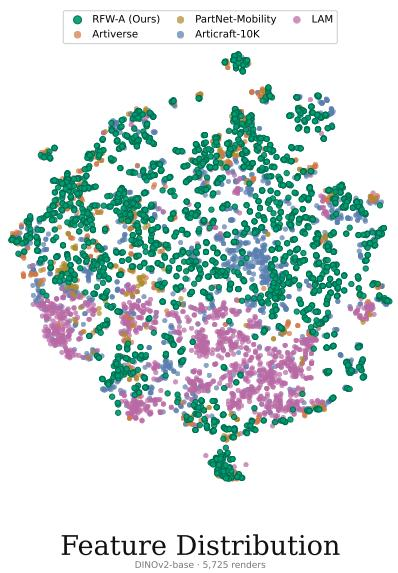

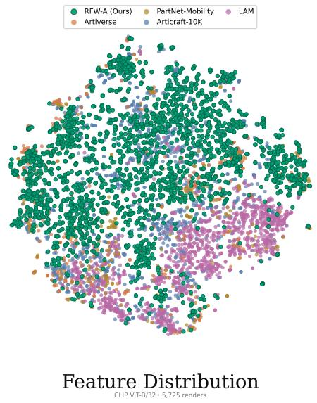  
Figure 11 Joint all-available t-SNE overviews in DINOv2-base (left) and CLIP ViT-B/32 (right) feature spaces. Within each encoder, panels use that encoder’s joint embedding coordinates and axis limits; the two encoders are embedded separately. Colors identify datasets (RFW-A uses larger outlined markers); all renders, including classes with fewer than five renders, are shown.

Table 12 Feature-space class consistency under standardized Blender rendering using all successfully rendered assets. Classes and renders include every available class and image; metric N excludes only images from singleton classes when a positive same-class pair is required. Top-1 and Top-4 are the same-class fractions among the nearest one and four neighbors, respectively. The cosine silhouette is $( b _ { i } - a _ { i } ) / \operatorname* { m a x } ( a _ { i } , b _ { i } )$ over L2-normalized features. The best value in each metric column is bold.
<table><tr><td>Dataset</td><td>Classes</td><td>Renders</td><td>Metric N</td><td>DINOv2 Top-1↑</td><td>DINOv2 Top-4↑</td><td>DINOv2 silh. ↑</td><td>CLIP Top-1↑</td><td>CLIP Top-4↑</td><td>CLIP silh. ↑</td></tr><tr><td>PartNet-Mobility</td><td>46</td><td>230</td><td>230</td><td>0.696</td><td>0.567</td><td>0.196</td><td>0.552</td><td>0.365</td><td>0.056</td></tr><tr><td>Artiverse</td><td>84</td><td>368</td><td>363</td><td>0.716</td><td>0.604</td><td>0.233</td><td>0.540</td><td>0.395</td><td>0.074</td></tr><tr><td>LAM</td><td>660</td><td>1,279</td><td>860</td><td>0.226</td><td>0.149</td><td>-0.301</td><td>0.152</td><td>0.113</td><td>-0.442</td></tr><tr><td>Articraft</td><td>244</td><td>1,193</td><td>1,187</td><td>0.530</td><td>0.413</td><td>0.073</td><td>0.405</td><td>0.266</td><td>-0.051</td></tr><tr><td>RFW-A-400K (Ours)</td><td>531</td><td>2,655</td><td>2,655</td><td>0.881</td><td>0.704</td><td>0.289</td><td>0.592</td><td>0.373</td><td>0.064</td></tr></table>

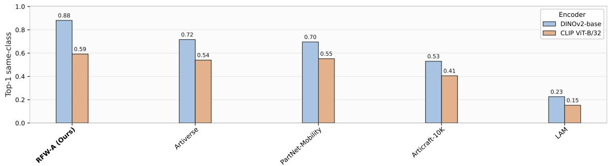

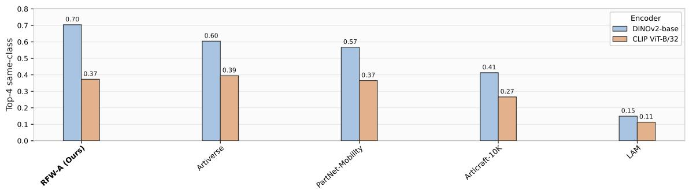

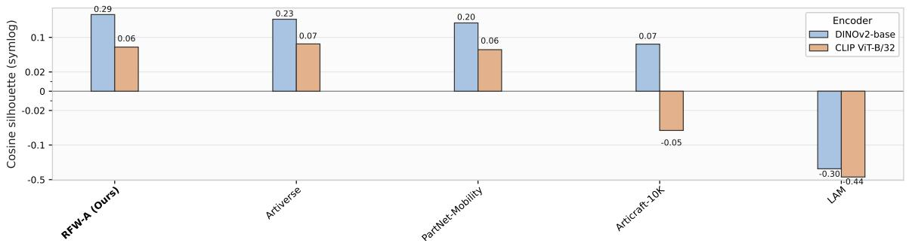  
Figure 12 All-available feature-space metrics reported in Table 12. Singleton classes are excluded only from metrics requiring a positive same-class pair; triangles mark the best value within each encoder.

## A.16 Downstream Articulation Estimation

Training configuration. All three models use the public Particulate-B architecture and the same loss, augmentation, and PartField features. We train each setting from random initialization with three independent training seeds for 180,000 optimizer updates on eight GPUs in FP32, with a global batch size of 128. AdamW uses $\beta = ( 0 . 9 , 0 . 9 9 9 )$ , weight decay 0.01, and $\epsilon = 1 0 ^ { - 8 }$ . The learning rate reaches $6 . 4 \times 1 0 ^ { - 5 }$ after 1,000 warm-up updates and follows a cosine schedule to $6 . 4 \times 1 0 ^ { - 6 }$ . We report the fixed 150K checkpoints for all three models and evaluation splits.

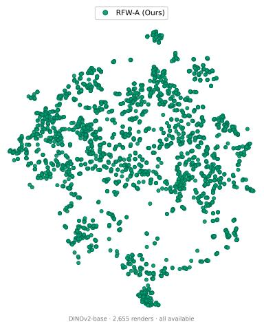

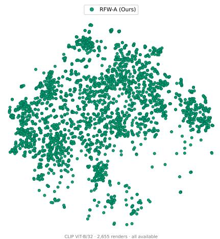  
Figure 13 All-available t-SNE for RFW-A in DINOv2-base (left) and CLIP ViT-B/32 (right) feature spaces. Each panel reuses the corresponding joint coordinates and axis limits; dataset colors match the overview and all rendered images are shown.

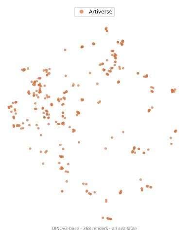

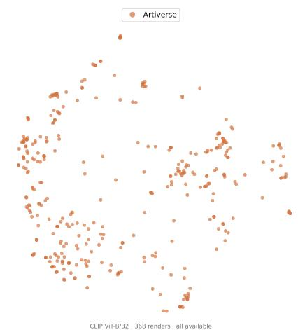  
Figure 14 All-available t-SNE for Artiverse in DINOv2-base (left) and CLIP ViT-B/32 (right) feature spaces. Each panel reuses the corresponding joint coordinates and axis limits; dataset colors match the overview and all rendered images are shown.

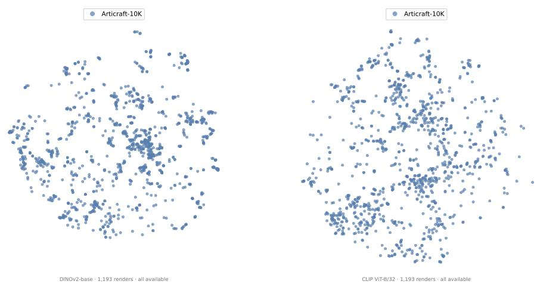  
Figure 15 All-available t-SNE for Articraft-10K in DINOv2-base (left) and CLIP ViT-B/32 (right) feature spaces. Each panel reuses the corresponding joint coordinates and axis limits; dataset colors match the overview and all rendered images are shown.

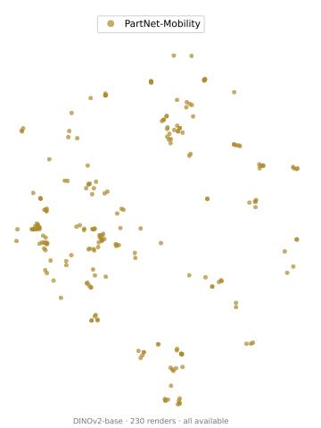

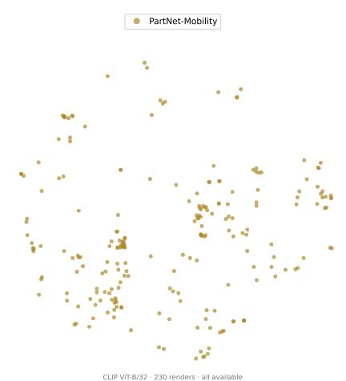  
Figure 16 All-available t-SNE for PartNet-Mobility in DINOv2-base (left) and CLIP ViT-B/32 (right) feature spaces. Each panel reuses the corresponding joint coordinates and axis limits; dataset colors match the overview and all rendered images are shown.

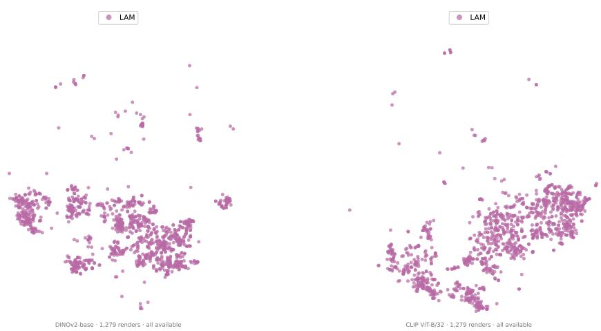  
Figure 17 All-available t-SNE for LAM in DINOv2-base (left) and CLIP ViT-B/32 (right) feature spaces. Each panel reuses the corresponding joint coordinates and axis limits; dataset colors match the overview and all rendered images are shown.

The training sets contain 2,087 PM assets, 9,383 Articraft assets, and 264,025 assets from RFW-A-400K. PM-only draws exclusively from PM. Each augmented run first selects PM or its additional source with probabilities 0.1 and 0.9, then samples uniformly within that source with replacement. At 150K updates, each run has processed 19.2 million sample draws. The augmented settings sample PM with probability 0.1, giving them one tenth of the expected PM exposure of the PM-only setting. The comparison fixes the model and number of training updates, while the additional datasets difer in size and repetition frequency.

Training and evaluation separation. The training subset of RFW-A-400K excludes nine categories: wheelchair, seesaw, skateboard, telescope, fire hydrant, music stand, wheelbarrow, tricycle, and walking cane. Semantically corresponding Articraft categories are excluded before training. Of the 9,996 assets in the compiled Articraft release used here, 225 are removed by this category filter. Preprocessing and the training/evaluation partition yield the final 9,383 training assets.

Within the six PM evaluation categories, we reserve at least 10% of usable Articraft objects per category before training, keeping exact rest-geometry duplicate groups together. This produces 61 evaluation objects.

We add 120 additional evaluation objects, contributing 20 objects per category. Their source identifiers are held out from the training partition. Exact rest-surface checks compare the evaluation split internally and against Articraft training geometry. Cross-source near-duplicate detection and geometric duplicate checks against the complete PM and RFW-A-400K training sets remain outside the scope of this audit.

In-domain evaluation composition. The original PM evaluation split contains 74 objects across six categories, including 55 storage-furniture objects but only one oven and one washing machine. We expand this set with 61 Articraft objects reserved before training and 120 additional objects from the same categories. The resulting 255-object evaluation split is shared by all three models. Table 13 gives the category counts. The expansion reduces the storage-furniture share from 74.3% to 33.7% and increases the minimum category count to 27. Category and source counts remain unequal.

Table 13 Category and source composition of the in-domain evaluation split. The added objects belong to the same six categories as the original PartNet-Mobility evaluation split. All three models are evaluated on the complete combined split with equal weight per object.
<table><tr><td>Category</td><td>PM</td><td>Articraft</td><td>RFW-A (new)</td><td>Total</td></tr><tr><td>Dishwasher</td><td>4</td><td>4</td><td>20</td><td>28</td></tr><tr><td>Oven</td><td>1</td><td>11</td><td>20</td><td>32</td></tr><tr><td>Refrigerator</td><td>4</td><td>12</td><td>20</td><td>36</td></tr><tr><td>Storage furniture</td><td>55</td><td>11</td><td>20</td><td>86</td></tr><tr><td>Table</td><td>9</td><td>17</td><td>20</td><td>46</td></tr><tr><td>Washing machine</td><td>1</td><td>6</td><td>20</td><td>27</td></tr><tr><td>Total</td><td>74</td><td>61</td><td>120</td><td>255</td></tr></table>

Category-OOD evaluation. The category-OOD evaluation contains 774 objects from the nine excluded categories listed above, with equal weight per object. These categories are absent from all three training sets. We reuse earlier PM-only and PM+RFW-A-400K evaluations and evaluate PM+Articraft separately on another machine. The checkpoint steps and evaluation protocol match, but the PM-only and PM+RFW-A-400K settings were not rerun in the new environment to verify numerical consistency.

Metrics and aggregation. Each inference uses 102,400 input points, and metrics use 100,000 evaluation points. Rest-pose metrics comprise mean IoU (mIoU), generalized IoU (gIoU), and part-wise bidirectional Chamfer distance (PC). Predicted and ground-truth parts are matched using the public Particulate evaluator. An unmatched part receives its prescribed penalty: −1 for gIoU, 0 for mIoU, and half the input bounding-box diagonal for PC. After moving parts to their maximum articulated states, we report gIoU, PC, and whole-object bidirectional Chamfer distance (OC). OC compares the complete moved point clouds without part matching.

For each model, training seed, and evaluation seed, we average per-object metrics over all 255 indomain objects or all 774 category-OOD objects, then average over the five fixed evaluation seeds {10101, 20202, 30303, 40404, 50505}. Training source probabilities are not used as evaluation weights. The reported means aggregate three training seeds × five evaluation seeds per setting. Statistical significance within each source or category requires separate evaluation. Relative gains in Table 2 are computed against PM+Articraft from the five-decimal means: (s − b)/b for higher-is-better metrics and (b − s)/b for distances, where s is the PM+RFW-A-400K score and b is the PM+Articraft score.

Original PM evaluation split. Table 14 reports a separate evaluation of the 150K checkpoints on the original 74-object PM evaluation split. PM-only has the best rest-pose mIoU and gIoU and articulated gIoU. PM+Articraft has the lowest rest-pose PC, while PM+RFW-A-400K has the lowest articulated PC and OC. PM+RFW-A-400K improves five of six metrics over PM+Articraft; rest-pose PC is the exception. These scores are not a source-level breakdown of the combined evaluation results: the two evaluations use independently prepared ground-truth caches and diferent sample ordering.

Table 14 Articulation estimation on the original PartNet-Mobility evaluation split using the three 150K checkpoints. Results average three training seeds × five evaluation seeds; bold marks the best result. This original split contains 55 storage-furniture objects and 19 objects across the other five categories.
<table><tr><td rowspan="2">Training data</td><td colspan="3">Rest-Pose Segmentation</td><td colspan="3">Articulated Geometry</td></tr><tr><td>mIoU ↑</td><td>gIoU ↑</td><td>PC↓</td><td>gIoU ↑</td><td>PC↓</td><td>OC↓</td></tr><tr><td>PM-only</td><td>0.79658</td><td>0.75910</td><td>0.02554</td><td>0.73732</td><td>0.09812</td><td>0.01114</td></tr><tr><td>PM+Articraft</td><td>0.77070</td><td>0.73300</td><td>0.02276</td><td>0.70978</td><td>0.09562</td><td>0.01232</td></tr><tr><td>PM+RFW-A-400K</td><td>0.78706</td><td>0.74752</td><td>0.02442</td><td>0.72360</td><td>0.08508</td><td>0.01028</td></tr></table>

## A.17 Generator Component Ablation

## Completed Category-Level Results

We evaluate the generator components on flip\_phone, microscope, and folding\_chair under a unified paired protocol. For each category, all four variants use the same raw source pool, backbone, execution environment, seed protocol, rendering settings, evaluators, and failure-handling rules; only the ablated component changes. Tables 15 and 16 summarize the results. Mean Judge, component scores, Avg. Iter., and Est. Cost are category means, while Strict Valid is pooled across all evaluation attempts.

Table 15 Aggregate generator-component ablation outcomes across flip\_phone, microscope, and folding\_chair. Mean Judge and Avg. Iter. are category means; Strict Valid reports pooled counts.
<table><tr><td>Variant</td><td>Mean Judge</td><td>Strict Valid</td><td>Avg. Iter.</td><td>Est. Cost ($)</td></tr><tr><td>w/o Component Extraction</td><td>0.500</td><td>35/108</td><td>9.33</td><td>3.80</td></tr><tr><td> $\mathrm { w / o }$  Structural Blueprint</td><td>0.401</td><td>72/108</td><td>11.33</td><td>3.73</td></tr><tr><td>w/o Validation &amp; Repair</td><td>0.241</td><td>0/108</td><td>0.00</td><td>0.83</td></tr><tr><td>RFW-A (full)</td><td>0.580</td><td>108/108</td><td>8.00</td><td>6.73</td></tr></table>

Metric definitions. Mean Judge summarizes geometry, aesthetics, and semantic quality on a 0–1 scale, with equal weight for each category. Generation or rendering failures score zero. Scoring details are given in Table 16. Strict Valid reports assets passing all required mechanical checks over total evaluation attempts; failed generation, missing outputs, crashes, and timeouts count as failures. Avg. Iter. is the average number of repair iterations per category, including unsuccessful runs. Zero denotes a disabled repair loop; bold marks the lowest average among repair-enabled variants. Est. Cost is the average estimated API cost of building a category generator, calculated from token usage and the corresponding rates. Failed runs are included; post-hoc evaluation and figure rendering are excluded.

Table 16 Mean component scores across flip\_phone, microscope, and folding\_chair for the same ablations. Each category receives equal weight; higher is better and bold marks the best mean in each column.
<table><tr><td>Variant</td><td>Geometry</td><td>Aesthetics</td><td>Semantic</td><td>Judge</td></tr><tr><td> $\mathrm { w } / \mathrm { o }$  Component Extraction</td><td>5.17</td><td>4.83</td><td>6.50</td><td>0.500</td></tr><tr><td> $\mathrm { w } / \mathrm { o }$  Structural Blueprint</td><td>4.67</td><td>3.83</td><td>5.33</td><td>0.401</td></tr><tr><td> $\mathrm { w } / \mathrm { o }$  Validation &amp; Repair</td><td>2.42</td><td>2.83</td><td>3.25</td><td>0.241</td></tr><tr><td>RFW-A (full)</td><td>6.25</td><td>5.42</td><td>7.00</td><td>0.580</td></tr></table>

Judge criteria and protocol. Geometry assesses completeness, proportions, assembly, and visible geometric defects. Aesthetics assesses visual coherence, refinement, and design quality. Semantic fidelity assesses consistency with the target category and the presence of expected functional parts. For successfully evaluated assets, each dimension is rated from 1 to 10 and normalized as s = max(0, min(1, (v − 1)/9)); per-asset Judge is the mean of the three normalized scores. The prescribed evaluation protocol requires four held-out Judge seeds for every category and variant, selected from that category’s hidden seed pool; all four variants share the same four seed IDs. Rendering settings and the Judge model, model version, prompt, temperature, and response parser are fixed. Judging is anonymous and blind: method names, variant identities, and Strict Valid outcomes are withheld from the Judge. Generation or rendering failures receive zero for all three dimensions and Judge and remain in the denominator. Scores are averaged within each category and then across categories with equal weight.

(b) Microscope seed 50000 | front three-quarter view  
(c) Folding chair seed 2 | shared single view  
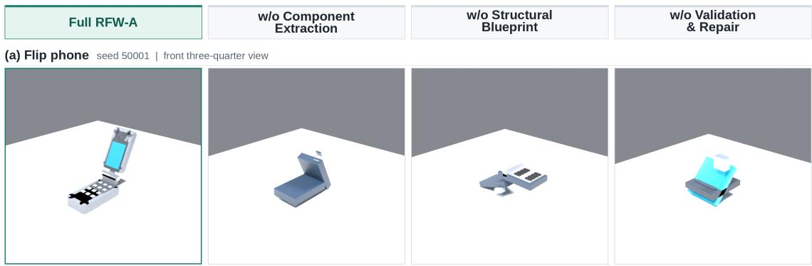

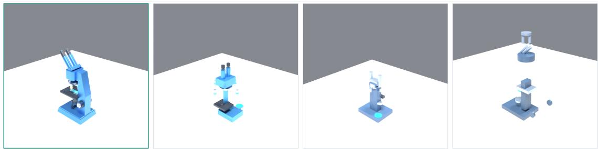

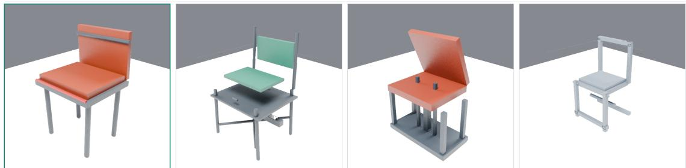  
Figure 18 Qualitative comparison of generator-component ablations. Rows show (a) flip phone, (b) microscope, and (c) folding chair. From left to right, columns compare full RFW-A with variants removing Component Extraction, Structural Blueprint, and Validation & Repair, respectively. Quantitative results are reported in Tables 15 and 16. The panels are qualitative visual examples; mechanical validity is measured by the strict-validity probes in these tables.

The ablation separates the roles of the three generator components. The full configuration reaches the highest mean Judge score (0.580) and passes all 108 strict validity probes. Removing component extraction reduces the score to 0.500 with 35/108 probes passing, and removing the structural blueprint reduces it to 0.401 with 72/108 passing. Removing validation and repair reduces the score to 0.241 and yields 0/108 strict-valid assets. The consistent gap from the full configuration demonstrates the contribution of each component to quality and executable validity. The full configuration costs \$6.73 per category on average over the three ablated categories; this estimate reflects the complete synthesis and repair process.

## A.18 Cabinet Generator Families

Figure 2 in the main text shows variants drawn from a single reusable cabinet generator. Figure 19 extends this example to four cabinet generators: a cabinet generator with drawers, a cabinet generator with drawers and doors, a cabinet generator with doors, and the hutch cabinet generator of Figure 2. The four generators encode diferent component vocabularies and proportions, so their families difer in the available drawer and door configurations. Within each family, sampled assets vary component choices, materials, drawer and door layouts, and appearance, while panel sizing, part placement, and joint attachment follow the shared rules encoded once in the generator. Each generator reproduces its reference configuration and produces structurally consistent variants without per-asset re-authoring. These families illustrate how resampling a shared program produces diverse configurations while preserving category-level construction logic.

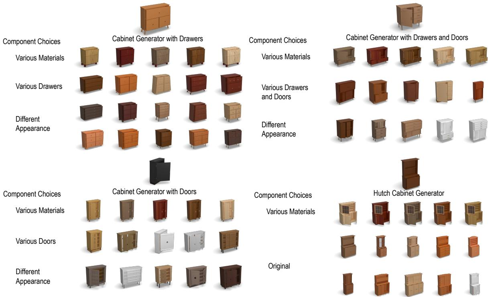  
Figure 19 Cabinet generator families. Each panel shows assets sampled from one reusable procedural cabinet generator: (top left) a cabinet generator with drawers, (top right) a cabinet generator with drawers and doors, (bottom left) a cabinet generator with doors, and (bottom right) the hutch cabinet generator of Figure 2, whose row labeled Original reproduces the reference asset; all other rows and columns are generated variants. Within each panel, rows vary component choices, materials, drawer and door layouts, and appearance while the generators preserve shared rules for panel sizing, part placement, and joint attachment.

## B Future Work

RFW-A could support the construction of larger-scale embodied datasets and benchmarks, including synthetic demonstrations, VLA training, and bimanual or sim-to-real settings that go beyond the five tasks evaluated in Section 6 [10, 14, 36, 47, 59, 77, 93].

The articulated assets and physical annotations in RFW-A-400K could also serve as building blocks for interactive 3D/4D scene modeling and generative simulation [6, 7, 9, 23, 25, 39, 52, 63, 64, 76, 84, 87].

More broadly, RFW-A’s executable category-level generators could be integrated with general agentic 3D generation and editing systems, enabling agents to construct and modify programmable, articulated, and simulation-ready assets [12, 41, 46, 60, 61, 78, 85, 90].

## C Discussion and Limitations

RFW-A allows assets to be resampled and edited without a new agent call, but diversity remains limited by the source components and category blueprints. Expanding mechanism and object-family coverage requires extending these sources or blueprints. The cost benefit depends on construction and repair costs and the number of valid outputs; broader multi-category studies are needed to quantify savings and component contributions.

Validation covers sampled configurations and motion states; the full configuration space remains untested. Collisions can remain despite valid files (Appendix A.7). Real-world dynamic accuracy requires additional validation, and material properties are estimated under reference conditions rather than measured per object. Broader motion tests and validation against real-object behavior remain necessary.

Articulation-estimation results use one model family and three training seeds per setting. Category-OOD objects are drawn from the released corpus, leaving transfer to independently sourced assets untested. Dataset size, category coverage, and asset quality vary jointly under the matched training budgets; external benchmarks, additional models, and controlled data-size comparisons are needed.