# ROAD: Modern Adversarial Training for Simple One-Step Distillation at Scale

Xiaoou Li1 Shan You2 Tao Huang1

1Shanghai Jiao Tong University (sjtu.edu.cn) 2SenseTime (sensetime.com)

Code: https://github.com/Lixiaoou729/ROAD

## Abstract

One-step distillation turns pretrained difusion models into fast generators, but strong results often require substantial training machinery and compute. Pure adversarial distillation ofers a simpler route, yet has struggled at modern text-to-image scale. To address this limitation, we propose ROAD (Representation-grounded One-step Adversarial Distillation), a one-stage framework that distills text-to-image models with one adversarial objective and a lightweight representation-space critic. First, we replace the classical convolutional head with a Lipschitz-controlled Transformer head with token-level text conditioning, which matches the semantic tokens of modern visual encoders. Second, we observed a fixed random feature mixing leads to long-horizon degradation. We attribute it to generator–critic co-adaptation around one realization-specific view, and periodically re-draw the mixing to keep the randomization efective. Third, for our dense and vector-valued logits, we introduce Jacobian R1 which penalizes the full input–logit Jacobian, overcoming pooled R1’s limitation of neglecting most of logit sensitivities. A single adversarial objective then sufices: in one step, ROAD reaches 11.03 FID on SDXL and 13.73 on SD3.5-M on COCO-10K, surpassing the multi-step teachers at a fraction of distribution matching’s training compute.

## Contents

1 Introduction 3   
2 Preliminaries 4   
3 Scaling Pure Adversarial Distillation with a Representation-Grounded Critic 5   
3.1 A Transformer Head for Semantic Token Representations 5   
3.2 Periodic Mixing Refresh Prevents Critic Co-adaptation 7   
3.3 Jacobian R1 Regularization for Dense Critics 9   
3.4 The complete recipe. 10   
4 Experiments 10   
4.1 Main Results 11   
4.2 Ablation Study 12   
4.3 Further Analysis of Mixing, Regularization, and Augmentation 13   
5 Conclusion and limitations 14   
AI use statement 14   
Reproducibility statement 15   
References 15   
A Lipschitz Analysis of the Transformer Head 18   
B Persistent Random Mixing: Analysis and Diagnostics 21   
B.1 The implemented random mixing and anisotropy 21   
B.2 Gain-weighted correction under fixed and refreshed draws 22   
B.3 Diagnostics 23   
B.4 Longitudinal probes on a fixed-mixing run 24   
B.5 Scope of the account 24   
C Jacobian R1: Analysis and Estimation 24   
C.1 Jacobian R1 versus pooled R1 . 25   
C.2 Rademacher estimator: unbiasedness and variance 26   
C.3 Minibatch implementation and normalization 27   
D Related Work 27   
E Implementation Details 29   
E.1 Critic design . 29   
E.2 Dataset and evaluation protocols 30   
E.3 Training hyperparameters 31   
F Qualitative Results 32   
F.1 Prompts for Qualitative Figures 32   
F.2 Qualitative Samples from ROAD . 34   
F.3 Qualitative Comparison with Other Distillation Methods 36

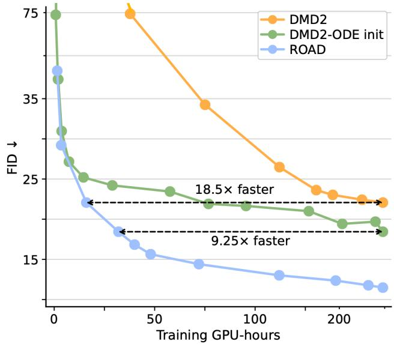  
Figure 1. A single adversarial loss sufices for one-step distillation. Left: samples from ROAD. Right: one-step SDXL FID vs. training GPU-hours (our runs). DMD2 starts from the base model; DMD2-ODE init [released recipe; 1] starts with a regression stage on teacher ODE pairs. ROAD needs no such stage, beats both baselines’ best FID early, and keeps improving.

## 1 Introduction

Difusion and flow models have achieved remarkable quality in text-to-image generation, but their iterative sampling remains expensive at inference time. Step distillation therefore aims to compress a many-step generator into one or a few evaluations. Paradoxically, however, the strongest one-step methods often simplify inference by making training substantially more complicated: distribution matching introduces an online score network at base-model scale [2–5], while competitive systems commonly rely on additional objectives, auxiliary models, or multiple stages (Tab. 2, Sec. D). Thus, one-step inference has become simple, but one-step training has not.

Adversarial distillation ofers a strikingly simpler alternative. Rather than matching scores or trajectories, it can train a one-step generator directly against real data with a single adversarial objective, without an online score network or repeated teacher queries. Yet this simplicity has not carried over to modern text-to-image models. Pure adversarial training at this scale has struggled with stability and prompt alignment [1, 6]. As a result, adversarial losses are typically used only to assist a heavier distillation objective [6, 7]. When adversarial training becomes the main objective, existing methods often recover performance by introducing other sources of complexity, such as teacher-generated supervision, previously distilled generators, or large trainable critics [8–10]. This leaves open a more fundamental question: is pure adversarial distillation itself unable to scale, or is the critic used to train it the actual bottleneck?

We investigate the latter possibility. The critic used in adversarial distillation is largely inherited from projected GANs [11, 12], while the representation space it operates on has changed substantially. Modern visual encoders such as DINOv3 and Perception Encoder already map images into contextual, semantically organized token representations [13, 14]. Yet these representations are still read through lightweight convolutional heads; the random feature transform is sampled once and held fixed throughout training; and gradient regularization acts only on a scalar obtained by pooling the dense critic outputs. We find that these seemingly innocuous design choices become increasingly restrictive at modern model scale. They limit how the critic interprets semantic representations, allow its judgments to become increasingly tied to a single feature view during prolonged optimization, and leave individual logit sensitivities insuficiently controlled. This diagnosis leads us to revisit pure adversarial distillation with a modern critic tailored to today’s representations and optimization dynamics, making its simple training recipe efective at text-to-image scale. We instantiate this idea in ROAD, Representation-grounded One-step Adversarial Distillation.

Reading modern representations with modern ViT heads. The inherited convolutional readout builds a visual pyramid over fixed neighborhoods, whereas modern token representations call for a head that selects and relates semantic evidence by content. We therefore use ViT heads made viable for adversarial training through Lipschitz controls, while cross-attention to individual prompt tokens improves text alignment. The resulting critic clearly outperforms similar-sized convolutional heads in fidelity and alignment (Sec. 3.1).

Keeping the random mixing random. Projected critics read the frozen features through a random mixing, drawn once and held fixed so that the critic does not rely on a few dominant feature directions [11]. This protection, however, does not last over long horizons: training under a fixed draw converges quickly, then oscillates and slowly deteriorates. We attribute this to generator–critic co-adaptation around one persistent view of the representation: directions measured weakly by that view can remain poorly corrected. ROAD periodically redraws the mixing while carrying forward the generator, heads, and optimizer states. This changes the feature view without restarting learning, limits prolonged co-adaptation, and sustains improvement where fixed-mixing runs deteriorate (Sec. 3.2).

Adapting R1 to dense, vector-valued critics. The classical R1 penalty regularizes a scalar critic through its input gradient on real images and is a staple of stable GAN training [15–17]. ROAD’s critic, however, is dense and vector-valued, and the adversarial loss acts on every logit, whereas the customary extension pools the logits into a scalar before applying R1 [18–20]. Pooling keeps only one direction of the critic’s output space, so the input–logit Jacobian’s sensitivities in every other direction, however large, never enter the penalty. The proposed Jacobian R1 (JR1) instead penalizes every logit’s input gradient, i.e., the squared Frobenius norm of the input–logit Jacobian. A single unbiased Hutchinson probe makes it practical with one vector–Jacobian product (Sec. 3.3).

ROAD proves to be a simple, low-cost, and strong one-step distillation method: with one loss and one stage, it reaches 11.03 FID on SDXL and 13.73 on SD3.5-M on COCO-10K. On SDXL, it reaches the best FID of ODE-initialized DMD2 using 1/9.25 of the training GPU-hours (Fig. 1).

## 2 Preliminaries

Pure adversarial one-step distillation. Given a pretrained text-to-image difusion model, we initialize a one-step student $G _ { \theta }$ from its architecture and weights. The student maps Gaussian noise $\epsilon \sim \mathcal { N } ( 0 , I )$ and a prompt $c \sim p _ { c }$ directly to an image at a fixed conditioning timestep, without querying the teacher thereafter. Following Projected GAN, the critic judges images through a frozen pretrained encoder F, whose features are tapped at $L = 4$ depths, $f _ { \ell } ( x )$ for $\ell = 1 , \ldots , L$ . The conditional head at level ℓ emits dense $N _ { \ell }$ per-position logits. Concatenating the logits across all levels gives a vector $D _ { \phi } ( x , c ) = [ D _ { 1 } ( x , c ) , \ldots , D _ { n } ( x , c ) ] ^ { \top } \in \mathbb { R } ^ { n }$ , where $\begin{array} { r } { n = \sum _ { \ell } N _ { \ell } } \end{array}$

For real image–prompt pairs $( x , c ) \sim p _ { r }$ , the critic and generator minimize, respectively,

$$
\begin{array} { r l } & { \mathcal { L } _ { D } = \mathbb { E } _ { ( x , c ) \sim p _ { r } } \Big [ \sum _ { i } \omega _ { i } \zeta \big ( - D _ { i } ( x , c ) \big ) \Big ] + \mathbb { E } _ { \epsilon , c } \Big [ \sum _ { i } \omega _ { i } \zeta \big ( D _ { i } ( G _ { \theta } ( \epsilon , c ) , c ) \big ) \Big ] , } \\ & { \mathcal { L } _ { G } = \mathbb { E } _ { \epsilon , c } \Big [ \sum _ { i } \omega _ { i } \zeta \big ( - D _ { i } ( G _ { \theta } ( \epsilon , c ) , c ) \big ) \Big ] , } \end{array}\tag{1}
$$

where $\omega _ { i } = 1 / n$ and $\zeta$ is the softplus function. These are the logistic critic and non-saturating generator losses [21], with the nonlinear loss applied to each logit before uniform averaging. We alternate minimizing $\mathcal { L } _ { G }$ over $\theta$ and $\mathcal { L } _ { D } + R _ { D }$ over $\phi ,$ where $R _ { D }$ is the critic gradient penalty defined below and is zero in unregularized configurations.

Random mixing in projected critics. Projected GAN feeds the frozen features through nonlearned random afine maps (i.e., CCM and CSM) before the trainable multi-scale heads. CCM reorganizes channels within each feature level, and CSM further combines information from diferent levels along a top-down path. We denote the collection of mixing parameters by $M ,$ the critic’s measurement basis (subscripts index feature levels; parenthesized superscripts index draws). Schematically,

$$
\tilde { f } _ { \ell } = M _ { \ell } ^ { \mathrm { c c } } f _ { \ell } , \qquad \hat { f } _ { \ell } = M _ { \ell } ^ { \mathrm { c s } } \bigl ( \hat { f } _ { \ell + 1 } + \tilde { f } _ { \ell } \bigr ) , \qquad \hat { f } _ { L } = M _ { L } ^ { \mathrm { c s } } \tilde { f } _ { L } ,\tag{2}
$$

where the top-down recursion applies for $\ell = L - 1 , \cdots , 1$ . In the classical design, these maps are sampled at initialization and then held fixed. By expressing pretrained features in mixed coordinates, the heads base their decisions on combinations of cues across channels and depths. This prevents the discriminator from relying solely on a few dominant feature directions and encourages broader feature use [11].

Pooled R1 regularization. For the vector-valued critic of Eq. (1), the pooled R1 first averages the n logits and applies the classical R1 penalty to the resulting scalar:

$$
R _ { 1 } ^ { \mathrm { p o o l } } = \frac { \gamma } { 2 } \mathbb { E } _ { ( { \boldsymbol { x } } , { \boldsymbol { c } } ) \sim p _ { r } } \big \lVert \nabla _ { \boldsymbol { x } } \big ( \frac { 1 } { n } \sum _ { i } D _ { i } ( { \boldsymbol { x } } , { \boldsymbol { c } } ) \big ) \big \rVert _ { 2 } ^ { 2 } .\tag{3}
$$

This pooled form controls the input sensitivity of the averaged logit. The common practice is to apply this regularization lazily to reduce cost [16, 20].

## 3 Scaling Pure Adversarial Distillation with a Representation-Grounded Critic

ROAD trains the one-step student with the dense adversarial losses and the JR1 penalty against a projected critic assembled from three parts: the frozen encoder, the random mixings, which ROAD periodically re-draws, and trainable Transformer heads that attend to the prompt’s text tokens and emit dense per-position logits (Fig. 2). The teacher appears only as the student’s initialization.

## 3.1 A Transformer Head for Semantic Token Representations

A natural starting point is to retain the convolutional discriminator design of Projected GAN [11]. In our one-step distillation setting, this convolutional (Conv) readout remains trainable but underperforms in both image quality and prompt adherence, and simply increasing its capacity (Deep Conv) further degrades performance, as shown in rows 1 and 2 of Tab. 1, respectively.

We attribute this to a change in what the trainable head is for. A modern ViT backbone such as DINOv3 already maps an image into a contextual, semantic representation space, and every tap returns the same number of tokens. The head need not rebuild the visual pyramid that projected

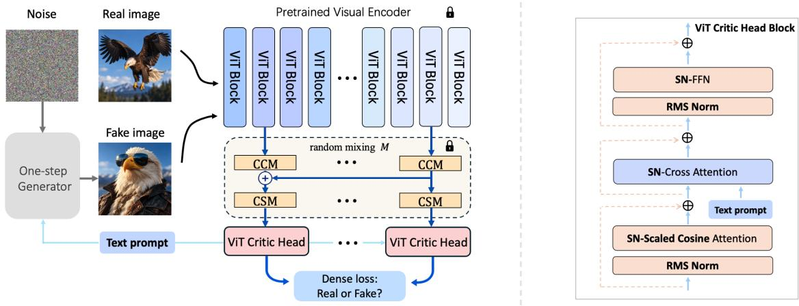  
Figure 2. Overall architecture and critic head’s ViT block of ROAD. Left: generated and real images are encoded into multi-level semantic features, transformed by periodically re-drawn random mixings M, and scored by Transformer critic heads. Right: a Lipschitz-controlled ViT block uses spectral-normalized scaled-cosine self-attention, token-level cross-attention, and an FFN, together with RMSNorm and learnable residual scales.

Table 1. Critic head design and text conditioning. Fixed mixing and pooled R1 are used with 2B generator (SDXL). Left: Conv follows the convolutional head of Projected GAN. Raising its capacity does not improve performance, whereas our ViT head substantially improves both fidelity and alignment; the naive Transformer head collapses. Right: Pooled-text projection provides only a minor gain over the unconditional critic, whereas token-level cross-attention yields a stronger improvement in text–image alignment.
<table><tr><td></td><td>Critic head</td><td>Param.</td><td>FID ↓</td><td>CLIP ↑</td></tr><tr><td>1</td><td>Conv</td><td>24.8M</td><td>19.02</td><td>0.317</td></tr><tr><td>2</td><td>Deep Conv</td><td>54.8M</td><td>21.52</td><td>0.311</td></tr><tr><td>3</td><td>Naive Transformer</td><td>54.4M</td><td>Collapse</td><td></td></tr><tr><td>4</td><td>ViTGAN</td><td>54.3M</td><td>15.40</td><td>0.319</td></tr><tr><td>5</td><td>ViT (ours)</td><td>54.3M</td><td>14.54</td><td>0.331</td></tr></table>

<table><tr><td></td><td>Text conditioning</td><td>CLIP ↑</td></tr><tr><td>6</td><td>Unconditional</td><td>0.320</td></tr><tr><td>7</td><td>Miyato-style</td><td>0.322</td></tr><tr><td>8</td><td>pooled-text projection Token-level cross-attention</td><td>0.331</td></tr></table>

GAN’s convolutional heads construct; it has only to decide which tokens matter and how they relate. Convolution aggregates over predetermined neighborhoods with fixed, translation-shared weights, an inductive bias suited to building a hierarchy from raw pixels rather than to reading backbone features: two tokens are combined because they are adjacent, not because their content is related. Self-attention decides instead from the tokens themselves which of them are combined and how strongly, which makes a Transformer head the more promising choice.

Lipschitz control, however, is necessary to make this replacement viable in the adversarial game [22, 23]. It limits how strongly the critic can amplify changes in its input and thereby constrains abrupt variation in the signal returned to the generator. A naive Transformer head collapses in our setting (Tab. 1, row 3). This failure is consistent with a known dificulty: standard dot-product softmax attention is not globally Lipschitz in its inputs, even when the learned linear maps have bounded spectral norm [24].

A Lipschitz-controlled ViT head is therefore introduced, which constrains the gain of every trainable component through three complementary mechanisms. First, spectral normalization [23] is applied to every learned linear map in attention, the FFN, and the logit readout, so that its spectral norm is no more than 1. Second, cosine attention with a clamped temperature normalizes every query and key before their comparison under a learnable per-head temperature clamped at $s _ { \mathrm { m a x } }$ [25]. This removes their raw activation magnitudes from the attention logits and bounds the remaining scale explicitly. Third, each residual branch uses a learnable per-channel scale initialized to $1 / B _ { \ell }$ for a level-ℓ head of depth $B _ { \ell }$ , preventing the cumulative residual gain from growing excessively with the head depth. On any convex region where queries and keys keep a norm floor before $\ell _ { 2 }$ -normalization, these controls make the head’s map from mixed tokens to logits Lipschitz with the explicit constant $\Lambda _ { \ell }$ of Eq. (7), proved as Lemma A.1 in Sec. A.

With the controls in place, the ViT head trains successfully and substantially improves the quality of generated images (Tab. 1, row 5). ViTGAN [26] provides an alternative ViT discriminator design, but remains inferior to our head under the same protocol (Tab. 1, row 4). The weak prompt adherence long associated with adversarial distillation, however, persists [1, 6]. Comparing textconditioning schemes, we attribute this shortfall to the pooled prompt vector: a single pooled embedding cannot express fine-grained linguistic structure.

Token-level text conditioning via cross-attention. The Transformer head admits token-level cross-attention naturally, and cross-attention provides a direct mechanism for image tokens at diferent spatial positions to interact diferently with individual text tokens. We insert cosine cross-attention into the first block of every head, with subsequent blocks refining the conditioned representation through self-attention and FFN layer. Each level keeps its own text key/value projections, allowing diferent semantic depths to read the same prompt diferently. Under the unified protocol, Miyato-style pooled-text projection provides only a minor improvement over the unconditional critic, whereas token-level cross-attention yields a much stronger gain in CLIP score (Tab. 1, rows 6-8).

Multi-branch random mixing. Projected GAN’s random mixing is tailored to a convolutional pyramid, where CCM is a 1×1 convolution within a level and CSM adds 3×3 convolutions between levels of difering resolution. A ViT backbone has no such pyramid, since all taps share one uniform patch-token grid, so both maps reduce to a plain 1×1 convolution that mixes channels alone. We therefore replace each single-kernel mixing by an average of three size-preserving random convolutions over the patch tokens, with kernels 1×1, 3×3, and $5 \times 5 ;$ the summary token is transformed separately by a random linear map. The wider branches let a token’s mixed value draw on its spatial neighbors, so evidence is spread across positions as well as channels and depths. Sec. 4.3 shows the advantage of this design. These frozen multi-branch maps constitute the mixing M that Sec. 3.2 re-draws, and Sec. B.1 gives its matrix form and analyzes its anisotropy.

## 3.2 Periodic Mixing Refresh Prevents Critic Co-adaptation

With the Transformer head of Sec. 3.1, training converges quickly to good performance, then begins to oscillate and slowly deteriorate (Fig. 3a). The symptom resembles discriminator overfitting, yet standard augmentation remedies such as DifAugment [27] and ADA [28] do not materially alleviate this late-stage degradation under fixed mixing (Sec. 4.3). We therefore examine other possible causes and finally focus on the random mixing, held fixed throughout training in the classical design. We argue that its anisotropy persistently biases long-horizon optimization toward the same feature directions. The generator and the critic then form a realization-specific co-adaptation around this single view, which eventually erodes generation quality.

A persistent critic state. We diagnose the critic with two measurements, Pre-projection Feature Utilization Coverage (PFUC) and the logit margin (Sec. B.3). PFUC is the first-order sensitivity of the critic’s mean logit to each backbone channel before mixing, expressed in backbone coordinates.

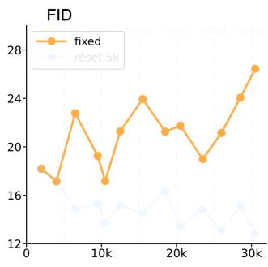  
(a) FID vs. training steps

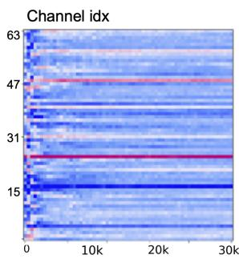  
(b) PFUC vs. training steps

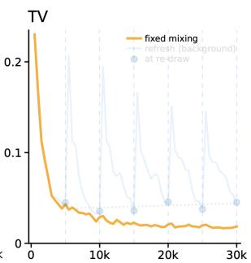  
(c) PFUC change vs. training steps

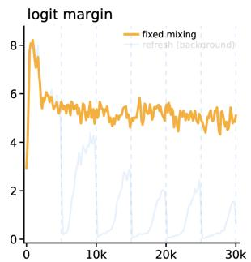  
(d) logit margin vs. training steps  
Figure 3. Diagnosing co-adaptation under fixed random mixing. (a) FID oscillates and eventually deteriorates. (b) PFUC settles into a persistent per-channel pattern. (c) The change between consecutive PFUC profiles, measured by total variation (TV), decays toward a floor. (d) The logit margin stays high and nearly stationary even as FID degrades. The twin run refreshed every 5k steps is faded for reference. Sec. B.3 describes the measurements in detail.

It settles after an early phase of training and barely moves thereafter (Fig. 3b): the TV between consecutive profiles decays to a floor (Fig. 3c). The logit margin is the batch-mean real logit minus the batch-mean generated logit, measuring how confidently the critic separates the two populations. After the first few thousand steps, the margin stays large and nearly stationary (Fig. 3d), even though FID has already begun its usual oscillation and deterioration. Because the generator is still changing, a critic decision that has stopped moving is not by itself a healthy sign. Together, the panels show a persistent critic state, i.e., hardened per-channel sensitivity profile and stationary logit margin.

Coupling to the fixed mixing. Write the critic as $D _ { \phi } \big ( M ^ { ( 0 ) } f ( x ) \big )$ , where $M ^ { ( 0 ) }$ is the training draw. Across training, $D _ { \phi }$ supplies the generator with an optimization signal shaped by this one realization. Gradually $M ^ { ( 0 ) }$ is absorbed into the critic’s parameters and becomes the fixed geometry within which the adversarial game continues to be optimized. Finally, the way the signal uses the features itself hardens, producing the phenomena of Fig. 3b–d. We test this account with two post-hoc experiments: fresh-draw transfer and a linear probe. First, we hold one checkpoint fixed and replace only $M ^ { ( 0 ) }$ by independently drawn mixings. Across six checkpoints from 5k to 30k steps, the logit margin is about 5.0 under $M ^ { ( 0 ) }$ but about 0 under a fresh draw, indicating the critic’s real–generated separation does not transfer to a fresh measurement basis. Second, at each level, we fit a separate linear classifier to the frozen mixed features to distinguish real from generated samples. From 2.5k steps on, the two populations are harder to separate under $M ^ { ( 0 ) }$ than under a fresh draw, particularly at the shallow levels. This suggests that what still distinguishes generated from real images is least visible under $M ^ { ( 0 ) }$ , the view through which the generator was trained. The two diagnostics together show that the critic’s separation is specific to the pairing $D _ { \phi } \circ M ^ { ( 0 ) }$

Anisotropy-based co-adaptation ends in degradation. Stack the frozen features as $f$ and write the afine mixing as ${ \hat { f } } = M f + b \ ( { \mathrm { S e c . ~ B . 1 } } )$ . As a random M is anisotropic (Sec. B.1), the gain $\lambda _ { M } ( \eta ) = \| M \eta \|$ that it applies to a unit feature direction $\eta$ varies widely from one direction to another. This gain decides both how much the critic’s logits change when the features move along a direction and how much of the generator’s correction reaches it. Specifically, the directional derivatives of the critic and the generator along $\eta$ are bounded as $| \langle \eta , \nabla _ { f } D _ { i } \rangle | \leq \lambda _ { M } ( \eta ) \Lambda _ { \ell }$ and $| \langle \eta , \nabla _ { f } \mathcal { L } _ { G } \rangle | \leq \lambda _ { M } ( \eta ) \| \nabla _ { \hat { f } } \mathcal { L } _ { G } \|$ , where $\Lambda _ { \ell }$ is the Lipschitz bound of Lemma A.1 for the level-ℓ head that produces $D _ { i }$ . So a small-gain direction moves the logits little and is slowly corrected in the generator, however the critic behaves; we call it weakly measured. The minimal measured-gap surrogate in Prop. B.1(i) shows the feature-space residual between generated and real data decays along a right-singular direction at a rate equal to the square of that direction’s gain. In light of the proposition, high-gain directions are corrected early, whereas weakly measured directions persist, concentrating the surviving residual in them. We thus hypothesize that an unchanging gain landscape sustains realization-specific co-adaptation.

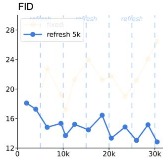  
(a) FID vs. training steps

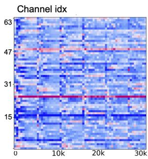  
(b) PFUC vs. training steps

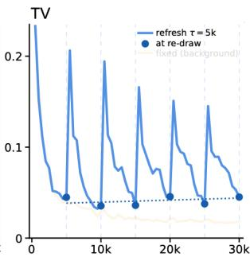  
(c) PFUC change vs. training steps

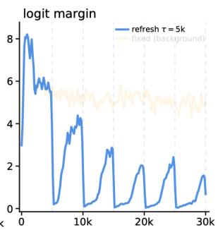  
(d) logit margin vs. training steps  
Figure 4. Periodic mixing refresh breaks the persistent critic state. The refreshed run (blue, every 5k steps) is foregrounded, with fixed mixing faded for reference. (a) FID improves after re-draws and avoids the late deterioration of fixed mixing. (b) PFUC reorganizes under each new view. (c) The PFUC change spikes after each re-draw and then decays; filled dots mark the value at each re-draw. (d) The logit margin resets toward zero at each re-draw and re-forms as the heads adapt.

Periodic mixing refresh suppresses co-adaptation-induced degradation. Given a refresh interval $\tau ,$ at the start of the k-th period we re-draw the mixing $M ^ { ( k ) }$ from its initialization law. The generator, the critic heads, and the optimizer states remain unchanged, and no learnable parameter is reset or added. Each re-draw replaces the draw-specific gain landscape, so a residual direction that is weakly measured under $M ^ { ( k ) }$ may receive a higher gain under $M ^ { ( k + 1 ) }$ Under the right-isotropy assumption, independent re-draws prevent any fixed direction from retaining a privileged slow correction rate (Prop. B.1(ii)). After a refresh, the critic heads adapted to the preceding mixing are therefore temporarily mismatched with the new measurement geometry. Accordingly, PFUC reorganizes at each re-draw (Fig. $^ { 4 \mathrm { b } , \mathrm { c } ) }$ , while the logit margin resets toward zero and then re-forms as the heads adapt (Fig. 4d). By shortening how long the generator–critic pair can co-adapt to one fixed view, periodic refresh interrupts realization-specific co-adaptation and can re-expose weak residual directions to adversarial correction. Consistent with this mechanism, the refreshed run re-enters an improving trajectory after re-draws and maintains a more stable and lower FID over long-horizon training (Fig. 4a).

## 3.3 Jacobian R1 Regularization for Dense Critics

The objective in Eq. (1) defines per-logit nonlinear loss across positions and levels. So its regularizer should control the sensitivities of these individual decisions, not only their aggregate. We abbreviate the vector-valued logit $D _ { \phi } ( x , c )$ as $D ( x )$ as both $\phi$ and c are fixed for gradient regularization. Let $J ( x ) = { \partial D ( x ) } / { \partial x } \in \mathbb { R } ^ { n \times d _ { x } }$ where $d _ { x }$ is input dimension, with the i-th row being $g _ { i } ^ { \top } { = } ( \nabla _ { x } D _ { i } ) ^ { \top }$

Pooled R1 misses logit sensitivities. To facilitate analysis, we write the pooled R1 as

$$
\begin{array} { r } { R _ { 1 } ^ { \mathrm { p o o l } } = \frac { \gamma } { 2 } \mathbb { E } _ { \boldsymbol { x } \sim p _ { r } } \frac { 1 } { n ^ { 2 } } \| \boldsymbol { J } ( \boldsymbol { x } ) ^ { \top } \mathbf { 1 } \| _ { 2 } ^ { 2 } = \frac { \gamma } { 2 } \mathbb { E } _ { \boldsymbol { x } \sim p _ { r } } \big \| \frac { 1 } { n } \sum _ { i = 1 } ^ { n } g _ { i } ( \boldsymbol { x } ) \big \| _ { 2 } ^ { 2 } , } \end{array}\tag{4}
$$

which penalizes the squared norm of the averaged gradient. The per-image energy $q _ { \mathrm { p o o l } } ( x ) =$ $\textstyle { \frac { 1 } { n ^ { 2 } } } \| J ( x ) ^ { \top } \mathbf { 1 } \| _ { 2 } ^ { 2 } = { \frac { 1 } { n ^ { 2 } } } \mathrm { t r } ( J ^ { \top } \mathbf { 1 } \mathbf { 1 } ^ { \top } J )$ shows that pooled R1 only regularizes the direction spanned by the all-ones vector in the n-dimensional output space, while leaving the remaining $n { - } 1$ directions unpenalized. Particularly, for $J ^ { \top } \mathbf { 1 } = 0$ the averaged logit is insensitive to every input perturbation to first order, while the individual logits need not be. In this case, pooled R1 does not impose any regularization at all, even though the dense loss of Eq. (1) is driven by those individual logits.

JR1 exploits full logit sensitivities. Motivated by input–output Jacobian sensitivity [29] and logit-level gradient penalties [30], we penalize the full input–logit Jacobian:

$$
\begin{array} { r } { R _ { 1 } ^ { \mathrm { J } } = \frac { \gamma _ { \mathrm { J } } } { 2 } \mathbb { E } _ { x \sim p _ { r } } \frac { 1 } { n } \| J ( x ) \| _ { F } ^ { 2 } = \frac { \gamma _ { \mathrm { J } } } { 2 } \mathbb { E } _ { x \sim p _ { r } } \frac { 1 } { n } \sum _ { i = 1 } ^ { n } \| g _ { i } ( x ) \| _ { 2 } ^ { 2 } . } \end{array}\tag{5}
$$

So JR1 penalizes the mean of the individual squared norms rather than the squared norm of the mean. In light of the per-image energy $\begin{array} { r } { q _ { \mathrm { J a c } } ( x ) = \frac { 1 } { n } \lVert J ( x ) \rVert _ { F } ^ { 2 } } \end{array}$ , all n directions of output space are regularized, including the $n { - } 1$ that pooled R1 neglects. Particularly, when $J ^ { \top } \mathbf { 1 } = 0 ;$ , pooled R1 imposes no regularization while JR1 retains every individual sensitivity. Prop. C.1 provides detailed theoretical comparison between pooled R1 and JR1.

Eficient estimation with Hutchinson probes. Exact JR1 requires backpropagating each of the n logits separately, i.e., one vector–Jacobian product (VJP), which is computationally expensive. We instead use the classical Hutchinson trace estimator [31], following its use for Jacobian regularization [30, 32]. Let $v \in \{ - 1 , + 1 \} ^ { n }$ have independent, equiprobable signs, so that $\mathbb E [ v v ^ { \top } ] = I _ { n } . \mathrm { ~ A s ~ } \mathbb E _ { v } \| J ^ { \top } v \| _ { 2 } ^ { 2 } = \mathrm { t r } ( J ^ { \top } \mathbb E [ v v ^ { \top } ] J ) = \| J \| _ { F } ^ { 2 }$ , we have

$$
R _ { 1 } ^ { \mathrm { J } } = \frac { \gamma _ { \mathrm { J } } } { 2 n } \mathbb { E } _ { \boldsymbol { x } \sim p _ { r } } \mathbb { E } _ { \boldsymbol { v } } \big \| \boldsymbol { J } ( \boldsymbol { x } ) ^ { \top } \boldsymbol { v } \big \| _ { 2 } ^ { 2 } .\tag{6}
$$

In practice we approximate $\mathbb { E } _ { v }$ by a Monte-Carlo average over P independent probes, and use $P { = } 1$ per real image, drawn afresh on the lazy schedule of JR1 critic updates. Prop. C.2 shows that the estimate is unbiased and provides its variance.

## 3.4 The complete recipe.

So far, the three components accomplish modernization of projected GAN, addressing three degrees of freedom of a representation-space critic, what judges (Sec. 3.1), through what measurement (Sec. 3.2), and how sharply (Sec. 3.3). Together they make the minimal objective of Eq. (1) suficient at modern text-to-image scale.

## 4 Experiments

Setup. We train one-step generators for SDXL [33], a difusion model with a UNet architecture, and SD3.5-M, a flow-matching model with an MMDiT architecture. Across the paper, DINOv3 ViT-B is chosen as the backbone for feature extraction unless otherwise specified. We use a dataset of 500K images from LAION-Aesthetic 5.5+ [34] built by DMD2. Following [1, 6, 35], we evaluate on a random set of 10K COCO-2014 validation prompts. For both models we report FID, CLIP score, and aesthetic score. We additionally report human-preference metrics: PickScore [36] and HPSv2 [37] for SDXL, as in [38, 39], and PickScore, HPSv2, ImageReward [40], and GenEval [41] for SD3.5-M, following [9, 42]. Complete descriptions of the dataset and evaluation metrics, training hyperparameters, and additional experiments are provided in Secs. E.2, E.3, and 4.3, respectively.

Table 2. Evaluation of one-step SDXL. All results are reproduced under our protocol with oficial checkpoints, except DMDX, whose values are from its paper. Unlike prior methods that require multiple objectives and multi-stage training (Sec. D), ROAD uses a single stage with a pure GAN loss.
<table><tr><td rowspan="2">Method</td><td colspan="2">Training</td><td rowspan="2">FID ↓</td><td rowspan="2">CLIP↑</td><td rowspan="2">HPSv2 ↑</td><td rowspan="2">Pick ↑</td><td rowspan="2">Aes ↑</td></tr><tr><td>Tech.</td><td>Stage</td></tr><tr><td>SDXL base (cfg 6)</td><td>一</td><td>一</td><td>19.29</td><td>0.331</td><td>28.33</td><td>22.11</td><td>6.19</td></tr><tr><td>Hyper-SDXL</td><td>Traj.+Reward+ ScoreD+GAN</td><td>6</td><td>33.66</td><td>0.328</td><td>29.97</td><td>22.71</td><td>6.59</td></tr><tr><td>DMD2</td><td>ScoreD+GAN</td><td>2</td><td>19.01</td><td>0.336</td><td>28.36</td><td>22.09</td><td>6.09</td></tr><tr><td>DMDX</td><td>Adv. ScoreD</td><td>2</td><td></td><td>0.352</td><td>27.70</td><td>22.27</td><td>一</td></tr><tr><td>SiDa</td><td>ScoreD+GAN</td><td>1</td><td>15.23</td><td>0.326</td><td>27.80</td><td>21.72</td><td>6.16</td></tr><tr><td>SDXL-Turbo</td><td>GAN+ScoreD</td><td>1</td><td>24.56</td><td>0.337</td><td>28.53</td><td>22.40</td><td>6.08</td></tr><tr><td>SDXL-Lightning</td><td>Traj.+GAN</td><td>5</td><td>23.93</td><td>0.316</td><td>28.13</td><td>21.92</td><td>6.19</td></tr><tr><td>NitroSD-Realism</td><td>ScoreD+GAN</td><td>3</td><td>20.80</td><td>0.335</td><td>28.84</td><td>22.37</td><td>6.31</td></tr><tr><td>ROAD (ours)</td><td>GAN</td><td>1</td><td>11.03</td><td>0.338</td><td>28.58</td><td>22.13</td><td>6.67</td></tr></table>

Table 3. Evaluation of few-step SD3.5-M. All results are reproduced under our protocol with oficial 4-step checkpoints; there are no 1-step methods yet, to the best of our knowledge.
<table><tr><td>Method</td><td>Tech.</td><td>NFE FID ↓</td><td></td><td>CLIP↑</td><td>HPSv2 ↑</td><td>IR↑</td><td>Pick ↑</td><td>Aes ↑</td><td>GE↑</td></tr><tr><td>SD3.5-M (cfg 4.5)</td><td>一</td><td>40</td><td>18.01</td><td>0.341</td><td>29.19</td><td>1.00</td><td>22.38</td><td>6.12</td><td>0.69</td></tr><tr><td>SD3.5-M-Turbo</td><td></td><td>4</td><td>23.22</td><td>0.330</td><td>26.80</td><td>0.47</td><td>21.59</td><td>5.86</td><td>0.55</td></tr><tr><td>SenseFlow</td><td>ScoreD+GAN+Traj.</td><td>4</td><td>28.07</td><td>0.328</td><td>29.54</td><td>0.93</td><td>22.59</td><td>6.28</td><td>0.62</td></tr><tr><td>SwD</td><td>ScoreD+GAN+MMD</td><td>4</td><td>26.56</td><td>0.338</td><td>29.48</td><td>1.15</td><td>22.91</td><td>6.39</td><td>0.71</td></tr><tr><td>SiD-DiT</td><td>ScoreD</td><td>4</td><td>22.02</td><td>0.338</td><td>29.36</td><td>1.01</td><td>22.59</td><td>6.24</td><td>0.64</td></tr><tr><td>ROAD (ours)</td><td>GAN</td><td>1</td><td>13.73</td><td>0.342</td><td>28.85</td><td>0.94</td><td>22.00</td><td>6.15</td><td>0.66</td></tr></table>

## 4.1 Main Results

Does a single GAN loss reach state-of-the-art one-step quality? On SDXL, we compare with strong baselines in Tab. 2. Typically, most of these methods consist of multiple training losses and require trajectory (traj.) distillation, score distillation (ScoreD), GAN, and reward learning, along with multiple stages such as ODE regression training followed by ScoreD+GAN. Compared to them, ROAD is much simpler, with a pure GAN loss and a single training stage. Nevertheless, it achieves 11.03 FID, ahead of all the baselines, and is also competitive on CLIP score, aesthetic score, and preference scores, suggesting that ROAD does not trade preference or alignment for fidelity. The comparison on SD3.5-M, a flow-based MMDiT generator, is given in Tab. 3. To the best of our knowledge, no one-step generators exist for it yet, so we compare with few-step models. Again, one-step ROAD achieves strong results on FID, much better than the competing methods as well as the teacher. Its CLIP score is among the best, indicating promising text-image alignment, while its preference scores are slightly inferior to those of the compared methods. We note that all these SOTA methods use 4 steps against our single step and are therefore 4 times slower than ours, while most adopt three training losses against our single GAN loss.

Table 4. Analysis of key components of ROAD.  
(a) Component decomposition
<table><tr><td></td><td></td><td></td><td>Critic Lip. Ctrl. Refresh Regularizer</td><td>FID↓</td><td>CLIP ↑</td></tr><tr><td>ViT</td><td>x</td><td>x</td><td>Pooled R1</td><td>collap</td><td></td></tr><tr><td>ViT</td><td>√</td><td>x</td><td>Pooled R1</td><td>14.54</td><td>0.331</td></tr><tr><td>ViT</td><td>√</td><td>5k</td><td>Pooled R1</td><td>12.08</td><td>0.335</td></tr><tr><td>ViT</td><td>√</td><td>x</td><td>JR1</td><td>13.62</td><td>0.332</td></tr><tr><td>ViT</td><td>√</td><td>5k</td><td>JR1</td><td>11.03</td><td>0.338</td></tr></table>

(b) Frozen backbone
<table><tr><td>Frozen backbone</td><td>FID ↓</td><td>CLIP ↑</td></tr><tr><td>PE-Spatial ViT-B</td><td>13.59</td><td>0.332</td></tr><tr><td>SigLIP2 ViT-B</td><td>13.37</td><td>0.334</td></tr><tr><td>DINOv3 ViT-S</td><td>15.14</td><td>0.328</td></tr><tr><td>DINOv3 ViT-B</td><td>12.08</td><td>0.335</td></tr><tr><td>DINOv3 ViT-L</td><td>16.33</td><td>0.325</td></tr></table>

(c) Regularizer
<table><tr><td>Regularizer</td><td>FID ↓</td><td>CLIP ↑</td></tr><tr><td>Pooled R1</td><td>12.08</td><td>0.335</td></tr><tr><td>Feature R1</td><td>13.65</td><td>0.327</td></tr><tr><td>Approx. R1</td><td>14.49</td><td>0.330</td></tr><tr><td>JR1 (ours)</td><td>11.03</td><td>0.338</td></tr></table>

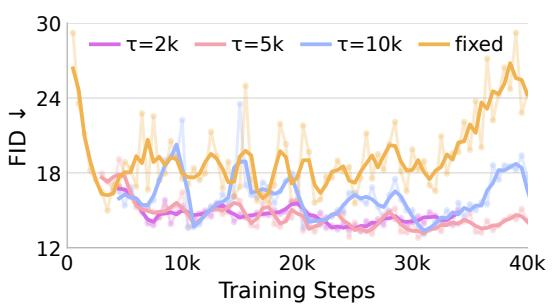

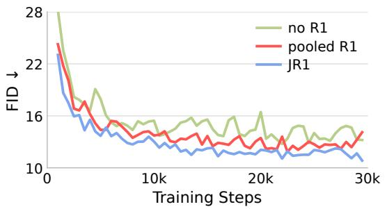  
Figure 5. Efect of refresh interval without gradi- Figure 6. Pooled R1 against Jacobian R1 (JR1). ent regularization.

## 4.2 Ablation Study

Across this section, the one-step SDXL generator is used for ablation, in which the refresh interval τ is 5k and the regularization is JR1 with $\gamma _ { \mathrm { J } } = 7 . 5 \times 1 0 ^ { - 3 }$ unless otherwise specified.

Transformer head. Tab. 1 (Sec. 3.1) isolates the critic head design and the text conditioning under fixed mixing and pooled R1. Increasing the capacity of the convolutional head does not improve performance. Our Lipschitz-controlled ViT head instead yields a substantial gain in both fidelity and alignment, and it also outperforms the ViTGAN alternative. For conditioning, tokenlevel cross-attention provides a clearly stronger alignment gain than Miyato-style pooled-text projection.

Component decomposition. Tab. 4(a) presents a breakdown of ROAD’s three components. Lipschitz control first makes the ViT head trainable, indicating its importance for stabilizing GAN. Periodic refresh then improves FID from 14.54 to 12.08 and CLIP from 0.331 to 0.335, demonstrating its benefit of refresh mixing over no refresh (i.e. fixed mixing). Finally, three components together reduces FID to 11.03 while improving CLIP to 0.338. Further, trajectorylevel comparison (Fig. 6) shows JR1’s benefit persists across training rather than appearing only at the selected checkpoint.

Frozen backbone. Tab. 4(b) contrasts feature extractors from several diferent foundation models. Among DINOv3 ViTs of diferent capacities, ViT-B is the strongest, while both the smaller ViT-S and the larger ViT-L underperform it. This suggests that a stronger representation does not necessarily translate into better GAN performance. PE-Spatial ViT-B and SigLIP2 ViT-B are close behind DINOv3 ViT-B, so ROAD is not tied to one feature extractor.

Regularizer. Tab. 4(c) compares JR1 with pooled R1, feature R1 that moves R1 penalty from image space to the frozen feature taps [6, 47], and Approx. R1 (APT) that approximates the imagespace penalty without a double backward pass [10]. JR1 is the strongest of the four. It improves on pooled R1 from 12.08 to 11.03 FID, whereas both the feature-space and the approximate penalty fall behind pooled R1. Sec. 4.3 further shows that JR1 consistently outperforms pooled R1 across a broad range of $\gamma _ { \mathrm { J } }$

Trajectory of Refresh interval. Fig. 5 analyzes the efect of periodic refresh at $\tau \in \{ 2 \mathrm { k } , 5 \mathrm { k } , 1 0 \mathrm { k } \}$ without gradient regularization to isolate the refresh efect. Fixed mixing oscillates strongly and deteriorates late in training, whereas all refreshed variants remain markedly more stable and achieve better FID. More frequent refresh yields smoother trajectories, consistent with periodic re-drawing interrupting co-adaptation to a single random view. The best FIDs nevertheless remain close across intervals, indicating low sensitivity to τ. We use $\tau = 5 \mathrm { k }$ by default.

Trajectory of Jacobian R1. Fig. 6 contrasts no gradient regularization, pooled R1, and JR1 with refresh interval $\tau = 5 \mathrm { k } .$ . Pooled R1 yields a smoother FID trajectory than the unregularized run, and JR1 maintains a consistently lower FID with smaller fluctuations across training. This suggests that gradient regularization is complementary to our refresh mechanism; besides, the optimization benefits more from JR1 which regularizes the full logit sensitivities.

## 4.3 Further Analysis of Mixing, Regularization, and Augmentation

We further examine the mixing design, sensitivity to the JR1 coeficient, and augmentation controls for the fixed-mixing degradation.

<table><tr><td colspan="2">Random mixing configuration  $\mathrm { F I D \downarrow }$  CLIP ↑</td></tr><tr><td>Projected GAN</td><td>14.80 0.328</td></tr><tr><td> $1 \times 1 + 3 \times 3$ </td><td>14.48 0.328</td></tr><tr><td> $3 \times 3 + 5 \times 5$ </td><td>13.35 0.333</td></tr><tr><td> $1 \times 1 + 3 \times 3 + 5 \times 5$ </td><td>11.03 0.338</td></tr></table>

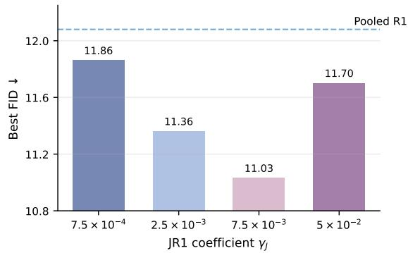  
Table 5. Multi-branch mixing design. SDXL ablations difering only in the composition of the random mixings M.  
Figure 7. JR1 coeficient sensitivity on SDXL. Best FID for each ${ \gamma } _ { \mathrm { J } } ;$ the dashed line is the pooled-R1 baseline.

Analysis of multi-branch random mixing. The tested configurations compare diferent receptivefield supports. Both pairs average two supports and difer only in which ones, yet $3 \times 3 + 5 \times 5$ reaches 13.35 against 14.48 for $1 \times 1 + 3 \times 3 .$ , suggesting a benefit from broader spatial mixing in this comparison. The triple then improves on both pairs by at least 2.32 FID, a margin larger than the 1.13 separating the pairs. These results suggest complementary benefits from the three kernels in the tested configurations: averaging kernels with diferent supports combines random maps operating over diferent spatial extents.

Sensitivity to the JR1 coeficient. We scan the JR1 coeficient $( \gamma _ { \mathrm { J } } )$ on SDXL and compare the best FID of each setting with the pooled-R1 baseline. Every tested JR1 coeficient improves over pooled R1. The best result is obtained at $\gamma _ { \mathrm { J } } = 7 . 5 \times 1 0 ^ { - 3 }$ , while the overall variation across the scanned range remains modest, suggesting limited sensitivity within the tested coeficient range under this SDXL configuration.

Discriminator augmentation under fixed mixing. Late-stage degradation can resemble discriminator overfitting, for which data augmentation is a standard remedy. So we examine DifAugment [27] and adaptive discriminator augmentation (ADA) [28] to test whether these remedies alleviate the observed degradation.

We follow the SDXL protocol of Sec. E.3 and compare fixed mixing with no augmentation, DifAugment, or ADA, alongside the 5k-refresh reference. All configurations share the Transformer critic with pooled R1, training data, optimization settings, and a 40k-step budget. Performance is evaluated with the shared COCO-10K protocol (Sec. E.2).

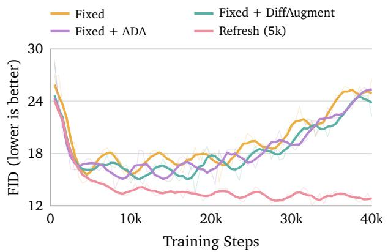  
Figure 8. Augmentation under fixed mixing. Representative discriminator anti-overfitting interventions do not materially alleviate late-stage FID degradation.

<table><tr><td>Mixing / augmentation</td><td>Best FID ↓</td></tr><tr><td>Fixed</td><td>14.54</td></tr><tr><td>Fixed + DiffAugment</td><td>14.46</td></tr><tr><td>Fixed + ADA</td><td>14.38</td></tr><tr><td>Refresh (5k)</td><td>12.08</td></tr></table>

Table 6. Best FID on COCO-10K. Augmentation controls under fixed mixing, with 5k refresh for reference. Unaugmented results are from Tab. 4(a).

The FID trajectories (Fig. 8) show that neither augmentation materially alleviates late-stage degradation under fixed mixing; Tab. 6 reports the best FID. The persistence of this failure mode despite these standard remedies supports the diagnosis in Sec. 3.2.

## 5 Conclusion and limitations

We modernize Projected GAN for one-step difusion distillation with a Lipschitz-controlled Transformer head, a periodic refresh of the random mixing, and a Jacobian R1 penalty. The resulting method, ROAD, converges fast and attains the best FID on both SDXL and SD3.5-M with a single adversarial objective and one training stage, whereas competing methods combine several objectives and stages. To our knowledge, ROAD is among the first to obtain a competitive one-step SD3.5-M generator. Its preference scores, however, still trail those of few-step competitors (Tab. 3). Text reaches the critic only through cross-attention, so an explicit text–image alignment term is a natural next step, though it would mean replacing DINOv3 with a contrastively trained encoder such as SigLIP2 (Tab. 4(b)). Scaling the frozen encoder does not help by itself either, since within DINOv3 ViT-B beats ViT-S and ViT-L (Tab. 4(b)). We attribute this to the two-player game’s balance, which our refresh mechanism improves but does not settle, and addressing it directly is future work.

## AI use statement

In this work, we used generative AI tools to clean and reformat datasets, and provide feedback on experiments. We did not use generative AI tools to generate synthetic datasets; help develop theoretical models or conceptual frameworks; formulate mathematical claims; provide critical ingredients for proving mathematical claims; assist in the writing of proofs; propose or refine hypotheses; implement methods; or interpret results. Assistance with translation and support for qualitative and thematic data analysis were not applicable to this work.

Additionally, we used generative AI tools to modify scientific figures, create or edit software code, summarize or analyze existing literature, edit the research paper to improve readability, and format references.

We carefully reviewed all AI-assisted work. AI-assisted code modifications were manually inspected, debugged, and tested before being incorporated into the final implementation. We also verified all edited portions of the manuscript to ensure that our intended meaning was preserved. References formatted with AI assistance were carefully checked for formatting accuracy against the corresponding bibliographic information. We take responsibility for the final content of this work, including text, claims, code, and other artifacts produced with the aid of generative AI.

## Reproducibility statement

Training configurations for both base models are listed in Sec. E.3 as extracted from the launch scripts, including teacher, batch, learning rates, head and mixing configuration, and refresh interval; unavailable launch-script fields are marked in the table. The shared evaluation protocol for SDXL and SD3.5-M, including prompt set, resolution, FID reference, and CLIP encoder, is given in Sec. E.2, together with the checkpoint-selection rule (best FID on a 500-step evaluation grid, CLIP from the same checkpoint). The JR1 estimator, including probe distribution, count and lazy scaling, is specified in Sec. C. The ROAD implementation and configuration files are publicly available at https://github.com/Lixiaoou729/ROAD.

## References

[1] Tianwei Yin, Michaël Gharbi, Taesung Park, Richard Zhang, Eli Shechtman, Frédo Durand, and William T Freeman. Improved distribution matching distillation for fast image synthesis. In NeurIPS, 2024.

[2] Weijian Luo, Tianyang Hu, Shifeng Zhang, Jiacheng Sun, Zhenguo Li, and Zhihua Zhang. Dif-Instruct: A universal approach for transferring knowledge from pre-trained difusion models. In NeurIPS, 2023.

[3] Tianwei Yin, Michaël Gharbi, Richard Zhang, Eli Shechtman, Frédo Durand, William T Freeman, and Taesung Park. One-step difusion with distribution matching distillation. In CVPR, 2024.

[4] Thuan Hoang Nguyen and Anh Tran. SwiftBrush: One-step text-to-image difusion model with variational score distillation. In CVPR, 2024.

[5] Mingyuan Zhou, Huangjie Zheng, Zhendong Wang, Mingzhang Yin, and Hai Huang. Score identity distillation: Exponentially fast distillation of pretrained difusion models for one-step generation. In ICML, 2024.

[6] Axel Sauer, Dominik Lorenz, Andreas Blattmann, and Robin Rombach. Adversarial difusion distillation. In ECCV, 2024.

[7] Mingyuan Zhou, Huangjie Zheng, Yi Gu, Zhendong Wang, and Hai Huang. Adversarial score identity distillation: Rapidly surpassing the teacher in one step. In ICLR, 2025.

[8] Axel Sauer, Frederic Boesel, Tim Dockhorn, Andreas Blattmann, Patrick Esser, and Robin Rombach. Fast high-resolution image synthesis with latent adversarial difusion distillation. In SIGGRAPH Asia 2024 Conference Papers, 2024.

[9] Dar-Yen Chen, Hmrishav Bandyopadhyay, Kai Zou, and Yi-Zhe Song. NitroFusion: High-fidelity single-step difusion through dynamic adversarial training. In CVPR, 2025.

[10] Shanchuan Lin, Xin Yang, Yuxi Li, Xing Xia, et al. Difusion adversarial post-training for one-step video generation. In ICML, 2025.

[11] Axel Sauer, Kashyap Chitta, Jonas Müller, and Andreas Geiger. Projected GANs converge faster. In NeurIPS, 2021.

[12] Axel Sauer, Tero Karras, Samuli Laine, Andreas Geiger, and Timo Aila. StyleGAN-T: Unlocking the power of GANs for fast large-scale text-to-image synthesis. In ICML, 2023.

[13] Oriane Siméoni, Huy V. Vo, Maximilian Seitzer, Federico Baldassarre, Maxime Oquab, Cijo Jose, Vasil Khalidov, Marc Szafraniec, Seungeun Yi, Michaël Ramamonjisoa, Francisco Massa, Daniel Haziza, Luca Wehrstedt, Jianyuan Wang, Timothée Darcet, Théo Moutakanni, Leonel Sentana, Claire Roberts, Andrea Vedaldi, Jamie Tolan, John Brandt, Camille Couprie, Julien Mairal, Hervé Jégou, Patrick Labatut, and Piotr Bojanowski. DINOv3. TMLR, 2026.

[14] Daniel Bolya, Po-Yao Huang, Peize Sun, Jang Hyun Cho, Andrea Madotto, Chen Wei, Tengyu Ma, Jiale Zhi, Jathushan Rajasegaran, Hanoona Rasheed, Junke Wang, Marco Monteiro, Hu Xu, Shiyu Dong, Nikhila Ravi, Daniel Li, Piotr Dollár, and Christoph Feichtenhofer. Perception Encoder: The best visual embeddings are not at the output of the network. In NeurIPS, 2025.

[15] Lars Mescheder, Andreas Geiger, and Sebastian Nowozin. Which training methods for GANs do actually converge? In ICML, 2018.

[16] Tero Karras, Samuli Laine, Miika Aittala, Janne Hellsten, Jaakko Lehtinen, and Timo Aila. Analyzing and improving the image quality of StyleGAN. In CVPR, 2020.

[17] Minguk Kang, Richard Zhang, Connelly Barnes, Sylvain Paris, Suha Kwak, Jaesik Park, Eli Shechtman, Jun-Yan Zhu, and Taesung Park. Distilling difusion models into conditional GANs. In ECCV, 2024.

[18] Bowen Zheng and Tianming Yang. Revisiting difusion models: From generative pre-training to one-step generation. In ICML, 2025.

[19] Roman Suvorov, Elizaveta Logacheva, Anton Mashikhin, Anastasia Remizova, Arsenii Ashukha, Aleksei Silvestrov, Naejin Kong, Harshith Goka, Kiwoong Park, and Victor Lempitsky. Resolution-robust large mask inpainting with fourier convolutions. In WACV, 2022.

[20] Minguk Kang, Jun-Yan Zhu, Richard Zhang, Jaesik Park, Eli Shechtman, Sylvain Paris, and Taesung Park. Scaling up GANs for text-to-image synthesis. In CVPR, 2023.

[21] Ian Goodfellow, Jean Pouget-Abadie, Mehdi Mirza, Bing Xu, David Warde-Farley, Sherjil Ozair, Aaron Courville, and Yoshua Bengio. Generative adversarial nets. In NeurIPS, 2014.

[22] Zhiming Zhou, Jiadong Liang, Yuxuan Song, Lantao Yu, Hongwei Wang, Weinan Zhang, Yong Yu, and Zhihua Zhang. Lipschitz generative adversarial nets. In ICML, volume 97 of Proceedings of Machine Learning Research, pages 7584–7593, 2019.

[23] Takeru Miyato, Toshiki Kataoka, Masanori Koyama, and Yuichi Yoshida. Spectral normalization for generative adversarial networks. In ICLR, 2018.

[24] Hyunjik Kim, George Papamakarios, and Andriy Mnih. The Lipschitz constant of self-attention. In ICML, 2021.

[25] Ze Liu, Han Hu, Yutong Lin, Zhuliang Yao, Zhenda Xie, et al. Swin transformer V2: Scaling up capacity and resolution. In CVPR, 2022.

[26] Kwonjoon Lee, Huiwen Chang, Lu Jiang, Han Zhang, Zhuowen Tu, and Ce Liu. ViTGAN: Training GANs with vision transformers. In ICLR, 2022.

[27] Shengyu Zhao, Zhijian Liu, Ji Lin, Jun-Yan Zhu, and Song Han. Diferentiable augmentation for data-eficient GAN training. In NeurIPS, 2020.

[28] Tero Karras, Miika Aittala, Janne Hellsten, Samuli Laine, Jaakko Lehtinen, and Timo Aila. Training generative adversarial networks with limited data. In NeurIPS, 2020.

[29] Roman Novak, Yasaman Bahri, Daniel A. Abolafia, Jefrey Pennington, and Jascha Sohl-Dickstein. Sensitivity and generalization in neural networks: an empirical study. In ICLR, 2018.

[30] Dániel Varga, Adrián Csiszárik, and Zsolt Zombori. Gradient regularization improves accuracy of discriminative models. Schedae Informaticae, 27:31–45, 2018.

[31] Michael F Hutchinson. A stochastic estimator of the trace of the influence matrix for Laplacian smoothing splines. Communications in Statistics—Simulation and Computation, 18(3):1059–1076, 1989.

[32] Judy Hofman, Daniel A Roberts, and Sho Yaida. Robust learning with Jacobian regularization. arXiv:1908.02729, 2019.

[33] Dustin Podell, Zion English, Kyle Lacey, Andreas Blattmann, Tim Dockhorn, Jonas Müller, Joe Penna, and Robin Rombach. SDXL: Improving latent difusion models for high-resolution image synthesis. In ICLR, 2024.

[34] Christoph Schuhmann et al. LAION-5B: An open large-scale dataset for training next generation image-text models. In NeurIPS, 2022.

[35] Mingyuan Zhou, Zhendong Wang, Huangjie Zheng, and Hai Huang. Long and short guidance in score identity distillation for one-step text-to-image generation. In ICLR, 2025.

[36] Yuval Kirstain, Adam Polyak, Uriel Singer, Shahbuland Matiana, Joe Penna, and Omer Levy. Pick-a-Pic: An open dataset of user preferences for text-to-image generation. In NeurIPS, 2023.

[37] Xiaoshi Wu, Yiming Hao, Keqiang Sun, Yixiong Chen, Feng Zhu, Rui Zhao, and Hongsheng Li. Human preference score v2: A solid benchmark for evaluating human preferences of text-to-image synthesis. arXiv preprint arXiv:2306.09341, 2023.

[38] Yanzuo Lu, Yuxi Ren, Shanchuan Lin, Xin Xia, Xing Wang, Xuefeng Xiao, Andy J Ma, Xiaohua Xie, and Jian-Huang Lai. Adversarial distribution matching for difusion distillation towards eficient image and video synthesis. In ICCV, 2025.

[39] Yuxi Ren, Xin Xia, Yanzuo Lu, Jiacheng Zhang, Jie Wu, Pan Xie, Xing Wang, and Xuefeng Xiao. Hyper-SD: Trajectory segmented consistency model for eficient image synthesis. In NeurIPS, 2024.

[40] Jiazheng Xu, Xiao Liu, Yuchen Wu, Yuxuan Tong, Qinkai Li, Ming Ding, Jie Tang, and Yuxiao Dong. ImageReward: Learning and evaluating human preferences for text-to-image generation. In NeurIPS, 2023.

[41] Dhruba Ghosh, Hannaneh Hajishirzi, and Ludwig Schmidt. GenEval: An object-focused framework for evaluating text-to-image alignment. In NeurIPS, 2023.

[42] Nikita Starodubcev, Ilya Drobyshevskiy, Denis Kuznedelev, Artem Babenko, and Dmitry Baranchuk. Scale-wise distillation of difusion models. In ICLR, 2026.

[43] Shanchuan Lin, Anran Wang, and Xiao Yang. SDXL-Lightning: Progressive adversarial difusion distillation. arXiv:2402.13929, 2024.

[44] Xingtong Ge et al. SenseFlow: Scaling distribution matching for flow-based text-to-image distillation. In ICLR, 2026.

[45] Mingyuan Zhou, Yi Gu, Huangjie Zheng, Liangchen Song, Guande He, Yizhe Zhang, Wenze Hu, and Yinfei Yang. Score distillation of flow matching models. arXiv:2509.25127, 2025.

[46] Michael Tschannen, Alexey Gritsenko, Xiao Wang, Muhammad Ferjad Naeem, Ibrahim Alabdulmohsin, Nikhil Parthasarathy, Talfan Evans, Lucas Beyer, Ye Xia, Basil Mustafa, Olivier Hénaf, Jeremiah Harmsen, Andreas Steiner, and Xiaohua Zhai. SigLIP 2: Multilingual vision-language encoders with improved semantic understanding, localization, and dense features. arXiv:2502.14786, 2025.

[47] Min Jin Chong, Krishna Kumar Singh, Yijun Li, Jingwan Lu, and David Forsyth. P2D: Plug and play discriminator for accelerating GAN frameworks. In WACV, 2024.

[48] Kaiming He, Xiangyu Zhang, Shaoqing Ren, and Jian Sun. Delving deep into rectifiers: Surpassing human-level performance on ImageNet classification. In ICCV, pages 1026–1034, 2015.

[49] Alexandre Araujo, Benjamin Negrevergne, Yann Chevaleyre, and Jamal Atif. On Lipschitz regularization of convolutional layers using Toeplitz matrix theory. In AAAI, volume 35, pages 6661–6669, 2021.

[50] Hanie Sedghi, Vineet Gupta, and Philip M. Long. The singular values of convolutional layers. In ICLR, 2019.

[51] Xiaohan Ding, Xiangyu Zhang, Jungong Han, and Guiguang Ding. Diverse branch block: Building a convolution as an inception-like unit. In CVPR, pages 10886–10895, 2021.

[52] Xiaohan Ding, Xiangyu Zhang, Ningning Ma, Jungong Han, Guiguang Ding, and Jian Sun. RepVGG: Making VGG-style convnets great again. In CVPR, pages 13733–13742, 2021.

[53] Vladimir A Marchenko and Leonid A Pastur. Distribution of eigenvalues for some sets of random matrices. Mathematics of the USSR-Sbornik, 1(4):457–483, 1967.

[54] Karen Simonyan, Andrea Vedaldi, and Andrew Zisserman. Deep inside convolutional networks: Visualising image classification models and saliency maps. In ICLR Workshop, 2014.

[55] Axel Sauer, Katja Schwarz, and Andreas Geiger. StyleGAN-XL: Scaling StyleGAN to large diverse datasets. In SIGGRAPH, 2022.

[56] Yifan Jiang, Shiyu Chang, and Zhangyang Wang. TransGAN: Two pure transformers can make one strong GAN, and that can scale up. In NeurIPS, 2021.

[57] Bowen Zhang, Shuyang $\mathsf { G u } ,$ Bo Zhang, Jianmin Bao, Dong Chen, Fang Wen, Yong Wang, and Baining Guo. StyleSwin: Transformer-based GAN for high-resolution image generation. In CVPR, 2022.

[58] Long Zhao, Zhixing Zhang, Ting Chen, Dimitris N Metaxas, and Han Zhang. Improved transformer for high-resolution GANs. In NeurIPS, 2021.

[59] Jeeseung Park and Younggeun Kim. Styleformer: Transformer based generative adversarial networks with style vector. In CVPR, 2022.

[60] Drew A Hudson and C Lawrence Zitnick. Generative adversarial transformers. In ICML, volume 139 of Proceedings of Machine Learning Research, pages 4487–4499, 2021.

[61] Xianbiao Qi, Jianan Wang, Yihao Chen, Yukai Shi, and Lei Zhang. LipsFormer: Introducing Lipschitz continuity to vision transformers. In ICLR, 2023.

[62] Behnam Neyshabur, Srinadh Bhojanapalli, and Ayan Chakrabarti. Stabilizing GAN training with multiple random projections. arXiv:1705.07831, 2017.

[63] Timothy I Cannings and Richard J Samworth. Random-projection ensemble classification. Journal of the Royal Statistical Society Series B, 2017.

[64] Hmrishav Bandyopadhyay et al. SD3.5-Flash: Distribution-guided distillation of generative flows. arXiv:2509.21318, 2025.

[65] Evgenii Nikishin, Max Schwarzer, Pierluca D’Oro, Pierre-Luc Bacon, and Aaron Courville. The primacy bias in deep reinforcement learning. In ICML, 2022.

[66] Ghada Sokar, Rishabh Agarwal, Pablo Samuel Castro, and Utku Evci. The dormant neuron phenomenon in deep reinforcement learning. In ICML, 2023.

[67] Jordan T Ash and Ryan P Adams. On warm-starting neural network training. In NeurIPS, 2020.

[68] Shibhansh Dohare, J Fernando Hernandez-Garcia, Qingfeng Lan, Parash Rahman, A Rupam Mahmood, and Richard S Sutton. Loss of plasticity in deep continual learning. Nature, 632:768–774, 2024.

[69] Kevin Roth, Aurelien Lucchi, Sebastian Nowozin, and Thomas Hofmann. Stabilizing training of generative adversarial networks through regularization. In NeurIPS, 2017.

[70] Yiwen Huang, Aaron Gokaslan, Volodymyr Kuleshov, and James Tompkin. The GAN is dead; long live the GAN! A modern GAN baseline. In NeurIPS, 2024.

[71] Daniel Jakubovitz and Raja Giryes. Improving DNN robustness to adversarial attacks using Jacobian regularization. In ECCV, pages 514–529, 2018.

## A Lipschitz Analysis of the Transformer Head

This appendix supports Sec. 3.1. We bound the sensitivity of one Transformer head, viewed as the map from the mixed tokens of its feature level to the dense logits of that level at a fixed prompt. Setting. Fix a feature level ℓ and a prompt c. The head reads the mixed tokens $X = \hat { f } _ { \ell } \in \mathbb { R } ^ { N _ { \ell } \times d }$ of Eq. (2), where d is the token width, and returns the $N _ { \ell }$ logits $D ^ { \ell } ( X , c ) \in \mathbb { R } ^ { N _ { \ell } }$ of level ℓ. The head has $B _ { \ell }$ pre-norm blocks (Sec. E.1). Each block contains a cosine self-attention branch followed by an FFN branch. The first block also contains a cosine cross-attention branch between the two. Its queries are the patch tokens, and its keys and values are computed from the $N _ { c }$ text tokens of $c .$ Every branch applies RMSNorm to its input, passes the result through its sublayer, multiplies the output channel-wise by a learnable scale in $\mathbb { R } ^ { d }$ , and adds the product to the input. We write $\alpha _ { \mathrm { s a } } ^ { ( b ) }$ and $\alpha _ { \mathrm { f f n } } ^ { ( b ) }$ for the residual scales of block b and $\alpha _ { \mathrm { c a } }$ for the cross-attention gate, and we set $a _ { \mathrm { s a } } ^ { ( b ) } = \| \alpha _ { \mathrm { s a } } ^ { ( b ) } \| _ { \infty } , a _ { \mathrm { f n } } ^ { ( b ) } = \| \alpha _ { \mathrm { f n } } ^ { ( b ) } \| _ { \infty }$ , and $a _ { \mathrm { c a } } = \| \alpha _ { \mathrm { c a } } \| _ { \infty }$ . A final RMSNorm and the linear logit head of Sec. E.1 produce the logits.

We measure token matrices in the Frobenius norm, logit vectors in the Euclidean norm, and Jacobians in the operator norm induced by these two norms. We write $\operatorname { L i p } ( f ; S )$ for the Lipschitz constant of $f$ on a set ${ \mathcal { S } } .$ . The RMSNorm layers use $\varepsilon > 0$ and learnable weights w with $\| w \| _ { \infty } \leq \bar { w } _ { \mathrm { : } }$ and we set $c _ { \mathrm { n } } = \bar { w } / \sqrt { \varepsilon }$ and $\nu = \sqrt { d } \bar { w }$ . The FFN activation is GELU, and $\begin{array} { r } { c _ { \mathrm { f f n } } = \operatorname* { s u p } _ { t \in \mathbb { R } } \lvert \mathrm { G E L U } ^ { \prime } ( t ) \rvert \leq } \end{array}$ 1.13. Attention head $h$ has temperature $s _ { h . }$ , and its clamped parametrization (Sec. E.1) guarantees $0 < s _ { h } \le s _ { \operatorname* { m a x } }$ . In cross-attention head $h _ { z }$ , let $V _ { c , h }$ be the value matrix computed from the text tokens of $c ,$ and let $\kappa _ { c } = \operatorname* { m a x } _ { h } \| V _ { c , h } \| _ { 2 }$

Lemma A.1 (Conditional Lipschitz bound for a Transformer head). Assume that every spectrally normalized linear map W of the head satisfies $\| W \| _ { 2 } \leq 1$ . Let $S \subset \mathbb { R } ^ { N _ { \ell } \times d }$ be a convex set such that, for every $X \in S ,$ every query and key vector has norm at least $\rho > 0$ immediately before ℓ -normalization. Set

$$
c _ { \mathrm { s a } } = \sqrt { N _ { \ell } } \Big ( 1 + \frac { s _ { \mathrm { m a x } } \sqrt { N _ { \ell } } \nu } { \rho } \Big ) , ~ c _ { \mathrm { c a } } = \frac { s _ { \mathrm { m a x } } \sqrt { N _ { c } } \kappa _ { c } } { 2 \rho } .
$$

Then the Jacobian of $D ^ { \ell } ( \cdot , c )$ has norm at most $\Lambda _ { \ell }$ at every $X \in S ,$ , and $\mathrm { L i p } \big ( D ^ { \ell } ( \cdot , c ) ; \mathcal { S } \big ) \leq \Lambda _ { \ell } .$ , where

$$
\Lambda _ { \ell } = c _ { \mathrm { n } } \big ( 1 + a _ { \mathrm { c a } } c _ { \mathrm { n } } c _ { \mathrm { c a } } \big ) \prod _ { b = 1 } ^ { B _ { \ell } } \big ( 1 + a _ { \mathrm { s a } } ^ { ( b ) } c _ { \mathrm { n } } c _ { \mathrm { s a } } \big ) \big ( 1 + a _ { \mathrm { f n } } ^ { ( b ) } c _ { \mathrm { n } } c _ { \mathrm { f n } } \big ) .\tag{7}
$$

The cross-attention factor is absent in a head without cross-attention. At initialization, the gate satisfies $a _ { \mathrm { c a } } = 0 .$ , and every residual scale equals $1 / B _ { \ell } \ ( \mathsf { S e c . \ E . 1 } )$ . Since $( 1 + t / B _ { \ell } ) ^ { B _ { \ell } } \leq e ^ { t }$ for $t \geq 0$ , the bound at initialization satisfies $\Lambda _ { \ell } \leq c _ { \mathrm { n } } \exp \bigl ( c _ { \mathrm { n } } ( c _ { \mathrm { s a } } + c _ { \mathrm { f f n } } ) \bigr )$  for every depth $B _ { \ell }$ . The residual scaling therefore keeps the initial bound below a constant that does not depend on the depth of the head.

Proof. All bounds below concern Jacobians at a point of $s ,$ , and $\delta ( \cdot )$ denotes the first-order change caused by a perturbation δX. By the chain rule, the Jacobian norm of the head is at most the product of the Jacobian norms of its layers. Because $s$ is convex, integrating this bound along segments in $\boldsymbol { \mathcal { S } }$ gives the Lipschitz bound.

Step 1: RMSNorm and FFN. For one token $x ~ \in ~ \mathbb { R } ^ { d }$ , let $r ( x ) ~ = ~ \sqrt { \| x \| _ { 2 } ^ { 2 } / d + \varepsilon } .$ , so that $\mathrm { R M S N o r m } ( x ) = w \odot x / r ( x )$ . Its Jacobian is

$$
\frac { \mathrm { d i a g } ( w ) } { r ( x ) } \Big ( I _ { d } - \frac { x x ^ { \top } } { d r ( x ) ^ { 2 } } \Big ) .
$$

The matrix in parentheses has eigenvalue 1 on $x ^ { \perp }$ and eigenvalue $\varepsilon / r ( x ) ^ { 2 } \leq 1$ along $x .$ . Since $r ( x ) \geq \sqrt { \varepsilon } .$ , the Jacobian has norm at most $c _ { \mathrm { n } }$ . Since $\| x \| _ { 2 } < \sqrt { d } r ( x )$ , every output token has norm at most $\nu .$ . RMSNorm acts on each token separately. On token matrices, its Jacobian also has norm at most $c _ { \mathrm { n } } .$ , and $\| \mathrm { R M S N o r m } ( X ) \| _ { F } \leq \sqrt { N _ { \ell } } \nu .$ . The FFN composes two linear maps of norm at most one with GELU, so its Jacobian has norm at most $c _ { \mathrm { f f n } }$

Step 2: Cosine self-attention. Two primitives are shared with cross-attention. The map $u \mapsto$ $u / \Vert u \Vert _ { 2 }$ has Jacobian $( I - \widehat { u } \widehat { u } ^ { \top } ) / \Vert u \Vert _ { 2 }$ with $\widehat { \boldsymbol { u } } = \boldsymbol { u } / \Vert \boldsymbol { u } \Vert _ { 2 }$ , whose norm is at most $1 / \rho$ when $\| u \| _ { 2 } \geq \rho .$ At a probability vector $p ,$ softmax has Jacobian $\mathrm { d i a g } ( p ) - p p ^ { \top }$ , whose largest eigenvalue is at most $1 / 2$ . Row-wise softmax therefore has Jacobian norm at most $1 / 2$

Let $Z = \mathrm { R M S N o r m } ( X )$ be the input of the sublayer. For head $h = 1 , \ldots , H$ , let

$$
Q _ { h } = Z W _ { Q , h } , \qquad K _ { h } = Z W _ { K , h } , \qquad V _ { h } = Z W _ { V , h } , \qquad P _ { h } = \mathrm { s o f t m a x } ( A _ { h } ) ,
$$

where $A _ { h } = s _ { h } \widehat { Q } _ { h } \widehat { K } _ { h } ^ { \top }$ , the matrices ${ \widehat { Q } } _ { h }$ and $\widehat { K } _ { h }$ normalize each row, with rows ${ \widehat { q } } _ { h , i }$ and $\widehat { k } _ { h , j } .$ and softmax acts on each row. The sublayer output is $[ P _ { 1 } V _ { 1 } , \dots , P _ { H } V _ { H } ] W _ { O }$ . Rotary position embeddings rotate each query and key by an orthogonal matrix, so they change none of the norms below. Each per-head projection is a column block of its full projection, so that, for example, $\begin{array} { r } { \sum _ { h } \lVert \delta V _ { h } \rVert _ { F } ^ { 2 } = \lVert \delta Z W _ { V } \rVert _ { F } ^ { 2 } \le \lVert \delta Z \rVert _ { F } ^ { 2 } } \end{array}$ . The perturbation of each head output splits into a value path and a weight path, $\delta ( P _ { h } V _ { h } ) = P _ { h } \delta V _ { h } + \delta P _ { h } V _ { h }$

For the value path, each row of $P _ { h }$ is a probability vector, so $\| P _ { h } \| _ { 2 } \le \| P _ { h } \| _ { F } \le \sqrt { N _ { \ell } }$ . The value path therefore contributes at most $\sqrt { N _ { \ell } } \left\| \delta Z \right\| _ { F }$ . For the weight path, the normalized rows have unit norm, so $\lvert \delta A _ { h , i j } \rvert \leq s _ { \operatorname* { m a x } } \big ( \lVert \delta \widehat { q } _ { h , i } \rVert _ { 2 } + \lVert \delta \widehat { k } _ { h , j } \rVert _ { 2 } \big )$ . Squaring with $( a + b ) ^ { 2 } \leq 2 a ^ { 2 } + 2 b ^ { 2 }$ , summing over $i , j$ and $h ,$ and applying the $1 / \rho$ bound to each row gives

$$
\sum _ { h } \lVert \delta A _ { h } \rVert _ { F } ^ { 2 } \le \frac { 4 s _ { \operatorname* { m a x } } ^ { 2 } N _ { \ell } } { \rho ^ { 2 } } \lVert \delta Z \rVert _ { F } ^ { 2 } , \qquad \sum _ { h } \lVert \delta P _ { h } \rVert _ { F } ^ { 2 } \le \frac { s _ { \operatorname* { m a x } } ^ { 2 } N _ { \ell } } { \rho ^ { 2 } } \lVert \delta Z \rVert _ { F } ^ { 2 } ,
$$

where the second inequality uses the softmax bound. Since $\| V _ { h } \| _ { 2 } \le \| Z \| _ { F } \le \sqrt { N _ { \ell } } \nu _ { \mathrm { \scriptscriptstyle f } }$ , the weight path contributes at most $( s _ { \mathrm { m a x } } N _ { \ell } \nu / \rho ) \| \delta Z \| _ { F }$ . The output projection $W _ { O }$ has norm at most one. Adding the two paths shows that the sublayer has Jacobian norm at most $c _ { \mathrm { s a } }$

Step 3: Cosine cross-attention. The keys and values of cross-attention come from the fixed text tokens, so only the queries vary with $X$ . The argument of Step 2 then gives $| \delta A _ { h , i j } | \leq s _ { \operatorname* { m a x } } \| \delta \widehat { q } _ { h , i } \| _ { 2 }$ for each of the $N _ { c }$ keys $j .$ Summing over keys, queries, and heads, and applying the $1 / \rho$ and softmax bounds, gives $\begin{array} { r } { \sum _ { h } \| \delta P _ { h } \| _ { F } ^ { 2 } \le \left( s _ { \operatorname* { m a x } } ^ { 2 } N _ { c } / ( 4 \rho ^ { 2 } ) \right) \| \delta Z \| _ { F } ^ { 2 } } \end{array}$ . The value matrices contribute the factor $\kappa _ { c s }$ and $W _ { O }$ has norm at most one, so the sublayer has Jacobian norm at most $c _ { \mathrm { c a } }$ . Selecting the patch-token queries and writing the output back into the full token matrix are maps of norm one, so they leave this bound unchanged.

Step 4: Composition. The Jacobian of a branch is the identity plus the product of three factors: the channel-wise scale, the sublayer Jacobian, and the RMSNorm Jacobian. The first factor has norm $\| \alpha \| _ { \infty } .$ , and the last has norm at most $c _ { \mathrm { n } }$ . By Steps 1–3, the self-attention and FFN branches of block b therefore have Jacobian norms at most $1 + a _ { \mathrm { s a } } ^ { ( b ) } c _ { \mathrm { n } } c _ { \mathrm { s a } }$ and $1 + a _ { \mathrm { f f n } } ^ { ( b ) } c _ { \mathrm { n } } c _ { \mathrm { f f n } }$ , and the cross-attention branch has Jacobian norm at most $1 + a _ { \mathrm { { c a } } } c _ { \mathrm { { n } } } c _ { \mathrm { { c a } } }$ . The final RMSNorm contributes $c _ { \mathrm { n } }$ . The linear logit head maps each token to one logit with a vector of norm at most one, so it contributes at most one. The product of these factors is $\Lambda _ { \ell }$ in Eq. (7). □

Scope of the bound. Lemma A.1 is conditional. The floor $\rho$ is an assumption about the forward pass, and the architecture does not enforce it. The bound diverges as a query or key approaches zero before normalization. The RMSNorm weights and the residual scales are trainable, so $\Lambda _ { \ell }$ changes during training through $\bar { w } , a _ { \mathrm { c a } } , a _ { \mathrm { s a } } ^ { ( b ) }$ , and $a _ { \mathrm { f f n } } ^ { ( b ) }$ . The lemma treats $\| W \| _ { 2 } \leq 1$ as exact. Spectral normalization with finitely many power iterations satisfies this condition only approximately, and any realized norm above one must be included in the bound of the corresponding sublayer. The bound concerns the head alone at a fixed prompt. Extending it to images requires, in addition, Jacobian bounds for the frozen encoder and the current random mixing. The constants are worst-case. For example, the RMSNorm Jacobian attains $c _ { \mathrm { n } }$ only near the zero token, and the factors $\sqrt { N _ { \ell } }$ come from Frobenius-norm accounting over all tokens. The lemma shows how spectral normalization, clamped cosine attention, RMSNorm, and residual scaling each enter a finite sensitivity budget. Tab. 1 evaluates the three controls of Sec. 3.1 jointly.

## B Persistent Random Mixing: Analysis and Diagnostics

This appendix supports Sec. 3.2. We describe the implemented operator and its gain spectrum, make precise the sense in which a direction is weakly measured under a draw, and isolate the long-horizon consequence in a minimal measured-gap model. We report the empirical diagnostics in Sec. B.3–B.4 and state the limits of the account in Sec. B.5.

## B.1 The implemented random mixing and anisotropy

Random mixing in matrix form. Eq. (2) composes CCM and CSM along a top-down path, but it leaves the two operators unspecified. We specify them here, and, because the mixing path carries no nonlinearity, we follow each one through to the matrix that Sec. 3.2 reasons about. The construction proceeds in three steps: the matrix of one convolutional branch, then the matrix of one mixing, then the matrix through which the head of a given level reads.

Setting. For both $M _ { \ell } ^ { \mathrm { c c } }$ and $M _ { \ell } ^ { \mathrm { c s } }$ , the patch tokens are reshaped to their two-dimensional grid. On a ViT backbone all L taps share that grid, so every level carries the same number $N _ { \mathrm { p } }$ of patch positions, each of token width d. The summary token is carried by its own random linear map, and it enters neither the matrices below nor the analysis that follows, so $f _ { \ell }$ and $\hat { f } _ { \ell }$ denote the patch part of the level-ℓ features throughout this appendix. We vectorize a level channel-major, so the features of one level form a vector of dimension $N _ { \mathrm { p } } d .$

Branch matrices. Each operator passes the grid through three independent, size-preserving $d \to d$ convolutions, whose $1 \times 1 , \ 3 \times 3 .$ , and $5 \times 5$ kernels are drawn by fan-in-scaled Kaiminguniform initialization [48]. Write $\mathcal { M } ( W )$ for the matrix of one such convolution with kernel W. $\mathsf { A } 1 \times 1$ kernel $W ^ { ( 1 ) } \in \mathbb { R } ^ { d \times d }$ recombines channels and leaves positions untouched, so $\mathcal { M } ( W ^ { ( 1 ) } ) =$ $W ^ { ( 1 ) } \otimes I _ { N _ { \mathrm { p } } }$ . A k×k kernel $W ^ { ( k ) } \in \mathbb { R } ^ { d \times d \times k \times k }$ gives the standard matrix of a multi-channel twodimensional convolution [49, 50]. That matrix is ${ \mathrm { ~ 1 ~ d ~ } } \times d$ array of blocks, and its $( c ^ { \prime } , c )$ block is the matrix $\mathcal { T } ( W _ { c ^ { \prime } c } ^ { ( k ) } )$ of order $N _ { \mathrm { p } }$ generated by the $k \times k$ slice $W _ { c ^ { \prime } c } ^ { ( k ) }$ on the patch grid,

$$
\mathcal { M } \big ( W ^ { ( k ) } \big ) = \Big [ \mathcal { T } \big ( W _ { c ^ { \prime } c } ^ { ( k ) } \big ) \Big ] _ { c ^ { \prime } , c = 1 } ^ { d } \in \mathbb { R } ^ { N _ { \mathrm { p } } d \times N _ { \mathrm { p } } d } .
$$

The convolutions zero-pad, so each block is banded doubly block-Toeplitz [49]. Circular padding would instead make each block doubly block-circulant and would block-diagonalize the operator by the two-dimensional DFT, which is the standard idealization of a zero-padded layer [50]. We invoke it only where the gain spectrum is needed, because decomposing the implemented operator directly is intractable at this width. Setting $k = 1$ recovers $\dot { \mathcal { T } } ( W _ { c ^ { \prime } c } ^ { ( \breve { 1 } ) } ) = W _ { c ^ { \prime } c } ^ { \dot { ( 1 ) } } I _ { N _ { \mathrm { p } } }$ , for which the two paddings agree exactly.

Mixing matrices. Each mixing averages its three branches, so

$$
M _ { \ell } ^ { \mathrm { c c } } = \frac { 1 } { 3 } \sum _ { k \in \{ 1 , 3 , 5 \} } \mathcal { M } \big ( W ^ { ( k ) } \big ) ,
$$

and $M _ { \ell } ^ { \mathrm { c s } }$ takes the same form from its own independent draw. All of these parameters are frozen after sampling, and they are reinitialized together at every refresh. Both matrices are square of order $N _ { \mathrm { p } } d ,$ so each mixing preserves the backbone’s channel width. The three branches share their stride and their sliding-window alignment, so this average is itself a single $5 \times 5$ convolution. Zero-padding $W ^ { ( 1 ) }$ and $W ^ { ( 3 ) }$ to a $1 5 \times 5$ support and averaging the three kernels gives one kernel W¯ with $\textstyle \frac { 1 } { 3 } \sum _ { k } \mathcal { M } \big ( W ^ { ( k ) } \big ) = \mathcal { M } ( \bar { W } ) \left[ 5 1 , 5 2 \right]$ . The branches therefore do not enlarge the operator class, and what they change is the law from which the $5 \times 5$ kernel is drawn. Fan-in scaling gives branch k an entry variance proportional to $1 / ( d k ^ { 2 } )$ , so the taps of $\bar { W }$ are center-heavy: the central tap receives all three branches, the remaining $3 { \times } 3$ taps receive two, and the outer $5 \times 5$ ring receives one. Mixing therefore stays predominantly a channel mixer, and it couples positions through a decaying spatial tail.

The mixing matrix. Stacking the levels, $f = [ f _ { 1 } ^ { \top } , \ldots , f _ { L } ^ { \top } ] ^ { \top }$ and $\hat { f } = [ \hat { f } _ { 1 } ^ { \top } , \ldots , \hat { f } _ { L } ^ { \top } ] ^ { \top }$ , the recursion of Eq. (2) unrolls into the afine map $\hat { f } = M f + b$ used throughout the analysis. Its matrix is block upper triangular in the level index,

$$
\small  M = \left[ M _ { \ell { m } } \right] _ { \ell , { m = 1 } } ^ { L } \in \mathbb { R } ^ { d _ { f } \times d _ { f } } , \quad { M _ { \ell { m } } = \left\{ \begin{array} { l l } { \big ( M _ { \ell } ^ { c s } M _ { \ell + 1 } ^ { c s } \cdots M _ { m } ^ { c s } \big ) M _ { { m } } ^ { c c } , } & { { m \ge \ell , } } \\ { 0 , } & { { m < \ell , } } \end{array} \right. \ d _ { f } = L N _ { \mathrm { p } } d _ { { m } } . }
$$

Every block is square of order $N _ { \mathrm { p } } d ,$ , so each level keeps the backbone’s channel width. Two readings of this matrix matter later. Row ℓ vanishes to the left of the diagonal, which says that the head of level ℓ reads the backbone features of levels ℓ through L and of those alone. The diagonal block $M _ { \ell \ell } = M _ { \ell } ^ { \mathrm { c s } } M _ { \ell } ^ { \mathrm { c c } }$ is the CCM–CSM composition at that level, and it dominates column $\ell ,$ because every of-diagonal block reaching that column carries at least one further CSM factor. Since the diagonal blocks are almost surely invertible, so is $M .$ , and no feature direction is left unmeasured; what varies is how strongly each one is measured.

## Anisotropy.

For a unit direction $\eta ,$ we define its gain as $\lambda _ { M } ( \eta ) = \| M \eta \|$ . In the circular-padding idealization of the token-grid convolutions above [50], these gains follow the singular values of square random matrices [53]. With the implemented initialization, a single CCM or CSM has a median gain of 0.27, and ${ \sim } 5 \%$ of directions lie below one tenth of that median. The diagonal block $M _ { \ell \ell } ,$ , which composes CCM with CSM, broadens the spectrum further, to a median of 0.063 with ${ \sim } 1 2 \%$ of directions below one tenth of the median; these blocks set the scale of the spectrum of $M _ { ☉ }$ , whose of-diagonal blocks are smaller by a further CSM factor each. Zero padding truncates the kernels at the grid border, so the implemented operator has medians about $4 \%$ and 9% below these two values, and its tail fractions are unchanged. The exact weak directions depend on the draw. The overall scale of the head gradient may change during training, but a fixed draw preserves the relative gain profile throughout the refresh interval.

## B.2 Gain-weighted correction under fixed and refreshed draws

We isolate the efect of the mixing draw with a deliberately minimal surrogate. Let $\delta \in \mathbb { R } ^ { d _ { f } }$ be a feature-space discrepancy between generated and real data, and let the generator reduce the measured gap $\textstyle { \frac { 1 } { 2 } } \| M \delta \| ^ { 2 }$ by the gradient flow $\dot { \delta } = - M ^ { \top } M \delta$ . Write $\begin{array} { r } { M = \sum _ { i } \lambda _ { i } a _ { i } \psi _ { i } ^ { \top } } \end{array}$ for its singular value decomposition. Because M is almost surely invertible (Sec. B.1), the $\psi _ { i }$ form an orthonormal basis of $\mathbb { R } ^ { d _ { f } }$ and every $\lambda _ { i }$ is positive, so the expansions below are over a full basis.

Proposition B.1 (Correction under a fixed draw and refreshed draws). (i) Fixed draw. For a fixed $M _ { i }$

$$
\delta ( t ) = \sum _ { i } e ^ { - \lambda _ { i } ^ { 2 } t } \langle \psi _ { i } , \delta ( 0 ) \rangle \psi _ { i } .
$$

Hence, the component along $\psi _ { i }$ decays at rate $\lambda _ { i } ^ { 2 }$

(ii) Independent refreshes. Suppose that independent draws $M ^ { ( 1 ) } , \ldots , M ^ { ( K ) }$ act for consecutive intervals of length τ. Let $A ^ { ( \bar { k } ) } = \exp \bigl ( - \tau ( \bar { M } ^ { ( k ) } ) ^ { \top } M ^ { ( k ) } \bigr )$ , and assume that their law is rightisotropic in the sense that $\mathbb { E } [ ( A ^ { ( k ) } ) ^ { \top } A ^ { \top } ] = c ( \tau ) I .$ . Then

$$
\mathbb { E } \| \delta ( K \tau ) \| ^ { 2 } = c ( \tau ) ^ { K } \| \delta ( 0 ) \| ^ { 2 } .
$$

Thus, in expectation, no fixed direction retains a privileged slow rate across refresh periods.

Proof. Part (i). Because $\begin{array} { r } { M ^ { \top } M = \sum _ { i } \lambda _ { i } ^ { 2 } \psi _ { i } \psi _ { i } ^ { \top } } \end{array}$ , the coeficient of $\delta ( t )$ along $\psi _ { i }$ satisfies $\dot { \delta } _ { i } ( t ) =$ $- \lambda _ { i } ^ { 2 } \delta _ { i } ( t )$ . Solving each scalar equation gives the stated expansion.

Part (ii). By construction, $\delta ( K \tau ) = A ^ { ( K ) } \cdot \cdot \cdot A ^ { ( 1 ) } \delta ( 0 )$ . Condition on $y = A ^ { ( K - 1 ) } \cdot \cdot \cdot A ^ { ( 1 ) } \delta ( 0 )$ Independence and the right-isotropy assumption give $\begin{array} { r } { \mathbb { E } [ \| A ^ { ( K ) } y \| ^ { 2 } \mid y ] = y ^ { \top } \mathbb { E } [ ( A ^ { ( K ) } ) ^ { \top } A ^ { ( K ) } ] y = } \end{array}$ $c ( \tau ) \| y \| ^ { 2 }$ . Iterating this identity over the K periods proves the result. □

Part (i) formalizes the fixed-draw selection described in Sec. 3.2. High-gain components decay first, so the surviving residual becomes enriched in weakly measured directions. The measured gap can therefore settle while a feature-space residual remains. Weak measurement here is a matter of degree rather than of kind: no direction is annihilated, because M is almost surely invertible, but a direction with a small $\lambda _ { i }$ is corrected at the far smaller rate $\lambda _ { i } ^ { 2 }$ and can therefore survive an entire fixed-draw run.

Part (ii) isolates the efect of refresh. Each independent draw replaces the gain landscape, so in expectation no fixed direction is systematically attenuated over the whole run. The implemented convolutional law has exact permutation and sign symmetries over channel coordinates, and every level is read chiefly through the diagonal block that dominates its column, so the expected gain is comparable across levels. Right isotropy over the full feature space is the corresponding idealization, and we use it only to make this temporal distinction precise.

The surrogate predicts diferential correction and stall. The nonlinear claim that realizationspecific co-adaptation leaves new discrepancies uncorrected in weak directions and causes FID oscillation or degradation therefore remains a hypothesis. The refresh intervention in Sec. 3.2 validates this hypothesis.

## B.3 Diagnostics

Definitions.. For an image $x ,$ let $f _ { \ell } ( x ) \in \mathbb { R } ^ { N _ { \ell } \times d }$ denote the level-ℓ backbone features after register-token handling and before mixing, and let $\begin{array} { r } { \bar { D } ( x ) = \frac { 1 } { n } \sum _ { i } D _ { i } ( x ) } \end{array}$ be the mean critic logit. With the encoder detached, the gradient $\nabla _ { f _ { \ell } } \bar { D } ( x )$ is the critic sensitivity in the shared backbone coordinates. We define the Pre-projection Feature Utilization Coverage (PFUC) profile by

$$
\begin{array} { r } { u _ { c } ( x ) = \sigma _ { c } \sqrt { \frac { 1 } { N _ { \ell } } \sum _ { j = 1 } ^ { N _ { \ell } } \left( \partial \bar { D } ( x ) / \partial f _ { \ell , j , c } ( x ) \right) ^ { 2 } } , \qquad U _ { c } = \mathbb { E } _ { x } [ u _ { c } ( x ) ] , \qquad \pi _ { c } = U _ { c } \Big / \sum _ { c ^ { \prime } } U _ { c ^ { \prime } } , } \end{array}
$$

where $j$ indexes tokens, $\sigma _ { c }$ is the feature scale of channel $c ,$ computed once on a reference set and shared across runs, and the expectation is over a fixed diagnostic set of real and generated images. We quantify the change between two PFUC profiles by their total-variation distance,

$$
\begin{array} { r } { \mathrm { T V } ( \pi , \pi ^ { \prime } ) = \frac { 1 } { 2 } \sum _ { c } \lvert \pi _ { c } - \pi _ { c } ^ { \prime } \rvert , } \end{array}
$$

which is the fraction of normalized sensitivity mass reassigned across channels. PFUC characterizes the breadth and stability of the critic’s input-gradient sensitivity [54].

The logit margin is $m _ { t } = r _ { t } - q _ { t }$ , where $r _ { t }$ and $q _ { t }$ are the batch-mean values of D¯ on the real and generated halves of the step-t batch, respectively. We apply ±150-step smoothing only for display. Unlike accuracy, $m _ { t }$ retains the magnitude of the real–generated separation, and the separate traces of $r _ { t }$ and $q _ { t }$ reveal how that separation changes.

Measured values (Figs. 3 and 4).. The two diagnostic runs use SDXL with an efective batch size of 32 and share the seeds, data, diagnostic set, and channel feature scales. They difer only in whether M is fixed or re-drawn every 5k steps. The PFUC heat maps display the first 64 of 768 channels at the deepest tap on a shared logarithmic color scale, with one profile every 500 steps; all TV values use the complete 768-channel profiles. In the refresh run, an additional profile is recorded immediately after each re-draw.

## B.4 Longitudinal probes on a fixed-mixing run

The fixed-run measurements in Sec. B.3 establish a persistent critic state, but they do not determine whether its separation is specific to the training realization $M ^ { ( 0 ) }$ . We therefore apply two post-hoc diagnostics to frozen checkpoints of the same run.

Fresh-draw transfer. At every 5k-step checkpoint from 5k to 30k, we hold the checkpoint, critic head, and matched real and generated batches fixed, and replace only $M ^ { ( 0 ) }$ by eight independently drawn mixings. The margin under $M ^ { ( 0 ) }$ remains 5.1–5.3 through 25k (4.5 at 30k), whereas the margins under fresh draws are approximately zero at every checkpoint. Because only the mixing changes, this collapse shows that the fixed head’s real–generated separation does not transfer to a fresh measurement basis. This result directly supports its coupling to $M ^ { ( 0 ) }$

Linear probe. We also fit a separate linear classifier to the frozen mixed features at each level to distinguish real from generated samples. This classifier is used only as a diagnostic and does not update the generator, backbone, mixing, or critic. Beginning at approximately 2.5k steps, real and generated samples are harder for a linear classifier to distinguish under $M ^ { ( 0 ) }$ than under fresh draws, particularly for the shallow-level features.

Over the same fixed-mixing run, FID oscillates and later worsens, whereas the margin under the fixed training mixing $M ^ { ( 0 ) }$ remains large and nearly stationary. The fresh-draw and linear-probe diagnostics show that this separation is specific to the pairing $D _ { \phi } \circ M ^ { ( 0 ) }$

## B.5 Scope of the account

The account makes two claims at diferent strengths. First, Prop. B.1 shows in a linear surrogate why weak-direction residuals persist under a fixed draw and why independent draws remove a permanently privileged direction in expectation. The chain-rule bounds of Sec. 3.2 tie the visibility and correction of a direction to its gain. Second, the realization-specific co-adaptation of Sec. 3.2, in which prolonged optimization under the fixed gain landscape hardens both players around it until quality degrades, is a mechanistic reading of the ongoing nonlinear game. It is supported jointly by PFUC, the margin, the fresh-draw probes of Sec. B.4, and the fixed-versus-refreshed intervention, but none of these alone establishes it.

## C Jacobian R1: Analysis and Estimation

This appendix supports Sec. 3.3. We compare pooled R1 and JR1 in the output space of the critic in Sec. C.1, analyze the Rademacher estimator of JR1 in Sec. C.2, and specify its minibatch implementation in Sec. C.3.

All quantities are evaluated at a fixed prompt $c ,$ critic parameters $\phi ,$ and mixing M. We use the notation of Sec. 3.3, where $J ( x ) \in \mathbb { R } ^ { n \times d _ { x } }$ is the input–logit Jacobian with rows $g _ { i } ( x ) ^ { \top }$ , and $d _ { x }$ is the dimension of the image $x .$ . Pooled R1 and JR1 in Eqs. (4) and (5) are the expectations of the per-image energies $q _ { \mathrm { p o o l } } ( x )$ and $q _ { \mathrm { J a c } } ( x )$ over real images, scaled by $\gamma / 2$ and $\gamma _ { \mathrm { { J } } } / 2$ . The Jacobian is taken through the entire critic, including the frozen encoder $F$ and the mixing M. Freezing their parameters excludes them from optimization, but it does not remove them from the path of the input gradient. Because both energies depend on x only through $J ( x )$ , we also evaluate them at an arbitrary matrix $J \in \mathbb { R } ^ { n \times d _ { x } }$ and write $q _ { \mathrm { p o o l } } ( J )$ and $q _ { \mathrm { J a c } } ( J )$ . Both energies are built from averages over the n logits. We call this $1 / n$ normalization the averaging convention, and the estimator and the minibatch penalty in Sec. C.2–C.3 retain it.

## C.1 Jacobian R1 versus pooled R1

Sec. 3.3 makes three claims about pooled R1. First, pooled R1 penalizes only the direction spanned by 1 in the n-dimensional output space, and it leaves the $n - 1$ orthogonal directions unpenalized. Second, a nonzero Jacobian can therefore incur zero pooled penalty. Third, the dense loss of Eq. (1) still depends on the sensitivities that pooling neglects. Parts (i)–(iii) of Prop. C.1 establish these claims in turn, and each part also states the corresponding property of JR1.

Fix an image $x ,$ and abbreviate $J = J ( x )$ and $g _ { i } = g _ { i } ( x )$ . We use the orthogonal projectors onto span{1} and onto its $( n - 1 )$ -dimensional orthogonal complement $\mathbf { 1 ^ { \perp } }$ , together with the mean gradient:

$$
\begin{array} { r } { \Pi _ { \parallel } = \frac { 1 } { n } { \bf 1 1 } ^ { \top } , \qquad \Pi _ { \perp } = I _ { n } - \Pi _ { \parallel } , \qquad \bar { g } = \frac { 1 } { n } \sum _ { i = 1 } ^ { n } g _ { i } = \frac { 1 } { n } J ^ { \top } { \bf 1 } . } \end{array}
$$

The $r { \mathrm { - t h } }$ column $j _ { r } ~ = ~ \partial D ( x ) / \partial x _ { \eta }$ of J is the response of the logit vector to the $r { \mathrm { - t h } }$ input coordinate. We call

$$
\begin{array} { r } { q _ { \perp } ( x ) = \frac { 1 } { n } \| \Pi _ { \perp } J \| _ { F } ^ { 2 } = \frac { 1 } { n } \sum _ { r = 1 } ^ { d _ { x } } \| \Pi _ { \perp } j _ { r } \| _ { 2 } ^ { 2 } } \end{array}
$$

the neglected energy. It measures how strongly input perturbations move the logit vector within the $n - 1$ directions orthogonal to 1.

Proposition C.1 (Pooled R1 and JR1 in output space). (i) Decomposition. The pooled energy satisfies $\begin{array} { r } { q _ { \mathrm { p o o l } } ( x ) = \frac { 1 } { n } \| \Pi _ { \| } J \| _ { F } ^ { 2 } } \end{array}$ , and

$$
\begin{array} { r } { q _ { \mathrm { J a c } } ( x ) = q _ { \mathrm { p o o l } } ( x ) + q _ { \perp } ( x ) , \qquad q _ { \perp } ( x ) = \frac { 1 } { n } \sum _ { i = 1 } ^ { n } \lVert g _ { i } - \bar { g } \rVert _ { 2 } ^ { 2 } . } \end{array}\tag{8}
$$

(ii) Zero set. The pooled energy $q _ { \mathrm { p o o l } } ( J )$ vanishes exactly on the $( n - 1 ) d _ { x }$ -dimensional subspace $\mathcal { Z } = \{ J \in \mathbb { R } ^ { n \times d _ { x } } : J ^ { \top } \mathbf { 1 } = 0 \}$ . In contrast, $q _ { \mathrm { J a c } } ( J )$ vanishes only at $J = 0$

(iii) Dense-loss gradient. Let $\begin{array} { r } { \ell _ { \mathrm { r e a l } } ( x ) = \frac { 1 } { n } \sum _ { i = 1 } ^ { n } \zeta ( - D _ { i } ( x ) ) } \end{array}$ be the per-image real-image term of $\mathcal { L } _ { D }$ in Eq. (1). Then

$$
\| \nabla _ { x } \ell _ { \mathrm { r e a l } } ( x ) \| _ { 2 } ^ { 2 } \leq q _ { \mathrm { J a c } } ( x ) .\tag{9}
$$

In contrast, $q _ { \mathrm { p o o l } }$ admits no such bound. If the logits $D _ { i } ( x )$ are not all equal, then $\| \nabla _ { x } \ell _ { \mathrm { r e a l } } ( x ) \| _ { 2 }$ is unbounded as $J ( x )$ ranges over Z with $D ( x )$ heldfixed.

Proof. Part (i). Since $\Pi _ { | | } J = { \bf 1 } \bar { g } ^ { \top }$ , every row of $\Pi _ { \parallel } J$ equals $\bar { g } ^ { \top }$ , and the i-th row of $\Pi _ { \perp } J = J - \Pi _ { \parallel } J$ equals $( g _ { i } - { \bar { g } } ) ^ { \top }$ . Hence $\begin{array} { r } { \frac { 1 } { n } \| \Pi _ { \| } J \| _ { F } ^ { 2 } = \| \bar { g } \| _ { 2 } ^ { 2 } = q _ { \mathrm { p o o l } } ( x ) } \end{array}$ , and $\begin{array} { r } { q _ { \perp } ( x ) = \frac { 1 } { n } \sum _ { i } \lVert g _ { i } - \bar { g } \rVert _ { 2 } ^ { 2 } } \end{array}$ . The deviations $g _ { i } - { \bar { g } }$ sum to zero. Averaging $\lVert g _ { i } \rVert _ { 2 } ^ { 2 } = \lVert \bar { g } + ( g _ { i } - \bar { g } ) \rVert _ { 2 } ^ { 2 }$ over i therefore cancels the cross terms and gives $q _ { \mathrm { J a c } } ( x ) = \| \bar { g } \| _ { 2 } ^ { 2 } + q _ { \perp } ( x )$

Part (ii). By definition, $\begin{array} { r } { q _ { \mathrm { p o o l } } ( J ) = \frac { 1 } { n ^ { 2 } } \lVert J ^ { \top } \mathbf { 1 } \rVert _ { 2 } ^ { 2 } } \end{array}$ vanishes if and only if $J ^ { \top } \mathbf { 1 } = 0$ . This condition places each of the $d _ { x }$ columns of J in the $( n - 1 )$ )-dimensional subspace $\mathbf { 1 ^ { \perp } }$ , so dim $\mathcal { Z } = ( n - 1 ) d _ { x }$ The energy $\begin{array} { r } { q _ { \mathrm { J a c } } ( J ) = \frac { 1 } { n } \| J \| _ { F } ^ { 2 } } \end{array}$ is a scaled squared norm, so it vanishes only at $J = 0$

Part (iii). Let $\eta \in \mathbb { R } ^ { n }$ collect the logit derivatives $\eta _ { i } = \partial \ell _ { \mathrm { r e a l } } / \partial D _ { i } = - { \textstyle \frac { 1 } { n } } \zeta ^ { \prime } ( - D _ { i } ( x ) )$ . The chain rule gives $\nabla _ { x } \ell _ { \mathrm { r e a l } } ( x ) = J ^ { \top } \eta$ . The derivative $\zeta ^ { \prime }$ is the logistic function, which takes values in $( 0 , 1 )$ , so $\| \eta \| _ { 2 } ^ { 2 } < 1 / n$ . The spectral norm of $J$ is at most its Frobenius norm. Therefore $\begin{array} { r } { \| J ^ { \top } \eta \| _ { 2 } ^ { 2 } \leq \| J \| _ { F } ^ { 2 } \| \eta \| _ { 2 } ^ { 2 } \leq \frac { 1 } { n } \| J \| _ { F } ^ { 2 } = q _ { \mathrm { J a c } } ( x ) } \end{array}$ , which is Eq. (9). For the second statement, note that $\eta$ depends only on $D ( x )$ , which is held fixed. The logistic function is strictly increasing. If the logits are not all equal, the entries of $\eta$ are therefore not all equal, and $\eta _ { \perp } = \Pi _ { \perp } \eta \neq 0$ . Fix a unit vector $a \in \mathbb { R } ^ { d _ { x } }$ , and let $J _ { t } = t \eta _ { \perp } a ^ { \top }$ for $t > 0$ . Because $\mathbf { 1 } ^ { \top } \eta _ { \perp } = 0$ , we have $J _ { t } ^ { \top } \mathbf { 1 } = 0 .$ , and hence $J _ { t } \in { \mathcal { Z } } .$ . Because $\eta _ { \perp } ^ { \top } \eta = \| \eta _ { \perp } \| _ { 2 } ^ { 2 }$ , we also have $J _ { t } ^ { \top } \eta = t \| \eta _ { \bot } \| _ { 2 } ^ { 2 } a$ , whose norm grows without bound as $t \to \infty$ □

## C.2 Rademacher estimator: unbiasedness and variance

Let $v _ { 1 } , \ldots , v _ { P } \in \{ - 1 , + 1 \} ^ { n }$ be independent probes, and let each probe have independent, equiprobable signs, as in Sec. 3.3. The per-image estimator replaces $\mathbb { E } _ { v }$ in Eq. (6) by an average over the $P$ probes:

$$
\widehat { q } _ { P } ( \boldsymbol { x } ) = \frac { 1 } { n P } \sum _ { p = 1 } ^ { P } \lVert \boldsymbol { J } ( \boldsymbol { x } ) ^ { \top } \boldsymbol { v } _ { p } \rVert _ { 2 } ^ { 2 } .
$$

Its factor $1 / n$ follows the averaging convention, so ${ \widehat { q } } _ { P } ( x )$ estimates $q _ { \mathrm { J a c } } ( x )$ . This is the trace estimator of Hutchinson [31] for tr $\left( J ( x ) J ( x ) ^ { \top } \right) = \| J ( x ) \| _ { F } ^ { 2 }$ , which earlier work also used for Jacobian regularization [30, 32]. Prop. C.2 restates its standard properties under the averaging convention.

Proposition C.2 (Unbiasedness and variance). Fix an image $x ,$ and write $g _ { i } = g _ { i } ( x )$

(i) Unbiasedness. $\mathbb { E } _ { v } [ \widehat { q } _ { P } ( x ) ] = q _ { \mathrm { J a c } } ( x )$ . If J(x) is diferentiable in $\phi ,$ then also $\mathbb { E } _ { v } [ \nabla _ { \phi } \widehat { q } _ { P } ( x ) ] =$ $\nabla _ { \phi } q _ { \mathrm { J a c } } ( x )$

(ii) Variance. The variance over the probes is

$$
\operatorname { V a r } _ { v } [ \widehat { q } _ { P } ( x ) ] = \frac { 2 } { n ^ { 2 } P } \sum _ { i \neq j } \bigl ( g _ { i } ^ { \top } g _ { j } \bigr ) ^ { 2 } .
$$

It vanishes if and only if the per-logit gradients are pairwise orthogonal.

(iii) Relative variance. $I f { \cal J } ( x ) \ne 0 ,$ , then Va $\begin{array} { r } { \mathrm { r } _ { v } [ \widehat { q } _ { P } ( x ) ] \le \frac { 2 } { P } \big ( 1 - \frac 1 n \big ) q _ { \mathrm { J a c } } ( x ) ^ { 2 } } \end{array}$ . Equality holds when every $g _ { i }$ equals $\pm g f o r$ a common vector $g \neq 0$

Proof. For a single probe $v ,$ the identity $v _ { i } ^ { 2 } = 1$ gives

$$
\| J ( \boldsymbol { x } ) ^ { \top } \boldsymbol { v } \| _ { 2 } ^ { 2 } = \sum _ { i , j } v _ { i } v _ { j } g _ { i } ^ { \top } g _ { j } = \sum _ { i } \| g _ { i } \| _ { 2 } ^ { 2 } + 2 \sum _ { i < j } v _ { i } v _ { j } g _ { i } ^ { \top } g _ { j } .
$$

Each product $v _ { i } v _ { j }$ with $i < j$ has zero mean and unit variance, and distinct products are uncorrelated.

Part (i). The cross terms have zero mean, so $\begin{array} { r } { \mathbb { E } _ { v } \| J ( \boldsymbol { x } ) ^ { \top } v \| _ { 2 } ^ { 2 } = \sum _ { i } \| g _ { i } \| _ { 2 } ^ { 2 } = n q _ { \mathrm { J a c } } ( \boldsymbol { x } ) } \end{array}$ . Averaging over the P probes and dividing by $n$ gives the first identity. The probe law is uniform on the finite set $\{ - 1 , + 1 \} ^ { n }$ and does not depend on $\phi .$ . The expectation $\mathbb { E } _ { v }$ is therefore a finite average, which commutes with $\nabla _ { \phi }$

Part (ii). The cross terms are uncorrelated and have unit variance. A single probe therefore gives $\begin{array} { r } { \operatorname { V a r } _ { v } \| J ( x ) ^ { \top } v \| _ { 2 } ^ { 2 } = 4 \sum _ { i < j } ( g _ { i } ^ { \top } g _ { j } ) ^ { 2 } = 2 \sum _ { i \neq i } ( g _ { i } ^ { \top } g _ { j } ) ^ { 2 } } \end{array}$ . The $P$ probes are independent, so averaging over them divides this variance by $P .$ . The factor $1 / n$ divides it by $n ^ { 2 }$

Part (iii). The Cauchy–Schwarz inequality gives $( g _ { i } ^ { \top } g _ { j } ) ^ { 2 } \leq \| g _ { i } \| _ { 2 } ^ { 2 } \| g _ { j } \| _ { 2 } ^ { 2 }$ for every pair, and it also gives $\begin{array} { r } { \sum _ { i } \lVert g _ { i } \rVert _ { 2 } ^ { 4 } \geq \frac { 1 } { n } \big ( \sum _ { i } \lVert g _ { i } \rVert _ { 2 } ^ { 2 } \big ) ^ { 2 } } \end{array}$ . Hence

$$
\sum _ { i \neq j } ( g _ { i } ^ { \top } g _ { j } ) ^ { 2 } \leq \left( \sum _ { i } \| g _ { i } \| _ { 2 } ^ { 2 } \right) ^ { 2 } - \sum _ { i } \| g _ { i } \| _ { 2 } ^ { 4 } \leq \left( 1 - \frac { 1 } { n } \right) \left( \sum _ { i } \| g _ { i } \| _ { 2 } ^ { 2 } \right) ^ { 2 } = \left( 1 - \frac { 1 } { n } \right) n ^ { 2 } q _ { \mathrm { J a c } } ( x ) ^ { 2 } .
$$

Substituting this bound into part (ii) gives the claim. If every $g _ { i }$ equals $\pm g$ , both inequalities hold with equality. □

Choice of Rademacher probes. Gaussian probes $v \sim \mathcal { N } ( 0 , I _ { n } )$ also satisfy $\mathbb { E } [ v v ^ { \top } ] = I _ { n } ,$ so they also give an unbiased estimator. For Gaussian probes, however, the diagonal terms $v _ { i } ^ { 2 } \| g _ { i } \| _ { 2 } ^ { 2 }$ fluctuate. At equal probe count, they add $\frac { 2 } { n ^ { 2 } P } \sum _ { i } \lVert g _ { i } \rVert _ { 2 } ^ { 4 }$ to the variance of part (ii). Rademacher signs remove this term because $v _ { i } ^ { 2 } = 1$ holds exactly.

## C.3 Minibatch implementation and normalization

Consider a minibatch B of real image–prompt pairs $( x , c )$ . For each pair, we draw P probes $v _ { x , 1 } , \ldots , v _ { x , P }$ with the law of Sec. C.2. The probes are independent across pairs, and they are drawn afresh at every evaluation of the penalty. The minibatch penalty is

$$
\widehat { R } _ { 1 } ^ { \mathrm { J } } = \frac { \gamma _ { \mathrm { J } } } { 2 | \mathcal { B } | } \sum _ { ( \boldsymbol { x } , \boldsymbol { c } ) \in \mathcal { B } } \widehat { q }_ { P } ( \boldsymbol { x } ) = \frac { \gamma _ { \mathrm { J } } } { 2 n | \mathcal { B } | P } \sum _ { ( \boldsymbol { x } , \boldsymbol { c } ) \in \mathcal { B } } \sum _ { p = 1 } ^ { P } \bigl | \big | \nabla _ { \boldsymbol { x } } \big ( v _ { \boldsymbol { x } , p } ^ { \intercal } D ( \boldsymbol { x } ) \big ) \bigr | \bigr | _ { 2 } ^ { 2 } ,\tag{10}
$$

where $D ( x )$ is evaluated at the prompt c paired with x. The second form uses the identity $J ( x ) ^ { \top } v = \nabla _ { x } \big ( v ^ { \top } D ( x ) \big )$ . By Prop. C.2(i), the expectation of $\widehat { R } _ { 1 } ^ { \mathrm { J } }$ over the probes and over minibatches drawn from $p _ { r }$ is $R _ { 1 } ^ { \mathrm { J } }$ of Eq. (5). The same holds for its gradient with respect to $\phi .$ . The probes are independent across images, so the probe noise in Eq. (10) is averaged over the |B| images as well as over the $P$ probes.

Cost and order of operations. Each term of Eq. (10) is one vector–Jacobian product (VJP). A single backward pass of the scalar $v _ { x , p } ^ { \top } D ( x )$ through the critic returns $J ( x ) ^ { \top } v _ { x , p }$ . The estimator therefore costs P VJPs per image, whereas the exact penalty costs n VJPs per image (Sec. 3.3). Pooled R1 in Eq. (3) backpropagates the scalar $\scriptstyle { \frac { 1 } { n } } \mathbf { 1 } ^ { \top } D ( x )$ in the same way. With $P = 1$ , the two penalties therefore have the same cost, and they difer only in the weights of the logit sum. Each probe gradient must be squared before the average over probes is taken. Averaging the P probe gradients first would give an estimate with expectation $q _ { \mathrm { J a c } } ( x ) / P$

Lazy scaling and reported coeficients. We apply the lazy regularization of Sec. 2 [16]. On every $k _ { \mathrm { l a z y } } – \mathrm { t h }$ critic update, the critic objective $\mathcal { L } _ { D } + R _ { D }$ uses $R _ { D } = k _ { \mathrm { l a z y } } \widehat { R } _ { 1 } ^ { \mathrm { J } }$ . On all other critic updates, $R _ { D } = 0$ . Both configurations in Tab. 7 use $P = 1$ and $k _ { \mathrm { l a z y } } = 1 6$ . The table reports $\gamma _ { \mathrm { J } }$ as the coeficient of the averaged penalty in Eq. (5), before the factor $k _ { \mathrm { l a z y } }$ is applied. The reported values, $\gamma _ { \mathrm { J } } = 7 . 5 \times 1 0 ^ { - 3 }$ for SDXL and $\gamma _ { \mathrm { J } } = 7 . 5 \times 1 0 ^ { - 4 }$ for $\mathrm { S D } 3 . 5 \mathrm { - } \mathrm { M }$ , therefore require no conversion.

## D Related Work

Few-step distillation of text-to-image difusion models. Multi-objective or multi-stage training. The existing methods mostly use multiple training objectives and often consist of multiple training stages. Hyper-SD employs a six-phase hybrid training pipeline: four stages of trajectorysegmented consistency distillation, followed by human-feedback optimization and DMD-based one-step score distillation [39]. For the one-step SDXL model, DMD2 uses a two-stage pipeline consisting of brief regression pretraining followed by joint distribution-matching and adversarial training stabilized by a two-timescale update rule [1, Sec. F.4]; DMDX is also a two-stage pipeline, consisting of adversarial distillation pretraining on teacher-generated ODE pairs with hybrid latent- and pixel-space discriminators, along with adversarial distribution-matching fine-tuning [38]. SiDA jointly trains a one-step generator with score-identity and adversarial losses, reusing the fake score network’s encoder as a parameter-free discriminator [7]. ADD (SDXL-Turbo) uses single-stage joint training with teacher-based score distillation and a DINOv2-feature adversarial loss [6]. SDXL-Lightning employs a five-stage progressive distillation pipeline: one MSE-based trajectory-distillation stage followed by four adversarial stages [43]. NitroFusion uses dynamic adversarial refinement with a pool of conditional and unconditional global–local discriminators, relying on a DMD2 one-step student and four-step teacher [9], so separate score-based pretraining is a prerequisite. SenseFlow combines score-based distribution matching, trajectory-based intra-segment guidance, and timestep-aware VFM adversarial supervision [44]. SwD produces a progressive few-step generator that increases latent resolution across denoising steps, combining patch-level MMD with score-based distribution matching and adversarial loss [42]. Adversarial objective as a single loss. Both APT [10] and LADD [8] perform latent-space adversarial training and derive multilevel discriminator features from pretrained difusion models. LADD freezes the difusion teacher, attaches discriminator heads to its intermediate features, and uses teachergenerated samples as real targets. APT initializes a separate discriminator from the pretrained difusion model, adds multilevel output heads, and fine-tunes it against real data. D2O [18] converts a pretrained difusion U-Net into a one-step generator through pure adversarial finetuning; it is evaluated only on low-resolution unconditional and class-conditional benchmarks and does not address text-to-image synthesis. Unlike APT and LADD, both of which use difusionbased critics—trainable in APT and frozen in LADD—ROAD uses a frozen foundation model (e.g., DINOv3) with lightweight, prompt-conditioned Transformer heads. Compared with D2O, we propose Transformer heads, refreshed mixing, and JR1, thereby scaling pure adversarial training to large-scale text-to-image generation.

Projected GAN and adjacent critic architectures. Convolutional heads over frozen encoders. Projected GAN trains shallow convolutional heads over a frozen pretrained encoder, whose features are scattered by fixed random cross-channel and cross-scale mixings [11]; StyleGAN-XL scales it to ImageNet [55], inheriting Projected GAN’s heads, and StyleGAN-T to text-to-image with 1-D convolutional heads over frozen ViT tokens [12]. Every head in this line is convolutional, the only reported head comparison being 1-D versus 2-D convolution [12], and positions are scored independently, so the critic is vector-valued, a property ROAD keeps and regularizes. As far as we know, no work in this line attaches a Transformer head to frozen features. Transformer discriminators from scratch. ViTGAN scores a ViT on raw pixels from the class token, stabilized by $L _ { 2 }$ attention with tied query and key projections, and applies spectral normalization only to initialize the linear weights [26]. It reports that the vanilla ViT discriminator trains markedly worse than the stabilized one. TransGAN’s convolution-free discriminator ingests patches of several sizes [56]. Other work pairs Transformer generators with convolutional discriminators or embeds attention inside a CNN [57–60]. Our Lipschitz controls build on analyses of attention [24, 61], scaled cosine attention [25], and spectral normalization [23]; their combination into the projected critic’s ViT head with an explicit bound (Lemma A.1) and its conditioning on individual prompt tokens are new.

Random feature mixing and time-varying discriminators. Fixed random mixing. Projected GAN samples the mixing once at initialization and holds it fixed for the whole run [11], and every method in that line inherits the choice; the consequence of one draw persisting through long training, a critic that specializes to it, is, to our knowledge, unexamined. Previously, multiplerandom-projection GANs train simultaneous discriminators on a fixed ensemble of input projections [62], as do random-projection ensembles for classification [63]; in both, the set of views is fixed in advance. Renewing trainable parameters. The closest precedents do alter the discriminator over time. NitroFusion keeps a pool of trainable heads, samples a subset per iteration, and re-initializes a small fraction of it, and SD3.5-Flash follows with stochastic head renewal [9, 64]; SDXL-Lightning resets its discriminator between progressive-distillation stages rather than within one [43]. Outside GANs, re-initializing trainable parameters is the standard remedy for lost plasticity, through last-layer resets, recycling of dormant neurons, shrink-and-perturb, and continual backpropagation [65–68]. Our ROAD instead re-draws the frozen measurement basis, the random mixings, at deterministic intervals while every trainable parameter persists, so it targets not lost plasticity in the head but the head’s specialization to a single persistent realization.

Discriminator gradient regularization. Zero-centered penalties in GANs. Zero-centered discriminator-gradient penalties stabilize GAN training and admit local convergence analyses under suitable assumptions [15, 69], and R3GAN combines R1 and R2 [70]. D2O applies pooled R1 to the averaged logit [18], ADD and P2D regularize in feature space [6, 47], and APT uses a finite-diference approximation [10]. Each constrains a scalar critic output, or an aggregate of a vector-valued one, which is the assumption our ROAD removes. Jacobian regularization in classification. Novak et al. [29] study the empirical relationship between input–output Jacobian sensitivity and generalization, whereas Jakubovitz and Giryes [71] explicitly regularize the logit Jacobian to improve adversarial robustness, and Varga et al. [30], Hofman et al. [32] develop eficient randomized Jacobian regularization. We apply a squared Jacobian-norm penalty to real images in a dense adversarial game, motivated specifically by the limitation of pooled R1, which aggregates the vector-valued logit (Sec. 3.3). Through Rademacher Hutchinson estimation [31] we recover the Jacobian energy in expectation with one input VJP per probe.

## E Implementation Details

## E.1 Critic design

This subsection specifies the critic heads of Sec. 3.1. The critic has one head per feature level, so it has L = 4 heads (Sec. 2). Head ℓ reads the mixed tokens $\hat { f } _ { \ell }$ of Eq. (2), which the random mixing computes from the features of the frozen encoder F (Sec. B.1).

Level and depth schedules. Let $L _ { F }$ be the number of blocks of the frozen encoder, indexed from 0 to $L _ { F } - 1$ . The features $f _ { \ell }$ of Eq. (2) are the tokens output by block $t _ { \ell }$ of $F _ { s }$ , and the head of level ℓ has $B _ { \ell }$ Transformer blocks, where

$$
t _ { \ell } = \left\lfloor \frac { \ell L _ { F } } { L } \right\rfloor - 1 , \qquad B _ { \ell } = \operatorname* { m i n } \bigl ( L - \ell + 1 , 4 \bigr ) , \qquad \ell = 1 , \ldots , L .
$$

The first rule divides F into L contiguous spans of equal length and taps the last block of each span, so the deepest level always taps the final block, $t _ { L } = L _ { F } - 1$ . The second rule gives the deepest level a single block, because its tokens are already highly semantic and need only light adaptation. The depth then increases by one per level toward the shallowest level, which receives the most reorganization. The cap of four blocks keeps the heads shallow and limits the number of factors in the Lipschitz bound of Eq. (7). For the configuration used throughout the paper, DINOv3 ViT-B with $L _ { F } = 1 2$ , the taps are (2, 5, 8, 11), and the depths are $( B _ { 1 } , \dots , B _ { 4 } ) = ( 4 , 3 , 2 , 1 )$ , which gives ten trainable blocks in total. Applied to a 24-block ${ \mathrm { V i T } } { \cdot } \mathrm { L } ,$ the same rule gives the taps (5, 11, 17, 23). The depths depend only on $L ,$ so they are unchanged.

Transformer block. A block follows the pre-norm Transformer design. It contains a self-attention branch followed by an FFN branch, and the first block of every head contains a cross-attention branch between the two. The block departs from the standard design in four ways. First, RMSNorm replaces LayerNorm. Second, queries and keys have width $d / 2 _ { \mathrm { : } }$ , where d is the token width. Third, the FFN uses GELU with an expansion ratio of 2 instead of 4. Fourth, self- and cross-attention use cosine attention with a clamped temperature. All learned linear maps of the head are spectrally normalized (Sec. 3.1), and token positions are encoded with rotary position embeddings (Tab. 7). Sec. A analyzes the resulting head.

Cross-attention. The cross-attention branch has the same cosine form. Its queries are the patch tokens of the level, and its keys and values are computed from the prompt. The summary token is excluded from the queries, so conditioning acts on the patch tokens only. The token sequences of all text encoders are concatenated along the channel axis into a single sequence and normalized without afine parameters. Two spectrally normalized linear maps then project this sequence to the widths of the visual queries and values. Each level has its own pair of text projections, so diferent levels can read the same prompt diferently.

Attention temperature. Each attention head h has a learnable temperature $s _ { h }$ . It is stored in the log domain, initialized at log $s _ { \mathrm { i n i t } }$ , and clamped at log $s _ { \mathrm { m a x } }$ before exponentiation, with $s _ { \mathrm { i n i t } } = 1 0$ and $s _ { \operatorname* { m a x } } = 1 0 0$ . This parametrization guarantees $0 < s _ { h } \le s _ { \operatorname* { m a x } }$ . Queries and keys are $\ell _ { 2 } { \tt - n o r m a l i z e d }$ , the normalized queries are multiplied by $s _ { h }$ , and the result is passed to scaled dot-product attention. Normalization, scaling, and attention are computed in single precision and cast back to the training precision. This keeps the clamp exact under mixed-precision training.

Residual scales and gate. Each self-attention and FFN branch of block b has its own learnable per-channel scale, $\alpha _ { \mathrm { s a } } ^ { ( b ) } \in \mathbb { R } ^ { d }$ or $\alpha _ { \mathrm { H n } } ^ { ( b ) } \in \mathbb { R } ^ { d }$ . For example, the self-attention branch maps its input X to $X + \alpha _ { \mathrm { s a } } ^ { ( b ) } \odot \mathrm { S A }$ RMSNorm(X), where SA is the cosine self-attention sublayer and the product acts on the channels of every token. Both scales are initialized to the constant $1 / B _ { \ell }$ . A head of $B _ { \ell }$ blocks therefore starts as a small perturbation of the identity whose size is set by its depth, and Sec. A shows that this initialization keeps the bound of Eq. (7) below a constant that does not depend on the depth. The cross-attention branch has the same form with a gate $\alpha _ { \mathrm { c a } }$ in place of the residual scale. The gate is initialized to zero, so conditioning contributes nothing at initialization. The output projection of the cross-attention branch is initialized normally (Sec. E.3), so the gate receives a nonzero gradient from the first update.

Logit head. Every head ends in a final RMSNorm and a linear logit head, which applies one spectrally normalized linear map to each token independently. Each patch token and the summary token therefore yields one logit. Level ℓ thus emits $N _ { \ell }$ logits, and concatenating the L levels gives the $\begin{array} { r } { n = \sum _ { \ell } N _ { \ell } } \end{array}$ logits of Eq. (1). We also implemented a convolutional logit head. It reshapes the patch tokens to their spatial grid and applies consecutive spectrally normalized $4 \times 4$ grouped convolutions, which reduce the grid to a $5 \times 5$ logit map. In this head, the summary token can contribute one further logit through its own linear map. In our experiments, the two logit heads performed comparably. We therefore report only the linear head, which is also the head analyzed in Sec. A.

## E.2 Dataset and evaluation protocols

Real-image training set. We use the fixed dataset of 500K real image–caption pairs constructed by DMD2 [1] from LAION-Aesthetics $5 . 5 + \ [ 3 4 ]$ for both SDXL and SD3.5-M. The dataset discards unsafe images and images whose width or height is below 1024 pixels. Model-specific decoding, resizing, and feature extraction are applied only after sampling from this common pool.

COCO evaluation sets. For both models, we follow the DMD2 SDXL protocol without resampling its prompts or reference images. We use the fixed draw of 10K distinct images from the COCO-2014 validation set and one associated caption per image, as stored in the coco10k/all\_prompts.pkl file and paired coco10k/subset directory. We generate one 1024 × 1024 image per prompt. The prompt order and sampling seeds are fixed and shared by all methods.

FID and CLIP score. We compute FID with the DMD2 implementation of clean-fid in its clean mode. Before Inception feature extraction, the longer spatial dimension is center-cropped to form a square and the image is resized to $5 1 2 \times 5 1 2$ with Lanczos interpolation. The resulting FID compares 10K generated images with their corresponding 10K real images. We compute CLIP score with the DMD2 evaluator for both models. It center-crops each generated image, resizes it to $2 5 6 \times 2 5 6$ , and applies the OpenCLIP ViT-g/14 model pretrained on LAION-2B (laion2b\_s12b\_b42k). The text encoder receives the original caption prefixed by “A photo depicts”. We report the mean cosine similarity over all generated image–caption pairs.

Auxiliary metrics. All auxiliary COCO metrics use the same generated images and the unmodified captions used by the corresponding FID evaluation. We report the mean raw score of LAION-Aesthetics Predictor V2, the oficial HPSv2 score [37], and the score produced by yuvalkirstain/PickScore\_v1 [36]. HPSv2 and PickScore are shown on the ×100 scale used in the tables. ImageReward is the mean raw score from ImageReward-v1.0 [40]. GenEval [41], reported only for SD3.5-M, is evaluated separately because it defines its own prompt suite. We use the released 553 prompts, generate four images per prompt, run the oficial Mask2Former/OpenCLIP evaluator with its default thresholds, and report the unweighted mean accuracy over its six compositional tasks.

Checkpoint selection. We evaluate ROAD checkpoints every 500 training steps and select the checkpoint with the lowest FID. Every other metric in a row is computed from that same checkpoint; we never select a separate checkpoint for alignment, aesthetics, human preference, or GenEval. Public baselines are evaluated with the same prompt files, reference images, preprocessing, metric implementations, and reporting scales as the corresponding ROAD model.

## E.3 Training hyperparameters

Tab. 7 lists the training configurations of SDXL and SD3.5-M. On SDXL the critic scores the summary (cls) token alongside the patch tokens, the register tokens of DINOv3 are dropped, the cross-attention gate is zero-initialized while its output projection is normally initialized, and the critic and student are updated at a 1:1 ratio. Each of the four projected feature levels receives its own head, with depths decreasing from shallow to deep, $B _ { \ell } { = } ( 4 , 3 , 2 , 1 )$ : shallower backbone representations receive more trainable reorganization steps, while already highly semantic deep representations need only light adaptation; every head ends in a token-wise linear logit map (block structure in Sec. A). SD3.5-M uses the same head design as SDXL.

Table 7. Training configurations of SDXL and SD3.5-M.
<table><tr><td>Setting</td><td>SDXL</td><td>SD3.5-M</td></tr><tr><td>Teacher model</td><td>SDXL-Base-1.0</td><td>SD3.5-Medium</td></tr><tr><td>Teacher arch.</td><td>UNet</td><td>MMDiT</td></tr><tr><td>Conditioning timestep / σ</td><td>t=999</td><td> $\sigma { = } 1 . 0$ </td></tr><tr><td>GPUs × batch</td><td> $8 \times 8 = 6 4$ </td><td> $8 \times 4 = 3 2$ </td></tr><tr><td>G learning rate</td><td> $5 \times 1 0 ^ { - 7 }$ </td><td> $5 \times 1 0 ^ { - 7 }$ </td></tr><tr><td>D learning rate</td><td> $5 \times 1 0 ^ { - 6 }$ </td><td> $5 \times 1 0 ^ { - 6 }$ </td></tr><tr><td>Optimizer</td><td> $\mathrm { A d a m w } , \beta { = } ( 0 , 0 . 9 9 )$  , no weight decay</td><td> $\mathrm { A d a m w } , \beta { = } ( 0 , 0 . 9 9 )$  , no weight decay</td></tr><tr><td>Gradient clipping (G / D)</td><td> $1 0 / 1 0$ </td><td> $1 . 0 / 1 0 . 0 ,$  global L2 norm</td></tr><tr><td>Position / linear norm</td><td>RoPE / SN</td><td> $\mathrm { R o P E } / \ S \mathrm { N }$ </td></tr><tr><td>Refresh interval τ</td><td>5k</td><td>5k</td></tr><tr><td>Gradient penalty</td><td> $\gamma \mathrm { { J } = 7 . 5 \times 1 0 ^ { - 3 } }$  with one</td><td> $\gamma \mathrm { { J } = 7 . 5 \times 1 0 ^ { - 4 } }$  with one Rademacher probe; lazy interval Rademacher probe; lazy interval</td></tr></table>

## F Qualitative Results

## F.1 Prompts for Qualitative Figures

We use the following prompts for Fig. 1, ordered by the top-left corner of each image, from top to bottom and then left to right:

• A steampunk woman wearing brass goggles stands by a sunlit window in an ornate Victorian room, beside a large vintage mechanical instrument.

• bedroom melting into the galaxy, penthouse apartment bedroom with big windows, unsplash, photo of the day

• mystical fantasy cat of many colors

• Ship in the form of a fish tank with fish and corals

• crowd of people on top of a skyscraper at night standing near a spotlight cityscape around them, from high angle looking down on rooftop, bladerunner

• Photo English country palace of aristocrats on a background of nature painted in watercolor on paper

• a unicorn standing in a meadow, morning sun in the background.

• concept art of a handsome and regal looking evil sorcerer with a circlet of thorns on his head, magic and lightning

• A glass teapot filled with blooming jasmine tea on a wooden table by a rainy window.

• A teddy bear reading a newspaper on a park bench.

The prompts for the SDXL comparison in Fig. 11, from top to bottom, are:

• isometric beach scenery

• Russian-inspired building with towers and spires, smokestacks spewing smoke in the background against a red sky.

• A cute mouse with a dress in a kitchen, fantasy, cinematic, door

• An old man playing chess against a robot.

• steampunk chameleon automaton bot, close up, realistic, highly detail

• An oil painting of a young woman dressed in a flowing, white dress sitting on a chair with a red drape. An easel rests on her knees and she is evidently drawing. She is gazing directly at the observer.

The prompts for the SD3.5-M comparison in Fig. 12, from top to bottom, are:

• an anthropomorphic owl courier, monochromatic with subtle red accents

• A futuristic city with flying cars, tall glass towers covered in plants, and a large park in the center, bright daylight.

• A bookshelf filled with colorful books, a potted plant and a small globe.

• A photo of an cosplay girl dressed as a fantasy warrior, with a full suit of armor and a sword at her side, standing on a hilltop with a dramatic sunset behind her

• bedroom melting into the galaxy, penthouse apartment bedroom with big windows, unsplash, photo of the day

• A teddy bear reading a newspaper on a park bench.

## F.2 Qualitative Samples from ROAD

Figures 9 and 10 show qualitative generations from ROAD distilled on SDXL and SD3.5-M, respectively.

  
Figure 9. ROAD samples on SDXL. Qualitative generations from the distilled model.

  
Figure 10. ROAD samples on SD3.5-M. Qualitative generations from the distilled model.

## F.3 Qualitative Comparison with Other Distillation Methods

isometric beach scenery  

  
Russian-inspired building with towers and spires, smokestacks spewing smoke in the background against a red sky.

  
A cute mouse with a dress in a kitchen, fantasy, cinematic, door

  
An old man playing chess against a robot.

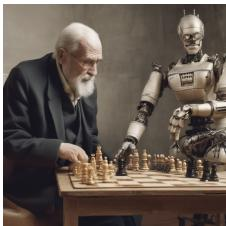

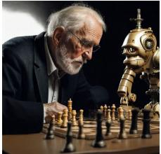

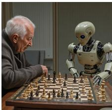  
steampunk chameleon automaton bot, close up, realistic, highly detail

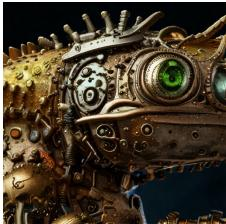

  
An oil painting of a young woman dressed in a flowing, white dress sitting on a chair with a red drape. An easel rests on her knees and she is evidently drawing. She is gazing directly at the observer.

  
SDXL

  
Hyper-SDXL

  
DMD2

  
NitroSD-Realism

  
ROAD  
Figure 11. Qualitative SDXL comparison under shared prompts. The SDXL teacher uses 40 inference steps; all four distilled methods use one step.

an anthropomorphic owl courier, monochromatic with subtle red accents  

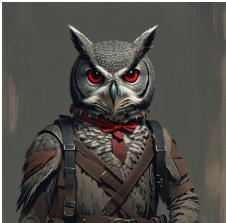

  
A futuristic city with flying cars, tall glass towers covered in plants, and a large park in the center, bright daylight.

  
A bookshelf filled with colorful books, a potted plant and a small globe.

  
A photo of an cosplay girl dressed as a fantasy warrior, with a full suit of armor and a sword at her side, standing on a hilltop with a dramatic sunset behind her

  
bedroom melting into the galaxy, penthouse apartment bedroom with big windows, unsplash, photo of the day

  
A teddy bear reading a newspaper on a park bench.

  
SD3.5-M 40 steps / 80 NFE

  
SiD-DiT 4 steps / 4 NFE

  
4 steps / 4 NFE

  
SenseFlow 4 steps / 4 NFE

  
ROAD 1 step / 1 NFE

Figure 12. Qualitative SD3.5-M comparison under shared prompts. Inference steps and network evaluations (NFE) are given below the columns.