# Read, Allocate, Route: Role-Coupled Tokenization for Pixel-Space Generative Transformers

Jiongfan Yang1,3, Weichen Fan2, Haiwen Diao2, Zhongang Cai3, Ziwei Liu2,†

1Peking University, 2Nanyang Technological University, 3SenseTime, †Corresponding author

Pixel-space generative Transformers typically use one token per image patch, so capturing finer detail requires more tokens and makes global attention increasingly expensive. We observe that finer detail does not necessarily require more global communication: low-frequency structure benefits from global exchange, while high-frequency detail can be modeled locally. Based on this insight, we introduce SpecSlot, a pixel-space rectified-flow Transformer that decouples output detail from the length of the global attention sequence. SpecSlot expands each spatial anchor into multiple slots, each assigned a disjoint band of DCT coeficients; this separates anchor density from spectral subdivision. Only the lowest-frequency slot from each anchor participates in global attention, while all slots interact locally. This allows the model to increase spectral detail without enlarging the global sequence. A spatial head further adds a local correction to the spectral prediction, while the generative state, target, and loss remain in pixel space. On ImageNet-256, SpecSlot achieves a comparable final FID to a FLOPs-matched JiT control while converging faster. On ImageNet-512, it improves FID by 2.84 over the control with 3.9% fewer FLOPs, and comes within only 0.69 FID of JiT-B/16 at 38.2% lower cost. On text-to-image generation, SpecSlot surpasses JiT-B/8 on DPG-Bench by 1.06 at 40.6% lower forward cost.

Project Page: https://yangjiongfan.site/specslot/

GitHub: https://github.com/JiongfanYang/SpecSlot

Hugging Face: https://huggingface.co/Gokottaw434/SpecSlot

  
Figure 1 Text-to-image samples generated by SpecSlot. More samples with prompts are shown in Appendix Figure 10.

## 1 Introduction

Pixel-space generative models learn directly from noise to pixels, eliminating the separately trained autoencoder and its compression bottleneck. This simplicity, however, comes with a computational cost: the full-resolution image must be represented as Transformer tokens. Most pixel-space Transformers use one token per spatial patch, so the patch grid simultaneously determines what the model reads, what each token predicts, and how many tokens participate in global attention. As a result, finer image detail directly increases attention cost: on a 256 × 256 image, reducing the patch size from 16 × 16 to 8 × 8 increases the token count from 256 to 1,024, making the quadratic term of dense attention 16× larger.

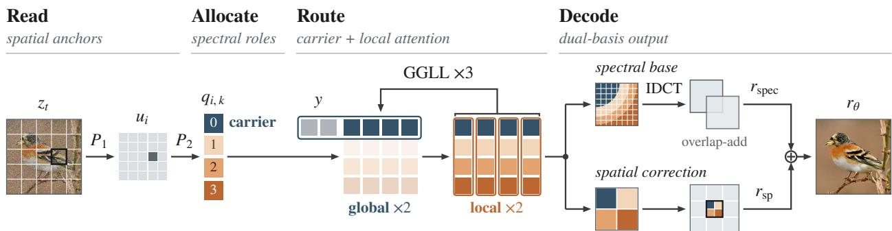  
Figure 2 SpecSlot data flow. Each anchor expands into K slots. G blocks process lowest-radial slot-0 carriers across anchors with context states; L blocks mix all slots within each anchor. The final slot states decode a lapped-DCT spectral base and an anchor-aligned spatial correction, summed in pixel space.

Existing methods address this cost from diferent directions, but largely retain the coupling between output detail and token communication. JiT routes every patch token through the global sequence [1]. Multiscale systems move detail to extra stages or detailer heads [2, 3, 4], and eficient-attention methods shorten the sequence with generic patterns—windows, selected global tokens, or learned sparsity [5, 6, 7, 8]. Spectral Forcing brings in frequency structure, but only to filter the noisy input; its tokens remain spatial patches [9]. Across the pixel-space generators discussed above, output detail remains tied to a spatial patch grid, even when communication is compressed or restricted.

Our key observation is that finer detail does not necessarily require proportionally more global communication: in the frequency domain, low-frequency structure carries broad image organization and benefits from long-range exchange, while fine detail is largely local. A token carrying broad structure therefore stands to gain from exchanging with the whole image, while a token carrying fine detail mostly does not. Yet in existing designs, what a token communicates is fixed by where it sits, not by what it produces. Can a token’s output role also determine how it should communicate?

SpecSlot builds on this idea by making output roles explicit and using them to control communication. It organizes computation around three operations: Read, Allocate, and Route. Read forms a grid of spatial anchors that collect input evidence. Allocate expands each anchor into K indexed slots, with each slot assigned a disjoint radial group of DCT coeficients. Route then uses these spectral roles to decide communication: only the slot assigned the lowest-frequency group from each anchor enters the global stage, while all slots interact locally within the anchor. This separates fine-grained output representation from the length of the global sequence. A spatial head further reuses the same slot states to add a local correction to the spectral prediction, without introducing additional tokens. Figure 2 illustrates this design.

This representation exposes two separate allocation variables. W controls the density of spatial anchors, while K controls the spectral subdivision at each anchor. The total number of slots grows with WK, but the global image sequence contains only W carriers. A fixed token budget can therefore be allocated either to denser spatial anchors or to finer spectral roles without forcing both to increase together. This turns tokenization from a single patch-size choice into an explicit quality–compute allocation problem.

Our contributions are:

• We introduce an indexed W × K representation in which spatial anchors collect input evidence and slots receive disjoint spectral coeficient groups. The split exposes anchor density and coeficient subdivision as separate allocation variables, and the same slot states also decode a local pixel correction.

• We define carrier-routed global–global–local–local (GGLL) attention from the slot index: one lowest-radial carrier per anchor enters global blocks, and all slots enter anchor-local blocks, so the global sequence contains W carriers rather than WK slots.

• On ImageNet-256 and ImageNet-512, SpecSlot provides two measured quality–compute operating points between JiT’s low-cost and high-cost settings. At ImageNet-512, W256/K4 lowers FID by 2.84 over our FLOPs-matched JiT control (JiT-CM) with 3.9% fewer GFLOPs, and trails JiT-B/16 by 0.69 FID at 38.2% lower cost. Larger output windows cover more pixels while the global sequence remains fixed;

the larger improvement over JiT-CM is consistent with this within-anchor allocation. On text-to-image generation, SpecSlot likewise surpasses JiT-B/8 on DPG-Bench by 1.06 at 40.6% lower forward cost.

## 2 Related Work

Difusion and pixel-space generation. Difusion and score-based models learn to reverse a gradual noising process and provide the iterative foundation of modern image synthesis [10, 11, 12]. Rectified flow turns the same idea into a straight noise-to-data path [13]. Latent difusion moved this process into the latent space of a separately trained autoencoder, and improved autoencoders continue to strengthen this line [14, 15, 16]. DiT, U-ViT, and SiT showed that plain Transformers scale reliably in this setting [17, 18, 19]. Pixel-space generation removes the autoencoder, but then asks the model to process the full-resolution state. This line has followed several routes: Simple Difusion and Hourglass DiT reduce the state internally, cascaded models and PixelFlow distribute generation across resolutions, and JiT shows that a direct large-patch Transformer can remain a strong pixel-space baseline [1, 20, 21, 22, 23]. Detail recovery is then assigned to extra components: PixelDiT adds a pixel-level DiT, DiP adds a detailer head, HyperDiT connects coarse and fine flows, and PixNerd decodes patch tokens with a neural field [2, 3, 4, 24]. These designs difer in where the compute goes, but share one premise: a token is a spatial patch, so finer detail and wider communication stay tied to the same spatial grid. SpecSlot complements this line with a single-backbone allocation: indexed slots carry fixed output and communication roles, so detail can be subdivided without making every output token global.

Frequency structure and transform-domain generation. Frequency ofers a complementary view of this problem. It has entered generative modeling through the state or forward process, through generation order or conditioning, and through the training objective or analysis. In the first line, inverse heat dissipation, wavelet models, sparse transform codes, and DCTdif change the representation or process used for generation [25, 26, 27, 28, 29]. In the second, VAR and NFIG organize generation by scale or frequency, while Spectral Forcing and Frequency-Forcing use frequency-related conditioning or guidance; Latent Forcing instead reorders the trajectory with a semantic auxiliary stream [9, 30, 31, 32, 33]. Focal frequency loss reweights spectral errors, and Fourier-space analyses characterize difusion without changing the denoiser [34, 35]. Recent architectura methods make frequency roles part of the denoiser itself: DiMSUM alternates spatial and wavelet-subband processing, while DeCo assigns low and high frequencies to a DiT and a separate pixel decoder [36, 37]. Together these works show several ways for frequency to shape representation or generation, but the cited lines do not use fixed spectral groups as both per-token output ownership and communication eligibility within one pixel-space backbone. SpecSlot keeps the state, target, and loss in pixel space; fixed, disjoint DCT groups give slots spectral roles, and the role index also determines which slots communicate globally.

Visual tokenization and allocation. Vision Transformers tokenize an image into a spatial patch grid [38], and NaViT extends this idea to variable resolutions [39]. This line reduces sequence work by changing how many spatial tokens are retained or processed at each step: ToMe merges similar tokens, SparseDiT prunes them, DyDiT++ reschedules computation across denoising time and space, variable-length tokenization learns a global merge, and FlexiDiT spends fewer tokens at easier steps [40, 41, 42, 43, 44]. The spatial patch remains the allocation unit, so detail and communication stay coupled to the same grid. SpecSlot adds a second, spectral axis: each of W anchors owns K slots with disjoint coeficient groups, making the fixed budget N=WK an explicit split between anchor density and spectral subdivision.

Global-local and sparse communication. The communication literature provides the other half of the problem by restricting how tokens exchange information. Swin uses local windows with shifted boundaries, Longformer combines local windows with a few global tokens, and Perceiver routes information through a small latent bottleneck [5, 6, 7]. In pixel-space generation, RINs exchange information through learned interface states, while trainable sparse attention and PixSGR learn or select interaction patterns from the data [8, 45, 46]. These approaches provide useful local or global topologies, but do not tie communication eligibility to a fixed spectral output role. SpecSlot fixes the graph from the allocation: one lowest-frequency slot per anchor is the global carrier, and all slots interact locally, so cross-anchor communication is spent on the role that also carries the low-frequency scafold.

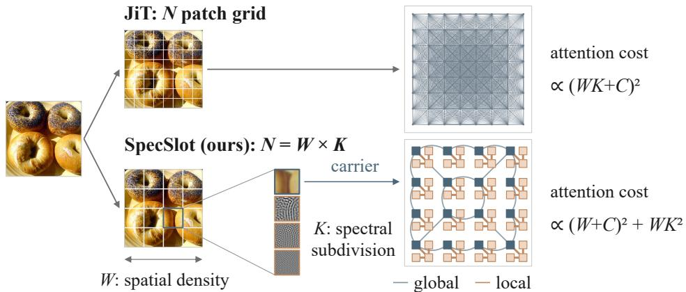  
Figure 3 SpecSlot allocation. A patch grid spends all N tokens in one global sequence; splitting N=WK into W spatial anchors and K spectral slots keeps global attention at W carriers.

## 3 Methodology

SpecSlot organizes pixel-space generation around one idea: tokenization as allocation—assigning each token a fixed output role and dividing a fixed token budget between anchor density and spectral subdivision. Global attention is then spent only on the role that needs it; the rectified-flow state, target, and loss remain in pixel space.

## 3.1 Shared Pixel-Space Rectified-Flow Objective

Following the JiT controls and objectives [1, 13], we mix an image $x \in [ - 1 , 1 ] ^ { 3 \times H \times H }$ with noise $\epsilon \sim \mathcal { N } ( 0 , I )$ on the linear path

$$
z _ { t } = t x + ( 1 - t ) \epsilon ,\tag{1}
$$

where $t = \sigma ( g )$ with $g \sim \mathcal { N } ( - 0 . 8 , 0 . 8 ^ { 2 } )$ and y is the class label. The network returns an image-shaped prediction $r _ { \theta } ( z _ { t } , t , y )$ , converted to a velocity by

$$
v _ { \theta } ( z _ { t } , t , y ) = \frac { r _ { \theta } ( z _ { t } , t , y ) - z _ { t } } { \operatorname* { m a x } ( 1 - t , \tau ) } , \qquad \tau = 0 . 0 5 ,\tag{2}
$$

where the clamp avoids the singularity at $t = 1$ , and training minimizes the velocity MSE

$$
\mathcal { L } _ { \mathrm { R F } } = \mathbb { E } _ { \boldsymbol { x } , \epsilon , t , \boldsymbol { y } } \left[ \frac { 1 } { 3 H ^ { 2 } } \left. \boldsymbol { v } _ { \theta } ( \boldsymbol { z } _ { t } , t , \boldsymbol { y } ) - ( \boldsymbol { x } - \epsilon ) \right. _ { 2 } ^ { 2 } \right] .\tag{3}
$$

## 3.2 SpecSlot Architecture

Why is allocation needed? In a patch-grid model, adding finer detail means shrinking the patch, and the global sequence grows with it; the two cannot be adjusted separately. Prior designs keep the spatial patch as the only allocation unit. SpecSlot instead introduces the missing variables, forming W spatial anchors and expanding each anchor into K indexed slots (Figure 3):

$$
\begin{array} { l } { { { \displaystyle { \cal N } = { \cal W } K , \qquad L = 2 s , } } } \\ { { { \displaystyle { \cal W } = ( H / s ) ^ { 2 } , \qquad E = \frac { L ^ { 2 } } { K } = \frac { 4 H ^ { 2 } } { N } . } } } \end{array}\tag{4}
$$

The budget splits into W anchors that read the input and K slots per anchor that divide the output; each slot owns an equal share E of the coeficients per channel, with s the input cell side and L the output window side. The two variables act separately: W sets how densely the input is read, and K how finely the output is divided. At fixed N, anchor density trades directly against spectral subdivision, and output detail can grow with K while the global sequence stays at $W$ carriers. Equal N does not imply equal cost, since communication and projection scale diferently with the split.

Three operations implement this allocation, as shown in Figure 2: Read collects each anchor’s input evidence, Allocate assigns each slot a fixed output role, and Route lets the role decide communication.

## 3.2.1 Read: Spatial Anchors and Slot Expansion

The first question is where input evidence comes from; SpecSlot reads it on a grid of anchors, independent of how the output is divided. Let $\mathcal { P } _ { i }$ extract the i-th non-overlapping $s \times s$ cell of $z _ { t }$ . A shared projection maps each cell to an anchor vector,

$$
u _ { i } = P _ { 1 } \operatorname { v e c } ( \mathcal { P } _ { i } z _ { t } ) \in \mathbb { R } ^ { B } , \qquad P _ { 1 } \in \mathbb { R } ^ { B \times 3 s ^ { 2 } } .\tag{5}
$$

This projection is a patch embedding whose width B is free, because the output count no longer depends on it. A zero-initialized residual depthwise $3 \times 3$ convolution over the anchor grid—the input mixer—lets neighboring cells exchange evidence before it is split into roles. A shared $1 \times 1$ projection expands each mixed anchor vector into K hidden states,

$$
\left[ q _ { i , 0 } ; \ldots ; q _ { i , K - 1 } \right] = \operatorname { r e s h a p e } ( P _ { 2 } \widetilde { u } _ { i } + b _ { 2 } ) , \qquad q _ { i , k } \in \mathbb { R } ^ { d } ,\tag{6}
$$

where $P _ { 2 } \in \mathbb { R } ^ { K d \times B } ;$ a two-dimensional anchor position plus a learned slot position are added. One anchor vector seeds all K slots; the roles come from the slot positions, output heads, and routing, not from the input. All WK slots are evaluated at every flow time.

## 3.2.2 Allocate: Radial Coefficients and Pixel Synthesis

Radial coeficient assignment. The second question is who produces what. SpecSlot assigns each slot a fixed share of the output in a DCT basis. Low radial frequencies carry broad structure and high frequencies fine detail, and natural-image spectra decay smoothly along this order [9]; a radial split therefore sorts the roles from global to local without any learned assignment. For an output window of side $L = 2 s .$ , the DCT-II indices $( u , v )$ are ordered by $\sqrt { u ^ { 2 } + v ^ { 2 } }$ and split into $K$ equal groups, requiring $K \mid L ^ { 2 } ;$ slot k of each anchor owns group k, that is, $E = L ^ { 2 } / K$ coeficients per channel. The disjoint groups cover the grid: every coeficient is predicted exactly once. A shared afine head predicts the owned coeficients from the slot’s final hidden state $h _ { i , k } ^ { \mathrm { o u t } }$

$$
\widehat { c } _ { i , k } = P _ { \mathrm { s p e c } } h _ { i , k } ^ { \mathrm { o u t } } + b _ { \mathrm { s p e c } } \in \mathbb { R } ^ { 3 E } .\tag{7}
$$

Sharing the head is deliberate: the slot index, not per-band parameters, defines ownership.

Lapped synthesis. Decoding each window independently would leave neighbors free to disagree on their shared edge, and the mismatch shows as block seams, most visibly early in training. SpecSlot decodes by the synthesis half of a 50%-lapped DCT frame instead: inverse DCT, a square-root periodic Hann window, and normalized overlap-add. Neighboring windows share half their pixels, and normalized overlap-add mitigates cross-window discontinuities.

$$
r _ { \mathrm { s p e c } } = \mathrm { O L A } \Big ( \{ \mathrm { I D C T } ( \widehat { c } _ { i } ) \} _ { i = 1 } ^ { W } \Big ) ,\tag{8}
$$

where each window is weighted before overlap-add. Let g be the separable square-root periodic Hann window, D the orthonormal two-dimensional DCT-II, $R _ { i } ^ { \top }$ the placement of window i at stride $s = L / 2$ , and $Q$ the crop to the image region after reflection padding by $s / 2$ . The normalized synthesis is

$$
\begin{array} { c } { { r _ { \mathrm { s p e c } } = Q \left[ \Lambda ^ { \dagger } \odot \displaystyle \sum _ { i } R _ { i } ^ { \top } \left( g \odot \mathcal { D } ^ { \top } \widehat { c } _ { i } \right) \right] , } } \\ { { \Lambda = \displaystyle \sum _ { i } R _ { i } ^ { \top } ( g ^ { 2 } ) . } } \end{array}\tag{9}
$$

Here $\Lambda ^ { \dagger }$ is the reciprocal on the covered region. For the matched analysis frame, let $P$ reflect-pad the image by $s / 2$ pixels and let $R _ { i }$ extract the i-th window. Its coeficients are

$$
c _ { i } ( x ) = { \cal D } \left( g \odot R _ { i } P x \right) .\tag{10}
$$

Applying the synthesis above to these coeficients gives $S ( \{ c _ { i } ( x ) \} ) = x$ up to floating-point error: the same window is used in analysis and synthesis, Λ normalizes the overlap, and the crop satisfies $Q P = I .$

Anchor-aligned spatial correction. The same slot states can also be read out directly in pixel space. A second head adds an anchor-aligned correction alongside the spectral base: slot k writes tile k of a deterministic row-major $K _ { h } \times K _ { w }$ tiling $\left( K _ { h } K _ { w } = K \right)$ of its anchor cell (four $8 \times 8$ quadrants for $K { = } 4 , s { = } 1 6 )$ These projections are slot-specific and zero-initialized, so training starts from a pure spectral model. The correction adds output parameters but no token states or attention edges. Radial ownership applies only to the spectral base; the spatial term is a pixel readout with no frequency assignment. The two terms express the same prediction in diferent bases, and Section 6.1 finds their content complementary. The prediction is

$$
r _ { \theta } ( z _ { t } , t , y ) = r _ { \mathrm { s p e c } } + r _ { \mathrm { s p } } .\tag{11}
$$

## 3.2.3 Route: Carrier and Local Attention

The third question is who needs to communicate globally. Sending every slot through global attention would make the global quadratic cost grow with K—reintroducing exactly the coupling between output detail and communication cost that the slot allocation set out to remove. The spectral roles suggest a cheaper split: the lowest radial group holds the broad structure that benefits from cross-anchor exchange, while finer groups are increasingly local; its signal also overtakes the noise earliest in the flow (Section 6.2). SpecSlot therefore routes by role: the owner of the lowest radial group, slot 0, is the carrier and the only slot entering the global stage; all K slots then mix locally within their anchor. Since global and local blocks alternate, the carrier brings global information into its anchor and takes local detail back into the next global stage.

Let $\mathbf { Z } \in \mathbb { R } ^ { W \times K \times d }$ be the slot tensor and $\mathbf { Y } \in \mathbb { R } ^ { C \times d }$ the C=32 context states formed from the class embedding. The two routing sets are

$$
\mathcal { A } _ { G } = \mathrm { C o n c a t } ( { \bf Y } , { \bf Z } _ { : , 0 } ) , \qquad \mathcal { A } _ { L } ^ { ( i ) } = { \bf Z } _ { i , : } .\tag{12}
$$

Two consecutive blocks process the global set and two more process each local set; this global-global-local-local (GGLL) schedule repeats three times, giving six global and six local blocks of identical dimensions. Class context appears only in the global group. Non-carrier slots traverse the six local blocks, context states the six global ones, and carriers all twelve. On ImageNet-256 with s=16 and $K { = } 4$ , the global sequence holds $W { + } C = 2 8 8$ tokens instead of $W K { + } C = 1 { , } 0 5 6$

Ignoring projections and elementwise operations, the quadratic terms are

$$
\begin{array} { r l } & { \mathcal { C } _ { \mathrm { G G L L } } ^ { \mathrm { q u a d } } \propto 6 ( W + C ) ^ { 2 } d + 6 W K ^ { 2 } d , } \\ & { \mathcal { C } _ { \mathrm { f u l l } } ^ { \mathrm { q u a d } } \propto 1 2 ( W K + C ) ^ { 2 } d , } \end{array}\tag{13}
$$

where d is the hidden width; the global quadratic term now grows with W, not WK. Measured GFLOPs include the full execution and decoder, not only these terms.

Because W and K can be varied independently, their efects on quality and compute can be measured separately.

## 4 Experiments

## 4.1 Experimental Setup

Models and training. We train class-conditional models on ImageNet-1K [47] and report results at ImageNet-256 and ImageNet-512. Unless stated otherwise, our models use the W256 anchor grid of Section 3 with B=1536, where B is the input-projection width; we write SpecSlot-K2 and SpecSlot-K4 for the two allocations. ImageNet-256 training lasts 120 epochs at efective batch 512, and the aligned models share the full training recipe.

Table 1 ImageNet quality and compute. SpecSlot rows report the best swept B and CFG per allocation (SF-B/32 at ImageNet-512: CFG 9.50). GFLOPs are conditional forward costs; img/s is peak Heun-50 throughput; – indicates that SpecSlot’s B parameter does not apply. SpecSlot gives two nondominated operating points between JiT’s low- and high-cost settings, and its margin over the compute-matched control is larger at ImageNet-512 than at ImageNet-256 in these comparisons. JiT models are retrained for 120 epochs under the aligned recipe.
<table><tr><td>Model</td><td>Tokens</td><td>B</td><td>CFG</td><td>FID ↓</td><td>IS↑</td><td>GFLOPs↓</td><td>img/s ↑</td></tr><tr><td>ImageNet-256</td><td></td><td></td><td></td><td></td><td></td><td></td><td></td></tr><tr><td>JiT-B/16</td><td>256</td><td></td><td>2.90</td><td>7.51</td><td>174.81</td><td>50.45</td><td>33.08</td></tr><tr><td>JiT-B/8</td><td>1,024</td><td></td><td>2.90</td><td>4.34</td><td>225.72</td><td>218.50</td><td>8.15</td></tr><tr><td>SF-B/16</td><td>256</td><td></td><td>2.90</td><td>7.81</td><td>172.35</td><td>50.85</td><td>32.89</td></tr><tr><td>JiT-CM</td><td>1,024</td><td></td><td>2.90</td><td>6.68</td><td>182.56</td><td>124.24</td><td>8.94</td></tr><tr><td>SpecSlot (W256/K2)</td><td>512</td><td>512</td><td>5.00</td><td>7.27</td><td>219.49</td><td>82.63</td><td>21.32</td></tr><tr><td>SpecSlot (W256/K4)</td><td>1,024</td><td>1,536</td><td>4.00</td><td>6.59</td><td>215.20</td><td>129.20</td><td>9.06</td></tr><tr><td>ImageNet-512</td><td></td><td></td><td></td><td></td><td></td><td></td><td></td></tr><tr><td>JiT-B/32</td><td>256</td><td></td><td>2.90</td><td>15.88</td><td>162.12</td><td>51.50</td><td>30.61</td></tr><tr><td>JiT-B/16</td><td>1,024</td><td></td><td>2.90</td><td>8.45</td><td>196.61</td><td>219.56</td><td>7.93</td></tr><tr><td>SF-B/32</td><td>256</td><td></td><td>9.50</td><td>11.41</td><td>172.48</td><td>54.72</td><td>30.88</td></tr><tr><td>JiT-CM</td><td>1,024</td><td></td><td>2.90</td><td>11.98</td><td>178.72</td><td>141.21</td><td>8.51</td></tr><tr><td>SpecSlot (W256/K2)</td><td>512</td><td>3,072</td><td>10.50</td><td>10.94</td><td>183.69</td><td>94.52</td><td>18.32</td></tr><tr><td>SpecSlot (W256/K4)</td><td>1,024</td><td>4,096</td><td>8.25</td><td>9.14</td><td>208.24</td><td>135.64</td><td>12.69</td></tr></table>

Evaluation. We sample with 50 Heun intervals on the common legacy-uniform grid and use EMA1 weights. Reported rows use the per-model best classifier-free guidance (CFG) [48] from a coarse-tofine sweep (Appendix B); JiT rows use 2.9 instead of 3.0, also the swept optimum for JiT (Table 10), matching SF’s protocol [9]. The main ImageNet and text-to-image results use five independently trained seeds. Ablations use three seeds, except that we reuse the five-seed results for W256/K2 and W256/K4. For

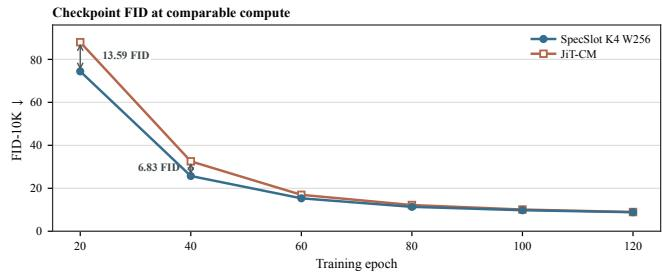  
Figure 4 Mean FID-10K under the aligned protocol.

ImageNet, FID and Inception Score [49, 50] are computed at 50K images per seed, and compared checkpoints share class ordering and noise draws.

Compute accounting. We measure forward cost on one H800 in BF16 with whole-network TorchInductor, counting a multiply–add as two FLOPs (full profiler contract in Table 8). Throughput is the best Heun-50 value over a shared batch sweep.

Compute-matched JiT control. JiT-CM/124G keeps JiT-B/8’s raw 8 × 8 tokenizer and routes features through a 128-dimensional input bottleneck and 32 context tokens inserted at block 4 of the 12-block trunk; width 560 with 10 heads measures 124.24 GFLOPs under the profiler above. It is an implementation-defined control matched on forward GFLOPs rather than a published JiT size. The ImageNet-512 control JiT-CM/141G uses the corresponding 16 × 16 tokenizer at width 600 (141.21 GFLOPs); we write JiT-CM for the resolution-matched control in what follows.

## 4.2 ImageNet Results

On ImageNet-256, SpecSlot-K2 and SpecSlot-K4 are two measured, nondominated operating points between JiT-B/16 and JiT-B/8 (Table 1): K2 already improves over JiT-B/16, and K4 improves further while using 40.9% fewer FLOPs than JiT-B/8, which remains the quality leader. JiT-CM gives the closer compute comparison: SpecSlot-K4 matches its mean FID within the five-seed 95% interval at nearly identical FLOPs and throughput (Appendix D), and descends faster at early-to-mid checkpoints (Figure 4).

At ImageNet-512, each anchor covers four times as many pixels as at ImageNet-256, while our global sequence stays at 288 tokens. Larger spectral windows and the spatial correction can accommodate the additional within-anchor detail without adding global communication, ofering a possible explanation for SpecSlot’s larger margin at this resolution. SpecSlot-K4 improves FID by 2.84 over JiT-CM at slightly lower cost, and is only 0.69 FID behind JiT-B/16 at 38.2% lower cost and 1.6× higher throughput; it also attains the highest Inception Score in the panel, and both allocations outperform the input-side spectral baseline SF-B/32. The lower-cost SpecSlot-K2 stays within 1.04 FID of the control at 33.1% less compute.

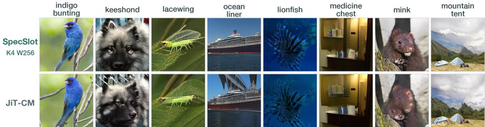  
Figure 5 Paired ImageNet-256 generations with the same class label and noise draw: SpecSlot W256/K4 and JiT-CM.

Table 2 Text-to-image generation at 256 × 256 after training 400 epochs using the same prompt sets and 50-step Heun sampler. DPG-Bench [51] and GenEval [52] report overall scores in percent; forward GFLOPs include the trainable text adapter.
<table><tr><td>Model</td><td>CFG</td><td>GFLOPs ↓</td><td>DPG ↑</td><td>GenEval ↑</td></tr><tr><td>JiT-B/16</td><td>2.9</td><td>50.71</td><td>59.22</td><td>24.89</td></tr><tr><td>JiT-B/8</td><td>2.9</td><td>218.77</td><td>61.15</td><td>29.78</td></tr><tr><td>SpecSlot (W256/K4)</td><td>4.0</td><td>129.86</td><td>62.21</td><td>26.99</td></tr></table>

Table 3 Communication schedules at fixed W256/K4/B1536; eficiency columns come from one profiler run.
<table><tr><td>Route</td><td>Cross-anchor image states</td><td>FID ↓</td><td>IS↑</td><td>GFLOPs ↓ img/s ↑</td><td></td></tr><tr><td>GGLL</td><td>one carrier per anchor</td><td>6.59</td><td>215.20</td><td>129.20</td><td>9.06</td></tr><tr><td>GLGL</td><td>one carrier per anchor</td><td>6.95</td><td>218.95</td><td>129.20</td><td>9.00</td></tr><tr><td>Dense-global-CM all image slots</td><td></td><td>6.81</td><td>210.20</td><td>128.96</td><td>5.80</td></tr><tr><td>Full-global</td><td>all image slots</td><td>5.84</td><td>237.54</td><td>225.82</td><td>5.11</td></tr></table>

Against the strongest JiT model in each panel, which uses about 1.7× our compute, our FID deficit narrows from 2.25 at ImageNet-256 to 0.69 at ImageNet-512, while our lead over JiT-CM grows from 0.09 to 2.84. These two operating points are consistent with the within-anchor allocation mechanism above, but do not by themselves isolate the cause of the larger margin.

Paired ImageNet-256 samples are shown in Figure 5; additional examples are provided in Appendix Figure 9.

## 4.3 Text-to-Image Generation

Protocol. We test whether the allocation and routing design transfers from class labels to text conditions. We train at 256 × 256 on a mixture of the BLIP3o long-caption and short-caption shards [53] and JourneyDB shards [54]. A frozen OpenCLIP ViT-L/14 encoder [55] and a trainable 32-query adapter provide the denoiser context. SpecSlot reads this context through its carrier states during the global route, while local blocks continue to process image slots; JiT uses the same text encoder and adapter. We retain the ImageNet rectifiedflow objective, optimizer, and EMA; the complete training contract is in Appendix Table 9. Evaluation uses the 50-step Heun sampler with CFG 4.0 for SpecSlot and 2.9 for JiT. Table 2 reports the results.

Results. Transferred to text conditioning, SpecSlot attains the highest DPG-Bench score, improving over both JiT baselines at 40.6% lower forward cost than the stronger JiT-B/8 (Table 2). On GenEval it improves over JiT-B/16, while JiT-B/8 remains the quality leader at 1.7× the forward cost—the same quality–compute

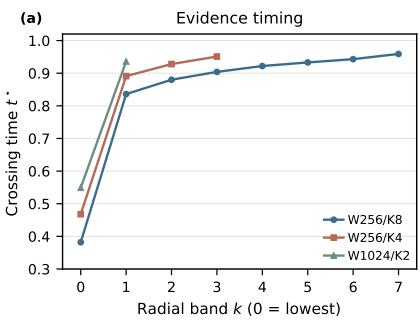

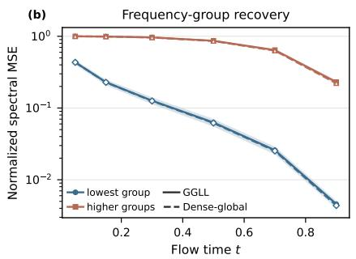

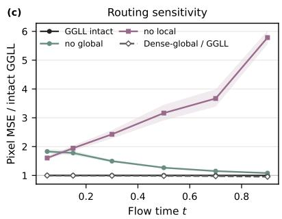  
Figure 6 Evidence timing and routed-communication probes. Panels (a)–(c) report the data-to-noise ratio crossing time per radial band for paired W256/K8, W256/K4, and W1024/K2 checkpoints, frequency-group recovery, and route sensitivity. The route interventions remove cross-anchor carrier edges or local cross-band edges inside the shared Transformer while retaining carrier self edges and context reads.

Table 4 Design analysis at ImageNet-256. (a) Slot allocation: the upper block fixes N=2,048 and the lower fixes W=256; all rows use B=1536. (b) Input/output bases at fixed W256/K4/B1536.  
(a)
<table><tr><td>Alloc.</td><td>FID ↓</td><td>IS ↑</td><td>GFLOPs↓</td><td>img/s ↑</td></tr><tr><td colspan="5">Fixed slot budget</td></tr><tr><td>W64/K32</td><td>7.28</td><td>218.52</td><td>195.43</td><td>9.00</td></tr><tr><td>W256/K8</td><td>6.28</td><td>219.52</td><td>220.02</td><td>6.55</td></tr><tr><td>W1024/K2</td><td>5.66</td><td>212.31</td><td>292.29</td><td>5.21</td></tr><tr><td colspan="5">Fixed anchor grid</td></tr><tr><td>W256/K2</td><td>7.39</td><td>222.97</td><td>83.84</td><td>20.10</td></tr><tr><td>W256/K4</td><td>6.59</td><td>215.20</td><td>129.20</td><td>9.06</td></tr><tr><td>W256/K8</td><td>6.28</td><td>219.52</td><td>220.02</td><td>6.55</td></tr></table>

(b)
<table><tr><td>Input Output</td><td>FID ↓</td><td>IS↑</td><td>GFLOPs ↓ img/s ↑</td><td></td></tr><tr><td>Single basis</td><td></td><td></td><td></td><td></td></tr><tr><td>Freq. Freq.</td><td>7.34</td><td>222.46</td><td>129.30</td><td>9.35</td></tr><tr><td>Freq. Spat.</td><td>7.23</td><td>215.73</td><td>129.20</td><td>9.63</td></tr><tr><td>Spat. Freq.</td><td>7.10</td><td>221.37</td><td>129.20</td><td>9.06</td></tr><tr><td>Spat. Spat.</td><td>6.99</td><td>215.56</td><td>129.10</td><td>9.34</td></tr><tr><td></td><td></td><td></td><td></td><td></td></tr><tr><td>Dual basis Spat. Freq.+ Spat. 6.59</td><td></td><td>215.20</td><td>129.20</td><td>9.06</td></tr></table>

trade-of as on ImageNet-256. This transfer requires no T2I-specific change to the SpecSlot architecture or training objective. Selected text-to-image samples are shown in Figure 1; additional examples are provided in Appendix Figure 10.

## 5 Ablation Study

## 5.1 Understanding the Design

## 5.1.1 Anchor Density and Coefficient Subdivision

Both allocation axes trade compute for quality, but they are not interchangeable: W improves the read, K refines the write (Table 4). Increasing K at fixed W lowers FID at higher cost with diminishing returns—the last doubling buys only 0.31 FID—while shifting the split toward more anchors at fixed N lowers FID monotonically, with no clear saturation in this range. Within the tested N=2,048 configurations, these trends favor allocating more of the token budget to spatial anchors; we do not claim that this rule generalizes beyond the measured range.

At fixed W and B, the entropy-efective slot fraction decreases monotonically from 0.803 at K=2 to 0.495 at K=8 (Table 5). The absolute efective rank still grows, but sublinearly, so token count alone does not measure efective capacity. This utilization pattern is consistent with the diminishing quality gains at larger K and motivates our choice of K2 as the lower-cost point and K4 as the intermediate point.

## 5.1.2 Input and Output Representations

At the same spectral output, spatial input surpasses frequency input, and the dual-basis hybrid achieves the best FID: 6.59, a further 0.40 below the best single-basis variant at 6.99, without adding tokens or cross-anchor

Table 5 Efective use of additional spectral slots at fixed W=256 and evidence width B=1536. Values are means over paired teacher states. Efective slots/K is the normalized entropy efective rank; definitions are in Appendix E.2.
<table><tr><td>K</td><td>Velocity MSE</td><td>Effective slots/K</td><td>Effective local keys</td><td>Detail → carrier</td></tr><tr><td>2</td><td>.10670</td><td>.803</td><td>.729</td><td>.330</td></tr><tr><td>4</td><td>.10549</td><td>.620</td><td>.682</td><td>.312</td></tr><tr><td>8</td><td>.10497</td><td>.495</td><td>.621</td><td>.275</td></tr></table>

Table 6 Component ablations at the fixed anchor–slot contract: (a) evidence width; (b) fixed-batch sampling throughput on one H800, in img/s at the indicated Heun interval count (full measurements are in Appendix Table 11); (c) output-window lapping; (d) input mixing.

(a)
<table><tr><td>Evidence width B FID ↓ IS ↑ GFLOPs ↓ img/s ↑</td></tr><tr><td>B = 1024 6.77 221.58</td><td>128.19 9.18</td></tr><tr><td>B = 1536 6.59 215.20</td><td>129.20 9.06</td></tr><tr><td>B = 2048 6.64 224.80</td><td>129.87 9.04</td></tr></table>

(c)

(b)
<table><tr><td>Route</td><td>20</td><td>30</td><td>50</td></tr><tr><td>GGLL</td><td>21.02</td><td>13.68</td><td>8.20</td></tr><tr><td>Dense-global-CM</td><td>14.31</td><td>9.16</td><td>5.56</td></tr><tr><td>Full-global</td><td>12.35</td><td>8.01</td><td>4.79</td></tr></table>

(d)

<table><tr><td>Output window</td><td>FID ↓</td><td></td><td>IS↑ GFLOPs ↓ img/s ↑</td><td></td></tr><tr><td>Non-overlapping</td><td>6.78</td><td>211.23</td><td>129.19</td><td>9.13</td></tr><tr><td>50% overlapping</td><td>6.59</td><td>215.20</td><td>129.20</td><td>9.06</td></tr></table>

<table><tr><td>Input mixer</td><td>FID ↓</td><td>IS ↑ GFLOPs ↓ img/s ↑</td><td></td></tr><tr><td>Identity</td><td>6.83 220.38</td><td></td><td>129.20 9.06</td></tr><tr><td>Residual depthwise mixer</td><td>6.59</td><td>215.20 129.20</td><td>9.06</td></tr></table>

attention edges (Table 4(b)). This margin indicates that the two output bases are not redundant: the spatial correction supplies structure that the spectral base alone misses. Section 6.1 localizes this complementarity over the flow and across frequency bands.

## 5.1.3 Carrier Routing

To test routing at a fixed forward budget, we train a full-global control (Dense-global-CM) on the same W256/K4 configuration, replacing the carrier/local schedule with 12 full-global blocks over all 1,024 image slots; its hidden width is 560, matching the measured GGLL forward cost. GGLL is both better and faster than this control at essentially identical FLOPs (Table 3). Full-global attention reaches a lower FID but at 74.8% higher cost and lower throughput. The carrier design therefore targets the intermediate, attention-constrained regime, saving 42.8% of the full-global cost. GLGL keeps the same carrier set and global budget but alternates the global/local order; its FID degrades at identical compute, showing that block order afects performance under this fixed carrier set. Section 6.2 provides a possible motivation for early global processing: the lowest-radial role is recovered earliest in the flow.

## 5.2 Component Ablations

The following controls vary one implementation component at a time at the fixed anchor–slot contract.

The best FID among the tested evidence widths is obtained at B=1536 (Table 6(a)). The residual mixer (Table 6(d)) and 50% overlap (Table 6(c)) improve FID at nearly unchanged forward cost, supporting their use in the final contract.

## 5.3 Sampling Efficiency

The main tables report peak Heun-50 throughput. To check how route cost scales with the sampling budget, we also measured fixed-batch BF16 sampling at batch 512 at 20, 30, and 50 Heun intervals (Table 6(b)). GGLL is faster than the compute-matched dense-global control at every tested budget: its throughput is 1.47–1.49× higher.

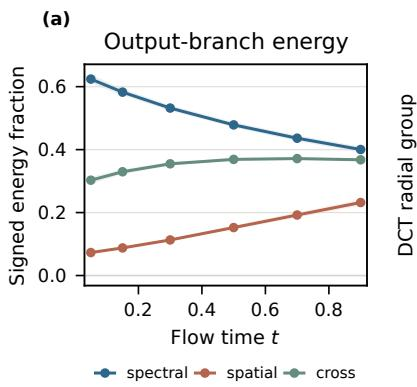

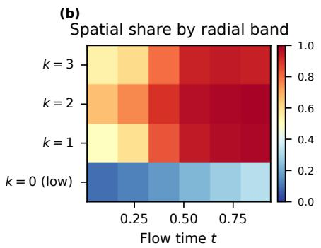

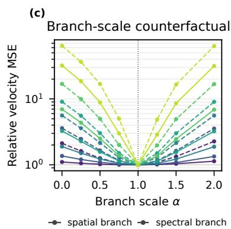  
Figure 7 Output-branch probes. Panels (a)–(c) show normalized branch self-energies and their signed cross term, spatial self-energy share by radial band, and relative velocity MSE under spatial or spectral scaling over $t \in \{ 0 . 0 5 , \ldots , 0 . 9 0 \}$ The energy panel shows 95% bootstrap intervals; the other panels show means.

## 6 Mechanistic Analysis

## 6.1 Spectral Base and Spatial Correction

Figure 7 shows the spectral term has the larger self-energy, while the spatial term’s share grows from 0.07 to 0.23 over the flow, and the normalized cross term stays positive—the two terms reinforce, not cancel. Projected through the matched lapped-DCT analysis frame (which does not confer radial coeficient ownership), the spatial term’s share is smallest in the lowest radial group and dominates the higher groups late in the flow. Removing either term with the trunk fixed raises velocity MSE: at t=0.90 by 32.1× (spatial) or 64.1× (spectral), and at t=0.05 by 1.1× and 2.1×. The spectral branch is the main scafold throughout these probes; the spatial branch supplies an additional late, higher-frequency correction under this parameterization.

## 6.2 Carrier Identity and Routed Communication

We vary only which slot receives cross-anchor access, holding the W256/K4 allocation, GGLL graph, and compute fixed (Table 7). Replacing the lowest-radial carrier with slot 1, 2, or 3 raises mean FID in every case (Table 7): the assignment matters, and the lowest-radial role is also the one whose signal emerges earliest. In Figure 6, this band is the first to cross DNR = 1, motivating the assignment of slot 0 to the global path. Table 3 compares separately trained communication graphs, whereas the GGLL intervention curves in Figure 6 change only route edges inside the shared Transformer; Dense-

Table 7 Carrier-identity ablation at fixed W256/K4/B1536: only the slot with cross-anchor access changes.
<table><tr><td>Global carrier</td><td>FID ↓</td><td>IS↑</td></tr><tr><td>Slot 0 (lowest radial)</td><td>6.59</td><td>215.20</td></tr><tr><td>Slot 1</td><td>6.91</td><td>220.38</td></tr><tr><td>Slot 2</td><td>7.21</td><td>203.90</td></tr><tr><td>Slot 3</td><td>6.97</td><td>214.87</td></tr></table>

global is a separately trained reference. On paired states, the lowest radial group is recovered earlier than the higher groups; removing cross-anchor carrier edges costs most early, while removing local cross-band edges costs most late.

## 7 Conclusion

SpecSlot recasts tokenization as allocation: a fixed token budget is split between anchor density and spectral subdivision, while global attention is assigned by role. On ImageNet-256, it reaches a comparable final FID to the FLOPs-matched JiT control and descends faster early in training; on ImageNet-512, it improves FID by 2.84 over that control and approaches JiT-B/16 at 38% lower cost. On text-to-image generation, the same design surpasses JiT-B/8 on DPG-Bench (62.21 vs. 61.15) at 40.6% lower forward cost. These results show that, in the evaluated pixel-space settings, output detail and global-communication cost can be decoupled through tokenization. Our diagnostics find the lowest-radial role is recovered earliest, supporting its use as the carrier. Allocation gives pixel-space models a new way to trade detail for communication.

## References

[1] Tianhong Li and Kaiming He. Back to basics: Let denoising generative models denoise, 2026. URL https://arxiv.org/abs/2511.13720.

[2] Yongsheng Yu, Wei Xiong, Weili Nie, Yichen Sheng, Shiqiu Liu, and Jiebo Luo. Pixeldit: Pixel difusion transformers for image generation. In Proceedings of the IEEE/CVF Conference on Computer Vision and Pattern Recognition (CVPR), pages 14273–14282, June 2026.

[3] Zhennan Chen, Junwei Zhu, Xu Chen, Jiangning Zhang, Xiaobin Hu, Hanzhen Zhao, Chengjie Wang, Jian Yang, and Ying Tai. Dip: Taming difusion models in pixel space, 2026. URL https://arxiv.org/ abs/2511.18822.

[4] Yu He, Lichen Ma, Zipeng Guo, Xinyuan Shan, Jingling Fu, Dong Chen, Junshi Huang, and Yan Li. Hyperdit: Hyper-connected transformers for high-fidelity pixel-space difusion, 2026. URL https: //arxiv.org/abs/2605.15741.

[5] Ze Liu, Yutong Lin, Yue Cao, Han Hu, Yixuan Wei, Zheng Zhang, Stephen Lin, and Baining Guo. Swin Transformer: Hierarchical Vision Transformer using Shifted Windows . In 2021 IEEE/CVF International Conference on Computer Vision (ICCV), pages 9992–10002, Los Alamitos, CA, USA, October 2021. IEEE Computer Society. doi: 10.1109/ICCV48922.2021.00986. URL https://doi.ieeecomputersoci ety.org/10.1109/ICCV48922.2021.00986.

[6] Iz Beltagy, Matthew E. Peters, and Arman Cohan. Longformer: The long-document transformer, 2020. URL https://arxiv.org/abs/2004.05150.

[7] Andrew Jaegle, Felix Gimeno, Andrew Brock, Andrew Zisserman, Oriol Vinyals, and Joao Carreira. Perceiver: General perception with iterative attention, 2021. URL https://arxiv.org/abs/2103.03206.

[8] Yifan Zhou, Zeqi Xiao, Tianyi Wei, Shuai Yang, and Xingang Pan. Trainable log-linear sparse attention for eficient difusion transformers, 2026. URL https://arxiv.org/abs/2512.16615.

[9] Weichen Fan, Haiwen Diao, Penghao Wu, and Ziwei Liu. Show the signal, hide the noise: Spectral forcing for pixel-space difusion, 2026. URL https://arxiv.org/abs/2606.15236.

[10] Jonathan Ho, Ajay Jain, and Pieter Abbeel. Denoising difusion probabilistic models. In Proceedings of the 34th International Conference on Neural Information Processing Systems, NIPS ’20, Red Hook, NY, USA, 2020. Curran Associates Inc. ISBN 9781713829546.

[11] Yang Song, Jascha Sohl-Dickstein, Diederik P. Kingma, Abhishek Kumar, Stefano Ermon, and Ben Poole. Score-based generative modeling through stochastic diferential equations, 2021. URL https: //arxiv.org/abs/2011.13456.

[12] Prafulla Dhariwal and Alexander Nichol. Difusion models beat gans on image synthesis. In M. Ranzato, A. Beygelzimer, Y. Dauphin, P.S. Liang, and J. Wortman Vaughan, editors, Advances in Neural Information Processing Systems, volume 34, pages 8780–8794. Curran Associates, Inc., 2021. URL https://proceedings.neurips.cc/paper\_files/paper/2021/file/49ad23d1ec9fa4bd8d77d02681d f5cfa-Paper.pdf.

[13] Xingchao Liu, Chengyue Gong, and Qiang Liu. Flow straight and fast: Learning to generate and transfer data with rectified flow, 2022. URL https://arxiv.org/abs/2209.03003.

[14] Patrick Esser, Robin Rombach, and Bjorn Ommer. Taming Transformers for High-Resolution Image Synthesis . In 2021 IEEE/CVF Conference on Computer Vision and Pattern Recognition (CVPR), pages 12868–12878, Los Alamitos, CA, USA, June 2021. IEEE Computer Society. doi: 10.1109/CVPR46437.20 21.01268. URL https://doi.ieeecomputersociety.org/10.1109/CVPR46437.2021.01268.

[15] Robin Rombach, Andreas Blattmann, Dominik Lorenz, Patrick Esser, and Björn Ommer. High-resolution image synthesis with latent difusion models. In 2022 IEEE/CVF Conference on Computer Vision and Pattern Recognition (CVPR), pages 10674–10685, 2022. doi: 10.1109/CVPR52688.2022.01042.

[16] Boyang Zheng, Nanye Ma, Shengbang Tong, and Saining Xie. Difusion transformers with representation autoencoders, 2025. URL https://arxiv.org/abs/2510.11690.

[17] William Peebles and Saining Xie. Scalable Difusion Models with Transformers . In 2023 IEEE/CVF International Conference on Computer Vision (ICCV), pages 4172–4182, Los Alamitos, CA, USA, October 2023. IEEE Computer Society. doi: 10.1109/ICCV51070.2023.00387. URL https://doi.ieeecomputer society.org/10.1109/ICCV51070.2023.00387.

[18] Fan Bao, Shen Nie, Kaiwen Xue, Yue Cao, Chongxuan Li, Hang Su, and Jun Zhu. All are worth words: A vit backbone for difusion models, 2023. URL https://arxiv.org/abs/2209.12152.

[19] Nanye Ma, Mark Goldstein, Michael S. Albergo, Nicholas M. Bofi, Eric Vanden-Eijnden, and Saining Xie. Sit: Exploring flow and difusion-based generative models with scalable interpolant transformers, 2024. URL https://arxiv.org/abs/2401.08740.

[20] Emiel Hoogeboom, Jonathan Heek, and Tim Salimans. Simple difusion: End-to-end difusion for high resolution images, 2023. URL https://arxiv.org/abs/2301.11093.

[21] Katherine Crowson, Stefan Andreas Baumann, Alex Birch, Tanishq Mathew Abraham, Daniel Z. Kaplan, and Enrico Shippole. Scalable high-resolution pixel-space image synthesis with hourglass difusion transformers. In Proceedings of the 41st International Conference on Machine Learning, ICML’24. JMLR.org, 2024.

[22] Jonathan Ho, Chitwan Saharia, William Chan, David J. Fleet, Mohammad Norouzi, and Tim Salimans. Cascaded difusion models for high fidelity image generation. J. Mach. Learn. Res., 23(1), January 2022. ISSN 1532-4435.

[23] Shoufa Chen, Chongjian Ge, Shilong Zhang, Peize Sun, and Ping Luo. Pixelflow: Pixel-space generative models with flow, 2025. URL https://arxiv.org/abs/2504.07963.

[24] Shuai Wang, Ziteng Gao, Chenhui Zhu, Weilin Huang, and Limin Wang. Pixnerd: Pixel neural field difusion, 2025. URL https://arxiv.org/abs/2507.23268.

[25] Severi Rissanen, Markus Heinonen, and Arno Solin. Generative modelling with inverse heat dissipation. In The Eleventh International Conference on Learning Representations, 2023. URL https://openrevi ew.net/forum?id=4PJUBT9f2Ol.

[26] Florentin Guth, Simon Coste, Valentin De Bortoli, and Stephane Mallat. Wavelet score-based generative modeling. In S. Koyejo, S. Mohamed, A. Agarwal, D. Belgrave, K. Cho, and A. Oh, editors, Advances in Neural Information Processing Systems, volume 35, pages 478–491. Curran Associates, Inc., 2022. doi: 10.52202/068431-0035. URL https://proceedings.neurips.cc/paper\_files/paper/2022/file/034 74669b759f6d38cdca6fb4eb905f4-Paper-Conference.pdf.

[27] Hao Phung, Quan Dao, and Anh Tran. Wavelet difusion models are fast and scalable image generators. In 2023 IEEE/CVF Conference on Computer Vision and Pattern Recognition (CVPR), pages 10199–10208, 2023. doi: 10.1109/CVPR52729.2023.00983.

[28] Charlie Nash, Jacob Menick, Sander Dieleman, and Peter W. Battaglia. Generating images with sparse representations, 2021. URL https://arxiv.org/abs/2103.03841.

[29] Mang Ning, Mingxiao Li, Jianlin Su, Jia Haozhe, Lanmiao Liu, Martin Benes, Wenshuo Chen, Albert Ali Salah, and Itir Onal Ertugrul. DCTdif: Intriguing properties of image generative modeling in the DCT space. In Forty-second International Conference on Machine Learning, 2025. URL https: //openreview.net/forum?id=vDoAA8xKXL.

[30] Keyu Tian, Yi Jiang, Zehuan Yuan, BINGYUE PENG, and Liwei Wang. Visual autoregressive modeling: Scalable image generation via next-scale prediction. In The Thirty-eighth Annual Conference on Neural Information Processing Systems, 2024. URL https://openreview.net/forum?id=gojL67CfS8.

[31] Zhihao Huang, Xi Qiu, Yukuo Ma, Yifu Zhou, Junjie Chen, Hongyuan Zhang, Chi Zhang, and Xuelong Li. Nfig: Multi-scale autoregressive image generation via frequency ordering, 2025. URL https: //arxiv.org/abs/2503.07076.

[32] Alan Baade, Eric Ryan Chan, Kyle Sargent, Changan Chen, Justin Johnson, Ehsan Adeli, and Li Fei-Fei. Latent forcing: Reordering the difusion trajectory for pixel-space image generation. In Forty-third International Conference on Machine Learning, 2026. URL https://openreview.net/forum?id=LFUa HUCO1a.

[33] Weitao Du. Frequency-forcing: From scaling-as-time to soft frequency guidance. In ICML 2026 Workshop on Structured Probabilistic Inference & Generative Modeling, 2026. URL https://openreview.net/for um?id=dvTYdwKbLj.

[34] Liming Jiang, Bo Dai, Wayne Wu, and Chen Change Loy. Focal frequency loss for image reconstruction and synthesis. In 2021 IEEE/CVF International Conference on Computer Vision (ICCV), pages 13899–13909, 2021. doi: 10.1109/ICCV48922.2021.01366.

[35] Fabian Falck, Teodora Pandeva, Kiarash Zahirnia, Rachel Lawrence, Richard Turner, Edward Meeds, Javier Zazo, and Sushrut Karmalkar. A fourier space perspective on difusion models, 2025. URL https://arxiv.org/abs/2505.11278.

[36] Hao Phung, Quan Dao, Trung Dao, Hoang Phan, Dimitris Metaxas, and Anh Tran. Dimsum: Difusion mamba – a scalable and unified spatial-frequency method for image generation, 2025. URL https: //arxiv.org/abs/2411.04168.

[37] Zehong Ma, Longhui Wei, Shuai Wang, Shiliang Zhang, and Qi Tian. Deco: Frequency-decoupled pixel difusion for end-to-end image generation, 2026. URL https://arxiv.org/abs/2511.19365.

[38] Alexey Dosovitskiy, Lucas Beyer, Alexander Kolesnikov, Dirk Weissenborn, Xiaohua Zhai, Thomas Unterthiner, Mostafa Dehghani, Matthias Minderer, Georg Heigold, Sylvain Gelly, Jakob Uszkoreit, and Neil Houlsby. An image is worth 16x16 words: Transformers for image recognition at scale. In International Conference on Learning Representations, 2021. URL https://openreview.net/forum?id=YicbFdNTTy.

[39] Mostafa Dehghani, Basil Mustafa, Josip Djolonga, Jonathan Heek, Matthias Minderer, Mathilde Caron, Andreas Peter Steiner, Joan Puigcerver, Robert Geirhos, Ibrahim Alabdulmohsin, Avital Oliver, Piotr Padlewski, Alexey A. Gritsenko, Mario Lucic, and Neil Houlsby. Patch n’ pack: Navit, a vision transformer for any aspect ratio and resolution. In Thirty-seventh Conference on Neural Information Processing Systems, 2023. URL https://openreview.net/forum?id=VpGFHmI7e5.

[40] Daniel Bolya and Judy Hofman. Token merging for fast stable difusion. In 2023 IEEE/CVF Conference on Computer Vision and Pattern Recognition Workshops (CVPRW), pages 4599–4603, 2023. doi: 10.1109/CVPRW59228.2023.00484.

[41] Shuning Chang, Pichao WANG, Jiasheng Tang, Fan Wang, and Yi Yang. Sparsedit: Token sparsification for eficient difusion transformer. In The Thirty-ninth Annual Conference on Neural Information Processing Systems, 2025. URL https://openreview.net/forum?id=jTBxyQempF.

[42] Wangbo Zhao, Yizeng Han, Jiasheng Tang, Kai Wang, Hao Luo, Yibing Song, Gao Huang, Fan Wang, and Yang You. Dydit++: Difusion transformers with timestep and spatial dynamics for eficient visual generation, 2026. URL https://arxiv.org/abs/2504.06803.

[43] Dong Hoon Lee and Seunghoon Hong. Variable-length tokenization via learnable global merging for difusion transformers, 2026. URL https://arxiv.org/abs/2606.20076.

[44] Sotiris Anagnostidis, Gregor Bachmann, Yeongmin Kim, Jonas Kohler, Markos Georgopoulos, Artsiom Sanakoyeu, Yuming Du, Albert Pumarola, Ali Thabet, and Edgar Schönfeld. Flexidit: Your difusion transformer can easily generate high-quality samples with less compute, 2025. URL https://arxiv.or g/abs/2502.20126.

[45] Allan Jabri, David Fleet, and Ting Chen. Scalable adaptive computation for iterative generation, 2023. URL https://arxiv.org/abs/2212.11972.

[46] Weiyi You, Jinhua Zhang, Xingyu Zhou, Wei Long, Junyu Lou, and Shuhang Gu. Advanced pixel difusion model with guided sparse global refinement, 2026. URL https://arxiv.org/abs/2609.00798.

[47] Jia Deng, Wei Dong, Richard Socher, Li-Jia Li, Kai Li, and Li Fei-Fei. Imagenet: A large-scale hierarchical image database. In 2009 IEEE Conference on Computer Vision and Pattern Recognition, pages 248–255, 2009. doi: 10.1109/CVPR.2009.5206848.

[48] Jonathan Ho and Tim Salimans. Classifier-free difusion guidance, 2022. URL https://arxiv.org/abs/ 2207.12598.

[49] Martin Heusel, Hubert Ramsauer, Thomas Unterthiner, Bernhard Nessler, and Sepp Hochreiter. Gans trained by a two time-scale update rule converge to a local nash equilibrium. In Proceedings of the 31st International Conference on Neural Information Processing Systems, NIPS’17, pages 6629–6640, Red Hook, NY, USA, 2017. Curran Associates Inc. ISBN 9781510860964.

[50] Tim Salimans, Ian Goodfellow, Wojciech Zaremba, Vicki Cheung, Alec Radford, and Xi Chen. Improved techniques for training gans. In Proceedings of the 30th International Conference on Neural Information Processing Systems, NIPS’16, pages 2234–2242, Red Hook, NY, USA, 2016. Curran Associates Inc. ISBN 9781510838819.

[51] Xiwei Hu, Rui Wang, Yixiao Fang, Bin Fu, Pei Cheng, and Gang Yu. Ella: Equip difusion models with llm for enhanced semantic alignment, 2024. URL https://arxiv.org/abs/2403.05135.

[52] Dhruba Ghosh, Hanna Hajishirzi, and Ludwig Schmidt. Geneval: An object-focused framework for evaluating text-to-image alignment, 2023. URL https://arxiv.org/abs/2310.11513.

[53] Jiuhai Chen, Zhiyang Xu, Xichen Pan, Yushi Hu, Can Qin, Tom Goldstein, Lifu Huang, Tianyi Zhou, Saining Xie, Silvio Savarese, Le Xue, Caiming Xiong, and Ran Xu. Blip3-o: A family of fully open unified multimodal models-architecture, training and dataset, 2025. URL https://arxiv.org/abs/2505.09568.

[54] Keqiang Sun, Junting Pan, Yuying Ge, Hao Li, Haodong Duan, Xiaoshi Wu, Renrui Zhang, Aojun Zhou, Zipeng Qin, Yi Wang, Jifeng Dai, Yu Qiao, Limin Wang, and Hongsheng Li. Journeydb: A benchmark for generative image understanding, 2023. URL https://arxiv.org/abs/2307.00716.

[55] Mehdi Cherti, Romain Beaumont, Ross Wightman, Mitchell Wortsman, Gabriel Ilharco, Cade Gordon, Christoph Schuhmann, Ludwig Schmidt, and Jenia Jitsev. Reproducible scaling laws for contrastive language-image learning. In 2023 IEEE/CVF Conference on Computer Vision and Pattern Recognition (CVPR), pages 2818–2829. IEEE, June 2023. doi: 10.1109/cvpr52729.2023.00276. URL http: //dx.doi.org/10.1109/CVPR52729.2023.00276.

## A Implementation Contract

Table 8 records the implementation and training contract of the final class-conditional models, and Table 9 that of the text-to-image model.

## B Classifier-free Guidance Sweep

We use JiT-B/8 on ImageNet-256 as a concrete example of the guidance-scale search. Every point evaluates the same epoch-120 EMA1 checkpoint on 50K images with per-rank batch size 512, the legacy-uniform Heun sampler with 50 steps, generation seed 0, and guidance interval [0.1, 1.0]; only CFG changes. We first run a coarse grid at $\mathrm { C F G } \in \{ 1 . 0 , 2 . 0 , 2 . 9 , 4 . 0 , 5 . 0 , 6 . 0 , 7 . 0 , 8 . 0 \}$ (Table 10(a)). We then refine the low-FID region with a local ±1 window and increments of 0.25. Table 10(b) lists the fine-grid evaluations retained in the archive; the coarse optimum 2.90 is also the fine optimum. We use CFG 2.9 for JiT in the main comparisons, rather than 3.0, to match the scale used by Spectral Forcing [9].

Table 8 Implementation and training contract of the class-conditional W256/K4 models. Resource rows are measured on one H800 with BF16 whole-network TorchInductor at profiler batch 128; the ImageNet-512 GFLOPs and throughput are the main-table measurements, and its peak-memory row is the logged training peak per GPU at batch 128.  
ImageNet-256  
ImageNet-512
<table><tr><td>Quantity</td><td>Value</td><td>Quantity</td><td>Value</td></tr><tr><td>Image side H</td><td>256</td><td>Image side H</td><td>512</td></tr><tr><td>Input cell / stride s</td><td>16 /  16</td><td>Input cell / stride s</td><td>32  / 32</td></tr><tr><td>Spatial anchors W</td><td>256</td><td>Spatial anchors W</td><td>256</td></tr><tr><td>Slots per anchor K</td><td>4</td><td>Slots per anchor K</td><td></td></tr><tr><td>Image slots N = W K</td><td>1,024</td><td>Image slots N = W K</td><td>4 1,024</td></tr><tr><td>Hidden / FFN width/</td><td>768 / 3,072 / 12 / 12</td><td>Hidden / FFN width/</td><td>768 / 3,072 / 12 / 12</td></tr><tr><td>heads / blocks Block design</td><td>pre-RMSNorm (e=10−6),</td><td>heads / blocks Block design</td><td>pre-RMSNorm (e=10−6),</td></tr><tr><td>Conditioning</td><td>RMS-normed q/k, SwiGLU FFN sinusoidal-256 t embedding; AdaLN shift/scale/gates from t</td><td>Conditioning</td><td>RMS-normed q/k, SwiGLU FFN sinusoidal-256 t embedding; AdaLN shift/scale/gates from t</td></tr><tr><td>Evidence width B</td><td>+ 32 class-context slots 1,536</td><td>Evidence width B</td><td>+ 32 class-context slots 4,096</td></tr><tr><td>Input mixer</td><td>zero-initialized residual</td><td>Input mixer</td><td>zero-initialized residual</td></tr><tr><td>Spectral-base window/ stride</td><td>depthwise 3 × 3 32  /  16</td><td>Spectral-base window/</td><td>depthwise 3 × 3 64  / 32</td></tr><tr><td>Spatial correction tiles/ anchor stride</td><td>zero-init, row-major 2 × 2 / 16 (K2: 1 × 2, K8: 2 × 4, K32:</td><td>stride Spatial correction tiles/ anchor stride</td><td>zero-init, row-major 2 × 2 / 32</td></tr><tr><td>Routing</td><td>4 × 8)</td><td>Routing Input DCT / frequency</td><td>(G, G, L, L) × 3</td></tr><tr><td>Input DCT / frequency</td><td>(G, G, L, L) × 3 none / none</td><td>gate</td><td>none / none</td></tr><tr><td>gate Prediction / loss</td><td>image-shaped prediction / pixel</td><td>Prediction / loss</td><td>image-shaped prediction / pixel velocity MSE</td></tr><tr><td>Training epochs / GPUs</td><td>velocity MSE 120  / 8</td><td>Training epochs / GPUs Batch per GPU (effective)</td><td>120 / 8 128 (1,024)</td></tr><tr><td>Batch per GPU (effective)</td><td>64 (512)</td><td>Optimizer / schedule</td><td>AdamW / constant after</td></tr><tr><td>Optimizer / schedule</td><td>AdamW / constant after</td><td></td><td>warmup</td></tr><tr><td>Actual learning rate</td><td>warmup 1 × 10−4</td><td>Actual learning rate EMA decays</td><td>2 × 10−4 0.9999 / 0.9996</td></tr><tr><td>EMA decays</td><td>0.9999 / 0.9996</td><td>Time sampling / label</td><td>logit-normal (−0.8, 0.82) / 0.1</td></tr><tr><td>Time sampling / label</td><td>logit-normal (−0.8, 0.82) / 0.1</td><td>dropout</td><td></td></tr><tr><td>dropout Reported training seeds</td><td></td><td>Reported training seeds</td><td>{0, 1, 2, 3, 4}</td></tr><tr><td>Trainable parameters</td><td>12345-12349 138.025728M</td><td>Trainable parameters Profiler device / precision</td><td>160.859904M</td></tr><tr><td>Profiler device / precision</td><td>H800 / BF16</td><td>Conditional forward</td><td>H800  / BF16</td></tr><tr><td>Conditional forward</td><td>129.20</td><td>GFLOPs</td><td>135.64</td></tr><tr><td>GFLOPs Conditional peak memory</td><td>5.56 GB</td><td>Training peak memory (batch 128 / GPU)</td><td>17.39 GB  / GPU</td></tr><tr><td>(batch 128) Heun-50 peak memory</td><td></td><td>Heun-50 throughput</td><td>12.69 img/s</td></tr><tr><td>(batch 128) Heun-50 throughput</td><td>5.84 GB</td><td>(batch 128)</td><td></td></tr></table>

Table 9 Text-to-image implementation and training contract (Section 4.3).
<table><tr><td>Quantity</td><td>Value</td></tr><tr><td>Backbone configuration</td><td>W256/K4/B1536 at 256 × 256 (Table 8)</td></tr><tr><td>Text encoder</td><td>frozen OpenCLIP ViT-L/14, 77-token states</td></tr><tr><td>Text adapter</td><td>32-query single-layer cross-attention</td></tr><tr><td>Training data</td><td>BLIP3o long/short-caption + JourneyDB shards</td></tr><tr><td>Training epochs / GPUs</td><td>400 / 8 (64 images per GPU)</td></tr><tr><td>Optimizer / learning rate</td><td>AdamW / 2 × 10−4</td></tr><tr><td>Caption dropout / EMA</td><td>0.1 / 0.9999</td></tr><tr><td>Sampler / CFG</td><td>Heun-50 / 4.0 (SpecSlot), 2.9 (JiT)</td></tr><tr><td>Benchmarks</td><td>GenEval (553 prompts × 4), DPG-Bench (1,065 × 4)</td></tr></table>

Table 10 CFG sweeps for JiT-B/8 on ImageNet-256: (a) coarse grid; (b) fine grid around the coarse-grid optimum (the coarse optimum 2.90 included for reference). All points use the same epoch-120 EMA1 checkpoint and evaluation protocol.  
(a)
<table><tr><td>CFG</td><td>FID-50K↓</td><td>IS ↑</td></tr><tr><td>1.00</td><td>29.4893</td><td>53.4115</td></tr><tr><td>2.00</td><td>7.3136</td><td>154.0057</td></tr><tr><td>2.90</td><td>4.3579</td><td>225.1920</td></tr><tr><td>4.00</td><td>5.0462</td><td>281.4794</td></tr><tr><td>5.00</td><td>6.3617</td><td>312.9500</td></tr><tr><td>6.00</td><td>7.5583</td><td>334.1862</td></tr><tr><td>7.00</td><td>8.5149</td><td>349.8076</td></tr><tr><td>8.00</td><td>9.2679</td><td>359.5481</td></tr></table>

(b)
<table><tr><td>CFG</td><td>FID-50K↓</td><td>IS ↑</td></tr><tr><td>2.25</td><td>5.7930</td><td>176.5661</td></tr><tr><td>2.50</td><td>4.9153</td><td>197.2529</td></tr><tr><td>2.75</td><td>4.4765</td><td>215.3064</td></tr><tr><td>2.90</td><td>4.3579</td><td>225.1920</td></tr><tr><td>3.25</td><td>4.3611</td><td>246.4003</td></tr><tr><td>3.50</td><td>4.5283</td><td>259.3960</td></tr><tr><td>3.75</td><td>4.7617</td><td>270.9640</td></tr></table>

Table 11 Fixed-batch sampling latency on one H800. “Evals/image” is the actual network-call count under classifier-free guidance; “TFLOPs/image” is the analytic cumulative model-forward compute.
<table><tr><td>Route</td><td>Heun</td><td>Evals/image</td><td>GFLOPs/eval</td><td>TFLOPs/image</td><td>ms/image</td><td>img/s</td></tr><tr><td>GGLL</td><td>20</td><td>73</td><td>128.59</td><td>9.39</td><td>47.56</td><td>21.02</td></tr><tr><td>Dense-global-CM</td><td>20</td><td>73</td><td>128.96</td><td>9.41</td><td>69.89</td><td>14.31</td></tr><tr><td>Full-global</td><td>20</td><td>73</td><td>225.22</td><td>16.44</td><td>80.99</td><td>12.35</td></tr><tr><td>GGLL</td><td>30</td><td>113</td><td>128.59</td><td>14.53</td><td>73.09</td><td>13.68</td></tr><tr><td>Dense-global-CM</td><td>30</td><td>113</td><td>128.96</td><td>14.57</td><td>109.20</td><td>9.16</td></tr><tr><td>Full-global</td><td>30</td><td>113</td><td>225.22</td><td>25.45</td><td>124.83</td><td>8.01</td></tr><tr><td>GGLL</td><td>50</td><td>187</td><td>128.59</td><td>24.05</td><td>121.88</td><td>8.20</td></tr><tr><td>Dense-global-CM</td><td>50</td><td>187</td><td>128.96</td><td>24.11</td><td>179.95</td><td>5.56</td></tr><tr><td>Full-global</td><td>50</td><td>187</td><td>225.22</td><td>42.12</td><td>208.60</td><td>4.79</td></tr></table>

## C Sampling-step Latency Scaling

The main tables use 50 Heun intervals for quality evaluation. We additionally measured sampling latency at 20, 30, and 50 intervals for the trained W256/K4 model and two routing controls. The measurement uses one H800, BF16, a fixed sampling batch of 512, one warm-up repeat, and three timed repeats. The sampler is the same legacy-uniform Heun implementation used for the quality results. Under the profiler’s classifier-free-guidance accounting, the corresponding network-evaluation counts are 73, 113, and 187 per image. We report both quantities to avoid confusing an integration budget with a network-evaluation count. The route-specific CFG values are 4.0 for GGLL, 4.25 for Dense-global-CM, and 3.5 for Full-global.

Table 11 reports the median model-sampling latency. The compute-matched dense-global control has nearly the same per-evaluation FLOPs as GGLL, so it is the primary routing comparison; the full-global row uses a wider network and is included as a cost reference. At every tested budget, GGLL is faster than both controls. Relative to Dense-global-CM, its throughput is 1.47–1.49× higher across the three budgets; relative to full-global, it is 1.70–1.71× higher. Figure 8 shows the same scaling in latency.

These measurements isolate fixed-batch model-sampling latency under per-network compilation; the quality numbers in the main tables remain the 50-step evaluations defined in Section 4.1.

GGLL (SpecSlot) Dense-global-CM Full-global  
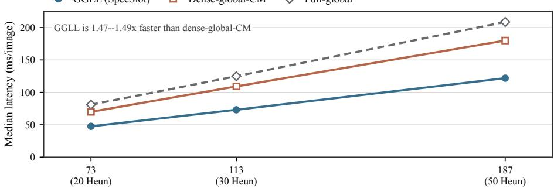  
Network evaluations per image (nominal Heun intervals)  
Figure 8 Sampling latency as the evaluation budget increases. The x-axis gives the profiler-observed network evaluations per image; the nominal Heun intervals appear in parentheses.

Table 12 Per-training-seed ImageNet-256 evaluation on 50K generated images per checkpoint. FID and IS are reported for training seeds 12345–12349.
<table><tr><td>Allocation</td><td>Training seed</td><td>FID-50K↓</td><td>IS ↑</td></tr><tr><td rowspan="5">W256/K2</td><td>12345</td><td>7.2191</td><td>214.2811</td></tr><tr><td>12346</td><td>7.0054</td><td>237.4801</td></tr><tr><td>12347</td><td>7.6025</td><td>206.7721</td></tr><tr><td>12348</td><td>7.3332</td><td>226.7448</td></tr><tr><td>12349</td><td>7.1983</td><td>212.1924</td></tr><tr><td rowspan="5">W256/K4</td><td>12345</td><td>6.4266</td><td>232.6772</td></tr><tr><td>12346</td><td>6.6197</td><td>212.0868</td></tr><tr><td>12347</td><td>6.4503</td><td>224.0468</td></tr><tr><td>12348</td><td>6.8389</td><td>201.4354</td></tr><tr><td>12349</td><td>6.6250</td><td>205.7543</td></tr></table>

Table 13 Across-training-seed statistics for the ImageNet-256 runs of Table 12: (a) FID; (b) Inception Score. SD is the sample standard deviation, SE is $\mathrm { S D } / { \sqrt { n } } ,$ , and the interval is the two-sided 95% Student-t interval with n − 1 degrees of freedom.

(a)
<table><tr><td>Statistic</td><td>W256/K2</td><td>W256/K4</td></tr><tr><td>n</td><td>5</td><td>5</td></tr><tr><td>Mean FID</td><td>7.2717</td><td>6.5921</td></tr><tr><td>SD</td><td>0.2192</td><td>0.1660</td></tr><tr><td>SE</td><td>0.0981</td><td>0.0742</td></tr><tr><td>95% CI</td><td>[6.9995, 7.5439]</td><td>[6.3860, 6.7982]</td></tr><tr><td>Median</td><td>7.2191</td><td>6.6197</td></tr><tr><td>Min-Max</td><td>[7.0054, 7.6025]</td><td>[6.4266, 6.8389]</td></tr></table>

(b)
<table><tr><td>Statistic</td><td>W256/K2</td><td>W256/K4</td></tr><tr><td>n</td><td>5</td><td>5</td></tr><tr><td>Mean IS</td><td>219.4941</td><td>215.2001</td></tr><tr><td>SD</td><td>12.4339</td><td>12.9624</td></tr><tr><td>SE</td><td>5.5606</td><td>5.7970</td></tr><tr><td>95% CI</td><td>[204.0554, 234.9328]</td><td>[199.1051, 231.2951]</td></tr><tr><td>Median</td><td>214.2811</td><td>212.0868</td></tr><tr><td>Min-Max</td><td>[206.7721, 237.4801]</td><td>[201.4354, 232.6772]</td></tr></table>

## D Five-seed ImageNet-256 Results

The main tables report means over independently trained seeds. This section exposes the individual runs and the across-seed uncertainty for the two W256 allocations used in the ImageNet-256 comparison. Table 12 lists each training seed, while Table 13 reports the FID and Inception Score statistics. The training seed identifies the independently trained checkpoint; the generation seed is fixed to zero for every row. Evaluations use epoch-120 EMA1 weights, 50K generated images, the legacy-uniform 50-step Heun sampler, and the same class ordering and noise draws. The selected CFG is 5.0 for K2 and 4.0 for K4, as in Table 1; the K2 runs use evidence width $B = 5 1 2$

The aligned five-seed mean trajectories in Figure 4, presented in the main comparison, complement the endpoint statistics above.

## E Additional Mechanistic Diagnostics

This appendix collects measurements that probe how SpecSlot uses its explicit roles. Unless stated otherwise, a probe loads a checkpoint and intervenes on its states without updating any parameter; these results characterize representation and communication rather than claim end-to-end quality gains. For the route probe, the intervention is made inside the shared Transformer after slot formation and before the output head, so its interpretation concerns the spectral-slot/GGLL submodule rather than a particular output basis.

## E.1 Evidence timing and route interventions

We first measure an empirical data-to-noise ratio (DNR) for each radial coeficient group in the lapped frame. For group k, $\mathrm { D N R } _ { k } ( t ) = t ^ { 2 } \mathbb { E } \| A _ { k } x \| ^ { 2 } / [ ( 1 - t ) ^ { 2 } \mathbb { E } \| A _ { k } \epsilon \| ^ { 2 } ]$ , where $A _ { k }$ denotes the matched lapped-frame analysis restricted to that group. The crossing time $t ^ { \star }$ is the first flow time at which the group reaches $\mathrm { D N R } \geq 1 ;$ it is a descriptive measure of when the noisy input contains more signal than noise, not a learned gate. Table 14 reports the crossings for the paired W256/K8, W256/K4, and W1024/K2 checkpoints.

Table 14 Empirical DNR frontiers from the lapped-frame probe. Entries list the crossing times t⋆ in increasing radial-group order.
<table><tr><td>Allocation</td><td>t* for successive radial groups</td></tr><tr><td>W256/K8</td><td>{0.382, 0.836, 0.880, 0.904, 0.922, 0.933, 0.943, 0.959}</td></tr><tr><td>W256/K4</td><td>{0.468, 0.891, 0.928, 0.951}</td></tr><tr><td>W1024/K2 </td><td>{0.549, 0.936}</td></tr></table>

The frontiers move when W or K changes: the low group becomes usable earlier, while progressively finer groups become usable later. This is consistent with assigning the early cross-anchor path to the lowest radial role. In the matched teacher-forced route intervention, removing the global carrier path primarily increases the low-group and early error; removing local mixing primarily increases detail-group error later in the trajectory. For example, the mid-time log-MSE penalties for the W256/K8 and W256/K4 probes are approximately 0.14/1.66 and 0.20/2.14 (global/local). The on-policy intervention has the same ordering: global removal changes the early coarse field (low-frequency change about 0.98, 0.99, and 1.05 for the three allocations), while local removal continues to change mid/high frequency content in the middle and late segments. These measurements are consistent with the role assignment used by GGLL.

## E.2 Allocation and effective use of additional slots

To separate single-step fitting from the use of extra role slots, a paired fixed-W = 256, fixed-B = 1536 analysis compares $K \in \{ 2 , 4 , 8 \}$ . The models share the input, lapped output, and GGLL interfaces used by the registered K-rate diagnostic. For reproducibility, the efective-slot value is the entropy efective rank of each anchor’s slot Gram matrix, divided by $K ;$ the efective-local-key value is $\exp ( H _ { q } ) / K$ averaged over local queries, with $\begin{array} { r } { H _ { q } = - \sum _ { j } p _ { q j } \log p _ { q j } ; } \end{array}$ and detail-to-carrier is the mean local attention probability from detail queries to the carrier key. Table 5 in Section 5.1.1 shows that although the teacher-forced velocity error changes little, the fraction of efective slots and the fraction of local keys decline as the within-anchor sequence grows.

Thus adding slots can slightly improve teacher-forced fitting without providing the same number of independent, strongly coupled directions. This is consistent with an allocation sweet spot: K controls how finely the coeficient ownership is divided, but it is not a promise that every added slot contributes an equal amount of information.

## F Paired Qualitative Comparisons

## F.1 ImageNet examples

Figure 9 compares selected ImageNet-256 generations from JiT-CM and SpecSlot W256/K4 under the same class and noise draw. In these pairs, SpecSlot renders class-specific fine structure more coherently: feather boundaries are clearer for brambling, chickadee, and rooster; the cornet has more regular tubing and bell geometry; and the boathouse preserves sharper roofline and reflection structure. It also reduces visible local distortions in the anemone fish, banister, and barrel examples, where contours or repeated parts are less coherent in the JiT-CM samples. The hay example shows a more regular field-scale texture.

## F.2 Text-to-image examples

Figure 10 shows additional SpecSlot samples generated from text prompts in DPG-Bench. The examples cover portraits, creatures, environments, architecture, and interiors; the prompt paired with each sample is included in the figure.

## ImageNet qualitative samples

Border collie

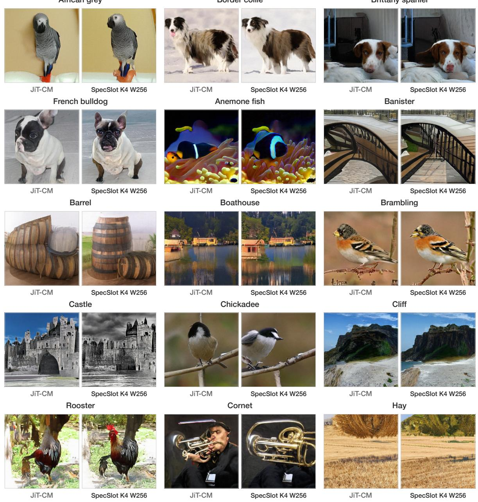  
Figure 9 Selected paired generations on ImageNet-256. Within each pair, JiT-CM is shown on the left and SpecSlot W256/K4 on the right; both use the same class and noise draw.

# Text-to-image qualitative samples

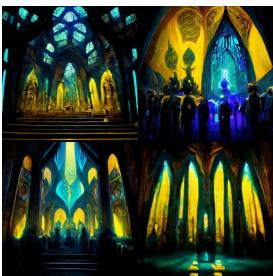

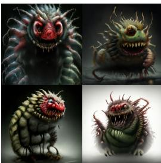  
Image

Prompt: Within a grand extraterrestrial place of worship, a group of alien beings is depicted in reverent prayer, illuminated by beams of light tering through stained glass panels featuring cosmic motifs. advanced alien architecture captures the imagination with soaring arches and embedded technology, rendered in striking yellow and blue tones.

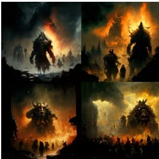

Prompt: An epic scene unfolds, styled in the manner of Richard Schmid, where a rce ba e rages under a tempestuous sky pouring rain. A colossal cave troll roars de ntly, towering over Viking warriors locked in combat.  backdrop is a city engulfed in mes, with thick smoke rising into the stormy atmosphere, rendered as a vivid, cinematic ma painting.

Image  

Image  

Prompt: A fantasy female character is reminiscent of Peter Mohrbacher’s angelic designs. Layered brushwork echoes Craig Mullins, with a whimsical Studio Ghibli backdrop. Gustav Klimt and Alphonse Mucha in ence the pa rns; Mike Mignola, Frank Fraze , and Boris Vallejo shape the contrast, pose, and musculature, creating extreme detail and depth.

Image  
  
Prompt: caterpillar’s body is portrayed with so delicate hairs transitioning into a glistening, wet pupa stage. al form emerges as a horrorinducing demon with a screaming visage, sharp fangs, and red, slimy hands that are deformed yet eerily precise in their 3-dimensional rendering.

Prompt: A mystical cat sits enveloped by undulating curls of vibrant smoke in hues of purple, blue, and green. Its eyes shine luminously, emi ng an aura of enigmatic chaos magic.ft, At the forefront, an emblematic “all seeing eye” is prominently featured, while a shallow depth of ld focuses on the feline.

Prompt: An intricately designed airship, with sleek steel panels and ornate golden trims, hovers above a bustling port. Floating islands and elevated platforms form a city skyline that echoes Ivantte Shishkin’s creations and Bioshock In ite.  image has cinematic quality, with the airship’s cables and anchors in a sky-high metropolis.

Image Image Figure 10 Additional text-to-image samples generated by SpecSlot W256/K4 from DPG-Bench prompts (first part).

Image  

Image  

Image  

Prompt: Visually intriguing macro photography captures mystical waves, seemingly a at and intertwined with delicate, hair-like particles. Shades from a psychedelic color pale create a stunning and surreal scene reminiscent of twilight. se vibrant waves o r a hyper-realistic glimpse into an otherworldly dimension.

Prompt: An incredibly detailed digital artwork depicts an enormous skyscraper soaring into the sky above an industrial power station, as imagined by Peter Elson, Chris Moore, and Jim Burns.  skyscraper has intricate designs, re ctive glass windows, and numerous protruding antennas. Pipes, wires, and glowing energy cores l the power station at its base.

Prompt: A voluminous library, bathed in so muted blue hues, stretches across a spacious Victorian-style living room. Intricately carved wooden bookshelves line the walls, and a grand eplace is the focal point. Plush pa rned rugs, polished wooden tables, and antique armchairs complete the room.

Image  

Image  

Image  
  
Figure 10 Additional text-to-image samples generated by SpecSlot W256/K4 from DPG-Bench prompts (continued).

Prompt: A grand, sprawling landscape is inspired by Hayao Miyazaki’s “Nausicaä of the Valley of the Wind” and “Breath of the Wild” from  Legend of Zelda series. Studio Ghibli’s post-apocalyptic se ng blends with a vibrant open-world aesthetic. Towering ancient trees with twisted roots rise from the earth, while bioluminescent creatures add surreal luminance.

Prompt: A detailed portrait of a character concept titled “Under  Dreaming Tree,” characterized by its symmetrical design and realistic texturing. character is situated centrally before an ethereal backdrop with the namesakeft, tree and expansive, leaf-laden branches.  visage displays a serene expression.

Prompt: A rendered Celtic temple stands majestically in a digital landscape, exhibiting high detail and a photorealistic appearance. Intricate stone textures and realistic lighting de e the temple, which is surrounded by a lush tteenvironment with dense foliage.