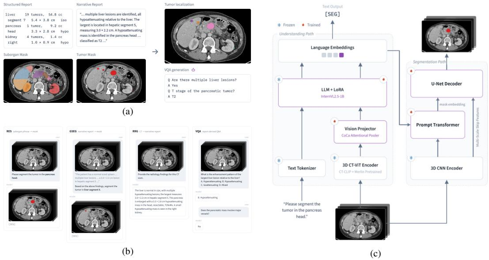
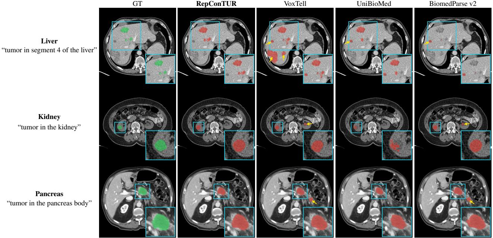
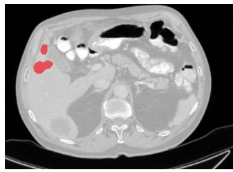
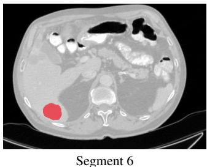
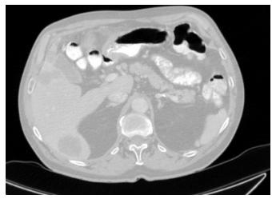
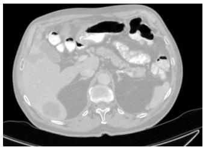
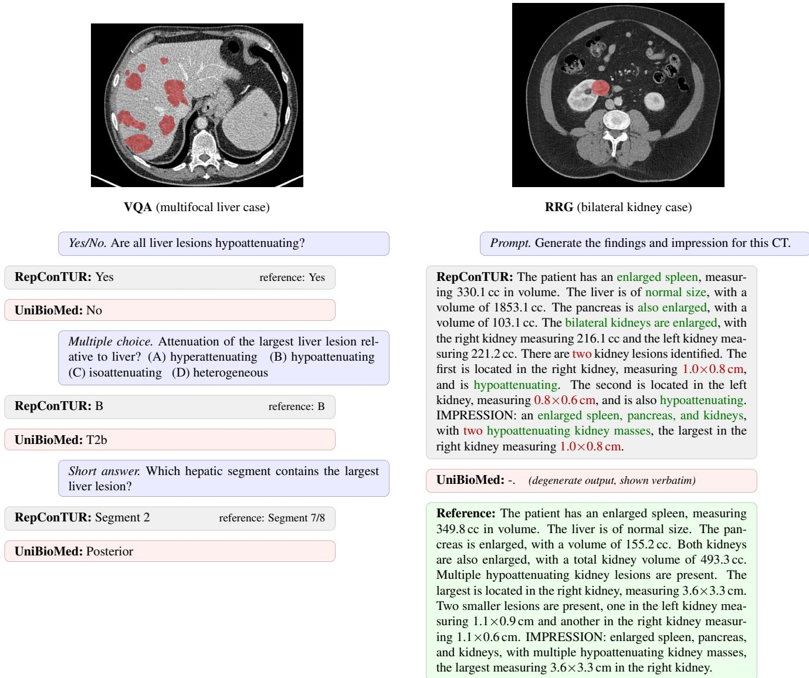

# RepConTUR: A Report-Conditioned Volumetric Multimodal Model for Abdominal Tumor Segmentation

Seunghwan Lee1 Sangjoon Park2 Jongmin Lee1 Yoon Jo Kim1 Wonyoung Cho1 Jin Sung Kim1,2 Han Joo Chae1,\*

1Oncosoft Inc., Seoul, South Korea

2Department of Radiation Oncology, Yonsei University College of Medicine, Seoul, South Korea

## Abstract

Tumor delineation is required for radiotherapy planning, yet automatic segmentation is limited by errors, predominantly false positives, that distort dose and increase editing time. The radiology report accompanies the scan and localizes disease at the suborgan level, but existing text-promptable models condition on short referring phrases, and most operate in 2D. We present RepCon-TUR, a single native-3D early-fusion multimodal model that conditions volumetric abdominal tumor segmentation on the narrative report. We extend AbdomenAtlas 3.0 to a suborgan-level promptable segmentation dataset and generate report-based VQA pairs, yielding four report-derived tasks on the same annotations: referring segmentation (RES), report-grounded segmentation (GSEG), report generation (RRG), and visual question answering (VQA). We train RepConTUR, comprising a 3D CT encoder, an early fusion language model, and a native-3D segmentation module, jointly on the four tasks. Across liver, kidney and pancreas, RepConTUR attains the highest Dice similarity coefficient (DSC), instance-wise precision, and detection F1 among the text-promptable baselines, and adding the report raises mean precision while leaving recall comparable. Against two vision-only specialists, nnU-Net and the report-supervised R-Super, RepConTUR attains the highest value on every in-domain metricfor liver and pancreas and the highest mean DSC, recall, precision, and detection F1 over the four out-of-distribution public cohorts. Ablations indicate that conditioning on the narrative report raises detection F1 from 0.499 to 0.528 within the same model, that joint GSEG training raises RES F1 from 0.450 to 0.482, and that the native-3D segmentation module raises GSEG F1 from 0.139 to 0.528 over its 2D counterpart. Code is available at github.com/Oncosoft-Research/RepConTUR.

## 1. Introduction

Tumor delineation is a required step in radiotherapy planning, but manual contouring is labor-intensive and shows large inter-observer variability [21, 52, 58]. Unlike diagnostic reading, radiotherapy target contouring routinely combines the diagnostic scan with its radiology report, as the report contains rich information about the tumor, including its anatomical location, size and stage [1, 7, 20, 29]. This makes the report a natural conditioning signal for automatic tumor segmentation.

Vision-only deep learning models remain the standard approach to tumor segmentation, and their accuracy is reported mainly by the volumetric Dice similarity coefficient (DSC), which underrepresents instance-wise recall and precision [37]. On the LiTS liver-tumor benchmark, the top method reports a tumor Dice of 0.702, yet its instancewise precision is only 0.148 [6]. In radiotherapy, instancewise recall and precision are as clinically important as DSC. False positives in particular distort the dose distribution and raise normal-tissue exposure and toxicity risk [44], and these errors increase the editing time [57]. A separate line of work uses the radiology report as training-time supervision to improve tumor detection and segmentation. Report-derived tumor count and size penalize inconsistent predictions through auxiliary losses [3], reported location provides weak labels [23], and the report yields pseudolabels [9]. However, these models still segment from the image alone at inference time [64], so the report cannot directly inform the prediction.

Text-guided segmentation models have achieved strong results on referring segmentation (RES) and grounded segmentation (GSEG) [31, 33, 45, 63, 76]. Some works adopt a dual-encoder design that encodes the language prompt and the image in separate branches and fuses them at the decoder [47, 70]. On the other hand, multimodal large language model (MLLM)-based segmentation models fuse image and text early and reason over both jointly within the language model [31, 61]. Yet both are designed for short target descriptions — class names or referring phrases — and do not exploit long-form textual context. BiomedParse v2, for example, conditions on an organ-level prompt (e.g., “tumor in liver CT”), which cannot indicate a detailed intraorgan region and may not capture suborgan-level information [70, 71]. A report instead specifies suborgan location, which may help suppress false positives elsewhere in the same organ [17, 18]. Furthermore, existing MLLM-based medical segmentation models are also mostly 2D [61], limiting their abilities to interpret report information that refers to 3D context [11, 30, 38].

Multitask learning can improve a target task when the tasks are related, although the gain depends on task affinity [10, 50, 55]. Unified vision–language models train localization and language tasks in one network [59, 68], and an MLLM-based segmentation model is a natural fit for such joint training. In the medical domain, UniBioMed trains segmentation jointly with VQA and report generation and reports improved segmentation Dice [61]. The report can therefore also serve as a joint-training signal.

We propose RepConTUR, an MLLM-based 3D reportconditioned tumor segmentation model that grounds segmentation on the report to improve both segmentation accuracy and instance-wise detection (Fig. 1). Our contributions are threefold:

• Report-conditioned segmentation. We condition segmentation on a suborgan-level referring phrase and an optional free-form narrative report, rather than a short class name alone. To the best of our knowledge, RepConTUR is the first 3D referring/grounded segmentation model to condition on such report context. We introduce suborganlevel mask and prompt design aligned to narrative freeform radiology reports, and implement it for abdominal tumors.

• A native 3D MLLM for report-conditioned abdominal tumor segmentation. We build on prior MLLM architectures and extend them with native-3D vision modules. The MLLM vision encoder and segmentation module are all 3D, and visual tokens are processed jointly with the report text from the first LLM layer, so vision and text are reasoned over jointly.

• Report-derived multitask dataset and multitask learning. From AbdomenAtlas 3.0 [4] tumor masks and their reports we construct a unified four-task dataset. Reportmatched suborgan localization produces the RES and GSEG targets, and the report is converted into radiology report generation (RRG) supervision and LLM-verified VQA pairs. We jointly train all four tasks on a single backbone. Cumulative task ablations show that reportgrounded segmentation training improves RES performance, while adding report generation and VQA further increases detection F1.

## 2. Related work

## 2.1. Reports and tumor segmentation

One line of work uses the report as a training signal. R-Super converts report-derived tumor count and size into voxel-wise losses [3], Guo et al. use report text as weak supervision to improve detection [23], Bosma et al. derive pseudo-labels from the report [9], and SGSeg uses text only during training and drops it at inference [64].

These methods all use the report only at training time. In contrast, we condition 3D tumor segmentation on the narrative report at inference.

## 2.2. Text-promptable medical segmentation

These methods share a common pipeline. A separate text encoder maps a short query to an embedding that is fused with vision features, usually late at the decoder, to produce a text-conditioned mask. The two families differ only in the query. Open-vocabulary methods use a class name or anatomical term as the query (SegVol [19], SAT [72], CLIP-Universal [36], BiomedParse v2 [70, 71]), while a parallel line uses a referring or descriptive phrase (LViT [35], Ariadne’s Thread [73], RecLMIS [27], CausalCLIPSeg [15], LSMS [43], VoxTell [47]) or attribute labels such as tumor count and severity (TGANet [56], Bi-VLGM [14]).

These methods primarily target class-level or phraselevel queries, leaving their effectiveness with full narrative reports less established. We investigate report conditioning by jointly processing volumetric visual tokens and report text in an MLLM before mask prediction.

## 2.3. MLLM-based segmentation

This family splits into two modules. An MLLM processes text and image jointly to produce an embedding aligned to the image, and a separate segmentation module combines that embedding with fine-grained backbone features to produce the mask. LISA introduced this design for natural images [31] and later works extended it [45, 60, 62, 67]. A medical branch adapts this design to biomedical images, usually in 2D. UniBioMed [61] couples an MLLM with a SAM-style segmentation module for grounded biomedical interpretation. MedPLIB [28] drives a separate SAM-Med mask decoder from a [SEG] embedding, with the pixel-grounding path routed through an in-LLM mixtureof-experts.

RepConTUR inherits this aligned embedding plus separate segmentation module design, but extends the 2D medical setting to full 3D and broadens the conditioning from a short referring phrase to the narrative report.

## 2.4. Multitask learning

In the medical domain, multitask training most often pairs segmentation with a diagnostic objective.

  
Figure 1. Overview of RepConTUR. (a) Report-driven dataset construction from AbdomenAtlas 3.0 [4]. Report matching decomposes each organ tumor mask into suborgan-localized instances by intersection-over-component, yielding the RES and GSEG targets; the reports additionally yield verified VQA pairs. (b) The four tasks trained jointly on the shared backbone, namely RES, GSEG, RRG and VQA. (c) A single native-3D early-fusion model. A 3D CT encoder produces visual tokens fused with the text prompt from the first LLM layer; a [SEG] token drives a 3D segmentation module to a volumetric mask, while the same backbone answers VQA and generates RRG.

Joint segmentation-and-classification improves segmentation over single-task training [74], and universal models unify detection, segmentation and diagnosis across organs (CancerUniT [13], CLIP-Universal [36]). A newer line instead couples segmentation with language tasks such as diagnostic text generation [32], VQA [28] and report generation [22]. UniBioMed trains segmentation jointly with VQA and report generation and reports improved segmentation Dice [61].

We adopt this report-based multitask scheme and build a report-derived multitask dataset from AbdomenAtlas 3.0. From report-aligned tumor localization we derive two suborgan-level tumor segmentation tasks (RES and GSEG), and from the report itself we derive RRG and VQA. We jointly train all four on full-3D CT volumes and condition segmentation on the narrative report.

## 3. Report-guided multitask dataset

We build the report-guided multitask dataset from AbdomenAtlas 3.0 [4], which provides 9,262 abdominal CT volumes with tumor masks for liver, kidney and pancreas, and organ masks that include suborgan structures such as liver Couinaud segments. Each volume also carries a synthetically generated radiology report from the RadGPT construction pipeline [4]. A structured report is first derived deterministically from the masks, listing per suborgan the tumor count, size, location, and attenuation. A large language model then rewrites the structured report into a narrative free-text report in radiologist style. The narrative may not enumerate every tumor. For multifocal disease it often reports the largest tumor with its suborgan and an aggregate tumor count rather than each tumor’s location. Across the 9,262 volumes, the narrative reports have a mean sequence length of 225 tokens and a maximum of 1,163 tokens under the Clinical-Longformer tokenizer [34].

We exclude volumes without tumors in any of the three organs to match the clinical setting of radiotherapy, where planning is performed only for tumor-positive patients. Of the 9,262 volumes, 5,464 are tumor-free and removed, leaving 3,798 tumor-bearing volumes for training and evaluation. Positives are unevenly distributed across organs, with 1,508 liver-positive, 2,222 kidney-positive and 1,113 pancreas-positive volumes, namely 39.7%, 58.5% and 29.3%. Every organ is therefore trained with both tumor-present and tumor-absent volumes.

Report-guided tumor localization. The original tumor masks are at organ level, so we decompose them into persuborgan instances using the structured report. We extract the connected components (CC) of the tumor mask. For each component c and suborgan mask s we measure their intersection over component,

$$
\mathrm { I o C } ( c , s ) = \frac { | c \cap s | } { | c | } ,\tag{1}
$$

and associate c with every suborgan whose IoC is nonzero, since one component can span more than one suborgan. The structured report describes the tumors at two levels of location, and we assign components differently for the two. Most findings name the suborgan and state how many tumors it contains, whereas others give only an organlevel finding without a suborgan. For a suborgan named by the report, we rank its overlapping components by IoC and keep the highest-ranked ones up to the tumor count stated for that suborgan. For a tumor the report places only at the organ level, the component is assigned to every suborgan whose IoC exceeds a fixed threshold and to its maximum-IoC suborgan. A component that overlaps no suborgan is instead assigned by spatial proximity. Because a suborgan can hold several tumors, we merge all components assigned to it into a single mask by voxel-wise union.

VQA generation. We generate up to 20 question– answer pairs per volume from the structured and narrative reports in a generation stage followed by a verification stage. The structured report supplies the exact per-tumor facts queried, namely suborgan location, size, and attenuation, while the narrative supplies tumor staging and clinical interpretation such as resectability. In the generation stage, a large language model writes pairs in three answer formats, namely binary yes/no, short answer, and multiple choice with enumerated options. The pairs span tumor presence, tumor count, suborgan location, tumor size, enhancement pattern relative to the organ, and organ-level findings such as organ enlargement. Tumor size is queried as an interval rather than an exact measurement, since an exact diameter varies with the measurer while a coarse band is reproducible, using the bands < 1, 1–2, 2–3, 3–5, 5–10 and > 10 cm. “No” questions are generated by perturbing a stated finding into a plausible but incorrect variation such as a different suborgan, side, or stage. In the verification stage, a separate language model checks each pair against the source structured and narrative reports and corrects or discards any pair that is unsupported by the reports, not answerable from the image alone, malformed in its answer, insufficiently localized, or whose negative is not a plausible variation. Across the 3,798 tumor-bearing volumes, verification retains 71,783 pairs, 18.9 per volume on average, comprising 48,451 yes/no, 13,433 short-answer and 9,899 multiple-choice. Within the yes/no pairs, 31,449 (64.9%) are affirmative and 17,002 (35.1%) negative.

Multitask composition. We train RepConTUR jointly on four objectives, namely RES and GSEG for segmentation, RRG for radiology report generation and VQA for visual question answering. RES conditions on a suborganlevel referring phrase drawn from a pool of phrasal variants that indicate the tumor in a suborgan, for example “tumor in hepatic segment 7”. At training time one phrase is sampled from this pool and inserted into a randomly sampled instruction template, such as “Please segment the tumor in {phrase}.” or “Please delineate the GTV in {phrase}.”.

RES also includes a whole-organ target that aggregates every tumor in an organ, named by an organ-level phrase such as “total liver GTV” or “all tumors in the kidney”. GSEG reuses the same target mask and referring phrase but prepends the full narrative report to the instruction, such as “{report} . . . Based on the above findings, please segment the tumor in {phrase}.”. The comparison therefore measures the additional benefit of report context beyond the target phrase, with the image and requested target held fixed.

RRG generates the report from the CT, and VQA answers the report-derived questions. The two language tasks supply language supervision to the shared backbone that the segmentation tasks reuse.

## 4. 3D MLLM segmentation model

Early-fusion 3D MLLM. We adopt the CT-ViT of CT-CLIP [24] as the 3D visual encoder. It factorizes attention into a spatial transformer that attends within each axial plane followed by a temporal transformer that attends across planes along the through-slice axis, producing a 3D token grid. This encodes the whole volume in 3D at lower cost than full 3D attention. We vary the original implementation in its input, resampling volumes to a (1.5, 1.5, 3.0) mm spacing and a 240 × 240 × 140 grid. We pretrain the encoder with a CLIP objective, aligning each CT volume embedding with a Clinical-Longformer [34] embedding of its report. The original CT-ViT is pretrained only on chest CT from CT-RATE [24], so we add abdominal CT image– report pairs from Merlin [8] to generalize the encoder from chest to abdominal radiological semantics, which our downstream abdominal tasks require. After pretraining we keep the frozen image branch as a feature extractor.

Following CoCa [66], an attentional pooler with 256 learnable queries cross-attends to the encoder tokens to produce 256 fixed-length visual tokens, projected to the LLM hidden dimension. We adopt a InternVL2.5-1B [16] language model as the backbone, initialized from the medically pretrained UniBioMed [61] weights. The LLM is frozen and adapted with LoRA [26]. We introduce a [SEG] token for requesting the segmentation [31].

3D segmentation module. We adopt VoxTell [47] as the 3D segmentation module, initialized from its pretrained weights. It pairs an nnU-Net residual encoder [30] with a text-prompted decoder that consists of a prompt transformer and a U-Net decoder. We keep the encoder frozen and train the decoder.

We construct this query from the language model. The hidden state of the [SEG] token is mapped by a two-layer projection to a 2048-dimensional query embedding. Because the MLLM fuses image and text early, this embedding jointly encodes the volume and the input text. The prompt transformer cross-attends from it to the encoder features to form a mask embedding, which the U-Net decoder fuses at every scale to produce the full-resolution volumetric mask.

## 5. Experiments and results

## 5.1. Setup

We evaluate abdominal tumor delineation on liver, kidney and pancreas across two streams, plus design ablations.

Text-promptable comparison. The first stream evaluates text-promptable segmentation under a single referring prompt, where RepConTUR is driven either by RES mode or GSEG mode. We compare it against three textpromptable baselines, namely the 2D MLLM-based model UniBioMed [61], the 2D late-fusion model BiomedParse v2 [70, 71], and the 3D late-fusion model VoxTell [47]. We finetune each baseline on our dataset with its own finetuning recipe, restricted to the tasks it supports, namely BiomedParse v2 on RES, VoxTell on RES and GSEG, and UniBioMed on all four tasks. This stream is evaluated on the AbdomenAtlas 3.0 test split.

Report-guided organ-wise segmentation. The second stream evaluates report-guided organ-wise segmentation against two vision-only specialists, the nnU-Net specialist [30] trained to segment liver, kidney and pancreas tumors jointly as separate classes, and R-Super [3], a segmentation model supervised by radiology reports during training; both use no report at inference. To simulate the radiotherapy setting where a CT scan and its report are available together, we run a simple agentic inference pipeline in which an LLM parses the report into the tumor-bearing suborgans, RepConTUR grounds and segments each suborgan under RES or GSEG, and the per-suborgan masks are combined by union into an organ-wise prediction. When the narrative report aggregates findings at the organ level and does not localize the tumor to a specific suborgan, the LLM cannot name a suborgan target, and we prompt RepConTUR with a single whole-organ tumor phrase for that organ. Because neither specialist can ground individual suborgans, the report enters them only as an organ-level restriction that zeroes any organ the report marks tumor-free. This stream is evaluated on an in-domain test set and four external out-ofdistribution (OOD) sets, namely HCC-TACE-Seg for primary hepatocellular carcinoma [39, 40], Colorectal-Liver-Metastases for colorectal liver metastases [53, 54], CPTAC-PDA for pancreatic ductal adenocarcinoma [42, 49], and CPTAC-CCRCC for clear cell renal cell carcinoma [41, 48]. These OOD sets have no radiology reports, so for each case we synthesize one with the same construction pipeline used for AbdomenAtlas 3.0 [4] and use it both to drive the agentic inference pipeline and as the GSEG grounding text.

Ablations. We ablate two design choices on the test split. The first evaluates successive replacements of the 2D visual and segmentation modules with their 3D counterparts, namely a 2D/2D reference, a 3D/2D variant, and the full 3D/3D model (Tab. 2). The second adds the four training tasks cumulatively, from RES alone to the full multitask model (Tab. 3).

Table 1. Comparison with the text-promptable baselines on test split. Rs=RES, $_ { \mathrm { G s = G S E G } }$ . DSC: Dice, R/P: instance-wise Recall/Precision, F1: harmonic mean. Bold: highest per column per section.
<table><tr><td></td><td colspan="2">DSC</td><td colspan="2">R</td><td colspan="2">P</td><td colspan="2">F1</td></tr><tr><td>Model</td><td> $\mathrm { R s }$ </td><td>Gs</td><td>Rs</td><td> $\mathrm { G s }$ </td><td> $\mathrm { R s }$ </td><td>Gs</td><td>Rs</td><td> $\mathrm { G s }$ </td></tr><tr><td>Liver</td><td></td><td></td><td></td><td></td><td></td><td></td><td></td><td></td></tr><tr><td>VoxTell</td><td>0.406</td><td>0.339</td><td>0.455</td><td>0.387</td><td>0.019</td><td>0.010</td><td>0.037</td><td>0.020</td></tr><tr><td>UniBioMed</td><td>0.370</td><td>0.391</td><td>0.531</td><td>0.554</td><td>0.081</td><td>0.086</td><td>0.141</td><td>0.149</td></tr><tr><td>BiomedParse v2</td><td>0.341</td><td></td><td>0.693</td><td></td><td>0.082</td><td></td><td>0.147</td><td></td></tr><tr><td>RepConTUR</td><td>0.522</td><td>0.542</td><td>0.616</td><td>0.611</td><td>0.369</td><td>0.424</td><td>0.461</td><td>0.500</td></tr><tr><td>Pancreas</td><td></td><td></td><td></td><td></td><td></td><td></td><td></td><td></td></tr><tr><td>VoxTell</td><td>0.270</td><td>0.221</td><td>0.430</td><td>0.336</td><td>0.099</td><td>0.078</td><td>0.161</td><td>0.127</td></tr><tr><td>UniBioMed</td><td>0.205</td><td>0.215</td><td>0.399</td><td>0.413</td><td>0.032</td><td>0.039</td><td>0.060</td><td>0.072</td></tr><tr><td>BiomedParse v2</td><td>0.305</td><td></td><td>0.711</td><td></td><td>0.057</td><td></td><td>0.105</td><td></td></tr><tr><td>RepConTUR</td><td>0.386</td><td>0.399</td><td>0.624</td><td>0.644</td><td>0.336</td><td>0.376</td><td>0.437</td><td>0.475</td></tr><tr><td>Kidney</td><td></td><td></td><td></td><td></td><td></td><td></td><td></td><td></td></tr><tr><td>VoxTell</td><td>0.470</td><td>0.391</td><td>0.477</td><td>0.369</td><td>0.025</td><td>0.020</td><td>0.047</td><td>0.039</td></tr><tr><td>UniBioMed</td><td>0.450</td><td>0.456</td><td>0.619</td><td>0.612</td><td>0.070</td><td>0.069</td><td>0.126</td><td>0.123</td></tr><tr><td>BiomedParse v2</td><td>0.469</td><td></td><td>0.836</td><td></td><td>0.075</td><td></td><td>0.138</td><td></td></tr><tr><td>RepConTUR</td><td>0.621</td><td>0.627</td><td>0.781</td><td>0.775</td><td>0.487</td><td>0.501</td><td>0.600</td><td>0.609</td></tr><tr><td>Mean</td><td></td><td></td><td></td><td></td><td></td><td></td><td></td><td></td></tr><tr><td>VoxTell</td><td>0.382</td><td>0.317</td><td>0.454</td><td>0.364</td><td>0.048</td><td>0.036</td><td>0.082</td><td>0.062</td></tr><tr><td>UniBioMed</td><td>0.342</td><td>0.354</td><td>0.516</td><td>0.526</td><td>0.061</td><td>0.065</td><td>0.109</td><td>0.115</td></tr><tr><td>BiomedParse v2</td><td>0.372</td><td></td><td>0.747</td><td></td><td>0.071</td><td></td><td>0.130</td><td></td></tr><tr><td>RepConTUR</td><td>0.510</td><td>0.523</td><td>0.674</td><td>0.677</td><td>0.397</td><td>0.433</td><td>0.499</td><td>0.528</td></tr></table>

Evaluation metrics. We assess our model with DSC, instance-wise Recall (R) and Precision (P), and their harmonic mean F1. Tumor instances are 3D connected components, and a predicted tumor matches a ground-truth tumor by $\mathrm { I o U } 2 0 . 1 0$ , following medical detection practice [5, 51].

## 5.2. Comparison with text-promptable baselines

On the test split (Tab. 1), RepConTUR attains the highest DSC, instance-wise precision, and detection F1 in every organ section for both RES and GSEG, and the highest recall against every baseline except BiomedParse v2. Averaged over the three organs, RepConTUR precision is 0.397 in RES and 0.433 in GSEG, versus $\leq 0 . 0 7 1$ for every baseline. The sole exception is recall, where BiomedParse v2 is higher in every organ, with mean recall 0.747 against RepConTUR RES 0.674, but its precision is substantially lower, so RepConTUR attains a higher detection F1 by a substantial margin, mean 0.499 against 0.130. Between the two conditioning modes of RepConTUR, prepending the report raises mean precision from RES 0.397 to GSEG 0.433, while mean recall is comparable at 0.674 and 0.677, so the report-conditioning effect is concentrated in precision. The baselines respond differently to report conditioning. VoxTell’s macro F1 decreases from 0.082 in RES to 0.062 in GSEG, whereas UniBioMed and RepConTUR improve from 0.109 to 0.115 and from 0.499 to 0.528, respectively. The MLLM-based models benefit from the additional report text, while VoxTell, a late-fusion model, does not.

Table 2. Design ablation replacing the 2D visual and segmentation modules with 3D counterparts, 3-organ macro means. Rows are (vision / segmentation) module; 2D/2D is UniBioMed, 3D/2D replaces only the visual encoder. Metrics and abbreviations as in Tab. 1. Bold: highest per column.
<table><tr><td rowspan="2">Vis./Seg.</td><td colspan="2">DSC</td><td colspan="2">R</td><td colspan="2">P</td><td colspan="2">F1</td></tr><tr><td>Rs</td><td>Gs</td><td>Rs</td><td>Gs</td><td>Rs</td><td>Gs</td><td>Rs</td><td>Gs</td></tr><tr><td>2D / 2D</td><td>0.342</td><td>0.354</td><td>0.517</td><td>0.526</td><td>0.061</td><td>0.065</td><td>0.109</td><td>0.115</td></tr><tr><td>3D / 2D</td><td>0.331</td><td>0.378</td><td>0.526</td><td>0.535</td><td>0.075</td><td>0.080</td><td>0.129</td><td>0.139</td></tr><tr><td>3D /3D</td><td>0.510</td><td>0.523</td><td>0.674</td><td>0.677</td><td>0.397</td><td>0.433</td><td>0.499</td><td>0.528</td></tr></table>

Qualitative results and prompt conditioning Across the three organs, RepConTUR confines its prediction to the referred tumor, whereas the baselines add false positives on the same slice (Fig. 2). The liver and pancreas cases each contain multiple tumors, so these false positives are not spurious activations but genuine tumors elsewhere in the same organ that the referring prompt did not single out. Under the pancreatic-body prompt the baselines additionally delineate a separate tumor in the tail, and under the segment-4 liver prompt they add further hepatic tumors. In the kidney they instead segment the tumor-free contralateral organ. Both behaviours are localization failures relative to the referring prompt and are consistent with the low baseline precision in Tab. 1. Figure 3 shows that the model does not segment indiscriminately. Changing the suborgan in the prompt moves the predicted mask, and querying a tumor-free organ produces an empty output, so the prompt determines both the location and the presence of the segmentation.

## 5.3. Ablation studies

Table 2 shows an ablation that varies the vision encoder and the segmentation module from 2D to 3D. The 2D/2D row pairs a 2D InternViT vision encoder [16] with a SAM2 segmentation module [46], initialized with UniBioMed. The 3D/2D row replaces this 2D encoder with our 3D CT-ViT while keeping the 2D SAM2 segmentation module, and the 3D/3D row adds the 3D segmentation module to form the full RepConTUR. Replacing the 2D visual encoder with the 3D CT-ViT yields modest improvements in detection metrics in both modes. DSC increases in GSEG from 0.354 to 0.378 but decreases in RES from 0.342 to 0.331. The larger improvement occurs when the 2D segmentation module is replaced with the pretrained 3D module, with GSEG precision increasing from 0.080 to 0.433 and detection F1 from 0.139 to 0.528.

Table 3 adds the training tasks cumulatively and reports both inference modes together. Starting from a RES-only model, adding GSEG co-training gives the largest single gain. It brings the report-grounded GSEG mode to a strong operating point, with DSC 0.524 and F1 0.508, and it also raises the phrase-only RES mode that uses no report at inference, lifting DSC from 0.481 to 0.505, precision from 0.345 to 0.385, and F1 from 0.450 to 0.482. This transfer to RES occurs despite that mode sharing no report text at test time. Adding the two language tasks, RRG then VQA, further increases detection F1, from 0.482 to 0.493 to 0.499 in RES and from 0.508 to 0.523 to 0.528 in GSEG. Other metrics do not improve monotonically, and GSEG DSC remains stable at 0.523–0.524. The observed benefit of the additional language tasks is therefore concentrated in detection F1.

Table 3. Multitask ablation, tasks added cumulatively (RES, +GSEG, +RRG, +VQA), 3-organ macro means. A RES-only model has no Gs (–). Metrics and abbreviations as in Tab. 1. Bold: highest per column.
<table><tr><td></td><td colspan="2">DSC</td><td colspan="2">R</td><td colspan="2">P</td><td colspan="2">F1</td></tr><tr><td>Train</td><td>Rs</td><td>Gs</td><td>Rs</td><td>Gs</td><td>Rs</td><td>Gs</td><td>Rs</td><td>Gs</td></tr><tr><td>RES</td><td>0.481</td><td></td><td>0.657</td><td></td><td>0.345</td><td></td><td>0.450</td><td></td></tr><tr><td>+GSEG</td><td>0.505</td><td>0.524</td><td>0.650</td><td>0.658</td><td>0.385</td><td>0.415</td><td>0.482</td><td>0.508</td></tr><tr><td>+RRG</td><td>0.503</td><td>0.524</td><td>0.656</td><td>0.655</td><td>0.396</td><td>0.435</td><td>0.493</td><td>0.523</td></tr><tr><td>+VQA</td><td>0.510</td><td>0.523</td><td>0.674</td><td>0.677</td><td>0.397</td><td>0.433</td><td>0.499</td><td>0.528</td></tr></table>

## 5.4. Report-based inference versus vision-only specialists

Following the report-guided organ-wise protocol of Sec. 5.1, we compare the two report-based conditions, RES and GSEG, against two vision-only specialists. We report results separately for the in-domain test set (Tab. 4) and the four external OOD sets (Tab. 5).

In-domain test set. On liver and pancreas, the two tumor types with the least conspicuous boundaries, RES and GSEG improve tumor detection substantially (Tab. 4). Detection F1 rises to 0.599 on liver (RES) and 0.475 on pancreas (GSEG). R-Super also exceeds the vision-only nnU-Net specialist on detection F1 for liver and pancreas, at 0.485 against 0.463 and 0.452 against 0.387. RepCon-TUR improves further with the report available at inference, clearly on liver at 0.599 in RES against R-Super 0.485, and comparably to R-Super on pancreas at 0.447 in RES and 0.475 in GSEG against 0.452. Hepatic and pancreatic tumors are frequently low-contrast and blend into the surrounding parenchyma, so the report context appears to help localize disease that vision alone tends to miss or oversegment. On kidney, whose tumors are comparatively welldelineated in contrast-enhanced CT, the vision-only nnU-Net specialist is already strong [25] at F1 0.661, while R-Super falls to 0.559 through a precision collapse to 0.435 despite the highest kidney recall of 0.784, and RepConTUR sits between at 0.575–0.584. Averaged over the three organs, RES and GSEG exceed both specialists on detection

  
Figure 2. Qualitative segmentation on the test split, same referring prompt per row, one axial slice. Cyan box marks the referred tumor, magnified in the lower-right inset; yellow arrows mark components outside it. GT green, prediction red. RepConTUR confines its predic tion to the referred tumor, whereas the baselines add components elsewhere on the slice, namely other real but non-referred tumors for the multifocal liver and pancreas cases and the tumor-free contralateral kidney for the kidney case. These raise the false-positive count and are consistent with the low baseline precision in Tab. 1.

  
Segment 5

  
Segment 3

  
Kidney  
Figure 3. Prompt conditioning for a multifocal liver case, one axial slice. Switching the prompt between segments 5 and 6 moves the mask from anterior to posterior; querying segment 3, whose tumor lies on other slices, or the tumor-free kidney yields an empty mask, so the prompt controls both location and presence.

F1, 0.543 and 0.548 against nnU-Net 0.504 and R-Super 0.499, and on precision; the R-Super mean is held down by kidney rather than resembling nnU-Net across organs.

External OOD sets. Table 5 reports the four external OOD cohorts. GSEG attains the highest detection F1 in three of four cohorts and is comparable to the reportsupervised R-Super specialist on CPTAC-PDA (0.571 vs. 0.573); it exceeds the nnU-Net specialist by 0.189 on HCC, 0.153 on PDA, 0.123 on CCRCC and 0.050 on CRLM. The margin over nnU-Net is positive on all four, including the kidney cohort CCRCC, the one organ on which nnU-Net was higher in domain, so the advantage extends even where vision-only segmentation was strongest in domain. The gain comes from false-positive suppression, as the nnU-Net precision degrades out of domain to a mean 0.307 against GSEG 0.432, while recall stays comparable across methods. R-Super, which uses reports for trainingtime supervision, shows the same out-of-domain precision collapse as nnU-Net at a mean 0.322, so RepConTUR attains higher external-cohort precision than both evaluated specialists. The advantage is not specific to GSEG. RES, which uses report-derived target phrases without conditioning the segmentation model on the full report, also exceeds the nnU-Net specialist F1 in every cohort, by 0.117 on HCC, 0.104 on PDA, 0.074 on CCRCC and 0.047 on CRLM. The margin over the nnU-Net specialist is also larger out of domain than in domain, with a mean detection-

Table 4. Report-based inference on the in-domain test set, perorgan RES/GSEG vs. two vision-only specialists, namely nnU-Net and the report-supervised R-Super [3]. nnU-Net and R-Super are restricted to the organs the agentic pipeline names, RES/GSEG are suborgan-decomposed. Metrics as in Tab. 1. Bold: highest per column per organ.
<table><tr><td>Model</td><td>DSC</td><td>R</td><td>P</td><td>F1</td></tr><tr><td colspan="5">Liver (n=134)</td></tr><tr><td>nnU-Net</td><td>0.602</td><td>0.566</td><td>0.392</td><td>0.463</td></tr><tr><td>R-Super</td><td>0.580</td><td>0.517</td><td>0.457</td><td>0.485</td></tr><tr><td>RES</td><td>0.610</td><td>0.659</td><td>0.550</td><td>0.599</td></tr><tr><td>GSEG</td><td>0.612</td><td>0.633</td><td>0.559</td><td>0.594</td></tr><tr><td colspan="5">Pancreas (n=110)</td></tr><tr><td>nnU-Net</td><td>0.367</td><td>0.554</td><td>0.297</td><td>0.387</td></tr><tr><td>R-Super</td><td>0.392</td><td>0.612</td><td>0.359</td><td>0.452</td></tr><tr><td>RES</td><td>0.393</td><td>0.619</td><td>0.350</td><td>0.447</td></tr><tr><td>GSEG</td><td>0.403</td><td>0.626</td><td>0.383</td><td>0.475</td></tr><tr><td colspan="5">Kidney (n=225)</td></tr><tr><td>nnU-Net</td><td>0.664</td><td>0.751</td><td>0.590</td><td>0.661</td></tr><tr><td>R-Super</td><td>0.652</td><td>0.784</td><td>0.435</td><td>0.559</td></tr><tr><td>RES</td><td>0.626</td><td>0.695</td><td>0.503</td><td>0.584</td></tr><tr><td>GSEG</td><td>0.625</td><td>0.689</td><td>0.493</td><td>0.575</td></tr><tr><td colspan="5">Mean</td></tr><tr><td>nnU-Net</td><td>0.544</td><td>0.624</td><td>0.426</td><td>0.504</td></tr><tr><td>R-Super</td><td>0.542</td><td>0.638</td><td>0.417</td><td>0.499</td></tr><tr><td>RES</td><td>0.543</td><td>0.658</td><td>0.468</td><td>0.543</td></tr><tr><td>GSEG</td><td>0.547</td><td>0.649</td><td>0.478</td><td>0.548</td></tr></table>

F1 advantage of 0.129 for GSEG and 0.086 for RES out of domain against 0.044 and 0.039 in domain, consistent with report-guided grounding generalizing under domain shift better than a vision-only specialist. The contrast between RES and GSEG isolates the report-text effect, since the two share the same suborgan decomposition and differ only in report text. F1 rises with report text on the primary cancers, by 0.072 on HCC, 0.049 on PDA, 0.049 on CCRCC, and 0.003 on CRLM, where DSC is instead higher for nnU-Net at 0.672 against 0.626. On CRLM RepConTUR still surpasses the nnU-Net specialist on detection F1, driven by higher precision.

## 5.5. Limitations and future work

RepConTUR targets three abdominal organs, namely liver, kidney and pancreas, while tumors in the other body regions are excluded in this work. Whether the approach scales to a larger set of tumor classes, spanning further abdominal organs and other body regions, is not established, and verifying this class-scaling ability is a primary direction for future work.

The validation cohorts lack real reports and were grounded with synthetic ones. Although these synthetic reports emulate the style of real narrative radiology reports, whether the same gain holds under real clinical reports, given their stylistic variation and reporting inconsistencies, remains to be verified. Confirming the benefit requires evaluation on datasets that pair real-world radiology reports with their images.

Table 5. Out-of-distribution generalization on four public tumor sets outside AbdomenAtlas 3.0, RES/GSEG (suborgandecomposed, synthetic reports) vs. the vision-only nnU-Net and report-supervised R-Super [3] specialists. Sets are GT-positive only, so no organ is suppressed. Metrics as in Tab. 1. Bold: highest per column per cohort.
<table><tr><td>Model</td><td>DSC</td><td>R</td><td>P</td><td>F1</td></tr><tr><td colspan="5">HCC-TACE-Seg — HCC (liver), n=130</td></tr><tr><td>nnU-Net</td><td>0.650</td><td>0.679</td><td>0.134</td><td>0.223</td></tr><tr><td>R-Super</td><td>0.597</td><td>0.653</td><td>0.111</td><td>0.190</td></tr><tr><td>RES</td><td>0.719</td><td>0.689</td><td>0.225</td><td>0.340</td></tr><tr><td>GSEG</td><td>0.727</td><td>0.694</td><td>0.293</td><td>0.412</td></tr><tr><td colspan="5">CPTAC-PDA — PDAC (pancreas), n=108</td></tr><tr><td>nnU-Net</td><td>0.492</td><td>0.766</td><td>0.287</td><td>0.418</td></tr><tr><td>R-Super</td><td>0.471</td><td>0.793</td><td>0.449</td><td>0.573</td></tr><tr><td>RES</td><td>0.488</td><td>0.793</td><td>0.389</td><td>0.522</td></tr><tr><td>GSEG</td><td>0.503</td><td>0.802</td><td>0.443</td><td>0.571</td></tr><tr><td colspan="5">CPTAC-CCRCC — ccRCC (kidney), n=108</td></tr><tr><td>nnU-Net</td><td>0.804</td><td>0.943</td><td>0.240</td><td>0.383</td></tr><tr><td>R-Super</td><td>0.791</td><td>0.943</td><td>0.187</td><td>0.312</td></tr><tr><td>RES</td><td>0.799</td><td>0.927</td><td>0.303</td><td>0.457</td></tr><tr><td>GSEG</td><td>0.807</td><td>0.927</td><td>0.348</td><td>0.506</td></tr><tr><td colspan="5">Colorectal-Liver-Metastases — - CRLM (liver), n=197</td></tr><tr><td>nnU-Net</td><td>0.672</td><td>0.731</td><td>0.565</td><td>0.637</td></tr><tr><td>R-Super</td><td>0.611</td><td>0.756</td><td>0.539</td><td>0.630</td></tr><tr><td>RES</td><td>0.625</td><td>0.731</td><td>0.643</td><td>0.684</td></tr><tr><td>GSEG</td><td>0.626</td><td>0.737</td><td>0.644</td><td>0.687</td></tr><tr><td colspan="5">Mean</td></tr><tr><td>nnU-Net</td><td>0.655</td><td>0.780</td><td>0.307</td><td>0.415</td></tr><tr><td>R-Super</td><td>0.618</td><td>0.786</td><td>0.322</td><td>0.426</td></tr><tr><td>RES</td><td>0.658</td><td>0.785</td><td>0.390</td><td>0.501</td></tr><tr><td>GSEG</td><td>0.666</td><td>0.790</td><td>0.432</td><td>0.544</td></tr></table>

The clinical value of automatic segmentation rests on the editing time it saves, which we do not measure on our outputs [57], so prospective clinical and editing-time studies remain future work.

## 6. Conclusion

We presented RepConTUR, a native-3D multimodal model that conditions abdominal tumor segmentation on a referring phrase and, optionally, a narrative report, using reportaligned suborgan masks. A report-derived dataset supports joint training on four tasks from AbdomenAtlas 3.0, namely referring and grounded segmentation, report generation and question answering. RepConTUR attains the highest DSC, precision and detection F1 among the text-promptable baselines, and improves mean detection F1 over the nnU-Net and R-Super specialists in-domain and across four external cohorts, although performance varies by organ. These results support report-conditioned segmentation under synthetic reports, and validation with independently authored clinical reports remains necessary.

## LLM Usage Statement

We used large language models in data construction, inference and manuscript preparation. GPT-5.4 generated the VQA pairs from the AbdomenAtlas 3.0 reports, and GPT-5.4-mini verified them by correcting or discarding pairs inconsistent with the report. OpenAI’s gpt-5.6-terra rewrote the structured reports of the four external cohorts into narrative reports, as detailed in the supplementary material. The same model parses each report into tumorbearing suborgan targets in the agentic inference pipeline (Sec. 5.1). Claude (Anthropic), used through Claude Code, assisted in writing and debugging code, running experiments, producing figures, surveying related work, organizing and verifying references, and writing and editing the manuscript, and it provided review feedback on manuscript drafts. OpenAI Codex was also used to verify citations and to review the manuscript. No LLM output was used without review by the authors, who take full responsibility for all content.

## Acknowledgements

This research was supported by the AI Computing Infrastructure Enhancement (GPU Rental Support) User Support Program funded by the Ministry of Science and ICT (MSIT), Republic of Korea.

## References

[1] Mahul B. Amin, Frederick L. Greene, Stephen B. Edge, Carolyn C. Compton, Jeffrey E. Gershenwald, Robert K. Brookland, Laura Meyer, Donna M. Gress, David R. Byrd, and David P. Winchester. The eighth edition AJCC cancer staging manual. CA: A Cancer Journal for Clinicians, 67(2): 93–99, 2017. 1

[2] Satanjeev Banerjee and Alon Lavie. METEOR: An automatic metric for MT evaluation with improved correlation with human judgments. In Proceedings ofthe ACL Workshop on Intrinsic and Extrinsic Evaluation Measuresfor Machine Translation and/or Summarization, pages 65–72, 2005. 17, 18

[3] Pedro R. A. S. Bassi, Wenxuan Li, Jieneng Chen, Zheren Zhu, Tianyu Lin, Sergio Decherchi, Andrea Cavalli, Kang Wang, Yang Yang, Alan L. Yuille, and Zongwei Zhou. Learning segmentation from radiology reports. In Medical Image Computing and Computer-Assisted Intervention (MICCAI), pages 305–315, 2025. 1, 2, 5, 8

[4] Pedro R. A. S. Bassi, Mehmet Can Yavuz, Ibrahim Ethem Hamamci, Sezgin Er, Xiaoxi Chen, Wenxuan Li, Bjoern Menze, Sergio Decherchi, Andrea Cavalli, Kang Wang, Yang Yang, Alan L. Yuille, and Zongwei Zhou. RadGPT: Constructing 3D image-text tumor datasets. In Proc.

IEEE/CVF International Conference on Computer Vision (ICCV), pages 23720–23730, 2025. 2, 3, 5, 13

[5] Michael Baumgartner, Paul F. Jager, Fabian Isensee, and¨ Klaus H. Maier-Hein. nnDetection: A self-configuring method for medical object detection. In Medical Image Computing and Computer Assisted Intervention (MICCAI), pages 530–539, 2021. 5

[6] Patrick Bilic, Patrick Christ, Hongwei Bran Li, Eugene Vorontsov, Avi Ben-Cohen, Georgios Kaissis, Adi Szeskin, Colin Jacobs, Gabriel Efrain Humpire Mamani, et al. The liver tumor segmentation benchmark (LiTS). Medical Image Analysis, 84:102680, 2023. 1

[7] David Bird, Andrew F. Scarsbrook, Jonathan Sykes, Satiavani Ramasamy, Manil Subesinghe, Brendan Carey, Daniel J. Wilson, Neil Roberts, Garry McDermott, Ebru Karakaya, Emel Bayman, Mehmet Sen, Richard Speight, and Robin J. D. Prestwich. Multimodality imaging with CT, MR and FDG-PET for radiotherapy target volume delineation in oropharyngeal squamous cell carcinoma. BMC Cancer, 15:844, 2015. 1

[8] Louis Blankemeier, Ashwin Kumar, Joseph Paul Cohen, Jiaming Liu, Longchao Liu, Dave Van Veen, Syed Jamal Safdar Gardezi, Hongkun Yu, Magdalini Paschali, Zhihong Chen, et al. Merlin: A computed tomography visionlanguage foundation model and dataset. Nature, 652(8112): 1318–1328, 2026. 4, 14

[9] Joeran S. Bosma, Anindo Saha, Matin Hosseinzadeh, Ivan Slootweg, Maarten de Rooij, and Henkjan Huisman. Semisupervised learning with report-guided pseudo labels for deep learning-based prostate cancer detection using biparametric MRI. Radiology: Artificial Intelligence, 5(5):e230031, 2023. 1, 2

[10] Rich Caruana. Multitask learning. Machine Learning, 28(1): 41–75, 1997. 2

[11] Ozg ¨ un C¸ ic¸ek, Ahmed Abdulkadir, Soeren S. Lienkamp,¨ Thomas Brox, and Olaf Ronneberger. 3D U-Net: Learning dense volumetric segmentation from sparse annotation. In Medical Image Computing and Computer-Assisted Intervention (MICCAI), pages 424–432, 2016. 2

[12] Hila Chefer, Shir Gur, and Lior Wolf. Generic attentionmodel explainability for interpreting bi-modal and encoderdecoder transformers. In Proceedings of the IEEE/CVF International Conference on Computer Vision (ICCV), pages 397–406, 2021. 15, 16

[13] Jieneng Chen, Yingda Xia, Jiawen Yao, Ke Yan, Jianpeng Zhang, Le Lu, Fakai Wang, Bo Zhou, Mingyan Qiu, Qihang Yu, et al. CancerUniT: Towards a single unified model for effective detection, segmentation, and diagnosis of eight major cancers using a large collection of CT scans. In Proc. IEEE/CVF International Conference on Computer Vision (ICCV), pages 21270–21281, 2023. 3

[14] Wenting Chen, Jie Liu, and Yixuan Yuan. Bi-VLGM: Bilevel class-severity-aware vision-language graph matching for text guided medical image segmentation. International Journal ofComputer Vision, 2024. 2

[15] Yaxiong Chen, Minghong Wei, Zixuan Zheng, Jingliang Hu, Yilei Shi, Shengwu Xiong, Xiao Xiang Zhu, and Lichao

Mou. CausalCLIPSeg: Unlocking CLIP’s potential in referring medical image segmentation with causal intervention. In Medical Image Computing and Computer-Assisted Intervention (MICCAI), pages 77–87, 2024. 2

[16] Zhe Chen, Jiannan Wu, Wenhai Wang, Weijie Su, Guo Chen, Sen Xing, Muyan Zhong, Qinglong Zhang, Xizhou Zhu, Lewei Lu, Bin Li, Ping Luo, Tong Lu, Yu Qiao, and Jifeng Dai. InternVL: Scaling up vision foundation models and aligning for generic visual-linguistic tasks. In Proc. IEEE/CVF Conference on Computer Vision and Pattern Recognition (CVPR), 2024. 4, 6

[17] Victoria Chernyak, Kathryn J. Fowler, Aya Kamaya, Ania Z. Kielar, Khaled M. Elsayes, Mustafa R. Bashir, Yuko Kono, Richard K. Do, Donald G. Mitchell, Amit G. Singal, An Tang, and Claude B. Sirlin. Liver imaging reporting and data system (LI-RADS) version 2018. Radiology, 289(3): 816–830, 2018. 2

[18] Claude Couinaud. Le foie: etudes anatomiques et chirurgi-´ cales. Masson, Paris, 1957. 2

[19] Yuxin Du, Fan Bai, Tiejun Huang, and Bo Zhao. SegVol: Universal and interactive volumetric medical image segmentation. In Advances in Neural Information Processing Systems (NeurIPS), 2024. 2

[20] E. A. Eisenhauer, P. Therasse, J. Bogaerts, L. H. Schwartz, D. Sargent, R. Ford, J. Dancey, S. Arbuck, S. Gwyther, M. Mooney, L. Rubinstein, L. Shankar, L. Dodd, R. Kaplan, D. Lacombe, and J. Verweij. New response evaluation criteria in solid tumours: revised RECIST guideline (version 1.1). European Journal ofCancer, 45(2):228–247, 2009. 1

[21] John S. Ginn, Hiram A. Gay, Jessica Hilliard, Jainil Shah, Nilesh Mistry, Christian Mohler, Geoffrey D. Hugo, and Yao¨ Hao. A clinical and time savings evaluation of a deep learning automatic contouring algorithm. Medical Dosimetry, 48 (1):55–60, 2023. 1

[22] Yannian Gu, Wenhui Lei, Hanyu Chen, Shaoting Zhang, and Xiaofan Zhang. Interactive segmentation and report generation for CT images. In Medical Image Computing and Computer-Assisted Intervention (MICCAI), pages 273–283, 2025. 3

[23] Guangyu Guo, Jiawen Yao, Yingda Xia, Tony C. W. Mok, Zhilin Zheng, Junwei Han, Le Lu, Dingwen Zhang, Jian Zhou, and Ling Zhang. Boosting medical image-based cancer detection via text-guided supervision from reports. arXiv preprint arXiv:2405.14230, 2024. 1, 2

[24] Ibrahim Ethem Hamamci, Sezgin Er, Chenyu Wang, Furkan Almas, Ayse Gulnihan Simsek, Sevval Nil Esirgun, Irem Dogan, Omer Faruk Durugol, Benjamin Hou, Suprosanna Shit, et al. Generalist foundation models from a multimodal dataset for 3D computed tomography. Nature Biomedical Engineering, 10(8):1610–1628, 2026. 4, 14

[25] Nicholas Heller, Fabian Isensee, Klaus H. Maier-Hein, Xiaoshuai Hou, et al. The state of the art in kidney and kidney tumor segmentation in contrast-enhanced CT imaging: Results of the KiTS19 challenge. Medical Image Analysis, 67: 101821, 2021. 6

[26] Edward J. Hu, Yelong Shen, Phillip Wallis, Zeyuan Allen-Zhu, Yuanzhi Li, Shean Wang, Lu Wang, and Weizhu Chen.

LoRA: Low-rank adaptation of large language models. In In ternational Conference on Learning Representations (ICLR), 2022. 4

[27] Xiaoshuang Huang, Hongxiang Li, Meng Cao, Long Chen, Chenyu You, and Dong An. Cross-modal conditioned recon struction for language-guided medical image segmentation. IEEE Transactions on Medical Imaging, 2025. 2

[28] Xiaoshuang Huang, Lingdong Shen, Jia Liu, Fangxin Shang, Hongxiang Li, Haifeng Huang, and Yehui Yang. Towards a multimodal large language model with pixel-level insight for biomedicine. In Proceedings ofthe AAAI Conference on Artificial Intelligence, pages 3779–3787, 2025. 2, 3

[29] International Commission on Radiation Units and Measurements. Prescribing, recording, and reporting photon-beam intensity-modulated radiation therapy (IMRT). Technical Report ICRU Report 83, ICRU, 2010. 1

[30] Fabian Isensee, Paul F. Jaeger, Simon A. A. Kohl, Jens Petersen, and Klaus H. Maier-Hein. nnU-Net: a selfconfiguring method for deep learning-based biomedical image segmentation. Nature Methods, 18(2):203–211, 2021. 2, 4, 5

[31] Xin Lai, Zhuotao Tian, Yukang Chen, Yanwei Li, Yuhui Yuan, Shu Liu, and Jiaya Jia. LISA: Reasoning segmentation via large language model. In Proc. IEEE/CVF Conference on Computer Vision and Pattern Recognition (CVPR), 2024. 1, 2, 4

[32] Chengrun Li, Corentin Royer, Haozhe Luo, Bastian Wittmann, Xia Li, Ibrahim Hamamci, Sezgin Er, Anjany Sekuboyina, and Bjoern Menze. RadDiagSeg-M: A vision language model for joint diagnosis and multi-target segmentation in radiology. arXiv preprint arXiv:2510.18188, 2025. 3

[33] Liunian Harold Li, Pengchuan Zhang, Haotian Zhang, Jianwei Yang, Chunyuan Li, Yiwu Zhong, Lijuan Wang, Lu Yuan, Lei Zhang, Jenq-Neng Hwang, Kai-Wei Chang, and Jianfeng Gao. Grounded language-image pre-training. In Proc. IEEE/CVF Conference on Computer Vision and Pat tern Recognition (CVPR), 2022. 1

[34] Yikuan Li, Ramsey M. Wehbe, Faraz S. Ahmad, Hanyin Wang, and Yuan Luo. A comparative study of pretrained language models for long clinical text. Journal ofthe American Medical Informatics Association, 30(2):340–347, 2023. 3, 4

[35] Zihan Li, Yunxiang Li, Qingde Li, Puyang Wang, Dazhou Guo, Le Lu, Dakai Jin, You Zhang, and Qingqi Hong. LViT: Language meets vision transformer in medical image segmentation. IEEE Transactions on Medical Imaging, 43(1): 96–107, 2024. 2

[36] Jie Liu, Yixiao Zhang, Jie-Neng Chen, Junfei Xiao, Yongyi Lu, Bennett A. Landman, Yixuan Yuan, Alan Yuille, Yucheng Tang, and Zongwei Zhou. CLIP-driven universal model for organ segmentation and tumor detection. In Proc. IEEE/CVF International Conference on Computer Vi sion (ICCV), pages 21152–21164, 2023. 2, 3

[37] Lena Maier-Hein, Annika Reinke, Patrick Godau, Minu D. Tizabi, Florian Buettner, Evangelia Christodoulou, Ben Glocker, Fabian Isensee, Jens Kleesiek, Michal Kozubek,

et al. Metrics reloaded: recommendations for image analysis validation. Nature Methods, 21(2):195–212, 2024. 1

[38] Pawel Mlynarski, Herve Delingette, Antonio Criminisi, and ´ Nicholas Ayache. 3D convolutional neural networks for tumor segmentation using long-range 2D context. Computerized Medical Imaging and Graphics, 73:60–72, 2019. 2

[39] Ahmed W. Moawad, David Fuentes, Ali Morshid, Ahmed M. Khalaf, Mohab M. Elmohr, Abdelrahman Abusaif, John D. Hazle, Ahmed O. Kaseb, Manal Hassan, Armeen Mahvash, Janio Szklaruk, Aliyya Qayyom, and Khaled Elsayes. Multimodality annotated HCC cases with and without advanced imaging segmentation (HCC-TACE-Seg), 2021. doi: 10.7937/TCIA.5FNA-0924. 5, 13

[40] Ahmed W. Moawad, Ali Morshid, Ahmed M. Khalaf, Mohab M. Elmohr, John D. Hazle, David Fuentes, Mohamed Badawy, Ahmed O. Kaseb, Manal Hassan, Armeen Mahvash, Janio Szklaruk, Aliyya Qayyum, Abdelrahman Abusaif, William C. Bennett, Tracy S. Nolan, Brittney Camp, and Khaled M. Elsayes. Multimodality annotated hepatocellular carcinoma data set including pre- and post-TACE with imaging segmentation. Scientific Data, 10(1):33, 2023. 5, 13

[41] National Cancer Institute Clinical Proteomic Tumor Analysis Consortium (CPTAC). The clinical proteomic tumor analysis consortium clear cell renal cell carcinoma collection (CPTAC-CCRCC), 2018. doi: 10.7937/K9/TCIA.2018.OBLAMN27. 5, 13

[42] National Cancer Institute Clinical Proteomic Tumor Analysis Consortium (CPTAC). The clinical proteomic tumor analysis consortium pancreatic ductal adenocarcinoma collection (CPTAC-PDA), 2018. doi: 10.7937/K9/TCIA.2018.SC20FO18. 5, 13

[43] Shuyi Ouyang, Jinyang Zhang, Xiangye Lin, Xilai Wang, Qingqing Chen, Yen-Wei Chen, and Lanfen Lin. Languageguided scale-aware MedSegmentor for lesion segmentation in medical imaging. arXiv preprint arXiv:2408.17347, 2024. 2

[44] Robert Poel, Elias Rufenacht, Ekin Ermis, Michael M¨ uller,¨ Michael K. Fix, Daniel M. Aebersold, Peter Manser, and Mauricio Reyes. Impact of random outliers in autosegmented targets on radiotherapy treatment plans for glioblastoma. Radiation Oncology, 17(1):170, 2022. 1

[45] Hanoona Rasheed, Muhammad Maaz, Sahal Shaji, Abdelrahman Shaker, Salman Khan, Hisham Cholakkal, Rao M. Anwer, Eric Xing, Ming-Hsuan Yang, and Fahad S. Khan. GLaMM: Pixel grounding large multimodal model. In Proc. IEEE/CVF Conference on Computer Vision and Pattern Recognition (CVPR), 2024. 1, 2

[46] Nikhila Ravi, Valentin Gabeur, Yuan-Ting Hu, Ronghang Hu, Chaitanya Ryali, Tengyu Ma, Haitham Khedr, Roman Radle, Chloe Rolland, Laura Gustafson, et al. SAM 2: Seg-¨ ment anything in images and videos. In International Conference on Learning Representations (ICLR), 2025. 6

[47] Maximilian Rokuss, Moritz Langenberg, Yannick Kirchhoff, Fabian Isensee, Benjamin Hamm, Constantin Ulrich, Sebastian Regnery, Lukas Bauer, Efthimios Katsigiannopulos, Tobias Norajitra, and Klaus Maier-Hein. VoxTell: Free-text promptable universal 3d medical image segmentation. In

Proceedings of the IEEE/CVF Conference on Computer Vision and Pattern Recognition (CVPR), 2026. 1, 2, 4, 5

[48] Michael Rozenfeld and Petr Jordan. Annotations for the clinical proteomic tumor analysis consortium clear cell renal cell carcinoma collection (CPTAC-CCRCC-Tumor-Annotations), 2023. doi: 10.7937/SKQ4-QX48. 5, 13

[49] Michael Rozenfeld and Petr Jordan. Annotations for the clinical proteomic tumor analysis consortium pancreatic ductal adenocarcinoma collection (CPTAC-PDA-Tumor-Annotations), 2023. doi: 10.7937/BW9V-BX61. 5, 13

[50] Sebastian Ruder. An overview of multi-task learning in deep neural networks. arXiv preprint arXiv:1706.05098, 2017. 2

[51] Anindo Saha, Joeran S. Bosma, Jasper J. Twilt, et al. Artificial intelligence and radiologists in prostate cancer detection on MRI (PI-CAI): an international, paired, non-inferiority, confirmatory study. The Lancet Oncology, 2024. 5

[52] Barbara Segedin and Primoz Petric. Uncertainties in target volume delineation in radiotherapy – are they relevant and what can we do about them? Radiology and Oncology, 50 (3):254–262, 2016. 1

[53] Amber L. Simpson, Jacob Peoples, John M. Creasy, Gabor Fichtinger, Natalie Gangai, Andras Lasso, Krishna Nand Keshava Murthy, Jinru Shia, Michael I. D’Angelica, and Richard K. G. Do. Preoperative CT and survival data for patients undergoing resection of colorectal liver metastases (Colorectal-Liver-Metastases), 2023. doi: 10.7937/QXK2- QG03. 5, 13

[54] Amber L. Simpson, Jacob Peoples, John M. Creasy, Gabor Fichtinger, Natalie Gangai, Krishna N. Keshavamurthy, Andras Lasso, Jinru Shia, Michael I. D’Angelica, and Richard K. G. Do. Preoperative CT and survival data for patients undergoing resection of colorectal liver metastases. Scientific Data, 11(1):172, 2024. 5, 13

[55] Trevor Standley, Amir R. Zamir, Dawn Chen, Leonidas Guibas, Jitendra Malik, and Silvio Savarese. Which tasks should be learned together in multi-task learning? In Proc. 37th International Conference on Machine Learning (ICML), pages 9120–9132, 2020. 2

[56] Nikhil Kumar Tomar, Debesh Jha, Ulas Bagci, and Sharib Ali. TGANet: Text-guided attention for improved polyp segmentation. In Medical Image Computing and Computer-Assisted Intervention (MICCAI), pages 151–160, 2022. 2

[57] Femke Vaassen, Colien Hazelaar, Ana Vaniqui, Mark Gooding, Brent van der Heyden, Richard Canters, and Wouter van Elmpt. Evaluation of measures for assessing timesaving of automatic organ-at-risk segmentation in radiotherapy. Physics and Imaging in Radiation Oncology, 13:1–6, 2020. 1, 8

[58] Shalini K. Vinod, Michael G. Jameson, Myo Min, and Lois C. Holloway. Uncertainties in volume delineation in radiation oncology: A systematic review and recommendations for future studies. Radiotherapy and Oncology, 121(2): 169–179, 2016. 1

[59] Peng Wang, An Yang, Rui Men, Junyang Lin, Shuai Bai, Zhikang Li, Jianxin Ma, Chang Zhou, Jingren Zhou, and Hongxia Yang. OFA: Unifying architectures, tasks, and

modalities through a simple sequence-to-sequence learning framework. In Proc. 39th International Conference on Machine Learning (ICML), 2022. 2

[60] Cong Wei, Haoxian Tan, Yujie Zhong, Yujiu Yang, and Lin Ma. LaSagnA: Language-based segmentation assistant for complex queries. arXiv preprint arXiv:2404.08506, 2024. 2

[61] Linshan Wu, Yuxiang Nie, Sunan He, Jiaxin Zhuang, Luyang Luo, Tao Li, Zhuoyao Xie, Dexuan Chen, Yinghua Zhao, Neeraj Mahboobani, et al. A universal foundation model for grounded biomedical image interpretation. Nature Communications, 2026. 2, 3, 4, 5

[62] Jinjin Xu, Liwu Xu, Yuzhe Yang, Xiang Li, Fanyi Wang, Yanchun Xie, Yi-Jie Huang, and Yaqian Li. u-LLaVA: Unifying multi-modal tasks via large language model. In European Conference on Artificial Intelligence (ECAI), 2024. 2

[63] Zhao Yang, Jiaqi Wang, Yansong Tang, Kai Chen, Hengshuang Zhao, and Philip H. S. Torr. LAVT: Languageaware vision transformer for referring image segmentation. In Proc. IEEE/CVF Conference on Computer Vision and Pattern Recognition (CVPR), 2022. 1

[64] Shuchang Ye, Mingyuan Meng, Mingjian Li, Dagan Feng, and Jinman Kim. SGSeg: Enabling text-free inference in language-guided segmentation of chest x-rays via selfguidance. In Medical Image Computing and Computer-Assisted Intervention (MICCAI), 2024. 1, 2

[65] Feiyang Yu, Mark Endo, Rayan Krishnan, Ian Pan, Andy Tsai, Eduardo Pontes Reis, Eduardo Kaiser Ururahy Nunes Fonseca, Henrique Min Ho Lee, Zahra Shakeri Hossein Abad, Andrew Y. Ng, Curtis P. Langlotz, Vasantha Kumar Venugopal, and Pranav Rajpurkar. Evaluating progress in automatic chest X-ray radiology report generation. Patterns, 4(9):100802, 2023. 17

[66] Jiahui Yu, Zirui Wang, Vijay Vasudevan, Legg Yeung, Mojtaba Seyedhosseini, and Yonghui Wu. CoCa: Contrastive captioners are image-text foundation models. Transactions on Machine Learning Research (TMLR), 2022. 4

[67] Haobo Yuan, Xiangtai Li, Tao Zhang, Yueyi Sun, Zilong Huang, Shilin Xu, Shunping Ji, Yunhai Tong, Lu Qi, Jiashi Feng, and Ming-Hsuan Yang. Sa2VA: Marrying SAM2 with MLLM for dense grounded understanding of images and videos. IEEE Transactions on Pattern Analysis and Machine Intelligence (TPAMI), 2026. 2

[68] Haotian Zhang, Pengchuan Zhang, Xiaowei Hu, Yen-Chun Chen, Liunian Harold Li, Xiyang Dai, Lijuan Wang, Lu Yuan, Jenq-Neng Hwang, and Jianfeng Gao. GLIPv2: Unifying localization and vision-language understanding. In Advances in Neural Information Processing Systems (NeurIPS), 2022. 2

[69] Tianyi Zhang, Varsha Kishore, Felix Wu, Kilian Q. Weinberger, and Yoav Artzi. BERTScore: Evaluating text generation with BERT. In International Conference on Learning Representations (ICLR), 2020. 17, 18

[70] Theodore Zhao, Yu Gu, Jianwei Yang, Naoto Usuyama, Ho Hin Lee, Sid Kiblawi, Tristan Naumann, Jianfeng Gao, Angela Crabtree, Jacob Abel, et al. A foundation model for joint segmentation, detection and recognition of biomedical

objects across nine modalities. Nature methods, 22(1):166– 176, 2025. 1, 2, 5

[71] Theodore Zhao, Sid Kiblawi, Naoto Usuyama, Ho Hin Lee, Sam Preston, Hoifung Poon, and Mu Wei. Boltzmann at tention sampling for image analysis with small objects. In Proceedings of the IEEE/CVF Conference on Computer Vision and Pattern Recognition (CVPR), pages 25950–25959, 2025. 2, 5

[72] Ziheng Zhao, Yao Zhang, Chaoyi Wu, Xiaoman Zhang, Weidi Xie, et al. Large-vocabulary segmentation for med ical images with text prompts. npj Digital Medicine, 2025. 2

[73] Yi Zhong, Mengqiu Xu, Kongming Liang, Kaixin Chen, and Ming Wu. Ariadne’s thread: Using text prompts to improve segmentation of infected areas from chest x-ray images. In Medical Image Computing and Computer-Assisted Interven tion (MICCAI), pages 724–733, 2023. 2

[74] Yue Zhou, Houjin Chen, Yanfeng Li, Qin Liu, Xuanang Xu, Shu Wang, Pew-Thian Yap, and Dinggang Shen. Multi-task learning for segmentation and classification of tumors in 3D automated breast ultrasound images. Medical Image Analy sis, 70:101918, 2021. 3

[75] Jinguo Zhu, Weiyun Wang, Zhe Chen, Zhaoyang Liu, Shen glong Ye, Lixin Gu, Hao Tian, Yuchen Duan, Weijie Su, Jie Shao, Zhangwei Gao, Erfei Cui, Xuehui Wang, Yue Cao, Yangzhou Liu, Xingguang Wei, Hongjie Zhang, Haomin Wang, Weiye Xu, Hao Li, Jiahao Wang, Nianchen Deng, Songze Li, Yinan He, Tan Jiang, Jiapeng Luo, Yi Wang, Conghui He, Botian Shi, Xingcheng Zhang, Wenqi Shao, Junjun He, Yingtong Xiong, Wenwen Qu, Peng Sun, Pen glong Jiao, Han Lv, Lijun Wu, Kaipeng Zhang, Huipeng Deng, Jiaye Ge, Kai Chen, Limin Wang, Min Dou, Lewei Lu, Xizhou Zhu, Tong Lu, Dahua Lin, Yu Qiao, Jifeng Dai, and Wenhai Wang. InternVL3: Exploring advanced training and test-time recipes for open-source multimodal models. arXiv preprint arXiv:2504.10479, 2025. 14

[76] Xueyan Zou, Jianwei Yang, Hao Zhang, Feng Li, Linjie Li, Jianfeng Wang, Lijuan Wang, Jianfeng Gao, and Yong Jae Lee. Segment everything everywhere all at once. In Advances in Neural Information Processing Systems (NeurIPS), 2023. 1

## A. Appendix

## A.1. Method and implementation details

## A.1.1. Training and inference

This section details the CT preprocessing, training and inference pipelines.

Target construction. The decomposition of Sec. 3 uses a fixed IoC threshold of 0.2 for a component the report places only at the organ level. Spatial proximity is measured as the surface distance from a component to a suborgan. The surface-distance rule also fills a stated slot when a suborgan’s reported tumor count exceeds its overlapping components. Across the 14,584 tumor components, the suborgan-count step accounts for 11,958 and the organlevel rule handles the remaining 2,618, while IoC assigns 13,723 and surface distance assigns 853. Splitting the two jointly, 80.4% of components are suborgan-stated and assigned by IoC, 1.6% suborgan-stated by surface distance, 13.7% organ-level by IoC, and 4.3% organ-level by surface distance.

CT preprocessing. The language encoder and the segmentation module follow different pipelines. The language encoder consumes a fixed $2 4 0 \times 2 4 0 \times 1 4 0$ volume, produced by resampling to (1.5, 1.5, 3.0) mm and then centercropping or padding, clipped to [−1000, 1000] HU and min–max normalized to [−1, 1]. The segmentation module trains on 1 mm isotropic, z-score-normalized $1 9 2 ^ { 3 }$ patches. The segmentation volume is first padded so every dimension is at least 192, and a $1 9 2 ^ { 3 }$ patch is then drawn per volume by a foreground-biased crop that samples tumorpositive and tumor-negative centers in equal proportion. Aside from the random crop location, no data augmentation is applied.

Losses. Segmentation uses voxel-wise sigmoid crossentropy and Dice loss summed 1:1, and the language tasks use standard language-model cross-entropy. The two are summed according to the task composition of each batch.

Optimization. RepConTUR trains for 20 epochs on four NVIDIA H100 80GB GPUs in bf16 mixed precision. Distributed training uses the DeepSpeed ZeRO-2 strategy, with a per-GPU batch of 4 and gradient accumulation of 8, giving an effective batch of 128 and a maximum sequence length of 8192. The optimizer is AdamW $( \beta = ( 0 . 9 , 0 . 9 9 9 )$ , weight decay 0.05) with learning rate $4 \times 1 0 ^ { - 5 }$ and gradient norms clipped to 1, using one epoch of linear warmup at ratio 0.05 followed by cosine annealing. The LoRA adapter has rank 64 and α=128.

VQA generation. The VQA pairs are generated with GPT-5.4 and verified with GPT-5.4-mini, which corrects or discards pairs inconsistent with the report.

Inference. At inference RepConTUR segments the full volume by sliding-window inference with a $1 9 2 ^ { 3 }$ window and 50% overlap, caching the language-model features of the fixed-grid volume and prompt so they are computed once and reused across suborgan prompts, as detailed in Sec. A.4.1.

## A.1.2. Out-of-distribution sets

Cohort construction and exclusion criteria. The four out-of-distribution cohorts (Tab. 5) are built from public TCIA collections, namely HCC-TACE-Seg [39, 40], Colorectal-Liver-Metastases [53, 54], CPTAC-PDA [42, 49] and CPTAC-CCRCC [41, 48]. The four cohorts span three organs and both primary and metastatic disease, and each targets a distinct clinical scenario. HCC-TACE-Seg contains primary hepatocellular carcinoma imaged in a transarterial-chemoembolization cohort, so it probes delineation of primary liver tumors whose appearance is altered by locoregional therapy. Colorectal-Liver-Metastases contains multifocal colorectal liver metastases, so it probes sensitivity to several scattered deposits rather than to a single tumor. CPTAC-PDA contains pancreatic ductal adenocarcinoma, an infiltrative and low-contrast primary, so it probes the hardest abdominal target, where small tumors are the primary detection challenge. CPTAC-CCRCC contains clear cell renal cell carcinoma and probes primary renaltumor delineation, the organ on which the vision-only specialist was strongest in domain.

The evaluation unit is the CT series rather than the patient, so a patient with several eligible contrast phases contributes several scans. The HCC-TACE-Seg CT series interleaves two to three contrast phases, so we separate the phases by acquisition and keep every phase that contains the tumor, yielding 130 scans from 105 patients. CPTAC-PDA and CPTAC-CCRCC likewise yield 108 scans from 67 and 47 patients, and Colorectal-Liver-Metastases contributes one scan per patient for 197 scans. We exclude contours drawn on MR or PET series and discard any scan whose contours do not rasterize to a non-empty tumor mask on the CT grid.

Synthetic report generation. Because the four cohorts provide no radiology reports, we synthesize a report for each scan with the same construction pipeline used for AbdomenAtlas 3.0 [4]. Because these sets also lack organ annotations, we first obtain multi-organ and suborgan masks with a pretrained MedFormer segmentation model [4] and pair them with each set’s ground-truth tumor masks. From the combined masks a structured report is derived deterministically by the same construction as RadGPT [4], listing per suborgan the tumor count, size, location and attenuation, as in Sec. 3. OpenAI’s gpt-5.6-terra then rewrites the structured report into a narrative free-text report in the AbdomenAtlas 3.0 style, using the same system prompt as RadGPT [4].

## A.2. Additional ablations and analyses

## A.2.1. LLM backbone ablation

RepConTUR uses a 1B medical pretrained LLM backbone. Table A.1 replaces it with the general-domain InternVL3- 2B and InternVL3-8B [75] under the identical multitask recipe and segmentation module, on the test split as a 3- organ macro mean consistent with Tab. 1. The 1B medical backbone attains higher DSC, instance-wise Recall, Precision and F1 than both general backbones in both inference modes. Increasing the general backbone from 2B to 8B narrows the gap but does not close it. This implies that domainadapted language pretraining contributes more than parameter count on this task, although the backbones also differ in family.

Table A.1. LLM backbone ablation with the same recipe and segmentation module. Metrics as in Tab. 1, macro mean over three organs. Bold: highest per column.
<table><tr><td></td><td colspan="4">RES</td><td colspan="4">GSEG</td></tr><tr><td>Backbone</td><td>DSC</td><td>R</td><td>P</td><td>Fl</td><td>DSC</td><td>R</td><td>P</td><td>Fl</td></tr><tr><td>InternVL3-2B (general)</td><td>0.399</td><td>0.572</td><td>0.340</td><td>0.421</td><td>0.471</td><td>0.644</td><td>0.352</td><td>0.450</td></tr><tr><td>InternVL3-8B (general)</td><td>0.485</td><td>0.661</td><td>0.360</td><td>0.466</td><td>0.506</td><td>0.661</td><td>0.397</td><td>0.495</td></tr><tr><td>RepConTUR (1B medical)</td><td>0.510</td><td>0.674</td><td>0.397</td><td>0.499</td><td>0.523</td><td>0.677</td><td>0.433</td><td>0.528</td></tr></table>

## A.2.2. Vision encoder initialization

RepConTUR pretrains its 3D CT encoder on two datasets, CT-RATE [24] and Merlin [8], to widen its body-region coverage. Table A.2 compares this against initialization from the CT-RATE-only encoder [24], on the test split with the same recipe. Our encoder yields marginally higher recall and DSC, while precision is essentially equal.

Table A.2. Vision encoder initialization with the same recipe, CT-RATE+Merlin for RepConTUR vs. CT-RATE only [24]. Metrics as in Tab. 1, macro mean over three organs. Bold: highest per column.
<table><tr><td></td><td colspan="4">RES</td><td colspan="4">GSEG</td></tr><tr><td>Encoder init</td><td>DSC</td><td>R</td><td>P</td><td>F1</td><td>DSC</td><td>R</td><td>P</td><td>F1</td></tr><tr><td>CT-RATE only</td><td>0.506</td><td>0.654</td><td>0.397</td><td>0.493</td><td>0.521</td><td>0.655</td><td>0.432</td><td>0.520</td></tr><tr><td>RepConTUR</td><td>0.510</td><td>0.674</td><td>0.397</td><td>0.499</td><td>0.523</td><td>0.677</td><td>0.433</td><td>0.528</td></tr></table>

## A.2.3. Size-stratified segmentation metrics

Table A.3 splits the Tab. 1 test-split tumor metrics at a tumor long-axis threshold of 1 cm. For every model the precision deficit is concentrated in the small (<1 cm) band, whereas the large (≥1 cm) band is comparatively well resolved. The promptable baselines lose almost all precision on small tumors, with mean small-band RES precision 0.005 for VoxTell, 0.019 for UniBioMed and 0.031 for BiomedParse v2, against 0.179 for RepConTUR. Biomed-Parse v2 attains the highest small-band recall at mean 0.521 but the lowest large-band precision at 0.145, indicating dense over-segmentation rather than localization. The baseline precision remains low even on large tumors, with mean ≥1 cm RES precision 0.395, 0.225 and 0.145 for Vox-Tell, UniBioMed and BiomedParse $\mathbf { v } 2 ,$ against 0.646 for RepConTUR. Report conditioning in GSEG raises Rep-ConTUR small-band recall and precision over RES, lifting macro recall $< 1$ from 0.486 to 0.582 and precision $^ { < 1 }$ from 0.179 to 0.202. Small-tumor precision remains low for al models, including RepConTUR, for example on pancreas it moves only from 0.013 to 0.040. For UniBioMed the report leaves the small band essentially unchanged, with precision $^ { - < 1 }$ moving only from 0.019 to 0.020.

Table A.3. Table 1 metrics split at a 1 cm tumor long axis; $\mathrm { D S C } _ { l e } \colon$ GT-referenced tumor Dice. BiomedParse v2 has no GSEG mode. Bold: larger band per metric, organ and model.
<table><tr><td rowspan="2">Model</td><td rowspan="2">Size</td><td colspan="4">Rs</td><td colspan="4"> $\mathrm { G s }$ </td></tr><tr><td> $\mathrm { D S C } _ { l e }$ </td><td>R</td><td>P</td><td>F1</td><td> $\mathrm { D S C } _ { l e }$ </td><td>R</td><td>P</td><td>F1</td></tr><tr><td>Liver</td><td></td><td></td><td></td><td></td><td></td><td></td><td></td><td></td><td></td></tr><tr><td>VoxTell</td><td>&lt;1 ≥1</td><td>0.152 0.384</td><td>0.272 0.559</td><td>0.007 0.400</td><td>0.013 0.466</td><td>0.108 0.339</td><td>0.191 0.499</td><td>0.003 0.337</td><td>0.006 0.402</td></tr><tr><td>UniBioMed</td><td>&lt;1</td><td>0.230</td><td>0.423</td><td>0.033</td><td>0.062</td><td>0.245</td><td>0.448</td><td>0.036</td><td>0.067</td></tr><tr><td>BiomedParse v2</td><td>≥1 &lt;1</td><td>0.361 0.319</td><td>0.592 0.571</td><td>0.265 0.048</td><td>0.367 0.089</td><td>0.380</td><td>0.614</td><td>0.281</td><td>0.385</td></tr><tr><td>RepConTUR</td><td>≥1 &lt;1</td><td>0.515 0.268</td><td>0.763 0.475</td><td>0.160 0.226</td><td>0.264 0.306</td><td>0.275</td><td>0.486</td><td>0.264</td><td>0.342</td></tr><tr><td>Kidney</td><td>≥1</td><td>0.466</td><td>0.696</td><td>0.585</td><td>0.636</td><td>0.459</td><td>0.682</td><td>0.644</td><td>0.662</td></tr><tr><td>VoxTell</td><td>&lt;1 ≥1</td><td>0.105</td><td>0.182</td><td>0.006</td><td>0.012</td><td>0.064</td><td>0.113</td><td>0.004</td><td>0.008</td></tr><tr><td>UniBioMed</td><td>&lt;1</td><td>0.529 0.237</td><td>0.711 0.456</td><td>0.459 0.025</td><td>0.558 0.048</td><td>0.417 0.234</td><td>0.572 0.448</td><td>0.541 0.025</td><td>0.556 0.046</td></tr><tr><td>BiomedParse v2</td><td>≥1 &lt;1</td><td>0.523 0.370</td><td>0.748 0.706</td><td>0.265 0.040</td><td>0.392 0.076</td><td>0.523</td><td>0.742</td><td>0.276</td><td>0.402</td></tr><tr><td>RepConTUR</td><td>≥1 &lt;1</td><td>0.713 0.351</td><td>0.939 0.625</td><td>0.156 0.298</td><td>0.268 0.403</td><td>0.349</td><td>0.615</td><td>0.303</td><td>0.406</td></tr><tr><td></td><td>≥1</td><td>0.681</td><td>0.904</td><td>0.794</td><td>0.845</td><td>0.684</td><td>0.902</td><td>0.822</td><td>0.860</td></tr><tr><td>Pancreas VoxTell</td><td>&lt;1</td><td>0.000</td><td>0.000</td><td>0.002</td><td>0.000</td><td>0.000</td><td>0.000</td><td>0.000</td><td>0.000</td></tr><tr><td>UniBioMed</td><td>≥1 &lt;1</td><td>0.262 0.035</td><td>0.451 0.143</td><td>0.326 0.000</td><td>0.378 0.000</td><td>0.206 0.047</td><td>0.352 0.214</td><td>0.312 0.000</td><td>0.331 0.001</td></tr><tr><td>BiomedParse v2</td><td>≥1 &lt;1</td><td>0.181 0.095</td><td>0.412 0.286</td><td>0.145 0.004</td><td>0.214 0.007</td><td>0.187</td><td>0.422</td><td>0.166</td><td>0.238</td></tr><tr><td>RepConTUR</td><td>≥1 &lt;1</td><td>0.387 0.139</td><td>0.732 0.357</td><td>0.118 0.013</td><td>0.204 0.026</td><td>0.317</td><td>0.643</td><td>0.040</td><td>0.075</td></tr><tr><td></td><td>≥1</td><td>0.358</td><td>0.637</td><td>0.560</td><td>0.596</td><td>0.363</td><td>0.644</td><td>0.596</td><td>0.619</td></tr><tr><td>Mean VoxTell</td><td>&lt;1</td><td>0.086</td><td>0.151</td><td>0.005</td><td>0.008</td><td>0.057</td><td>0.101</td><td>0.002</td><td>0.005</td></tr><tr><td></td><td>≥1 &lt;1</td><td>0.392 0.167</td><td>0.574 0.341</td><td>0.395 0.019</td><td>0.467 0.036</td><td>0.321 0.175</td><td>0.474 0.370</td><td>0.397 0.020</td><td>0.430 0.038</td></tr><tr><td>UniBioMed</td><td>≥1</td><td>0.355</td><td>0.584</td><td>0.225</td><td>0.324</td><td>0.363</td><td>0.593</td><td>0.241</td><td>0.342</td></tr><tr><td>BiomedParse v2</td><td>&lt;1 ≥1</td><td>0.261 0.538</td><td>0.521 0.811</td><td>0.031 0.145</td><td>0.057 0.245</td><td></td><td></td><td></td><td></td></tr><tr><td>RepConTUR</td><td>&lt;1</td><td>0.253</td><td>0.486</td><td>0.179</td><td>0.245</td><td>0.314</td><td>0.582</td><td>0.202</td><td>0.274</td></tr></table>

## A.2.4. Agentic inference pipeline: decomposing the source of false-positive suppression

In Sec. 5.4, the agentic inference pipeline supplies the report to RepConTUR at inference and is compared against the vision-only nnU-Net and report-supervised R-Super specialists. This section decomposes that comparison, evaluating each model both on its own and under the agentic inference pipeline to isolate how much of the false-positive suppression the pipeline contributes. Without the pipeline, RES and GSEG each run a single whole-organ pass, issuing one tumor prompt for the entire organ rather than decomposing it into the report-named suborgans.

Table A.4 reports this decomposition on the in-domain test set. Even without the pipeline, base GSEG exceeds the vision-only nnU-Net and R-Super specialists on liver and pancreas in DSC, precision and F1, and base RES exceeds them in precision and F1, for example liver GSEG F1 0.485 against 0.286 for nnU-Net and 0.319 for R-Super, while on kidney nnU-Net remains higher at F1 0.553. Base GSEG attains higher F1 than base RES on all three organs, 0.485, 0.495 and 0.320 against 0.438, 0.453 and 0.249. The agentic pipeline improves both further, chiefly through precision, raising liver GSEG precision from 0.396 to 0.559 and F1 to 0.594. With the pipeline the agentic GSEG exceeds both pipeline-restricted specialists on liver and pancreas in F1, reaching 0.594 and 0.475 against the best specialist F1 of 0.485 and 0.452, while nnU-Net attains the highest kidney F1 at 0.661.

Table A.5 repeats the decomposition on the four external cohorts. Each cohort has a single GT-positive organ, so the base and +agentic rows differ only in whether the organ is prompted as a whole or decomposed into the report-named suborgans. Averaged over the four cohorts, every variant of RepConTUR attains a higher precision and F1 than both specialists, with F1 from 0.470 to 0.547 against 0.415 for nnU-Net and 0.426 for R-Super. GSEG +agentic also attains the highest mean DSC and recall at 0.666 and 0.790. RES +agentic and both GSEG variants exceed the nnU-Net DSC of 0.655, which only base RES does not reach at 0.647, and only GSEG +agentic exceeds the R-Super recall of 0.786.

Across both evaluation sets, the agentic pipeline benefits RES more than GSEG. On the in-domain set, it raises mean RES F1 by 0.163, from 0.380 to 0.543, and mean GSEG F1 by 0.115, from 0.433 to 0.548, mainly through precision, which rises from 0.271 to 0.468 for RES and from 0.326 to 0.478 for GSEG. On the external cohorts, it raises mean RES F1 from 0.470 to 0.501, mainly on CPTAC-CCRCC, where precision rises from 0.213 to 0.303. Mean GSEG F1 there is comparable with and without the pipeline, at 0.547 and 0.544, as recall rises from 0.770 to 0.790 and precision falls from 0.448 to 0.432. Most of this recall gain comes from the multifocal CRLM cohort.

This pattern is consistent with the report already supplying GSEG the tumor locations that the pipeline adds. The report names the organs and suborgans that contain tumors, whereas RES receives only the referring phrase. The pipeline prompts only the report-named organs on the in-domain set and decomposes each organ into its reportnamed suborgans on both sets, so its targets may add less new information to GSEG than to RES. The suborgan targets do not carry the remaining report content, such as attenuation, size and count. On the external cohorts, RES +agentic remains below base GSEG in mean precision and F1, at 0.390 and 0.501 against 0.448 and 0.547. Section A.2.5 illustrates on three cases that GSEG places high relevancy on such report attributes.

Table A.4. In-domain decomposition of false-positive suppression. Base: RES/GSEG with one whole-organ prompt, specialists unrestricted; +agentic: suborgan prompts, or for nnU-Net and R-Super, predictions restricted to the reported organs. DSC: image wise mean over GT-positive cases; R/P/F1 as in Tab. 1; Mean: macro mean over organs. Bold/underline: best/second per column.
<table><tr><td>Organ</td><td>Model</td><td>DSC</td><td>R</td><td>P</td><td>Fl</td></tr><tr><td rowspan="8">Liver</td><td>nnU-Net</td><td>0.603</td><td>0.568</td><td>0.191</td><td>0.286</td></tr><tr><td>nnU-Net +agentic</td><td>0.602</td><td>0.566</td><td>0.392</td><td>0.463</td></tr><tr><td>R-Super</td><td>0.580</td><td>0.518</td><td>0.230</td><td>0.319</td></tr><tr><td>R-Super +agentic</td><td>0.580</td><td>0.517</td><td>0.457</td><td>0.485</td></tr><tr><td>RES</td><td>0.600</td><td>0.637</td><td>0.334</td><td>0.438</td></tr><tr><td>RES +agentic</td><td>0.610</td><td>0.659</td><td>0.550</td><td>0.599</td></tr><tr><td>GSEG</td><td>0.629</td><td>0.624</td><td>0.396</td><td>0.485</td></tr><tr><td>GSEG +agentic</td><td>0.612</td><td>0.633</td><td>0.559</td><td>0.594</td></tr><tr><td rowspan="8">Kidney</td><td>nnU-Net</td><td>0.677</td><td>0.765</td><td>0.433</td><td>0.553</td></tr><tr><td>nnU-Net +agentic</td><td>0.664</td><td>0.751</td><td>0.590</td><td>0.661</td></tr><tr><td>R-Super</td><td>0.657</td><td>0.795</td><td>0.320</td><td>0.456</td></tr><tr><td>R-Super +agentic</td><td>0.652</td><td>0.784</td><td>0.435</td><td>0.559</td></tr><tr><td>RES</td><td>0.612</td><td>0.765</td><td>0.321</td><td>0.453</td></tr><tr><td>RES +agentic</td><td>0.626</td><td>0.695</td><td>0.503</td><td>0.584</td></tr><tr><td>GSEG</td><td>0.629</td><td>0.758</td><td>0.367</td><td>0.495</td></tr><tr><td>GSEG +agentic</td><td>0.625</td><td>0.689</td><td>0.493</td><td>0.575</td></tr><tr><td rowspan="8">Pancreas</td><td>nnU-Net</td><td>0.367</td><td>0.554</td><td>0.101</td><td>0.170</td></tr><tr><td>nnU-Net +agentic</td><td>0.367</td><td>0.554</td><td>0.297</td><td>0.387</td></tr><tr><td>R-Super</td><td>0.392</td><td>0.612</td><td>0.138</td><td>0.225</td></tr><tr><td>R-Super +agentic</td><td>0.392</td><td>0.612</td><td>0.359</td><td>0.452</td></tr><tr><td>RES</td><td>0.379</td><td>0.568</td><td>0.159</td><td>0.249</td></tr><tr><td>RES +agentic</td><td>0.393</td><td>0.619</td><td>0.350</td><td>0.447</td></tr><tr><td>GSEG</td><td>0.406</td><td>0.626</td><td>0.215</td><td>0.320</td></tr><tr><td>GSEG +agentic</td><td>0.403</td><td>0.626</td><td>0.383</td><td>0.475</td></tr><tr><td rowspan="8">Mean</td><td>nnU-Net</td><td>0.549</td><td>0.629</td><td>0.242</td><td>0.336</td></tr><tr><td>nnU-Net +agentic</td><td>0.544</td><td>0.624</td><td>0.426</td><td>0.504</td></tr><tr><td>R-Super</td><td>0.543</td><td>0.642</td><td>0.229</td><td>0.333</td></tr><tr><td>R-Super +agentic</td><td>0.542</td><td>0.638</td><td>0.417</td><td>0.499</td></tr><tr><td>RES</td><td>0.530</td><td>0.657</td><td>0.271</td><td>0.380</td></tr><tr><td>RES +agentic</td><td>0.543</td><td>0.658</td><td>0.468</td><td>0.543</td></tr><tr><td>GSEG</td><td>0.554</td><td>0.669</td><td>0.326</td><td>0.433</td></tr><tr><td>GSEG +agentic</td><td>0.547</td><td>0.649</td><td>0.478</td><td>0.548</td></tr></table>

## A.2.5. Report-word relevancy

We attribute the produced tumor mask to individual report words using the generic gradient-weighted attention rollout of Chefer et al. [12], computed over the language-model self-attention. The backward target is the mean foreground segmentation logit inside the reference tumor crop, so the attribution scores each report token by its influence on the mask. Each word is scored by max-pooling the relevancy over its subword tokens. We compute it on three in-domain GSEG cases spanning kidney, pancreas and liver. Relative to RES, the report clears 19 false positives on the kidney case and raises DSC from 0.285 to 0.651, moves the pancreas case from a missed to a recovered tumor at DSC 0.097 to 0.591, and recovers a second true tumor on the multifocal liver case at DSC 0.246 to 0.436.

Figure A.1 shows the per-word relevancy over the narra-

LIVER

Table A.5. External-cohort version of Tab. A.4; metrics as in Tab. 1. One GT-positive organ per cohort, so nnU-Net and R-Super appear once. Mean: macro mean over four cohorts. Bold/underline: best/second per column.
<table><tr><td>Dataset</td><td>Model</td><td>DSC</td><td>R</td><td>P</td><td>F1</td></tr><tr><td rowspan="6">HCC-TACE liver (n=130)</td><td>nnU-Net</td><td>0.650</td><td>0.679</td><td>0.134</td><td>0.223</td></tr><tr><td>R-Super</td><td>0.597</td><td>0.653</td><td>0.111</td><td>0.190</td></tr><tr><td>RES</td><td>0.707</td><td>0.668</td><td>0.212</td><td>0.322</td></tr><tr><td>RES +agentic</td><td>0.719</td><td>0.689</td><td>0.225</td><td>0.340</td></tr><tr><td>GSEG</td><td>0.725</td><td>0.689</td><td>0.302</td><td>0.420</td></tr><tr><td>GSEG +agentic</td><td>0.727</td><td>0.694</td><td>0.293</td><td>0.412</td></tr><tr><td rowspan="6">CPTAC-PDA pancreas (n=108)</td><td>nnU-Net</td><td>0.492</td><td>0.766</td><td>0.287</td><td>0.418</td></tr><tr><td>R-Super</td><td>0.471</td><td>0.793</td><td>0.449</td><td>0.573</td></tr><tr><td>RES</td><td>0.475</td><td>0.802</td><td>0.387</td><td>0.522</td></tr><tr><td>RES +agentic</td><td>0.488</td><td>0.793</td><td>0.389</td><td>0.522</td></tr><tr><td>GSEG</td><td>0.504</td><td>0.793</td><td>0.476</td><td>0.595</td></tr><tr><td>GSEG +agentic</td><td>0.503</td><td>0.802</td><td>0.443</td><td>0.571</td></tr><tr><td rowspan="6">CPTAC-CCRCC kidney (n=108)</td><td>nnU-Net</td><td>0.804</td><td>0.943</td><td>0.240</td><td>0.383</td></tr><tr><td>R-Super</td><td>0.791</td><td>0.943</td><td>0.187</td><td>0.312</td></tr><tr><td>RES</td><td>0.790</td><td>0.935</td><td>0.213</td><td>0.346</td></tr><tr><td>RES +agentic</td><td>0.799</td><td>0.927</td><td>0.303</td><td>0.457</td></tr><tr><td>GSEG</td><td>0.808</td><td>0.927</td><td>0.341</td><td>0.499</td></tr><tr><td>GSEG +agentic</td><td>0.807</td><td>0.927</td><td>0.348</td><td>0.506</td></tr><tr><td rowspan="6">CRLM liver (n=197)</td><td>nnU-Net</td><td>0.672</td><td>0.731</td><td>0.565</td><td>0.637</td></tr><tr><td>R-Super</td><td>0.611</td><td>0.756</td><td>0.539</td><td>0.630</td></tr><tr><td>RES</td><td>0.617</td><td>0.686</td><td>0.696</td><td>0.691</td></tr><tr><td>RES +agentic</td><td>0.625</td><td>0.731</td><td>0.643</td><td>0.684</td></tr><tr><td>GSEG</td><td>0.623</td><td>0.672</td><td>0.674</td><td>0.673</td></tr><tr><td>GSEG +agentic</td><td>0.626</td><td>0.737</td><td>0.644</td><td>0.687</td></tr><tr><td rowspan="6">Mean</td><td>nnU-Net</td><td>0.655</td><td>0.780</td><td>0.307</td><td>0.415</td></tr><tr><td>R-Super</td><td>0.618</td><td>0.786</td><td>0.322</td><td>0.426</td></tr><tr><td>RES</td><td>0.647</td><td>0.773</td><td>0.377</td><td>0.470</td></tr><tr><td>RES +agentic</td><td>0.658</td><td>0.785</td><td>0.390</td><td>0.501</td></tr><tr><td>GSEG</td><td>0.665</td><td>0.770</td><td>0.448</td><td>0.547</td></tr><tr><td>GSEG +agentic</td><td>0.666</td><td>0.790</td><td>0.432</td><td>0.544</td></tr></table>

tive report for the three cases. Each report states, per suborgan, the tumor count, size, location and attenuation, together with organ-level descriptors such as organ volume and mean Hounsfield unit, and for the pancreas case an added description of tumor contact with the abdominal vessels. We express each word score as a ratio to an even split, namely the word score divided by the mean word score of its report. The median word lies at 0.25× to 0.33× across the three cases. The highest ratio in each case falls on the tumor location, namely kidney in right kidney at 25.5× with right at 9.8× on the kidney case, tail at 50.2× on the pancreas case, and the segment number at 11.6× with segment at 8.9× on the liver case. Attenuation reaches 14.7× for hyperattenuating on the pancreas case and 7.8× for hypoattenuating on the liver case, against 1.8× on the kidney case. On the liver case the count word two reaches 7.2× and the size figures up to 10.6×, and on the pancreas case the size figure reaches 7.9×. On the pancreas case the vessel abbreviations IVC and SMV reach 5.9× and 4.4×, whereas the relation words contact and encase reach 1.6× and 0.5×. Organ names also reach high ratios, including non-target organs such as liver at 9.8× and spleen at 6.2× on the pancreas case. Organ-level measurements such as volume and mean Hounsfield unit stay near 1.0× on the pancreas case and below 5× on all three cases. This indicates that

## BDMAP 00000203

The patients spleen is normal in size, measuring 174.8 cc in volume, with a mean Hounsfield Unit (HU) value of 75.4 +/- 28.5. The liver is also normal in size, with a volume of 1633.5 cc and a mean HU value of 61.5 +/- 23.8. The pancreas is normal in size as well, with a volume of 57.7 cc and a mean HU value of 69.9 +/- 51.6. The kidneys are bilaterally enlarged, with the right kidney measuring 273.1 cc in volume and the left kidney not visible. The total kidney volume is 273.1 cc, with a mean HU value of 99.4 +/- 58.5. A hyperattenuating mass is present in the right kidney, measuring 3.3 x 2.4 cm in size and 8.2 cc in volume, with a HU value of 121.1 +/- 40.1. IMPRESSION: The patient has enlarged kidneys, with a hyperattenuating mass in the right kidney, measuring 3.3 x 2.4 cm.

## BDMAP\_00002613

The patient has undergone a CT scan of the abdomen and pelvis, which demonstrates several findings. The spleen is normal in size, measuring 139.9 cc in volume, with a mean Hounsfield Unit (HU) value of 106.1 +/- 40.1. The liver is also normal in size, with a volume of 883.7 cc and a mean HU value of 129.5 +/- 28.9. However, there are three hypoattenuating liver lesions identified, with the largest one located in hepatic segment 4, measuring 1.0 x 0.6 cm in size and 0.4 cc in volume. The other two lesions are smaller, located in hepatic segments 7 and 4, measuring 0.8 x 0.5 cm and 0.6 x 0.4 cm in size, respectively. The pancreas is normal in size, with a volume of 63.9 cc and a mean HU value of 93.5 +/- 25.8. However, a hyperattenuating mass is identified in the pancreas tail, measuring2.8 x 1.9 cm in size and 4.9 cc in volume. This mass is in contact with the colon, stomach, and intestine, and has a 104-degree contact with the portal vein and superior mesenteric vein (SMV), but does not encase these vessels. The tumor does not contact the superior mesenteric artery (SMA), aorta, inferior vena cava (IVC), celiac axis (CA), common hepatic artery (CHA), or splenic artery (SA). The kidneys are normal in size, with a total volume of 299.7 cc and a mean HU value of 142.7 +/- 64.6. RESULTS: - Spleen: Normal size (139.9 cc) with a mean HU value of 106.1 +/- 40.1. - Liver: Normal size (883.7 cc) with a mean HU value of 129.5 +/- 28.9. Three hypoattenuating liver lesions are identified, with the largest one located in hepatic segment 4. measuring 1.0 x 0.6 cm in size and 0.4 cc in volume. Pancreas: Normal size (63.9 cc) with a mean HU value of 93.5 +/- 25.8. A hyperattenuating mass is identified in the pancreas tail,measuring 2.8 x 1.9 cm in size and 4.9 cc in volume, - Kidnev: Normal size (total volume: 299.7 cc) with a mean HU value of 142.7 +/- 64.6. IMPRESSION: 1. Multiple hypoattenuating liver masses, with the largest one located in hepatic segment 4, measuring 1.0 x 0.6 cm in size. 2. A hyperattenuating pancreas (tail)mass, measuring 2.8 x 1.9 cm in size. 3. Clinical stage: T2NxMx.

## BDMAP 00004283

The patients spleen is normal in size. measuring 312.4 cc in volume. with a mean HU value of 121.7 +/- 18.6. The liver is also normal in size, with a volume of 1801.5 cc and a mean HU value of 128.5 +/- 15.5. However, there are two liver lesions identified in hepatic segment 7. The first lesion measures 0.5 x 0.4 cm in size, with a volume of 0.1 cc, and is hypoattenuating with a HU value of 90.2 +/- 22.1. The second lesion measures 0.6 x 0.3 cm in size, also with a volume of 0.1 cc, and is hypoattenuating with a HU value of 117.9 +/- 10.6. The pancreas is enlarged, with a volume of 94.2 cc and a mean HU value of 112.8 +/- 17.1. The kidneys are normal in size, with a total volume of 380.8 cc and a mean HU value of 149.6 +/- 36.1. IMPRESSION: 1. Multiple hypoattenuating liver masses, with the largest one measuring 0.5 x 0.4 cm in hepatic segment 7. 2. Enlarged pancreas.

Figure A.1. Report-word relevancy for three in-domain GSEG cases, one per organ, by gradient-weighted attention rollout [12]. Each word takes the maximum relevancy over its subword tokens; color is its ratio to the mean word relevancy of its report, on a log scale shared across rows from white at or below 1× to 64×.

relevancy is highest on the report tumor location, followed by attenuation, size and count, and is at most 1.6× on the tumor-vessel relation. Because organ names without a tumor role also reach high ratios, relevancy alone does not establish that a word is used.

  
Figure A.2. VQA on a multifocal liver case and RRG on a bilateral-kidney case from the in-domain cohort, each with one axial CT slice in radiological orientation and the reference tumor mask in red. Green/red: RepConTUR expressions that match/contradict the reference, which is lightly abridged.

## A.3. Language tasks

## A.3.1. VQA and RRG

In this section we report the language tasks on the indomain test cohort, comparing RepConTUR with the UniBioMed baseline. For report generation UniBioMed conditions on sixteen randomly sampled 2D slices rather than the full CT volume. We use exact-match accuracy per question type for VQA and BLEU, ROUGE-L, ME-TEOR [2] and BERTScore [69] for RRG. BERTScore-F1 uses DistilBERT (distilbert-base-uncased) following the radiology-report protocol of [65]. As shown in Tab. A.6, RepConTUR exceeds the UniBioMed baseline on every metric. The gap is largest on multiple-choice VQA, 0.640 against 0.006, and on report generation, where Rep-ConTUR attains BERTScore-F1 0.593 against 0.073 and ROUGE-L 0.377 against 0.107. Overall VQA accuracy is 0.732 against 0.294. The report-generation gap may partly reflect this input bottleneck, since the sampled 2D slices barely capture the quantitative content of these reports, namely organ volumes, three-dimensional tumor sizes and tumor counts. In our runs the UniBioMed report head often returns empty strings. Figure A.2 gives one qualitative example for each task.

Table A.6. Language tasks on the in-domain cohort, n=373 reports and 7,011 VQA questions. MC: multiple choice; B-1/B-4: BLEU-1/4; R-L: ROUGE-L; M: METEOR [2]; BS: BERTScore-F1 [69]. Bold: highest per column.
<table><tr><td></td><td colspan="4">VQA accuracy</td><td colspan="5">RRG</td></tr><tr><td>Model</td><td>Y/N</td><td>MC</td><td>Short</td><td>All</td><td>B-1</td><td>B-4</td><td>R-L</td><td>M</td><td>BS</td></tr><tr><td>UniBioMed</td><td>0.434</td><td>0.006</td><td>0.004</td><td>0.294</td><td>0.072</td><td>0.006</td><td>0.107</td><td>0.086</td><td>0.073</td></tr><tr><td>RepConTUR</td><td>0.848</td><td>0.640</td><td>0.406</td><td>0.732</td><td>0.329</td><td>0.168</td><td>0.377</td><td>0.299</td><td>0.593</td></tr></table>

## A.4. Computational cost

## A.4.1. Inference latency

Table A.7. Computational cost on one in-domain volume with 7 suborgan targets, NVIDIA RTX A5000, batch 1, bfloat16, slidingwindow pass only. Input: the original volume at $0 . 6 3 \times 0 . 6 3 \times$ 1.5 mm, which each model resamples to its own plan. Inference Time: mean over repeated runs, s.d. below 0.1 s.
<table><tr><td>Model</td><td>Params</td><td>Input  $( W \times H \times D )$ </td><td>Inference Time (s)</td></tr><tr><td>nnU-Net (specialist)</td><td>102M</td><td> $5 1 2 \times 3 9 4 \times 4 1 9$ </td><td>6.2</td></tr><tr><td>R-Super (specialist)</td><td>37.9M</td><td> $5 1 2 \times 3 9 4 \times 4 1 9$ </td><td>24.6</td></tr><tr><td>RepConTUR (RES)</td><td>1.41 B</td><td> $5 1 2 \times 3 9 4 \times 4 1 9$ </td><td>23.7</td></tr><tr><td>RepConTUR (GSEG)</td><td>1.41 B</td><td> $5 1 2 \times 3 9 4 \times 4 1 9$ </td><td>23.7</td></tr></table>

We compare inference cost against the two vision-only specialists, nnU-Net and R-Super. All models run on the same GPU, an NVIDIA RTX A5000, on a single in-domain test volume. We time the network sliding-window pass and average over repeated runs, with a per-value standard deviation below 0.1 s. The volume is the most tumor-involved case in the cohort, with 7 suborgan targets across all three organs, and approximates the upper end of RepConTUR cost. Both specialists run a single vision-only slidingwindow pass. For RepConTUR the measurement exercises its inference caching. The multimodal encoder computes the image features once and memoizes them for reuse across all suborgan prompts. The report prefix, namely the image tokens and, for GSEG, the narrative report, is prefilled once into the language-model key-value cache. It is reused for every suborgan prompt, which differs only in the trailing target phrase. The segmentation branch encodes the $1 9 2 ^ { 3 }$ sliding window once per call and shares it across targets, decoding one mask per suborgan from the common features. RES and GSEG differ only in the prefill length. Table A.7 shows that RES and GSEG have the same measured inference time in this setting.

nnU-Net is fastest at 6.2 s, and RepConTUR and R-Super are comparable at 23.7 s and 24.6 s, with R-Super timed under GPU-side window aggregation. R-Super and RepConTUR run a 1 mm isotropic sliding window over the finer $3 2 4 \times 2 4 9 \times 6 2 8$ grid, with $1 2 8 ^ { 3 }$ and $1 9 2 ^ { 3 }$ patches. nnU-Net’s self-configured plan instead resamples to a coarser $0 . 8 6 \times 0 . 8 6 \times 2 . 0$ mm spacing, giving a

$3 7 6 \times 2 8 9 \times 3 1 4$ grid tiled with a $2 5 6 \times 1 9 2 \times 1 1 2$ patch, so it evaluates substantially fewer windows. The RepCon-TUR cost decomposes into a one-time encoding and a persuborgan decode. The multimodal image encoding is negligible at 0.01 s. The grounding sliding-window encoding over the 1 mm grid costs approximately 5 s and is computed once per volume. Each suborgan target then adds approximately 2.7 s for its own mask decode, so latency grows linearly with the number of targets, from 7.6 s for one target to 23.7 s for all seven.