# SDMD: SINKHORN DISTRIBUTION MATCHING DISTILLATION

Jaihoon Kim1,2†, Lingxiao Li2, Soshi Shimada2, Roshni Cooper2, Minhyuk Sung1‡, Yiwei Zhao2‡

1KAIST, 2Netflix

{jh27kim, mhsung}@kaist.ac.kr {lingxiaol, soshis, roshnic, yiweiz}@netflix.com Project Page: https://sinkhorn-dmd.github.io/

## ABSTRACT

Distribution Matching Distillation (DMD) distills multi-step diffusion models into few-step generators by minimizing reverse KL divergence. Despite its strong performance, DMD guides samples by local density alone, which introduces two limitations: teacher scores can be unreliable in regions of low teacher density, and the mode-seeking behavior of reverse KL can collapse the student onto a subset of the teacher modes. We first connect DMD to Wasserstein gradient flow, showing that its gradient follows from a fixed-point formulation with integral KL (IKL) as the energy functional. This perspective motivates augmenting IKL with an optimal transport term that addresses these limitations by guiding outlier samples toward the target and promoting mode coverage. We realize this term using Sinkhorn divergence estimated from finite batches. In practice, however, errors in the estimated Sinkhorn velocity can perturb in-domain samples for which IKL guidance is already accurate. To this end, we introduce sDMD, which adaptively activates the Sinkhorn correction based on discriminator outputs, focusing on outlier samples where IKL may be unreliable. With 2–4 sampling steps on FLUX.1-dev, Qwen-Image-20B, and Wan2.1-14B, sDMD outperforms distillation baselines on GenEval, DPG, WISE, and VBench while improving sample diversity over DMD2.

## 1 INTRODUCTION

Diffusion models (Sohl-Dickstein et al., 2015; Song et al., 2021; Ho et al., 2020) generate highquality images and videos but require many sampling steps. Diffusion distillation reduces this cost by transferring knowledge from a pretrained teacher to a student that generates samples in one or a few steps. Existing approaches have advanced few-step generation by learning mappings along teacher trajectories (Geng et al., 2025; Song et al., 2023), using adversarial supervision (Sauer et al., 2024; Lin et al., 2025), or directly matching student and teacher distributions (Xu et al., 2025; Zhou et al., 2024). Among these, a representative approach is DMD (Yin et al., 2024b), which optimizes a reverse KL objective using the difference between teacher and student scores. It has been widely adopted due to its high sample fidelity and scalability in large-scale image and video generation (Fan et al., 2025; Zheng et al., 2026b; Ge et al., 2025).

To better understand and improve the training dynamics of DMD, we view diffusion distillation from the perspective of Wasserstein gradient flow (WGF) (Ambrosio et al., 2008). WGF evolves a probability distribution by steepest descent of an energy functional in Wasserstein space, with the corresponding velocity field specifying the update direction for each sample. While recent works (Han et al., 2026; He et al., 2026) use WGF to train one-step generators from scratch, we establish its connection to diffusion distillation by recovering the DMD gradient through fixed-point regression under the integral KL (IKL) energy, defined as reverse KL averaged over diffusion noise levels (Sec. 4.1). This identifies the energy underlying DMD and the velocity field that guides generated samples, allowing us to analyze the behavior and limitations of DMD and explore complementary energy functionals to improve distillation.

Figure 1: Teaser. 4-step generated images using sDMD with FLUX.1 and Qwen-Image.  

The IKL velocity of DMD reveals two practical limitations (Fig. 2). First, learned teacher scores can be unreliable for outlier samples, and the resulting updates may fail to guide them toward target modes. Although adding diffusion noise can improve distributional overlap, outliers may remain poorly supported at low noise levels. Higher noise levels can improve their support but blur the local structure of target modes. Second, the mode-seeking behavior of reverse KL can concentrate the student on a subset of target modes, potentially reducing the diversity of generated samples.

To address these limitations, we augment IKL with an optimal transport (OT) term. OT couples student and target samples globally, providing robust guidance for outlier samples and promoting mode coverage without relying on learned teacher scores. To exploit their complementary strengths, we propose combining global OT guidance with local IKL score updates that help capture fine details. Our analysis shows that sufficiently strong exact OT regularization ensures convergence of the combined flow to the target under regularity assumptions (Sec. 4.2). For efficient computation, we use Sinkhorn divergence, a debiased form of entropic OT. While Sinkhorn does not automatically inherit this guarantee, we establish sufficient conditions on its approximation error and regularization strength for the combined flow to converge to the target (Sec. 5).

In practice, the transport maps used to compute Sinkhorn updates are estimated from finite samples, with larger batches generally reducing estimation error at greater computational cost (Genevay et al., 2019). Notably, our experiments show that even with relatively few samples, Sinkhorn can provide more informative guidance than IKL for outlier samples where learned teacher scores are unreliable. However, for well-supported samples, estimation errors in Sinkhorn can instead interfere with the accurate guidance already provided by IKL. To this end, we introduce sDMD, which adaptively activates Sinkhorn guidance for samples with relatively weak teacher support based on discriminator outputs. We reuse the discriminator trained for adversarial regularization in DMD2 (Yin et al., 2024a), without training a separate model.

We evaluate sDMD using 2–4 sampling steps on FLUX.1-dev (Labs, 2024) and Qwen-Image-20B (Wu et al., 2025) for text-to-image generation (Fig. 1) and Wan2.1 (Wan et al., 2025) (1.3B and 14B) for text-to-video generation. sDMD outperforms the distillation baselines in most metrics on GenEval (Ghosh et al., 2023), DPG (Hu et al., 2024), and WISE (Niu et al., 2025), achieves the highest overall VBench scores on both Wan2.1 models, and improves all reported diversity metrics over the strong DMD2 (Yin et al., 2024a) baseline.

## 2 RELATED WORK

Diffusion Distillation. To reduce the sampling cost of multi-step diffusion models, trajectorybased distillation methods enable one or few-step generation by learning shortcuts along denoising trajectories (Song et al., 2023; Boffi et al., 2025; Frans et al., 2025). Continuous-time formulations use JVPs (Lu & Song, 2025; Geng et al., 2025), whose efficient computation at scale requires specialized implementations (Zheng et al., 2026b). Recent works aim to avoid JVP computation through specialized architectures that decouple sampling substeps from backbone evaluations (Chen et al., 2026; Shaul et al., 2026). Adversarial approaches use discriminator-based supervision for distillation (Sauer et al., 2023; 2024) with potential training instability (Lin et al., 2025).

Distribution-matching distillation methods align generated and target distributions through fdivergence minimization (Xu et al., 2025; Xie et al., 2024) or score matching (Zhou et al., 2024; Luo et al., 2024). Among these, DMD (Yin et al., 2024b; Luo et al., 2023) minimizes the reverse KL divergence using the difference between teacher and student scores. With their high sample fidelity and scalability, DMD-based methods have been widely adopted for high-resolution image synthesis and video generation (Yin et al., 2025; Huang et al., 2025; Zheng et al., 2026b; Yin et al., 2024a). However, DMD remains sensitive to outliers and the mode-seeking behavior of reverse KL (Bai et al., 2026; Luo et al., 2025). Our work augments DMD with a complementary velocity field to address these limitations and improve sample quality and diversity.

Wasserstein Gradient Flow for Generative Modeling. WGF (Jordan et al., 1998; Ambrosio et al., 2008) evolves a probability distribution by steepest descent of an energy functional under the 2-Wasserstein metric. When a divergence to the target distribution is chosen as the energy, the flow reduces the discrepancy between the two distributions, providing a framework for generative modeling. For example, MMD flows (Arbel et al., 2019) depend on kernel gradients and can provide weak guidance when generated and target samples are far apart relative to the kernel bandwidth. This requires careful kernel design, such as noise-adaptive kernels (Galashov et al., 2025) or kernels built from multiple feature encoders and scales (Feng et al., 2026; Deng et al., 2026).

Sinkhorn divergence provides transport-based guidance (Genevay et al., 2018; Feydy et al., 2019), and recent works (Han et al., 2026; He et al., 2026) use its gradient flow to train one-step generators. However, estimating transport from finite batches can introduce error into the resulting velocity field (Pooladian & Niles-Weed, 2021; Genevay et al., 2019). Flows based on reverse KL between clean distributions use local score information to guide samples toward the target distribution (Li et al., 2023; Liu, 2017; He et al., 2025). However, these approaches require known target densities or score estimates obtained through methods such as kernel density estimation, which can limit scalability in high-dimensional generation (He et al., 2025; Han et al., 2026). In contrast, DMD offers a scalable diffusion distillation approach by applying reverse KL to noise-perturbed distributions with noise annealing. In this work, we connect DMD to WGF and propose sDMD, which incorporates an optimal transport term to improve guidance for outlier samples and promote mode coverage.

## 3 PRELIMINARIES

Problem Setup and Notation. We work on $\mathbb { R } ^ { d }$ and denote by $\mathcal { P } _ { 2 } ( \mathbb { R } ^ { d } )$ the set of probability distributions. Let $p \in \mathcal { P } _ { 2 } ( \mathbb { R } ^ { d } )$ denote the target distribution and let $p _ { \mathrm { r e f } } = \mathcal { N } ( 0 , I _ { d } )$ be the reference distribution. We assume access to a pretrained multi-step teacher for p that gives scores at different noise levels. Our goal is to distill this teacher into a student generator $\mathbf { \widehat { f } } _ { \theta } : \mathbb { R } ^ { \breve { d } } \to \mathbb { R } ^ { d }$ that generates a sample in one or a few steps, such that its output distribution $q = ( f _ { \theta } ) _ { \# } p _ { \mathrm { r e f } }$ approximates $p .$

Distribution Matching Distillation (DMD). DMD (Yin et al., 2024b) distills a multi-step diffusion teacher into a few-step generator by matching the student distribution $q$ to the teacher distribution $p .$ The original formulation starts from reverse KL between clean distributions, whose gradient involves the difference between the student and target scores. To approximate the gradient, it introduces diffusion annealing, replacing the clean-distribution scores with scores of noisy distributions. For a few-step generated sample $x = f _ { \theta } ( z )$ with $z \sim p _ { \mathrm { r e f } }$ , the forward diffusion process gives $x _ { t } =$ $\alpha _ { t } x + \sigma _ { t } \epsilon$ , where $\epsilon \sim \mathcal { N } ( 0 , I _ { d } )$ and $\left( \alpha _ { t } , \sigma _ { t } \right)$ defines the noise schedule. We denote the corresponding perturbed marginals by $q _ { t }$ and $p _ { t }$ , then the distribution-matching gradient takes the form:

$$
\nabla _ { \mathrm { D M D } } ( \theta ) = - \mathbb { E } _ { t , z , \epsilon } \bigg [ \alpha _ { t } \left( \nabla \log p _ { t } ( x _ { t } ) - \nabla \log q _ { t } ( x _ { t } ) \right) \frac { \partial f _ { \theta } ( z ) } { \partial \theta } \bigg ] .\tag{1}
$$

In practice, the pretrained teacher provides target scores, while an auxiliary diffusion model learns the student score online from generated samples using a score-matching objective (Vincent, 2011).

Wasserstein Gradient Flow (WGF). Let $\mathcal { F } : \mathcal { P } _ { 2 } ( \mathbb { R } ^ { d } )  \mathbb { R }$ be an energy functional on distributions that satisfies arg mi $\mathbf { \boldsymbol { \mathrm { 1 } } } _ { q } \mathcal { F } ( q ) = \boldsymbol { p }$ . WGF (Ambrosio et al., 2008; Jordan et al., 1998) describes the evolution of the probability density $\{ q _ { \tau } \} _ { \tau \geq 0 } .$ , where τ denotes gradient-flow time. The evolution is characterized by the following partial differential equation (Villani et al., 2009):

$$
\partial _ { \tau } q _ { \tau } + \nabla \cdot ( q _ { \tau } V _ { \tau } ) = 0 , \qquad V _ { \tau } ( x ) = - \nabla \frac { \delta \mathcal { F } } { \delta q } ( q _ { \tau } ) ( x ) ,\tag{2}
$$

where the velocity field $V _ { \tau }$ is the negative gradient of the first variation of $\mathcal { F }$ . Discretizing this flow in time, each iteration displaces every particle $x _ { \tau } \sim q _ { \tau }$ by an Euler step, i.e., $x _ { \tau + 1 } = x _ { \tau } + V _ { \tau } ( x _ { \tau } )$ At the equilibrium $q _ { \tau } = p ,$ the velocity vanishes and each step leaves every particle in place. Writing the particles as generator output $x = f _ { \theta } ( z )$ , the fixed-point relation gives the following regression objective on generator parameters (Deng et al., 2026):

$$
\mathcal { L } ( \theta ) = \mathbb { E } _ { z \sim p _ { \mathrm { r e f } } } \| f _ { \theta } ( z ) - \mathrm { s g } ( f _ { \theta } ( z ) + V _ { \tau } ( f _ { \theta } ( z ) ) ) \| ^ { 2 } ,\tag{3}
$$

where $\operatorname { s g } ( \cdot )$ denotes the stop-gradient, and the loss decreases as $V _ { \tau } \to 0$ . Note that different energy functionals induce different velocity fields and shape the training dynamics. Therefore, we connect DMD to WGF to explore the design space of energy functionals for distillation and introduce a complementary transport term to address the limitations of DMD.

Figure 2: IKL and Sinkhorn Velocity Fields. We visualize velocity fields from a 2D Gaussian mixture experiment. Black circles mark student particles and contours show target density. Solid (dashed) arrows use exact (learned) teacher scores for IKL and large (small) batches for Sinkhorn. (a) For in-domain student samples, the IKL velocity carries the particles onto the target. (b) Outlier samples under poor initialization, the IKL velocity can be inaccurate in regions of low teacher density. (c) The mode-seeking behavior of IKL can concentrate particles on a subset of the target modes. (d) The Sinkhorn velocity guides particles toward the target modes through the transport plan, remaining robust even for outlier samples (blue box). In practice, finite-sample errors in the Sinkhorn velocity can perturb samples for which IKL already provides reliable guidance (red boxes). We address thi using our gated scheduler in Sec. 5.2.

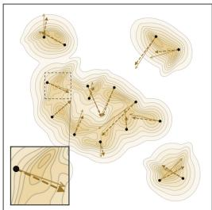  
(a) IKL: aligned samples.

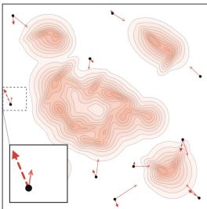  
(b) IKL: outlier samples.

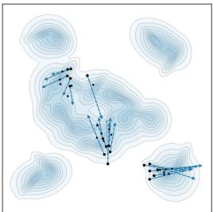  
(c) IKL: mode seeking.

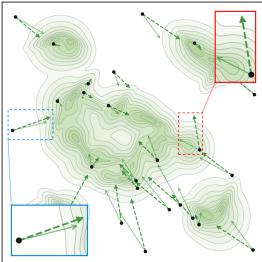  
(d) Sinkhorn transport.

Entropic Optimal Transport and Sinkhorn Divergence. Entropic optimal transport (EOT) compares q and p via a regularized transport cost which can be computed using the Sinkhorn algorithm (Cuturi, 2013; Knight, 2008). For the quadratic cost $c ( x , y ) \overset { \cdot } { = } \frac { 1 } { 2 } \| x - y \| ^ { 2 }$ and regularization strength $\beta > 0$ , EOT is defined as:

$$
\mathrm { O T } _ { \beta } ( q , p ) = \operatorname* { m i n } _ { \pi \in \Pi ( q , p ) } \int c ( x , y ) d \pi ( x , y ) + \beta D _ { \mathrm { K L } } ( \pi \| q \otimes p ) ,\tag{4}
$$

where $\Pi ( q , p )$ denotes the couplings with marginals q and p. The debiased Sinkhorn divergence removes entropic bias by subtracting the self-transport costs (Genevay et al., 2018):

$$
\begin{array} { r } { S _ { \beta } ( q , p ) = \mathrm { O T } _ { \beta } ( q , p ) - \frac { 1 } { 2 } \mathrm { O T } _ { \beta } ( q , q ) - \frac { 1 } { 2 } \mathrm { O T } _ { \beta } ( p , p ) . } \end{array}\tag{5}
$$

$S _ { \beta }$ is nonnegative and vanishes if and only i ${ \mathrm { ~ f ~ } } q = p \left( { \mathrm { F e y d y } } \right.$ et al., 2019). Let $\pi _ { q , p }$ denote the optimal entropic transport plan in Eq. (4), and define its barycentric projection as $\begin{array} { r } { T _ { \boldsymbol { q } , \boldsymbol { p } } ( \dot { \boldsymbol { x } } ) = \int \boldsymbol { y } d \pi _ { \boldsymbol { q } , \boldsymbol { p } } ( \boldsymbol { y } \mid \boldsymbol { x } ) } \end{array}$ the weighted average of target points under the transport plan; $T _ { q , q } ( x )$ denotes the corresponding projection under the self-transport plan. Then, the WGF velocity can be written as the difference between the two barycentric projections (Genevay et al., 2018):

$$
V _ { S _ { \beta } } ( x ) = - \nabla \frac { \delta S _ { \beta } ( q , p ) } { \delta q } ( x ) = T _ { q , p } ( x ) - T _ { q , q } ( x ) .\tag{6}
$$

## 4 ANALYZING DMD THROUGH WASSERSTEIN GRADIENT FLOW

## 4.1 CONNECTION OF DMD TO WGF

DMD (Yin et al., 2024b) has shown strong empirical performance in few-step generation, but the original derivation of the gradient introduces diffusion noise without a formal connection to WGF. We show that the DMD gradient in Eq. (1) follows from the WGF fixed-point relation in Eq. (3). Specifically, the DMD update can be viewed through the WGF framework by choosing the integral KL (IKL) divergence (Luo et al., 2023), i.e., reverse KL averaged over diffusion noise levels, as the energy functional:

$$
\begin{array} { r } { \mathcal { F } _ { \mathrm { I K L } } ( q ) = \mathbb { E } _ { t } \big [ D _ { \mathrm { K L } } \big ( q _ { t } \| p _ { t } \big ) \big ] , \quad V _ { \mathrm { I K L } } ( x ) \stackrel { \mathrm { ( i ) } } { = } \mathbb { E } _ { t , \epsilon } \big [ \alpha _ { t } \big ( \nabla \log p _ { t } ( x _ { t } ) - \nabla \log q _ { t } ( x _ { t } ) \big ) \big ] , } \end{array}\tag{7}
$$

where (i) follows by substituting $\mathcal { F } _ { \mathrm { I K L } }$ into the WGF velocity in Eq. (2). Plugging this velocity into the fixed-point relation in Eq. (3) and taking the gradient gives:

$$
\nabla _ { \mathrm { I K L } } ( \theta ) : = \nabla _ { \theta } \mathbb { E } _ { z } \big [ \| f _ { \theta } ( z ) - \mathrm { s g } ( f _ { \theta } ( z ) + V _ { \mathrm { I K L } } ( f _ { \theta } ( z ) ) ) \| ^ { 2 } \big ] = - 2 \mathbb { E } _ { z } \left[ V _ { \mathrm { I K L } } ( f _ { \theta } ( z ) ) \frac { \partial f _ { \theta } ( z ) } { \partial \theta } \right] ,\tag{8}
$$

which recovers the DMD gradient in Eq. (1) up to a constant after substituting VIKL from Eq. (7). We present the detailed derivation in Appendix B.1. This connection allows us to analyze the behavior and limitations of DMD through its velocity field and explore synergistic energies to improve distillation.

Connection to Prior and Concurrent Work. Diff-Instruct (Luo et al., 2023) derives the generator score-difference update directly from IKL, but does not explicitly connect it to WGF. Prolific-Dreamer (Wang et al., 2023b) derives a WGF update for text-to-3D particles, but does not consider distillation into few-step image or video generators. Concurrent analyses (Gretton et al., 2026; Turan et al., 2026) study WGF fixed-point regression for drifting models (Deng et al., 2026) using kernel-smoothed KL rather than IKL, and also do not explicitly connect DMD to WGF. In this work, we connect DMD to WGF under diffusion-noise-averaged KL from fixed-point regression and use this interpretation to introduce complementary Sinkhorn guidance for diffusion distillation.

## 4.2 LIMITATIONS OF IKL

DMD (Yin et al., 2024b) and its follow-up methods Fan et al. (2026); Ge et al. (2025) have demonstrated empirical success in capturing fine details and scaling to high-resolution image generation (Fan et al., 2025; Yin et al., 2024a) and video generation (Gu et al., 2026; Zheng et al., 2026b; Huang et al., 2025). However, the gradient of IKL in DMD guides particles by local density alone, which brings two practical limitations. First, the clean reverse KL gradient flow is ill-defined when $p$ and q are mutually singular (Glaser et al., 2021). Although forward diffusion gives $p _ { t }$ and $q _ { t }$ full support, in practice the learned teacher score may remain unreliable for generated samples with low teacher density, particularly at low noise levels. Second, the mode-seeking behavior of reverse KL can cause the student to cover only a subset of the teacher modes.

We illustrate these limitations using an experiment with a 2D Gaussian mixture (Fig. 2). When the two distributions are well aligned, the predicted score is accurate and the particles converge onto the target (Fig. 2(a)). However, when a generated sample lies in a low-density region of the teacher distribution, the predicted score becomes inaccurate, and the resulting velocity fails to carry the particles toward the target under weak diffusion annealing (Fig. 2(b)). With higher noise levels, the sample can be better supported, but the velocity can ignore the local structure of the target distribution, and the mode-seeking behavior of reverse KL can collapse the particles onto a single mode (Fig. 2(c)).

Convergence with Exact OT. These limitations motivate augmenting IKL with an optimal transport (OT) regularizer. We show that IKL alone does not guarantee convergence from arbitrary initializations, whereas the WGF of exact OT contracts toward the target. Under regularity assumptions, a sufficiently strong exact OT term counteracts the negative curvature of IKL and ensures convergence of the combined flow to the target in Wasserstein distance (Theorem 1). We provide a failure case for IKL and a sufficient condition on the OT regularization strength for convergence in Appendix B.2. In the next section, we introduce a practical transport correction that complements IKL.

## 5 SDMD: SINKHORN DISTRIBUTION MATCHING DISTILLATION

## 5.1 COMPLEMENTING IKL WITH SINKHORN DIVERGENCE

Despite the favorable convergence properties of exact OT, it can be computationally prohibitive. Instead, we use Sinkhorn divergence, a computationally tractable, debiased form of entropic OT with more favorable sample complexity (Cuturi, 2013; Genevay et al., 2019). We compare this choice with other energy functionals, including forward KL and MMD, in Sec. 6.3.

IKL and Sinkhorn induce complementary velocity fields that are useful in different regimes. IKL captures fine details through local score guidance in regions well supported by the teacher, whereas Sinkhorn uses a global transport plan to guide particles with weak teacher support toward the target and promote mode coverage (Fig. 2(d)).

Combining the two gives sDMD-U, which augments $\mathcal { F } _ { \mathrm { I K L } }$ with a Sinkhorn divergence term:

$$
\mathcal { F } _ { \mathrm { s D M D - U } } ( q ) = \mathbb { E } _ { t } [ D _ { \mathrm { K L } } ( q _ { t } \parallel p _ { t } ) ] + w S _ { \beta } ( q , p ) ,\tag{9}
$$

where the hyperparameter w weights the transport term and recovers $\mathcal { F } _ { \mathrm { I K L } }$ at $w = 0$ . Both terms are nonnegative, vanish only at $q = p ,$ , and Eq. (9) remains a valid energy functional for Eq. (2).

By linearity of the first variation in the energy, the velocity field of the combined energy yields the weighted sum of the two fields:

$$
\begin{array} { r l } & { V _ { \mathrm { s D M D - U } } ( x ) = V _ { \mathrm { I K L } } ( x ) + w V _ { S _ { \beta } } ( x ) } \\ & { \qquad = \mathbb { E } _ { t , \epsilon } \bigl [ \alpha _ { t } \bigl ( \nabla \log p _ { t } ( x _ { t } ) - \nabla \log q _ { t } ( x _ { t } ) \bigr ) \bigr ] + w \left( T _ { q , p } ( x ) - T _ { q , q } ( x ) \right) . } \end{array}\tag{10}
$$

In Appendix B.3, we show that the velocity field is identifiable, i.e., $V _ { \mathrm { s D M D - U } } \equiv 0$ if and only if $q = p .$ The score difference is obtained by passing the perturbed student samples $x _ { t }$ through the teacher and student score networks. Additionally, the transport term is computed using batches of student and teacher samples, i.e., $\{ \boldsymbol { x } ^ { ( i ) } \} _ { i = 1 } ^ { M _ { q } } \sim q$ and $\{ y ^ { ( i ) } \} _ { i = 1 } ^ { M _ { p } } \sim p .$ , on which the Sinkhorn-Knopp algorithm returns the two projections of Eq. (6). We discuss the space on which the transport is computed in Sec. 5.3, and study the role of $M _ { q }$ and $M _ { p }$ in Sec. 6.3.

Lastly, substituting Eq. (10) into Eq. (3) gives the training objective of sDMD-U:

$$
\begin{array} { r } { \mathcal { L } _ { \mathrm { s D M D - U } } ( \theta ) = \mathbb { E } _ { z \sim p _ { \mathrm { r e f } } } \| f _ { \theta } ( z ) - \mathrm { s g } \big ( f _ { \theta } ( z ) + V _ { \mathrm { I K L } } ( x ) + w V _ { S _ { \beta } } ( x ) \big ) \| ^ { 2 } , \qquad x = f _ { \theta } ( z ) . } \end{array}\tag{11}
$$

Convergence with Sinkhorn. We note that Sinkhorn does not automatically inherit the convergence guarantees of exact OT. However, under the assumptions in Appendix B.4, a sufficiently large transport weight and a suitable bound on the Sinkhorn approximation error show convergence of the combined IKL and Sinkhorn flow to the target (Theorem 2). Empirically, sDMD-U benefits from the complementary guidance of IKL and Sinkhorn. As shown by the blue box in Fig. 2(d), Sinkhorn provides more informative guidance than IKL for outliers.

In practice, however, the transport plan is computed on finite batches of student and teacher samples, which introduces error in the resulting velocity (Genevay et al., 2019; Pooladian & Niles-Weed, 2021). As a result, applying Sinkhorn at every iteration can perturb well-supported samples for which IKL already provides reliable guidance, as highlighted by the red boxes in Fig. 2(d), while adding computational cost. We therefore seek a criterion that adaptively activates the Sinkhorn correction for samples with relatively weak teacher support, for which IKL guidance may be unreliable.

## 5.2 GATED SINKHORN SCHEDULER

In this section, we propose a practical criterion for identifying samples with relatively weak teacher support that can benefit from Sinkhorn transport. During training, the few-step generator produces oversmoothed or distorted samples that are outside the typical regions of the target distribution. We assume that these outlier samples have low density under the perturbed target distribution $p _ { t }$ but higher density under the perturbed (fake) distribution $q _ { t }$ of student outputs, i.e., $q _ { t } ( x _ { t } ) \gg p _ { t } ( x _ { t } )$ 1

However, estimating these densities directly is challenging, and we instead exploit the ratio $q _ { t } ( x _ { t } ) / p _ { t } ( x _ { t } )$ , with larger values indicating relatively weak teacher support. Specifically, we assess this density imbalance using a discriminator $D _ { \phi } : \mathbb { R } ^ { d } \times [ 0 , 1 ] \to ( 0 , 1 )$ trained to distinguish perturbed target samples from perturbed student samples:

$$
\mathcal { L } _ { \mathrm { a d v } } ( \phi ) = - \mathbb { E } _ { t , \epsilon } [ \mathbb { E } _ { y \sim p } \log D _ { \phi } ( y _ { t } , t ) + \mathbb { E } _ { x \sim q } \log ( 1 - D _ { \phi } ( x _ { t } , t ) ) ] ,\tag{12}
$$

where $y _ { t }$ and $x _ { t }$ are perturbed target and generated samples, respectively. The discriminator is then used to define the following gating criterion:

$$
\lambda _ { \phi } ( x _ { t } , t ) = 1 - D _ { \phi } ( x _ { t } , t ) \approx \frac { q _ { t } ( x _ { t } ) } { p _ { t } ( x _ { t } ) + q _ { t } ( x _ { t } ) } \in ( 0 , 1 ) ,\tag{13}
$$

where the approximation becomes exact for the optimal discriminator $D ^ { \star } ( x _ { t } , t ) = p _ { t } ( x _ { t } ) / ( p _ { t } ( x _ { t } ) +$ $q _ { t } ( x _ { t } ) \big |$ ). A high value of $\lambda _ { \phi } ( x _ { t } , t )$ suggests that $x _ { t }$ has lower density under the target distribution than under the student distribution. We assume that these samples are more likely to be out-of-distribution samples, where the learned teacher score and the resulting IKL (DMD) velocity may be unreliable. We therefore use λ as a threshold and activate the Sinkhorn term when $\lambda _ { \phi } ( x _ { t } , t ) > \lambda \colon$

$$
\begin{array} { r l } & { \quad V _ { \mathrm { s D M D } } ( x ) = V _ { \mathrm { I K L } } ( x ) + w \cdot \mathbb { 1 } [ \lambda _ { \phi } ( x _ { t } , t ) > \lambda ] V _ { S _ { \beta } } ( x ) , } \\ & { \mathcal { L } _ { \mathrm { s D M D } } ( \theta , \phi ) = \mathbb { E } _ { z \sim p _ { \mathrm { r e f } } } \Vert f _ { \theta } ( z ) - \mathrm { s g } ( f _ { \theta } ( z ) + V _ { \mathrm { s D M D } } ( x ) ) \Vert ^ { 2 } + \mathcal { L } _ { \mathrm { a d v } } ( \phi , \theta ) , } \end{array}\tag{14}
$$

sDMD (Ours)

Figure 3: Qualitative Comparison on Text-to-Image Distillation. sDMD more closely matches the diversity of the teacher than DMD-based Qwen-Lightning while preserving visual quality. † denotes an officially released checkpoint. See Appendix G for additional results.  
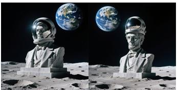  
Teacher (Qwen-Image) (Wu et al., 2025)

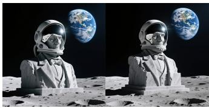  
Lightning† (Fan et al., 2025)

“A towering statue ofAbraham Lincoln, cast in a silvery-gray stone, is adorned with a gleaming, opaque astronaut’s helmet that reflects the barren lunar landscape. The statue is positioned on the moon’s surface, with its craters and dust visible around the base. In the dark sky above, the planet Earth looms large, a swirl ofblue and white against the blackness ofspace.”  
  
Teacher (Qwen-Image) (Wu et al., 2025)

  
Lightning† (Fan et al., 2025)

  
sDMD (Ours)  
“A vibrant and detailed image showcasing a large ceramic bowlfilled with steaming ramen, the noodles and broth glistening under the light. Floating amidst the savory dish are several origami boats, each crafted from paper in hues of red, blue, and yellow, adding a whimsical touch to the culinary scene. The bowl sits on a dark wooden table, contrasting with the bright colors ofthe paper crafts and the rich tones ofthe ramen ingredients.”

where 1[·] denotes the indicator function. Instead of training a separate discriminator, we incorporate the GAN objective of DMD2 (Yin et al., 2024a) and reuse its discriminator. Here, $\mathcal { L } _ { \mathrm { a d v } } ( \phi , \theta )$ denotes adversarial training with alternating updates to the generator and discriminator. We denote the gated method by sDMD and the ungated variant in Eq. (9) by sDMD-U, and compare them in Sec. 6.3.

## 5.3 PRACTICAL CONSIDERATIONS

Choice of Transport Space. The transport in Eq. (6) is computed on the sampled latents $x \in \mathbb { R } ^ { d }$ of the student and the teacher. Instead, it can be computed in a feature space given a network $\psi : \mathbb { R } ^ { d }  \mathbb { R } ^ { n }$ , replacing the samples with the feature vectors $\psi ( x ) \in \mathbb { R } ^ { n }$ . We empirically find that Sinkhorn transport computed in the clean latent space already provides effective guidance for outlier samples, avoiding the additional cost of a feature encoder. With this choice, sDMD incurs only marginal computational overhead compared with DMD2 (Yin et al., 2024a). We present an ablation of the transport space and an analysis of computational cost in Sec. 6.3 and Appendix E, respectively.

Conditional Generation. For conditional generation, we compute Sinkhorn transport between $M _ { q }$ student samples and $M _ { p }$ teacher samples generated under the same conditioning input. To reduce training cost, we pre-generate the teacher samples for each conditioning input and store them in a buffer. While previous works applied Sinkhorn divergence to class-conditioned generation (Han et al., 2026; He et al., 2026), we extend its use to text-conditioned generation.

## 6 EXPERIMENTS

We evaluate sDMD for text-to-image generation with Qwen-Image (Wu et al., 2025) and text-tovideo generation with Wan2.1 (Wan et al., 2025). In Appendix, we provide implementation details (Appendix D), additional experimental results (Appendix E), and qualitative results (Appendix G).

## 6.1 TEXT-TO-IMAGE DIFFUSION DISTILLATION

We distill Qwen-Image (Wu et al., 2025) (20B) into two- and four-step students at $1 0 2 4 \times 1 0 2 4$ resolution using teacher samples generated using HPSv2 (Wu et al., 2023) prompts. Following the previous work (Cheng et al., 2026), we evaluate on GenEval (Ghosh et al., 2023), DPG-Bench (Hu et al., 2024), and WISE (Niu et al., 2025). We compare our method with state-of-the-art baselines, including TwinFlow (Cheng et al., 2026), π-Flow (Chen et al., 2026), and the DMD2-based Qwen-Lightning (Fan et al., 2025), using their official checkpoints. Two-step DMD2 (Yin et al., 2024a) is trained using FastGen (Nie et al., 2026a) framework.

<table><tr><td>Method NFE GenEval ↑ DPG ↑ WISE ↑</td></tr><tr><td>Teacher 50 × 2 0.860 88.70</td></tr><tr><td>TwinFlow† (Cheng et al., 2026) 2 0.827 86.65</td></tr><tr><td>0.50 DMD2 (Yin et al., 2024a) 2 0.856 87.08 0.53</td></tr><tr><td></td></tr><tr><td>sDMD (Ours) 2 0.862 87.03 0.54</td></tr></table>

(a) Two-Step Generation.

<table><tr><td>Method</td><td colspan="4">NFE GenEval ↑ DPG ↑ WISE ↑</td></tr><tr><td>Teacher</td><td>50 × 2</td><td>0.860</td><td>88.70</td><td>0.54</td></tr><tr><td>Lightning† (Fan et al., 2025)</td><td>4</td><td>0.864</td><td>88.41</td><td>0.51</td></tr><tr><td>TwinFlow† (Cheng et al., 2026)</td><td>4</td><td>0.817</td><td>86.24</td><td>0.49</td></tr><tr><td>π-Flow† (Chen et al., 2026)</td><td>4</td><td>0.863</td><td>87.90</td><td>0.53</td></tr><tr><td>sDMD (Ours)</td><td>4</td><td>0.867</td><td>88.45</td><td>0.53</td></tr></table>

(b) Four-Step Generation.  
Table 1: Qwen-Image Distillation. Two- and four-step text-to-image generation with Qwen-Image 20B (Wu et al., 2025), evaluated on GenEval (Ghosh et al., 2023), DPG-Bench (Hu et al., 2024), and WISE (Niu et al., 2025). † denotes results obtained using officially released checkpoints.

Figure 4: Qualitative Comparison on Text-to-Video Distillation. We compare sDMD with DMD2 (Yin et al., 2024a) and AnyFlow (Gu et al., 2026) using different seeds, with uniformly sampled frames. † denotes an officially released checkpoint. See Appendix G for additional results.  
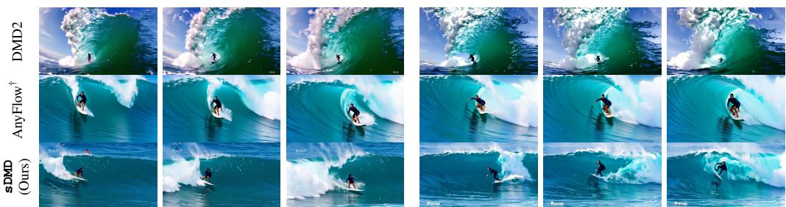

“In this dynamic scene, a surfer expertly maneuvers a wave, showcasing impressive skill and balance. The surfer, clad in a wetsuit, is positioned on a sleek, white surfboard, riding the crest ofa powerful, turquoise wave. The wave’s size and power are evidentfrom its towering height and thefrothy whitefoam at its peak. The surfer’s body leansforward, arms extendedfor stability, as they navigate the wave’s curve with precision. The ocean’s deep blue-green hues contrast sharply with the whitefoam, emphasizing the intensity ofthe moment. The "Recap" text in the corner suggests this is part ofa larger surfing event, highlighting the surfer’s performance within a competitive context.”  
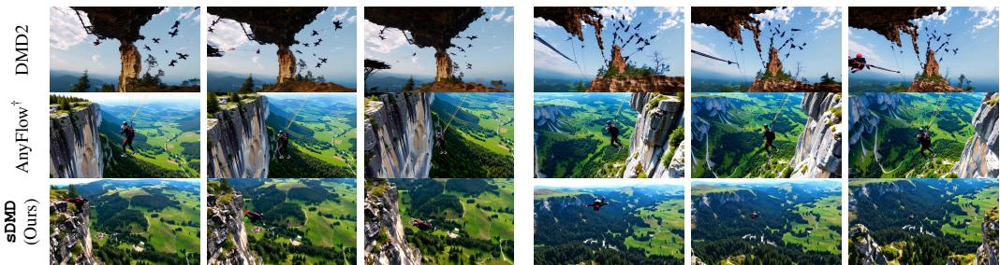  
“The video captures an exhilarating bungee jumpfrom a towering cliff. A person, clad in a black outfit with red accents, is seen descending rapidly towards the valley below. The camerafollows the jumper’s descent, revealing the rugged, rocky cliffface and the expansive green valley dotted with patches oftrees. The bungee cord stretches taut, absorbing the impact as the jumper descends. The scene emphasizes the height and scale ofthe jump, with the vast landscape stretching out beneath the cliff. The dynamic movement ofthe jumper contrasts sharply with the stillness ofthe surrounding terrain, highlighting the thrill and adventure ofthe activity.”

Results. As shown in Tab. 1, sDMD matches or outperforms the evaluated baselines across all metrics in both two- and four-step generation, except for a marginally lower DPG-Bench score than DMD2 in the two-step setting. The qualitative comparisons in Fig. 3 and Appendix G suggest that sDMD more closely matches the diversity of the teacher than the strong Qwen-Lightning baseline (Fan et al., 2025), without degrading visual quality. The quantitative results in Sec. 6.4 further show improved diversity over Qwen-Lightning (DMD2) across all reported metrics.

## 6.2 TEXT-TO-VIDEO DIFFUSION DISTILLATION

We distill the 1.3B and 14B variants of Wan2.1 (Wan et al., 2025) into four-step students for text-tovideo generation. We use teacher samples generated from MovieGenVideoBench prompts (Polyak et al., 2024) for training and evaluate the distilled models on VBench (Huang et al., 2024). We compare sDMD against the official checkpoints of rCM (Zheng et al., 2026b) and AnyFlow (Gu et al., 2026), as well as DMD2 (Yin et al., 2024a) trained on FastGen framework (Nie et al., 2026a).

Results. As shown in Tab. 2b, sDMD achieves the highest overall and semantic scores on Wan2.1- 14B, with a quality score comparable to DMD2. Similarly, Tab. 2a shows that sDMD achieves the highest overall and quality scores on Wan2.1-1.3B. The qualitative results in Fig. 4 and the additional examples in Appendix G show that sDMD generates high-quality videos that closely follow the text prompts with diversity. Consistent with the text-to-image results in Sec. 6.1, the quantitative evaluation in Sec. 6.4 shows that sDMD also produces more diverse samples than DMD2 on Wan2.1.

<table><tr><td>Method</td><td>NFE</td><td>Overall ↑ Quality ↑ Sem. ↑</td><td></td><td></td></tr><tr><td>Teacher</td><td>50×2</td><td>83.03</td><td>84.29</td><td>78.00</td></tr><tr><td>DMD2 (Yin et al., 2024a)</td><td>4</td><td>83.65</td><td>85.73</td><td>75.32</td></tr><tr><td>rCM† (Zheng et al., 2026b)</td><td>4</td><td>82.78</td><td>84.13</td><td>77.31</td></tr><tr><td>AnyFlow† (Gu et al., 2026)</td><td>4</td><td>83.86</td><td>85.15</td><td>78.71</td></tr><tr><td>sDMD (Ours)</td><td>4</td><td>84.12</td><td>85.94</td><td>76.81</td></tr></table>

(a) Wan2.1 T2V (1.3B).

<table><tr><td>Method</td><td>NFE</td><td>Overall ↑ Quality ↑ Sem. ↑</td><td></td><td></td></tr><tr><td>Teacher</td><td>50×2</td><td>83.71</td><td>85.13</td><td>78.02</td></tr><tr><td>DMD2 (Yin et al., 2024a)</td><td>4</td><td>84.69</td><td>86.67</td><td>76.75</td></tr><tr><td>rCM† (Zheng et al., 2026b)</td><td>4</td><td>83.97</td><td>85.40</td><td>78.28</td></tr><tr><td>AnyFlow† (Gu et al., 2026)</td><td>4</td><td>84.38</td><td>85.70</td><td>79.11</td></tr><tr><td>sDMD (Ours)</td><td>4</td><td>84.87</td><td>85.96</td><td>80.51</td></tr></table>

(b) Wan2.1 T2V (14B).  
Table 2: Wan Text-to-Video Distillation. We evaluate the generated video samples using VBench (Huang et al., 2024). † denotes results obtained using officially released checkpoints. DMD2 (Yin et al., 2024a) is trained using FastGen (Nie et al., 2026a).

## 6.3 ABLATION STUDY

Energy Functional. Tab. 3 reports FID on ImageNet-256 for models distilled with different energy functionals. IKL achieves the lowest FID among the individual energy functionals, in line with previous observations that it can help preserve fine details (Zheng et al., 2026b; Huang et al., 2025).

Complementing IKL with Sinkhorn divergence in sDMD further reduces FID. The global transport plan guides samples with weak teacher support toward the target distribution and can alleviate the mode collapse associated with reverse KL, as illustrated in Fig. 2. While MMD can also complement IKL, it yields worse performance than Sinkhorn, consistent with observations in previous work (Han et al., 2026; Gretton et al., 2026; He et al., 2026).

<table><tr><td></td><td>Energy (F)</td><td>FID↓</td></tr><tr><td rowspan="2">Score-based</td><td>Forward KL</td><td>3.23</td></tr><tr><td>IKL</td><td>3.14</td></tr><tr><td rowspan="2">Sample-based</td><td>MMD</td><td>6.21</td></tr><tr><td>Sinkhorn</td><td>5.09</td></tr><tr><td rowspan="2">Combined</td><td>IKL + MMD</td><td>3.01</td></tr><tr><td>sDMD (Ours)</td><td>2.83</td></tr></table>

Table 3: Energy Functional. ImageNet-256 (Deng et al., 2009) distillation with different energy functionals. Combined guidance uses both score- and sample-based updates.

Transport Space and Sinkhorn Scheduler. Tab. 4 evaluates the effects of the transport space and the gated Sinkhorn scheduler on sDMD. Applying Sinkhorn at every iteration (ungated) yields worse performance with more computational overhead. Finite-sample Sinkhorn errors can disrupt reliable IKL guidance (Sec. 5.1), motivating our gated scheduler to activate transport only for samples with weak teacher support.

<table><tr><td rowspan="2"></td><td rowspan="2">Space Scheduler</td><td>ImageNet-256</td><td colspan="3">FLUX</td></tr><tr><td>FID↓</td><td>FID↓</td><td>CMMD↓</td><td>CLIP ↑</td></tr><tr><td>ψ(x)</td><td>Gated</td><td>2.83</td><td>13.78</td><td>0.187</td><td>27.46</td></tr><tr><td>ψ(x)</td><td>Ungated</td><td>2.88</td><td>13.89</td><td>0.201</td><td>27.46</td></tr><tr><td>x</td><td>Gated</td><td>2.84</td><td>14.48</td><td>0.211</td><td>27.45</td></tr></table>

Table 4: Transport Space and Sinkhorn Scheduler. Transport in the learned feature space ψ(x) or clean latent space x, with gated (sDMD) or ungated (sDMD-U) Sinkhorn updates.

Computing transport in the learned feature space ψ(x) yields better performance than computing

it in the clean latent space x, consistent with observations in previous work (Han et al., 2026; Feng et al., 2026; Deng et al., 2026). However, feature-space transport requires additional forward passes and backpropagation through the feature encoder, whereas clean-latent transport offers competitive quality at a lower computational cost. We therefore compute the Sinkhorn transport in the clean latent space for the large scale generative models (Wan et al., 2025; Wu et al., 2025) to balance sample quality and computational cost.

## 6.4 SAMPLE DIVERSITY

We compare the diversity of samples generated by DMD2 (Yin et al., 2024a) and sDMD. For images, following DAS (Kim et al., 2025), we report truncated CLIP entropy (TCE) and mean pairwise LPIPS distance (LPIPS MPD). TCE measures the spread of generated images in CLIP feature space, while LPIPS MPD measures the average perceptual difference between image pairs. For videos, following

<table><tr><td></td><td colspan="2">FLUX</td><td colspan="2">Qwen-Image</td><td colspan="2">Wan 14B</td></tr><tr><td>Method</td><td>TCE↑</td><td>LPIPS MPD ↑</td><td>TCE↑</td><td>LPIPS MPD ↑</td><td>V-JEPA2 ↑</td><td>VideoMAE ↑</td></tr><tr><td>Teacher</td><td>7.25</td><td>0.469</td><td>5.86</td><td>0.397</td><td>28.91</td><td>18.36</td></tr><tr><td>DMD2 (Yin et al., 2024a)</td><td>5.93</td><td>0.206</td><td>4.72</td><td>0.161</td><td>16.78</td><td>13.74</td></tr><tr><td>sDMD (Ours)</td><td>6.75</td><td>0.348</td><td>5.43</td><td>0.301</td><td>20.68</td><td>13.85</td></tr></table>

Table 5: Diversity Comparison. Across the applications, sDMD achieves higher diversity than DMD2, suggesting that Sinkhorn global transport helps mitigate mode collapse.

PDD (Shaul et al., 2026), we generate five videos per prompt and compute mean pairwise $\ell _ { 2 }$ distances in the feature spaces of V-JEPA 2 (Assran et al., 2025) and VideoMAE V2 (Wang et al., 2023a).

As shown in Tab. 5, sDMD achieves higher scores than DMD2 on all reported diversity metrics across applications. These results are consistent with the toy example in Fig. 2 and suggest that the global transport of Sinkhorn can alleviate the mode collapse associated with reverse-KL-based distribution matching.

## 7 CONCLUSION

In this work, we proposed sDMD, a diffusion distillation method that combines local score guidance of DMD with global transport. We first connected DMD to WGF by showing that the fixed-point relation with IKL as the energy functional recovers the DMD gradient. This connection enabled us to explore energy functionals that address unreliable guidance for outliers and limited mode coverage in DMD. Specifically, we augmented IKL with Sinkhorn divergence and introduced an adaptive scheduler to focus transport guidance on samples with relatively weak teacher support. Experiments showed that sDMD improves sample quality and diversity over strong diffusion distillation baselines in image and video generation with only marginal training overhead than DMD2. We discuss limitations and future work in Appendix F.

## REFERENCES

Luigi Ambrosio, Nicola Gigli, and Giuseppe Savaré. Gradient Flows in Metric Spaces and in the Space of Probability Measures. Birkhäuser, 2nd edition, 2008.

Michael Arbel, Anna Korba, Adil Salim, and Arthur Gretton. Maximum mean discrepancy gradient flow. In NeurIPS, 2019.

Mahmoud Assran, Adrien Bardes, David Fan, Quentin Garrido, Russell Howes, Mojtaba Komeili, Matthew Muckley, Ammar Rizvi, Claire Roberts, Koustuv Sinha, Artem Zholus, Sergio Arnaud, Abha Gejji, Ada Martin, Francois Robert Hogan, Daniel Dugas, Piotr Bojanowski, Vasil Khalidov, Patrick Labatut, Francisco Massa, Marc Szafraniec, Kapil Krishnakumar, Yong Li, Xiaodong Ma, Sarath Chandar, Franziska Meier, Yann LeCun, Michael Rabbat, and Nicolas Ballas. V-JEPA 2: Self-supervised video models enable understanding, prediction and planning. arXiv preprint arXiv:2506.09985, 2025.

Lichen Bai, Zikai Zhou, Shitong Shao, Wenliang Zhong, Shuo Yang, Shuo Chen, Bojun Chen, and Zeke Xie. Optimizing few-step generation with adaptive matching distillation. arXiv preprint arXiv:2602.07345, 2026.

Nicholas M. Boffi, Michael S. Albergo, and Eric Vanden-Eijnden. How to build a consistency model: Learning flow maps via self-distillation. arXiv preprint arXiv:2505.18825, 2025.

Clément Bonet, Nicolas Courty, François Septier, and Lucas Drumetz. Efficient gradient flows in slicedwasserstein space. arXiv preprint arXiv:2110.10972, 2021.

Hansheng Chen, Kai Zhang, Hao Tan, Leonidas Guibas, Gordon Wetzstein, and Sai Bi. pi-flow: Policy-based few-step generation via imitation distillation. In ICLR, 2026.

Zhenglin Cheng, Peng Sun, Jianguo Li, and Tao Lin. Twinflow: Realizing one-step generation on large models with self-adversarial flows. In ICLR, 2026.

Jaemoo Choi, Jaewoong Choi, and Myungjoo Kang. Scalable wasserstein gradient flow for generative modeling through unbalanced optimal transport. arXiv preprint arXiv:2402.05443, 2024.

Marco Cuturi. Sinkhorn distances: Lightspeed computation of optimal transport. In NeurIPS, 2013.

Jia Deng, Wei Dong, Richard Socher, Li-Jia Li, Kai Li, and Li Fei-Fei. Imagenet: A large-scale hierarchical image database. In CVPR, 2009.

Mingyang Deng, He Li, Tianhong Li, Yilun Du, and Kaiming He. Generative modeling via drifting. arXiv preprint arXiv:2602.04770, 2026.

Jiaojiao Fan, Qinsheng Zhang, Amirhossein Taghvaei, and Yongxin Chen. Variational wasserstein gradient flow. arXiv preprint arXiv:2112.02424, 2021.

Xiangyu Fan, Zesong Qiu, Fanzhou Wang, Peng Gao, and Lei Yang. Qwen-image-lightning, 2025. URL https://github.com/ModelTC/LightX2V-Qwen-Image-Lightning.

Xiangyu Fan, Zesong Qiu, Zhuguanyu Wu, Fanzhou Wang, Zhiqian Lin, Tianxiang Ren, Dahua Lin, Ruihao Gong, and Lei Yang. Phased dmd: Few-step distribution matching distillation via score matching within subintervals. In CVPR, 2026.

Lan Feng, Wuyang Li, Eloi Zablocki, Matthieu Cord, and Alexandre Alahi. Representation distribution matching for one-step visual generation. arXiv preprint arXiv:2607.02375, 2026.

Jean Feydy, Thibault Séjourné, François-Xavier Vialard, Shun-ichi Amari, Alain Trouvé, and Gabriel Peyré. Interpolating between optimal transport and mmd using sinkhorn divergences. In AISTATS, 2019.

Kevin Frans, Danijar Hafner, Sergey Levine, and Pieter Abbeel. One step diffusion via shortcut models. In ICML, 2025.

Alexandre Galashov, Valentin De Bortoli, and Arthur Gretton. Deep MMD gradient flow without adversarial training. In ICLR, 2025.

Xingtong Ge, Xin Zhang, Tongda Xu, Yi Zhang, Xinjie Zhang, Yan Wang, and Jun Zhang. Senseflow: Scaling distribution matching for flow-based text-to-image distillation. arXiv preprint arXiv:2506.00523, 2025.

Aude Genevay, Gabriel Peyré, and Marco Cuturi. Learning generative models with sinkhorn divergences. In AISTATS, 2018.

Aude Genevay, Lénaïc Chizat, Francis Bach, Marco Cuturi, and Gabriel Peyré. Sample complexity of sinkhorn divergences. In Proceedings of the Twenty-Second International Conference on Artificial Intelligence and Statistics, volume 89, pp. 1574–1583. PMLR, 2019. URL https://proceedings.mlr.press/v89/ genevay19a.html.

Zhengyang Geng, Mingyang Deng, Xingjian Bai, Zico Kolter, and Kaiming He. Mean flows for one-step generative modeling. In NeurIPS, 2025.

Zhengyang Geng, Yiyang Lu, Zongze Wu, Eli Shechtman, J Zico Kolter, and Kaiming He. Improved mean flows: On the challenges of fastforward generative models. In CVPR, 2026.

Dhruba Ghosh, Hannaneh Hajishirzi, and Ludwig Schmidt. Geneval: An object-focused framework for evaluating text-to-image alignment. In NeurIPS, 2023.

Pierre Glaser, Michael Arbel, and Arthur Gretton. KALE flow: A relaxed KL gradient flow for probabilities with disjoint support. In NeurIPS, 2021.

Arthur Gretton, Li Kevin Wenliang, Alexandre Galashov, James Thornton, Valentin De Bortoli, and Arnaud Doucet. On the wasserstein gradient flow interpretation of drifting models. arXiv preprint arXiv:2605.05118, 2026.

Yuchao Gu, Guian Fang, Yuxin Jiang, Weijia Mao, Song Han, Han Cai, and Mike Zheng Shou. Anyflow: Any-step video diffusion model with on-policy flow map distillation. arXiv preprint arXiv:2605.13724, 2026.

Jiaqi Han, Puheng Li, Qiushan Guo, Renyuan Xu, Stefano Ermon, and Emmanuel J. Candès. One-step generative modeling via wasserstein gradient flows. arXiv preprint arXiv:2605.11755, 2026.

Jiajun He, Wenlin Chen, Mingtian Zhang, David Barber, and José Miguel Hernández-Lobato. Training neural samplers with reverse diffusive kl divergence. In AISTATS, 2025.

Ping He, Om Khangaonkar, Hamed Pirsiavash, Yikun Bai, and Soheil Kolouri. Sinkhorn-drifting generative models. arXiv preprint arXiv:2603.12366, 2026.

Martin Heusel, Hubert Ramsauer, Thomas Unterthiner, Bernhard Nessler, and Sepp Hochreiter. Gans trained by a two time-scale update rule converge to a local nash equilibrium. NeurIPS, 2017.

Jonathan Ho, Ajay Jain, and Pieter Abbeel. Denoising diffusion probabilistic models. In NeurIPS, 2020.

Edward J Hu, Yelong Shen, Phillip Wallis, Zeyuan Allen-Zhu, Yuanzhi Li, Shean Wang, Lu Wang, and Weizhu Chen. Lora: Low-rank adaptation of large language models. arXiv preprint arXiv:2106.09685, 2021.

Xiwei Hu, Rui Wang, Yixiao Fang, Bin Fu, Pei Cheng, and Gang Yu. Ella: Equip diffusion models with llm for enhanced semantic alignment. arXiv preprint arXiv:2403.05135, 2024.

Xun Huang, Zhengqi Li, Guande He, Mingyuan Zhou, and Eli Shechtman. Self forcing: Bridging the train-test gap in autoregressive video diffusion. In NeurIPS, 2025.

Ziqi Huang, Yinan He, Jiashuo Yu, Fan Zhang, Chenyang Si, Yuming Jiang, Yuanhan Zhang, Tianxing Wu, Qingyang Jin, Nattapol Chanpaisit, et al. Vbench: Comprehensive benchmark suite for video generative models. In CVPR, 2024.

Sadeep Jayasumana, Srikumar Ramalingam, Andreas Veit, Daniel Glasner, Ayan Chakrabarti, and Sanjiv Kumar. Rethinking fid: Towards a better evaluation metric for image generation. In CVPR, 2024.

Richard Jordan, David Kinderlehrer, and Felix Otto. The variational formulation of the fokker–planck equation. SIAM Journal on Mathematical Analysis, 1998.

Sunwoo Kim, Minkyu Kim, and Dongmin Park. Test-time alignment of diffusion models without reward over-optimization. In ICLR, 2025.

Philip A Knight. The sinkhorn–knopp algorithm: convergence and applications. SIAM Journal on Matrix Analysis and Applications, 2008.

Black Forest Labs. Flux. https://github.com/black-forest-labs/flux, 2024.

Daiqing Li, Aleks Kamko, Ehsan Akhgari, Ali Sabet, Linmiao Xu, and Suhail Doshi. Playground v2.5: Three insights towards enhancing aesthetic quality in text-to-image generation, 2024.

Lingxiao Li, Samuel Hurault, and Justin Solomon. Self-consistent velocity matching of probability flows. In NeurIPS, 2023.

Shanchuan Lin, Xin Xia, Yuxi Ren, Ceyuan Yang, Xuefeng Xiao, and Lu Jiang. Diffusion adversarial posttraining for one-step video generation. In ICML, 2025.

Dongyang Liu, Gao Peng, David Liu, DU DU, Zhen Li, Qilong Wu, Xin Jin, Sihan Cao, Shifeng Zhang, Steven HOI, et al. Decoupled dmd: Cfg augmentation as the spear, distribution matching as the shield. In ICLR, 2026.

Qiang Liu. Stein variational gradient descent as gradient flow. In NeurIPS, 2017.

Cheng Lu and Yang Song. Simplifying, stabilizing and scaling continuous-time consistency models. In ICLR, 2025.

Yiyang Lu, Susie Lu, Qiao Sun, Hanhong Zhao, Zhicheng Jiang, Xianbang Wang, Tianhong Li, Zhengyang Geng, and Kaiming He. One-step latent-free image generation with pixel mean flows. arXiv preprint arXiv:2601.22158, 2026.

Weijian Luo, Tianyang Hu, Shifeng Zhang, Jiacheng Sun, Zhenguo Li, and Zhihua Zhang. Diff-instruct: A universal approach for transferring knowledge from pre-trained diffusion models. In NeurIPS, 2023.

Weijian Luo, Zemin Huang, Zhengyang Geng, J Zico Kolter, and Guo-jun Qi. One-step diffusion distillation through score implicit matching. In NeurIPS, 2024.

Yihong Luo, Tianyang Hu, Jiacheng Sun, Yujun Cai, and Jing Tang. Learning few-step diffusion models by trajectory distribution matching. In ICCV, 2025.

Nanye Ma, Mark Goldstein, Michael S Albergo, Nicholas M Boffi, Eric Vanden-Eijnden, and Saining Xie. Sit: Exploring flow and diffusion-based generative models with scalable interpolant transformers. In ECCV, 2024.

Petr Mokrov, Alexander Korotin, Lingxiao Li, Aude Genevay, Justin M Solomon, and Evgeny Burnaev. Largescale wasserstein gradient flows. In NeurIPS, 2021.

Weili Nie, Julius Berner, Chao Liu, and Arash Vahdat. Nvidia fastgen: Fast generation from diffusion models, 2026a. URL https://github.com/NVlabs/FastGen.

Weili Nie, Julius Berner, Nanye Ma, Chao Liu, Saining Xie, and Arash Vahdat. Transition matching distillation for fast video generation. arXiv preprint arXiv:2601.09881, 2026b.

Yuwei Niu, Munan Ning, Mengren Zheng, Weiyang Jin, Bin Lin, Peng Jin, Jiaqi Liao, Chaoran Feng, Fanqing Meng, Kunpeng Ning, et al. Wise: A world knowledge-informed semantic evaluation for text-to-image generation. arXiv preprint arXiv:2503.07265, 2025.

Maxime Oquab, Timothée Darcet, Théo Moutakanni, Huy Vo, Marc Szafraniec, Vasil Khalidov, Pierre Fernandez, Daniel Haziza, Francisco Massa, Alaaeldin El-Nouby, et al. Dinov2: Learning robust visual features without supervision. arXiv preprint arXiv:2304.07193, 2023.

Adam Polyak, Amit Zohar, Andrew Brown, Andros Tjandra, Animesh Sinha, Ann Lee, Apoorv Vyas, Bowen Shi, Chih-Yao Ma, Ching-Yao Chuang, et al. Movie gen: A cast of media foundation models. arXiv preprint arXiv:2410.13720, 2024.

Aram-Alexandre Pooladian and Jonathan Niles-Weed. Entropic estimation of optimal transport maps. arXiv preprint arXiv:2109.12004, 2021.

Aram-Alexandre Pooladian, Marco Cuturi, and Jonathan Niles-Weed. Debiaser beware: Pitfalls of centering regularized transport maps. In ICML, volume 162, pp. 17830–17847. PMLR, 2022. URL https:// proceedings.mlr.press/v162/pooladian22a.html.

Alec Radford, Jong Wook Kim, Chris Hallacy, Aditya Ramesh, Gabriel Goh, Sandhini Agarwal, Girish Sastry, Amanda Askell, Pamela Mishkin, Jack Clark, et al. Learning transferable visual models from natural language supervision. In ICML, 2021.

Robin Rombach, Andreas Blattmann, Dominik Lorenz, Patrick Esser, and Björn Ommer. High-resolution image synthesis with latent diffusion models. In CVPR, 2022.

Axel Sauer, Dominik Lorenz, Andreas Blattmann, and Robin Rombach. Adversarial diffusion distillation. arXiv preprint arXiv:2311.17042, 2023.

Axel Sauer, Frederic Boesel, Tim Dockhorn, Andreas Blattmann, Patrick Esser, and Robin Rombach. Fast high-resolution image synthesis with latent adversarial diffusion distillation. arXiv preprint arXiv:2403.12015, 2024.

Neta Shaul, Chao Liu, Arash Vahdat, and Julius Berner. Parallel decoding distillation for fast image and video generation. arXiv preprint arXiv:2607.26004, 2026.

Jascha Sohl-Dickstein, Eric Weiss, Niru Maheswaranathan, and Surya Ganguli. Deep unsupervised learning using nonequilibrium thermodynamics. In ICML, 2015.

Yang Song and Prafulla Dhariwal. Improved techniques for training consistency models. In ICML, 2024.

Yang Song, Jascha Sohl-Dickstein, Diederik P. Kingma, Abhishek Kumar, Stefano Ermon, and Ben Poole. Score-based generative modeling through stochastic differential equations. In ICLR, 2021.

Yang Song, Prafulla Dhariwal, Mark Chen, and Ilya Sutskever. Consistency models. In ICML, 2023.

Erkan Turan, Nicolas Dufour, and Maks Ovsjanikov. Generative drifting is secretly score matching: a spectral and variational perspective. arXiv preprint arXiv:2603.09936, 2026. URL https://arxiv.org/abs/ 2603.09936.

Cédric Villani et al. Optimal transport: old and new. Springer, 2009.

Pascal Vincent. A connection between score matching and denoising autoencoders. Neural computation, 2011.

Team Wan, Ang Wang, Baole Ai, Bin Wen, Chaojie Mao, Chen-Wei Xie, Di Chen, Feiwu Yu, Haiming Zhao, Jianxiao Yang, Jianyuan Zeng, Jiayu Wang, Jingfeng Zhang, Jingren Zhou, Jinkai Wang, Jixuan Chen, Kai Zhu, Kang Zhao, Keyu Yan, Lianghua Huang, Mengyang Feng, Ningyi Zhang, Pandeng Li, Pingyu Wu, Ruihang Chu, Ruili Feng, Shiwei Zhang, Siyang Sun, Tao Fang, Tianxing Wang, Tianyi Gui, Tingyu Weng, Tong Shen, Wei Lin, Wei Wang, Wei Wang, Wenmeng Zhou, Wente Wang, Wenting Shen, Wenyuan Yu, Xianzhong Shi, Xiaoming Huang, Xin Xu, Yan Kou, Yangyu Lv, Yifei Li, Yijing Liu, Yiming Wang, Yingya Zhang, Yitong Huang, Yong Li, You Wu, Yu Liu, Yulin Pan, Yun Zheng, Yuntao Hong, Yupeng Shi, Yutong Feng, Zeyinzi Jiang, Zhen Han, Zhi-Fan Wu, and Ziyu Liu. Wan: Open and advanced large-scale video generative models. arXiv preprint arXiv:2503.20314, 2025.

Limin Wang, Bingkun Huang, Zhiyu Zhao, Zhan Tong, Yinan He, Yi Wang, Yali Wang, and Yu Qiao. VideoMAE V2: Scaling video masked autoencoders with dual masking. In CVPR, 2023a.

Zhengyi Wang, Cheng Lu, Yikai Wang, Fan Bao, Chongxuan Li, Hang Su, and Jun Zhu. Prolificdreamer: High-fidelity and diverse text-to-3d generation with variational score distillation. NeurIPS, 2023b.

Zidong Wang, Yiyuan Zhang, Xiaoyu Yue, Xiangyu Yue, Yangguang Li, Wanli Ouyang, and Lei Bai. Transition models: Rethinking the generative learning objective. In CVPR, 2026.

Chenfei Wu, Jiahao Li, Jingren Zhou, Junyang Lin, Kaiyuan Gao, Kun Yan, Sheng ming Yin, Shuai Bai, Xiao Xu, Yilei Chen, Yuxiang Chen, Zecheng Tang, Zekai Zhang, Zhengyi Wang, An Yang, Bowen Yu, Chen Cheng, Dayiheng Liu, Deqing Li, Hang Zhang, Hao Meng, Hu Wei, Jingyuan Ni, Kai Chen, Kuan Cao, Liang Peng, Lin Qu, Minggang Wu, Peng Wang, Shuting Yu, Tingkun Wen, Wensen Feng, Xiaoxiao Xu, Yi Wang, Yichang Zhang, Yongqiang Zhu, Yujia Wu, Yuxuan Cai, and Zenan Liu. Qwen-image technical report, 2025.

Xiaoshi Wu, Yiming Hao, Keqiang Sun, Yixiong Chen, Feng Zhu, Rui Zhao, and Hongsheng Li. Human preference score v2: A solid benchmark for evaluating human preferences of text-to-image synthesis. arXiv preprint arXiv:2306.09341, 2023.

Sirui Xie, Zhisheng Xiao, Diederik P Kingma, Tingbo Hou, Ying N Wu, Kevin Murphy, Tim Salimans, Ben Poole, and Ruiqi Gao. Em distillation for one-step diffusion models. In NeurIPS, volume 37, pp. 45073–45104, 2024.

Yilun Xu, Weili Nie, and Arash Vahdat. One-step diffusion models with f-divergence distribution matching. arXiv preprint arXiv:2502.15681, 2025.

Shuai Yang, Wei Huang, Ruihang Chu, Yicheng Xiao, Yuyang Zhao, Xianbang Wang, Muyang Li, Enze Xie, Yingcong Chen, Yao Lu, et al. Longlive: Real-time interactive long video generation. arXiv preprint arXiv:2509.22622, 2025.

Tianwei Yin, Michaël Gharbi, Taesung Park, Richard Zhang, Eli Shechtman, Frédo Durand, and William T. Freeman. Improved distribution matching distillation for fast image synthesis. In NeurIPS, 2024a.

Tianwei Yin, Michaël Gharbi, Richard Zhang, Eli Shechtman, Frédo Durand, William T. Freeman, and Taesung Park. One-step diffusion with distribution matching distillation. In CVPR, 2024b.

Tianwei Yin, Qiang Zhang, Richard Zhang, William T. Freeman, Frédo Durand, Eli Shechtman, and Xun Huang. From slow bidirectional to fast autoregressive video diffusion models. In CVPR, 2025.

Sihyun Yu, Sangkyung Kwak, Huiwon Jang, Jongheon Jeong, Jonathan Huang, Jinwoo Shin, and Saining Xie. Representation alignment for generation: Training diffusion transformers is easier than you think. arXiv preprint arXiv:2410.06940, 2024.

Huijie Zhang, Aliaksandr Siarohin, Willi Menapace, Michael Vasilkovsky, Sergey Tulyakov, Qing Qu, and Ivan Skorokhodov. Alphaflow: Understanding and improving meanflow models. In ICLR, 2026.

Boyang Zheng, Nanye Ma, Shengbang Tong, and Saining Xie. Diffusion transformers with representation autoencoders. In ICLR, 2026a.

Kaiwen Zheng, Yuji Wang, Qianli Ma, Huayu Chen, Jintao Zhang, Yogesh Balaji, Jianfei Chen, Ming-Yu Liu, Jun Zhu, and Qinsheng Zhang. Large scale diffusion distillation via score-regularized continuous-time consistency. In ICLR, 2026b.

Linqi Zhou, Stefano Ermon, and Jiaming Song. Inductive moment matching. arXiv preprint arXiv:2503.07565, 2025.

Mingyuan Zhou, Huangjie Zheng, Zhendong Wang, Mingzhang Yin, and Hai Huang. Score identity distillation: Exponentially fast distillation of pretrained diffusion models for one-step generation. In ICML, 2024.

## APPENDIX

## A ALGORITHM

Alg. 1 presents sDMD training, with Sinkhorn barycentric projections computed by Alg. 2. We alternate between updating the generator and optimizing the discriminator and student score network. Transport can optionally be computed in the feature space $\psi ( x )$ (Sec. 5.3).

Algorithm 1: sDMD training   
Input: Teacher score $\overline { { \nabla \log p _ { t } } }$ , generator $f _ { \theta } ,$ , discriminator $D _ { \phi } ,$ transport weight $w ,$ entropic regularization   
$\beta ,$ gate threshold $\lambda ,$ batch sizes $M _ { q }$ and $M _ { p } ,$ , Sinkhorn iterations $L .$   
Output: Few-step generator $f _ { \theta }$   
1 while not converged do   
2 Sample $\{ z ^ { ( i ) } \} _ { i = 1 } ^ { M _ { q } } \sim p _ { \mathrm { r e f } }$   
3 Sample $\{ \boldsymbol { y } ^ { ( j ) } \} _ { j = 1 } ^ { M _ { p } } \sim p$   
4 $\{ x ^ { ( i ) } \} _ { i = 1 } ^ { M _ { q } }  \bar { \{ f _ { \theta } ( z ^ { ( i ) } ) \} } _ { i = 1 } ^ { M _ { q } }$ $/ /$ Few-step sampling   
5 Sample noise levels $\left\{ t _ { i } \right\} _ { i = 1 } ^ { M _ { q } }$ and $\{ \epsilon ^ { ( i ) } \} _ { i = 1 } ^ { M _ { q } } \sim \mathcal { N } ( 0 , I _ { d } )$   
6 $x _ { t _ { i } } ^ { ( i ) } \gets \alpha _ { t _ { i } } x ^ { ( i ) } + \sigma _ { t _ { i } } \epsilon ^ { ( i ) }$   
7 $V _ { \mathrm { I K L } } ( { \boldsymbol { x } } ^ { ( i ) } ) \gets \alpha _ { t _ { i } } \left( \nabla \log p _ { t _ { i } } ( { \boldsymbol { x } } _ { t _ { i } } ^ { ( i ) } ) - \nabla \log q _ { t _ { i } } ( { \boldsymbol { x } } _ { t _ { i } } ^ { ( i ) } ) \right)$ $/ / \quad \operatorname { E q } .$ . (7)   
8 $V _ { \mathrm { s D M D } } ( x ^ { ( i ) } )  V _ { \mathrm { I K L } } ( x ^ { ( i ) } )$   
9 if $\lambda _ { \phi } > \dot { \lambda }$ then $/ / \operatorname { E q . }$ . (13)   
10 $T _ { q , p } \gets \mathrm { S i n k h o r n } ( \{ x ^ { ( i ) } \} _ { i = 1 } ^ { M _ { q } } , \{ y ^ { ( j ) } \} _ { j = 1 } ^ { M _ { p } } , \beta , L )$ // Alg. 2   
11 $T _ { q , q } \gets \mathrm { S i n k h o r n } ( \{ x ^ { ( i ) } \} _ { i = 1 } ^ { M _ { q } } , \{ x ^ { ( i ) } \} _ { i = 1 } ^ { M _ { q } } , \beta , L )$   
12 $V _ { S _ { \beta } } ( x ^ { ( i ) } )  T _ { q , p } ( x ^ { ( i ) } ) - T _ { q , q } ( x ^ { ( i ) } )$   
13 $V _ { \mathrm { s D M D } } ( x ^ { ( i ) } ) \longleftarrow V _ { \mathrm { I K L } } ( x ^ { ( i ) } ) + w V _ { S _ { \beta } } ( x ^ { ( i ) } )$   
14 $\mathcal { L } _ { \mathrm { s D M D } } ( \theta , \phi ) \gets \mathbb { E } _ { z \sim p _ { \mathrm { r e f } } } \| f _ { \theta } ( z ) - \mathrm { s g } ( f _ { \theta } ( z ) + V _ { \mathrm { s D M D } } ( f _ { \theta } ( z ) ) ) \| ^ { 2 } + \mathcal { L } _ { \mathrm { a d v } } ( \phi , \theta )$ // Eq. (14)   
15 Update $( \theta , \phi )$ with $\nabla _ { \theta , \phi } \mathcal { L } _ { \mathrm { s D M D } }$   
16 Update ∇ log qt by denoising score matching on $\{ x ^ { ( i ) } \} _ { i = 1 } ^ { M _ { q } }$

Algorithm 2: Sinkhorn barycentric projection   
Input: Samples $\{ x ^ { ( i ) } \} _ { i = 1 } ^ { N }$ and $\{ y ^ { ( j ) } \} _ { j = 1 } ^ { M } ,$ , regularization $\beta > 0$ , iterations $L \geq 1 $   
Output: Barycentric projections $\{ T ( x ^ { ( i ) } ) \} _ { i = 1 } ^ { N }$ 1.   
1 Function Sinkhorn $( \bar { \{ } x ^ { ( i ) } \} _ { i = 1 } ^ { N } , \{ \bar { y } ^ { ( j ) } \} _ { j = 1 } ^ { M } , \beta , L ) \colon$   
2 $a \gets \mathbf { 1 } _ { N } / N$   
3 $b  \mathbf { 1 } _ { M } \mathbf { \dot { / } } M$   
4 $K \gets \left[ \exp \left( - \| x ^ { ( i ) } - y ^ { ( j ) } \| ^ { 2 } / ( 2 \beta ) \right) \right] _ { i , j }$   
5 $v  \mathbf { 1 } _ { M }$   
6 for $\ell = 1 , \ldots , L$ do   
7 $u \gets \textmd { a } \textcircled { > } \left( K v \right)$   
8 $\_ v  b \oslash ( K ^ { \top } u )$   
9 Π ← diag(u)K diag(v)   
10 $T ( x ^ { ( i ) } ) \gets \frac { \sum _ { j = 1 } ^ { M } \Pi _ { i j } y ^ { ( j ) } } { \sum _ { j = 1 } ^ { M } \Pi _ { i j } } , ~ i = 1 , \ldots , N$   
11 return $\{ T ( x ^ { ( i ) } ) \} _ { i = 1 } ^ { N }$

## B DERIVATIONS

## B.1 CONNECTION OF DMD TO WGF

We derive the connection of DMD (Yin et al., 2024b) to WGF presented in Sec. 4.1. Starting from the IKL energy, we derive its WGF velocity and substitute it into the fixed-point relation to recover the DMD gradient.

IKL Energy. Let $q = ( f _ { \theta } ) _ { \# } p _ { \mathrm { r e f } }$ be the student distribution and $p$ the target distribution. We choose the integral KL divergence (Luo et al., 2023) as the energy functional:

$$
\mathcal { F } _ { \mathrm { I K L } } ( q ) = \mathbb { E } _ { t } [ D _ { \mathrm { K L } } ( q _ { t } \parallel p _ { t } ) ] ,\tag{15}
$$

where t denotes the diffusion noise level and the perturbed marginals are:

$$
q _ { t } ( y ) = \int k _ { t } ( y \mid x ) d q ( x ) , \qquad p _ { t } ( y ) = \int k _ { t } ( y \mid x ) d p ( x ) , \qquad k _ { t } ( y \mid x ) = \mathcal { N } ( y ; \alpha _ { t } x , \sigma _ { t } ^ { 2 } I _ { d } ) .\tag{16}
$$

We use continuous noise schedules on $t \in [ 0 , 1 ]$ satisfying:

$$
\alpha _ { 0 } = \sigma _ { 1 } = 0 , \qquad \alpha _ { 1 } = \sigma _ { 0 } = 1 , \qquad \dot { \alpha } _ { t } > 0 , \quad \dot { \sigma } _ { t } < 0 \quad ( 0 < t < 1 ) .\tag{17}
$$

Thus $0 \leq \alpha _ { t } , \sigma _ { t } \leq 1$ , with $p _ { t = 0 } = \mathcal { N } ( 0 , I _ { d } )$ and $p _ { t = 1 } = p$ the clean target. The expectations over t use sampled noise levels in $( 0 , 1 )$ , and the noised marginals have positive smooth densities.

IKL Gradient Flow. By Eq. (2), the velocity is the negative spatial gradient of the first variation of $\mathcal { F } _ { \mathrm { I K L } }$ . To compute this variation, consider a perturbation $q _ { h } = q + h \chi$ , where χ is a finite measure with zero total mass and $q _ { h }$ remains in $\mathcal { P } _ { 2 } ( \mathbb { R } ^ { \hat { d } } )$ . Writing $\begin{array} { r } { \chi _ { t } ( y ) = \int k _ { t } ( y \mid x ) d \chi ( x ) } \end{array}$ , we have:

$$
\begin{array} { r l r } {  { \frac { d } { d h } \mathcal { F } _ { \mathrm { I K L } } ( q _ { h } ) \bigg | _ { h = 0 } = \mathbb { E } _ { t } [ \int \chi _ { t } ( y ) ( \log \frac { q _ { t } ( y ) } { p _ { t } ( y ) } + 1 ) d y ] } } \\ & { } & { = \int \mathbb { E } _ { t } [ \int k _ { t } ( y \mid x ) ( \log \frac { q _ { t } ( y ) } { p _ { t } ( y ) } + 1 ) d y ] d \chi ( x ) . } \end{array}\tag{18}
$$

Since $\chi$ has zero total mass, we can omit the additive constant and write:

$$
\frac { \delta \mathcal { F } _ { \mathrm { I K L } } } { \delta q } ( x ) = \mathbb { E } _ { t } \left[ \int k _ { t } ( y \mid x ) \log \frac { q _ { t } ( y ) } { p _ { t } ( y ) } d y \right] .\tag{19}
$$

Using $\nabla _ { x } k _ { t } ( y \mid x ) = - \alpha _ { t } \nabla _ { y } k _ { t } ( y \mid x )$ ) and integrating by parts yields:

$$
\begin{array} { r l } & { \nabla _ { x } \frac { \delta \mathcal { F } _ { \mathrm { I K L } } } { \delta q } ( x ) = - \mathbb { E } _ { t } \bigg [ \alpha _ { t } \int \nabla _ { y } k _ { t } ( y \mid x ) \log \frac { q _ { t } ( y ) } { p _ { t } ( y ) } d y \bigg ] } \\ & { \qquad = \mathbb { E } _ { t } \bigg [ \alpha _ { t } \int k _ { t } ( y \mid x ) \big [ \nabla _ { y } \log q _ { t } ( y ) - \nabla _ { y } \log p _ { t } ( y ) \big ] d y \bigg ] . } \end{array}\tag{20}
$$

Taking the negative gradient and writing the kernel integral gives:

$$
\begin{array} { r l } & { { \cal V } _ { \mathrm { I K L } } ( { \boldsymbol x } ) = - \nabla _ { \boldsymbol x } \frac { \delta { \mathcal F } _ { \mathrm { I K L } } } { \delta { \boldsymbol q } } ( { \boldsymbol x } ) } \\ & { \qquad = { { \mathbb E } } _ { t , \epsilon } \left[ \alpha _ { t } \bigl ( \nabla \log p _ { t } ( { \boldsymbol x } _ { t } ) - \nabla \log q _ { t } ( { \boldsymbol x } _ { t } ) \bigr ) \right] , } \end{array}\tag{21}
$$

where $x _ { t } = \alpha _ { t } x + \sigma _ { t } \epsilon , \epsilon \sim \mathcal { N } ( 0 , I _ { d } )$ . This recovers the IKL velocity in $\operatorname { E q . } \left( 7 \right)$

Recovering the DMD Gradient. Substituting $V _ { \mathrm { I K L } }$ into Eq. (3) gives:

$$
\mathcal { L } ( \theta ) = \mathbb { E } _ { z \sim p _ { \mathrm { r e f } } } \Vert f _ { \theta } ( z ) - \mathrm { s g } ( f _ { \theta } ( z ) + V _ { \mathrm { I K L } } ( f _ { \theta } ( z ) ) ) \Vert ^ { 2 } .\tag{22}
$$

The stop-gradient holds the regression target fixed, and only $f _ { \theta } ( z )$ contributes to the gradient:

$$
\begin{array} { r l } & { \nabla _ { \mathrm { I K L } } ( \theta ) : = \nabla _ { \theta } \mathcal { L } ( \theta ) = - 2 \mathbb { E } _ { z } \left[ V _ { \mathrm { I K L } } ( f _ { \theta } ( z ) ) \frac { \partial f _ { \theta } ( z ) } { \partial \theta } \right] } \\ & { \qquad = - 2 \mathbb { E } _ { t , z , \epsilon } \left[ \alpha _ { t } \bigl ( \nabla \log p _ { t } ( x _ { t } ) - \nabla \log q _ { t } ( x _ { t } ) \bigr ) \frac { \partial f _ { \theta } ( z ) } { \partial \theta } \right] } \\ & { \qquad = 2 \nabla _ { \mathrm { D M D } } ( \theta ) , } \end{array}\tag{23}
$$

where $x _ { t } = \alpha _ { t } f _ { \theta } ( z ) + \sigma _ { t } \epsilon$ . Thus, the fixed-point relation under the IKL energy recovers the DMD gradient in Eq. (1) up to a constant factor, as stated in Eq. (8).

Comparison with Concurrent and Previous Works. DMD (Yin et al., 2024b) uses diffusionperturbed scores to approximate the clean reverse KL gradient, without an explicit connection to WGF. Diff-Instruct (Luo et al., 2023) derives the IKL gradient for generator training without connecting it to WGF. ProlificDreamer (Wang et al., 2023b) derives a WGF update for 3D particles through a renderer, without considering fixed-point regression. While concurrent works (Gretton et al., 2026; Turan et al., 2026) analyze kernel-smoothed KL and fixed-point training for drifting models, they do not explicitly study IKL averaged over diffusion noise levels or its connection to DMD. We focus on diffusion distillation with pretrained teacher scores, recovering the widely used DMD update through fixed-point regression under the IKL energy. This WGF perspective provides a common framework for deriving and combining velocity fields from complementary energy functionals to address the limitations of DMD in few-step image and video generation.

## B.2 IKL FAILURE AND EXACT OT REGULARIZATION

We first give an IKL failure case, then show how exact OT can restore contraction toward the target.

## B.2.1 STATIONARITY AND NEGATIVE CURVATURE OF IKL

Take $\begin{array} { r } { p = \frac { 1 } { 2 } { \mathcal { N } } ( - m , s ^ { 2 } ) + \frac { 1 } { 2 } { \mathcal { N } } ( m , s ^ { 2 } ) } \end{array}$ with m $> s > 0$ and $q _ { 0 } = \delta _ { 0 }$ . The perturbed densities are even, their score difference is odd, and the noise at $x = 0$ is symmetric. Consequently $V _ { \mathrm { I K L } } ( 0 ) = 0$ so $q _ { \tau } = \delta _ { 0 }$ is a stationary solution of the IKL continuity equation despite $q _ { \tau } \neq p$ . This example rules out convergence from arbitrary initializations. Note that it does not show failure from smooth positive densities.

Separately, IKL need not be convex along Wasserstein geodesics, even for a Gaussian target. Take $p \overset { \cdot } { = } \mathcal { N } ( 0 , b ^ { 2 } )$ and $q _ { r } = \mathcal { N } ( 0 , r ^ { 2 } )$ with $b , r > 0$ . Linear interpolation in r is a Wasserstein geodesic, and at each noise level:

$$
\begin{array} { c } { { \displaystyle D _ { \mathrm { K L } } \big ( q _ { r , t } \| p _ { t } \big ) = \frac { 1 } { 2 } \left[ \frac { \sigma _ { t } ^ { 2 } + \alpha _ { t } ^ { 2 } r ^ { 2 } } { \sigma _ { t } ^ { 2 } + \alpha _ { t } ^ { 2 } b ^ { 2 } } - 1 - \log \frac { \sigma _ { t } ^ { 2 } + \alpha _ { t } ^ { 2 } r ^ { 2 } } { \sigma _ { t } ^ { 2 } + \alpha _ { t } ^ { 2 } b ^ { 2 } } \right] , } } \\ { { \displaystyle \operatorname* { l i m } _ { r \to 0 ^ { + } } \frac { d ^ { 2 } } { d r ^ { 2 } } D _ { \mathrm { K L } } \big ( q _ { r , t } \| p _ { t } \big ) = - \frac { \alpha _ { t } ^ { 4 } b ^ { 2 } } { \sigma _ { t } ^ { 2 } \big ( \alpha _ { t } ^ { 2 } b ^ { 2 } + \sigma _ { t } ^ { 2 } \big ) } < 0 , } } \end{array}\tag{24}
$$

where $q _ { r , t }$ is the diffusion-perturbed law of $q _ { r }$ . For t sampled from $( 0 , t _ { \mathrm { m a x } } ]$ with $t _ { \mathrm { m a x } } < 1$ , the KL curvature remains negative after averaging over t for sufficiently small $r > 0$ . While negative curvature alone does not imply nonconvergence, it shows that IKL need not be convex, even for Gaussian targets.

## B.2.2 EXACT OT CONTRACTS TOWARD THE TARGET

With our cost convention, exact OT is $\frac { 1 } { 2 } W _ { 2 } ^ { 2 } ( q , p )$ . For an absolutely continuous source $q ,$ let $T _ { q , p } ^ { 0 }$ be the optimal transport map to p and define $V _ { \mathrm { O T } } ( x ) = T _ { q . p } ^ { 0 } ( x ) - x$ . The superscript 0 denotes zero entropic regularization and $T _ { q , p }$ in the main text denotes the entropic barycentric map. The squared-distance chain rule (Ambrosio et al., 2008) gives:

$$
\frac { d } { d \tau } \frac { 1 } { 2 } W _ { 2 } ^ { 2 } ( q _ { \tau } , p ) = - \int V _ { \mathrm { O T } } ( x ) ^ { \top } V _ { \tau } ( x ) d q _ { \tau } ( x ) ,\tag{25}
$$

where $V _ { \tau }$ is the flow velocity and $V _ { \mathrm { O T } }$ is evaluated at the current distribution $q _ { \tau }$ . Throughout the convergence arguments, a flow is locally absolutely continuous in $W _ { 2 }$ , has a density at almost every time, and has square-integrable velocities. Setting $V _ { \tau } = V _ { \mathrm { O T } }$ gives:

$$
\frac { d } { d \tau } \frac { 1 } { 2 } W _ { 2 } ^ { 2 } ( q _ { \tau } , p ) = - W _ { 2 } ^ { 2 } ( q _ { \tau } , p ) , \qquad W _ { 2 } ( q _ { \tau } , p ) = e ^ { - \tau } W _ { 2 } ( q _ { 0 } , p ) .\tag{26}
$$

## B.2.3 CONVERGENCE OF IKL WITH EXACT OT

Theorem 1 (Convergence of IKL with exact OT). Let $p \in \mathcal { P } _ { 2 } ( \mathbb { R } ^ { d } )$ and consider the energy:

$$
\widetilde { \mathcal { F } } ( q ) = \mathcal { F } _ { \mathrm { I K L } } ( q ) + \frac { w } { 2 } W _ { 2 } ^ { 2 } ( q , p ) , \qquad w > 0 .\tag{27}
$$

Let $q _ { \tau }$ be a Wasserstein gradientflow ofEq. (27). Define:

$$
\begin{array} { r l r } & { \boldsymbol { M } _ { t } = \underset { \boldsymbol { y } } { \operatorname* { s u p } } \lambda _ { \operatorname* { m a x } } \bigl ( \operatorname { C o v } _ { p } ( X \mid \alpha _ { t } X + \sigma _ { t } \epsilon = \boldsymbol { y } ) \bigr ) , } & \\ & { \boldsymbol { L } = \mathbb { E } _ { t } \biggl [ \frac { \alpha _ { t } ^ { 4 } } { \sigma _ { t } ^ { 4 } } \boldsymbol { M } _ { t } \biggr ] < \infty , \quad } & { X \sim p , \quad \epsilon \sim \mathcal { N } ( 0 , I _ { d } ) , } & \end{array}\tag{28}
$$

where X and ϵ are independent, and $\lambda _ { \mathrm { m a x } }$ denotes the largest eigenvalue of the covariance matrix. Assume differentiation under the integrals and expectations and integration by parts are valid for the OT interpolations in Eq. (30). Then the flow satisfies:

$$
W _ { 2 } ( q _ { \tau } , p ) \leq e ^ { - ( w - L / 2 ) \tau } W _ { 2 } ( q _ { 0 } , p ) .\tag{29}
$$

When $w > L / 2$ , the right-hand side of Eq. (29) decays exponentially to zero, proving convergence of the combined IKL and OT flow to $p$

Proof. We differentiate IKL along the OT interpolation from the current distribution q to p:

$$
\begin{array} { r l } & { x _ { u } = ( 1 - u ) x + u T _ { q , p } ^ { 0 } ( x ) = x + u V _ { \mathrm { O T } } ( x ) , } \\ & { q _ { u } = ( \mathrm { i d } + u V _ { \mathrm { O T } } ) _ { \# } q , \qquad q _ { u = 0 } = q , \quad q _ { u = 1 } = p , \quad 0 \leq u \leq 1 . } \end{array}\tag{30}
$$

Here $q$ and its optimal map stay fixed as u varies; τ is flow time and t is the diffusion noise level. Differentiating $\begin{array} { r } { \bar { q _ { u , t } } ( y ) = \bar { \int } k _ { t } ( \dot { y } \mid x _ { u } ) d q ( x ) } \end{array}$ gives:

$$
\begin{array} { r l } & { \partial _ { u } q _ { u , t } ( y ) = - \alpha _ { t } \displaystyle \int V _ { \mathrm { O T } } ( x ) ^ { \top } \nabla _ { y } k _ { t } ( y \mid x _ { u } ) d q ( x ) \mathrm { , } } \\ & { \partial _ { u } ^ { 2 } q _ { u , t } ( y ) = \alpha _ { t } ^ { 2 } \displaystyle \int V _ { \mathrm { O T } } ( x ) ^ { \top } \nabla _ { y } ^ { 2 } k _ { t } ( y \mid x _ { u } ) V _ { \mathrm { O T } } ( x ) d q ( x ) \mathrm { . } } \end{array}\tag{31}
$$

Substituting Eq. (31) into the second derivative of KL and integrating by parts yields:

$$
\begin{array} { l } { \displaystyle \frac { d ^ { 2 } } { d u ^ { 2 } } D _ { \mathrm { K L } } ( q _ { u , t } | | p _ { t } ) = \int \frac { ( \partial _ { u } q _ { u , t } ) ^ { 2 } } { q _ { u , t } } d y + \int ( \partial _ { u } ^ { 2 } q _ { u , t } ) \log \frac { q _ { u , t } } { p _ { t } } d y } \\ { = \int \frac { ( \partial _ { u } q _ { u , t } ) ^ { 2 } } { q _ { u , t } } d y } \\ { \displaystyle \qquad + \alpha _ { t } ^ { 2 } \int \int k _ { t } ( y | x _ { u } ) V _ { \mathrm { O T } } ( x ) ^ { \top } \nabla _ { y } ^ { 2 } \log \frac { q _ { u , t } ( y ) } { p _ { t } ( y ) } V _ { \mathrm { O T } } ( x ) d y d q ( x ) . } \end{array}\tag{32}
$$

To bound the negative curvature of IKL, differentiate $\begin{array} { r } { p _ { t } ( y ) = \int k _ { t } ( y \mid x ) d p ( x ) \colon } \end{array}$

$$
\nabla _ { y } ^ { 2 } \log { p _ { t } ( y ) } = - \frac { I _ { d } } { \sigma _ { t } ^ { 2 } } + \frac { \alpha _ { t } ^ { 2 } } { \sigma _ { t } ^ { 4 } } \operatorname { C o v } _ { p } ( X \mid \alpha _ { t } X + \sigma _ { t } \epsilon = y ) .\tag{33}
$$

Apply Eq. (33) also to $q _ { u }$ , subtract, and use positive semidefiniteness of covariance and Eq. (28):

$$
\begin{array} { l } { { \nabla _ { y } ^ { 2 } \log \displaystyle \frac { q _ { u , t } ( y ) } { p _ { t } ( y ) } = \frac { \alpha _ { t } ^ { 2 } } { \sigma _ { t } ^ { 4 } } \operatorname { C o v } _ { q _ { u } } ( X \mid \alpha _ { t } X + \sigma _ { t } \epsilon = y ) } } \\ { { \mathrm { } ~ - \displaystyle \frac { \alpha _ { t } ^ { 2 } } { \sigma _ { t } ^ { 4 } } \operatorname { C o v } _ { p } ( X \mid \alpha _ { t } X + \sigma _ { t } \epsilon = y ) } } \\ { { \mathrm { } ~ \succeq - \displaystyle \frac { \alpha _ { t } ^ { 2 } } { \sigma _ { t } ^ { 4 } } M _ { t } I _ { d } . } } \end{array}\tag{34}
$$

Substitute Eq. (34) into Eq. (32), drop the nonnegative first term, and use $\textstyle \int k _ { t } ( y \mid x _ { u } ) d y = 1$

$$
\begin{array} { r l } & { \displaystyle \frac { d ^ { 2 } } { d u ^ { 2 } } \mathcal { F } _ { \mathrm { I K L } } ( q _ { u } ) = \mathbb { E } _ { t } \left[ \frac { d ^ { 2 } } { d u ^ { 2 } } D _ { \mathrm { K L } } ( q _ { u , t } | | p _ { t } ) \right] } \\ & { \quad \quad \quad \quad \geq - \mathbb { E } _ { t } \left[ \frac { \alpha _ { t } ^ { 4 } } { \sigma _ { t } ^ { 4 } } M _ { t } \right] \int \| V _ { \mathrm { O T } } ( x ) \| ^ { 2 } d q ( x ) } \\ & { \quad \quad \quad = - L W _ { 2 } ^ { 2 } ( q , p ) . } \end{array}\tag{35}
$$

To prove convergence, we must control how much the IKL velocity can oppose transport toward p. Indeed, substituting $V _ { \tau } = V _ { \mathrm { I K L } } + w V _ { \mathrm { O T } }$ into Eq. (25) gives:

$$
\frac { d } { d \tau } \frac { 1 } { 2 } W _ { 2 } ^ { 2 } ( q _ { \tau } , p ) = - \int V _ { \mathrm { O T } } ( x ) ^ { \top } V _ { \mathrm { I K L } } ( x ) d q _ { \tau } ( x ) - w W _ { 2 } ^ { 2 } ( q _ { \tau } , p ) .\tag{36}
$$

The OT term decreases the distance, while the IKL term can increase it if the velocity inner product is negative. We use the curvature bound to lower-bound this inner product at an arbitrary current distribution q.

First, Eq. (35) implies that $\begin{array} { r } { \mathcal { F } _ { \mathrm { I K L } } ( q _ { u } ) + \frac { L } { 2 } u ^ { 2 } W _ { 2 } ^ { 2 } ( q , p ) } \end{array}$ is convex in u. Therefore, using $q _ { u = 0 } = q $ $q _ { u = 1 } = p ,$ , and $\mathcal { F } _ { \mathrm { I K L } } ( p ) = 0$ gives:

$$
{ \mathcal { F } } _ { \mathrm { I K L } } ( q _ { u } ) \leq ( 1 - u ) { \mathcal { F } } _ { \mathrm { I K L } } ( q ) + \frac { L } { 2 } u ( 1 - u ) W _ { 2 } ^ { 2 } ( q , p ) .\tag{37}
$$

Subtracting $\mathcal { F } _ { \mathrm { I K L } } ( q )$ , dividing by $u > 0 ,$ , and taking $u \to 0 ^ { + }$ bounds the initial energy increase along the OT direction:

$$
\frac { d } { d u } \mathcal { F } _ { \mathrm { I K L } } ( q _ { u } ) \bigg | _ { u = 0 } \leq - \mathcal { F } _ { \mathrm { I K L } } ( q ) + \frac { L } { 2 } W _ { 2 } ^ { 2 } ( q , p ) .\tag{38}
$$

Next, we express this initial slope as the negative inner product of the two velocities. The interpolation satisfies $\partial _ { u } \bar { q } _ { u } | _ { u = 0 } = - \nabla _ { x } \cdot ( \bar { q } V _ { \mathrm { O T } } )$ . The first-variation chain rule and integration by parts give:

$$
\begin{array} { r l } & { \frac { d } { d u } \mathcal { F } _ { \mathrm { F K L } } ( q _ { u } ) \bigg | _ { u = 0 } = \displaystyle \int \frac { \delta \mathcal { F } _ { \mathrm { I K L } } } { \delta q } ( x ) \partial _ { u } q _ { u } ( x ) | _ { u = 0 } d x } \\ & { \qquad = - \displaystyle \int \frac { \delta \mathcal { F } _ { \mathrm { I K L } } } { \delta q } ( x ) \nabla _ { x } \cdot \big ( q ( x ) V _ { \mathrm { O T } } ( x ) \big ) d x } \\ & { \qquad = \displaystyle \int \left[ \nabla _ { x } \frac { \delta \mathcal { F } _ { \mathrm { I K L } } } { \delta q } ( x ) \right] ^ { \top } V _ { \mathrm { O T } } ( x ) d q ( x ) } \\ & { \qquad = - \displaystyle \int V _ { \mathrm { I K L } } ( x ) ^ { \top } V _ { \mathrm { O T } } ( x ) d q ( x ) . } \end{array}\tag{39}
$$

Combining Eqs. (38) and (39) yields the required alignment bound:

$$
\int V _ { \mathrm { I K L } } ( x ) ^ { \top } V _ { \mathrm { O T } } ( x ) d q ( x ) \geq { \mathcal { F } } _ { \mathrm { I K L } } ( q ) - { \frac { L } { 2 } } W _ { 2 } ^ { 2 } ( q , p ) .\tag{40}
$$

Since $\mathcal { F } _ { \mathrm { I K L } } ( q ) \geq 0$ , the inner product cannot fall below $- \textstyle { \frac { L } { 2 } } W _ { 2 } ^ { 2 } ( q , p )$

Finally, apply this bound at $q = q _ { \tau }$ in Eq. (36):

$$
\begin{array} { r l } & { \displaystyle \frac { d } { d \tau } \frac { 1 } { 2 } W _ { 2 } ^ { 2 } ( q _ { \tau } , p ) \leq - \mathcal { F } _ { \mathrm { I K L } } ( q _ { \tau } ) - ( w - L / 2 ) W _ { 2 } ^ { 2 } ( q _ { \tau } , p ) } \\ & { \quad \quad \quad \leq - ( w - L / 2 ) W _ { 2 } ^ { 2 } ( q _ { \tau } , p ) . } \end{array}\tag{41}
$$

Thus $w > L / 2$ ensures that OT dominates any opposing IKL contribution. Multiplying by the integrating factor gives

$$
\frac { d } { d \tau } \left[ e ^ { 2 ( w - L / 2 ) \tau } W _ { 2 } ^ { 2 } ( q _ { \tau } , p ) \right] \leq 0 .
$$

Integrating from 0 to τ and taking square roots yields

$$
W _ { 2 } ( q _ { \tau } , p ) \leq e ^ { - ( w - L / 2 ) \tau } W _ { 2 } ( q _ { 0 } , p ) ,
$$

which proves Eq. (29).

Corollary 1 (A sufficient weight for Gaussian-mixture targets). Under the flow and calculus assumptions ofTheorem 1, let $p = \bar { \sum _ { i } \pi _ { j } } \mathcal { N } ( \mu _ { j } , s ^ { 2 } I _ { d } )$ havefinitely many components, $s > 0$ , and positive weights summing to one. Define:

$$
\Delta = \operatorname* { m a x } _ { i , j } \| \mu _ { i } - \mu _ { j } \| , \qquad v _ { t } = \alpha _ { t } ^ { 2 } s ^ { 2 } + \sigma _ { t } ^ { 2 } .
$$

Then $w > L _ { \mathrm { m i x } } / 2$ suffices for Eq. (29) with L replaced by:

$$
L _ { \mathrm { m i x } } = \mathbb { E } _ { t } \bigg [ \frac { \alpha _ { t } ^ { 4 } s ^ { 2 } } { \sigma _ { t } ^ { 2 } v _ { t } } + \frac { \alpha _ { t } ^ { 4 } \Delta ^ { 2 } } { 4 v _ { t } ^ { 2 } } \bigg ] ,\tag{42}
$$

which isfinite when the noise level is bounded awayfrom zero.

Proof. To compute the target posterior covariance, let J be the component index. Gaussian conditioning gives:

$$
\begin{array} { c } { { \mathbb { E } [ X \mid \alpha _ { t } X + \sigma _ { t } \epsilon = y , J = j ] = \displaystyle \frac { \alpha _ { t } s ^ { 2 } } { v _ { t } } y + \frac { \sigma _ { t } ^ { 2 } } { v _ { t } } \mu _ { j } , } } \\ { { \mathrm { C o v } ( X \mid \alpha _ { t } X + \sigma _ { t } \epsilon = y , J = j ) = \displaystyle \frac { s ^ { 2 } \sigma _ { t } ^ { 2 } } { v _ { t } } I _ { d } . } } \end{array}\tag{43}
$$

Substituting Eq. (43) into the law of total covariance gives:

$$
\begin{array} { l } { \operatorname { C o v } ( X \mid \alpha _ { t } X + \sigma _ { t } \epsilon = y ) } \\ { = { \frac { s ^ { 2 } \sigma _ { t } ^ { 2 } } { v _ { t } } } I _ { d } + { \frac { \sigma _ { t } ^ { 4 } } { v _ { t } ^ { 2 } } } \operatorname { C o v } ( \mu _ { J } \mid \alpha _ { t } X + \sigma _ { t } \epsilon = y ) . } \end{array}\tag{44}
$$

To bound $L ,$ note that in any unit direction, projected means span an interval of length at most $\Delta .$ , so their variance is at most $\Delta ^ { 2 } / 4$ . Using this in Eq. (44) and then Eq. (28) gives:

$$
\begin{array} { r l r } {  { M _ { t } \le \frac { s ^ { 2 } \sigma _ { t } ^ { 2 } } { v _ { t } } + \frac { \sigma _ { t } ^ { 4 } \Delta ^ { 2 } } { 4 v _ { t } ^ { 2 } } , } } \\ & { } & { L \le \mathbb { E } _ { t } \bigg [ \frac { \alpha _ { t } ^ { 4 } s ^ { 2 } } { \sigma _ { t } ^ { 2 } v _ { t } } + \frac { \alpha _ { t } ^ { 4 } \Delta ^ { 2 } } { 4 v _ { t } ^ { 2 } } \bigg ] = L _ { \mathrm { m i x } } < \infty . } \end{array}
$$

Then apply Theorem 1 with $w > L _ { \mathrm { m i x } } / 2 \geq L / 2$

## B.3 IDENTIFIABILITY OF SDMD

We establish identifiability of the velocity induced by Eq. (9), i.e., $V _ { \mathrm { s D M D - U } } ( x ) = 0$ for every $x \in \mathbb { R } ^ { d }$ implies $p = q$ . Let $p , q$ have compact support, and fix $w , \beta > 0$ . Assume $\alpha _ { t } , \sigma _ { t } > 0$ and sampled noise levels bounded away from zero.

IKL Identifiability. Since noise averaging preserves convexity and Gaussian smoothing is injective, the identifiability argument for kernel-smoothed scores (Turan et al., 2026) extends to IKL:

$$
V _ { \mathrm { I K L } } \equiv 0 \quad \Longleftrightarrow \quad \mathcal { F } _ { \mathrm { I K L } } ( q ) = 0 \quad \Longleftrightarrow \quad q = p .
$$

Sinkhorn Identifiability. Following (He et al., 2026), the exact Sinkhorn field satisfies:

$$
V _ { S _ { \beta } } \equiv 0 \quad \Longleftrightarrow \quad S _ { \beta } ( q , p ) = 0 \quad \Longleftrightarrow \quad q = p .
$$

sDMD Identifiability. Since noising is linear and KL is convex, $\mathcal { F } _ { \mathrm { I K L } }$ is convex in $q . \ S _ { \beta }$ is also convex in q for the quadratic cost (Feydy et al., 2019). Hence $\mathcal { F } _ { \mathrm { s } }$ DMD- $\mathrm { \Delta _ { J } } = \mathcal { F } _ { \mathrm { I K L } } + w S _ { \beta }$ is convex under mixtures of distributions. For $q _ { h } = ( 1 - h ) q + h p = q + h ( p - q )$ with $0 < h \leq 1$ , convexity gives:

$$
\mathcal { F } _ { \mathrm { s D M D - U } } ( q _ { h } ) \leq ( 1 - h ) \mathcal { F } _ { \mathrm { s D M D - U } } ( q ) + h \mathcal { F } _ { \mathrm { s D M D - U } } ( p ) .
$$

Rearranging and taking $h \to 0 ^ { + }$ , the definition of the first variation yields:

$$
\begin{array} { r } { \mathcal { F } _ { \mathrm { s D M D - U } } ( p ) - \mathcal { F } _ { \mathrm { s D M D - U } } ( q ) \geq \displaystyle \operatorname* { l i m } _ { h  0 ^ { + } } \frac { \mathcal { F } _ { \mathrm { s D M D - U } } ( q _ { h } ) - \mathcal { F } _ { \mathrm { s D M D - U } } ( q ) } { h } } \\ { = \displaystyle \int \frac { \delta \mathcal { F } _ { \mathrm { s D M D - U } } } { \delta q } ( x ) \big [ p ( x ) - q ( x ) \big ] d x . } \end{array}
$$

If $V _ { \mathrm { s D M D - U } } \equiv 0 .$ , the first variation is spatially constant, and the integral vanishes as $\int [ p ( x ) -$ $q ( x ) ] d x = 1 - 1 = 0$ . Since both divergences are nonnegative and vanish at $q = p ,$ , we obtain:

$$
0 = { \mathcal { F } } _ { \mathrm { s D M D - U } } ( p ) \geq { \mathcal { F } } _ { \mathrm { s D M D - U } } ( q ) \geq 0 .
$$

Since $w > 0$ , both $\mathcal { F } _ { \mathrm { I K L } } ( q )$ and $S _ { \beta } ( q , p )$ must vanish, implying $q = p$ . Conversely, $q = p$ makes both velocity terms zero, establishing:

$$
V _ { \mathrm { s D M D - U } } \equiv 0 \quad \Longleftrightarrow \quad q = p .
$$

## B.4 CONVERGENCE WITH SINKHORN REGULARIZATION

In this section, we extend Appendix B.2 to Sinkhorn flows Eq. (9). We first analyze how Sinkhorn regularization affects convergence (Theorems 2 and 3), then specialize the analysis to Gaussian distributions (Proposition 1).

## B.4.1 CONVERGENCE OF IKL WITH SINKHORN

On compact supports, $S _ { \beta } ( q , p ) \ :  \ : { \textstyle { \frac { 1 } { 2 } } } W _ { 2 } ^ { 2 } ( q , p )$ as $\beta \to 0 ^ { + }$ (Genevay et al., 2019). To compare velocities, write $\pi _ { q , p } ^ { \beta }$ for the entropic plan and $T _ { q , p } ^ { \beta }$ for its barycentric map. Since $V _ { S _ { \beta } } - V _ { \mathrm { O T } } =$ $( T _ { q , p } ^ { \beta } - T _ { q , p } ^ { 0 } ) - ( T _ { q , q } ^ { \tilde { \beta } } - \mathrm { i d } )$ , the triangle and Jensen inequalities gives:

$$
\begin{array} { l } { \displaystyle \left( \int \| V _ { S _ { \beta } } ( x ) - V _ { \mathrm { O T } } ( x ) \| ^ { 2 } d q ( x ) \right) ^ { 1 / 2 } } \\ { \displaystyle \quad \leq \left( \int \| y - T _ { q , p } ^ { 0 } ( x ) \| ^ { 2 } d \pi _ { q , p } ^ { \beta } ( x , y ) \right) ^ { 1 / 2 } + \sqrt { 2 \mathrm { O T } _ { \beta } ( q , q ) } . } \end{array}\tag{45}
$$

For fixed $p , q$ the Sinkhorn velocity converges to the OT velocity as $\beta \to 0 ^ { + }$ . This supports using Sinkhorn regularization to approximate the OT guidance in Appendix B.2 at small $\beta$

When the Sinkhorn velocity remains sufficiently close to the exact OT velocity along the flow, the following theorem establishes convergence of IKL and Sinkhorn flow to the target distribution.

Theorem 2 (Convergence under relative velocity control). Let $p \in \mathcal { P } _ { 2 } ( \mathbb { R } ^ { d } ) , w , \beta > 0 ,$ and $q _ { \tau }$ be a regular Wasserstein gradient flow of $\mathcal { F } _ { \mathrm { I K L } } + w S _ { \beta } ( \cdot , p )$ . Assume Eq. (28) with $L < \infty$ and the assumptions ofTheorem 1. Ifafixed $0 \leq \eta < 1$ satisfies:

$$
\Biggl ( \int \| V _ { S _ { \beta } } ( x ) - V _ { \mathrm { O T } } ( x ) \| ^ { 2 } d q _ { \tau } ( x ) \Biggr ) ^ { 1 / 2 } \leq \eta W _ { 2 } ( q _ { \tau } , p ) \quad a l o n g t h e f l o w ,\tag{46}
$$

then:

$$
W _ { 2 } ( q _ { \tau } , p ) \leq e ^ { - [ w ( 1 - \eta ) - L / 2 ] \tau } W _ { 2 } ( q _ { 0 } , p ) .\tag{47}
$$

In particular, w $> L / [ 2 ( 1 - \eta ) ]$ gives exponential convergence to p.

Proof. At $q = q _ { \tau }$ , set $e _ { \beta } = V _ { S _ { \beta } } - V _ { \mathrm { O T } }$ . Applying Cauchy–Schwarz inequality and the identity $\begin{array} { r } { \int \| V _ { \mathrm { O T } } ( x ) \| ^ { 2 } d q ( x ) = W _ { 2 } ^ { 2 } ( q , p ) } \end{array}$ gives:

$$
\begin{array} { r l } & { \displaystyle \int V _ { \mathrm { O T } } ( x ) ^ { \top } V _ { S _ { \beta } } ( x ) d q ( x ) = W _ { 2 } ^ { 2 } ( q , p ) + \int V _ { \mathrm { O T } } ( x ) ^ { \top } e _ { \beta } ( x ) d q ( x ) } \\ & { \qquad \quad \geq W _ { 2 } ^ { 2 } ( q , p ) - W _ { 2 } ( q , p ) \left( \int \| e _ { \beta } ( x ) \| ^ { 2 } d q ( x ) \right) ^ { 1 / 2 } } \\ & { \qquad \quad \geq ( 1 - \eta ) W _ { 2 } ^ { 2 } ( q , p ) . \quad \mathrm { ( b y ~ E q . ~ ( 4 6 ) ) } } \end{array}\tag{48}
$$

Using Eqs. (25), (40) and (48):

$$
\begin{array} { r l } & { \displaystyle \frac { d } { d \tau } \frac { 1 } { 2 } W _ { 2 } ^ { 2 } ( q _ { \tau } , p ) = - \int V _ { \mathrm { O T } } ( x ) ^ { \top } V _ { \mathrm { I K L } } ( x ) d q _ { \tau } ( x ) - w \int V _ { \mathrm { O T } } ( x ) ^ { \top } V _ { S _ { \beta } } ( x ) d q _ { \tau } ( x ) } \\ & { \qquad \leq - \mathcal { F } _ { \mathrm { I K L } } ( q _ { \tau } ) - [ w ( 1 - \eta ) - L / 2 ] W _ { 2 } ^ { 2 } ( q _ { \tau } , p ) } \\ & { \qquad \leq - [ w ( 1 - \eta ) - L / 2 ] W _ { 2 } ^ { 2 } ( q _ { \tau } , p ) . } \end{array}\tag{49}
$$

With $a _ { \eta } = w ( 1 - \eta ) - L / 2$ , the integrating factor gives:

$$
\begin{array} { c } { { \displaystyle \frac { d } { d \tau } \left[ e ^ { 2 a _ { \eta } \tau } W _ { 2 } ^ { 2 } ( q _ { \tau } , p ) \right] \le 0 , } } \\ { { W _ { 2 } ^ { 2 } ( q _ { \tau } , p ) \le e ^ { - 2 a _ { \eta } \tau } W _ { 2 } ^ { 2 } ( q _ { 0 } , p ) . } } \end{array}
$$

Taking square roots gives Eq. (47).

Theorem 3 (Distance bound under general transport error). Let $p \in \mathcal { P } _ { 2 } ( \mathbb { R } ^ { d } )$ and $q _ { \tau }$ be a Wasserstein gradientflow with velocity:

$$
V _ { \tau } = V _ { \mathrm { I K L } } + w \big [ V _ { S _ { \beta ( \tau ) } } + \zeta _ { \tau } \big ] ,\tag{50}
$$

where w $> 0 , \beta ( \tau ) > 0 ,$ , and $\zeta _ { \tau }$ is transport-estimation or solver error. Assume the regularity and calculus conditions ofTheorem 1 and the IKL curvature bound Eq. (35), with a uniform constant $L < \infty$ along theflow. Let $b _ { \tau }$ be a nonnegative, locally integrable error bound satisfying:

$$
\left( \int \| V _ { S _ { \beta ( \tau ) } } ( x ) - V _ { \mathrm { O T } } ( x ) + \zeta _ { \tau } ( x ) \| ^ { 2 } d q _ { \tau } ( x ) \right) ^ { 1 / 2 } \le b _ { \tau } .\tag{51}
$$

If w $\begin{array} { r } { \tau > L / 2 , } \end{array}$ , then:

$$
W _ { 2 } ( q _ { \tau } , p ) \leq e ^ { - ( w - L / 2 ) \tau } W _ { 2 } ( q _ { 0 } , p ) + w \int _ { 0 } ^ { \tau } e ^ { - ( w - L / 2 ) ( \tau - s ) } b _ { s } d s .\tag{52}
$$

Proof. The Cauchy–Schwarz argument in Eq. (48), with Eq. (51), gives:

$$
\int V _ { \mathrm { O T } } ( x ) ^ { \top } [ V _ { S _ { \beta ( \tau ) } } ( x ) + \zeta _ { \tau } ( x ) ] d q _ { \tau } ( x ) \geq W _ { 2 } ^ { 2 } ( q _ { \tau } , p ) - b _ { \tau } W _ { 2 } ( q _ { \tau } , p ) .\tag{53}
$$

Using Eqs. (25), (40) and (53):

$$
\begin{array} { r l r } {  { \frac { d } { d \tau } \frac { 1 } { 2 } W _ { 2 } ^ { 2 } ( q _ { \tau } , p ) \leq - \mathscr { F } _ { \mathrm { I K L } } ( q _ { \tau } ) - ( w - L / 2 ) W _ { 2 } ^ { 2 } ( q _ { \tau } , p ) + w b _ { \tau } W _ { 2 } ( q _ { \tau } , p ) } } \\ & { } & { \leq - ( w - L / 2 ) W _ { 2 } ^ { 2 } ( q _ { \tau } , p ) + w b _ { \tau } W _ { 2 } ( q _ { \tau } , p ) . } \end{array}\tag{54}
$$

We divide Eq. (54) by $W _ { 2 } ( q _ { \tau } , p )$ where the distance is positive. When the distance is zero, its derivative is zero almost everywhere, and the inequality still holds:

$$
\frac { d } { d \tau } W _ { 2 } ( q _ { \tau } , p ) \leq - ( w - L / 2 ) W _ { 2 } ( q _ { \tau } , p ) + w b _ { \tau } .\tag{55}
$$

Multiplying by $e ^ { ( w - L / 2 ) \tau }$ and integrating proves Eq. (52).

Corollary 2 (Distance bound under bounded transport error). Under the assumptions of Theorem 3, suppose $\dot { b } _ { \tau } \le b$ uniformlyfor some $b \geq 0$ . Then:

$$
W _ { 2 } ( q _ { \tau } , p ) \leq e ^ { - ( w - L / 2 ) \tau } W _ { 2 } ( q _ { 0 } , p ) + \frac { w b } { w - L / 2 } \big ( 1 - e ^ { - ( w - L / 2 ) \tau } \big ) ,
$$

$$
\operatorname* { l i m } _ { \tau \to \infty } w _ { 2 } ( q _ { \tau } , p ) \leq \frac { w b } { w - L / 2 } .\tag{56}
$$

Proof. Substitute $b _ { s } \leq b$ into Eq. (52) and integrate the exponential. Taking the limit superior gives the second claim. □

At fixed $\beta ,$ uniform bounds on approximation, estimation, and solver errors give b. The radius $w b / ( w - L / 2 )$ approaches b as $w \to \infty$ for fixed b. Note that this does not mean that the flow cannot converge exactly to p.

## B.4.2 GAUSSIAN IKL–SINKHORN CONVERGENCE

For Gaussian targets and initializations, we verify the velocity bound in Eq. (46). This gives exact convergence at fixed, sufficiently small $\beta > 0$

Proposition 1 (Gaussian IKL–Sinkhorn convergence). Let $\boldsymbol { p } = \mathcal { N } ( \boldsymbol { m } _ { p } , B )$ and $q _ { 0 } = \mathcal { N } ( m _ { 0 } , A _ { 0 } )$ satisfy $0 < \lambda _ { - } I _ { d } \preceq A _ { 0 } , B \preceq \lambda _ { + } I _ { d }$ . Under the schedule in Eq. (17), assume:

$$
L = \mathbb { E } _ { t } \left[ \alpha _ { t } ^ { 2 } \left( \frac { 1 } { \sigma _ { t } ^ { 2 } } - \frac { 1 } { \alpha _ { t } ^ { 2 } \lambda _ { + } + \sigma _ { t } ^ { 2 } } \right) \right] < \infty .\tag{57}
$$

For $\beta > 0$ and $w \geq 0 ,$ , the flow of $\mathcal { F } _ { \mathrm { I K L } } + w S _ { \beta } ( \cdot , p )$ from $q _ { 0 }$ admits a global Gaussian solution $q _ { \tau } =$ $\mathcal { N } ( m _ { \tau } , A _ { \tau } )$ with λ− $I _ { d } \preceq A _ { \tau } \preceq \lambda _ { + } I _ { d } .$ . Set $\eta = \beta ^ { 2 } \lambda _ { + } ^ { 3 / 2 } / ( 8 \lambda _ { - } ^ { 7 / 2 } )$ . $I f \eta < 1$ and w $> L / [ 2 ( 1 - \eta ) ]$ then:

$$
W _ { 2 } ( q _ { \tau } , p ) \leq e ^ { - [ w ( 1 - \eta ) - L / 2 ] \tau } W _ { 2 } ( q _ { 0 } , p ) .\tag{58}
$$

Proof. For $\boldsymbol { q } _ { \ u { \tau } } = \mathcal { N } ( \boldsymbol { m } _ { \ u { \tau } } , \boldsymbol { A } _ { \ u { \tau } } )$ , set $\begin{array} { r } { Z _ { \tau } = A _ { \tau } ^ { 1 / 2 } B A _ { \tau } ^ { 1 / 2 } } \end{array}$ and define the symmetric matrices:

$$
\begin{array} { r l } & { C _ { \mathrm { I K L } , \tau } = \mathbb { E } _ { t } \big [ \alpha _ { t } ^ { 2 } \left\{ ( \alpha _ { t } ^ { 2 } A _ { \tau } + \sigma _ { t } ^ { 2 } I _ { d } ) ^ { - 1 } - ( \alpha _ { t } ^ { 2 } B + \sigma _ { t } ^ { 2 } I _ { d } ) ^ { - 1 } \right\} \big ] , } \\ & { \quad C _ { \beta , \tau } = A _ { \tau } ^ { - 1 / 2 } \left[ ( Z _ { \tau } + \frac { \beta ^ { 2 } } { 4 } I _ { d } ) ^ { 1 / 2 } - ( A _ { \tau } ^ { 2 } + \frac { \beta ^ { 2 } } { 4 } I _ { d } ) ^ { 1 / 2 } \right] A _ { \tau } ^ { - 1 / 2 } . } \end{array}
$$

Gaussian scores in Eq. (21) and the Gaussian maps of (Pooladian et al., 2022) give:

$$
\begin{array} { r l } & { V _ { \mathrm { I K L } } ( x ) = - \mathbb { E } _ { t } [ \alpha _ { t } ^ { 2 } ( \alpha _ { t } ^ { 2 } B + \sigma _ { t } ^ { 2 } I _ { d } ) ^ { - 1 } ] ( m _ { \tau } - m _ { p } ) + C _ { \mathrm { I K L } , \tau } ( x - m _ { \tau } ) , } \\ & { V _ { S _ { \beta } } ( x ) = m _ { p } - m _ { \tau } + C _ { \beta , \tau } ( x - m _ { \tau } ) . } \end{array}\tag{59}
$$

Affine velocities preserve Gaussian distributions. Therefore, using $\mathbb { E } _ { q _ { \tau } } [ X - m _ { \tau } ] = 0$ and $\mathbb { E } _ { q _ { \tau } } [ ( X -$ $m _ { \tau } ) ( X - m _ { \tau } ) ^ { \top } ] = A _ { \tau }$ , the mean and covariance evolve according to:

$$
\begin{array} { r l } & { \dot { m } _ { \tau } = - \left( \mathbb { E } _ { t } [ \alpha _ { t } ^ { 2 } ( \alpha _ { t } ^ { 2 } B + \sigma _ { t } ^ { 2 } I _ { d } ) ^ { - 1 } ] + w I _ { d } \right) ( m _ { \tau } - m _ { p } ) , } \\ & { \dot { A } _ { \tau } = ( C _ { \mathrm { I K L } , \tau } + w C _ { \beta , \tau } ) A _ { \tau } + A _ { \tau } ( C _ { \mathrm { I K L } , \tau } + w C _ { \beta , \tau } ) . } \end{array}\tag{60}
$$

We show that the covariance remains bounded above and away from zero. For a unit vector u with $A _ { \tau } u = \lambda _ { - } u$ , the variance is at its lower limit. Using $B \succeq \lambda _ { - } \dot { I } _ { d }$ and $Z _ { \tau } \succeq \lambda _ { - } A _ { \tau }$ τ gives:

$$
u ^ { \top } C _ { \mathrm { I K L } , \tau } u = \mathbb { E } _ { t } \left[ \alpha _ { t } ^ { 2 } \left( \frac { 1 } { \alpha _ { t } ^ { 2 } \lambda _ { - } + \sigma _ { t } ^ { 2 } } - u ^ { \top } ( \alpha _ { t } ^ { 2 } B + \sigma _ { t } ^ { 2 } I _ { d } ) ^ { - 1 } u \right) \right] \ge 0 ,\tag{61}
$$

$$
u ^ { \top } C _ { \beta , \tau } u = \frac { u ^ { \top } ( Z _ { \tau } + \frac { \beta ^ { 2 } } { 4 } I _ { d } ) ^ { 1 / 2 } u - \sqrt { \lambda _ { - } ^ { 2 } + \beta ^ { 2 } / 4 } } { \lambda _ { - } } \ge 0 .\tag{62}
$$

Thus $u ^ { \top } \dot { A } _ { \tau } u = 2 \lambda _ { - } u ^ { \top } ( C _ { \mathrm { I K L } , \tau } + w C _ { \beta , \tau } ) u \geq 0$ , and the variance cannot decrease at its lower limit. At the upper limit $A _ { \tau } u = \lambda _ { + } u ,$ , the inequalities reverse: $u ^ { \top } \dot { A } _ { \tau } u \leq 0$ , and the variance cannot increase. Hence $\lambda _ { - } I _ { d } \preceq A _ { \tau } \preceq \lambda _ { + } I _ { d }$ for all τ. These bounds keep the covariance and its inverse bounded.

We next bound the relative velocity error without assuming that $A _ { \tau }$ and B commute. The Gaussian OT map gives:

$$
V _ { \mathrm { O T } } ( x ) = m _ { p } - m _ { \tau } + A _ { \tau } ^ { - 1 / 2 } ( Z _ { \tau } ^ { 1 / 2 } - A _ { \tau } ) A _ { \tau } ^ { - 1 / 2 } ( x - m _ { \tau } ) .\tag{63}
$$

Set $g _ { \beta } ( z ) = \sqrt { z + \beta ^ { 2 } / 4 } - \sqrt { z } .$ . Since $\lambda _ { - } ^ { 2 } I _ { d } \preceq Z _ { \tau } , A _ { \tau } ^ { 2 } \preceq \lambda _ { + } ^ { 2 } I _ { d }$ , we use the scalar bound:

$$
| g _ { \beta } ^ { \prime } ( z ) | = \frac { \beta ^ { 2 } } { 8 \sqrt { z } \sqrt { z + \beta ^ { 2 } / 4 } ( \sqrt { z } + \sqrt { z + \beta ^ { 2 } / 4 } ) } \le \frac { \beta ^ { 2 } } { 1 6 \lambda _ { - } ^ { 3 } } , \qquad z \in [ \lambda _ { - } ^ { 2 } , \lambda _ { + } ^ { 2 } ] .\tag{64}
$$

Let M, N be symmetric matrices with eigenvalues in $[ \lambda _ { - } ^ { 2 } , \lambda _ { + } ^ { 2 } ]$ ]. Write their orthonormal eigenvectors as $u _ { i } , v _ { j }$ , with corresponding eigenvalues $\mu _ { i } , \nu _ { j }$ . Then Eq. (64) implies:

$$
\begin{array} { r l } & { \| g _ { \beta } ( M ) - g _ { \beta } ( N ) \| _ { \mathrm { F } } ^ { 2 } = \displaystyle \sum _ { i , j } | g _ { \beta } ( \mu _ { i } ) - g _ { \beta } ( \nu _ { j } ) | ^ { 2 } | u _ { i } ^ { \top } v _ { j } | ^ { 2 } } \\ & { \qquad \le \left( \frac { \beta ^ { 2 } } { 1 6 \lambda _ { - } ^ { 3 } } \right) ^ { 2 } \displaystyle \sum _ { i , j } | \mu _ { i } - \nu _ { j } | ^ { 2 } | u _ { i } ^ { \top } v _ { j } | ^ { 2 } } \\ & { \qquad = \left( \frac { \beta ^ { 2 } } { 1 6 \lambda _ { - } ^ { 3 } } \right) ^ { 2 } \| M - N \| _ { \mathrm { F } } ^ { 2 } . } \end{array}
$$

Apply this with $M = Z _ { \tau } , N = A _ { \tau } ^ { 2 }$ and use $Z _ { \tau } - A _ { \tau } ^ { 2 } = Z _ { \tau } ^ { 1 / 2 } ( Z _ { \tau } ^ { 1 / 2 } - A _ { \tau } ) + ( Z _ { \tau } ^ { 1 / 2 } - A _ { \tau } ) A _ { \tau }$

$$
\begin{array} { r l r } & { } & { \Vert { g } _ { \beta } ( Z _ { \tau } ) - { g } _ { \beta } ( A _ { \tau } ^ { 2 } ) \Vert _ { \mathrm { F } } \leq \frac { \beta ^ { 2 } } { 1 6 \lambda _ { - } ^ { 3 } } \Vert { Z } _ { \tau } - A _ { \tau } ^ { 2 } \Vert _ { \mathrm { F } } } \\ & { } & { \qquad \leq \frac { \beta ^ { 2 } \lambda _ { + } } { 8 \lambda _ { - } ^ { 3 } } \Vert { Z } _ { \tau } ^ { 1 / 2 } - A _ { \tau } \Vert _ { \mathrm { F } } . } \end{array}\tag{65}
$$

Let $e _ { \beta } = V _ { S _ { \beta } } - V _ { \mathrm { O T } }$ . The mean terms cancel. Substituting $C _ { \beta , }$ τ and using $( A _ { \tau } ^ { 2 } ) ^ { 1 / 2 } = A _ { \tau }$ gives:

$$
\begin{array} { c } { { e _ { \beta } ( x ) = \left[ C _ { \beta , \tau } - A _ { \tau } ^ { - 1 / 2 } ( Z _ { \tau } ^ { 1 / 2 } - A _ { \tau } ) A _ { \tau } ^ { - 1 / 2 } \right] ( x - m _ { \tau } ) } } \\ { { { } } } \\ { { = A _ { \tau } ^ { - 1 / 2 } \Big [ ( Z _ { \tau } + \frac { \beta ^ { 2 } } { 4 } I _ { d } ) ^ { 1 / 2 } - Z _ { \tau } ^ { 1 / 2 } } } \\ { { { } } } \\ { { - ( A _ { \tau } ^ { 2 } + \frac { \beta ^ { 2 } } { 4 } I _ { d } ) ^ { 1 / 2 } + A _ { \tau } \Big ] A _ { \tau } ^ { - 1 / 2 } ( x - m _ { \tau } ) } } \\ { { { } } } \\ { { { } = A _ { \tau } ^ { - 1 / 2 } [ g _ { \beta } ( Z _ { \tau } ) - g _ { \beta } ( A _ { \tau } ^ { 2 } ) ] A _ { \tau } ^ { - 1 / 2 } ( x - m _ { \tau } ) . } } \end{array}
$$

Substitute $X = m _ { \tau } + A _ { \tau } ^ { 1 / 2 } \xi$ with $\xi \sim \mathcal { N } ( 0 , I _ { d } )$ . Using E $| K \xi | | ^ { 2 } = \| K \| _ { \mathrm { F } } ^ { 2 }$ for any matrix K gives:

$$
\left( \int \| e _ { \beta } ( x ) \| ^ { 2 } d q _ { \tau } ( x ) \right) ^ { 1 / 2 } = \| A _ { \tau } ^ { - 1 / 2 } [ g _ { \beta } ( Z _ { \tau } ) - g _ { \beta } ( A _ { \tau } ^ { 2 } ) ] \| _ { \mathrm { F } } .\tag{66}
$$

For the transport distance, evaluate the exact OT velocity at the same $X \colon$

$$
V _ { \mathrm { O T } } ( X ) = m _ { p } - m _ { \tau } + A _ { \tau } ^ { - 1 / 2 } ( Z _ { \tau } ^ { 1 / 2 } - A _ { \tau } ) \xi .
$$

The mean cross term vanishes because $\mathbb { E } [ \xi ] = 0$ . Applying the same identity to the remaining random term gives:

$$
\begin{array} { r l } & { W _ { 2 } ^ { 2 } ( q _ { \tau } , p ) = \mathbb { E } \| V _ { \mathrm { O T } } ( X ) \| ^ { 2 } } \\ & { \qquad = \| m _ { \tau } - m _ { p } \| ^ { 2 } + \| A _ { \tau } ^ { - 1 / 2 } ( Z _ { \tau } ^ { 1 / 2 } - A _ { \tau } ) \| _ { \mathrm { F } } ^ { 2 } . } \end{array}\tag{67}
$$

Inserting $A _ { \tau } ^ { 1 / 2 } A _ { \tau } ^ { - 1 / 2 } = I _ { d }$ gives:

$$
\begin{array} { r l } & { \| Z _ { \tau } ^ { 1 / 2 } - A _ { \tau } \| _ { \mathrm { F } } \leq \| A _ { \tau } ^ { 1 / 2 } \| _ { \mathrm { o p } } \| A _ { \tau } ^ { - 1 / 2 } ( Z _ { \tau } ^ { 1 / 2 } - A _ { \tau } ) \| _ { \mathrm { F } } } \\ & { \qquad \leq \lambda _ { + } ^ { 1 / 2 } \| A _ { \tau } ^ { - 1 / 2 } ( Z _ { \tau } ^ { 1 / 2 } - A _ { \tau } ) \| _ { \mathrm { F } } . } \end{array}\tag{68}
$$

Using $\| A _ { \tau } ^ { - 1 / 2 } \| _ { \mathrm { o p } } \leq \lambda _ { - } ^ { - 1 / 2 }$ in the first inequality yields:

$$
\begin{array} { r l r l } { \displaystyle \left( \int \| e _ { \beta } ( x ) \| ^ { 2 } d q _ { \tau } ( x ) \right) ^ { 1 / 2 } \le \frac { \beta ^ { 2 } \lambda _ { + } } { 8 \lambda _ { - } ^ { 7 / 2 } } \| Z _ { \tau } ^ { 1 / 2 } - A _ { \tau } \| _ { \mathrm { F } } } & & { ~ \mathrm { b y ~ E q s . ~ } ( 6 5 ) \mathrm { ~ a n d ~ } ( 6 6 } \\ & { \le \frac { \beta ^ { 2 } \lambda _ { + } ^ { 3 / 2 } } { 8 \lambda _ { - } ^ { 7 / 2 } } \| A _ { \tau } ^ { - 1 / 2 } ( Z _ { \tau } ^ { 1 / 2 } - A _ { \tau } ) \| _ { \mathrm { F } } } & & { ~ \mathrm { b y ~ E q . ~ } ( 6 8 ) } \\ & { \le \eta W _ { 2 } ( q _ { \tau } , p ) } & & { ~ \mathrm { b y ~ E q . ~ } ( 6 7 ) , } \end{array}\tag{69}
$$

where $\eta = \beta ^ { 2 } \lambda _ { + } ^ { 3 / 2 } / ( 8 \lambda _ { - } ^ { 7 / 2 } )$ .

Finally, Gaussian conditioning and $B \preceq \lambda _ { + } I _ { d }$ give:

$$
\begin{array} { l } { \operatorname { C o v } _ { p } ( X \mid \alpha _ { t } X + \sigma _ { t } \epsilon = y ) = ( B ^ { - 1 } + \alpha _ { t } ^ { 2 } \sigma _ { t } ^ { - 2 } I _ { d } ) ^ { - 1 } } \\ { \qquad \preceq \frac { \lambda _ { + } \sigma _ { t } ^ { 2 } } { \alpha _ { t } ^ { 2 } \lambda _ { + } + \sigma _ { t } ^ { 2 } } I _ { d } . } \end{array}\tag{70}
$$

Thus $M _ { t }$ in Eq. (28) satisfies:

$$
\mathbb { E } _ { t } \bigg [ \frac { \alpha _ { t } ^ { 4 } } { \sigma _ { t } ^ { 4 } } M _ { t } \bigg ] \le \mathbb { E } _ { t } \bigg [ \frac { \alpha _ { t } ^ { 4 } \lambda _ { + } } { \sigma _ { t } ^ { 2 } ( \alpha _ { t } ^ { 2 } \lambda _ { + } + \sigma _ { t } ^ { 2 } ) } \bigg ] = L < \infty .
$$

Applying Theorem 2 with this curvature bound L and the uniform relative error η proves Eq. (58).

## B.5 ANALYSIS OF IKL AND SINKHORN VELOCITY

Sec. 4.2 discusses two limitations of DMD: unreliable guidance for outlier samples and mode collapse. Outlier behavior depends on multiple factors and is difficult to characterize in general, and we present empirical observations in Figs. 2b and 2d.

In this section, we present analysis on mode coverage behavior using the toy example of (Gretton et al., 2026). We compare IKL velocity of DMD with sDMD and show how adding Sinkhorn preserves a correction toward an underrepresented mode when IKL guidance vanishes. We assume exact scores and transport plans. The diffusion coefficients $\alpha _ { t } , \sigma _ { t }$ control the noise level, while $\beta > 0$ independently controls Sinkhorn regularization.

Two-Mode Setup. Consider the following two-mode distributions (Gretton et al., 2026):

$$
p = a \delta _ { - D } + ( 1 - a ) \delta _ { D } , \qquad q = b \delta _ { - D } + ( 1 - b ) \delta _ { D } , \qquad D > 0 , \quad 0 < b < a < 1 .\tag{71}
$$

The student has excess mass at D and insufficient mass $\mathrm { a t } - D$ . We evaluate each velocity at $x = D$ , where a negative velocity points toward the underrepresented mode.

IKL Velocity. For simplicity, we analyze the IKL update for a single draw of $( t , \epsilon )$ . A similar analysis applies to the expected update. The stochastic IKL update corresponding to Eq. (21) is:

$$
V _ { \mathrm { I K L } } ( x ; t , \epsilon ) = \alpha _ { t } \big [ \nabla \log p _ { t } ( x _ { t } ) - \nabla \log q _ { t } ( x _ { t } ) \big ] , \qquad x _ { t } = \alpha _ { t } x + \sigma _ { t } \epsilon .\tag{72}
$$

Using the Gaussian diffusion kernel from Appendix B.1, the perturbed distributions are:

$$
\begin{array} { r l } & { p _ { t } ( y ) = a k _ { t } ( y \mid - D ) + ( 1 - a ) k _ { t } ( y \mid D ) , } \\ & { q _ { t } ( y ) = b k _ { t } ( y \mid - D ) + ( 1 - b ) k _ { t } ( y \mid D ) . } \end{array}\tag{73}
$$

Differentiating the two mixtures and subtracting their scores gives:

$$
\nabla \log p _ { t } ( y ) - \nabla \log q _ { t } ( y ) = - \frac { 2 \alpha _ { t } D ( a - b ) } { \sigma _ { t } ^ { 2 } } \frac { k _ { t } ( y \mid - D ) k _ { t } ( y \mid D ) } { p _ { t } ( y ) q _ { t } ( y ) } .\tag{74}
$$

$\mathbf { A } \mathfrak { t } x = D$ , we have $x _ { t } = \alpha _ { t } D + \sigma _ { t } \epsilon$ . To simplify the velocity, define the ratio of the left and right Gaussian kernels at this noisy query:

$$
\xi _ { t } ( \epsilon ) : = \frac { k _ { t } ( x _ { t } \mid - D ) } { k _ { t } ( x _ { t } \mid D ) } = \exp \left[ - \frac { 2 \alpha _ { t } ^ { 2 } D ^ { 2 } } { \sigma _ { t } ^ { 2 } } - \frac { 2 \alpha _ { t } D } { \sigma _ { t } } \epsilon \right] .\tag{75}
$$

Substituting this ratio into the velocity in Eq. (72) gives:

$$
V _ { \mathrm { T K L } } ( { \cal D } ; t , \epsilon ) = - \frac { 2 \alpha _ { t } ^ { 2 } D ( a - b ) } { \sigma _ { t } ^ { 2 } } \frac { \xi _ { t } ( \epsilon ) } { [ 1 - a + a \xi _ { t } ( \epsilon ) ] [ 1 - b + b \xi _ { t } ( \epsilon ) ] } .\tag{76}
$$

Sinkhorn Velocity. Let ${ m _ { \beta } ( a , b ) : = \pi _ { q , p } ( D , - D ) }$ be the mass transported from $D \ \mathrm { t o } \ - D$ . A transport plan has student modes as rows and target modes as columns, both in the order $( - D , D )$ . Its row sums must be $( b , 1 - b )$ and column sums $( a , 1 - a )$ , so any feasible plan has the form:

$$
\pi ( m ) = \left( \begin{array} { l l } { { a - m } } & { { b - a + m } } \\ { { m } } & { { 1 - b - m } } \end{array} \right) , \qquad a - b \leq m \leq \operatorname* { m i n } ( a , 1 - b ) .\tag{77}
$$

For $\begin{array} { r } { c ( x , y ) = \frac { 1 } { 2 } \| x - y \| ^ { 2 } } \end{array}$ , staying at the same mode costs zero and crossing between modes costs $2 D ^ { 2 }$ . Thus, Eq. (4) reduces to minimizing over the feasible interval above:

$$
m _ { \beta } ( a , b ) = \arg \operatorname* { m i n } _ { m } \left\{ 2 D ^ { 2 } ( b - a + 2 m ) + \beta D _ { \mathrm { K L } } \big ( \pi ( m ) \| q \otimes p \big ) \right\} .\tag{78}
$$

Differentiating the objective with respect to m and setting the derivative to zero gives the following condition for the optimal mass $m = m _ { \beta } ( a , b )$

$$
0 = 4 D ^ { 2 } + \beta \log \frac { m ( b - a + m ) } { ( a - m ) ( 1 - b - m ) } ,\tag{79}
$$

$$
m ( b - a + m ) = e ^ { - 4 D ^ { 2 } / \beta } ( a - m ) ( 1 - b - m ) .
$$

At $m = m _ { \beta } ( a , b )$ , dividing the destination-weighted masses by the source mass $1 - b$ gives:

$$
\begin{array} { l } { { \displaystyle T _ { q , p } ( D ) = \frac { ( - D ) m + D ( 1 - b - m ) } { 1 - b } = D - \frac { 2 D } { 1 - b } m _ { \beta } ( a , b ) , } } \\ { { \displaystyle T _ { q , q } ( D ) = D - \frac { 2 D } { 1 - b } m _ { \beta } ( b , b ) . } } \end{array}\tag{80}
$$

Here $m _ { \beta } ( b , b )$ is the transported mass under self-transport $q \to q$ . Subtracting the two averages gives the Sinkhorn velocity:

$$
V _ { S _ { \beta } } ( D ) = T _ { q , p } ( D ) - T _ { q , q } ( D ) = - \frac { 2 D } { 1 - b } \big [ m _ { \beta } ( a , b ) - m _ { \beta } ( b , b ) \big ] ,\tag{81}
$$

which recovers the unregularized transport velocity $- 2 D ( a - b ) / ( 1 - b )$ of Gretton et al. (2026) as $\beta  0$

sDMD Velocity Analysis. We examine two cases where a student sample at D receives diminishing IKL guidance toward the underrepresented target mode $\mathrm { a t } - D \colon ( \mathrm { i } )$ approaching the clean diffusion timestep $( t  1 ^ { - } , \sigma _ { t } / \alpha _ { t }  0 )$ at fixed D, and (ii) increasing mode separation $( D \to \infty )$ at fixed t. In both cases, with active Sinkhorn term, the velocity presents as:

$$
V _ { \mathrm { s D M D } } ( D ; t , \epsilon ) = V _ { \mathrm { I K L } } ( D ; t , \epsilon ) + w V _ { S _ { \beta } } ( D ) .\tag{82}
$$

(i) Low diffusion noise. First, let the diffusion timestep approach the clean endpoint, with $D > 0$ and ϵ fixed. As $\sigma _ { t } / \alpha _ { t }  0$ with $\alpha _ { t } , \sigma _ { t } > 0$ , the exponential decay of $\xi _ { t } ( \epsilon )$ dominates in Eq. (76), and the IKL velocity vanishes:

$$
{ \cal V } _ { \mathrm { I K L } } ( D ; t , \epsilon ) \longrightarrow 0 .\tag{83}
$$

On the other hand, for fixed $w , \beta > 0 ,$ , the Sinkhorn correction is independent of diffusion noise. Substituting this limit into Eq. (82) gives:

$$
V _ { \mathrm { s D M D } } ( D ; t , \epsilon ) = V _ { \mathrm { I K L } } ( D ; t , \epsilon ) + w V _ { S _ { \beta } } ( D ) \longrightarrow w V _ { S _ { \beta } } ( D ) .\tag{84}
$$

Hence, the Sinkhorn term in sDMD does not vanish and continues to guide the sample toward the underrepresented mode at −D.

(ii) Large mode separation. We can see a similar result when the mode separation becomes large. As $D \to \infty , \xi _ { t } ( \epsilon )$ decays exponentially in $D ^ { 2 }$ , causing the IKL velocity in Eq. (76) to vanish. Meanwhile, Eq. (79) gives $m _ { \beta } ( a , b )  a - b$ and $m _ { \beta } ( b , b )  0$ , yielding:

$$
V _ { \mathrm { I K L } } ( D ; t , \epsilon ) \longrightarrow 0 , \qquad \frac { V _ { \mathrm { s D M D } } ( D ; t , \epsilon ) } { 2 D } \longrightarrow - w \frac { a - b } { 1 - b } .\tag{85}
$$

As mode separation grows, IKL guidance vanishes, while the Sinkhorn term in sDMD continues to guide the sample toward −D, with magnitude growing proportionally to D. These results motivate augmenting IKL with Sinkhorn in sDMD to retain guidance when the IKL correction becomes weak.

Improving DMD with Finite Sinkhorn Batches. These properties make Sinkhorn alone a natural candidate for distillation. Indeed, concurrent works demonstrate that Sinkhorn can train generators from scratch (Han et al., 2026; He et al., 2026). However, our analysis assumes that p and q are known exactly, while training computes Sinkhorn from finite batches. Finite batches introduce estimation errors in the entropic transport cost and the barycentric maps used to compute the velocity (Genevay et al., 2019; Pooladian & Niles-Weed, 2021).

Therefore, small transport batches can yield inaccurate Sinkhorn guidance. In our ablation, Sinkhorn alone underperforms IKL (Tab. 3). Nevertheless, combining Sinkhorn with IKL improves generation quality even with relatively small transport batches (Tab. 9). We interpret this improvement in terms of their complementary roles: despite its own estimation error, Sinkhorn can provide more informative guidance than IKL for outlier samples, while IKL captures fine details in regions well supported by the teacher (Fig. 2d).

## C ADDITIONAL RELATED WORKS

Training Few-Step Generators from Scratch. Recent methods train one- or few-step generators directly from data (Song et al., 2023; Frans et al., 2025; Zhou et al., 2025; Boffi et al., 2025), with often using JVPs during training (Lu & Song, 2025; Geng et al., 2025). Further advances improve stability and sample quality through revised objectives and training strategies (Song & Dhariwal, 2024; Geng et al., 2026; Lu et al., 2026; Zhang et al., 2026), and reduce computation costs through finite-difference approximations (Wang et al., 2026). On the other hand, recent methods use minibatch particle interactions to align generated and target distributions during training (Han et al., 2026; Deng et al., 2026). Our work distills few-step image and video generators from pretrained multi-step diffusion models widely used in real-world applications (Wu et al., 2025; Wan et al., 2025; Labs, 2024).

Wasserstein Gradient Flow for Generative Modeling. WGF evolves probability distributions by steepest descent of an energy functional under the 2-Wasserstein metric (Ambrosio et al., 2008). The Jordan–Kinderlehrer–Otto (JKO) scheme (Jordan et al., 1998) approximates this flow by minimizing the energy functional at each step, with a squared 2-Wasserstein penalty that keeps the updated distribution close to the distribution from the preceding step. Neural implementations (Mokrov et al., 2021; Fan et al., 2021) optimize a transport map at each JKO step which incur quadratic training cost in the number of JKO steps. More efficient formulations have been proposed (Choi et al., 2024; Bonet et al., 2021), but their evaluation does not extend to the scale and dimensionality of modern generative models. In this work, we apply the WGF framework to diffusion distillation, training few-step image and video generators from large pretrained diffusion teachers.

Distribution Matching Distillation. The high sample quality and scalability of DMD have led to broad adoption in high-resolution image synthesis (Yin et al., 2024a), hybrid consistency training for image and video generation (Zheng et al., 2026b), and autoregressive video generation (Yin et al., 2025; Huang et al., 2025; Yang et al., 2025). Recent advances further improve its training and sampling: SenseFlow (Ge et al., 2025) introduces fake-score alignment, while Decoupled DMD (Liu et al., 2026) uses separate noise schedules for CFG augmentation and distribution matching. Other methods improve few-step distillation by matching intermediate distributions along the denoising trajectory (Luo et al., 2025; Fan et al., 2026). Additionally, recent works combine DMD-based and trajectory-based training objectives for few-step generation (Cheng et al., 2026; Nie et al., 2026b; Gu et al., 2026).

Meanwhile, AMD (Bai et al., 2026) shares our concern about unreliable teacher guidance, but uses reward scores as a diagnostic proxy to adapt distillation updates. We derive the DMD update from WGF under the IKL energy, opening a design space of energy functionals for improving distillation. sDMD builds on this formulation by adding complementary Sinkhorn transport to improve sample quality and diversity. Additionally, this transport correction may complement the above DMD training strategies which we leave to future work.

## D IMPLEMENTATION DETAILS

This section describes the training setup and configuration for each application. Tab. 6 summarizes the corresponding hyperparameters.

In all applications, we generate teacher samples using the default guidance scale and number of sampling steps for each model. For DMD2 (Yin et al., 2024a) and sDMD, we perform one generator update for every four discriminator and fake-score updates. We use one H200 node for ImageNet, FLUX, and Wan 1.3B, two nodes for Qwen-Image, and four nodes for Wan 14B.

ImageNet-256. We distill the pretrained SiT-XL/2 teacher (Ma et al., 2024) (675M) into a one-step, class-conditional generator at $2 5 6 \times 2 5 6$ resolution. Training uses ImageNet-1K images (Deng et al., 2009) encoded into $3 2 \times 3 2 \times 4$ latents with a pretrained VAE (Rombach et al., 2022). The data loader groups the batch on each GPU by class, and each transport problem uses 8 clean student samples and 8 clean target samples from the same class. We compute Sinkhorn transport using features from a frozen MAE encoder, following the latent feature extraction protocol of Deng et al. (2026). We use two-batch sampling to estimate the self-transport Sinkhorn term.

<table><tr><td></td><td>ImageNet-256 Appendix E.1</td><td>FLUX.1 Appendix E.2</td><td>Qwen-Image Sec. 6.1</td><td>Wan2.1 Sec. 6.2</td></tr><tr><td colspan="5">Model architecture</td></tr><tr><td>Backbone</td><td>SiT-XL/2</td><td>FLUX.1-dev</td><td>Qwen-Image</td><td>1.3B / 14B</td></tr><tr><td>Resolution</td><td>256 × 256</td><td>512 × 512</td><td>1024 × 1024</td><td>832 × 480</td></tr><tr><td>Latent resolution</td><td> $3 2 \times 3 2 \times 4$ </td><td>64 × 64 × 16</td><td>128 × 128 × 16</td><td>104 × 60</td></tr><tr><td>Trainable parameters</td><td>Full</td><td>Full</td><td>LoRA</td><td>LoRA</td></tr><tr><td>Student / score LoRA rank</td><td></td><td></td><td>256 /64</td><td>256 /64</td></tr><tr><td colspan="5">Optimization</td></tr><tr><td>Batch size</td><td>256</td><td>128</td><td>128</td><td>48 /32</td></tr><tr><td>Training iterations</td><td>100K</td><td>5K</td><td>3K</td><td>1K</td></tr><tr><td>Student / score learning rate</td><td> $3 \times 1 0 ^ { - 5 }$ </td><td>10−5</td><td>5 × 10−5</td><td> $1 0 ^ { - 5 }$ </td></tr><tr><td>Discriminator learning rate</td><td> $2 \times 1 0 ^ { - 6 }$ </td><td>10-5</td><td>10⁻5</td><td>10-5</td></tr><tr><td>Student / score weight decay</td><td>0</td><td>0.01</td><td>0.01</td><td>0.01</td></tr><tr><td>Discriminator weight decay</td><td>0.01</td><td>0.01</td><td>0.01</td><td>0.01</td></tr><tr><td colspan="5">Distillation</td></tr><tr><td>Student NFE</td><td>1</td><td>4</td><td>2/4</td><td>4</td></tr><tr><td>Teacher guidance scale</td><td>1.5</td><td>3.5</td><td>4</td><td>5</td></tr><tr><td>Adversarial loss weight</td><td>0.003</td><td>0.03</td><td>0.03</td><td>0.03</td></tr><tr><td colspan="5">Sinkhorn transport</td></tr><tr><td>Samples per condition  $M _ { q } = M _ { p }$ </td><td>8</td><td>8</td><td>8</td><td>6/8</td></tr><tr><td>Self-transport  $T _ { q , q }$ </td><td>Independent batch</td><td>Diagonal mask</td><td>Diagonal mask</td><td>Diagonal mask</td></tr><tr><td>Regularization strength β</td><td>0.05</td><td>0.05</td><td>1</td><td>1/ 0.5</td></tr><tr><td>Sinkhorn iterations L</td><td>40</td><td>10</td><td>100</td><td>50</td></tr><tr><td>Sinkhorn weight w</td><td>0.5</td><td>0.5</td><td>2</td><td>0.5</td></tr><tr><td>Transport representation</td><td>MAE</td><td>DINOv2</td><td>Latent</td><td>Latent</td></tr><tr><td colspan="5">Gating schedule</td></tr><tr><td>Gate threshold λ</td><td>0.50</td><td>0.55</td><td>0.55</td><td>0.55</td></tr><tr><td>Gate warmup iterations</td><td>1,000</td><td>1,000</td><td>1,000</td><td>50</td></tr></table>

Table 6: Implementation Configurations. Hyperparameters used in sDMD.

FLUX.1. We distill FLUX.1-dev (Labs, 2024) (12B) into a four-step generator at $5 1 2 \times 5 1 2$ resolution using 64 × 64 × 16 latents. The training set contains 8,000 teacher-generated images from 1,000 GenEval prompts (Ghosh et al., 2023), with eight images per prompt. Each GPU processes two prompts per batch, with $M _ { q } = M _ { p } = 8$ samples per prompt, and transport is computed independently for each prompt. For feature transport, we use a frozen DINOv2 ViT-B/14 backbone (Oquab et al., 2023) with inputs at 224 × 224 resolution and extract activations from blocks 3, 6, 9, and 12 to construct a multiscale representation.

Qwen-Image. We distill Qwen-Image (Wu et al., 2025) (20B) into two- and four-step generators at 1024 × 1024 resolution with 128 × 128 × 16 latents. To reduce memory use, we train LoRA (Hu et al., 2021) adapters with rank 256 for the student and rank 64 for the fake score network. Teacher images are generated from the HPSv2 benchmark set (Wu et al., 2023). Following Deng et al. (2026), we mask the diagonal in self-transport to exclude matches between a sample and itself.

Wan2.1. We distill Wan2.1 (Wan et al., 2025) (1.3B and 14B) into four-step generators producing 81-frame videos at 16 frames per second and 832 × 480 using the latents which have a spatial resolution of 104 × 60. Training uses teacher video latents generated from the prompts in MovieGen-VideoBench (Polyak et al., 2024).

For Wan 14B, the memory constraints limit the per-GPU batch size. Therefore, we adopt cross-node sample gathering to pool samples conditioned on the same prompt across GPUs for Sinkhorn transport computation. We use the four-step sampling schedule (0.999, 0.937, 0.833, 0.624, 0) provided in the FastGen framework (Nie et al., 2026a).

## E ADDITIONAL EXPERIMENTAL RESULTS

## E.1 CLASS-CONDITIONAL IMAGE DIFFUSION DISTILLATION

We evaluate one-step class-conditional generation on ImageNet-256, using SiT-XL/2 (Ma et al., 2024). We also distill from a SiT-XL/2 variant pretrained with representation alignment (REPA) (Yu et al., 2024), which accelerates teacher pretraining. The pretraining and distillation costs are summarized in Tab. 10.

The student uses the same backbone as the teacher and generates samples with a single network function evaluation (NFE). Training uses real ImageNet-256 images encoded with the Stable Diffusion VAE (Rombach et al., 2022), with Sinkhorn transport computed between samples of the same class. We evaluate FID (Heusel et al., 2017) on 50,000 generated images and compare against trajectory-based baselines (Lu & Song, 2025; Geng et al., 2025; Zheng et al., 2026b) and the distribution-matching baseline (Yin et al., 2024a).

<table><tr><td>Method</td><td>NFE</td><td>FID↓</td></tr><tr><td>SiT‡ (Ma et al., 2024) SiT + REPA‡ (Yu et al., 2024)</td><td>250 × 2 250 × 2</td><td>2.06 1.42</td></tr><tr><td>DMD2 (Yin et al., 2024a)</td><td>1</td><td>3.14</td></tr><tr><td>sCM (Lu &amp; Song, 2025)</td><td>1</td><td>5.11</td></tr><tr><td>rCM (Zheng et al., 2026b)</td><td>1</td><td>3.51</td></tr><tr><td>MeanFlow‡ (Geng et al., 2025)</td><td>1</td><td>3.43</td></tr><tr><td>sDMD (Ours)</td><td>1</td><td>2.83</td></tr><tr><td>REPA + π-Flow‡ (Chen et al., 2026)</td><td>1</td><td>2.85</td></tr><tr><td>REPA + sDMD (Ours)</td><td>1</td><td>2.62</td></tr></table>

Table 7: ImageNet-256 One-Step Distillation. The first two rows show the teacher results. ‡ denotes reported metrics in previous works.

Results. As shown in Tab. 7, sDMD outperforms the one-step baselines, including DMD2 (Yin et al., 2024a), supporting the benefit of incorporating Sinkhorn transport into distribution matching distillation. Additionally, distilling from the SiT-XL/2+REPA (Yu et al., 2024) further improves generation quality. We compare the computational cost of distillation with that of training a one-step model from scratch in Tab. 10.

## E.2 FLUX

We distill the FLUX.1 12B (Labs, 2024) teacher into a four-step student at 512 × 512 resolution. Training uses 8, 000 teacher-generated images obtained from 1, 000 prompts in the GenEval (Ghosh et al., 2023), with eight images per prompt. Sample quality is assessed using FID (Heusel et al., 2017), CMMD (Jayasumana et al., 2024), and CLIP score (Radford et al., 2021), computed on the same generated samples, with 30, 000 images from MJHQ (Li

<table><tr><td>Method</td><td>NFE</td><td>FID↓</td><td>CMMD↓</td><td>CLIP↑</td></tr><tr><td>Teacher</td><td>50 × 2</td><td>11.10</td><td>0.19</td><td>27.31</td></tr><tr><td>DMD2 (Yin et al., 2024a)</td><td>4</td><td>16.67</td><td>0.22</td><td>27.14</td></tr><tr><td>sCM (Lu &amp; Song, 2025)</td><td>4</td><td>14.20</td><td>0.25</td><td>26.17</td></tr><tr><td>sDMD (Ours)</td><td>4</td><td>13.78</td><td>0.19</td><td>27.46</td></tr></table>

Table 8: FLUX Distillation. Four-step text-to-image generation at 512 × 512 resolution with FLUX.1 12B (Labs, 2024).

et al., 2024) as the reference set. For the baselines, we use the FastGen (Nie et al., 2026a) framework and compare against DMD2 (Yin et al., 2024a) and sCM (Lu & Song, 2025), as training instability prevented us from reproducing rCM (Zheng et al., 2026b) in our experiments.

Results. On FLUX, sDMD outperforms the few-step baselines across all metrics and achieves CMMD and CLIP scores comparable to those of the teacher (Tab. 8). The qualitative comparison on FLUX.1 in Appendix G shows that sDMD preserves fine details while generating more diverse samples than DMD2 (Yin et al., 2024a), consistent with the quantitative diversity results in Sec. 6.4.

## E.3 SINKHORN BATCH SIZE

As discussed in Sec. 5.1, while Sinkhorn transport provides global guidance toward the teacher distribution, in practice it is computed using a finite number of samples per condition, which may introduce errors into the transport velocity. To analyze the effect of this finite-sample approximation, we show ablation results on ImageNet-256 (Deng et al., 2009) in Tab. 9a and Tab. 9b, which sweep the student sample count $M _ { q }$ with $M _ { p } = 8$ and the teacher sample count $M _ { p }$ with $M _ { q } = 8 ,$ respectively. In both cases, using too few samples degrades generation quality, with a more pronounced degradation when fewer teacher samples $( M _ { p } )$ are used. However, sDMD recovers robust performances even with relatively low number of samples from each distribution $( M _ { q } \ge 8 , M _ { p } \ge 8 )$ . These results suggest that Sinkhorn velocities estimated from relatively few samples can still provide more informative guidance than IKL velocities for out-of-distribution samples, thereby improving generation quality.

<table><tr><td> $M _ { q }$ </td><td> $M _ { p }$ </td><td>FID↓</td></tr><tr><td>1</td><td>8</td><td>3.23</td></tr><tr><td>4</td><td>8</td><td>2.98</td></tr><tr><td>8</td><td>8</td><td>2.83</td></tr><tr><td>16</td><td>8</td><td>2.84</td></tr></table>

<table><tr><td> $M _ { q }$ </td><td> $M _ { p }$ </td><td>FID↓</td></tr><tr><td>8</td><td>1</td><td>3.97</td></tr><tr><td>8</td><td>4</td><td>3.02</td></tr><tr><td>8</td><td>8</td><td>2.83</td></tr><tr><td>8</td><td>16</td><td>2.85</td></tr></table>

(a) Student sweep $( M _ { p } = 8 ) .$  
(b) Teacher sweep $( M _ { q } = 8 ) .$  
Table 9: Ablation Study of Sinkhorn Batch Size. sDMD achieves robust performance with relatively small batch sizes $( M _ { q } , M _ { p } \ge 8 )$

## E.4 TRAINING COST

<table><tr><td>Method</td><td>#Params</td><td>Iter.</td><td>NFE</td><td>GPU Hours</td><td>FID↓</td></tr><tr><td>SiT (Ma et al., 2024)</td><td>675M</td><td>7M</td><td>250 × 2</td><td>2,290</td><td>2.06</td></tr><tr><td>SiT + REPA (Yu et al., 2024)</td><td>675M/87M</td><td>4M</td><td>250 × 2</td><td>1,220</td><td>1.42</td></tr><tr><td>W-Flow‡ (Han et al., 2026)</td><td>675M/49M</td><td>200K</td><td>1</td><td>4,639</td><td>1.29</td></tr><tr><td>DMD2 (Yin et al., 2024a)</td><td>675M</td><td>100K</td><td>1</td><td>114</td><td>3.14</td></tr><tr><td>sDMD (Diag. Mask)</td><td>675M /49M</td><td>100K</td><td>1</td><td>118</td><td>2.91</td></tr><tr><td>sDMD (Two Batch)</td><td>675M/ 49M</td><td>100K</td><td>1</td><td>145</td><td>2.83</td></tr><tr><td>REPA + sDMD (Two Batch)</td><td>675M/ 49M</td><td>100K</td><td>1</td><td>145</td><td>2.62</td></tr></table>

Table 10: Training and Sampling Cost. Comparison of teacher pretraining (Ma et al., 2024; Yu et al., 2024), training a one-step generator from scratch (Han et al., 2026), and distillation. GPU hours for distillation exclude teacher pretraining, whose cost is listed separately in the first two rows. ‡ denotes reported metrics in previous works.

Tab. 10 compares the training and sampling costs of sDMD with DMD2 (Yin et al., 2024a) and training a one-step generator from scratch (Han et al., 2026). All experiments in our cost analysis are conducted on NVIDIA H200 GPUs. For sDMD, we consider two choices of computing the self-transport map $T _ { q , q }$ in Eq. (6): diagonal masking (Deng et al., 2026) and two-batch (Han et al., 2026). Diagonal masking reuses a single student batch while preventing each sample from matching itself, whereas two-batch estimation computes transport between two independent student batches. With diagonal masking, sDMD improves generation quality over DMD2 while increasing training cost by only around 3.5%. Using two batches further improves FID at additional training cost, consistent with the observations of Han et al. (2026).

Distillation and Training from Scratch. Recent methods achieve high generation quality by training one-step generators from scratch (Han et al., 2026; Deng et al., 2026; Geng et al., 2025). In our analysis, we observe that teacher pretraining followed by distillation still requires fewer GPU hours than training a model from scratch (Han et al., 2026) (Tab. 10). Additionally, advances in representation learning further accelerate convergence and improve generation quality of pretrained models (Yu et al., 2024; Zheng et al., 2026a), supporting for pretraining followed by distillation as an efficient practice.

## F LIMITATIONS AND FUTURE WORK

For conditional generation, sDMD requires multiple teacher samples for each conditioning input to estimate Sinkhorn guidance. While our ablations show that relatively few samples suffice to provide effective guidance for outlier samples, generating these samples still adds computational costs. Additionally, although our gated Sinkhorn scheduler improves performance, it uses discriminator outputs as a proxy for identifying samples with relatively weak teacher support. Exploring more reliable criteria for identifying samples that benefit from Sinkhorn guidance remains an interesting direction for future work. Lastly, we compute transport in the clean latent space for video diffusion models to reduce computational overhead. Exploring video feature spaces that provide a favorable balance between sample quality and computational cost remains future work.

## G ADDITIONAL QUALITATIVE RESULTS

Extending the comparisons in Figs. 3 and 4, we present additional text-to-image results with FLUX.1 (Labs, 2024) and Qwen-Image 20B (Wu et al., 2025), along with text-to-video results with Wan2.1-14B (Wan et al., 2025). For each prompt, we show samples generated with different random seeds to illustrate the fidelity and diversity of sDMD.

Figure 5: Additional Qualitative Comparison on FLUX.1. sDMD more closely matches the diversity of the teacher than DMD2 while preserving visual quality.  
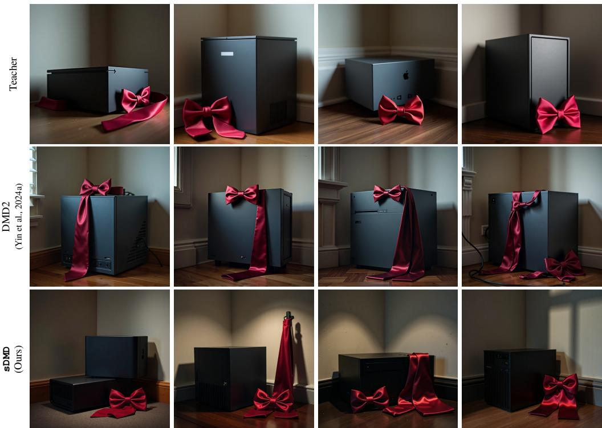  
“In the corner of a dimly lit room, a rectangular, charcoal-gray computer box exhibits its sharp edges as it rests beside an elegantly draped, cherry-red silk bow tie. The contrast between the electronic’s mattefinish and the tie’s glossy sheen is striking. The computer appears dormant, while the bow tie seems almost ready to be picked up and worn to an event. Behind these objects, the ambient lighting casts soft shadows against the plain, light-colored wall.”

  
“A hefty, red-painted chainsaw rests prominently on the surface of a sturdy, solid oak table. The metal components of the chainsaw catch the soft glow of the early morning sunlight, causing a shimmering effect. The wood’s rich, deep grain stands in contrast to the boldness ofthe chainsaw, and there are wood shavings scattered nearby, hinting at recent activity.”

Figure 6: Additional Qualitative Comparison on FLUX.1 (Continued). sDMD more closely matches the diversity of the teacher than DMD2 while preserving visual quality.  
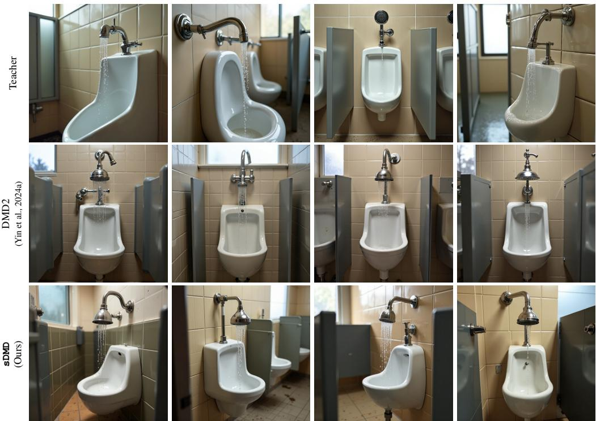  
“A gleaming stainless steel showerhead mounted on a beige tiled wall, with beads ofwater steadily drippingfrom its nozzle onto the glossy white porcelain urinal below. The urinal is flanked by grey dividers, ensuring privacy, and the floor beneath is speckled with small, wet splashes reflecting the dim early morning lightfiltering through afrosted window just out ofview. The metallicfixtures ofthe showerhead are complemented by the chrome handles and plumbing visible under the urinal, creating a cohesive andfunctional restroom vignette.”

  
“Inside a warm room with a large window showcasing a picturesque winter landscape, three gleaming ruby red necklaces are elegantly laid out on the plush surface ofa deep purple velvetjewelry box. The gentle glowfrom the overhead light accentuates the rich color and intricate design ofthe necklaces. Just beyond the glass pane, snowflakes can be seen gentlyfalling to coat the ground outside in a blanket ofwhite.”

Figure 7: Additional Qualitative Comparison on FLUX.1 (Continued). sDMD more closely matches the diversity of the teacher than DMD2 while preserving visual quality.  
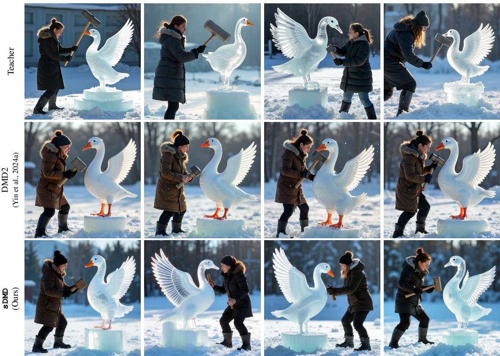  
“afocused woman wielding a heavy sledgehammer, poised to strike an intricately carved ice sculpture ofa goose. The sculpture glistens in the light, showcasing its detailed wings andfeathers, standing on a pedestal ofsnow. Around her, shards ofice are scattered across the ground, evidence ofher previous strikes.”

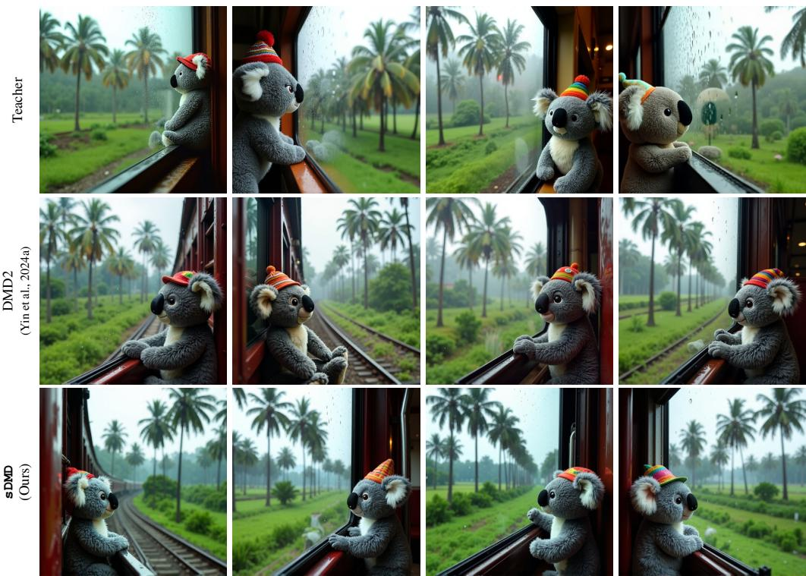  
“A scenic train journey unfolds during the monsoon season in Kerala, with raindrops rhythmically tapping against the windowpane. Inside one of the train’s carriages, a plush koala bear toy, donning a small, colorful hat, is propped up against the glass, peering out at the lush landscape. Outside, numerous tall coconut trees sway gently in the rain, their greenfronds glistening with moisture, creating a verdant backdrop as the train meanders through the countryside.”

Figure 8: Additional Qualitative Comparison on FLUX.1 (Continued). sDMD more closely matches the diversity of the teacher than DMD2 while preserving visual quality.  
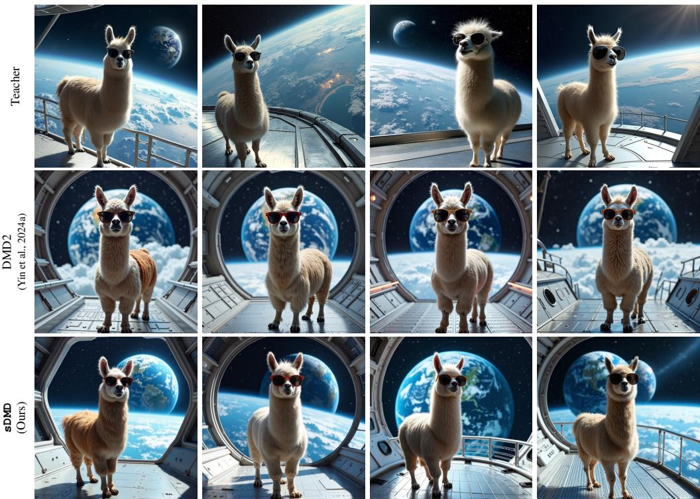  
“A whimsical scene where a llama, adorned with a pair of oversized, round sunglasses, stands confidently on the metallic deck of a spacecraft. The deck beneath the llama’s hooves gleams with a polished silverfinish, reflecting the starry cosmos that surrounds the vessel. In the vast backdrop, the Earth looms large, a swirl ofblue oceans and white clouds, providing a stunning contrast to the spaceship’s sleek,futuristic design.”

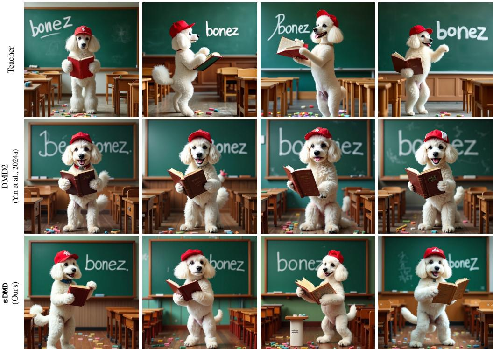  
“A fluffy white poodle, adorned with a red baseball cap, stands on its hind legs in front of a green chalkboard. In one paw, it holds a large, open dictionary, while the other paw is used to scrawl the word “bonez” in white chalk. The floor beneath the poodle is scattered with colorful pieces ofchalk, and the room is filled with small wooden desks and chairs, suggesting a classroom setting.”

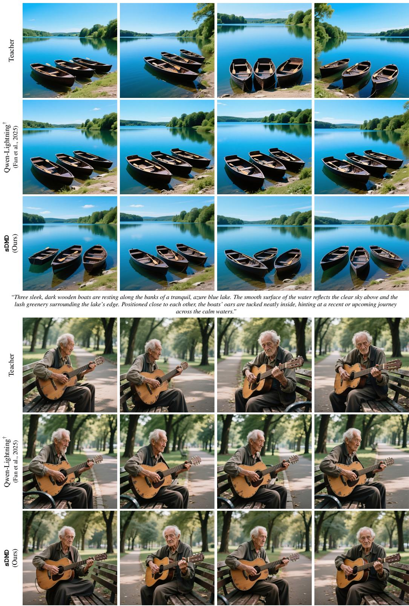  
Figure 9: Additional Qualitative Comparison on Qwen-Image 20B. sDMD more closely matches the diversity of the teacher than DMD-based Qwen-Lightning while preserving visual quality. † denotes an officially released checkpoint.  
“An elderly gentleman with a weatheredface sits on a park bench, cradling a well-worn wooden guitar in his arms. Hisfingers are poised over the strings, ready to play a tune. The bench is situated along a path lined with trees that provide a canopy ofshade overhead.”

Figure 10: Additional Qualitative Comparison on Qwen-Image 20B (Continued). sDMD more closely matches the diversity of the teacher than DMD-based Qwen-Lightning while preserving visual quality. † denotes an officially released checkpoint.  
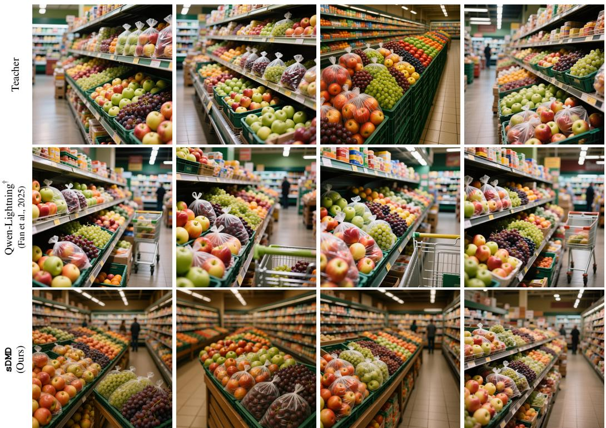  
“Rows offresh produce line the interior ofa bustling grocery store. Bags filled with crisp apples and plump grapes are neatly arranged on the shelves, inviting shoppers to add them to their carts. Thefruits’ vibrant colors stand out against the backdrop ofother grocery items in the background.”

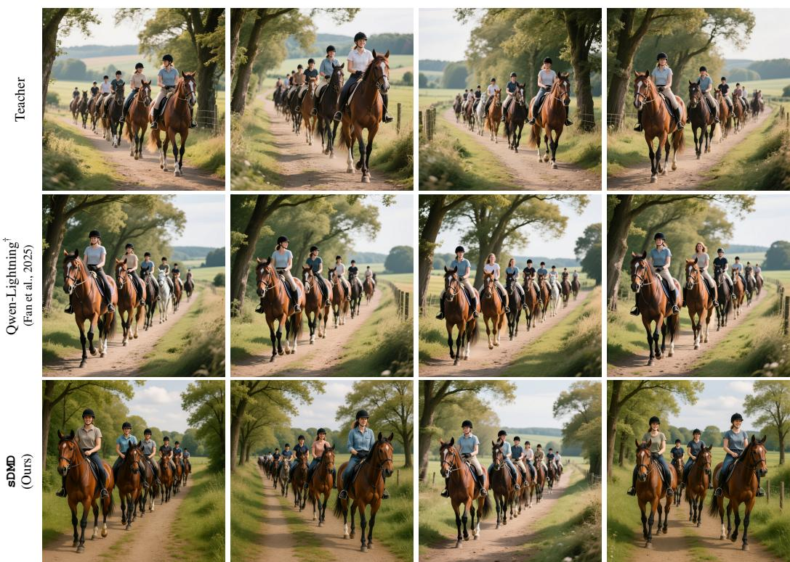  
“A scenic trail where a group ofriders are mounted on their horses, moving in a line. The horses appear well-groomed, and the riders are dressed in casual riding attire. The path they are on is bordered by trees, and the group seems to be enjoying a leisurely ride in the countryside.”

Figure 11: Additional Qualitative Comparison on Qwen-Image 20B (Continued). sDMD more closely matches the diversity of the teacher than DMD-based Qwen-Lightning while preserving visual quality. † denotes an officially released checkpoint.  
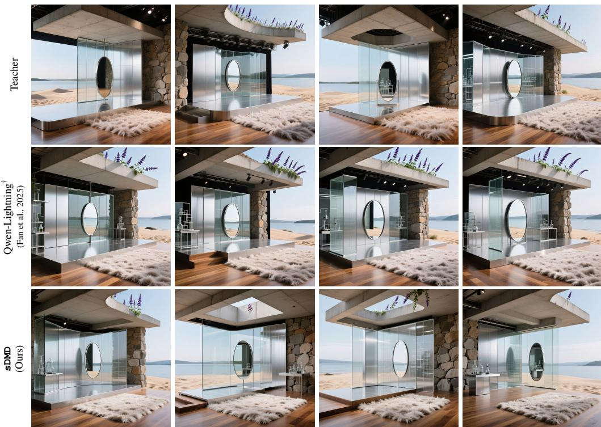

“A stage designed with a fusion of natural and industrial elements, featuring sleek silver glass panels reminiscent of a high-tech laboratory, situated alongside a soft, feathered carpet. The flooring transitions into an area of polished wood leading to a sturdy stone wall, adding an earthy touch to the synthetic ambiance. Overhead, raw concrete merges into theform ofa salvia patens roof, juxtaposed with a tranquil sand-laden backdrop that suggests the gentle shores ofa lake. In the center, an oval mirror with a slim steelframe reflects the composed space, including the transparent screen that adds a layer ofmodernity to this eclectic setting.”  
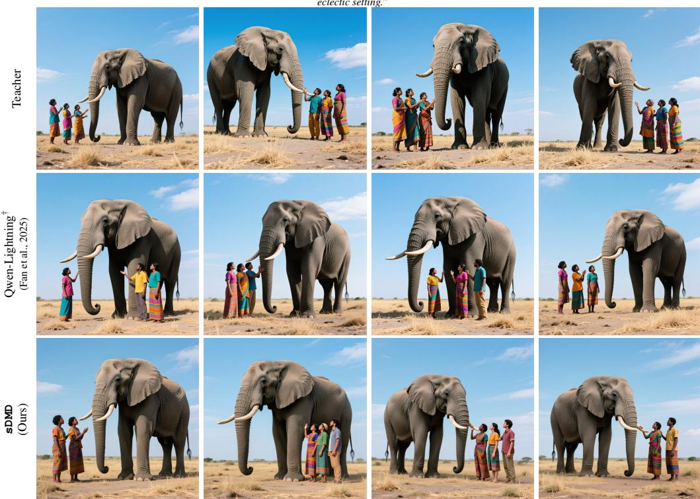  
“A group of three individuals positioned beside a towering elephant in an open area. The elephant’s gray skin contrasts with the colorful clothing of the people They appear to be engaged in a moment ofinteraction, with the vast sky above them and the ground beneath scattered with dry grass.”

Figure 12: Additional Qualitative Comparison on Wan 14B. Each method row shows two video samples for the prompt below. † denotes an officially released checkpoint.

DMD2 AnyFlow† sDMD (Ours)

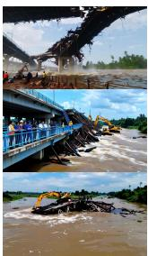

  
“The video captures a scene ofemergency responsefollowing the collapse ofthe Ji Rao Bridge in Thailand. A group ofindividuals, including officials and workers, is gathered on the bridge’s railing, observing the damage. They appear concerned and engaged in discussion, possibly assessing the situation or coordinating rescue efforts. In the background, heavy machinery, likely excavators, is actively working to clear debris and assess the extent ofthe damage. The water belowflows rapidly, indicating the severity oftheflood conditions. The sky is partly cloudy, suggesting variable weather conditions during the incident. This collaborative effort highlights the urgency and scale of the disaster, with multiple parties working together to address the crisis.”  
DMD2 AnyFlow† sDMD (Ours)

  
“In this video clip, a Korean manicurist is meticulously working on a client’s nails. The manicurist’s hands, adorned with dark nail polish, are carefully applying a vibrant purple nail polish to the client’sfingernails. The client’s hands, resting on a pink cushion, are positioned to allow easy accessfor the manicurist. A bottle ofnail polish remover is visible in the background, suggesting a professional setting. The interaction between the manicurist and the client is gentle and precise, highlighting the skill and care involved in the process. The scene captures the intimate andfocused nature ofa nail treatment session, emphasizing the attention to detail and the personal touch provided by the manicurist.”  
DMD2 AnyFlow† sDMD Ours)

  
“The video captures a close-up of a textured white canvas with blue paint being applied using a palette knife. The knife moves methodically across the canvas, spreading the paint in broad, sweeping strokes. The paint appears thick and creamy, creating a raised, almost sculptural effect on the surface The canvas rests on a dark wooden table, which contrasts sharply with the bright white background ofthe canvas. The deliberate motion ofthe knife suggests an artist at work, carefully crafting the texture andform ofthe painting. The overall scene emphasizes the tactile nature ofthe painting process, highlighting the interplay between the tool, the paint, and the canvas.”

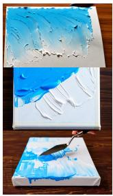

Figure 13: Additional Qualitative Comparison on Wan 14B (Continued). Each method row shows two video samples for the prompt below. † denotes an officially released checkpoint.

DMD2 AnyFlow† sDMD Ours)

  
“In the video, a person is seen stirring a pot on a stovetop with a spoon. The pot contains a mixture of what appears to be rice and possibly meat, creating a basefor a dish. The individual then adds a generous portion ofshredded carrotsfrom a separate bowl into the pot. The carrots are bright orange and appearfreshly grated, contrasting with the white rice and brownish hue ofthe meat. The person uses a large spoon to mix the ingredients thoroughly, ensuring the carrots are evenly distributed throughout the pot. This action suggests the preparation ofa hearty,flavorful meal, combining different textures and colors to create a visually appealing and nutritious dish.”  
DMD2 AnyFlow† sDMD Ours

  
“In this dynamic scene from a video game, a player-controlled ship is engaged in a naval battle against two formidable vessels: the Royal Sovereign and HMS Fearless. The player’s ship, positioned on the left, maneuvers skillfully amidst turbulent waves, while the enemy ships, larger and more imposing dominate the right side oftheframe. The player’s ship is equipped with various controls visible on-screen, including optionsfor "fire swivels," "brace (hold)," "stop," and "speed up." A circular mini-map at the bottom left corner indicates the player’s position and nearby objectives. The text overlay provides instructions on targeting weak points, guiding the player through the combat strategy. The overall atmosphere is intense, with the ships battling under a stormy sky, highlighting the strategic and action-packed nature of the gameplay.”  
DMD2 AnyFlow† sDMD Ours)

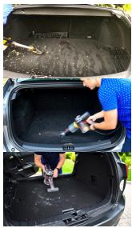

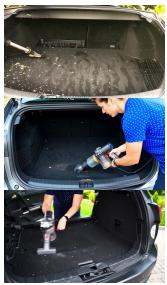

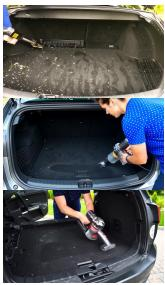

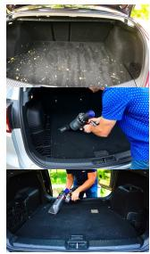

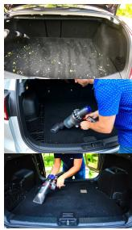

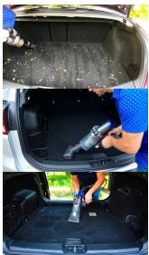  
“In the video, a person wearing a blue shirt with white polka dots is seen cleaning the trunk ofa vehicle. They are using a handheld vacuum cleaner to remove debrisfrom the black carpetedfloor, whichfeatures a textured pattern. The individual bends down, maneuvering the vacuum to ensure thorough cleaning. The trunk’s interior includes a black plastic tray with a grid-like design, likelyfor organizing items. The person’s movements are deliberate andfocused, indicating a meticulous approach to maintaining the cleanliness ofthe vehicle’s storage area. The vacuum cleaner is small and portable, suitablefor reaching into tight spaces within the trunk. The overall scene suggests a routine maintenance task aimed at keeping the vehicle tidy and functional.”