# SONOWORLD4D: FROM ONE VIDEO TO A 4D AUDIO-VISUAL SCENE VIA DIFFUSION SYNCHRONIZATION

Derong Jin∗ Xiyi Chen∗ Ming C. Lin Ruohan Gao University of Maryland, College Park

https://humathe.github.io/sonoworld4d

## ABSTRACT

Recent progress in visual scene generation has extended beyond static 3D scenes toward the more challenging problem of generating dynamic 4D scenes from minimal input. However, sound, despite being intrinsically coupled with dynamic objects and events, remains largely unmodeled in prior work. We introduce VIDEO-TO-4DAVSCENE, a new task that turns a video into an explorable, timevarying 4D audio-visual scene, and present the SONOWORLD4D framework for this task. Given a monocular video, our method generates a $3 6 0 ^ { \circ }$ static background, reconstructs explicit motion trajectories of dynamic, sound-emitting foreground objects, and synthesizes a dynamic sound field consistent across multiple sources through dual-space diffusion synchronization. The resulting 4D scene supports real-time novel-view visual and spatial audio rendering. Experiments on real-world dynamic scenes and a user study demonstrate that SONOWORLD4D generates 4D audio-visual scenes with perceptually realistic, physically grounded spatial audio consistent with scene geometry and visual content.

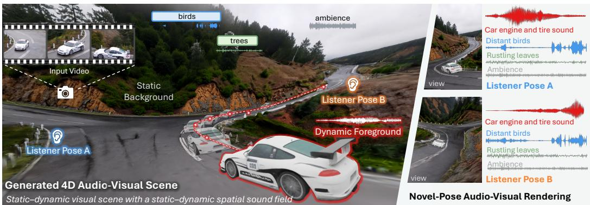  
Figure 1: From a single monocular video, SONOWORLD4D generates an explorable 4D audiovisual scene, where you can navigate to novel viewpoints and follow arbitrary listener trajectories while hearing spatial audio synchronized with dynamic events and grounded in moving sound sources (e.g., a racing car), static sources (e.g., birds and rustling trees), and background ambience.

## 1 INTRODUCTION

Advances in 3D scene reconstruction and generation (Mildenhall et al., 2020; Kerbl et al., 2023; Yu et al., 2025a; 2024), and more recently in dynamic 4D scene generation (Wu et al., 2024; Ren et al., 2025; Lei et al., 2024), make it possible to transform monocular videos into explorable, time-varying worlds with moving objects and temporally coherent geometry. Yet these worlds remain incomplete without sound, which is intrinsically coupled with dynamic objects and events: engine and wheel noise grow louder as a car approaches, sweeping past and fading into the distance; a dancer’s tap shoes strike the stage in sharp, rhythmic beats synchronized with each step; and ambient sounds such as wind and crowds continuously convey the structure and scale of the environment.

Despite its importance, limited prior work has modeled spatial audio in 3D visual scenes. Existing approaches either focus on static scenes without time-varying geometry or moving sound sources (Jin et al., 2026; Yoshida et al., 2026), or spatialize audio for dynamic videos under constrained camera and interaction settings (Xie et al., 2025). Generating fully explorable 4D audiovisual scenes therefore remains an open challenge, requiring joint modeling of dynamic geometry, moving sound sources, and spatial audio.

We introduce VIDEO-TO-4DAVSCENE, a new problem that aims to turn a monocular video into an explorable 4D audio-visual scene: an interactive, time-varying world-space scene with dynamic sound sources that supports synchronized rendering of both visual content and spatial audio from novel viewpoints and listener trajectories. The generated scene should contain a spatially grounded sound field: ambient sound should be tied to the static environment, dynamic sounds should follow moving visual objects, and the rendered audio should remain consistent as the virtual listener moves through the reconstructed 4D audio-visual world.

Solving this problem introduces several new challenges. First, unlike recent 4D visual generation methods that primarily optimize visual fidelity, 4D audio-visual scene generation requires explicit scene geometry, camera motion, dynamic object trajectories, and static-dynamic structure to place and render sound sources in a physically meaningful coordinate system. Second, dynamic scenes contain heterogeneous acoustic components: ambient sound should align with the background, lo calized static sources should remain fixed in world space, and dynamic sources should follow foreground objects while obeying distance attenuation, occlusion, and motion-dependent effects. Third, the system must maintain consistency across coordinate spaces: input audio is observed in camera space, object sounds are represented in object-centric canonical space, and the output must be rendered for arbitrary listener trajectories in world space. These spaces must be synchronized to keep sound temporally aligned with the input video and geometrically consistent with the evolving scene.

To address these challenges, we propose SONOWORLD4D, a world-space framework for 4D audiovisual scene generation. Given an input video, we reconstruct a decomposed 4D visual scene representation, comprising a 360◦ static background and dynamic foreground objects with world-space trajectories, providing geometry and motion for spatial audio rendering while supporting interactive visual exploration. Building on this representation, we introduce a diffusion-based synchronization mechanism that jointly synthesizes a global camera-space audio signal and per-object canonical audio signals to generate a dynamic spatial sound field. Specifically, it repeatedly projects objectspace sounds into camera space through acoustic rendering and maps the global mixture back to object space via inverse rendering, enforcing cross-space consistency throughout the diffusion process. This synchronization keeps the generated audio aligned with the input video while preserving persistent, re-renderable object sounds that follow dynamic sources under novel listener trajectories.

We evaluate SONOWORLD4D on real-world dynamic scenes with moving foreground sound sources exhibiting rigid-body, human, and general deformable motion. We also establish objective evaluation protocols for VIDEO-TO-4DAVSCENE to assess the spatial accuracy and semantic consistency of generated audio. Experiments show that our framework generates 4D audio-visual scenes with spatial audio that better aligns with scene geometry, object motion, and listener viewpoint than baseline methods. Ablation studies and a user study further confirm the effectiveness of diffusion synchronization in generating coherent spatial audio with multiple sound sources.

## 2 RELATED WORK

4D Visual Scene Generation. Recent 4D scene generation methods can be broadly grouped into video diffusion, dynamic Gaussian reconstruction, and dynamic foreground reconstruction. Video diffusion based methods (Ren et al., 2025; Xie et al., 2026; Yu et al., 2025b; Lin et al., 2026; Yang et al., 2026; Bai et al., 2025) synthesize photorealistic videos under controlled camera trajectories, but are trajectory-specific and often lack explicit geometry grounding. Dynamic Gaussian reconstruction methods (Lei et al., 2024; Wang et al., 2025; Shih et al., 2025) reconstruct geometry-grounded dynamic scenes from monocular videos and support real-time rendering, but are largely limited to visible regions and cannot reliably recover unseen object surfaces or a complete panoramic background. Dynamicforeground reconstruction methods further recover animatable 4D assets from monocular inputs, including category-agnostic deformable or articulated objects (Liao et al., 2025; Sabathier et al., 2026; Chen et al., 2026b; 2025a; Litman et al., 2026) and human specific avatars (Qiu et al., 2025; Hu et al., 2024; Moon et al., 2024). Our visual pipeline builds on these advances to construct a 4D visual scene representation, combining dynamic foreground objects with a static background to enable generation of a dynamic spatial sound field.

Spatial Audio Generation. Audio generation methods synthesize realistic monaural audio from text or video (Cheng et al., 2025; Shan et al., 2025; Tian et al., 2025; Chen et al., 2025b), but typically lack spatial cues. Complementary approaches spatialize existing audio: RIR-based rendering and acoustic-field methods model propagation effects (Chen et al., 2020; 2022; Luo et al., 2022; Wang et al., 2024; Jin & Gao, 2025; Lan et al., 2024; Liu et al., 2025b), while visually guided methods use scene geometry, object locations, or motion to predict binaural or spatial audio from mono input (Gao & Grauman, 2019; Garg et al., 2023; 2021; Morgado et al., 2018; Li et al., 2018; Liang et al., 2023). More recent methods generate ambisonics from videos (Kim et al., 2025; Liu et al., 2025a; Lan et al., 2026), spatialize generated audio for 4D scene exploration (Xie et al., 2025), or construct static 3D audio-visual scenes from single images (Jin et al., 2026; Yoshida et al., 2026; Chen et al., 2026a). In contrast, SONOWORLD4D generates explorable dynamic 4D audio-visual scenes with moving sound sources, synchronizing spatial audio with object motion while modeling listener-dependent acoustic effects.

Diffusion Synchronization. Diffusion synchronization couples multiple diffusion trajectories at inference time to satisfy shared constraints. Primarily explored for image generation, it enables coherent large images and region-controlled layouts (Bar-Tal et al., 2023), enforces consistency across overlapping generations (Lee et al., 2023), and models correlations between coupled trajectories (Lee et al., 2025). Recent work extends these ideas to synchronize image and audio diffusion on a shared canvas (Chen et al., 2024) and extend long-form audio separation beyond the training length (Shi et al., 2025). We also apply diffusion synchronization to audio, but target spatial audio rendering. Specifically, we synchronize camera-space and object-space audio trajectories through forward and inverse acoustic rendering, allowing generated source sounds to remain consistent with the camera-space mixture while being re-renderable under source motion and novel listener trajectories. To our knowledge, this is the first use of diffusion synchronization for spatial audio generation with an explicit rendering component.

## 3 THE VIDEO-TO-4DAVSCENE TASK

We define VIDEO-TO-4DAVSCENE as the problem of generating an explorable 4D audio-visual scene from a single monocular video. Given an input video $V \stackrel { } { = } \{ I _ { t } \} _ { t = 1 } ^ { T }$ , where $I _ { t }$ denotes the RGB frame at time t, the problem is to generate:

$$
V \mapsto \{ S , { \mathcal { A } } \} ,\tag{1}
$$

where S denotes a time-varying 4D visual scene with moving objects and A denotes a dynamic spatial sound field associated with the scene. The output should be explorable: for any target camera/listener trajectory, it should support synchronized novel-view visual rendering and listenerdependent spatial audio rendering.

Formally, given a target trajectory $p _ { t } = [ R _ { t } , \mathbf { x } _ { t } ] \in S E ( 3 )$ , where $R _ { t }$ and $\mathbf { x } _ { t }$ denote the listener orientation and position at time t, the generated scene should render an audio-visual sequence

$$
\left\{ { \cal S } ( p _ { t } ) , { \cal A } ( p _ { t } ) \right\} = \left\{ \hat { I } _ { t } ^ { p } , { \bf \Pi } _ { \hat { a } _ { t } } ^ { p } \right\} .\tag{2}
$$

Here, $\hat { I } _ { t } ^ { p }$ is the visual observation rendered from pose $p _ { t }$ , and $\hat { a } _ { t } ^ { p }$ is the synchronized spatial audio perceived by the listener at the same pose. The visual scene $s$ contains both the static environment and time-varying foreground content. The spatial sound field A should be geometrically and temporally grounded in S: ambient sound and static localized sound sources should remain fixed in static world space, and dynamic sound sources should move consistently with their corresponding foreground objects. Thus, the generated audio should not only match the semantic and temporal content of the input video, but also vary coherently with listener position, listener orientation, source motion, distance attenuation, and visibility.

The SONOSCENE4D Dataset. To support quantitative evaluation of this new task, we collect SONOSCENE4D, an evaluation dataset of 54 clips of dynamic scenarios with moving sound sources such as cars and humans. Specifically, each scene contains an 8-second $3 6 0 ^ { \circ }$ video captured at 30 FPS using an Insta360 X5 camera, paired with synchronized first-order ambisonic (FOA) audio recorded at 48 kHz using a RØDE NT-SF1 microphone placed at a novel listening pose. The FOA microphone is placed at a listening pose different from the camera pose, enabling evaluation of whether a method can render spatial audio at a novel listener location rather than merely reproducing camera-view audio. Further details about SONOSCENE4D are provided in Appendix (Sec. E).

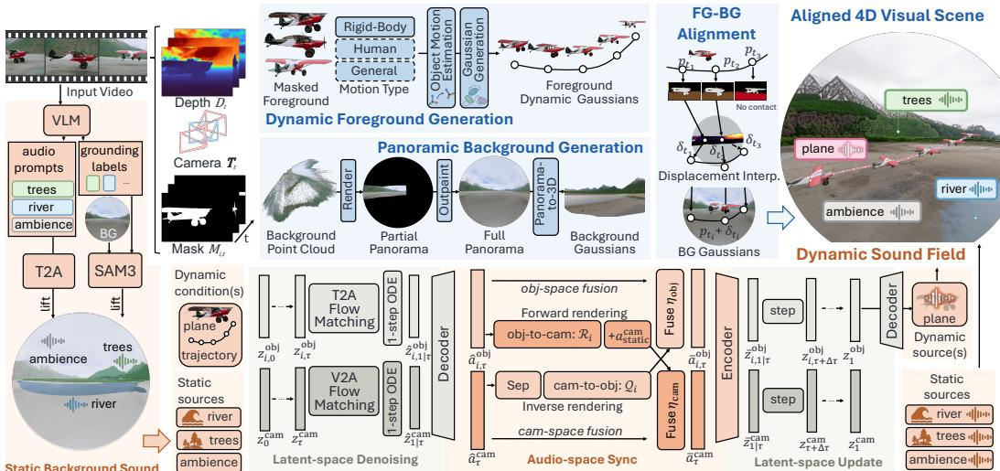  
Figure 2: Overview of SONOWORLD4D. Given a monocular video, we extract depth maps, camera poses, foreground masks, and VLM-derived audio prompts. For visual scene generation (Sec. 4.2), the framework reconstructs per-object dynamic Gaussians, lifts an outpainted 360◦ panorama into background Gaussians, and aligns them into a common world frame via scale correction and local displacement correction. For dynamic sound field generation (Sec. 4.3), static sources are synthesized via text-to-audio and anchored to the background. Dynamic sources are generated via dual-space diffusion synchronization: at each sampling step, forward rendering (Ri) maps object-space predictions to camera space, while source separation and inverse rendering (Q ) map camera-space mixtures back to individual object spaces. The resulting scene enables real-time novel-pose visual and spatial audio rendering (Sec. 4.4).

Evaluation Metrics. We evaluate spatial audio generation in terms of spatial accuracy and semantic consistency. For spatial accuracy, we report correlation coefficient (CC) and area under the curve (AUC) between generated and reference spatial energy maps (Kim et al., 2025), together with direction-of-arrival (DoA) errors, including absolute azimuth error $\Delta _ { \mathrm { a b s } } \theta _ { \mathrm { i } }$ , absolute elevation error $\Delta _ { \mathrm { a b s } } \phi ,$ , and angular error $\Delta _ { \mathrm { A n g u l a r } }$ (Liu et al., 2025a). For semantic consistency, we compute CLAP similarity between the rendered audio and manually annotated object descriptions. Spatial metrics are evaluated at 5 Hz and averaged over time, while CLAP is computed at the clip level.

## 4 APPROACH

## 4.1 OVERVIEW

Given a monocular video $V = \{ I _ { t } \} _ { t = 1 } ^ { T }$ , SONOWORLD4D generates an explorable 4D audio-visual scene {S, A}. We distinguish three coordinate systems: world space is the shared, fixed reference frame for the scene; camera space is the camera’s coordinate system at each frame; and object space is the local coordinate system attached to each foreground object. To support object-space audio modeling, we decompose dynamic foreground objects from the static background and explicitly model each object’s trajectory, allowing its sound to follow its motion even when multiple objects move independently. All static objects are treated as part of the background. We represent the visual scene as $\dot { \boldsymbol { S } } = ( \mathcal { G } _ { \mathrm { b g } } ^ { \mathrm { w o r l d } } , \{ \mathcal { G } _ { i } ^ { \mathrm { w o r l d } } \} _ { i = 1 } ^ { N ^ { \circ } } )$ , where $\mathcal { G } _ { \mathrm { b g } } ^ { \mathrm { w o r l d } }$ denotes the static background and $\mathcal { G } _ { i } ^ { \mathrm { w o r l d } }$ denotes the i-th dynamic foreground object, both represented by Gaussians that support real-time rendering. W

We represent the spatial sound field as:

$$
\mathcal { A } = \left( a ^ { \mathrm { a m b } } , \{ a _ { j } ^ { \mathrm { b g } } \} _ { j = 1 } ^ { M } , \{ a _ { i } ^ { \mathrm { o b j } } \} _ { i = 1 } ^ { N } \right) ,\tag{3}
$$

where $a ^ { \mathrm { a m b } }$ denotes diffuse ambient audio, $a _ { j } ^ { \mathrm { { b g } } }$ denotes audio from the j-th static background source, and $a _ { i } ^ { \mathrm { o b j } }$ denotes object-space audio from the i-th dynamic source. The reconstructed audiovisual scene provides the source locations, trajectories, and geometry required to render these signals from arbitrary listener poses.

Fig. 2 illustrates our framework. We first reconstruct a decomposed 4D visual scene in world space (Sec. 4.2): the static component provides geometry and context for ambient sound, while the dynamic component provides object-centric trajectories for moving sound sources. We then reconstruct a dynamic spatial sound field (Sec. 4.3) by jointly generating object-space and camera-space audio through diffusion synchronization, allowing source sounds to remain aligned with object motion and consistent with the rendered camera mixture. During free-viewpoint rendering (Sec. 4.4), a target listener trajectory is used to render novel-view visuals and spatialize the generated object sounds into synchronized audio coherently blended with the background sound.

## 4.2 4D VISUAL SCENE GENERATION VIA FOREGROUND-BACKGROUND DECOMPOSITION

We first preprocess the input video to estimate scene geometry, camera poses, and foreground masks. Conditioned on the observed background regions and visible foreground pixels, we then generate panoramic background Gaussians and dynamic foreground Gaussians, respectively. Foreground generation supports three motion types: rigid-body, human, and general deformable motion, using a shared formulation for object motion estimation and deformable Gaussian generation. Finally, we align the generated foreground objects and background in a common world frame. The resulting 4D scene provides the geometry and object trajectories used for spatial audio generation and rendering.

Video Preprocessing. Given an input video $\{ I _ { t } \} _ { t = } ^ { T }$ with T frames, we use a geometry foundation model (Wang et al., 2026) to estimate depth maps $\{ D _ { t } \} _ { t = 1 } ^ { T }$ and camera poses $\{ \mathbf { T } _ { t } \} _ { t = 1 } ^ { T }$ , and use a segmentation model (Carion et al., 2026) to obtain foreground masks $\{ M _ { i , t } \} _ { i = 1 , t = 1 } ^ { N }$ , where N is the number of foreground objects. We further use a vision-language model (VLM) (Team et al., 2026) to infer acoustic context from the video. It produces a video-level description $d _ { \mathrm { v i d } }$ capturing the overall acoustic scene, including ambient and background sounds, and an object-level description $d _ { i }$ for each sound-producing foreground object $i ,$ capturing its sound semantics and temporal activity. The former conditions camera-space audio generation, while the latter conditions the corresponding object-space source generation in Sec. 4.3.

Panoramic Background Generation. We generate the background from observed background regions in the input video. To consolidate these observations into a single panorama for completion, we select the frame with the largest visible background region as an anchor frame and take its coordinate system as the world frame. We then unproject background pixels from the depth maps across all frames and rasterize the aggregated points in the world frame to obtain a partial background panorama $I _ { \mathrm { p a n o } } ^ { \mathrm { p a r t i a l } }$ l. Next, we apply single-camera calibration (Veicht et al., 2024) to align the panorama with the gravity direction and use a panorama diffusion outpainting model (nomadoor, 2026; Labs, 2025a) to generate a complete $3 6 0 ^ { \circ }$ background panorama $\dot { I } _ { \mathrm { p a n o } } ^ { \mathrm { f u l l } }$ . Finally, a panoramato-3D model (Team HY-World, 2026; Labs, 2025b) lifts it into background Gaussians $\mathcal { G } _ { \mathrm { b g } } ^ { \mathrm { w o r l d } }$

Dynamic Foreground Generation. We generate a dynamic Gaussian representation for each foreground object conditioned on its visible pixels in the input video. Dynamic object modeling remains an active area of research (Sabathier et al., 2026; Liao et al., 2025; Chen et al., 2026b; Yenphraphai et al., 2026), with visual backbones offering different capabilities across motion types. We therefore adopt a unified formulation with motion-type-specific instantiations for three categories: rigid-body motion, which preserves object shape; human motion, which includes body articulation; and general deformable motion, which allows flexible shape changes without assuming a human body model. Across all three types, we model global motion through per-frame scale, rotation, and translation, while treating local deformation differently.

Generation comprises two shared components: i) Object Motion Estimation: For each foreground object i and frame $t ,$ we estimate a similarity transformation $\mathbf { H } _ { i , t } ^ { \mathrm { o b j \to c a m } } ~ = ~ ( \alpha _ { i , t } , \mathbf { R } _ { i , t } , \mathbf { p } _ { i , t } ) ~ \in$ Sim(3), where $\alpha _ { i , t } , { \bf R } _ { i , t } .$ , and $\mathbf { p } _ { i , t }$ denote scale, rotation, and translation, respectively. This transformation maps the object’s locally deformed geometry from object space into camera space at frame t. These parameters describe its scale, orientation, and position, while local shape changes are modeled by the second component, described next.

ii) Deformable Gaussian Generation: Conditioned on visible foreground pixels of object i, we generate its canonical Gaussians $\mathcal { G } _ { i } ^ { \mathrm { o b j } }$ and a time-dependent deformation field $\Phi _ { i , t }$ . This field maps $\mathcal { G } _ { i } ^ { \mathrm { { o b j } } }$ to their deformed configuration in object space at frame $t ,$ capturing local articulation or shape changes, and reduces to the identity for rigid objects. We apply $\Phi _ { i , t } ,$ followed by the object-tocamera transformation ${ \bf H } _ { i , t } ^ { \mathrm { o b j - c a m } }$ and the camera-to-world transformation $\mathbf { T } _ { t } ^ { \mathrm { c } \to \mathrm { w } }$ , to obtain dynamic foreground Gaussians $\mathcal { G } _ { i , t } ^ { \mathrm { w o r l d } }$ . The full formulation and motion-type-specific instantiations are provided in Appendix (Sec. A). The resulting foreground Gaussians and object trajectories are then aligned with the panoramic background.

Foreground-Background Alignment. Since the foreground and background are generated independently, their scales and local geometry may be inconsistent. We align the independently generated foreground and background through global scale alignment and local displacement correction. We first estimate a background scale s in closed form by matching the generated background to the video-derived point cloud over their common visible region. For each foreground object, we then estimate displacements $\delta _ { i , t }$ from correspondences between its local contact neighborhood and the scale-aligned background. For frames without reliable contact, we interpolate the displacements from supported frames, retaining the nearest displacement outside their temporal range. We apply these corrections to the object’s world-space positions, $\mathbf { p } _ { i , t } ^ { \mathrm { w o r l d } } + \delta _ { i , t }$ , and its Gaussians to obtain an aligned 4D visual scene. Details are provided in Appendix (Sec. B).

## 4.3 DYNAMIC SPATIAL SOUND FIELD GENERATION VIA DIFFUSION SYNCHRONIZATION

The reconstructed 4D visual scene provides the geometry and trajectories of sound sources, while the video provides their semantic and temporal context. Our goal is to generate persistent source signals that can be spatially re-rendered along arbitrary listener trajectories while remaining consistent with the acoustic events observed in the input video.

To this end, we represent audio in two complementary spaces. We denote by $a ^ { \mathrm { c a m } }$ a videoconditioned camera-space mixture, which captures the overall acoustic content observed by the input camera, and by $a _ { i } ^ { \mathrm { { o b j } } }$ the object-space signal of dynamic source $i \in \mathcal { T } _ { \mathrm { d y n } }$ , which can be independently re-rendered from novel listener poses. Generating these signals independently, however, does not guarantee that the object tracks explain the camera-space mixture. We therefore couple the two representations through the acoustic renderer induced by the reconstructed 4D scene.

Static Background Sound Generation. We generate background audio using the VLM-derived descriptions and grounding labels obtained during video preprocessing. For each static source, a text-to-audio model (Shan et al., 2025) synthesizes a source signal conditioned on its textual description. To spatially ground the signal, we use its grounding label to prompt SAM3 (Carion et al., 2026) for segmentation in the background panorama and associate the resulting region with the reconstructed background geometry, obtaining a point cloud as a fixed spatial anchor for the source. Global ambience is maintained as a separate, non-spatialized background track. Together, the rendered static-source signals and ambience provide the background contribution $a _ { \mathrm { s t a t i c } } ^ { \mathrm { c a m } }$ to the camera-space mixture used for diffusion synchronization (Eq. 4).

Bidirectional Camera-Object Consistency. For each dynamic source $i \in \mathcal { T } _ { \mathrm { d y n } }$ , the reconstructed scene defines an acoustic rendering operator $\mathcal { R } _ { i }$ that maps its object-space signal to its contribution along the observed camera trajectory. We focus on outdoor scenes with limited reverberation and model direct-path propagation with Doppler shifts, distance attenuation, and air absorption, omitting reflected paths. Rendering and summing the source tracks gives a camera-space prediction:

$$
\tilde { a } ^ { \mathrm { c a m } } = \sum _ { i \in \mathcal { T } _ { \mathrm { d y n } } } \mathcal { R } _ { i } \Big ( a _ { i } ^ { \mathrm { o b j } } \Big ) + a _ { \mathrm { s t a t i c } } ^ { \mathrm { c a m } } ,\tag{4}
$$

where $a _ { \mathrm { s t a t i c } } ^ { \mathrm { c a m } }$ denotes the rendered static-source and ambient contributions. We require this rendered mixture to remain consistent with the video-conditioned prediction $a ^ { \mathrm { c a m } }$

Conversely, the camera-space mixture provides a video-aligned cue for each dynamic source. We first isolate source i using a query-conditioned separator $\mathrm { S e p } _ { q _ { i } }$ and then approximately invert it acoustic propagation:

$$
\begin{array} { r } { \tilde { a } _ { i } ^ { \mathrm { { o b j } } } = \mathcal { Q } _ { i } \left( \mathrm { { S e p } } _ { q _ { i } } ( a ^ { \mathrm { { c a m } } } ) \right) , } \end{array}\tag{5}
$$

where $q _ { i }$ is the source-specific separation prompt and $\operatorname { S e p } ( { \mathord { \cdot } } )$ is instantiated with SAM-Audio (Shi et al., 2025). Here, $\mathcal { Q } _ { i }$ is the inverse renderer that maps the separated camera-space signal back to object space. Together, Eqs. 4 and 5 establish bidirectional camera–object consistency, applying the object-space constraint. Static and ambient tracks contribute to the forward camera-space mixture but do not receive camera-to-object synchronization feedback. We detail the complete inverse formulation and its derivation in the Appendix (Sec. D).

Dual-Space Diffusion Synchronization. We enforce the above constraints during sampling by synchronizing one camera-space diffusion trajectory with the object-space trajectories of all dynamic sources. We use the flow-matching formulation of HY-VideoFoley (Shan et al., 2025). At each flow step, we first predict clean audio for every branch, synchronize the predictions in audio space through Eq. 4 and Eq. 5, and then map the synchronized predictions back to the latent flow.

Clean prediction. Let $\tau \in [ 0 , 1 )$ denote flow time, and let $z _ { \tau } ^ { k }$ and $v _ { \tau } ^ { k }$ denote the latent state and predicted velocity of branch k, where $k \in \{ \mathrm { c a m } \} \cup \mathcal { T } _ { \mathrm { d y n } }$ . We extrapolate each branch to its predicted clean endpoint and decode it with the audio decoder Dec:

$$
\hat { z } _ { 1 | \tau } ^ { k } = z _ { \tau } ^ { k } + ( 1 - \tau ) v _ { \tau } ^ { k } , \qquad \hat { a } _ { \tau } ^ { k } = \mathrm { D e c } \Big ( \hat { z } _ { 1 | \tau } ^ { k } \Big ) .\tag{6}
$$

Audio-space synchronization. We first render the object-space predictions into camera space:

$$
\tilde { a } _ { \tau } ^ { \mathrm { c a m } } = \sum _ { i \in \mathcal { T } _ { \mathrm { d y n } } } \mathcal { R } _ { i } \left( \hat { a } _ { i , \tau } ^ { \mathrm { o b j } } \right) + a _ { \mathrm { s t a t i c } } ^ { \mathrm { c a m } } .\tag{7}
$$

We synchronize the camera-space prediction using

$$
\bar { a } _ { \tau } ^ { \mathrm { c a m } } = ( 1 - \eta _ { \mathrm { c a m } } ) \hat { a } _ { \tau } ^ { \mathrm { c a m } } + \eta _ { \mathrm { c a m } } \tilde { a } _ { \tau } ^ { \mathrm { c a m } } , \qquad \eta _ { \mathrm { c a m } } \in [ 0 , 1 ] .\tag{8}
$$

Conversely, the camera-space prediction provides an object-space hint $\tilde { a } _ { i , \tau } ^ { \mathrm { { o b j } } } = \mathcal { Q } _ { i } \left( \mathrm { { S e p } } _ { q _ { i } } \left( \hat { a } _ { \tau } ^ { \mathrm { { c a m } } } \right) \right)$ The synchronized object-space target is then

$$
\bar { a } _ { i , \tau } ^ { \mathrm { o b j } } = ( 1 - \eta _ { \mathrm { o b j } } ) \hat { a } _ { i , \tau } ^ { \mathrm { o b j } } + \eta _ { \mathrm { o b j } } \tilde { a } _ { i , \tau } ^ { \mathrm { o b j } } , \qquad \eta _ { \mathrm { o b j } } \in [ 0 , 1 ] .\tag{9}
$$

Synchronized flow update. We encode each synchronized audio target into a clean latent endpoint $\dot { z } _ { 1 | \tau } ^ { k } = \mathrm { E n c } \big ( \bar { a } _ { \tau } ^ { k } \big )$ , and replace the branch velocity by the direction toward this synchronized endpoint:

$$
v _ { \mathrm { s y n c } , \tau } ^ { k } = \frac { \bar { z } _ { 1 | \tau } ^ { k } - z _ { \tau } ^ { k } } { 1 - \tau } , \qquad \frac { \mathrm { d } z _ { \tau } ^ { k } } { \mathrm { d } \tau } = v _ { \mathrm { s y n c } , \tau } ^ { k } .\tag{10}
$$

Repeating this procedure throughout sampling couples the video-conditioned camera trajectory with the object-conditioned source trajectories, producing source signals that remain both videoconsistent and independently re-renderable.

## 4.4 FREE-VIEWPOINT RENDERING OF DYNAMIC SCENES

Given a target camera/listener trajectory $p _ { t } ~ = ~ [ R _ { t } , \mathbf { x } _ { t } ] \in S E ( 3 )$ , we render the visual and audio streams in the same world coordinate system. For visuals, we render the static background and dynamic foreground objects at time t using the reconstructed Gaussian splats, compositing the foreground objects according to their estimated trajectories ${ \bf X } _ { i } ( t )$ . For audio, we first render each localized source signal into the listener coordinate frame using the acoustic renderer, which accounts for source position, motion, attenuation, and visibility. The resulting directional source contributions are then encoded into ambisonics:

$$
a _ { L } ( t ) = \sum _ { i \in { \cal Z } _ { \mathrm { d y n } } \cup { \cal Z } _ { \mathrm { s t a i c } } } \sigma _ { i } ( t ) a _ { i } ( t _ { i } ^ { \mathrm { e m } } ) y _ { L } \left( R _ { t } ^ { \top } \frac { { \bf s } _ { i } ( t ) - { \bf x } _ { t } } { \| { \bf s } _ { i } ( t ) - { \bf x } _ { t } \| } \right) ,\tag{11}
$$

where $\mathcal { T } _ { \mathrm { d y n } }$ and $\mathcal { T } _ { \mathrm { s t a t i c } }$ index dynamic foreground sources and localized static background sources, respectively, and $a _ { i }$ denotes the corresponding source signal. The world-space source position ${ \bf s } _ { i } ( t )$ follows the reconstructed trajectory for dynamic sources and remains fixed for static sources. Here, $t _ { i } ^ { \mathrm { e m } }$ is the emission time, $\sigma _ { i } ( t )$ models distance attenuation and occlusion, and $\mathbf { y } _ { L }$ denotes spherical harmonics up to order L. Finally, the ambisonics signal is decoded to binaural audio with an HRTF decoder:

$$
b ( t ) = \sum _ { \ell = 0 } ^ { L } \sum _ { m = - \ell } ^ { \ell } h _ { \ell , m } \star a _ { \ell , m } ( t ) ,\tag{12}
$$

where $h _ { \ell , m }$ are the left/right HRIR filters for each ambisonics channel. Global ambience is then mixed with $b ( t )$ to produce the final binaural output. This produces synchronized novel-view video and listener-dependent spatial audio along the target trajectory.

<table><tr><td></td><td colspan="5">Spatial Metrics</td><td colspan="2">Semantic Metrics</td></tr><tr><td>Method</td><td> $\Delta _ { \mathrm { a b s } } \theta \downarrow$ </td><td> $\Delta _ { \mathrm { a b s } } \varphi \downarrow$ </td><td> $\Delta _ { \mathrm { A n g u l a r } }$ </td><td>CC↑</td><td>AUC↑</td><td> $\mathrm { C L A P _ { A } \uparrow }$ </td><td> $\mathrm { C L A P _ { T } } \uparrow$ </td></tr><tr><td>VISAGE</td><td>74.1</td><td>24.5</td><td>75.9</td><td>0.189</td><td>0.615</td><td>0.078</td><td>-0.059</td></tr><tr><td>OMNIAUDIO</td><td>80.9</td><td>30.0</td><td>83.1</td><td>0.124</td><td>0.579</td><td>0.234</td><td>0.057</td></tr><tr><td>SONOWORLD</td><td>65.7</td><td>24.3</td><td>66.6</td><td>0.333</td><td>0.672</td><td>0.365</td><td>0.154</td></tr><tr><td>SONIC4D</td><td>54.3</td><td>17.2</td><td>55.5</td><td>0.446</td><td>0.728</td><td>0.223</td><td>0.103</td></tr><tr><td>Ours (T2A)</td><td>45.7</td><td>16.8</td><td>48.4</td><td>0.566</td><td>0.787</td><td>0.349</td><td>0.185</td></tr><tr><td>Ours (V2A)</td><td>43.2</td><td>16.9</td><td>46.1</td><td>0.591</td><td>0.800</td><td>0.527</td><td>0.261</td></tr><tr><td>Ours</td><td>36.6</td><td>16.9</td><td>40.7</td><td>0.647</td><td>0.835</td><td>0.560</td><td>0.274</td></tr></table>

Table 1: Quantitative comparison on SONOSCENE4D for video-to-4D audio-visual scene generation. We compare our full method against baselines and two ablated variants: Ours (T2A) and Ours (V2A), which use text-to-audio and video-to-audio generation for dynamic-source signals, respectively. Angular errors are in degrees. ↓/↑ indicate whether lower/higher is better.  
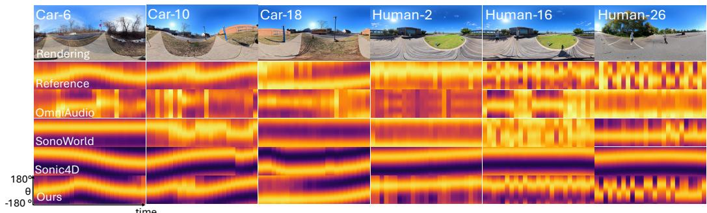  
Figure 3: Time-azimuth RMS visualization of ambisonics. Top: mid-frame panoramas of each video rendered by our method at microphone poses in SONOSCENE4D with faces blurred to protect privacy. Remaining rows compare the reference FOA recordings with baselines and ours. Each map shows the peak-normalized directional RMS response over time and azimuth after spherical-areaweighted aggregation over elevation. Our method more closely follows the reference azimuthal trajectories and temporal structure, while the baselines exhibit directional mismatches or reduced spatiotemporal variation.

## 5 EXPERIMENTS

## 5.1 EXPERIMENT SETTINGS

We evaluate on our newly collected dataset, SONOSCENE4D, with metrics introduced in Sec. 3, by rendering spatial audio at the microphone pose and comparing it with the ground-truth FOA recording. We compare against four prior methods that generate spatial audio from visual inputs:

• VISAGE (Kim et al., 2025): generates ambisonics at the input camera pose from a field-of-view (FoV) video, without supporting novel-view audio rendering. To evaluate it at the target microphone pose, we provide a FoV video rendered from our 4D visual scene at that pose.

• OMNIAUDIO (Liu et al., 2025a): generates ambisonics at the input camera pose from a panoramic video, likewise without supporting novel-view audio rendering. We therefore provide a panoramic video rendered from our 4D visual scene at the target microphone pose.

• SONOWORLD (Jin et al., 2026): generates a static 3D audio-visual scene from a single image. Since it does not model scene dynamics, we use the middle frame of the input video and otherwise follow its original setting for evaluation.

• SONIC4D (Xie et al., 2025): is the closest prior method for spatializing video-conditioned monaural audio in 4D scenes. It supports novel-view rendering but assumes a single sound source. We retain its visual backbone and audio pipeline, track the dominant moving sound source, and render at the target microphone pose. For comparison with ground-truth FOA, we adapt its binaural renderer using one omnidirectional and three co-located, orthogonal figure-eight virtual microphones.

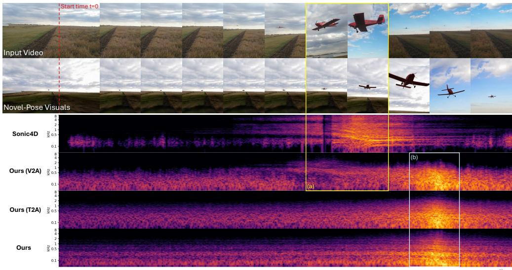  
Figure 4: STFT visualization of spatial audio rendered at a novel-listener position. The top two rows show input video frames and our novel-view renderings on a shared timeline. Highlighted intervals (a) and (b) indicate when the airplane is closest to the input camera and the novel listener, respectively. Correct spatialization should concentrate energy near (b) with a downward frequency shift due to the Doppler effect. Sonic4D retains strong energy near (a). Ours (V2A) responds near both (a) and (b). Ours (T2A) responds near (b) but lacks clear spectral structure. Our full method produces a dominant response with a visible Doppler shift around (b), correctly adapting both amplitude and frequency to the novel-listener position.

We also compare with two variants of our method: Ours (T2A), which uses text-to-audio generation for each dynamic-source track, and Ours (V2A), which instead uses video-to-audio generation conditioned on the input video.

## 5.2 QUANTITATIVE RESULTS

Quantitative Evaluation on SONOSCENE4D. Tab. 1 shows results on VIDEO-TO-4DAVSCENE using the metrics defined in Sec. 3. Compared with prior video-to-audio generation baselines, including VISAGE (Kim et al., 2025) and OMNIAUDIO (Liu et al., 2025a), SONOWORLD4D achieves substantially better performance. Compared with SONOWORLD and SONIC4D (Xie et al., 2025), we also show large gains, confirming the effectiveness of our explicit object-space audio generation and dual-space synchronization mechanisms, which improve spatial audio consistency over a trajectory-based dynamic spatialization baseline.

User Study. We conduct a user study with 50 participants comparing our method against baselines and ablated variants across nine dynamic scenes from our dataset and web videos, covering multi-source scenarios and rigid-body, human, and general deformable motion. Participants use headphones to assess audio-visual synchronization, spatial direction and distance cues, audio quality, and consistency with a shared sound source description. Comparisons with SONIC4D also assess overall visual quality. As shown in Fig. 5, participants prefer our audio over OMNIAUDIO and SONIC4D in 94.0% and 66.4% of comparisons, respectively, and our vi-

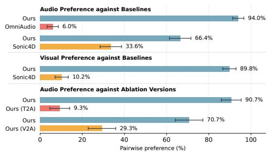  
Figure 5: Pairwise user preferences. Bars show mean per-participant preference rates, and error bars indicate 95% confidence intervals.

suals over SONIC4D in 89.8%. Our full method is also preferred over the T2A and V2A variants in 90.7% and 70.7% of audio comparisons, respectively. See appendix (Sec. F) for details.

## 5.3 QUALITATIVE RESULTS

Time-Azimuth RMS Visualization. Fig. 3 visualizes time–azimuth RMS maps of generated ambisonics for scenes in SONOSCENE4D, alongside reference FOA recordings at the target microphone poses. Brighter regions indicate stronger directional responses. Our maps more closely follow the reference patterns across both vehicle and human scenes. In vehicle scenes, the bright bands track the changing sound direction as vehicles move through the scene; in human scenes, the maps retain intermittent responses aligned with repeated acoustic events. The baselines exhibit misplaced directional responses, overly persistent bands, or reduced temporal variation, confirming that our method better captures both the evolving sound directions and the temporal structure.

Novel-Listener Audio Adaptation. Fig. 4 further visualizes audio generated for a novel listener position in the airplane scene, alongside the input video and our novel-view visual renderings. Intervals (a) and (b) indicate when the airplane is closest to the input camera and the novel listener, respectively. At the novel listener position, the strongest response should occur near (b), with frequencies shifting downward as the airplane passes. SONIC4D retains a strong response near (a). Ours (V2A) responds near both intervals, as its generated audio already encodes Doppler shifts and loudness variations tied to the input camera position, which persist when re-rendered for the novel listener. Ours (T2A) responds near (b) but with less distinct spectral structure. Our full method produces a dominant response and a clear downward frequency shift around (b), consistent with the expected Doppler effect. These results confirm that the synchronization scheme effectively adapts both the amplitude envelope and motion-dependent frequency content to the novel listener position.

## 6 CONCLUSION

We presented VIDEO-TO-4DAVSCENE, a new task that transforms a monocular video into an explorable, time-varying 4D audio-visual scene, and SONOWORLD4D, a training-free framework for this task. Our framework combines a 4D visual scene representation that decomposes scenes into static backgrounds and dynamic foreground objects in a unified world coordinate system, with a novel diffusion synchronization mechanism tailored for dynamic spatial sound field generation. This enables real-time interactive exploration with moving sound sources and temporally, semantically, and geometrically aligned visual and spatial audio rendering. Experiments on real-world dynamic scenes demonstrate that SONOWORLD4D outperforms a series of baselines on both objective metrics and in a user study. Future work will explicitly model object materials to support more physically accurate rendering of interaction-driven sounds in dynamic scenes.

## ACKNOWLEDGMENTS

This work was supported in part by faculty research awards from Sony and Dolby Laboratories and by the Barry Mersky and Capital One Endowed Professorships.

## AI USE STATEMENT

We used AI tools to refine author-written text and assist with code development for this work. The authors reviewed and revised the AI-assisted text and code and take full responsibility for the final manuscript and implementation.

## REFERENCES

Jianhong Bai, Menghan Xia, Xiao Fu, Xintao Wang, Lianrui Mu, Jinwen Cao, Zuozhu Liu, Haoji Hu, Xiang Bai, Pengfei Wan, et al. Recammaster: Camera-controlled generative rendering from a single video. arXiv preprint arXiv:2503.11647, 2025.

Omer Bar-Tal, Lior Yariv, Yaron Lipman, and Tali Dekel. Multidiffusion: Fusing diffusion paths for controlled image generation. arXiv preprint arXiv:2302.08113, 2023.

Nicolas Carion, Laura Gustafson, Yuan-Ting Hu, Shoubhik Debnath, Ronghang Hu, Didac Suris, Chaitanya Ryali, Kalyan Vasudev Alwala, Haitham Khedr, Andrew Huang, Jie Lei, Tengyu Ma, Baishan Guo, Arpit Kalla, Markus Marks, Joseph Greer, Meng Wang, Peize Sun, Roman

Radle, Triantafyllos Afouras, Effrosyni Mavroudi, Katherine Xu, Tsung-Han Wu, Yu Zhou, Lil-¨ iane Momeni, Rishi Hazra, Shuangrui Ding, Sagar Vaze, Francois Porcher, Feng Li, Siyuan Li, Aishwarya Kamath, Ho Kei Cheng, Piotr Dollar, Nikhila Ravi, Kate Saenko, Pengchuan´ Zhang, and Christoph Feichtenhofer. Sam 3: Segment anything with concepts, 2026. URL https://arxiv.org/abs/2511.16719.

Changan Chen, Unnat Jain, Carl Schissler, Sebastia Vicenc Amengual Gari, Ziad Al-Halah, Vamsi Krishna Ithapu, Philip Robinson, and Kristen Grauman. Soundspaces: Audio-visual navigaton in 3d environments. In ECCV, 2020.

Changan Chen, Carl Schissler, Sanchit Garg, Philip Kobernik, Alexander Clegg, Paul Calamia, Dhruv Batra, Philip W Robinson, and Kristen Grauman. Soundspaces 2.0: A simulation platform for visual-acoustic learning. In NeurIPS, 2022.

Duowen Chen, Jinjin He, Gouthaman KV, Sandeep Bangalore Venkatesh, and Bo Zhu. Audible world models: Spatially aware sound generation for 3d worlds. In Advances in Neural Information Processing Systems (NeurIPS), 2026a.

Hongyuan Chen, Xingyu Chen, Zexiang Xu, and Anpei Chen. Motion 3-to-4: 3d motion reconstruction for 4d synthesis. In Proceedings of the IEEE/CVF Conference on Computer Vision and Pattern Recognition (CVPR), pp. 28947–28958, June 2026b.

Jianqi Chen, Biao Zhang, Xiangjun Tang, and Peter Wonka. V2m4: 4d mesh animation reconstruction from a single monocular video. In ICCV, 2025a.

Ziyang Chen, Daniel Geng, and Andrew Owens. Images that sound: Composing images and sounds on a single canvas. NeurIPS, 2024.

Ziyang Chen, Prem Seetharaman, Bryan Russell, Oriol Nieto, David Bourgin, Andrew Owens, and Justin Salamon. Video-guided foley sound generation with multimodal controls. 2025b.

Ho Kei Cheng, Masato Ishii, Akio Hayakawa, Takashi Shibuya, Alexander Schwing, and Yuki Mitsufuji. MMAudio: Taming multimodal joint training for high-quality video-to-audio synthesis. In CVPR, 2025.

Ruohan Gao and Kristen Grauman. 2.5d visual sound. In CVPR, 2019.

Rishabh Garg, Ruohan Gao, and Kristen Grauman. Geometry-aware multi-task learning for binaural audio generation from video. In BMVC, 2021.

Rishabh Garg, Ruohan Gao, and Kristen Grauman. Visually-guided audio spatialization in video with geometry-aware multi-task learning. In IJCV, 2023.

Liangxiao Hu, Hongwen Zhang, Yuxiang Zhang, Boyao Zhou, Boning Liu, Shengping Zhang, and Liqiang Nie. Gaussianavatar: Towards realistic human avatar modeling from a single video via animatable 3d gaussians. In CVPR, 2024.

Derong Jin and Ruohan Gao. Differentiable room acoustic rendering with multi-view vision priors. In ICCV, 2025.

Derong Jin, Xiyi Chen, Ming Lin, and Ruohan Gao. Sonoworld: From one image to a 3d audiovisual scene. In CVPR, 2026.

Bernhard Kerbl, Georgios Kopanas, Thomas Leimkuhler, and George Drettakis. 3d gaussian splat-¨ ting for real-time radiance field rendering. TOG, 2023.

Jaeyeon Kim, Heeseung Yun, and Gunhee Kim. Visage: Video-to-spatial audio generation. In ICLR, 2025.

Black Forest Labs. FLUX.2: Frontier Visual Intelligence. https://bfl.ai/blog/flux-2, 2025a.

World Labs. Marble. https://marble.worldlabs.ai/, 2025b.

Zitong Lan, Chenhao Zheng, Zhiwei Zheng, and Mingmin Zhao. Acoustic volume rendering for neural impulse response fields. arXiv preprint arXiv:2411.06307, 2024.

Zitong Lan, Mutian Tong, Jiatao Gu, and Mingmin Zhao. Enabling immersive audio-visual experience from any video, 2026. URL https://arxiv.org/abs/2609.36295.

Hyunjun Lee, Hyunsoo Lee, and Sookwan Han. Syncsde: A probabilistic framework for diffusion synchronization. In CVPR, 2025.

Yuseung Lee, Kunho Kim, Hyunjin Kim, and Minhyuk Sung. Syncdiffusion: Coherent montage via synchronized joint diffusions. In NeurIPS, 2023.

Jiahui Lei, Yijia Weng, Adam Harley, Leonidas Guibas, and Kostas Daniilidis. Mosca: Dynamic gaussian fusion from casual videos via 4d motion scaffolds. arXiv preprint arXiv:2405.17421, 2024.

Baicheng Li, Dong Wu, Jun Li, Shunkai Zhou, Zecui Zeng, Lusong Li, and Hongbin Zha. Mv-sam3d: Adaptive multi-view fusion for layout-aware 3d generation. arXiv preprint arXiv:2603.11633, 2026.

Dingzeyu Li, Timothy R Langlois, and Changxi Zheng. Scene-aware audio for 360 videos. TOG, 2018.

Jiefeng Li, Jinkun Cao, Haotian Zhang, Davis Rempe, Jan Kautz, Umar Iqbal, and Ye Yuan. Genmo: A generalist model for human motion. In ICCV, 2025.

Susan Liang, Chao Huang, Yapeng Tian, Anurag Kumar, and Chenliang Xu. Av-nerf: Learning neural fields for real-world audio-visual scene synthesis. In NeurIPS, 2023.

Ting-Hsuan Liao, Haowen Liu, Yiran Xu, Songwei Ge, Gengshan Yang, and Jia-Bin Huang. Pad3r: Pose-aware dynamic 3d reconstruction from casual videos. SIGGRAPH ASIA, 2025.

Kuan Heng Lin, Zhizheng Liu, Pablo Salamanca, Yash Kant, Ryan Burgert, Koichi Namekata, Yiwei Zhao, Bolei Zhou, Micah Goldblum, Paul Debevec, and Ning Yu. Vista4D: Video reshooting with 4d point clouds. In CVPR, 2026.

Yehonathan Litman, Xiaoxuan Ma, Manan Shah, Nicolas Ugrinovic, Kris Kitani, Fernando De la´ Torre, and Shubham Tulsiani. Lift4d: Harmonizing single-view 3d estimation for 4d reconstruction in-the-wild. arXiv preprint arXiv:2606.23688, 2026.

Huadai Liu, Tianyi Luo, Qikai Jiang, Kaicheng Luo, Peiwen Sun, Jialei Wan, Rongjie Huang, Qian Chen, Wen Wang, Xiangtai Li, Shiliang Zhang, Zhijie Yan, Zhou Zhao, and Wei Xue. Omniaudio: Generating spatial audio from 360-degree video. In ICML, 2025a.

Xiulong Liu, Anurag Kumar, Paul Calamia, Sebastia V. Amengual Gar\` ´ı, Calvin Murdock, Ishwarya Ananthabhotla, Philip Robinson, Eli Shlizerman, Vamsi Krishna Ithapu, and Ruohan Gao. Hearing anywhere in any environment. In CVPR, 2025b.

Andrew Luo, Yilun Du, Michael Tarr, Josh Tenenbaum, Antonio Torralba, and Chuang Gan. Learning neural acoustic fields. NeurIPS, 2022.

N. Magnenat-Thalmann, R. Laperriere, and D. Thalmann. Joint-dependent local deformations for\` hand animation and object grasping. In Proceedings on Graphics Interface ’88, pp. 26–33, CAN, 1989. Canadian Information Processing Society.

Ben Mildenhall, Pratul P. Srinivasan, Matthew Tancik, Jonathan T. Barron, Ravi Ramamoorthi, and Ren Ng. Nerf: Representing scenes as neural radiance fields for view synthesis. In ECCV, 2020.

Gyeongsik Moon, Takaaki Shiratori, and Shunsuke Saito. Expressive whole-body 3d gaussian avatar. In ECCV, 2024.

Pedro Morgado, Nuno Nvasconcelos, Timothy Langlois, and Oliver Wang. Self-supervised generation of spatial audio for 360 video. NeurIPS, 2018.

nomadoor. FLUX.2 Klein 9B 360 ERP Outpaint LoRA. https://huggingface.co/ nomadoor/flux-2-klein-9B-360-erp-outpaint-lora, 2026. Hugging Face model repository.

Georgios Pavlakos, Vasileios Choutas, Nima Ghorbani, Timo Bolkart, Ahmed A. A. Osman, Dimitrios Tzionas, and Michael J. Black. Expressive body capture: 3d hands, face, and body from a single image. In CVPR, 2019.

Lingteng Qiu, Peihao Li, Heyuan Li, Qi Zuo, Xiaodong Gu, Yuan Dong, Weihao Yuan, Rui Peng, Siyu Zhu, Xiaoguang Han, Guanying Chen, and Zilong Dong. Lhm++: An efficient large human reconstruction model for pose-free images to 3d. arXiv preprint arXiv:2503.10625, 2025.

Xuanchi Ren, Tianchang Shen, Jiahui Huang, Huan Ling, Yifan Lu, Merlin Nimier-David, Thomas Muller, Alexander Keller, Sanja Fidler, and Jun Gao. Gen3c: 3d-informed world-consistent video¨ generation with precise camera control. In CVPR, 2025.

Remy Sabathier, David Novotny, Niloy J. Mitra, and Tom Monnier. Actionmesh: Animated 3d mesh generation with temporal 3d diffusion. In Proceedings ofthe IEEE/CVF Conference on Computer Vision and Pattern Recognition (CVPR), pp. 34312–34321, June 2026.

Sizhe Shan, Qiulin Li, Yutao Cui, Miles Yang, Yuehai Wang, Qun Yang, Jin Zhou, and Zhao Zhong. Hunyuanvideo-foley: Multimodal diffusion with representation alignment for high-fidelity foley audio generation, 2025.

Bowen Shi, Andros Tjandra, John Hoffman, Helin Wang, Yi-Chiao Wu, Luya Gao, Julius Richter, Matt Le, Apoorv Vyas, Sanyuan Chen, Christoph Feichtenhofer, Piotr Dollar, Wei-Ning Hsu, and´ Ann Lee. Sam audio: Segment anything in audio. 2025.

Meng-Li Shih, Ying-Huan Chen, Yu-Lun Liu, and Brian Curless. Prior-enhanced gaussian splatting for dynamic scene reconstruction from casual video. In SIGGRAPH Asia, 2025.

Kimi Team, Tongtong Bai, Yifan Bai, Yiping Bao, Jianfeng Cai, Xinyuan Cai, Peizhou Cao, Yuxuan Cao, Ziwei Chai, Y Charles, et al. Kimi k3: Open frontier intelligence. arXiv preprint arXiv:2607.24653, 2026.

SAM 3D Team, Xingyu Chen, Fu-Jen Chu, Pierre Gleize, Kevin J Liang, Alexander Sax, Hao Tang, Weiyao Wang, Michelle Guo, Thibaut Hardin, Xiang Li, Aohan Lin, Jiawei Liu, Ziqi Ma, Anushka Sagar, Bowen Song, Xiaodong Wang, Jianing Yang, Bowen Zhang, Piotr Dollar, Georgia´ Gkioxari, Matt Feiszli, and Jitendra Malik. Sam 3d: 3dfy anything in images. 2025. URL https://arxiv.org/abs/2511.16624.

Team HY-World. Hy-world 2.0: A multi-modal world model for reconstructing, generating, and simulating 3d worlds. arXiv preprint arXiv:2604.14268, 2026. doi: 10.48550/arXiv.2604.14268. URL https://arxiv.org/abs/2604.14268.

Zeyue Tian, Yizhu Jin, Zhaoyang Liu, Ruibin Yuan, Xu Tan, Qifeng Chen, Wei Xue, and Yike Guo. Audiox: Diffusion transformer for anything-to-audio generation. arXiv preprint arXiv:2503.10522, 2025.

James Traer and Josh H. McDermott. Statistics of natural reverberation enable perceptual separation of sound and space. Proceedings of the National Academy of Sciences, 113(48):E7856–E7865, 2016. doi: 10.1073/pnas.1612524113.

James Traer, Sam V. Norman-Haignere, and Josh H. McDermott. Causal inference in environmental sound recognition. Cognition, 214:104627, 2021. doi: 10.1016/j.cognition.2021.104627.

Alexander Veicht, Paul-Edouard Sarlin, Philipp Lindenberger, and Marc Pollefeys. GeoCalib: Single-image Calibration with Geometric Optimization. In ECCV, 2024.

Jianyuan Wang, Minghao Chen, Shangzhan Zhang, Nikita Karaev, Johannes Schonberger, Patrick¨ Labatut, Piotr Bojanowski, David Novotny, Andrea Vedaldi, and Christian Rupprecht. VGGT-Ω. In Proceedings of the IEEE/CVF Conference on Computer Vision and Pattern Recognition (CVPR), 2026.

Mason Wang, Ryosuke Sawata, Samuel Clarke, Ruohan Gao, Shangzhe Wu, and Jiajun Wu. Hearing anything anywhere. In CVPR, 2024.

Qianqian Wang, Vickie Ye, Hang Gao, Weijia Zeng, Jake Austin, Zhengqi Li, and Angjoo Kanazawa. Shape of motion: 4d reconstruction from a single video. In ICCV, 2025.

Bowen Wen, Wei Yang, Jan Kautz, and Stan Birchfield. Foundationpose: Unified 6d pose estimation and tracking of novel objects. In Proceedings of the IEEE/CVF Conference on Computer Vision and Pattern Recognition (CVPR), pp. 17868–17879, June 2024.

Rundi Wu, Ruiqi Gao, Ben Poole, Alex Trevithick, Changxi Zheng, Jonathan T. Barron, and Aleksander Holynski. CAT4D: Create Anything in 4D with Multi-View Video Diffusion Models. arXiv:2411.18613, 2024.

Mingyang Xie, Numair Khan, Tianfu Wang, Naina Dhingra, Seonghyeon Nam, Haitao Yang, Zhuo Hui, Christopher Metzler, Andrea Vedaldi, Hamed Pirsiavash, et al. Lavr: Scene latent conditioned generative video trajectory re-rendering using large 4d reconstruction models. arXiv preprint arXiv:2601.14674, 2026.

Siyi Xie, Hanxin Zhu, Tianyu He, Xin Li, and Zhibo Chen. Sonic4d: Spatial audio generation for immersive 4d scene exploration. arXiv preprint arXiv:2506.15759, 2025.

Yuxue Yang, Lue Fan, Ziqi Shi, Junran Peng, Feng Wang, and Zhaoxiang Zhang. Neoverse: Enhancing 4d world model with in-the-wild monocular videos. arXiv preprint arXiv:2601.00393, 2026.

Jiraphon Yenphraphai, Jianqi Chen, Jian Wang, Gordon Guocheng Qian, Sergey Tulyakov, Rameen Abdal, Raymond A. Yeh, Peter Wonka, and Chaoyang Wang. Helix4d: Complex 4d mesh generation. arXiv preprint arXiv:2605.26109, 2026.

Masaki Yoshida, Ren Togo, Takahiro Ogawa, and Miki Haseyama. Scene2sound: Auditorygrounded soundscape generation for 3d gaussian worlds. arXiv preprint arXiv:2608.00463, 2026.

Hong-Xing Yu, Haoyi Duan, Charles Herrmann, William T. Freeman, and Jiajun Wu. Wonderworld: Interactive 3d scene generation from a single image. In CVPR, 2025a.

Mark Yu, Wenbo Hu, Jinbo Xing, and Ying Shan. Trajectorycrafter: Redirecting camera trajectory for monocular videos via diffusion models. In ICCV, 2025b.

Wangbo Yu, Jinbo Xing, Li Yuan, Wenbo Hu, Xiaoyu Li, Zhipeng Huang, Xiangjun Gao, Tien-Tsin Wong, Ying Shan, and Yonghong Tian. Viewcrafter: Taming video diffusion models for high-fidelity novel view synthesis. arXiv preprint arXiv:2409.02048, 2024.

## APPENDIX

## A MOTION-TYPE-SPECIFIC INSTANTIATIONS FOR DYNAMIC FOREGROUND GENERATION

Our dynamic foreground generation follows the same two components for all motion types: $O b .$ ject Motion Estimation, which estimates the global similarity transformation ${ \bf H } _ { i , t } ^ { \mathrm { o b j  c a m } }$ from object space to camera space at each frame, and Deformable Gaussian Generation, which produces canonical Gaussians $\mathcal { G } _ { i } ^ { \mathrm { { \bar { o b j } } } }$ and their time-dependent deformation $\Phi _ { i , t }$ . We instantiate these components with different backbones for rigid-body, human, and general deformable motion, while retaining the shared formulation:

$$
{ \mathcal G } _ { i , t } ^ { \mathrm { w o r l d } } = \mathbf { T } _ { t } ^ { \mathrm { c }  \mathrm { w } } [ ( \mathbf { H } _ { i , t } ^ { \mathrm { o b j }  \mathrm { c a m } } \circ { \Phi } _ { i , t } ) ( { \mathcal G } _ { i } ^ { \mathrm { o b j } } ) ] .\tag{13}
$$

Fig. 6 summarizes how each motion type instantiates these two components. All outputs are subsequently aligned with the panoramic background through the foreground-background alignment described in the main paper.

## A.1 RIGID-BODY MOTION

Object Motion Estimation. We use MV-SAM3D (Li et al., 2026) to jointly reconstruct a proxy mesh and canonical Gaussians from selected frames of the input video. Using this mesh, FoundationPose (Wen et al., 2024) estimates object rotation and translation through anchor-frame registration and temporal tracking. We complete motion estimates across unreliable or missing observations using trajectory interpolation and extrapolation. Together with reconstruction-derived scale estimates, the resulting poses specify $\mathbf { H } _ { i , t } ^ { \mathrm { o b j }  \mathrm { c a \bar { m } } }$ . Keyframe selection, tracking, and trajectory completion are detailed in Appendix G.2.

Deformable Gaussian Generation. We use the canonical Gaussians $\mathcal { G } _ { i } ^ { \mathrm { o b j } }$ jointly produced with the proxy mesh by MV-SAM3D. Reconstruction is conditioned on foreground images, masks, and depth-derived pointmaps from selected keyframes. Since rigid objects preserve their shape, we set $\Phi _ { i , t } = \mathrm { I d }$ and reuse the same canonical Gaussians throughout the sequence.

## A.2 HUMAN MOTION

Object Motion Estimation. We use GEM (Li et al., 2025) to recover SMPL-X (Pavlakos et al., 2019) parameters from the foreground video, including global body motion and articulated poses. The global body pose provides the rotation and translation needed for ${ \bf H } _ { i , t } ^ { \mathrm { o b j - c a m } }$ . We reconcile the human reconstruction with the scene scale using the ratio between predicted scene depth and rendered human depth over foreground pixels. The camera poses from video preprocessing then map the recovered motion into the common world frame.

Deformable Gaussian Generation. We use LHM++ (Qiu et al., 2025) to reconstruct an animatable Gaussian avatar from reference images of the person. The avatar provides $\mathcal { G } _ { i } ^ { \mathrm { o b j } }$ , and skeletal skinning driven by the estimated SMPL-X pose sequence instantiates $\Phi _ { i , t }$ . This captures body articulation while maintaining a shared appearance representation across frames.

## A.3 GENERAL DEFORMABLE MOTION

Object Motion Estimation. We use SAM3D (Team et al., 2025) to reconstruct a proxy mesh for each frame, conditioned on the foreground image, mask, and depth-derived pointmap. We use these per-frame meshes with FoundationPose (Wen et al., 2024) to estimate object rotation and translation through pose registration and tracking. Allowing the proxy geometry to vary across frames accounts for the object’s changing shape. Together with reconstruction-derived scale estimates, the resulting poses specify $\mathbf { H } _ { i , t } ^ { \mathrm { o b j }  \mathrm { c a m } }$

Deformable Gaussian Generation. We initialize the canonical Gaussians $\mathcal { G } _ { i } ^ { \mathrm { o b j } }$ from the SAM3D reconstruction of a reference frame and use Lift4D (Litman et al., 2026) to fit the time-dependent deformation field $\Phi _ { i , t }$ to the per-frame reconstructions and observed foreground images. The deformation field is parameterized by learned control nodes, supporting non-human articulation and flexible shape changes without assuming a human body model. We combine the deformed Gaussians with the estimated object-to-camera transformations using the same formulation as the other two instantiations.

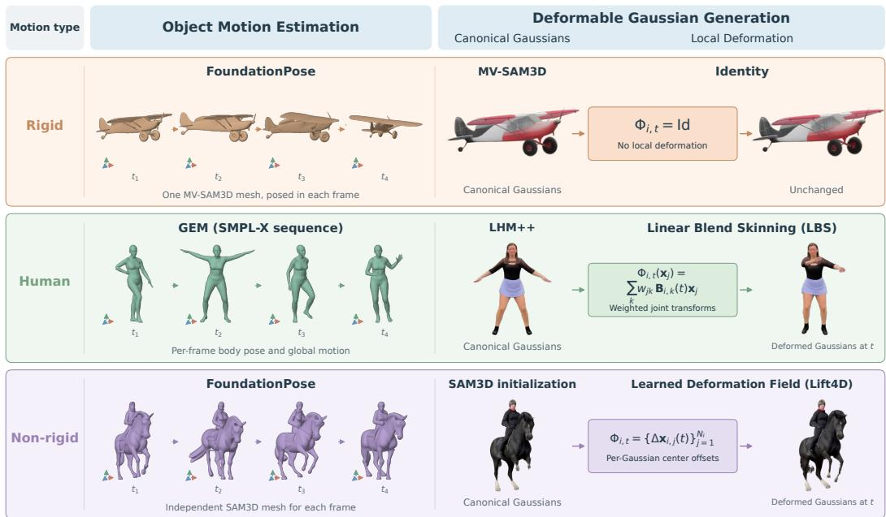  
Figure 6: Motion-type-specific instantiations for dynamic foreground generation. Each branch combines object motion estimation with canonical Gaussian generation and a local deformation model: identity for rigid objects, linear blend skinning (Magnenat-Thalmann et al., 1989) for humans, and learned per-Gaussian center offsets (Litman et al., 2026) for non-rigid objects.

## B DETAILS ON FOREGROUND-BACKGROUND ALIGNMENT

Foreground reconstruction and panorama-to-3D generation produce geometry independently. Although their coordinate orientations are established by camera estimation and panorama calibration, their scales and local surfaces may disagree. We address these discrepancies through a scene-level background scale followed by time-varying foreground displacement corrections.

## B.1 GLOBAL SCALE ALIGNMENT

We render the video-derived background point cloud and the generated background Gaussians into the same panoramic view. Let $d _ { \mathrm { i n i t } } ( u )$ and $d _ { \mathrm { b g } } ( \boldsymbol { u } )$ denote their radial depths at panorama pixel $u ,$ respectively. We retain reliable correspondences over their common visible region, denoted by U, and weight them by observation confidence ${ w _ { u } } = C _ { \mathrm { o b s } } ( u )$

We estimate a single scene-level background scale through weighted least squares:

$$
s = \underset { \bar { s } > 0 } { \mathrm { a r g } \mathrm { m i n } } \sum _ { u \in \mathcal { U } } w _ { u } \left( \bar { s } d _ { \mathrm { b g } } ( u ) - d _ { \mathrm { i n i t } } ( u ) \right) ^ { 2 } = \frac { \sum _ { u \in \mathcal { U } } w _ { u } d _ { \mathrm { b g } } ( u ) d _ { \mathrm { i n i t } } ( u ) } { \sum _ { u \in \mathcal { U } } w _ { u } d _ { \mathrm { b g } } ( u ) ^ { 2 } } .\tag{14}
$$

We apply this scale to the generated background geometry and map it into the common world frame using the known panorama-to-world transformation.

## B.2 LOCAL DISPLACEMENT ESTIMATION

Global scale alignment does not resolve local geometric differences between the two reconstructions. For each object i and frame t, we collect background points in a neighborhood of its foreground mask $M _ { i , t }$ . We exclude foreground pixels and use depth and surface-normal discontinuities to restrict the neighborhood to connected geometry. For supported objects, such as a car on a road, this neighborhood captures the nearby supporting surface.

We project these points into the reference panorama and retain correspondences that are visible and depth-consistent with the initialized background, with valid geometry in the generated background. For each retained correspondence $p ,$ let $\mathbf { x } _ { i , t , p }$ be the video-derived point and ${ \bf y } _ { i , t , p }$ its corresponding point on the scale-aligned background, both in world space. Their displacement is $\Delta \mathbf { x } _ { i , t , p } = \mathbf { y } _ { i , t , p } -$ $\mathbf { x } _ { i , t , p } .$

After rejecting displacement outliers, we estimate the local translation by a weighted average:

$$
\widehat { \delta } _ { i , t } = \frac { \sum _ { p \in \Omega _ { i , t } } w _ { i , t , p } \Delta \mathbf { x } _ { i , t , p } } { \sum _ { p \in \Omega _ { i , t } } w _ { i , t , p } } ,\tag{15}
$$

where $\Omega _ { i , t }$ is the retained support set and $w _ { i , t , p }$ combines depth confidence with background rendering opacity. We accept a displacement estimate only when its support is sufficient and its residual displacements are consistent.

## B.3 DISPLACEMENT INTERPOLATION

Frames without reliable local support, such as an airborne interval, do not provide direct displacement constraints. We propagate the accepted estimates through a temporally regularized correction field. Let $\mathcal { T } _ { i }$ denote the supported frames and $c _ { i , t }$ the confidence of each accepted estimate. We solve

$$
\operatorname* { m i n } _ { \{ \delta _ { i , t } \} _ { t = 1 } ^ { T } } \sum _ { t \in \mathcal { T } _ { i } } c _ { i , t } \rho \Big ( \lVert \delta _ { i , t } - \widehat { \delta } _ { i , t } \rVert _ { 2 } \Big ) + \eta \sum _ { t = 1 } ^ { T - 1 } \lVert \delta _ { i , t + 1 } - \delta _ { i , t } \rVert _ { 2 } ^ { 2 } ,\tag{16}
$$

where $\rho$ is a Huber penalty and $\eta$ controls temporal smoothness.

This optimization smooths the supported displacement estimates and linearly interpolates the resulting offsets across intervals without reliable contact. Outside the supported temporal range, the correction remains equal to the nearest supported offset. If no reliable support is available throughout the sequence, we set $\delta _ { i , t } = \mathbf { 0 }$ and retain the original trajectory.

Finally, we update each object’s world-space position as

$$
\widetilde { \mathbf { p } } _ { i , t } ^ { \mathrm { w o r l d } } = \mathbf { p } _ { i , t } ^ { \mathrm { w o r l d } } + \delta _ { i , t } ,\tag{17}
$$

and apply the same translation to its Gaussians, preserving object rotations and local deformations. Together with the scale-aligned background, these corrected foreground objects form the aligned 4D visual scene.

## C ABLATION ON VISUAL COMPONENTS

We examine two components of visual scene generation: the displacement correction in foregroundbackground alignment and the panorama-to-3D backbone used for background generation. Fig. 7 provides qualitative comparisons.

Foreground-background displacement correction. We compare our full alignment, which combines global scale alignment with local displacement corrections, against a variant that retains only scale alignment. Global scale alone cannot resolve local geometric discrepancies between the inde pendently reconstructed foreground and background. The scale-only variant places much of the car below the road surface. Adding displacement corrections substantially reduces this interpenetration and improves object-ground contact. This comparison illustrates the importance of accounting for local geometry in addition to global scale.

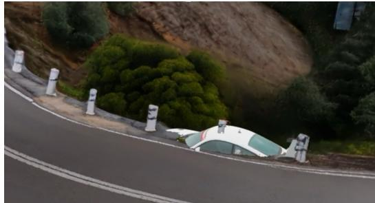  
(a) Scale only

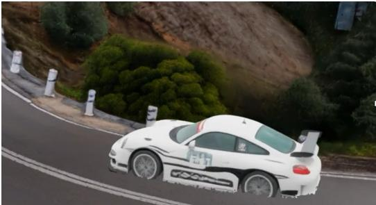  
(b) Scale + displacement

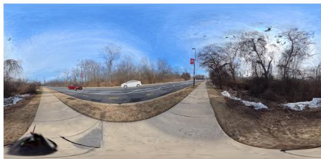  
(c) HYWorld 2.0

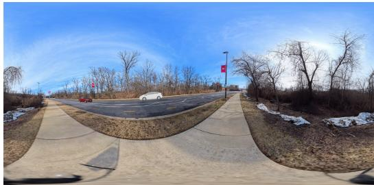  
(d) Marble  
Figure 7: Qualitative ablation on visual components. Top: Ablation of displacement correction in foreground-background alignment. Both variants include global scale alignment; adding local displacement corrections reduces foreground interpenetration with the ground. Bottom: Both panorama-to-3D backbones produce usable scenes, but Marble yields fewer visible reconstruction artifacts in the illustrated example.

Panorama-to-3D backbone. We compare HYWorld 2.0 (Team HY-World, 2026) and Marble (Labs, 2025b) for lifting the completed background panorama into 3D Gaussians. Both produce usable background reconstructions, demonstrating that our framework accommodates different panorama-to-3D backbones. In our qualitative comparisons, however, HYWorld 2.0 exhibits more visible artifacts, including distorted vegetation and spurious geometry, while Marble produces cleaner renderings. For reproducibility, we use HYWorld 2.0 for all quantitative evaluations. For improved visual quality, we use the proprietary Marble model in our qualitative comparisons and demos.

## D FORWARD AND INVERSE ACOUSTIC RENDERING

This section details the forward renderer $\mathcal { R } _ { i }$ and inverse renderer $\mathcal { Q } _ { i }$ used for diffusion synchronization, and explains how occlusion is handled during camera-to-object fusion.

Direct-Path Propagation. Measurements of natural acoustics show that reverberation typically decays faster outdoors than indoors (Traer & McDermott, 2016). Perceptual experiments further show that strong room-like reverberation can sound atypical for low-intensity outdoor sources (Traer et al., 2021). Motivated by these observations, we adopt an outdoor-focused direct-path approximation and omit reflected paths and reverberation. Our renderer accounts for Doppler shifts, distance attenuation, and air absorption, which change the timing and amplitude of each source signal.

For source i, let t denote reception time at the camera and u denote emission time in object space. We write the emission-time mapping as $u = \phi _ { i } ( t ) = t _ { i } ^ { \mathrm { e m } } ( t )$ . This mapping is determined by the source and camera trajectories, and its local rate accounts for the Doppler shift. Let $g _ { i } ( t ) > 0$ denote the multiplicative gain accounting for distance attenuation and air absorption. On available, unoccluded reception intervals $\Omega _ { i }$ , the forward renderer is

$$
\big ( \mathcal { R } _ { i } a _ { i } ^ { \mathrm { o b j } } \big ) ( t ) = g _ { i } ( t ) a _ { i } ^ { \mathrm { o b j } } ( \phi _ { i } ( t ) ) , \qquad t \in \Omega _ { i } .\tag{18}
$$

This expression describes the unoccluded direct path. Occluded intervals are excluded from inverserendering feedback, as described below.

Inverse Rendering. Given the source and camera trajectories, we treat $\phi _ { i }$ and $g _ { i }$ as known. We assume that $\phi _ { i }$ is strictly increasing over the time range considered, so that each emission time has a unique corresponding reception time. The inverse renderer first reverses this time mapping and then divides out the propagation gain. For a separated camera-space signal $b _ { i }$

$$
\left( \mathcal { Q } _ { i } b _ { i } \right) ( u ) = \frac { b _ { i } \bigl ( \phi _ { i } ^ { - 1 } ( u ) \bigr ) } { g _ { i } \bigl ( \phi _ { i } ^ { - 1 } ( u ) \bigr ) } , \qquad u \in \mathcal { U } _ { i } ,\tag{19}
$$

where $\mathcal { U } _ { i } = \phi _ { i } ( \Omega _ { i } )$ is the corresponding set of valid emission times. Substituting Eq. 18 into Eq. 19 gives

$$
\begin{array} { r l } & { \bigl ( \mathcal { Q } _ { i } \mathcal { R } _ { i } a _ { i } ^ { \mathrm { o b j } } \bigr ) ( u ) = \frac { g _ { i } \bigl ( \phi _ { i } ^ { - 1 } ( u ) \bigr ) a _ { i } ^ { \mathrm { o b j } } \bigl ( \phi _ { i } \bigl ( \phi _ { i } ^ { - 1 } ( u ) \bigr ) \bigr ) } { g _ { i } \bigl ( \phi _ { i } ^ { - 1 } ( u ) \bigr ) } } \\ & { \qquad = a _ { i } ^ { \mathrm { o b j } } ( u ) , \qquad u \in \mathcal { U } _ { i } . } \end{array}\tag{20}
$$

Thus, the continuous-time propagation model is analytically invertible on valid intervals when the time mapping is strictly increasing and the gain is nonzero. In discrete time, evaluating the warped signal requires resampling, which introduces numerical approximation errors. Source-separation errors further affect the object-space estimate obtained from a camera-space mixture.

Occlusion Handling and Fusion. We do not apply inverse rendering to occluded intervals. Instead, we define a validity mask on the object-space timeline:

$$
m _ { i } ( u ) = \left\{ \begin{array} { l l } { 1 , } & { u \in \mathcal { U } _ { i } , } \\ { 0 , } & { \mathrm { o t h e r w i s e } . } \end{array} \right.\tag{21}
$$

The mask associates each emission time with the visibility and availability of its corresponding camera-space observation.

At diffusion step $\tau ,$ we obtain the inverse target only on valid intervals:

$$
\tilde { a } _ { i , \tau } ^ { \mathrm { o b j } } ( u ) = \left[ \mathcal { Q } _ { i } \bigl ( \mathrm { S e p } _ { q _ { i } } ( \hat { a } _ { \tau } ^ { \mathrm { c a m } } ) \bigr ) \right] ( u ) , \qquad u \in \mathcal { U } _ { i } .\tag{22}
$$

The object-space fusion is then

$$
\bar { a } _ { i , \tau } ^ { \mathrm { o b j } } ( u ) = \left\{ \begin{array} { l l } { ( 1 - \eta _ { \mathrm { o b j } } ) \hat { a } _ { i , \tau } ^ { \mathrm { o b j } } ( u ) + \eta _ { \mathrm { o b j } } \tilde { a } _ { i , \tau } ^ { \mathrm { o b j } } ( u ) , } & { m _ { i } ( u ) = 1 , } \\ { \hat { a } _ { i , \tau } ^ { \mathrm { o b j } } ( u ) , } & { m _ { i } ( u ) = 0 . } \end{array} \right.\tag{23}
$$

Visible intervals therefore receive camera-to-object feedback, while occluded or unavailable intervals retain the object-space branch’s own prediction during fusion. This avoids attempting to recover source signals from intervals where their camera-space contributions cannot be reliably inverted.

## E DETAILS ON OUR SONOSCENE4D DATASET

We collect SONOSCENE4D to evaluate spatial audio generation at listener positions distinct from the input camera viewpoints. The dataset contains 54 dynamic scenes: 25 vehicle scenes and 29 human scenes, covering rigid-body motion and human articulation. Each scene includes a panoramic video and synchronized first-order ambisonic (FOA) audio recorded at a separate listening position. The dataset includes both single-source and multi-source scenarios, with 13 scenes containing two dynamic foreground sound sources.

Vehicle scenes. We capture 25 vehicle scenes across three locations, featuring police vehicles, pickup trucks, sedans, and buses. These scenes cover different vehicle appearances and acoustic characteristics, with vehicles moving through the scene along different trajectories. Three scenes contain two vehicles, requiring the generated audio to account for multiple moving sources and their respective spatial cues. The remaining 22 scenes contain a single foreground vehicle.

Human scenes. We capture 29 human scenes across three locations. Activities include walking, jogging, jumping, foot stomping, clapping, burpees, and clapping while walking. These activities produce footsteps, hand claps, and ground-contact sounds with distinct temporal patterns, enabling evaluation of both spatial audio and synchronization with visible actions. Ten scenes contain two people performing either the same activity or different activities, such as walking and jogging, or clapping and jogging. The remaining 19 scenes contain one person. Some recordings additionally include static background sounds, such as flowing water, providing mixtures of dynamic foreground events and persistent background audio.

Together, these scenes cover diverse source motions, acoustic events, and overlapping sound sources. The FOA recordings provide reference audio at a listening position different from the input camera position, allowing us to evaluate spatial audio generation at novel listener positions. We follow the annotation and capture-device setup protocols of the SONOSCENE360 dataset in SonoWorld (Jin et al., 2026).

For experiments on SONOSCENE4D, we use our captured full background panorama as input to panorama-to-3D generation. For each dynamic foreground sound source, we extract a perspective field-of-view (FoV) video from the recorded panoramic sequence using mask-based tracking. Specifically, per-frame foreground masks determine the viewing direction of a virtual camera, whose orientation is temporally smoothed to follow the source with a fixed FoV. We project the panoramic frames into these views to obtain the foreground video inputs to our method, producing one tracked FoV video per dynamic sound source.

## F DETAILS ON USER STUDY

Platform and scene selection. We hosted the questionnaire on Zoho Forms and recruited participants internationally through Prolific’s AI Taskers pool. The study included seven scenes from web videos: bird singing, horse riding, karate, tap dancing, an airplane, a sports car, and a running humanoid robot. Two additional scenes from SONOSCENE4D featured two cars traveling in opposite directions and two people clapping, respectively.

Comparison design. For each of the nine scenes, we compared our method against Sonic4D (Xie et al., 2025) and OmniAudio (Liu et al., 2025a), yielding 18 baseline comparisons. We additionally compared our full method against the V2A and T2A variants on three scenes: the airplane, two people clapping, and tap dancing. This yielded six ablation comparisons and 24 video pairs in total.

Questionnaire. Each pair was accompanied by a one-sentence sound source description specifying the main objects and activities the users are expected to hear. Methods were presented as Method 1 and Method 2, without revealing their identities. For every pair, participants answered the required question: “Which method, A or B, do you prefer overall in terms of spatial audio?” For comparisons against Sonic4D, they additionally answered: “Which method, A or B, has better overall visual quality?” This second question was included only for Sonic4D because it uses its own visual generation backbone; OmniAudio and our ablated variants share our novel-view visual renderings. Each question required selecting one of the two methods, yielding 24 audio judgments and nine visual judgments per participant.

## G IMPLEMENTATION DETAILS

## G.1 COMPONENT-WISE IMPLEMENTATION

Video preprocessing and scene understanding. We use VGGT-Ω (Wang et al., 2026) to estimate per-frame depth, camera intrinsics, and camera poses, and SAM3 (Carion et al., 2026) to segment and track foreground objects. For the tracked FoV videos in SONOSCENE4D, we retain the known virtual-camera intrinsics and rotations used during panorama-to-perspective projection, together with the predicted depth. We query Kimi K3 (Team et al., 2026) with uniformly sampled video frames to obtain structured scene descriptions, sound-source attributes, and generation and separation prompts. The VLM prompt is summarized in Fig. 8.

Visual scene generation. For background generation, we aggregate the observed background geometry into a partial panorama and use GeoCalib (Veicht et al., 2024) for gravity alignment. We complete missing regions using FLUX.2 Klein 9B (Labs, 2025a) with a panorama-outpainting LoRA (nomadoor, 2026). For SONOSCENE4D, we instead use the captured full background panoramas. We use HYWorld 2.0 (Team HY-World, 2026) for panorama-to-3D generation in quantitative evaluations and Marble (Labs, 2025b) for qualitative comparisons and demos.

Foreground generation follows the motion-type-specific instantiations in Appendix A, with reconstruction and motion estimation details provided in Appendix G.2.

Foreground-background alignment. We follow the alignment procedure described in Appendix B. For scale estimation, we reject outliers in the log-depth ratios of reliable background correspondences before confidence-weighted fitting. For outdoor scenes, scale estimation uses the lower half of the reference panorama. Local displacement estimation uses visible, depth-consistent correspondences and rejects outliers before averaging.

Audio generation and grounding. We instantiate both the camera-space video-to-audio branch and the object-space text-to-audio branches with HunyuanVideo-Foley (Shan et al., 2025), using its XXL configuration. The camera-space branch receives the input video and the full-scene audio description. By default, each object-space branch is conditioned only on its source-specific text prompt. We additionally enable video conditioning only when the VLM scene analysis indicates that the source remains at an approximately constant distance from the input camera throughout the video. We use SAM-Audio-small (Shi et al., 2025) for query-conditioned source separation during camera-to-object synchronization. Each static background sound is generated through text to-audio conditioning. For non-global static sources, SAM3 segments the corresponding regions in the background panorama, which are associated with reconstructed background geometry to obtain fixed spatial anchors. Dynamic sources are associated with their reconstructed object trajectories, and global ambience is retained as a separate background track.

Both generation branches use 100 Euler steps with a step size of 0.01 and classifier-free guidance of 6.0. Camera-space fusion uses $\eta _ { \mathrm { c a m } } = 0 . 8 .$ , while the object-space fusion uses $\eta _ { \mathrm { o b j } } ~ =$ 0.5. For numerical stability, the denominator in the synchronized velocity update is clamped to max(1 − τ, 0.05). Each source-separation call uses 32 midpoint steps with a step size of 1/32, without classifier-free guidance. Separation results are recomputed at each synchronization step, with hint caching disabled. Generated audio is decoded at 48 kHz.

## G.2 FOREGROUND RECONSTRUCTION AND MOTION ESTIMATION

Rigid-body keyframe selection. We select up to 10 reliable keyframes per object for MV-SAM3D reconstruction and FoundationPose registration. We exclude frames with empty or insufficiently large foreground masks, substantial occlusion, severe image-boundary truncation, or blurred foreground observations. Among the valid frames, we choose the one with the largest foreground mask as the reconstruction reference. The remaining keyframes are selected by farthest-point sampling based on object positions and frame timestamps to cover both spatial motion and time.

Pose registration and trajectory completion. We register object poses at anchor frames using FoundationPose and track bidirectionally between consecutive anchors, averaging valid estimates from both directions. Before the first anchor and after the last anchor, we track backward and forward, respectively. Tracking stops when observations become unreliable due to occlusion, insufficient object size, or departure from the image. For rigid-body objects, we fill gaps between reliable poses by interpolating translations and rotations, and complete trajectories outside this range using constant-velocity translation extrapolation and the nearest reliable rotation. Available foreground masks provide additional position and depth cues, and we refine the completed trajectories using silhouette-containment and temporal constraints.

Human representation. We store posed human Gaussians relative to the SMPL-X pelvis and retain the pelvis trajectory separately. This allows foreground-background alignment to adjust global placement without modifying the recovered articulation.

## G.3 VLM PROMPT

We jointly provide sampled video frames to the VLM to obtain structured scene and sound-source descriptions. The JSON response includes a static environment description, an indoor/outdoor label, a full-scene audio description, and source-specific attributes and prompts. Each sound source is assigned a visual grounding label, a target peak level, and a spatial type. Dynamic foreground sources additionally receive rigidity and support-surface labels, together with identifiers linking their generation and separation prompts to the corresponding reconstructed objects. The support-surface labels also guide the layered rendering described in Appendix G.5. Fig. 8 summarizes the prompt instructions.

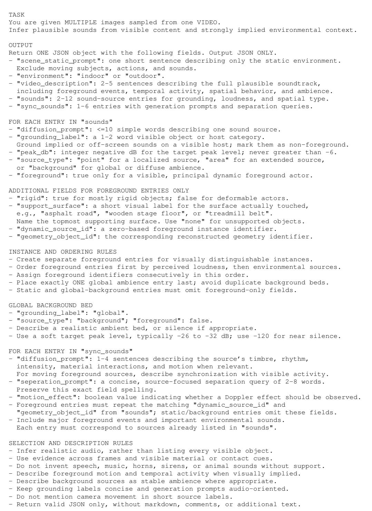  
Figure 8: VLM prompt for video-based scene understanding. Condensed presentation of the instructions used to obtain scene descriptions, sound-source attributes, and generation and separation prompts. Examples and repeated validation instructions are omitted for brevity.

## G.4 INTERACTIVE VIEWER

We implement the browser-based viewer using Three ${ \bf { j } } { \bf { s } } ^ { 1 }$ and the Spark Gaussian Splatting renderer2. The viewer loads background Gaussian layers, canonical foreground Gaussians, object transformations, and per-frame deformation attributes. Rigid objects reuse their canonical Gaussians with time-dependent global transformations. For deformable objects, we additionally update Gaussian positions and, where available, rotations and scales from the exported deformation sequences. All objects share a playback timeline, which also controls audio playback and seeking. Users can follow recorded camera paths or navigate freely through the scene.

Interactive audio playback uses the Web Audio $\mathrm { A P I } ^ { 3 }$ . The listener’s position and orientation follow the viewing camera. Dynamic source positions follow their reconstructed trajectories, while static sources remain at their grounded background anchors. Each localized source is spatialized using HRTF-based panning with distance-dependent attenuation, updating its spatial cues as the source or listener moves. The spatialized source contributions are mixed with global ambience to produce binaural output.

## G.5 LAYERED RENDERING

We use layered rendering to address two types of incorrect foreground occlusion. First, inaccuracies in object poses and reconstructed supporting surfaces can leave parts of an object below the surface, making feet or wheels appear buried even after foreground-background alignment. Second, sky Gaussians reconstructed by Marble may lie closer to the viewer than distant foreground objects, causing the sky to incorrectly occlude them. We therefore separate the background into sky, supporting surfaces, and other scene geometry, and introduce a depth tolerance when compositing foreground objects against the sky and supporting surfaces. Other scene geometry, such as trees and walls, retains depth-based occlusion.

Background layer construction. After alignment, we partition the background Gaussians into sky, supporting surfaces, and remaining background geometry. For outdoor scenes, we segment the sky in the background panorama using SAM3 and transfer its mask to Gaussians by projecting their centers into the panorama. Indoor scenes omit the sky layer.

To identify supporting surfaces, we use the VLM-provided surface labels as SAM3 prompts and combine these semantic masks with contact geometry. We collect the lowest foreground Gaussian points along the aligned trajectories and identify nearby background Gaussians at compatible heights as contact seeds. The support region grows from these seeds along a nearest-neighbor graph subject to spatial and height continuity constraints. When the semantic mask agrees with the contact seeds, it restricts the region to the named surface near the trajectory. Objects labeled as unsupported, such as a plane flying through the sky, do not contribute contact seeds. All background Gaussians outside the sky and support regions form the remaining geometry layer, which retains potential occluders such as trees, pillars, and walls.

Depth-aware compositing. The viewer renders three groups separately: foreground objects, sky and supporting surfaces, and the remaining background geometry. For each group, we render both color and an alpha-weighted view-depth image using the same splat ordering and blending. The groups are then composited per pixel.

Let $d _ { \mathrm { f g } } , d _ { \mathrm { s u p } } .$ , and $d _ { \mathrm { o c c } }$ denote the rendered depths of the foreground, the combined support/sky group, and the remaining background geometry, respectively. Foreground visibility relative to the remaining background follows the usual depth comparison, $d _ { \mathrm { f g } } < d _ { \mathrm { o c c } }$ . Against the support/sky group, we introduce a depth tolerance $\epsilon = 2 D$ and favor the foreground when $d _ { \mathrm { f g } } < d _ { \mathrm { s u p } } + \epsilon$ , where D is the foreground object’s bounding-box diagonal length after applying its global scale. We soften this transition using a smooth blending weight around the threshold. This reduces the disappearance of foreground contact regions into the supporting surface while retaining depth-based occlusion by other scene geometry. The tolerance is expressed in scene units relative to foreground size.

Layered compositing complements the geometric alignment by correcting residual visibility artifacts at display time. It leaves the reconstructed Gaussian positions, object trajectories, and acoustic geometry unchanged.