# SelfThinker: Self-Evolving Reasoning via Reliability-Verified Intrinsic Visual Thoughts

Zhangquan Chen iD1 and Ruqi Huang iD1\*

1Tsinghua Shenzhen International Graduate School, Tsinghua University, Shenzhen, 518055, Guangdong, China.

\*Corresponding author(s). E-mail(s): ruqihuang@sz.tsinghua.edu.cn; ORCID(s): 0009-0006-2370-6120 (Z. Chen); 0000-0001-5942-3671 (R. Huang)

## Abstract

Unified multimodal models can both generate and understand images within a single set of weights, ofering an opportunity to use image synthesis as training supervision for visual comprehension. However, existing visual chain-of-thought methods rely on human-annotated helper images during training and require slow image generation at test time. We present SelfThinker, the first self-evolving framework that turns a unified model’s self-generated visual thoughts into stronger understanding without human image annotations. Given a visual problem, SelfThinker samples candidate helper images from its generation pathway and uses its frozen understanding pathway to score each candidate via conditional pointwise mutual information. High-utility visual thoughts then refine the generator via flow matching and serve as privileged teacher context for on-policy self-distillation. At inference, SelfThinker reasons directly from the original image in text without generating intermediate images. Although trained only on small synthetic visual-search and navigation datasets, SelfThinker transfers broadly to natural-image and spatial benchmarks, raising the seven-benchmark average of ThinkMorph-7B from 52.7 to 64.0 (+11.3 points). Controlled image-perturbation probes further show that SelfThinker surpasses ThinkMorph-7B by up to 40.4 points and its pretrained BAGEL-7B backbone by up to 23.2 points across fine-grained and spatial perception tasks. Our code, data, and models are available at https://github.com/zhangquanchen/SelfThinker.

Keywords: Unified multimodal models, Visual reasoning, Self-evolving training, Self-distillation

## 1 Introduction

Visual understanding and spatial reasoning are foundational capabilities for multimodal large language models (Tong et al. 2024c,a; Fu et al. 2024). When tackling multi-step visual tasks (e.g., grid navigation, visual search), text-only chains of thought often fall short because natural language struggles to capture fine-grained spatial geometry. Humans naturally overcome this bottleneck by forming intermediate mental images to guide deduction (Shepard and Metzler 1971; Kosslyn et al. 2001; Pearson et al. 2015; Chen et al. 2025c, 2026). Motivated by this cognitive process, recent unified multimodal models (UMMs) integrate image generation and visual understanding within a single set of weights (Chameleon Team 2024; Zhou et al. 2024; Xie et al. 2025; Wu et al. 2024a; Wang et al. 2024; Tong et al. 2024b; Deng et al. 2025), enabling interleaved reasoning models to draw intermediate helper images, or visual

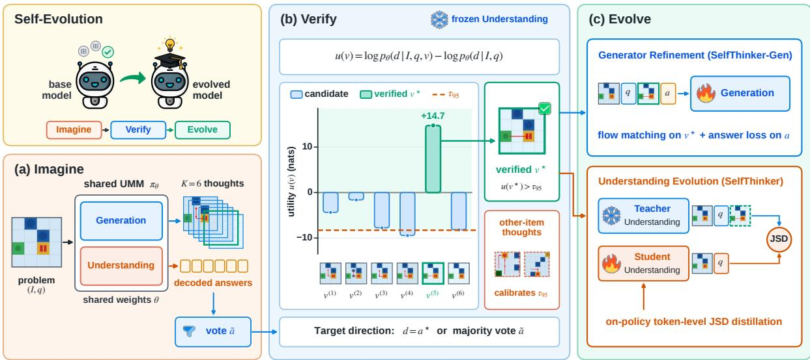  
Fig. 1 Overview of SelfThinker. The upper-left Self-Evolution panel summarizes the closed loop of imagining candidate visual thoughts, verifying reliable ones, and evolving into a stronger model. Imagine: a shared UMM with Generation and Understanding pathways produces candidate visual thoughts and decoded answers. Verify: the frozen Understanding pathway scores each candidate by its log-likelihood utility, calibrates the acceptance threshold against thoughts from other problems, and selects the top verified thought under the ground-truth answer or majority vote. Evolve: the verified thought is distilled into the Student Understanding pathway via on-policy token-level JSD distillation from the EMA Teacher (SelfThinker), supported by flow-matching generator refinement (SelfThinker-Gen). No human image annotation is used

thoughts, before predicting a final answer (Li et al.   
2025; Chern et al. 2025; Gu et al. 2025; Chen et al.   
2025b,d).

In principle, because a unified model can already synthesize images, its generation pathway could serve as a self-contained source of visual supervision to strengthen its understanding pathway. In practice, however, existing visualthought pipelines such as Mirage (Yang et al. 2025b), ThinkMorph (Gu et al. 2025), and Visual-OPSD (Li et al. 2026a) remain tied to external visual supervision, relying on human-designed helper images rendered by external tools (such as shortest-path overlays for navigation or bounding boxes for visual search). Constructing such taskspecific templates requires costly manual engineering and confines visual imagination to predefined heuristics, preventing the model from learning from its own generated imagery at scale.

Overcoming this limitation and turning a model’s image generation capability into efective training supervision for visual understanding requires addressing three core challenges: (C1)

Annotation-free learning, replacing humanengineered visual templates with diverse candidate visual thoughts sampled directly from the model’s own generation pathway, without groundtruth bounding boxes, masks, or path overlays; (C2) Intrinsic verification, determining which self-generated images genuinely aid comprehension, since generated candidates are often noisy and standard majority voting over text answers (Wang et al. 2023; Huang et al. 2023; Zuo et al. 2025; Li et al. 2026b; Gkountouras et al. 2026) fails when agreeing answers accompany uninformative or corrupted intermediate images (Li et al. 2026a); and (C3) Test-time eficiency, internalizing the visual cues of helpful intermediate images back into the understanding pathway, so that deployment neither incurs slow image generation latency nor halts prematurely at the image token.

To address (C1)–(C3), we propose SelfThinker (Fig. 1), a self-evolving framework structured into three stages: Imagine, Verify, and Evolve. In the Imagine stage, given a visual problem, the model samples multiple candidate visual thoughts from its generation pathway and decodes their corresponding answers, supplying diverse visual candidates without human image annotations (resolving C1). In the Verify stage, the model’s frozen understanding pathway acts as an intrinsic verifier, scoring each candidate image by its conditional pointwise mutual information with a target answer direction and calibrating the score against thoughts drawn for other problems to filter out conflicting imagery (resolving C2). In the Evolve stage, the verified visual thoughts serve as privileged teacher context for on-policy self-distillation (SelfThinker ), transferring their visual cues into the understanding pathway so the student model reasons directly from the original image in text at test time (resolving C3), while a supporting flowmatching update (SelfThinker-Gen) refines the generator to produce cleaner candidate imagery.

Beyond eliminating human image annotations and test-time drawing overhead, our experiments also reveal a striking property, i.e., self-generated visual supervision transfers broadly across tasks. Although SelfThinker is trained only on small synthetic visual-search and grid-navigation pools, its improvements generalize across seven diverse multimodal benchmarks, spanning fine-grained chart reading and visual search, multi-step spatial planning, and natural-scene perception. Specifically, SelfThinker raises the seven-benchmark average of ThinkMorph-7B from 52.7 to 64.0 (+11.3 points) under ground-truth answer supervision, and to 63.4 (+10.7 points) under label-free majority voting. Controlled image-perturbation probes further confirm that this cross-task transfer stems from stronger visual perception rather than output formatting or language priors. That is, Self-Thinker consistently outperforms teacher-context controls that lack verified imagery, surpassing ThinkMorph-7B by up to 40.4 points and its pretrained BAGEL-7B-MoT backbone by 12.0 to 23.2 points across fine-grained and spatial benchmarks.

Our contributions can be summarized as follows.

• We propose SelfThinker , the first self-evolving framework that turns a unified multimodal model’s image generation capability into training supervision for visual understanding without human image annotations.

• We introduce an intrinsic visual verification mechanism based on calibrated conditional pointwise mutual information, enabling the understanding pathway to select informative self-generated helper images.

• We develop a privileged on-policy selfdistillation scheme, supported by flow-matching generator refinement, that internalizes verified visual thoughts into the understanding pathway for fast text-only inference without test-time image generation.

• Extensive experiments across multiple benchmarks and controlled image-perturbation probes demonstrate that SelfThinker consistently outperforms strong baselines and its pretrained backbone. Furthermore, our results indicate that SelfThinker generalizes efectively from synthetic training pools to natural-image and spatial perception, highlighting its broad applicability.

## 2 Related Work

## 2.1 Unified Multimodal Models

Unified multimodal models (UMMs) integrate visual understanding and image generation within a single architecture. Early-fusion autoregressive models such as Chameleon (Chameleon Team 2024) and Emu3 (Wang et al. 2024) represent both modalities as discrete token streams. In contrast, Transfusion (Zhou et al. 2024) and Show-o (Xie et al. 2025) combine next-token prediction with continuous difusion or discrete denoising. Janus and Janus-Pro decouple the visual encoders used for reading and generation (Wu et al. 2024a; Chen et al. 2025a), whereas MetaMorph aligns an understanding backbone with visual generation via instruction tuning (Tong et al. 2024b). BAGEL routes understanding and generation tokens through specialized transformer experts pretrained on interleaved multimodal data (Deng et al. 2025). At the evaluation level, standard multimodal benchmarks often suffer from language shortcuts where questions can be answered without inspecting the image (Chen et al. 2024a). This limitation has motivated visioncentric benchmarks such as MMVP, CV-Bench, and BlindTest (Tong et al. 2024c,a; Rahmanzadehgervi et al. 2024), alongside image corruption robustness protocols (Hendrycks and Dietterich 2019). SelfThinker builds on a unified architecture to convert its generative capability into stronger visual perception across fine-grained and spatial benchmarks.

## 2.2 Reasoning with Helper Images

To move beyond text-only chains of thought, recent multimodal reasoning methods construct intermediate helper images that supply explicit visual cues during deduction. Tool-augmented systems such as Visual Sketchpad and Whiteboardof-Thought invoke external code and drawing APIs to render auxiliary lines, boxes, and diagrams (Hu et al. 2024; Menon et al. 2024), while region-focusing methods crop or zoom into informative sub-regions (Shao et al. 2024; Zheng et al. 2025; Fan et al. 2025). Mirage synthesizes taskspecific helper images, such as path-annotated maps, and compresses them into latent visual tokens during training (Yang et al. 2025b). Within native UMMs, MVoT generates step-by-step spatial visualizations (Li et al. 2025), and Chern et al. (2025) sample and critique intermediate images at test time. ThinkMorph fine-tunes BAGEL on interleaved traces across human-annotated helperimage templates, including red bounding boxes for visual search, shortest-path overlays for navigation, and region highlights for chart reading (Gu et al. 2025). However, these approaches rely on external rendering tools or human annotation pipelines to prescribe task-specific helper images. In contrast, SelfThinker uses the model’s own generation pathway as a source of visual training supervision without human image annotations, selects informative visual thoughts via the understanding pathway, and distills them into single-image text reasoning.

## 2.3 Self-Evolving Training

Self-evolving training frameworks iteratively improve model capability without human rationales by filtering self-generated trajectories (Zelikman et al. 2022; Gulcehre et al. 2023; Dong et al. 2023; Yuan et al. 2023) or optimizing against outcome rewards and self-play (Chen et al. 2024b; DeepSeek-AI 2025). Related work also evaluates whether intermediate steps genuinely contribute to predictions via pointwise mutual information (PMI) and counterfactual interventions (Church and Hanks 1990; Koh and Liang 2017; Lanham et al. 2023; Turpin et al. 2023). A complementary paradigm is learning using privileged information (Vapnik and Vashist 2009; Hinton et al. 2015; Lopez-Paz et al. 2016), which supplies a teacher with training signals that are unavailable to the student at test time. Combining privileged context with on-policy context distillation (Askell et al. 2021; Snell et al. 2022; Agarwal et al. 2024) allows a student policy to internalize rich teacher conditioning along its own sampled trajectories. Recent methods instantiate this teacher context with annotated helper images in Visual-OPSD (Li et al. 2026a), image crops in Vision-OPD (Yuan et al. 2026), annealed contexts in ATESD (Han et al. 2026), and hindsight skills in SEED (Wu et al. 2026).

When ground-truth labels are unavailable during self-training, majority voting across rollouts provides a label-free supervision signal (Wang et al. 2023; Huang et al. 2023; Zuo et al. 2025). Recent self-distillation methods such as u-OPSD (Li et al. 2026b) and Canon (Gkountouras et al. 2026) condition the teacher on a consensus text solution, while UniGame pits generation against understanding in an adversarial loop (Su et al. 2025). As summarized in Table 1, prior training pipelines either require human-annotated helper images and external crops (ThinkMorph, Visual-OPSD, Vision-OPD) or distill text-only consensus solutions without visual thoughts (u-OPSD, Canon). SelfThinker bridges this gap through a unified self-evolving training loop. Rather than distilling dataset-provided visual annotations, we use conditional PMI against mismatched thoughts to verify helper images synthesized by the model itself, and distill the verified imagery into fast text-only inference.

## 3 Methodology

## 3.1 Problem Formulation

A unified multimodal model (UMM) $\pi _ { \theta } \quad = $ $( \pi _ { \theta } ^ { U } , \pi _ { \theta } ^ { G } )$ shares parameters across an autoregressive understanding pathway $\pi _ { \theta } ^ { U }$ , which encodes images and generates text tokens, and a continuous generation pathway $\pi _ { \theta } ^ { G }$ , which synthesizes images in latent space (Deng et al. 2025; Gu et al. 2025). Given a visual reasoning problem $x = ( I , q )$ consisting of an input image I and a query q, the model operates in the Imagine stage by sampling

Table 1 Comparison of SelfThinker with related visual-thought and self-distillation methods across five key properties: reasoning with intermediate visual thoughts, learning from the model’s own self-generated visual thoughts rather than external tools or curated datasets, operating without human image annotations (bounding boxes, masks, or path overlays), explicitly verifying candidate visual thoughts, and supporting text-only inference at test time
<table><tr><td>Method</td><td>Visual thoughts</td><td>Self-generated imagery</td><td>No image annotations</td><td>Thought verification</td><td>Text-only inference</td></tr><tr><td>Visual Sketchpad (Hu et al. 2024)</td><td></td><td>X</td><td>××× &gt;</td><td></td><td></td></tr><tr><td>MVoT (Li et al. 2025), ThinkMorph (Gu et al. 2025)</td><td></td><td>V</td><td></td><td></td><td>× × √</td></tr><tr><td>Visual-OPSD (Li et al. 2026a), Vision-OPD (Yuan et al. 2026)</td><td>V</td><td>X</td><td></td><td></td><td></td></tr><tr><td>u-OPSD (Li et al. 2026b), Canon (Gkountouras et al. 2026)</td><td>X</td><td>X</td><td></td><td>××××</td><td></td></tr><tr><td>SelfThinker (ours)</td><td>√</td><td>V</td><td>V</td><td>V</td><td>√</td></tr></table>

K interleaved trajectories $\{ \tau ^ { ( k ) } \} _ { k = 1 } ^ { K } \colon$

$$
\tau ^ { ( k ) } = \big ( r _ { \mathrm { p r e } } ^ { ( k ) } , v ^ { ( k ) } , r _ { \mathrm { p o s t } } ^ { ( k ) } , a ^ { ( k ) } \big ) .\tag{1}
$$

Here $r _ { \mathrm { p r e } } ^ { ( k ) } \sim \pi _ { \theta } ^ { U } ( \cdot \mid I , q )$ is the initial text thought before the image token <image start>, $v ^ { ( k ) } \sim$ $\pi _ { \theta } ^ { G } ( \cdot \mid I , q , r _ { \mathrm { p r e } } ^ { ( k ) } )$ is a self-generated helper image (an intrinsic visual thought), and $( r _ { \mathrm { p o s t } } ^ { ( k ) } , a ^ { ( k ) } )$ ∼ $\begin{array} { r l } { \pi _ { \theta } ^ { U } ( \cdot } & { { } | \quad I , q , r _ { \mathrm { p r e } } ^ { ( k ) } , v ^ { ( k ) } ) } \end{array}$ is the text continuation ending in a decoded answer $a ^ { ( k ) }$

Directly training on self-generated trajectories faces two obstacles. First, a correct text answer $a ^ { ( k ) } = a ^ { \star }$ can arise despite an uninformative or corrupted helper image $\bar { v } ^ { ( k ) }$ (Li et al. 2026a). Second, running image generation $\pi _ { \theta } ^ { G }$ at test time incurs substantial latency, whereas disabling it causes premature termination at <image start>. As illustrated in Fig. 1 and Algorithm 1, Self-Thinker addresses both issues through two subsequent stages. In the Verify stage (Sect. 3.2), the understanding pathway scores the task utility of each candidate helper image $v ^ { ( k ) }$ without human image annotations. In the Evolve stage, the model internalizes the verified visual context into the understanding pathway via on-policy self-distillation (Sect. 3.4), supported by flowmatching refinement of the generation pathway (Sect. 3.3).

## 3.2 Intrinsic Visual Verification

## Directed utility score.

To evaluate whether a candidate helper image v provides useful visual evidence for solving $( I , q )$ we use the frozen understanding pathway $\pi _ { \theta } ^ { U }$ as an intrinsic verifier. Let $d = ( d _ { 1 } , \ldots , d _ { L } )$ be a token sequence encoding a target answer direction. We define the directed utility of v as the log-likelihood gain of generating d when v is revealed relative to the plain problem context:

$$
u ( v ) = \log p _ { \theta } \big ( d \mid C ( I , q , v ) \big ) - \log p _ { \theta } \big ( d \mid C ( I , q ) \big ) ,\tag{2}
$$

where log $\textstyle p _ { \theta } ( d \mid C ) = \sum _ { \ell = 1 } ^ { L }$ log $\pi _ { \theta } ^ { U } ( d _ { \ell } \ | \ C , d _ { < \ell } )$ Here $C ( I , q ) ~ = ~ [ I , q ]$ is the single-image problem context, and $C ( I , q , v ) = [ I , q , \rho , v , \tau ]$ appends a neutral context header $\rho ,$ the helper image v, and a fixed transition instruction τ (prompt templates in Appendix A). Measured in nats, u(v) equals the conditional pointwise mutual information $\operatorname { P M I } _ { \theta } ( v ; d \mid I , q )$ (Church and Hanks 1990) and requires only two forward passes without gradients.

Equation (2) has three desirable properties for verification without human image annotations. First, the score is signed, rewarding helper images that increase the probability of d $( u ( v ) > 0 )$ and penalizing conflicting imagery $( u ( v ) ~ < ~ 0 )$ . Second, omitting the rollout text $( r _ { \mathrm { p r e } } ^ { ( k ) } , r _ { \mathrm { p o s t } } ^ { ( k ) } )$ from $C ( I , q , v )$ isolates the visual contribution of v; because all candidates for item i share the same header $\rho$ and instruction τ, any prompt ofset cancels in within-item comparisons $\mathrm { \bar { \it { u } } } _ { i } ( v _ { i } ^ { ( k ) } ) - u _ { i } ( v _ { \mathrm { m i s } } ^ { ( k ) } )$ Third, the score requires no ground-truth helper images or handcrafted pixel rules.

## Within-item calibration.

Because log $p _ { \theta } ( d \mid \cdot )$ scales with the token length L of d, we calibrate utilities within each item i against mismatched thoughts. Specifically, we pair each candidate $v _ { i } ^ { ( k ) }$ with a mismatched thought $v _ { \mathrm { m i s } } ^ { ( k ) } = v _ { ( i + \delta ) } ^ { ( k ) }$ generated by the same model for a diferent problem, and evaluate $\begin{array} { r l } { s _ { i k } } & { { } = } \end{array}$ $u _ { i } ( v _ { \mathrm { m i s } } ^ { ( k ) } )$ under item i’s context and direction. A mismatched thought matches a genuine candidate in style, resolution, and token count while depicting an unrelated scene, which controls for baseline conditioning bias. Sorting $\{ s _ { i 1 } , \ldots , s _ { i K } \}$ as $s _ { i , ( 1 ) } \leq \cdots \leq s _ { i , ( K ) }$ defines an item-adaptive order-statistic threshold $\begin{array} { l c l } { { Q _ { i } } } & { { = } } & { { s _ { i , ( \lfloor \alpha ( K - 1 ) \rfloor + 1 ) } } } \end{array}$ $( \alpha = 0 . 9 5 ;$ Appendix $\mathrm { A } )$ . The top candidate is verified whenever it exceeds $Q _ { i } { \mathrm { : } }$

Algorithm 1 SelfThinker: Self-Evolving Training   
Require: Model $\begin{array} { r l r } { \overline { { \pi _ { \theta } } } } & { { } = } & { ( \pi _ { \theta } ^ { U } , \pi _ { \theta } ^ { G } ) } \end{array}$ , problem pool $\begin{array} { r l } { \mathcal { D } } & { { } = } \end{array}$   
$\{ ( I _ { i } , q _ { i } ) \} _ { i = 1 } ^ { N } ,$ rollouts $K ,$ quantile $\alpha = 0 . 9 5$   
Ensure: Updated generator SelfThinker-Gen $( \pi _ { \theta } ^ { G } )$ and dis  
tilled student SelfThinker $( \bar { \pi } _ { \boldsymbol { \theta } } ^ { U } )$   
1: $\mathcal { D } _ { \mathrm { v e r } }  \emptyset$   
2: for $i = 1 , \ldots , N$ do ▷ Stages 1–2: Imagine & Verify   
3: Sample traces $\{ ( r _ { \mathrm { p r e } , i } ^ { ( k ) } , \upsilon _ { i } ^ { ( \overline { { k } } ) } , r _ { \mathrm { p o s t } , i } ^ { ( k ) } , a _ { i } ^ { ( k ) } ) \} _ { k = 1 } ^ { K } \sim \pi _ { \theta } ( \cdot \^ { }$   
$I _ { i } , q _ { i } )$   
4: Set $d _ { i } \gets a _ { i } ^ { \star }$ (answer mode) or $\tilde { a } _ { i } =$ mode $( \{ a _ { i } ^ { ( k ) } \} _ { k = 1 } ^ { K } )$   
(vote mode)   
5: for $k = \stackrel { \cdot } { 1 } , \ldots , K$ do   
6: $u _ { i k }  u _ { i } ( v _ { i } ^ { ( k ) } ) , \quad s _ { i k }  u _ { i } ( v _ { \operatorname* { m i s } } ^ { ( k ) } )$ ▷ Eq. (2)   
7: end for   
8: $k ^ { \star } \gets$ arg maxk uik, $Q _ { i }  s _ { i , ( \lfloor \alpha ( K - 1 ) \rfloor + 1 ) }$   
9: if $u _ { i k ^ { \star } } > Q _ { i }$ then   
10: $\mathcal { D } _ { \mathrm { v e r } }  \mathcal { D } _ { \mathrm { v e r } } \cup \{ ( I _ { i } , q _ { i } , v _ { i } ^ { ( k ^ { \star } ) } , d _ { i } ) \}$ ▷ Eq. (3)   
11: end if   
12: end for   
13: for minibatch $B \subset \mathcal { D } _ { \mathrm { v e r } }$ do ▷ Stage 3: Evolve   
14: SelfThinker-Gen: update $\pi _ { \theta } ^ { G } \quad \mathrm { o n } \quad [ I , q , v ^ { \star } , d ]$ via   
$\nabla _ { \theta } \mathcal { L } _ { \mathrm { G e n } } ( \theta )$ ▷ Eq. (4)   
15: SelfThinker: sample $y _ { _ { \overline { { s } } } } \sim \ \pi _ { \theta } ^ { U } ( \cdot \ | \ c _ { S } )$ , update $\pi _ { \theta } ^ { \bar { U } }$ via   
$\nabla _ { \theta } { \mathcal { L } } _ { \mathrm { U n d } } ( \theta ) ,$ update EMA θ¯ ▷ Eq. (6)   
16: end for

$$
v _ { i } ^ { \star } = \arg \operatorname* { m a x } _ { k } u _ { i } \big ( v _ { i } ^ { ( k ) } \big ) , \quad u _ { i } ( v _ { i } ^ { \star } ) > Q _ { i } .\tag{3}
$$

## Target directions.

We instantiate $d _ { i }$ in two settings, neither of which uses human helper-image annotations. The answer direction sets $d _ { i } ~ = ~ a _ { i } ^ { \star }$ using the ground-truth text answer. The label-free vote direction sets $d _ { i } \ = \ \tilde { a } _ { i } \ =$ mode $\langle \{ a _ { i } ^ { ( k ) } \} _ { k = 1 } ^ { K } \rangle$ using the rollout majority vote, measuring how strongly each candidate image visually supports the consensus answer without requiring image or answer labels.

## 3.3 Supporting Generative Refinement

Given the verified dataset $\mathcal { D } _ { \mathrm { v e r } } = \{ ( I _ { i } , q _ { i } , v _ { i } ^ { \star } , d _ { i } ) \}$ we can refine the generation pathway $\pi _ { \theta } ^ { G }$ via rectified flow matching (Lipman et al. 2023; Liu et al. 2023; Deng et al. 2025) (SelfThinker-Gen) to improve the quality of candidate visual thoughts. Let $z _ { 1 } = E _ { \mathrm { V A E } } ( v ^ { \star } )$ denote the clean latent tokens of the verified helper image encoded by the variational autoencoder $( \mathrm { V A E } ) , z _ { 0 } \sim \mathcal { N } ( 0 , \mathbf { I } )$ Gaussian noise, and $z _ { t } = ( 1 - t ) z _ { 0 } + t z _ { 1 }$ their linear interpolation at $t \sim \mathcal { U } ( 0 , 1 )$ . The generation expert $v _ { \theta } ^ { G }$ regresses the target velocity $z _ { 1 } - z _ { 0 }$ jointly with a cross-entropy loss ${ \mathcal { L } } _ { \mathrm { C E } } ( \theta )$ on the answer tokens:

$$
\begin{array} { r } { \mathcal { L } _ { \mathrm { G e n } } ( \theta ) = \lambda _ { \mathrm { F M } } \mathbb { E } _ { t , z _ { 0 } } \Big [ \big \lVert v _ { \theta } ^ { G } ( z _ { t } , t \mid I , q , r _ { \mathrm { p r e } } ) } \\ { - ( z _ { 1 } - z _ { 0 } ) \big \rVert _ { 2 } ^ { 2 } \Big ] + \lambda _ { \mathrm { C E } } \mathcal { L } _ { \mathrm { C E } } ( \theta ) , } \end{array}\tag{4}
$$

with $\lambda _ { \mathrm { F M } } = 1 . 0$ and $\lambda _ { \mathrm { C E } } = 0 . 2 5$ (Appendix A). Filtering training targets by Eq. (3) shifts the generative prior toward problem-consistent trajectories and localized target boxes without human image annotations.

## 3.4 Internalizing Visual Supervision into Understanding

To convert verified visual thoughts into stronger visual comprehension without test-time drawing overhead, our primary update (SelfThinker) distills the verified helper images back into the understanding pathway via privileged on-policy self-distillation (Agarwal et al. 2024; Li et al. 2026a). For each verified item $( I , q , v ^ { \star } ) \in \mathcal { D } _ { \mathrm { v e r } } .$ we construct asymmetric student and teacher contexts:

$$
c _ { S } = [ I , q ] , \qquad c _ { T } = [ I , q , \rho , v ^ { \star } , \tau ] .\tag{5}
$$

The student $\pi _ { \theta } ^ { U }$ observes only the test-time context $c _ { S }$ and samples an on-policy text completion $y = ( y _ { 1 } , \dots , y _ { T } ) \sim \pi _ { \theta } ^ { U } ( \cdot \mid c _ { S } )$ without image generation. An exponential moving average (EMA) teacher $\pi _ { \bar { \theta } } ^ { U } \ ( \bar { \theta }  \mu \bar { \theta } + ( 1 - \mu ) \theta )$ observes the privileged context $c _ { T }$ containing the verified helper image $v ^ { \star }$ . The teacher is initialized from θ and evaluated with stop-gradient, whereas the Stage 2 verifier remains fixed at the base ThinkMorph-7B weights. Letting $P _ { t } ^ { T } = \pi _ { \bar { \theta } } ^ { U } ( \cdot \mid c _ { T } , y _ { < t } ) , P _ { t } ^ { \hat { S } } =$ $\pi _ { \theta } ^ { U } ( \cdot \mathrm { ~  ~ \vert ~ } c _ { S } , y _ { < t } )$ , and $M _ { t } \ = \ \stackrel { \cdot } { \beta } P _ { t } ^ { T } + ( 1 - \beta ) P _ { t } ^ { S } .$ we minimize the token-level generalized Jensen– Shannon divergence (JSD) along y using the Kullback–Leibler (KL) divergence:

$$
\begin{array} { r l } {  { \mathcal { L } _ { \mathrm { U n d } } ( \theta ) = \mathbb { E } _ { y \sim \pi _ { \theta } ^ { U } ( \cdot | c s ) } \sum _ { t = 1 } ^ { T } \Big [ \beta \mathrm { K L } ( P _ { t } ^ { T } \parallel M _ { t } ) } } \\ & { + ( 1 - \beta ) \mathrm { K L } ( P _ { t } ^ { S } \parallel M _ { t } ) \Big ] . } \end{array}\tag{6}
$$

Minimizing Eq. (6) teaches the student to bypass the <image start> bottleneck and extract the spatial cues highlighted by v⋆ directly from the original image I. At test time, SelfThinker reasons purely in text from $c _ { S } = [ I , q ]$ without generating intermediate images.

## 4 Experiments

## 4.1 Experimental Setup

## Compared models.

We build on ThinkMorph-7B (Gu et al. 2025), an interleaved reasoning model fine-tuned from BAGEL-7B-MoT (Deng et al. 2025) (denoted BAGEL-7B). The model routes understanding and generation tokens through specialized Qwen2.5 transformer experts (Qwen Team 2024) paired with a SigLIP vision encoder (Zhai et al. 2023). All intrinsic utility scores are evaluated by the frozen understanding pathway of ThinkMorph-7B. We evaluate our self-distilled understanding models across training pools and supervision settings: SelfThinker (Nav) (distilled from verified navigation thoughts), SelfThinker (Mix) (distilled from combined navigation and visual-search thoughts), SelfThinker (Vote) (distilled from visual-search thoughts verified via label-free majority voting), and our primary model SelfThinker (distilled from visual-search thoughts verified via ground-truth answers). In our ablation studies (Sect. 4.5), we also evaluate two teacher-context controls under identical visual-search training schedules. Specifically, Noise-OPSD replaces the teacher’s verified thought with uniform RGB noise, and Prompt-OPSD omits the second image so the teacher observes only the problem and transition instruction. For the generation pathway, we compare our supporting generative update (SelfThinker-Gen) against random-thought fine-tuning (Rand-RFT).

## Synthesized problem pools.

To evaluate candidate visual thoughts on layouts unseen during ThinkMorph-7B training, we synthesize fresh Navigation (Frozen-Lake grid maps (Towers et al. 2024)) and Visual Search (multiobject shape canvases) pools. Each pool is split into 1,500 training and 500 diagnostic items with disjoint layouts. For each problem, we sample K = 6 interleaved traces with one visual thought per trace. Programmatic reference thoughts (shortestpath overlays and target boxes) are rendered only for post-hoc diagnostics and are never used in verification or training. Complete pool specifications, sampling parameters, and optimization schedules are provided in Appendix A.

## Evaluation protocols.

Following the benchmark suite of Li et al. (2026a), we evaluate multimodal reasoning across seven benchmarks: VSP (600 maze items) (Wu et al. 2024b), ChartQA (444 horizontal and 382 vertical bar items) (Masry et al. 2022), V\* (191 items) (Wu and Xie 2024), MMVP (300 items) (Tong et al. 2024c), SAT (150 circular split items) (Ray et al. 2024), BLINK (1,901 items across 14 subtasks) (Fu et al. 2024), and CV-Bench (1,438 2D and 1,200 3D items) (Tong et al. 2024a). All benchmarks are evaluated in VLMEvalKit (Duan et al. 2024) using greedy text-only decoding (up to 1,024 thinking tokens) and a unified Qwen3- 30B-A3B-Instruct-2507 judge (Yang et al. 2025a; Kwon et al. 2023). On the 500-item diagnostic splits, we evaluate intrinsic verification using four metrics: verification yield, Top-1 AUC (area under the receiver operating characteristic curve) (Hanley and McNeil 1982), paired win rate, and utility margin (nats) (formal definitions in Appendix B). Finally, to test whether accuracy gains stem from visual perception rather than language priors, we evaluate a multi-layer image-condition probe across image swaps, pixel scrambles, tile permutations, mosaics, and Gaussian blurs (Appendix F).

## 4.2 Main Benchmark Results

## Improving visual understanding without test-time image generation.

Table 2 and Fig. 2 present the main benchmark comparison. By distilling verified visual thoughts into the understanding pathway, Self-Thinker raises the seven-benchmark average from 52.7 to 64.0 (+11.3 points). It outperforms ThinkMorph-7B on every benchmark while operating purely in text mode at test time, avoiding the 59–75 s per-trace difusion overhead required by interleaved image generation. Notably, even though training uses only a small pool of synthetic navigation or visual-search problems, the distilled visual supervision transfers broadly across natural-image and spatial benchmarks. Specifically, SelfThinker (Nav) lifts the seven-benchmark average to 60.0 (+7.3 points, reaching 60.3 on BLINK), SelfThinker (Mix) reaches 60.8 (+8.1 points, reaching 83.5 on CV-Bench), label-free SelfThinker (Vote) reaches 63.4 (+10.7 points, reaching 81.9 on ChartQA), and SelfThinker reaches 64.0 (+11.3 points).

Table 2 Main results on seven multimodal benchmarks under a unified judge (Qwen3-30B-A3B-Instruct-2507) and text-only decoding. SelfThinker variants distill verified visual thoughts from synthesized navigation (Nav), combined (Mix), or visual-search pools (under label-free rollout Vote or ground-truth answer direction) into single-image text reasoning. Bold marks the best score in each column and ∆ gives the gain over ThinkMorph-7B. CV-B.: CV-Bench
<table><tr><td>Method</td><td>VSP</td><td>ChartQA</td><td>V*</td><td>MMVP</td><td>SAT</td><td>BLINK</td><td>CV-B.</td><td>Average</td><td>∆</td></tr><tr><td>ThinkMorph-7B (Gu et al. 2025)</td><td>1.2</td><td>52.7</td><td>53.9</td><td>79.0</td><td>55.3</td><td>53.6</td><td>73.4</td><td>52.7</td><td></td></tr><tr><td>SelfThinker (Nav)</td><td>2.0</td><td>78.1</td><td>63.4</td><td>80.3</td><td>58.0</td><td>60.3</td><td>78.0</td><td>60.0</td><td>+7.3</td></tr><tr><td>SelfThinker (Mix)</td><td>5.5</td><td>74.7</td><td>70.2</td><td>79.3</td><td>54.7</td><td>58.0</td><td>83.5</td><td>60.8</td><td>+8.1</td></tr><tr><td>SeifThinker (Vote)</td><td>13.0</td><td>81.9</td><td>67.0</td><td>80.0</td><td>60.0</td><td>59.3</td><td>82.4</td><td>63.4</td><td>+10.7</td></tr><tr><td>SeifThinker</td><td>15.8</td><td>80.1</td><td>70.2</td><td>82.3</td><td>60.0</td><td>58.2</td><td>81.7</td><td>64.0</td><td>+11.3</td></tr><tr><td>∆ vs. ThinkMorph-7B</td><td>+14.6</td><td>+27.4</td><td>+16.3</td><td>+3.3</td><td>+4.7</td><td>+4.6</td><td>+8.3</td><td>+11.3</td><td></td></tr></table>

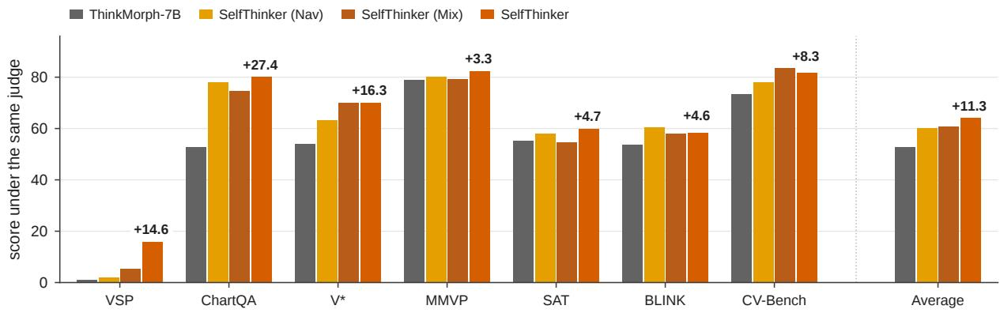  
Fig. 2 Per-benchmark and average scores of ThinkMorph-7B, SelfThinker (Nav), SelfThinker (Mix), and SelfThinker under the unified judge and text-only decoding. Numbers above the bars indicate the gains of SelfThinker over ThinkMorph-7B

## Cross-task gains on vision-centric reasoning.

Grouping the benchmarks by task type shows how self-generated visual supervision transfers to diverse visual domains. On fine-grained visual reading and search tasks that require locating small objects or reading dense charts, SelfThinker improves ChartQA by +27.4 points (to 80.1, and 81.9 for SelfThinker (Vote)) and V\* by +16.3 points (to 70.2). On multi-step spatial planning,

SelfThinker lifts VSP maze navigation from nearfailure (1.2) to 15.8 (+14.6 points) without drawing intermediate paths at test time, while improving perspective reasoning on SAT by +4.7 points (to 60.0). On 2D and 3D natural-scene perception, SelfThinker consistently advances CV-Bench (+8.3, to 81.7), BLINK (+4.6, to 58.2), and MMVP (+3.3, to 82.3).

## 4.3 Cross-Task Perception Transfer and Internalization

## Unlocking multi-scale visual perception beyond the pretrained BAGEL-7B backbone.

To verify that these cross-task gains reflect stronger visual perception rather than language shortcuts, we compare SelfThinker against both ThinkMorph-7B and its pretrained BAGEL-7B backbone under the 512-token image-condition probe (Fig. 3b; full 256- and 512-token corruption tables in Appendix F). Across all four spatial and object-perception benchmarks, Self-Thinker surpasses ThinkMorph-7B by 33.0 to 40.4 points and outperforms the pretrained BAGEL-7B backbone by 12.0 to 23.2 points. Specifically, SelfThinker reaches 67.0% on V\* (+18.3 over BAGEL-7B), 78.0% on MMVP (+12.0), 83.4% on CV-Bench-2D (+20.9), and 82.0% on CV-Bench-3D (+23.2), while also lifting ChartQA-h/v under the 256-token probe from 32.2%–32.5% in ThinkMorph-7B to 67.3%–68.6% (Table 10). Because pixel-scramble accuracy remains at a similar baseline across all three models, the entire improvement over BAGEL-7B stems from stronger visual evidence extraction from the real problem image. Graded mosaic, Gaussian blur, and tile-permutation ladders in Appendix F further show that SelfThinker preserves global interobject geometry across 2 × 2 to 8 × 8 mosaics and mild blur on 2D and 3D spatial tasks, while extracting fine local glyphs on ChartQA.

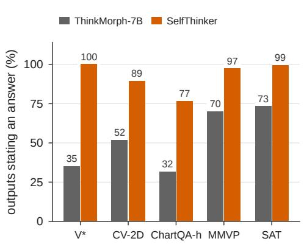

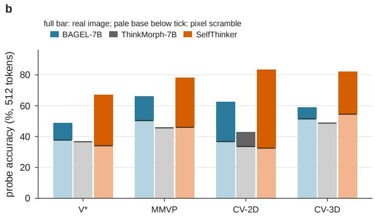  
Fig. 3 Analysis of the distilled student. a Percentage of outputs that state a final answer before the image slot under the benchmark protocol, for ThinkMorph-7B and SelfThinker. b Image-condition probe at 512 thinking tokens for pretrained BAGEL-7B, ThinkMorph-7B, and SelfThinker across V\*, MMVP, CV-Bench-2D, and CV-Bench-3D. Full bar height gives accuracy with the real problem image, and the pale base below the horizontal tick gives accuracy on its pixel scramble, so the upper saturated segment represents the visual gain

## Eliminating premature termination at the image slot.

As shown in Fig. 3a, when test-time image generation is disabled, ThinkMorph-7B frequently halts prematurely at the <image start> token, completing a final text answer on only 32% to 73% of items across V\*, CV-Bench-2D, ChartQAh, MMVP, and SAT. SelfThinker raises direct text answer completion to 77%–100% (reaching 100% on V\* and 99% on SAT). Crucially, on the paired subsets of items where ThinkMorph-7B already states an answer before <image start>, SelfThinker still improves conditional accuracy under the 512-token probe from 35.3% to 66.8% on V\* (+31.5 points), from 46.6% to 82.9% on CV-Bench-2D (+36.3), from 37.2% to 68.4% on ChartQA-h (+31.3), from 48.9% to 77.4% on MMVP (+28.5), and from 50.4% to 60.0% on SAT (+9.6). This confirms that self-distillation strengthens visual reasoning itself rather than merely repairing answer formatting.

## Internalizing visual thoughts without test-time drawing.

To verify that the student has absorbed the privileged teacher conditioning into single-image reasoning, we perform controlled context interventions on the 1,092 verified visual-search items (Table 9 and Fig. 9 in Appendix E). Whereas ThinkMorph-7B drops by 6.1 points when the verified visual thought is removed at test time (45.9% with the thought versus 39.7% with the problem image alone), SelfThinker achieves virtually identical accuracy whether given the problem plus its verified thought (99.0%) or the problem image alone (98.9%, a diference of +0.1 points). Label-free SelfThinker (Vote) likewise matches at 95.4% versus 95.3% (+0.1 points). Conversely, when the problem image is withheld and only the verified thought is shown, SelfThinker and Self-Thinker (Vote) reach 96.5% and 93.0% accuracy (versus 35.4% for ThinkMorph-7B), showing that distillation sharpens the model’s visual reader. To evaluate generalization on unseen problem types, we also test SelfThinker (Nav), which is distilled solely on grid navigation and never exposed to visual-search items. SelfThinker (Nav) transfers zero-shot to the 1,092 visual-search problems at 92.9% single-image accuracy (with a 0.0-point gap between with and without the visual thought, up from 39.7% in ThinkMorph-7B).

## 4.4 Intrinsic Verification Analysis

## Why the understanding pathway must select what is worth learning.

We first examine how much answer evidence the frozen understanding pathway extracts from ThinkMorph’s human-annotated helper images across its training tasks (Fig. 4a). While shortestpath overlays carry strong utility on both training maps (AUC 0.95) and unseen fresh maps (AUC 0.81), fixed human templates on visual search and chart refocus yield near-chance discrimination between matched and mismatched thoughts (AUC 0.52–0.53). Prescribing a fixed helper-image template per task does not guarantee that the model’s reader can extract useful evidence from it; scoring candidate thoughts directly through the understanding pathway provides a task-agnostic criterion for selecting informative visual expressions.

## Separating helpful visual cues from conflicting imagery.

Table 3 and Fig. 4b evaluate intrinsic verification on self-generated thoughts across the unseen diagnostic splits. On navigation, unverified candidate rollouts average −9.1 nats and mismatched thoughts from other maps reduce target answer log-likelihood by −11.8 nats on average. In contrast, verified intrinsic thoughts $v ^ { \star }$ achieve a positive mean utility of +2.0 nats, exceeding programmatic GT path overlays (+0.6 nats; Fig. 4b), while reaching a Top-1 AUC of 0.821, a verification yield of 0.674, and a utility margin of 2.10 nats (Table 3). On visual search, appending a second image introduces a constant baseline log-likelihood ofset across candidates (rows 3–4 of Fig. 5). Calibrating against same-item mismatched thoughts $u _ { i } ( v _ { \mathrm { m i s } } ^ { ( k ) } )$ removes this ofset and achieves a Top-1 AUC of 0.660 and a yield of 0.578. Comparing generated red boxes against the ground-truth target coordinates on the 500 unseen visual-search diagnostic items further confirms that thoughts boxing the true queried target achieve a +0.31-nat utility margin over mismatched thoughts, whereas boxes placed on distractor objects average −0.04 nats.

## Label-free verification via rollout majority voting.

We next test whether visual thoughts can be verified without ground-truth answer labels. On visual search, 47.4% of diagnostic items exhibit high text answer agreement across visibly diverse visual thoughts, and trace answer correctness is nearly orthogonal to the visual utility of the accompanying thought $( \rho = 0 . 0 2 2$ ; full analysis in Appendix D). Consequently, text consensus alone cannot certify image quality. However, when the rollout majority vote a˜ is used to set the target direction d in Eq. (2), label-free vote verification closely matches ground-truth answer verification (Table 3), achieving a 0.895 Spearman rank correlation with ground-truth utilities, a 54.5% paired win rate, and a 63.4 seven-benchmark average (+10.7 points over ThinkMorph-7B, Table 8).

## 4.5 Ablation Studies

## Privileged visual thoughts versus context distillation.

Table 4 disentangles the factors driving SelfThinker ’s benchmark gains (complete perbenchmark breakdown in Appendix C). First, distilling verified thoughts into the understanding pathway via on-policy self-distillation yields large gains across all task pools. Performance scales consistently from navigation (SelfThinker (Nav) at 60.0, +7.3) and mixed pools (SelfThinker (Mix) at 60.8, +8.1) to visual search (SelfThinker at 64.0, +11.3, and label-free SelfThinker (Vote) at 63.4, +10.7). Across 13 independent training seeds for SelfThinker (62.4 ± 1.0, range 60.7–64.0) and 11 seeds for label-free SelfThinker (Vote) (61.9±0.8, range 61.1–63.4), every run matches or outperforms Prompt-OPSD (60.7). Second, paired item-level bootstrap tests (10,000 resamples) confirm that conditioning the teacher on verified visual thoughts (SelfThinker at 64.0) significantly outperforms both Prompt-OPSD (+3.3 points, 95% $C I \ [ + 1 . 7 , + 5 . 0 ] , p < 1 0 ^ { - 4 } )$ and Noise-OPSD (+2.2 points, 95% CI [+0.8, +3.8], p = 0.0015). Label-free SelfThinker (Vote) (63.4) likewise significantly exceeds both controls (+2.7 points, CI $[ + 1 . 0 , + 4 . 2 ] ; + 1 . 6$ points, CI [+0.1, +3.1]), while verified visual thoughts further provide +10.7 to +23.3 point gains on fine-grained 2D and 3D image-condition probes (Appendix F).

Table 3 Reliability verification on the diagnostic splits (500 items each). Yield is the fraction of items with a verified thought, Top-1 AUC compares the top intrinsic thought with the mean of mismatched utilities, Win rate is the percentage of intrinsic thoughts that outscore their paired mismatched thought, and Margin is the mean utility diference in nats
<table><tr><td>Task and direction</td><td>Yield</td><td>Top-1 AUC</td><td>Win rate (%)</td><td>Margin (nats)</td></tr><tr><td>Navigation, answer direction</td><td>0.674</td><td>0.821</td><td>57.0</td><td>2.10</td></tr><tr><td>Visual search, answer direction</td><td>0.578</td><td>0.660</td><td>54.1</td><td>0.20</td></tr><tr><td>Visual search, vote direction (label-free)</td><td>0.578</td><td>0.647</td><td>54.5</td><td>0.21</td></tr><tr><td>accurate-vote subset (93% of items)</td><td>0.583</td><td>0.654</td><td>54.9</td><td>0.23</td></tr></table>

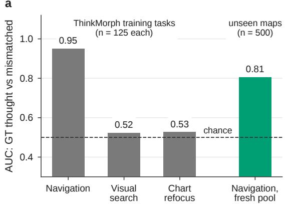

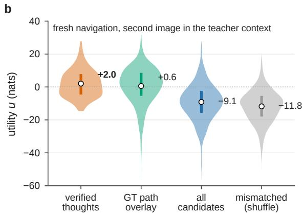  
Fig. 4 What intrinsic verification measures. a Ground-truth thoughts of ThinkMorph’s training tasks and of fresh navigation maps, verified against mismatched ground-truth thoughts. b Utility u (nats) on fresh navigation for verified intrinsic thoughts v⋆, programmatic GT path overlays, all self-generated candidates, and mismatched thoughts from other maps. Dots show means and vertical bars show interquartile ranges

Table 4 Ablation of the self-evolving understanding update across training task pools, teacher contexts, and supervision directions. Average gives the seven-benchmark mean and ∆ gives the improvement over ThinkMorph-7B
<table><tr><td>Method</td><td>Configuration</td><td>Average</td><td>∆ vs. ThinkMorph-7B</td></tr><tr><td>ThinkMorph-7B</td><td>Base interleaved model</td><td>52.7</td><td></td></tr><tr><td>SelfThinker (Nav)</td><td>On-policy self-distillation with verified navigation thoughts</td><td>60.0</td><td>+7.3</td></tr><tr><td>SelfThinker (Mix)</td><td>On-policy self-distillation with combined navigation and visual-search thoughts</td><td>60.8</td><td>+8.1</td></tr><tr><td>Prompt-OPSD</td><td>Visual-search distillation with transition prompt only (no second image)</td><td>60.7</td><td>+8.0</td></tr><tr><td>Noise-OPSD</td><td>Visual-search distillation with uniform RGB noise in place of the thought</td><td>61.8</td><td>+9.1</td></tr><tr><td>SelfThinker (Vote)</td><td>Visual-search distillation with thoughts verified via majority voting (label-free)</td><td>63.4</td><td>+10.7</td></tr><tr><td>SelfThinker</td><td>Visual-search distillation with verified visual thoughts</td><td>64.0</td><td>+11.3</td></tr></table>

Supporting generative refinement improves candidate training imagery.

Table 5 evaluates the supporting generative update (SelfThinker -Gen) on candidate thought generation across the 500-item unseen diagnostic splits. Training on randomly selected thoughts (Rand-RFT) fails to improve utility margins on unseen navigation maps (2.06 versus 2.10 nats). In contrast, SelfThinker-Gen raises the navigation utility margin to 2.96 nats (+0.90 nats over

threshold (95th pct. of mismatched) = 1.4  
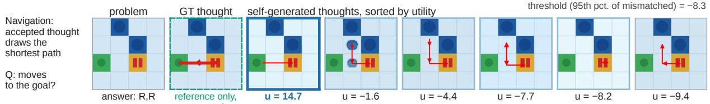  
threshold (95th pct. of mismatched) = −8.3

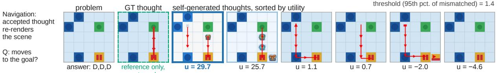

threshold (95th pct. of mismatched) = −17.3  
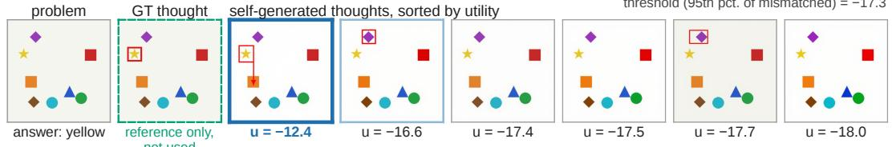

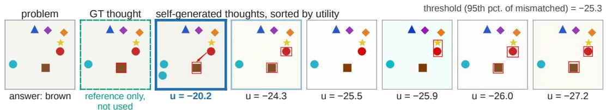  
Fig. 5 Verified visual thoughts on diagnostic items. Each row shows the problem, the programmatic reference thought (dashed green frame, not used by verification), and the six intrinsic visual thoughts sorted by utility u (nats). The dark blue frame marks the verified top thought, and light blue frames mark other thoughts exceeding the item’s 95th-percentile mismatched threshold printed above each row. Row 1: the verified thought draws the shortest path. Row 2: the verified thoughts re-render the scene consistently. Rows 3 and 4 (visual search): marking the queried target scores highest, whereas boxes on distractor objects score lowest

Table 5 Ablation of the supporting generation update on the diagnostic splits (500 items per task). Each generator draws six visual thoughts per item, and the frozen ThinkMorph-7B understanding pathway scores them. SelfThinker-Gen improves every verification metric over both ThinkMorph-7B and Rand-RFT
<table><tr><td>Task</td><td>Method</td><td>Margin (nats)</td><td>Win rate (%)</td><td>Top-1 AUC</td><td>Yield</td></tr><tr><td>Navigation</td><td>ThinkMorph-7B</td><td>2.10</td><td>57.0</td><td>0.821</td><td>0.674</td></tr><tr><td>Navigation</td><td>Rand-RFT</td><td>2.06</td><td>57.3</td><td>0.825</td><td>0.659</td></tr><tr><td>Navigation</td><td>SelfThinker-Gen</td><td>2.96</td><td>60.0</td><td>0.847</td><td>0.694</td></tr><tr><td>Visual search</td><td>ThinkMorph-7B</td><td>0.20</td><td>54.1</td><td>0.660</td><td>0.578</td></tr><tr><td>Visual search</td><td>SelfThinker-Gen</td><td>0.27</td><td>54.4</td><td>0.675</td><td>0.632</td></tr></table>

Rand-RFT), lifts Top-1 AUC from 0.821 to 0.847, and increases yield from 0.674 to 0.694. On visual search, SelfThinker-Gen improves every verification metric (lifting yield from 0.578 to 0.632 and Top-1 AUC from 0.660 to 0.675) while increasing the localized bounding-box generation rate from

40.8% to 50.8% (Appendix D), providing cleaner visual supervision for understanding evolution.

## 5 Conclusion

We introduced SelfThinker, a self-evolving framework that turns a unified multimodal model’s image generation capability into training supervision for visual understanding without human image annotations. By scoring candidate visual thoughts through the model’s frozen understanding pathway via calibrated conditional pointwise mutual information, SelfThinker selects informative helper images under both ground-truth answers and label-free majority votes. Distilling these verified visual thoughts into the understanding pathway via privileged on-policy selfdistillation, supported by flow-matching generator refinement, enables the deployed model to reason directly from the original image in text without generating images at test time. Although trained only on small synthetic visual-search and navigation pools, SelfThinker improves the sevenbenchmark average of ThinkMorph-7B by +11.3 points (and by +10.7 points under label-free majority voting). Controlled image-perturbation probes further show that this self-generated visual supervision transfers broadly across tasks, unlocking fine-grained and 2D/3D spatial perception that surpasses ThinkMorph-7B by up to 40.4 points and the pretrained BAGEL-7B backbone by up to 23.2 points.

## Appendix A Implementation Details

## Rollout sampling.

Table 6 summarizes the synthesized navigation and visual-search problem pools, and Table 7 lists the training hyperparameters for SelfThinker-Gen and SelfThinker. For each item, we sample $K \ = \ 6$ interleaved traces with one visual thought each using the interleaved inferencer of ThinkMorph-7B. Sampling uses 10 denoising steps per thought, text temperature $0 . 7 ,$ classifier-free guidance scales of 4.0 for text and 2.0 for images, and at most 256 thinking tokens. Generating one interleaved trace takes 59 s on navigation and 75 s on visual search on one NVIDIA H20 GPU, whereas scoring a candidate thought with its controls takes 2.3–2.8 s. Navigation thoughts are sampled from ThinkMorph-7B (and from each fine-tuned generator for generator comparisons), while visual-search thoughts are sampled from the navigation SelfThinker-Gen checkpoint. All understanding students are initialized from ThinkMorph-7B.

## Threshold calibration.

For intrinsic verification in Eq. (2), the plain context $C ( I , q )$ and privileged context $C ( I , q , v ) =$ $[ I , q , \rho , v , \tau ]$ are formatted identically to the student and teacher contexts of Eq. (6). We use the transition instruction τ (“Now, using your own independent reasoning, answer the problem above. Think step by step.”) and the privileged context header $\rho$ (“The following images are additional visual context. Use them silently as grounding context, and do not describe or echo them.”). The mismatched partner $v _ { \mathrm { m i s } } ^ { ( k ) }$ of each thought is assigned by a fixed cyclic ofset across items in the scoring order. This ensures that every candidate is compared against an in-distribution thought generated by the same model for a distinct problem. For training set construction, the 95th-percentile threshold $Q _ { i }$ uses the order-statistic form, i.e., the $( \lfloor 0 . 9 5 ( K - 1 ) \rfloor + 1 ) { \ - } 6 \ln$ smallest element of the mismatched utilities $s _ { i }$ (the second largest for $K = 6 )$ , whereas diagnostic yield calculations use the linearly interpolated 95th percentile.

## Teacher-context controls.

Navigation training uses 1,179 verified thoughts from 1,472 scored training items. Visual search uses 1,092 verified thoughts (or 1,074 under the vote direction) from 1,500 items, and the mixed pool combines both verified sets. In SelfThinker-Gen, the flow-matching loss on latent thought tokens has weight 1.0 and the cross-entropy loss on answer tokens has weight 0.25. Rand-RFT uses the exact same 1,179 navigation items and optimization schedule as SelfThinker-Gen, but selects one thought per item uniformly at random without reading $u .$ The teacher-context controls on visual search (Noise-OPSD and Prompt-OPSD) reuse the exact items and optimization settings in Table 7 (1,000 steps on eight NVIDIA H20 GPUs with learning rate $1 0 ^ { - 5 }$ and cosine decay, with navigation distillation trained for 2,000 steps). They modify only the teacher context cT: replacing $v ^ { \star }$ with a $5 1 2 \times 5 1 2$ image of independent uniform RGB noise in Noise-OPSD, or omitting $v ^ { \star }$ in Prompt-OPSD.

Table 6 Synthesized problem pools built outside the training data of ThinkMorph-7B. Each pool contains 1,500 training items and 500 diagnostic items. Programmatic reference thoughts are used only as diagnostic baselines and never ente verification or model training
<table><tr><td>Pool</td><td>Problem image</td><td>Question and answer</td><td>Reference thought</td></tr><tr><td>Navigation</td><td>Frozen-Lake grid, 4 × 4 to 8 × 8, 12–28% holes, 192 × 192 px</td><td>Move sequence along the unique shortest path (2–14 moves, mean 5.1)</td><td>Path overlay</td></tr><tr><td>Visual search</td><td>5–8 non-overlapping shapes (5 shapes, 8 colours), 384 × 384 px</td><td>Colour of a target shape or shape of a target colour (13 classes)</td><td>Red bounding box</td></tr></table>

Table 7 Training hyperparameters for SelfThinker-Gen and SelfThinker. Both updates start from ThinkMorph-7B and run on one node with eight NVIDIA H20 GPUs
<table><tr><td>Setting</td><td>SelfThinker-Gen (generation update)</td><td>SelfThinker (understanding update)</td></tr><tr><td>Trainable pathway</td><td>Generation and understanding (shared decoder)</td><td>Understanding; generation pathway unused Token-level JSD, β = 0.5, temperature 1.0, top-k</td></tr><tr><td>Objective</td><td>Flow matching on thought latents (weight 1.0), cross-entropy on answer (0.25)</td><td>256, per-token clip 0.05</td></tr><tr><td>Teacher</td><td></td><td>EMA of the student, decay 0.995</td></tr><tr><td>Student sampling</td><td></td><td>Temperature 1.0, up to 128 new tokens, one</td></tr><tr><td>Schedule</td><td>1,000 steps; cosine decay, warmup 100, learning</td><td>image skip 1,000 steps; cosine decay, warmup 200, learning</td></tr><tr><td></td><td>rate 10−5 to 10−7 AdamW</td><td>rate  $1 0 ^ { - 5 }$  to 10−7 AdamW (0.9, 0.95), gradient clipping 1.0</td></tr><tr><td>Optimizer Sequence budget</td><td>16,384 tokens per packed batch (8,192 expected)</td><td>10,240 tokens per forward pass</td></tr><tr><td>Parallelism</td><td>Fully sharded data parallel over 8 GPUs</td><td>Fully sharded data parallel over 8 GPUs</td></tr><tr><td>Image transforms</td><td>Vision Transformer (ViT) stride 14, 378–980 px; variational autoencoder (VAE) stride 16,</td><td>ViT stride 14, 378–980 px, at most 2,007,040</td></tr><tr><td></td><td>512-1,024 px</td><td>pixels</td></tr></table>

Table 8 Per-benchmark breakdown of task-pool variants, teacher-context controls, and SelfThinker under the unified judge and text-only decoding. ∆ gives the improvement in the seven-benchmark average relative to ThinkMorph-7B. CV-B: CV-Bench
<table><tr><td>Method</td><td>VSP</td><td>ChartQA</td><td> ${ \mathrm { V } } ^ { * }$ </td><td>MMVP</td><td>SAT</td><td>BLINK</td><td>CV-B.</td><td>Average</td><td>∆</td></tr><tr><td>ThinkMorph-7B</td><td>1.2</td><td>52.7</td><td>53.9</td><td>79.0</td><td>55.3</td><td>53.6</td><td>73.4</td><td>52.7</td><td></td></tr><tr><td colspan="10">Understanding evolution: navigation and mixed pools</td></tr><tr><td>SelfThinker (Nav)</td><td>2.0</td><td>78.1</td><td>63.4</td><td>80.3</td><td>58.0</td><td>60.3</td><td>78.0</td><td>60.0</td><td>+7.3</td></tr><tr><td>SelfThinker (Mix)</td><td>5.5</td><td>74.7</td><td>70.2</td><td>79.3</td><td>54.7</td><td>58.0</td><td>83.5</td><td>60.8</td><td>+8.1</td></tr><tr><td colspan="10">Understanding evolution: visual-search pool and teacher controls</td></tr><tr><td>Prompt-OPSD</td><td>3.3</td><td>77.7</td><td>68.6</td><td>79.7</td><td>56.7</td><td>58.4</td><td>80.6</td><td>60.7</td><td>+8.0</td></tr><tr><td>Noise-OPSD</td><td>13.2</td><td>78.3</td><td>65.4</td><td>80.0</td><td>56.0</td><td>58.5</td><td>81.2</td><td>61.8</td><td>+9.1</td></tr><tr><td>SelfThinker (Vote,</td><td>13.0</td><td>81.9</td><td>67.0</td><td>80.0</td><td>60.0</td><td>59.3</td><td>82.4</td><td>63.4</td><td>+10.7</td></tr><tr><td>label-free) SelfThinker</td><td>15.8</td><td>80.1</td><td>70.2</td><td>82.3</td><td>60.0</td><td>58.2</td><td>81.7</td><td>64.0</td><td>+11.3</td></tr><tr><td>∆ vs. ThinkMorph-7B</td><td>+14.6</td><td>+27.4</td><td>+16.3</td><td>+3.3</td><td>+4.7</td><td>+4.6</td><td>+8.3</td><td>+11.3</td><td></td></tr></table>

## Appendix B Diagnostic Definitions

## Verification metrics.

On the 500-item diagnostic splits, the utility margin is the mean diference $u ( v ) - u ( v _ { \mathrm { m i s } } )$ in nats across all candidate pairs, and the win rate is the percentage of pairs with $u ( v ) > u ( v _ { \mathrm { m i s } } )$ . The Top-1 AUC computes the area under the ROC curve comparing each item’s top intrinsic thought against the mean of its mismatched utilities (Hanley and McNeil 1982), and the yield is the fraction of items whose top thought exceeds $Q _ { i }$ . As an analytical diagnostic for label-free verification, we also report metrics on the accurate-vote subset where the rollout majority vote a˜ matches $a ^ { \star }$

## Bounding-box detector.

Each visual-search thought is converted to RGB, and a pixel is classified as red if $r \geq 1 6 0 , g \leq 9 0$ $b \ \leq \ 9 0$ , and $r \mathrm { ~ - ~ } \operatorname* { m a x } ( g , b ) \ > \ 5 0 . \mathrm { ~ A ~ }$ thought is flagged as containing a red bounding box if its red pixel fraction lies in [0.0015, 0.18] with at least 30 red pixels, its red bounding box is at least $1 0 \times 1 0$ pixels, and the red density along the perimeter band of the bounding box is at least 0.08 and exceeds the interior red density by at least 0.04.

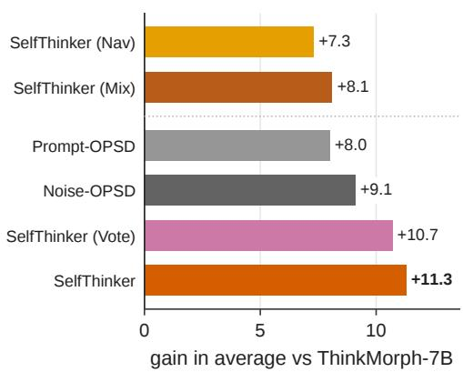

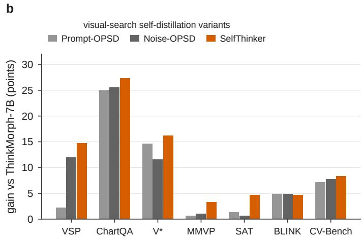  
Fig. 6 Comparison of SelfThinker variants and teacher-context controls. a Gain in the seven-benchmark average relative to ThinkMorph-7B across navigation, mixed-pool, and visual-search distillation runs. b Per-benchmark gains relative to ThinkMorph-7B for Prompt-OPSD, Noise-OPSD, and SelfThinker

## Dual consensus.

On visual search, an item has high answer agreement if the majority vote accounts for at least 80% of the K = 6 rollout answers. It has high visual agreement if the mean pairwise cosine similarity of its six thoughts (after resizing to 48 × 48 RGB arrays and subtracting each array’s mean) exceeds the median across items.

## Pixel deviation.

Pixel deviation measures the mean absolute difference between a visual thought and its problem image after resizing both to 96 × 96 RGB in [0, 1]. Programmatic path overlays deviate by 0.015 on average, and self-generated navigation thoughts have quartile boundaries of 0.012, 0.017, and 0.043.

## Appendix C Per-Benchmark Breakdown of Distillation Variants

Table 8 reports the complete per-benchmark scores of all task-pool variants, visual-search teacher controls, and SelfThinker. Figure 6 visualizes the overall and per-benchmark gains relative to ThinkMorph-7B.

Across training pools (Fig. 6a), navigation distillation in SelfThinker (Nav) lifts the sevenbenchmark average by +7.3 points (reaching 60.0 and achieving the highest score of 60.3 on BLINK). Combining navigation with visual-search thoughts in SelfThinker (Mix) raises the gain to +8.1 points (60.8) and achieves the highest score on CV-Bench (83.5). Moving to the visualsearch pool yields a further jump: Prompt-OPSD (+8.0, 60.7) and Noise-OPSD (+9.1, 61.8) establish strong context-distillation baselines, and conditioning the teacher on verified visual thoughts raises the gain to +10.7 points for label-free Self-Thinker (Vote) (63.4, reaching 81.9 on ChartQA) and +11.3 points for SelfThinker (64.0). Across individual benchmarks (Fig. 6b), SelfThinker consistently improves over Prompt-OPSD and Noise-OPSD on ChartQA (80.1 versus 77.7 and 78.3), V\* (70.2 versus 68.6 and 65.4), VSP (15.8 versus 3.3 for Prompt-OPSD and 13.2 for Noise-OPSD), MMVP (82.3 versus 79.7 and 80.0), SAT (60.0 versus 56.7 and 56.0), and CV-Bench (81.7 versus 80.6 and 81.2).

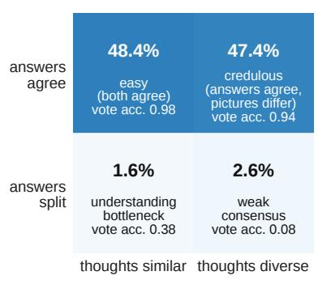

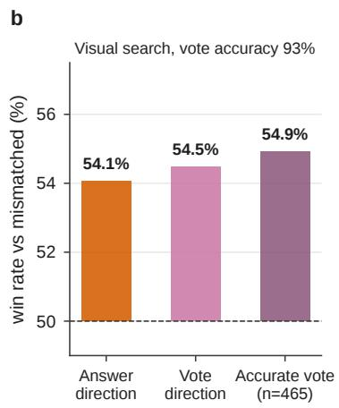

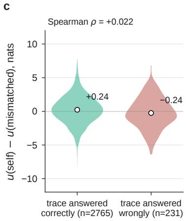  
Fig. 7 Answer consensus versus imagery on visual search (500 diagnostic items). a Items split by answer agreement (vote share at least 0.8) and visual agreement (mean pairwise cosine similarity of the six thoughts, median split), with the vote accuracy of each cell. b Paired win rate against mismatched thoughts under the answer direction, the vote direction, and the accurate-vote subset. c Utility diference u(self) − u(mismatched) for thoughts whose trace answered correctly versus wrongly

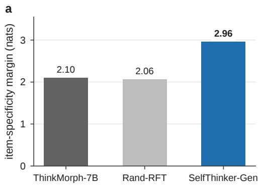

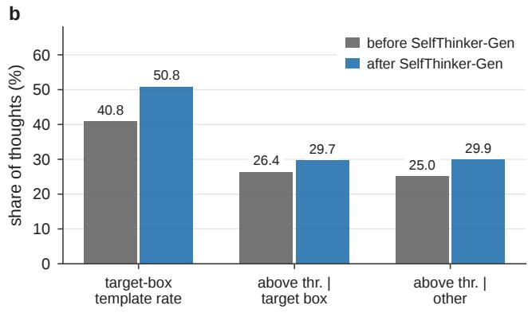  
Fig. 8 Improvements in the generation pathway under SelfThinker-Gen. a Utility margin (nats) of navigation thoughts drawn by ThinkMorph-7B, Rand-RFT, and SelfThinker-Gen on the 500-item diagnostic split. b Bounding-box generation rate and above-threshold pass rates on visual search before and after SelfThinker-Gen

Table 9 Context interventions on the 1,092 verified visual-search items (accuracy in %). Own: the item’s verified visual thought as second image. None: no second image (single-image deployment). Neutral: a neutral sentence appended. True ans.: the ground-truth answer appended. Thought only: the verified visual thought replaces the problem image. The last column reports the diference between Own and None, measuring single-image internalization
<table><tr><td>Method</td><td>Own</td><td>None</td><td>Neutral</td><td>True ans.</td><td>Thought only</td><td>Own – None</td></tr><tr><td>ThinkMorph-7B</td><td>45.9</td><td>39.7</td><td>38.0</td><td>40.7</td><td>35.4</td><td>+6.1</td></tr><tr><td>SelfThinker (Nav)</td><td>92.9</td><td>92.9</td><td>91.2</td><td>96.4</td><td>89.1</td><td>+0.0</td></tr><tr><td>SelfThinker (Vote)</td><td>95.4</td><td>95.3</td><td>95.3</td><td>99.7</td><td>93.0</td><td>+0.1</td></tr><tr><td>SeifThinker</td><td>99.0</td><td>98.9</td><td>98.9</td><td>99.5</td><td>96.5</td><td>+0.1</td></tr></table>

## Appendix D Additional Verification Analyses

Acceptance across pixel deviation quartiles.

On navigation, verified thoughts span the full16 range of pixel deviation from the problem map,

<table><tr><td></td><td>ThinkMorph-7B</td><td>SelfThinker (Nav)</td><td>SelfThinker (Vote)</td><td>SelfThinker</td></tr><tr><td>own verified thought</td><td>45.9</td><td>92.9</td><td>95.4</td><td>99.0</td></tr><tr><td>no second image</td><td>39.7</td><td>92.9</td><td>95.3</td><td>98.9</td></tr><tr><td>text: neutral sentence</td><td>38.0</td><td>91.2</td><td>95.3</td><td>98.9</td></tr><tr><td>text: correct answer</td><td>40.7</td><td>96.4</td><td>99.7</td><td>99.5</td></tr><tr><td>thought only, no problem image</td><td>35.4</td><td>89.1</td><td>93.0</td><td>96.5</td></tr></table>

accuracy (%), 1,092 visual-search items

Fig. 9 Context interventions on the 1,092 verified visual-search items across ThinkMorph-7B, SelfThinker (Nav), Self-Thinker (Vote), and SelfThinker under five conditions (accuracy in %). Rows compare providing the item’s verified thought as second image, no second image (single-image deployment), appending a neutral sentence or the ground-truth answer, or replacing the problem image with the verified thought alone

with acceptance rates of 11.4%, 13.9%, 11.6%, and 15.1% across the four deviation quartiles. The highest-deviation quartile, which includes complete scene re-renderings such as row 2 of Fig. 5, achieves the highest acceptance rate (15.1%).

## Answer consensus versus visual consensus.

Figure 7a shows the dual-consensus breakdown across the 500 diagnostic visual-search items: 48.4% of items have both high answer agreement and visually similar thoughts, while 47.4% have high answer agreement produced from visibly diverse thoughts (matching the 48.5% and 47.3% split on the 1,500 training items). In this diverse-imagery regime, intrinsic verification identifies a validated helper image on 66% of items. Figure 7b,c further shows that the labelfree vote direction matches the answer direction in paired win rate (54.5% versus 54.1%, and 54.9% on accurate-vote items), while trace answer correctness is orthogonal to the visual utility of the thought (ρ = +0.022).

## Generation pathway gains and target-box selectivity.

Figure 8 illustrates how SelfThinker -Gen improves the generation pathway on both tasks. On navigation (Fig. 8a), SelfThinker-Gen lifts the utility margin on unseen diagnostic maps from 2.10 nats (ThinkMorph-7B) and 2.06 nats (Rand-RFT) to

2.96 nats, confirming that verification drives the improvement in generated imagery. On visual search (Fig. 8b), SelfThinker-Gen increases the share of thoughts that draw a localized red bounding box from 40.8% to 50.8%, while raising the utility-threshold pass rate among both box thoughts (from 26.4% to 29.7%) and non-box thoughts (from 25.0% to 29.9%). Evaluating against the ground-truth target coordinates on the 500 unseen diagnostic items further confirms that thoughts boxing the true queried object achieve a mean utility margin of +0.31 nats over mismatched thoughts, compared with −0.04 nats for boxes on distractor objects.

## Appendix E Context Interventions on Visual Search

We evaluate how ThinkMorph-7B and the Self-Thinker students respond to five controlled context interventions on the 1,092 verified visualsearch items (Table 9 and Fig. 9). Whereas ThinkMorph-7B loses 6.1 percentage points when the helper image is removed at test time (45.9% with “Own” versus 39.7% with “None”), Self-Thinker and label-free SelfThinker (Vote) achieve virtually identical accuracy whether given the item’s own verified thought (99.0% and 95.4%) or no second image at all (98.9% and 95.3%, a diference of +0.1 points). This confirms that the distilled students absorb the privileged visual conditioning without requiring a second image at deployment. Appending a neutral sentence leaves accuracy unchanged (98.9% and 95.3%). When the problem image is withheld and only the verified visual thought is shown (“Thought only”), SelfThinker and SelfThinker (Vote) achieve 96.5% and 93.0% accuracy (compared with 35.4% for ThinkMorph-7B), demonstrating that their understanding pathway directly extracts the solution from the verified thought. Furthermore, to test generalization on unseen problem types, Self-Thinker (Nav), trained solely on navigation problems, reaches 92.9% zero-shot on these 1,092 visual-search items both with and without the visual thought (0.0-point gap, up from 45.9% and 39.7% for ThinkMorph-7B).

Table 10 Image-condition probe on ChartQA and V\*. Accuracy (%) under each condition of the problem image (256 thinking tokens). real† and wrong†: real image and another item’s image on the subset whose previous row shows a diferent image. scr.: pixels in random order. ×k: mosaic with k-pixel blocks. σk: Gaussian blur with σ = k pixels. Dashes: not run
<table><tr><td>Method</td><td>real</td><td>real†</td><td>wrong†</td><td>gray</td><td>scr.</td><td>×2</td><td>×4</td><td>×8</td><td>×16</td><td>σ1</td><td>σ2</td><td>σ4</td><td>σ8</td></tr><tr><td colspan="10">ChartQA, horizontal bars (444 items, 222 with a different previous image)</td><td></td><td></td><td></td><td>4.1</td><td>4.7</td></tr><tr><td>ThinkMorph-7B</td><td>32.2</td><td>13.1</td><td>8.6</td><td>5.0</td><td>5.6</td><td>30.6</td><td>10.1</td><td>4.7</td><td>3.8</td><td>32.7</td><td>20.5</td><td></td><td></td></tr><tr><td>SelfThinker (Nav)</td><td>51.4</td><td>33.3</td><td>11.7</td><td>9.7</td><td>10.1</td><td>48.9</td><td>19.4</td><td></td><td></td><td>48.2</td><td>36.7</td><td>10.8</td><td>10.1</td></tr><tr><td>Prompt-OPSD Noise-OPSD</td><td>63.3</td><td>52.7</td><td>9.0</td><td>11.7</td><td>10.4</td><td>59.0</td><td>24.5</td><td>12.4</td><td></td><td>60.1</td><td>45.0</td><td>14.4</td><td></td></tr><tr><td>SelfThinker</td><td>66.2</td><td>58.1</td><td>14.4</td><td>12.6</td><td>10.8</td><td>62.4</td><td>26.6</td><td>12.6</td><td></td><td>67.1</td><td>46.8</td><td>18.2</td><td>14.4</td></tr><tr><td></td><td>67.3</td><td>52.3</td><td>14.9</td><td>10.4</td><td>11.3</td><td>64.9 image)</td><td>25.7</td><td>11.7</td><td>13.7</td><td>68.9</td><td>52.3</td><td>18.2</td><td>12.8</td></tr><tr><td colspan="10">ChartQA, vertical bars (382 items, 191 with a different previous</td><td></td><td></td><td></td><td></td></tr><tr><td>ThinkMorph-7B</td><td>32.5</td><td>14.1</td><td>4.2</td><td>3.4</td><td>6.0</td><td>26.7</td><td>8.6</td><td>3.7</td><td>3.9</td><td>26.4</td><td>18.3</td><td>6.5</td><td>4.5</td></tr><tr><td>SelfThinker (Nav)</td><td>42.9</td><td>30.4</td><td>4.2</td><td>7.9</td><td>8.4</td><td>40.8</td><td>16.2</td><td></td><td></td><td>42.7</td><td>29.3</td><td>14.1</td><td>7.9</td></tr><tr><td>Prompt-OPSD Noise-OPSD</td><td>53.4 61.0</td><td>41.9</td><td>6.8</td><td>11.0</td><td>10.7 10.2</td><td>46.6 54.7</td><td>18.3 18.1</td><td>11.0 11.3</td><td></td><td>52.4 60.2</td><td>33.0 39.5</td><td>15.7 15.7</td><td>11.8</td></tr><tr><td>SelfThinker</td><td>68.6</td><td>52.9 54.5</td><td>5.8 4.7</td><td>8.6 11.5</td><td>13.1</td><td>63.1</td><td>19.9</td><td>12.8</td><td>11.8</td><td>63.4</td><td>43.2</td><td>15.4</td><td>14.7</td></tr><tr><td></td><td></td><td></td><td></td><td></td><td></td><td></td><td></td><td></td><td></td><td></td><td></td><td></td><td></td></tr><tr><td colspan="10">V* (191 items)</td><td></td><td></td><td></td><td></td><td></td></tr><tr><td>ThinkMorph-7B</td><td>34.0</td><td>34.0</td><td>34.0</td><td>32.5</td><td>36.6</td><td>35.6</td><td>37.2</td><td>34.6</td><td>36.1</td><td>36.1</td><td>36.1</td><td>35.1</td><td>35.6</td></tr><tr><td>SelfThinker (Nav)</td><td>56.0</td><td>56.0</td><td>40.3</td><td>38.2</td><td>38.2</td><td>57.6</td><td>50.3</td><td>52.4</td><td>38.2</td><td>59.2</td><td>56.5</td><td>53.9</td><td>45.0</td></tr><tr><td>Prompt-OPSD Noise-OPSD</td><td>50.8</td><td>50.8</td><td>36.6</td><td>34.6</td><td>36.1</td><td>51.3</td><td>49.7</td><td>45.5</td><td></td><td>52.4</td><td>51.8</td><td>47.1</td><td>41.4</td></tr><tr><td></td><td>51.3</td><td>51.3</td><td>31.4</td><td>35.6</td><td>34.0</td><td>51.8</td><td>50.3</td><td>49.7</td><td></td><td>49.2</td><td>49.7</td><td>51.3</td><td>35.6</td></tr><tr><td>SelfThinker</td><td>67.0</td><td>67.0</td><td>38.2</td><td>35.1</td><td>33.0</td><td></td><td>63.9</td><td>61.8</td><td>46.1</td><td>64.4</td><td>66.5</td><td>56.5</td><td>46.1</td></tr></table>

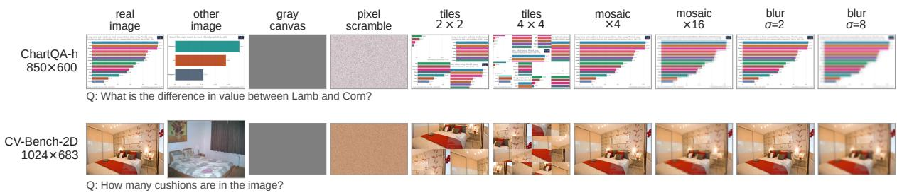  
Fig. 10 Conditions of the image-condition probe, illustrated on a ChartQA horizontal-bar item and a CV-Bench-2D item. The problem image is replaced by another item’s image, a gray canvas, its pixels in random order, a 2 × 2 or 4 × 4 tile permutation, a mosaic with square blocks of 4 or 16 pixels, or a Gaussian blur with σ of 2 or 8 pixels at the native resolution shown under each benchmark name

## Appendix F Multi-Layer Image-Condition Probe

Tables 10, 11, and 12 report the complete results of the image-condition probe at 256 and 512 thinking tokens. Figures 10, 11, and 12 illustrate the visual transformations, the per-benchmark visualsensitivity heatmaps, and the three degradation ladders. Unlike the main benchmark evaluation in Table 2 (which uses 1,024 thinking tokens and semantic grading by Qwen3-30B-A3B-Instruct-2507), the image-condition probe uses a strict 256- or 512-token budget and deterministic rule-based extraction (the last standalone option letter for multiple-choice items or the last number within 5% relative error for ChartQA) to isolate visual sensitivity under controlled image corruptions.

a  
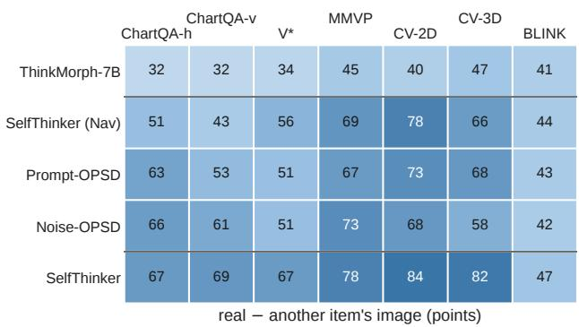

b  
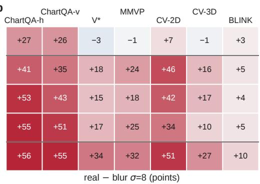

c
<table><tr><td rowspan=1 colspan=1>+5</td><td rowspan=1 colspan=1>+10</td><td rowspan=1 colspan=1>+0</td><td rowspan=1 colspan=1>-3</td><td rowspan=1 colspan=1>+4</td><td rowspan=1 colspan=1>+2</td><td rowspan=1 colspan=1>+5</td></tr><tr><td rowspan=1 colspan=1>+22</td><td rowspan=1 colspan=1>+26</td><td rowspan=1 colspan=1>+16</td><td rowspan=1 colspan=1>+29</td><td rowspan=1 colspan=1>+39</td><td rowspan=1 colspan=1>+14</td><td rowspan=1 colspan=1>+6</td></tr><tr><td rowspan=1 colspan=1>+44</td><td rowspan=1 colspan=1>+35</td><td rowspan=1 colspan=1>+14</td><td rowspan=1 colspan=1>+30</td><td rowspan=1 colspan=1>+34</td><td rowspan=1 colspan=1>+16</td><td rowspan=1 colspan=1>+5</td></tr><tr><td rowspan=1 colspan=1>+44</td><td rowspan=1 colspan=1>+47</td><td rowspan=1 colspan=1>+20</td><td rowspan=1 colspan=1>+44</td><td rowspan=1 colspan=1>+28</td><td rowspan=1 colspan=1>+6</td><td rowspan=1 colspan=1>+6</td></tr><tr><td rowspan=1 colspan=1>+37</td><td rowspan=1 colspan=1>+50</td><td rowspan=1 colspan=1>+29</td><td rowspan=1 colspan=1>+51</td><td rowspan=1 colspan=1>+41</td><td rowspan=1 colspan=1>+27</td><td rowspan=1 colspan=1>+9</td></tr></table>

d
<table><tr><td rowspan=1 colspan=5>ChartQA-v       MMVPChartQA-h        V*</td><td rowspan=1 colspan=1>CV-2D</td><td rowspan=1 colspan=1>CV-3D</td><td rowspan=1 colspan=1>BLINK</td></tr><tr><td rowspan=1 colspan=1></td><td rowspan=1 colspan=1>+27</td><td rowspan=1 colspan=1>+28</td><td rowspan=1 colspan=1>-2</td><td rowspan=1 colspan=1>-5</td><td rowspan=1 colspan=1>-2</td><td rowspan=1 colspan=1>+0</td><td rowspan=1 colspan=1>+1</td></tr><tr><td rowspan=1 colspan=1></td><td rowspan=1 colspan=1>+41</td><td rowspan=1 colspan=1>+35</td><td rowspan=1 colspan=1>+11</td><td rowspan=1 colspan=1>+12</td><td rowspan=1 colspan=1>+9</td><td rowspan=1 colspan=1>-1</td><td rowspan=1 colspan=1>+4</td></tr><tr><td rowspan=1 colspan=1></td><td rowspan=1 colspan=1></td><td rowspan=1 colspan=1></td><td rowspan=1 colspan=1>+9</td><td rowspan=1 colspan=1>+10</td><td rowspan=1 colspan=1>+12</td><td rowspan=1 colspan=1>+9</td><td rowspan=1 colspan=1>+3</td></tr><tr><td rowspan=1 colspan=1></td><td rowspan=1 colspan=1>+52</td><td rowspan=1 colspan=1>+49</td><td rowspan=1 colspan=1>+16</td><td rowspan=1 colspan=1>+19</td><td rowspan=1 colspan=1>+12</td><td rowspan=1 colspan=1>+4</td><td rowspan=1 colspan=1>+4</td></tr><tr><td rowspan=1 colspan=1></td><td rowspan=1 colspan=1>+55</td><td rowspan=1 colspan=1>+54</td><td rowspan=1 colspan=1>+21</td><td rowspan=1 colspan=1>+15</td><td rowspan=1 colspan=1>+11</td><td rowspan=1 colspan=1>+8</td><td rowspan=1 colspan=1>+6</td></tr></table>

Fig. 11 Image-condition probe at 256 thinking tokens across ThinkMorph-7B, SelfThinker (Nav), Prompt-OPSD, Noise-OPSD, and SelfThinker. a Accuracy with the real problem image. b–d Visual sensitivity (accuracy gain in percentage points of the real problem image over pixel scramble, another item’s distinct image, and Gaussian blur with σ = 8 pixels)

Table 11 Image-condition probe on MMVP and CV-Bench. Accuracy (%) under each condition of the problem image (256 thinking tokens). real† and wrong†: real image and another item’s image on the subset whose previous row shows a diferent image. scr.: pixels in random order. ×k: mosaic with k-pixel blocks. σk: Gaussian blur with σ = k pixels. Dashes: not run
<table><tr><td>Method</td><td>real</td><td>real†</td><td>wrong†</td><td>gray</td><td>scr.</td><td>×2</td><td>×4</td><td>×8</td><td>×16</td><td>σ1</td><td>σ2</td><td>σ4</td><td>σ8</td></tr><tr><td colspan="10">MMVP (300 items)</td><td></td><td></td><td></td><td></td></tr><tr><td>ThinkMorph-7B</td><td>44.7</td><td>44.7</td><td>47.7</td><td>49.0</td><td>45.3</td><td>45.3</td><td>47.3</td><td>49.7</td><td>47.0</td><td>47.3</td><td>51.7</td><td>46.3</td><td>50.0</td></tr><tr><td>SelfThinker (Nav)</td><td>69.3</td><td>69.3</td><td>40.0</td><td>48.3</td><td>45.0</td><td>69.7</td><td>61.7</td><td>53.0</td><td>49.7</td><td>67.7</td><td>68.7</td><td>63.3</td><td>57.3</td></tr><tr><td>Prompt-OPSD Noise-OPSD</td><td>67.0</td><td>67.0</td><td>36.7</td><td>49.7</td><td>49.0</td><td>66.7</td><td>61.0</td><td>54.0</td><td></td><td>68.0</td><td>65.0</td><td>62.3</td><td>56.7</td></tr><tr><td></td><td>73.3</td><td>73.3</td><td>29.0</td><td>49.3</td><td>48.7 46.3</td><td>70.3 74.0</td><td>61.3</td><td>56.7</td><td>52.7</td><td>72.7</td><td>69.3</td><td>62.7</td><td>54.7</td></tr><tr><td>SelfThinker</td><td>78.0</td><td>78.0</td><td>26.7</td><td>48.7</td><td></td><td></td><td>62.7</td><td>53.3</td><td></td><td>79.7</td><td>72.3</td><td>63.0</td><td>62.7</td></tr><tr><td colspan="10">CV-Bench-2D (1,438 items)</td><td></td><td></td><td></td><td></td></tr><tr><td>ThinkMorph-7B</td><td>40.2</td><td>40.2</td><td>36.4</td><td>32.6</td><td>33.4</td><td>41.5</td><td>42.6</td><td>41.9</td><td>41.0</td><td>41.2</td><td>43.1</td><td>42.9</td><td>42.4</td></tr><tr><td>SelfThinker (Nav) Prompt-OPSD</td><td>78.1</td><td>78.1</td><td>39.4</td><td>32.3</td><td>32.4</td><td>76.7</td><td>74.6 69.1</td><td>70.8</td><td>61.1</td><td>79.1</td><td>78.0</td><td>75.2 66.2</td><td>69.0 61.1</td></tr><tr><td>Noise-OPSD</td><td>72.8 68.3</td><td>72.8 68.3</td><td>39.1 40.5</td><td>31.8 31.6</td><td>30.7 33.8</td><td>71.1 68.6</td><td>66.1</td><td>63.4 55.4</td><td></td><td>71.8 67.6</td><td>72.3 65.6</td><td>62.1</td><td>56.3</td></tr><tr><td>SelfThinker</td><td>83.5</td><td>83.5</td><td>42.4</td><td>33.9</td><td>32.4</td><td>82.5</td><td>80.9</td><td>75.0</td><td>67.7</td><td>84.1</td><td>81.2</td><td>78.4</td><td>72.6</td></tr><tr><td>CV-Bench-3D (1,200 items,</td><td></td><td></td><td></td><td></td><td></td><td></td><td></td><td></td><td></td><td></td><td></td><td></td><td></td></tr><tr><td colspan="10">1198 with a different previous image)</td><td></td><td></td><td></td><td></td><td></td></tr><tr><td> $\mathrm { T h i n k M o r p h { - } 7 B }$ </td><td>46.8</td><td>46.7</td><td>45.2</td><td>47.5</td><td>48.0</td><td>49.2</td><td>48.3</td><td>48.2</td><td>43.9</td><td>46.8</td><td>48.2</td><td>49.8</td><td>46.4</td></tr><tr><td> $S e l f T h i n k e r \ ( \mathrm { N a v } )$ </td><td>66.5</td><td>66.5</td><td>52.9</td><td>53.2</td><td>50.2</td><td>66.8</td><td>68.1</td><td>67.4</td><td>62.3</td><td>68.2</td><td>69.5</td><td>68.2</td><td>67.3</td></tr><tr><td>Prompt-OPSD</td><td>68.2</td><td>68.2</td><td>51.8</td><td>48.3</td><td>51.3</td><td>65.1</td><td>67.4</td><td>63.7</td><td></td><td>68.8</td><td>67.8</td><td>62.0</td><td>59.5</td></tr><tr><td>Noise-OPSD</td><td>58.5</td><td>58.6</td><td>52.5</td><td>47.5</td><td>48.7</td><td>60.0</td><td>61.2</td><td>55.5</td><td></td><td>58.9</td><td>58.8</td><td>57.7</td><td>54.3</td></tr><tr><td>SelfThinker</td><td>81.8</td><td>81.8</td><td>54.8</td><td>52.3</td><td>54.3</td><td>83.8</td><td>82.2</td><td>77.2</td><td>69.6</td><td>83.0</td><td>81.8</td><td>81.1</td><td>74.2</td></tr></table>

The prompt presents a single image and the question, and multiple-choice items append “Answer with a single letter.” Final answers are extracted from explicit <answer> tags or post-</think> text when present, falling back to the last standalone option letter or number before <image start>. Image swaps use the previous row of the benchmark file on the subset of items whose previous row depicts a distinct image (222 horizontal and 191 vertical ChartQA items, 1,198 CV-Bench-3D items, and all items elsewhere). Pixel scrambles permute all pixels deterministically, and $g \times g$ tile permutations partition the image into $g ^ { 2 }$ equal rectangular patches and shufle those patches, preserving local detail inside each patch while disrupting global spatial layout. Mosaics apply box downsampling by factor $k \in \{ 2 , 4 , 8 , 1 6 \}$ followed by nearest-neighbour upsampling, and blurs apply a Gaussian kernel with $\sigma \in \{ 1 , 2 , 4 , 8 \}$ pixels at native resolution.

Table 12 Image-condition probe at 512 thinking tokens across mosaic, Gaussian blur, and tile-permutation ladders, including the pretrained BAGEL-7B backbone. scr.: pixels in random order. ×k: mosaic with k-pixel blocks. σk: Gaussian blur with σ = k pixels. g × g: permutation of a g × g grid of intact image tiles. Dashes: not run
<table><tr><td>Method</td><td>real</td><td>scr.</td><td>×2</td><td>×4</td><td>×8</td><td>×16</td><td> $\sigma 2$ </td><td> $\sigma 4$ </td><td> $\sigma 8$ </td><td> $\overline { { 2 \times 2 } }$ </td><td> $\overline { { 4 \times 4 } }$ </td><td> $\overline { { 8 \times 8 } }$ </td><td> $\overline { { 1 6 \times 1 6 } }$ </td></tr><tr><td colspan="10"> $\overline { { V ^ { * } \left( 1 9 1 \ i t e m s \right) } }$ </td><td></td><td></td><td></td><td></td></tr><tr><td>BAGEL-7B</td><td>48.7</td><td>37.7</td><td>48.2</td><td></td><td>42.4</td><td>40.3</td><td>52.4</td><td>44.5</td><td>42.4</td><td>43.5</td><td>44.5</td><td>43.5</td><td>40.8</td></tr><tr><td>ThinkMorph-7B</td><td>34.0</td><td>36.6</td><td>35.6</td><td></td><td>34.6</td><td>36.1</td><td>36.1</td><td>35.1</td><td>35.1</td><td>37.2</td><td>36.1</td><td>37.7</td><td>36.1</td></tr><tr><td>SelfThinker (Nav)</td><td>56.0</td><td>38.2</td><td>57.6</td><td></td><td></td><td>38.2</td><td>56.5</td><td>53.9</td><td></td><td>52.9</td><td>54.5</td><td>50.8</td><td>44.0</td></tr><tr><td>SelfThinker</td><td>67.0</td><td>34.0</td><td>66.5</td><td></td><td>61.8</td><td>46.1</td><td>66.5</td><td>56.5</td><td>46.1</td><td>57.1</td><td>57.1</td><td>53.9</td><td>47.6</td></tr><tr><td colspan="10">MMVP (300 items)</td><td></td><td></td><td></td><td></td></tr><tr><td>BAGEL-7B</td><td>66.0</td><td>50.3</td><td>58.7</td><td></td><td>52.7</td><td>53.0</td><td>52.7</td><td>52.3</td><td>49.0</td><td>59.0</td><td>52.3</td><td>51.3</td><td>50.3</td></tr><tr><td>ThinkMorph-7B</td><td>44.7</td><td>45.7</td><td>45.3</td><td></td><td></td><td>47.0</td><td>51.7</td><td>46.0</td><td></td><td>48.0</td><td>47.3</td><td>49.3</td><td>51.3</td></tr><tr><td>SelfThinker (Nav)</td><td>70.0 78.0</td><td>45.3 46.0</td><td>69.3 74.3</td><td></td><td>53.0 53.3</td><td>50.3 52.7</td><td>68.7 72.7</td><td>63.3 63.0</td><td>57.7 62.7</td><td>64.7 75.7</td><td>61.0</td><td>59.3 59.3</td><td>50.0 53.3</td></tr><tr><td colspan="10">SelfThinker</td><td></td><td>63.3</td><td></td><td></td></tr><tr><td> $C V \mathrm { - } B e n c h \mathrm { - } \mathcal { Q } D \ ( 1 , 4 \mathcal { 3 } \& \ i t e m s )$ </td><td></td><td></td><td></td><td></td><td></td><td></td><td></td><td></td><td></td><td></td><td></td><td></td><td></td></tr><tr><td>BAGEL-7B ThinkMorph-7B</td><td>62.5</td><td>36.7</td><td>58.6</td><td>57.2</td><td>53.0</td><td>47.1</td><td>59.5</td><td>56.7</td><td>53.1</td><td>46.9</td><td>42.8</td><td>42.9</td><td>42.5</td></tr><tr><td>SelfThinker (Nav)</td><td>43.0</td><td>33.5</td><td>41.7</td><td>42.6</td><td>41.9</td><td>41.2</td><td>43.1</td><td>43.0</td><td>42.4</td><td>45.0</td><td>43.4</td><td>43.3</td><td>40.6</td></tr><tr><td>SelfThinker</td><td>78.0 83.4</td><td>32.4</td><td>76.6</td><td>74.8</td><td>70.9</td><td>61.1</td><td>78.0</td><td>75.2</td><td>69.1</td><td>59.3</td><td>55.5</td><td>51.3</td><td>44.9</td></tr><tr><td>CV-Bench-3D</td><td></td><td>32.5</td><td>82.8</td><td>80.7</td><td>75.2</td><td>67.8</td><td>81.2</td><td>78.4</td><td>72.7</td><td>64.0</td><td>57.4</td><td>55.1</td><td>52.4</td></tr><tr><td colspan="10">(1,200 items)</td><td></td><td></td><td></td><td></td><td></td></tr><tr><td>BAGEL-7B</td><td>58.8</td><td>51.4</td><td></td><td>57.1</td><td>55.6</td><td>54.3</td><td>59.5</td><td>57.8</td><td>55.0</td><td>55.8</td><td>52.8</td><td>50.0</td><td>50.9</td></tr><tr><td> $\mathrm { T h i n k M o r p h { - } 7 B }$ </td><td>47.6</td><td>48.8</td><td></td><td>49.8</td><td>49.1</td><td>45.0</td><td>49.4</td><td>50.7</td><td>47.5</td><td>50.0</td><td>52.7</td><td>54.2</td><td>54.1</td></tr><tr><td> $S e l f T h i n k e r \ ( \mathrm { N a v } )$ </td><td>71.2 82.0</td><td>50.7</td><td></td><td>73.9</td><td>72.1</td><td>65.2</td><td>72.2</td><td>70.3</td><td>69.2</td><td>68.2</td><td>63.1</td><td>57.4</td><td>55.2</td></tr><tr><td> $S e l f T h i n k e r$ </td><td></td><td>54.5</td><td></td><td>82.2</td><td>77.2</td><td>69.5</td><td>81.9</td><td>81.2</td><td>74.2</td><td>76.6</td><td>68.8</td><td>61.6</td><td>57.1</td></tr></table>

## Visual perception advantage over teacher controls.

At 256 thinking tokens (Fig. 11 and Tables 10– 11), SelfThinker achieves the highest accuracy on every benchmark: 67.3%–68.6% on ChartQA-$h / v ,$ 67.0% on V\*, 78.0% on MMVP, 83.5% on CV-Bench-2D, and 81.8% on CV-Bench-3D, outperforming ThinkMorph-7B (32.2%–46.8%) by wide margins. The real problem image provides a 55–56 point accuracy gain over pixel scramble on ChartQA, 51 points on CV-Bench-2D, 32 points on MMVP, 34 points on ${ \mathrm { V } } ^ { * } .$ , and 28 points on CV-Bench-3D (Fig. 11b). Crucially, Self-Thinker achieves substantially higher real-image accuracy than both teacher controls (Noise-OPSD and Prompt-OPSD), exceeding them by +15.7 and +16.2 points on V\* (67.0% versus 51.3% and 50.8%), +4.7 and +11.0 points on MMVP (78.0% versus 73.3% and 67.0%), +15.2 and +10.7 points on CV-Bench-2D (83.5% versus 68.3% and 72.8%), and +23.3 and +13.6 points on CV-Bench-3D (81.8% versus 58.5% and 68.2%).

## Multi-scale spatial perception.

Comparing the transformation families across Tables 10–12 and Fig. 12 highlights two complementary visual perception capabilities. On ChartQA horizontal and vertical bars (Table 10), SelfThinker preserves high accuracy on $2 \times 2 \cdot$ pixel mosaics (64.9% and 63.1%) and $\sigma ~ = ~ 1$ blur (68.9% and 63.4%), demonstrating strong local glyph reading. On V\*, MMVP, CV-Bench-2D, and CV-Bench-3D at 512 thinking tokens (Table 12 and Fig. 12), SelfThinker preserves its large advantage over both ThinkMorph-7B and pretrained BAGEL-7B across 2 × 2 to $8 \times 8 .$ pixel mosaics, mild blur $( \sigma \ = \ 2 , 4 ) .$ , and $2 \times 2$ to 16 × 16 tile permutations. Specifically, on CV-Bench-2D, SelfThinker achieves 82.8%, 80.7%, and 75.2% across ×2, ×4, ×8 mosaics (versus 32.5% on scramble), and on CV-Bench-3D it achieves 82.2% and 77.2% across ×4 and ×8 mosaics (versus 54.5% on scramble). Together with the 12.0 to 23.2 point improvement over pretrained BAGEL-7B across all four spatial and object-level benchmarks (Table 12), these results confirm that SelfThinker unlocks high-precision visual perception across both fine local details and global scene geometry.

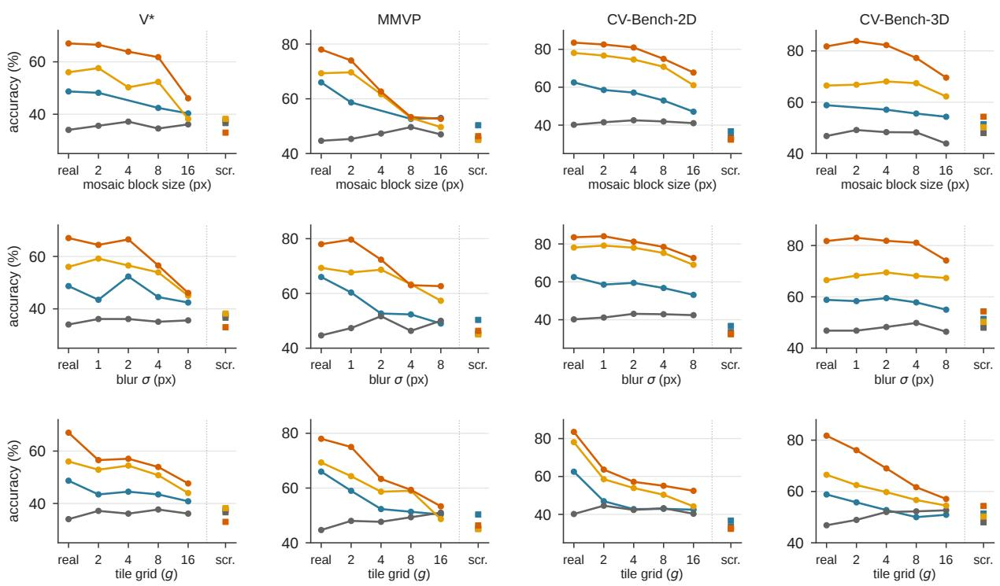  
Fig. 12 Accuracy across mosaic block sizes (top), Gaussian blur σ (middle), and $g \times g$ tile permutations (bottom) on V\*, MMVP, CV-Bench-2D, and CV-Bench-3D for BAGEL-7B (512 tokens), ThinkMorph-7B, SelfThinker (Nav), and SelfThinker. Squares on the right mark the pixel-scramble baseline

## References

Agarwal R, Vieillard N, Zhou Y, et al (2024) Onpolicy distillation of language models: Learning from self-generated mistakes. In: International Conference on Learning Representations, https: //doi.org/10.48550/arXiv.2306.13649

Askell A, Bai Y, Chen A, et al (2021) A general language assistant as a laboratory for alignment. arXiv preprint https://doi.org/10.48550/ arXiv.2112.00861, arXiv:2112.00861

Chameleon Team (2024) Chameleon: Mixedmodal early-fusion foundation models. arXiv preprint https://doi.org/10.48550/arXiv.2405. 09818, arXiv:2405.09818

Chen L, Li J, Dong X, et al (2024a) Are we on the right way for evaluating large vision-language models? In: Advances in Neural Information

Processing Systems, https://doi.org/10.48550/ arXiv.2403.20330

Chen X, Wu Z, Liu X, et al (2025a) Janus-Pro: Unified multimodal understanding and generation with data and model scaling. arXiv preprint https://doi.org/10.48550/arXiv.2501. 17811, arXiv:2501.17811

Chen Z, Deng Y, Yuan H, et al (2024b) Self-play fine-tuning converts weak language models to strong language models. In: International Conference on Machine Learning, https://doi.org/ 10.48550/arXiv.2401.01335

Chen Z, Luo X, Li D (2025b) Visrl: Intentiondriven visual perception via reinforced reasoning. arXiv preprint arXiv:250307523

Chen Z, Zhang M, Yu X, et al (2025c) Think with 3d: Geometric imagination grounded spatial reasoning from limited views. arXiv preprint arXiv:251018632

Chen Z, Zhao R, Luo C, et al (2025d) Sifthinker: Spatially-aware image focus for visual reasoning. arXiv preprint arXiv:250806259

Chen Z, Zhang M, Yu X, et al (2026) 4dthinker: Thinking with 4d imagery for dynamic spatial understanding. arXiv preprint arXiv:260505997

Chern E, Hu Z, Chern S, et al (2025) Thinking with generated images. arXiv preprint https://doi.org/10.48550/arXiv.2505.22525, arXiv:2505.22525

Church KW, Hanks P (1990) Word association norms, mutual information, and lexicography. Computational Linguistics 16(1):22–29

DeepSeek-AI (2025) DeepSeek-R1: Incentivizing reasoning capability in LLMs via reinforcement learning. arXiv preprint https://doi.org/ 10.48550/arXiv.2501.12948, arXiv:2501.12948

Deng C, Zhu D, Li K, et al (2025) Emerging properties in unified multimodal pretraining. arXiv preprint https://doi.org/10.48550/arXiv. 2505.14683, arXiv:2505.14683

Dong H, Xiong W, Goyal D, et al (2023) RAFT: Reward ranked finetuning for generative foundation model alignment. Transactions on Machine Learning Research https://doi.org/ 10.48550/arXiv.2304.06767

Duan H, Fang X, Yang J, et al (2024) VLMEvalKit: An open-source toolkit for evaluating large multi-modality models. In: Proceedings of the ACM International Conference on Multimedia, https://doi.org/10.48550/ arXiv.2407.11691

Fan Y, He X, Yang D, et al (2025) GRIT: Teaching MLLMs to think with images. arXiv preprint https://doi.org/10.48550/arXiv.2505. 15879, arXiv:2505.15879

Fu X, Hu Y, Li B, et al (2024) BLINK: Multimodal large language models can see but not

perceive. In: Proceedings of the European Conference on Computer Vision, https://doi.org/ 10.48550/arXiv.2404.12390

Gkountouras J, Juki´c J, Titov I (2026) Consensus as privileged context for label-free selfdistillation. arXiv preprint https://doi.org/10. 48550/arXiv.2607.13643, arXiv:2607.13643

Gu J, Hao Y, Wang HW, et al (2025) ThinkMorph: Emergent properties in multimodal interleaved chain-of-thought reasoning. arXiv preprint https://doi.org/10.48550/arXiv. 2510.27492, arXiv:2510.27492

Gulcehre C, Paine TL, Srinivasan S, et al (2023) Reinforced self-training (ReST) for language modeling. arXiv preprint https://doi.org/10. 48550/arXiv.2308.08998, arXiv:2308.08998

Han Z, Zhang T, Wang H, et al (2026) Adaptive teacher exposure for self-distillation in LLM reasoning. arXiv preprint https://doi.org/10. 48550/arXiv.2605.11458, arXiv:2605.11458

Hanley JA, McNeil BJ (1982) The meaning and use of the area under a receiver operating characteristic (ROC) curve. Radiology 143(1):29–36. https://doi.org/10.1148/ radiology.143.1.7063747

Hendrycks D, Dietterich T (2019) Benchmarking neural network robustness to common corruptions and perturbations. In: International Conference on Learning Representations, https:// doi.org/10.48550/arXiv.1903.12261

Hinton G, Vinyals O, Dean J (2015) Distilling the knowledge in a neural network. arXiv preprint https://doi.org/10.48550/arXiv.1503. 02531, arXiv:1503.02531

Hu Y, Shi W, Fu X, et al (2024) Visual sketchpad: Sketching as a visual chain of thought for multimodal language models. In: Advances in Neural Information Processing Systems, https: //doi.org/10.48550/arXiv.2406.09403

Huang J, Gu SS, Hou L, et al (2023) Large language models can self-improve. In: Proceedings of the Conference on Empirical Methods in Natural Language Processing, https://doi.org/10.

Koh PW, Liang P (2017) Understanding blackbox predictions via influence functions. In: International Conference on Machine Learning, https://doi.org/10.48550/arXiv.1703.04730

Kosslyn SM, Ganis G, Thompson WL (2001) Neural foundations of imagery. Nature Reviews Neuroscience 2(9):635–642. https://doi.org/10. 1038/35090055

Kwon W, Li Z, Zhuang S, et al (2023) Eficient memory management for large language model serving with PagedAttention. In: Proceedings of the ACM Symposium on Operating Systems Principles, https://doi.org/10.48550/ arXiv.2309.06180

Lanham T, Chen A, Radhakrishnan A, et al (2023) Measuring faithfulness in chain-of-thought reasoning. arXiv preprint https://doi.org/10.48550/arXiv.2307.13702, arXiv:2307.13702

Li C, Wu W, Zhang H, et al (2025) Imagine while reasoning in space: Multimodal visualizationof-thought. arXiv preprint https://doi.org/10. 48550/arXiv.2501.07542, arXiv:2501.07542

Li P, Gao Z, Zhang L, et al (2026a) Visual-OPSD: Cross-modal on-policy self-distillation for eficient unified multimodal reasoning. arXiv preprint https://doi.org/10.48550/arXiv.2606. 18974, arXiv:2606.18974

Li Y, Wang B, Liang Y, et al (2026b) Onpolicy self-distillation without any supervision. arXiv preprint https://doi.org/10.48550/arXiv. 2608.06296, arXiv:2608.06296

Lipman Y, Chen RTQ, Ben-Hamu H, et al (2023) Flow matching for generative modeling. In: International Conference on Learning Representations, https://doi.org/10.48550/ arXiv.2210.02747

Liu X, Gong C, Liu Q (2023) Flow straight and fast: Learning to generate and transfer data with rectified flow. In: International Conference on Learning Representations, https://doi.org/ 10.48550/arXiv.2209.03003

Lopez-Paz D, Bottou L, Sch¨olkopf B, et al (2016) Unifying distillation and privileged information. In: International Conference on Learning Representations, https://doi.org/10.48550/ arXiv.1511.03643

Masry A, Long DX, Tan JQ, et al (2022) ChartQA: A benchmark for question answering about charts with visual and logical reasoning. In: Findings of the Association for Computational Linguistics, https://doi.org/10.48550/ arXiv.2203.10244

Menon S, Zemel R, Vondrick C (2024) Whiteboard-of-thought: Thinking stepby-step across modalities. arXiv preprint https://doi.org/10.48550/arXiv.2406.14562, arXiv:2406.14562

Pearson J, Naselaris T, Holmes EA, et al (2015) Mental imagery: Functional mechanisms and clinical applications. Trends in Cognitive Sciences 19(10):590–602. https://doi.org/10.1016/ j.tics.2015.08.003

Qwen Team (2024) Qwen2.5 technical report. arXiv preprint https://doi.org/10.48550/arXiv. 2412.15115, arXiv:2412.15115

Rahmanzadehgervi P, Bolton L, Taesiri MR, et al (2024) Vision language models are blind. In: Proceedings of the Asian Conference on Computer Vision, pp 18–34, https://doi.org/10. 48550/arXiv.2407.06581

Ray A, Duan J, Brown E, et al (2024) SAT: Dynamic spatial aptitude training for multimodal language models. arXiv preprint https://doi.org/10.48550/arXiv.2412.07755, arXiv:2412.07755

Shao H, Qian S, Xiao H, et al (2024) Visual CoT: Advancing multi-modal language models with a comprehensive dataset and benchmark for chain-of-thought reasoning. In: Advances in Neural Information Processing Systems, Datasets and Benchmarks Track, https://doi. org/10.48550/arXiv.2403.16999

Shepard RN, Metzler J (1971) Mental rotation of three-dimensional objects. Science 171(3972):701–703. https://doi.org/10.1126/

org/10.48550/arXiv.2203.11171

Snell C, Klein D, Zhong R (2022) Learning by distilling context. arXiv preprint https://doi.org/ 10.48550/arXiv.2209.15189, arXiv:2209.15189

Su Z, Lu W, Chen H, et al (2025) UniGame: Turning a unified multimodal model into its own adversary. arXiv preprint https://doi.org/ 10.48550/arXiv.2511.19413, arXiv:2511.19413

Tong S, Brown E, Wu P, et al (2024a) Cambrian-1: A fully open, vision-centric exploration of multimodal LLMs. In: Advances in Neural Information Processing Systems, https://doi.org/10. 48550/arXiv.2406.16860

Tong S, Fan D, Zhu J, et al (2024b) MetaMorph: Multimodal understanding and generation via instruction tuning. arXiv preprint https://doi.org/10.48550/arXiv.2412.14164, arXiv:2412.14164

Tong S, Liu Z, Zhai Y, et al (2024c) Eyes wide shut? exploring the visual shortcomings of multimodal LLMs. In: Proceedings of the IEEE/CVF Conference on Computer Vision and Pattern Recognition, https://doi.org/10. 48550/arXiv.2401.06209

Towers M, Kwiatkowski A, Terry J, et al (2024) Gymnasium: A standard interface for reinforcement learning environments. arXiv preprint https://doi.org/10.48550/arXiv.2407. 17032, arXiv:2407.17032

Turpin M, Michael J, Perez E, et al (2023) Language models don’t always say what they think: Unfaithful explanations in chain-of-thought prompting. In: Advances in Neural Information Processing Systems, https://doi.org/10.48550/ arXiv.2305.04388

Vapnik V, Vashist A (2009) A new learning paradigm: Learning using privileged information. Neural Networks 22(5–6):544–557. https: //doi.org/10.1016/j.neunet.2009.06.042

Wang X, Wei J, Schuurmans D, et al (2023) Selfconsistency improves chain of thought reasoning in language models. In: International Conference on Learning Representations, https://doi.

Wang X, Zhang X, Luo Z, et al (2024) Emu3: Next-token prediction is all you need. arXiv preprint https://doi.org/10.48550/arXiv.2409. 18869, arXiv:2409.18869

Wu C, Chen X, Wu Z, et al (2024a) Janus: Decoupling visual encoding for unified multimodal understanding and generation. arXiv preprint https://doi.org/10.48550/arXiv.2410. 13848, arXiv:2410.13848

Wu J, Yang S, Lu Z, et al (2026) SEED: Self-evolving on-policy distillation for agentic reinforcement learning. arXiv preprint https://doi.org/10.48550/arXiv.2607.14777, arXiv:2607.14777

Wu P, Xie S (2024) V\*: Guided visual search as a core mechanism in multimodal LLMs. In: Proceedings of the IEEE/CVF Conference on Computer Vision and Pattern Recognition, https://doi.org/10.48550/arXiv.2312.14135

Wu Q, Zhao H, Saxon M, et al (2024b) VSP: Assessing the dual challenges of perception and reasoning in spatial planning tasks for VLMs. arXiv preprint https://doi.org/10.48550/arXiv. 2407.01863, arXiv:2407.01863

Xie J, Mao W, Bai Z, et al (2025) Show-o: One single transformer to unify multimodal understanding and generation. In: International Conference on Learning Representations, https: //doi.org/10.48550/arXiv.2408.12528

Yang A, Li A, Yang B, et al (2025a) Qwen3 technical report. arXiv preprint https://doi.org/10. 48550/arXiv.2505.09388, arXiv:2505.09388

Yang Z, Yu X, Chen D, et al (2025b) Machine mental imagery: Empower multimodal reasoning with latent visual tokens. arXiv preprint https://doi.org/10.48550/arXiv.2506. 17218, arXiv:2506.17218

Yuan Q, Lou J, Yu X, et al (2026) Vision-OPD: Learning to see fine details for multimodal LLMs via on-policy self-distillation. arXiv preprint https://doi.org/10.48550/arXiv. 2605.18740, arXiv:2605.18740

Yuan Z, Yuan H, Li C, et al (2023) Scaling relationship on learning mathematical reasoning with large language models. arXiv preprint https://doi.org/10.48550/arXiv.2308. 01825, arXiv:2308.01825

Zelikman E, Wu Y, Mu J, et al (2022) STaR: Bootstrapping reasoning with reasoning. In: Advances in Neural Information Processing Systems, https://doi.org/10.48550/arXiv.2203. 14465

Zhai X, Mustafa B, Kolesnikov A, et al (2023) Sigmoid loss for language image pre-training. In: Proceedings of the IEEE/CVF International Conference on Computer Vision, https://doi. org/10.48550/arXiv.2303.15343

Zheng Z, Yang M, Hong J, et al (2025) Deep-Eyes: Incentivizing “thinking with images” via reinforcement learning. arXiv preprint https://doi.org/10.48550/arXiv.2505.14362, arXiv:2505.14362

Zhou C, Yu L, Babu A, et al (2024) Transfusion: Predict the next token and difuse images with one multi-modal model. arXiv preprint https://doi.org/10.48550/arXiv.2408. 11039, arXiv:2408.11039

Zuo Y, Zhang K, Sheng L, et al (2025) TTRL: Test-time reinforcement learning. arXiv preprint https://doi.org/10.48550/arXiv.2504. 16084, arXiv:2504.16084