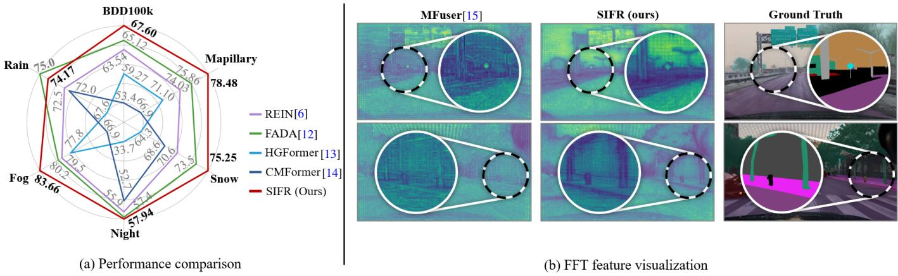
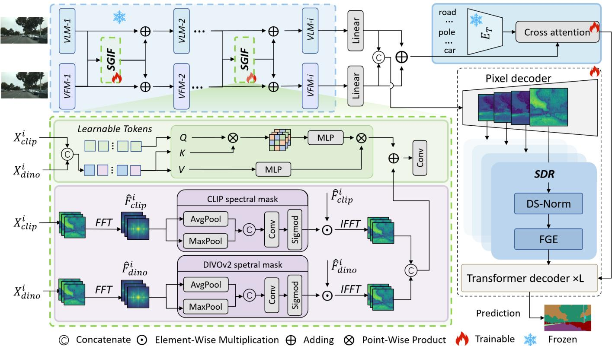
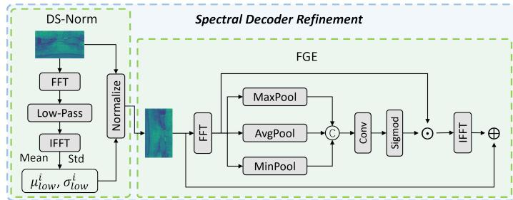
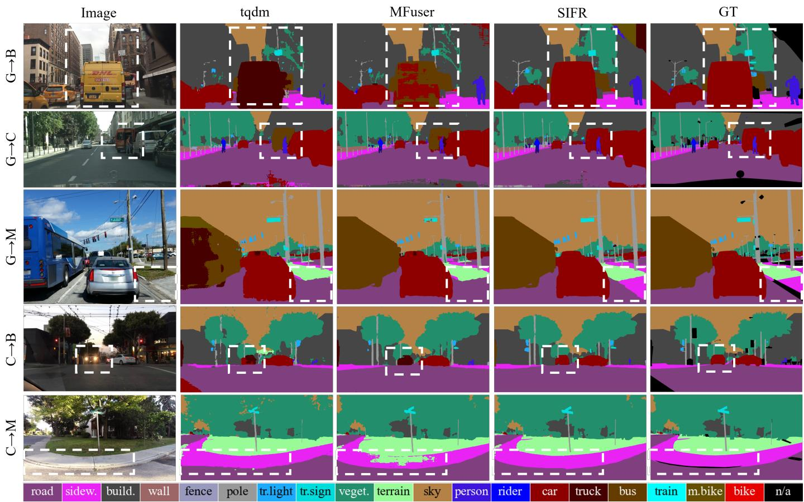
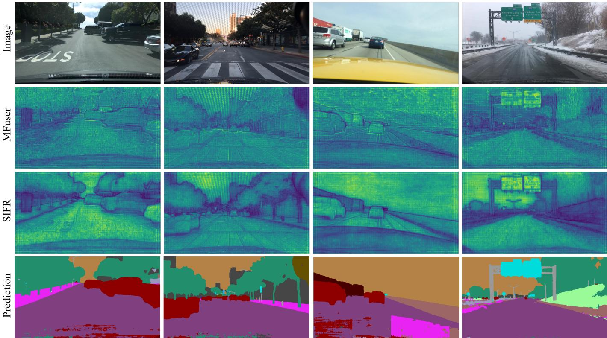
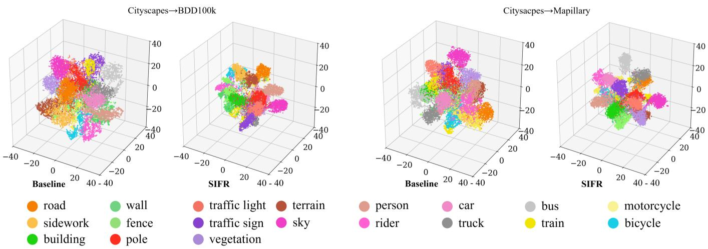
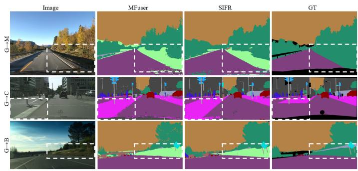

# Spectral Invariant Fusion and Refinement for Domain Generalized

Semantic Segmentation

Yansong Bai, Yunzhi Zhuge, Xinzhuo Yu, Lu Zhang, Jin Zhan, Pingping Zhang, Huchuan Lu, Fellow IEEE

Abstract—Domain generalized semantic segmentation is challenging because it requires accurate dense prediction on unseen domains without any access to target-domain data during training. Existing methods improve transferability through data diversification, invariant learning, or direct use of foundation models, but they often struggle to simultaneously suppress domain-sensitive interference and preserve fine-grained spatial cues. In this work, we propose SIFR, a frequency-aware dual-stream framework that tackles domain shift at both the fusion and decoding stages. SIFR uses spectral modeling as a unified principle to regulate both heterogeneous prior interaction and dense decoder refinement. Instead of directly fusing frozen CLIP and DINOv2 features, SIFR performs spectral-guided invariant fusion to filter out domainsensitive responses while preserving complementary semantic and structural information. In addition, SIFR incorporates a spectral decoder refinement module that stabilizes multi-scale decoder features through low-frequency statistics-based normalization and adaptive frequency selection, thereby reducing the propagation of residual domain bias in dense prediction. This design enables SIFR to jointly improve domain robustness and segmentation precision under severe distribution shifts. Extensive experiments on multiple DGSS benchmarks, including synthetic-to-real, real-to-real, and adverse-weather settings, demonstrate consistent improvements over previous state-of-the-art methods.

Index Terms—Domain generalized semantic segmentation, vi sion foundation model, vision-language model, frequency modeling, CLIP, DINOv2.

## I. INTRODUCTION

Domain Generalized Semantic Segmentation (DGSS) aims to learn segmentation models from multiple source domains that generalize well to unseen target domains without any target-domain adaptation [1]–[7]. Compared with Domain Adaptive Semantic Segmentation [8]–[10], which addresses cross-domain discrepancies by leveraging unlabeled targetdomain data during training, DGSS must confront domain shifts in a more challenging setting where no target-domain information is available at all. Consequently, a central challenge in DGSS is to achieve robustness to both low-level appearance changes and high-level semantic or contextual variations without compromising the accuracy and structural consistency of pixel-wise predictions [1], [2], [11].

Existing DGSS methods mainly improve generalization from two perspectives: data-level generalization and feature-level representation learning [2], [4], [16], [17]. The former increases source-domain diversity through perturbation, stylization, or synthesis, while the latter aims to learn domain-invariant representations across source domains [2], [4], [17]–[20]. However, both directions face an inherent tension between domain invariance and spatial discriminability. Increasing appearance diversity or enforcing feature consistency can improve robustness to domain shifts, but may also weaken boundary, texture, and other fine-grained cues that are essential for accurate segmentation. Consequently, those methods still struggle to jointly achieve strong domain robustness and precise spatial prediction [4], [16].

Recent advances in large-scale pretrained models have opened a promising direction for DGSS, as they provide more transferable and stable visual priors than conventionally trained backbones [6]. In particular, vision-language models (VLMs) capture rich high-level semantic knowledge, while vision foundation models (VFMs) offer stronger local structural cues and dense visual representations [15], [21], [22]. However, simply combining these heterogeneous priors is still insufficient for DGSS, as it faces two core challenges: i) Cross-prior misalignment. VLM and VFM are pretrained with different objectives, which leads to inconsistent feature geometries and domain responses and thus makes their interaction unstable under domain shifts. ii) Domain appearance entanglement. Despite their strong transferability, both priors can still encode domain-specific style, texture, and low-level statistics, so direct fusion may propagate domain-sensitive variations instead of isolating task-relevant cues.

To address these challenges, spectral modeling offers a complementary perspective. i) Spectral alignment. By organizing heterogeneous priors in the frequency domain, spectral modeling promotes more coherent interaction between semantic and structural cues across domains. ii) Spectral disentanglement. By separating domain-variant appearance components from task-relevant structural information, spectral modeling suppresses domain-sensitive responses while preserving the local details required for precise segmentation.

Inspired by these principles, we propose SIFR, a Spectral Invariant Fusion and Refinement framework for domain generalized semantic segmentation, which leverages heterogeneous large-scale priors while explicitly enhancing domain invariance. i) Spectral-Guided Invariant Fusion (SGIF). SGIF employs frozen CLIP [21] and DINOv2 [22] as the VLM and VFM, where CLIP provides high-level semantic priors and DINOv2 captures fine-grained structural representations. By casting cross-prior interaction into the spectral domain, SGIF explicitly suppresses domain-variant appearance responses and enhances domain-stable semantic and structural cues. As qualitatively illustrated in Fig. 1 (b), this spectral-guided invariant fusion produces clearer structural responses and better preserves semantically relevant regions under challenging domain shifts. Learnable query tokens and cross-attention [23] are further introduced to promote effective semantic-visual fusion under reduced domain interference. ii) Spectral Decoder Refinement (SDR). SDR performs decoder refinement via domain-stable normalization and frequency-guided enhancement module to curb the accumulation of domain-sensitive patterns, stabilize multi-scale features, and preserve informative components for precise segmentation. Overall, SIFR unifies spectral invariant fusion and refinement into a coherent framework that enhances generalization to unseen domains without sacrificing finegrained spatial prediction.

  
Fig. 1. Representative characteristic of SIFR. (a) Performance comparison with recent DGSS methods on representative real-to-real and adverse-weather benchmarks, where SIFR consistently achieves the best mIoU. (b) Feature visualization comparing MFuser [15] and SIFR, where our method preserves clearer structures, suppresses domain-sensitive interference, and produces feature responses that better match the ground-truth semantics in challenging regions.

We evaluate SIFR on multiple DGSS benchmarks spanning real-to-real and real-to-adverse-weather settings, the comparison results of which is shown in Fig. 1 (a). Furthermore, on the synthetic-to-real setting, SIFR achieves state-of-the-art performance, reaching 71.30 mIoU on Cityscapes [24], 62.54 on BDD100K [25], and 71.96 on Mapillary [26], with gains of up to +1.32 points over previous methods. On the real-toreal setting, SIFR consistently outperforms strong baselines, obtaining 67.60 and 78.48 mIoU on BDD100K [25] and Mapil lary [26], respectively. These consistent improvements suggest that SIFR effectively suppresses domain-sensitive interference while preserving transferable semantic and structural cues, thereby enhancing robustness under domain shift.

Our contributions can be summarized as follows:

• We present SIFR, a frequency-aware dual-stream framework for domain generalized semantic segmentation that leverages frozen CLIP and DINOv2 as complementary semantic and structural priors, and introduces spectral modeling in both feature fusion and decoder refinement.

• We introduce a Spectral-Guided Invariant Fusion (SGIF) module that couples token-level cross-attention with frequency-domain refinement to promote complementary interaction between heterogeneous pretrained representations while suppressing domain-sensitive responses.

• We develop a Spectral Decoder Refinement (SDR) module, comprising domain-stable normalization and frequencyguided enhancement, to stabilize decoder features and preserve segmentation-relevant spectral components for robust dense prediction under domain shift.

• Extensive experiments on multiple DGSS benchmarks show that SIFR consistently improves cross-domain segmentation performance across synthetic-to-real, real-toreal, and adverse-weather settings.

## II. RELATED WORK

## A. Domain Generalized Semantic Segmentation

Domain-generalized semantic segmentation (DGSS) studies how to learn segmentation models that generalize to unseen target domains without access to target-domain data during training. Existing research has explored this problem through multiple paradigms [1], [4], [11], [16], [27]. Earlier efforts often improve domain robustness either by simulating domain variation during training, such as through meta-learning or source-domain diversification [2], [20], [27], or by reducing domain-specific bias via feature alignment, normalization, whitening, and related representation learning techniques [1], [4], [28]. Beyond these data- and representation-oriented strategies, some studies further investigate architectural designs, including transformer-based models, to strengthen cross-domain feature modeling and dense prediction [13], [29]. More recently, foundation models have introduced a new opportunity for DGSS, since large-scale pretraining can provide stronger and more transferable visual priors than conventionally trained backbones [6], [11], [12], [15]. Existing attempts have begun to exploit such priors through synthetic data generation [11], model adaptation [6], [12], or semantic guidance [29], [30]. Beyond conventional static vision–language alignment, SB-Gen [31] formulates the transformation from domain-specific visual representations to domain-agnostic textual semantics as a cross-modal Schrodinger Bridge, and models this alignment¨ as a stochastic semantic evolution process. However, how to effectively utilize heterogeneous pretrained representations under domain shift, especially when different pretrained streams capture complementary yet unequally domain-sensitive cues, still remains to be explored.

  
Fig. 2. Overview of the proposed framework. Frozen VLM and VFM encoders extract hierarchical features, which are progressively fused by the proposed Spectral-Guided Invariant Fusion (SGIF) module via token-level cross-attention and frequency-domain refinement. The fused features are then passed to the pixel decoder and further refined by Spectral Decoder Refinement (SDR) module, including Domain-Stable Normalization (DS-Norm) and Frequency-Guided Enhancement (FGE), before being decoded with text-guided semantic priors to generate robust segmentation masks under domain shift.

## B. Vision Foundation Models

Vision foundation models (VFMs) have recently emerged as a powerful basis for visual transfer learning, primarily driven by large-scale pretraining on diverse image corpora using self-supervised objectives [22], [32], [33], masked image modeling [34], and segmentation-oriented paradigms [35]. Compared with conventionally supervised backbones, VFMs generally learn more generalizable and reusable representations, enabling strong transfer performance across a wide range of downstream tasks [22], [33], [34]. Representative examples include DINO series [22], [32], iBOT, MAE [34] and EVA series [33], [36], [37] which provide strong semantic and structural representations, as well as the SAM family [35], [38], which brings foundation-scale modeling to segmentation.

Recent studies have also shown the relevance of VFMs to dense prediction. DINO [32] and iBOT [39] suggest that self-supervised ViTs can encode explicit segmentationrelated information and strong local semantic patterns, while ViT-Adapter [40] demonstrates that pretrained ViTs can be effecti- vely adapted to semantic segmentation with lightweight task-specific designs. Nevertheless, existing efforts mostly emphasize architectural adaptation or downstream transfer, with limited attention paid to how domain-sensitive appearance statistics are entangled with transferable structural cues in pretrained dense representations. This leaves room for spectral modeling as a complementary mechanism for DGSS, since it can help expose and suppress domain-variant responses while preserving the structure-aware cues that VFMs already capture.

## C. Frequency Modeling Under Domain Shift

Frequency-based modeling has become an increasingly important direction in cross-domain learning, since domain shift often affects not only spatial appearance but also frequency statistics [12], [18], [41], [42]. Existing studies mainly explore frequency information from two perspectives [12], [18], [41], [42]. One line of work applies frequency-domain perturbation, spectral substitution, or amplitude manipulation at the input level to expand source-domain diversity and alleviate stylerelated bias [18], [41], [42]. Another line of work performs frequency filtering or modulation at the feature level to improve the cross-domain robustness of learned representations [12], [43], [44]. Most recently, HarDiff [45] introduces the Discrete Hartley Transform into a diffusion-based framework for generalizable dense prediction. It exploits low-frequency structural priors from the source domain during training and highfrequency detail guidance from unseen-domain inputs during iterative sampling. Nevertheless, existing frequency-aware VFM methods mainly focus on adapting a single pretrained visual stream. For example, FADA [12] decomposes VFM features into low- and high-frequency branches through Haar wavelet transformation, while SET [3] processes the amplitude and phase components of frozen VFM features with learnable spectral tokens. In contrast, our method focuses on frequencyaware interaction between heterogeneous VLM and VFM representations rather than frequency adaptation within a single VFM. Although MFuser [15] also integrates VLM and VFM features, it mainly employs Mamba-based modules to model sequential and spatial interactions, without explicitly regulating the domain-sensitive spectral responses propagated from the two pretrained streams. Our SGIF instead combines tokenlevel cross-attention with stream-specific adaptive spectral reweighting, and SIFR further extends spectral regulation to multi-scale decoder refinement. Therefore, SIFR differs from existing approaches in both the representation scope and the stages at which spectral modeling is performed.

## III. METHOD

## A. Overview

As shown in Fig. 2, our method adopts a unified frequencyaware segmentation framework that consists of hierarchical prior extraction, spectral-guided invariant fusion, and decoder side refinement. Given an input image, frozen VLM and VFM encoders first extract multi-level features, where VLM provides high-level semantic priors and VFM offers fine-grained structural cues. To effectively exploit these heterogeneous representations under domain shift, we introduce a Spectral-Guided Invariant Fusion (SGIF) module during layer-wise feature interaction. Specifically, SGIF combines token-level cross-attention with a frequency-guided enhancement branch, which transforms features into the spectral domain, adaptively reweights different frequency components, and then projects them back to the spatial domain. In this way, the fusion process suppresses domain-sensitive appearance variations while preserving domain-stable semantic and structural information that is more beneficial for semantic segmentation.

The fused features are then fed into the pixel decoder and further refined by the proposed Spectral Decoder Refinement (SDR) module. Specifically, SDR module first applies lowfrequency statistics-based normalization to mitigate residual domain-specific bias in decoder features, and then performs adaptive frequency selection to enhance segmentation-relevant spectral responses. The resulting multi-scale features are finally fed into the Transformer decoder, where they interact with text guided semantic priors to progressively produce high-quality masks. At the framework level, SGIF, the pixel decoder, and SDR play complementary rather than redundant roles. SGIF suppresses domain-sensitive interference during heterogeneous feature interaction and fusion. The pixel decoder subsequently aggregates the SGIF-fused multi-level representations into multi-scale dense features, providing spatially structured visual representations for subsequent mask decoding. SDR then mitigates the residual domain bias that remains or accumulates during multi-scale feature aggregation and dense decoding. Finally, the text-guided semantic priors complement the SDRrefined visual representations by providing category-level semantic guidance within the Transformer decoder, thereby establishing more reliable pixel-to-class correspondences for mask prediction.

## B. Spectral-Guided Invariant Fusion

In domain generalized semantic segmentation, pretrained VLMs [21] and VFMs [22] often exhibit domain preferential responses learning from their pretraining data. Therefore, directly combining their features can introduce domain-sensitive patterns during feature interaction and fusion. To address this issue, we formulate feature fusion as a dual-branch process, as shown in Fig. 2, consisting of a layer-wise interaction branch and a frequency-guided enhancement branch. The former captures complementary semantic interactions between the two pretrained representations, while the latter injects spectral priors to suppress domain-sensitive interference and preserve structurally stable cues.

Given the features extracted from the i-th layer of VLM and VFM, we denote them as $X _ { \mathrm { v l m } } ^ { i } ~ \in ~ \mathbb { R } ^ { \tilde { B } \times L _ { c } \times D }$ and $X _ { \mathrm { v f m } } ^ { i } \in \mathbb { R } ^ { B \times L _ { d } \times D }$ , where B is the batch size, $L _ { c }$ and $L _ { d }$ denote the token numbers, and $D$ is the shared embedding dimension. To capture complementary interactions between the two branches, we first concatenate their features along the sequence dimension:

$$
X _ { \mathrm { c a t } } ^ { i } = \mathrm { C o n c a t } \left( X _ { \mathrm { v l m } } ^ { i } , X _ { \mathrm { v f m } } ^ { i } \right) .\tag{1}
$$

We then introduce a learnable query token $T ^ { i } \in \mathbb { R } ^ { B \times L _ { q } \times D }$ and perform cross-attention over the concatenated features:

$$
X _ { \mathrm { a t t n } } ^ { i } = \mathrm { C r o s s A t t n } \left( T ^ { i } , X _ { \mathrm { c a t } } ^ { i } , X _ { \mathrm { c a t } } ^ { i } \right) ,\tag{2}
$$

where $X _ { \mathrm { a t t } } ^ { i }$ denotes the i-th layer fusion result and $L _ { q }$ denotes the number of learnable query tokens.

In parallel, we construct a frequency-guided enhancement branch. Specifically, features are reshaped into 2D feature maps, $F _ { \mathrm { v l m } } ^ { i ^ { \star } } \ \in \ \mathbb { R } ^ { \bar { B ^ { \star } } D \times H _ { c } \times W _ { c } }$ and $F _ { \mathrm { v f m } } ^ { i } ~ \in ~ \mathbb { R } ^ { B \times D \times H _ { d } \times W _ { d } }$ We then transform them into the frequency domain using Fourier transform operation $\mathcal F ( \cdot )$ , yielding $\hat { F } _ { \mathrm { v l m } } ^ { i } = \mathcal { F } ( F _ { \mathrm { v l m } } ^ { i } )$ and $\hat { F } _ { \mathrm { v f m } } ^ { i } = \mathcal { F } ( F _ { \mathrm { v f m } } ^ { i } )$ . Based on the spectral representations, we generate the adaptive spectral masks $M _ { \mathrm { v l m } } ^ { i }$ and $M _ { \mathrm { v f m } } ^ { i }$ through a lightweight refinement module. For each branch, the spectral feature is first summarized by channel-wise average and maximum pooled descriptors computed from the magnitude spectrum at each frequency location. These descriptors preserve the spatial frequency resolution and are concatenated and passed through a convolutional layer followed by a sigmoid function to produce the corresponding spectral mask. The spectral masks are applied to reweight the frequency responses:

$$
\tilde { F } _ { \mathrm { v l m } } ^ { i } = \hat { F } _ { \mathrm { v l m } } ^ { i } \odot M _ { \mathrm { v l m } } ^ { i } , \qquad \tilde { F } _ { \mathrm { v f m } } ^ { i } = \hat { F } _ { \mathrm { v f m } } ^ { i } \odot M _ { \mathrm { v f m } } ^ { i } ,\tag{3}
$$

where ⊙ denotes element-wise multiplication. After inverse Fourier transform, the enhanced feature maps are transformed back into token representations, denoted as $X _ { \mathrm { f r e q } } ^ { i } .$

Finally, we combine the token-level fusion result and the frequency-guided enhancement through residual addition, followed by a convolutional layer to obtain the final fused representation:

$$
X _ { \mathrm { f u s e } } ^ { i } = \mathrm { C o n v } \left( X _ { \mathrm { a t t n } } ^ { i } + X _ { \mathrm { f r e q } } ^ { i } \right) .\tag{4}
$$

In this way, the proposed fusion strategy integrates the complementary semantic interactions captured by the crossattention branch with the domain-robust structural cues provided by the frequency-guided branch. As a result, it yields more discriminative and robust intermediate features for the subsequent decoder under domain shift.

  
Fig. 3. Paradigm of the Spectral Decoder Refinement (SDR) module. For each decoder feature, DS-Norm first normalizes the feature using lowfrequency statistics obtained via FFT, low-pass filtering, and IFFT, while FGE then adaptively enhances segmentation-relevant frequency responses through pooled spectral descriptors and inverse reconstruction.

## C. Spectral Decoder Refinement

Although the encoder-stage SGIF reduces domain-sensitive interference during heterogeneous prior fusion, residual appearance deviations may still remain in the fused representations and propagate through subsequent multi-scale decoding. The key motivation of SDR is to decouple residual domain-bias suppression from segmentation-relevant spectral preservation during dense prediction. Since global and smoothly varying domain changes, such as illumination, contrast, weather, and style, are more strongly reflected in low-frequency feature statistics, DS-Norm estimates normalization statistics from the low-frequency component while applying normalization to the original full-spectrum feature. This suppresses global statistical deviations without explicitly discarding fine-grained spatial responses. However, normalization alone cannot determine which frequency components are informative for different images and feature scales. Therefore, FGE further performs data-dependent spectral reweighting to adaptively emphasize segmentation-relevant responses. In this way, SDR follows a suppress-then-select principle: DS-Norm stabilizes decoder feature statistics, whereas FGE adaptively preserves and enhances informative spectral components for robust mask prediction. As shown in Fig. 2, SDR is inserted between the pixel decoder and the Transformer decoder. Fig. 3 details the internal suppress-then-select design of SDR.

Let $\{ D ^ { i } \} _ { i = 1 } ^ { 4 }$ denote the four multi-scale output features of the pixel decoder, where $D ^ { i } \in \mathbb { R } ^ { B \times C \times H _ { i } \times W _ { i } }$ . For each scale, we first extract its low-frequency component in the frequency domain. Specifically, we transform $D ^ { i }$ into the spectral domain, apply a low-pass filter, and project the filtered response back to the spatial domain, yielding the low-frequency feature $D _ { \mathrm { l o w } } ^ { i }$ The size of the retained low-frequency region is controlled by a filter ratio $\rho .$ Based on $D _ { \mathrm { l o w } } ^ { i }$ , we compute the channel-wise mean and standard deviation:

$$
\mu _ { \mathrm { l o w } } ^ { i } = \mathrm { M e a n } ( D _ { \mathrm { l o w } } ^ { i } ) , \qquad \sigma _ { \mathrm { l o w } } ^ { i } = \mathrm { S t d } ( D _ { \mathrm { l o w } } ^ { i } ) .\tag{5}
$$

These low-frequency statistics are then used to normalize the original decoder feature:

$$
\tilde { D } ^ { i } = \frac { D ^ { i } - \mu _ { \mathrm { l o w } } ^ { i } } { \sigma _ { \mathrm { l o w } } ^ { i } + \epsilon } ,\tag{6}
$$

where ϵ is a small constant for numerical stability.

Built upon the normalized feature $\tilde { D } ^ { i }$ , we further perform frequency-guided enhancement. We first transform ${ \tilde { D } } ^ { i }$ into the frequency domain and denote its spectral representation as:

$$
\hat { \tilde { D } } ^ { i } = \mathcal { F } ( \tilde { D } ^ { i } ) .\tag{7}
$$

Then, we generate the frequency-guided mask $M ^ { i }$ from ${ \hat { \tilde { D } } } ^ { i }$ using a lightweight refinement module. Specifically, for each frequency location, we compute channel-wise pooled spectral descriptors from the magnitude spectrum of $\ddot { \tilde { D } } { } ^ { i }$ , including average, maximum, and minimum responses across the channel dimension. Different from spatial pooling with a fixed local window, these operations summarize cross-channel spectral statistics while preserving the spatial frequency resolution. The resulting descriptors are concatenated and fed into a lightweight convolutional layer followed by a sigmoid function to produce $M ^ { i }$ . The mask is then applied to reweight the normalized spectral representation:

$$
\hat { D } _ { \mathrm { e n h } } ^ { i } = M ^ { i } \odot \hat { \tilde { D } } ^ { i } .\tag{8}
$$

Finally, the enhanced decoder feature is obtained by inverse Fourier transform:

$$
D _ { \mathrm { e n h } } ^ { i } = \mathcal { F } ^ { - 1 } ( \hat { D } _ { \mathrm { e n h } } ^ { i } ) .\tag{9}
$$

In this way, the proposed decoder refinement suppresses residual domain-sensitive statistical deviations while further emphasizing structurally informative spectral responses. As a result, it provides more robust multi-scale features for the subsequent transformer decoder and improves mask prediction under domain shift.

## D. Training Objective

We optimize the proposed framework using the standard segmentation objective together with a pixel-level visionlanguage alignment objective. For segmentation, following Mask2Former [46], the loss is defined as:

$$
{ \mathcal { L } } _ { \mathrm { s e g } } = \lambda _ { \mathrm { b c e } } { \mathcal { L } } _ { \mathrm { b c e } } + \lambda _ { \mathrm { d i c e } } { \mathcal { L } } _ { \mathrm { d i c e } } + \lambda _ { \mathrm { c l s } } { \mathcal { L } } _ { \mathrm { c l s } } ,\tag{10}
$$

where $\mathcal { L } _ { \mathrm { b c e } }$ and ${ \mathcal { L } } _ { \mathrm { d i c e } }$ denote the binary cross-entropy loss and Dice loss for mask prediction, respectively, and $\mathcal { L } _ { \mathrm { c l s } }$ is the classification loss for query prediction.

In addition, we introduce a pixel-text alignment loss $\mathcal { L } _ { \mathrm { a l i g n } }$ to enforce semantic consistency between pixel-level visual representations and textual class embeddings. For each semantic class k, we construct its text prompt by placing M learnable context tokens $\{ p _ { m } \} _ { m = 1 } ^ { M }$ between the start token SOS and the tokenized class name $c _ { k } ,$ followed by the end token EOS. The CLIP text encoder is kept frozen, while the context tokens are optimized during training.

Given the normalized pixel-level visual feature $\hat { \mathbf { v } } _ { i }$ at pixel i and the normalized text embedding $\hat { \mathbf { t } } _ { k }$ of class k, we compute their similarity score as the inner product $\hat { \mathbf { v } } _ { i } ^ { \top } \hat { \mathbf { t } } _ { k }$ divided by the temperature τ, which is fixed to 0.07. The resulting dense similarity scores are supervised by the ground-truth semantic labels using pixel-wise cross-entropy:

$$
\mathcal { L } _ { \mathrm { a l i g n } } = - \frac { 1 } { | \Omega | } \sum _ { i \in \Omega } \log \frac { \exp ( s _ { i , y _ { i } } ) } { \sum _ { k = 1 } ^ { K } \exp ( s _ { i , k } ) } ,\tag{11}
$$

  
Fig. 4. Qualitative comparison of segmentation results across five source-to-target settings: $G  B , G  C , G  M , C  B ,$ and $C  M .$ . From left to right are the input image, the predictions of tqdm [29], MFuser [15], our SIFR, and the ground truth . The white boxes highlight challenging regions with small objects, thin structures, and ambiguous boundaries. Compared with previous methods, SIFR yields more complete predictions and better preserves fine structures, producing results closer to the ground truth.

where K denotes the number of semantic classes, $y _ { i }$ is the ground-truth label of pixel $i ,$ and Ω is the set of valid pixels. Pixels with the ignore label are excluded.

The overall training objective is defined as

$$
\mathcal { L } _ { \mathrm { t o t a l } } = \mathcal { L } _ { \mathrm { s e g } } + \lambda _ { \mathrm { a l i g n } } \mathcal { L } _ { \mathrm { a l i g n } } ,\tag{12}
$$

where $\lambda _ { \mathrm { a l i g n } }$ is set to 1.0 in all experiments.

## IV. EXPERIMENTS

## A. Experiment Settings

Datasets and Metrics. We evaluate our method under synthetic-to-real, real-to-real, and real-to-adverse-weather DGSS settings on five driving-scene benchmarks that share 19 semantic categories. GTA5 [47] is a large-scale synthetic dataset containing 24,966 densely annotated images with a fixed resolution of 1914×1052, and is widely used as a source domain for cross-domain semantic segmentation. Cityscapes [24] is a standard real-world benchmark for urban scene understanding, containing 2,975 training images, 500 validation images, and 1,525 testing images, with a fixed resolution of 2048×1024. BDD100K [25] is a diverse real-world driving dataset with images of fixed resolution 1280×720; for semantic segmentation, it provides 10K annotated images and is commonly organized into 7,000 training, 1,000 validation, and 2,000 test images. Mapillary [26] is a large-scale street-scene dataset containing 18,000 training images, 2,000 validation images, and 5,000 test images; unlike Cityscapes [24] and BDD100K [25], its images are high-resolution but come in diverse sizes and capture conditions. ACDC [48] is designed for adverse-condition semantic segmentation and contains 1,600 training images, 406 validation images, and 2,000 test images under four weather conditions, i.e. fog, rain, snow, and nighttime, making it a challenging benchmark for evaluations under severe domain shifts. Following prior DGSS works [6], [15], we adopt mean Intersection over Union (mIoU) as the evaluation metric.

Implementation Details. We adopt CLIP [21] as the visionlanguage model, DINOv2 [22] as the visual foundation model, and Mask2Former [46] as the segmentation head. During training, the CLIP visual encoder, CLIP text encoder, and DINOv2 backbone are kept frozen, and their parameters are not updated. Optimization is performed over the parameters of the SGIF modules and their learnable query tokens, the feature projection and fusion layers, the pixel decoder, the learnable layers within SDR, the text-guided cross-attention module, the Transformer decoder, and the classification and mask prediction heads. The learnable context tokens used to construct the class prompts are also optimized, while the CLIP text encoder remains frozen. All trainable parameters are jointly optimized in a single end-to-end training stage using the total objective in Eq.(12). No stage-wise pretraining or alternating optimization is adopted. All input images are resized to 512 × 512. We train the model with a batch size of 2 on each GPU. We optimize the model using AdamW with a base learning rate of 1e-4 and a weight decay of 1e-4. The learning rate follows a poly decay schedule with a power of 0.9 and a minimum learning rate of 1e-6, together with a linear warm-up over the first 1900 iterations using a warm-up ratio of 1e-6. The model is trained for 30,000 iterations. During inference, we adopt sliding-window evaluation with a crop size of 512 × 512 and a stride of $3 4 1 \times 3 4 1$ Unless otherwise specified, we use $L _ { q } = 6 4$ learnable query tokens in SGIF and set the low-pass filter ratio in DS-Norm to $\rho = 0 . 2 5$ . All experiments are implemented based on MMSegmentation and conducted on two RTX 4090 GPUs.

## B. Comparison with State-of-the-Art Methods

We compare SIFR with representative domain generalized semantic segmentation (DGSS) methods under three evaluation settings: synthetic-to-real generalization from GTA5 [47] to Cityscapes [24], BDD100K [25], and Mapillary [26] $( G $ C, B, M), real-to-real generalization from Cityscapes [24] to BDD100K [25] and Mapillary [26] $( C \ \to \ B , M )$ , and real-to-adverse-weather generalization from Cityscapes [24] to ACDC [48] $( C  A )$ . Since our method is built upon heterogeneous pretrained priors, we place particular emphasis on recent foundation-model-based approaches, including CLOUDS [11], VLTSeg [30], REIN [6], SET [3], MFuser [15], DepthForge [49], and tqdm [29]. For completeness, we also include several conventional DGSS methods to provide a broader comparison across different methodological paradigms.

Real-to-Real Generalization. Tab. I reports the comparisons under the real-to-real setting. SIFR achieves the best performance on both $C  B$ and $C  M$ , demonstrating that the proposed spectral modeling strategy improves transferability across real-world domains. In particular, compared with the strong baseline MFuser [15], SIFR improves mIoU by +2.02 on $C  B$ and +0.38 on $C  M ,$ yielding an average gain of +1.20. Moreover, although DepthForge [49] additionally leverages depth information, SIFR still surpasses it by +1.41 on C → B and +2.55 on $C  M$ , corresponding to an average improvement of +1.98. These results indicate that SIFR more effectively exploits complementary semantic and structural priors for robust real-to-real generalization.

Synthetic-to-Real Generalization. The results in Tab. II further verify the effectiveness of SIFR under the more challenging synthetic-to-real setting. SIFR obtains the best performance on all three target domains, namely $G  C$ $G  B$ , and $G  M$ . Relative to MFuser [15], SIFR improves performance by +0.06, +1.46, and +0.82 mIoU, respectively. The largest improvement on BDD100K [25] suggests that SIFR is particularly effective when the target domain exhibits larger appearance and context variations.

Real-to-Adverse-Weather Generalization. As reported in Tab. III, SIFR achieves the best overall performance on Cityscapes [24] → ACDC [48], showing stronger robustness under adverse weather. It reaches 75.3 mIoU on Snow, 57.9 on

TABLE I  
QUANTITATIVE COMPARISONS UNDER THE Cityscapes → BDD100K + Mapillary GENERALIZATION SETTING.
<table><tr><td>Method</td><td>Proc. &amp; Year</td><td>BDD100k</td><td>Mapillary</td><td>Avg</td></tr><tr><td colspan="5">ResNet based:</td></tr><tr><td>IBN [50]</td><td>ECCV2018</td><td>48.56</td><td>57.04</td><td>52.80</td></tr><tr><td>IW [51]</td><td>CVPR2019</td><td>48.49</td><td>55.82</td><td>52.16</td></tr><tr><td>Itenorm [52]</td><td>CVPR2019</td><td>49.23</td><td>56.26</td><td>52.75</td></tr><tr><td>DRPC [53]</td><td>ICCV2019</td><td>49.86</td><td>56.34</td><td>53.10</td></tr><tr><td>GTR [54]</td><td>TIP2021</td><td>50.75</td><td>57.16</td><td>53.96</td></tr><tr><td>RobustNet [1]</td><td>CVPR2021</td><td>50.73</td><td>58.64</td><td>54.69</td></tr><tr><td>WildNet [2]</td><td>CVPR2022</td><td>50.94</td><td>58.79</td><td>54.87</td></tr><tr><td>SAW [4]</td><td>CVPR2022</td><td>52.95</td><td>59.81</td><td>56.38</td></tr><tr><td>BlindNet [28]</td><td>CVPR2024</td><td>51.84</td><td>60.18</td><td>56.01</td></tr><tr><td colspan="5">Transformer based:</td></tr><tr><td>HGFormer [13]</td><td>CVPR2023</td><td>53.40</td><td>66.90</td><td>60.15</td></tr><tr><td>CMFormer [14]</td><td>AAAI2024</td><td>59.27</td><td>71.10</td><td>65.19</td></tr><tr><td colspan="5">VFM based:</td></tr><tr><td>REIN [6]</td><td>CVPR2024</td><td>63.54</td><td>74.03</td><td>68.79</td></tr><tr><td>FADA [12]</td><td>NeurIPS2024</td><td>65.12</td><td>75.86</td><td>70.49</td></tr><tr><td>SET [3]</td><td>ACM MM</td><td>65.07</td><td>75.76</td><td>70.37</td></tr><tr><td>VLTSeg [30]</td><td>ACCV2024</td><td>64.40</td><td>76.40</td><td>70.40</td></tr><tr><td>tqdm [29]</td><td>ECCV2024</td><td>64.72</td><td>76.15</td><td>70.44</td></tr><tr><td>DPMFormer [55]</td><td>ICCV2025</td><td>64.20</td><td>76.67</td><td>70.44</td></tr><tr><td>DepthForge [49]</td><td>ICCV2025</td><td>66.19</td><td>75.93</td><td>71.06</td></tr><tr><td>Causal-Tune [56]</td><td>AAAI2026</td><td>66.28</td><td>76.05</td><td>71.16</td></tr><tr><td>MFuser [15]</td><td>CVPR2025</td><td>65.58</td><td>78.10</td><td>71.84</td></tr><tr><td>SBGen [31]</td><td>NeurIPS2026</td><td>66.03</td><td>77.90</td><td>71.97</td></tr><tr><td></td><td></td><td>67.60</td><td></td><td></td></tr><tr><td>SIFR(ours)</td><td></td><td></td><td>78.48</td><td>73.04</td></tr></table>

Night, and 83.7 on Fog, outperforming previous methods on all three conditions. Compared with FADA [12], SIFR improves by +1.8, +0.5, and +3.5 mIoU on Snow, Night, and Fog, while remaining competitive on Rain. This suggests that SIFR better preserves domain-invariant cues under severe weather-induced shifts.

Qualitative Results Analysis. Fig. 4 further illustrates the qualitative superiority of SIFR on five cross-domain settings spanning synthetic-to-real and real-to-real generalization. Compared with tqdm [29] and MFuser [15], SIFR produces masks that are visually closer to the ground truth, especially in the white-boxed regions containing small objects, thin structures, and ambiguous boundaries. On $G  B$ and $G  C ,$ our method better preserves object completeness for vehicles and roadside structures while reducing fragmented predictions. On G → M and $C  M$ , SIFR yields cleaner layouts for roads, sidewalks, and vegetation, with fewer category confusions. On the challenging $C  B$ case, it also recovers clearer scene boundaries under low-light conditions. These observations confirm that spectral fusion and decoder refinement improve both structural consistency and semantic precision.

## C. Ablation Analysis

We conduct ablation experiments under the Cityscapes [24] → BDD100k [25] + Mapillary [26] setting to analyze the effect of the proposed spectral designs from five aspects, including normalization strategy, pooling design, module composition, the number of learnable query tokens in SGIF, and the low-pass filter ratio in DS-Norm.

  
Fig. 5. Qualitative comparison of feature responses. From top to bottom are the input images, the feature visualizations of MFuser [15], the feature visualizations of our SIFR, and the corresponding predictions of SIFR. SIFR exhibits clearer structural patterns and more discriminative feature responses than MFuser [15], particularly in regions containing distant objects and ambiguous semantic boundaries.

Effect of Normalization Strategy. Tab. IV compares different normalization strategies in the decoder refinement stage. Among all variants, the proposed DS-Norm achieves the best average performance, improving the average mIoU to 73.04. Compared with conventional normalization schemes, such as LayerNorm, BatchNorm, GroupNorm, and InstanceNorm, DS-Norm yields more consistent gains on both BDD100k [25] and Mapillary [26]. This result indicates that directly applying generic normalization operators is insufficient to address domainspecific distribution shifts in decoder features. By contrast, our DS-Norm explicitly normalizes features with low-frequency statistics, which better suppresses residual domain-sensitive deviations and produces more robust representations for cross domain segmentation.

Effect of Pooling Design. Tab. V studies different pooling combinations for generating the spectral mask in the decoder stage. Using only two types of pooled descriptors already brings reasonable performance, but the full combination of min pooling, average pooling, and max pooling gives the best result, reaching 73.04 average mIoU. This suggests that different pool ing operators capture complementary statistics in the frequency domain. In particular, max pooling emphasizes strong spectral responses, average pooling captures global frequency trends, and min pooling further supplements suppressed yet potentially informative cues. Their combination therefore enables a more comprehensive spectral characterization and leads to stronger domain-generalized segmentation performance.

Effect of SGIF and SDR. Tab. VI further evaluates the contributions of the two proposed modules. Introducing either

SGIF or SDR alone already improves the cross-domain performance over the baseline, indicating that both encoder-side spectral fusion and decoder-side spectral refinement are individually effective. Using both modules together yields further gains, highlighting their complementarity. Specifically, SGIF strengthens intermediate fused representations by combining token interaction with frequency-guided invariant cues, while SDR removes residual domain-sensitive bias during decoding. These results show that spectral modeling at both the feature fusion and decoder refinement stages is important for stronger robustness under domain shift.

Hyperparameter Sensitivity. Table VII evaluates the sensitivity of SIFR to the number of learnable query tokens $L _ { q }$ in SGIF and the low-pass filter ratio $\rho$ in DS-Norm. For each experiment, we vary one parameter while keeping the remaining configurations fixed.

For the number of query tokens, SIFR achieves average mIoU scores of 72.49, 72.38, 73.04, and 72.04 with $L _ { q }$ set to 32, 48, 64, and 128, respectively. The model maintains comparable performance with moderate token numbers, while $L _ { q } = 6 4$ achieves the best result. Increasing $L _ { q }$ to 128 leads to a moderate performance decrease, possibly because an excessive number of tokens introduces redundant cross-prior interactions. Therefore, we use $L _ { q } = 6 4$ as the default setting.

For DS-Norm, the low-pass filter ratios of 0.25, 0.50, and 0.75 yield average mIoU scores of 73.04, 72.75, and 72.94, respectively. The maximum difference among these settings is only 0.29 mIoU, indicating that DS-Norm is relatively robust to the size of the low-pass filter. We adopt $\rho = 0 . 2 5$ because

TABLE II  
QUANTITATIVE COMPARISONS UNDER THE GTA5 → Cityscapes + BDD100K + Mapillary GENERALIZATION SETTING.
<table><tr><td>Method</td><td>Proc. &amp; Year</td><td></td><td></td><td>Cityscapes BDD100k Mapillary</td><td>Avg</td></tr><tr><td colspan="6">ResNet based:</td></tr><tr><td>Iternorm [52]</td><td>CVPR2019</td><td>31.81</td><td>32.70</td><td>33.88</td><td>32.80</td></tr><tr><td>DRPC [53]</td><td>ICCV2019</td><td>37.42</td><td>32.14</td><td>34.12</td><td>34.56</td></tr><tr><td>GTR [54]</td><td>TIP2021</td><td>37.53</td><td>33.75</td><td>34.52</td><td>35.27</td></tr><tr><td>RobustNet [1]</td><td>CVPR2021</td><td>36.58</td><td>35.20</td><td>40.33</td><td>37.37</td></tr><tr><td>AdvStyle [57]</td><td>NeurIPS2022</td><td>39.62</td><td>35.54</td><td>37.00</td><td>37.39</td></tr><tr><td>SAW [4]</td><td>CVPR2022</td><td>39.75</td><td>37.34</td><td>41.86</td><td>39.65</td></tr><tr><td>DIRL [58]</td><td>AAAI2022</td><td>41.04</td><td>39.15</td><td>41.60</td><td>40.60</td></tr><tr><td>SHADE [59]</td><td>ECCV2022</td><td>44.65</td><td>39.28</td><td>43.34</td><td>42.42</td></tr><tr><td>WildNet [2]</td><td>CVPR2023</td><td>44.62</td><td>38.42</td><td>46.09</td><td>43.04</td></tr><tr><td>SPC [17]</td><td>CVPR2023</td><td>44.10</td><td>40.46</td><td>45.51</td><td>43.36</td></tr><tr><td>BlindNet [28]</td><td>CVPR2024</td><td>45.72</td><td>41.32</td><td>47.08</td><td>44.71</td></tr><tr><td>TLDR [19]</td><td>ICCV2023</td><td>47.58</td><td>44.88</td><td>48.80</td><td>47.08</td></tr><tr><td>FAMix [60]</td><td>CVPR2024</td><td>49.47</td><td>46.40</td><td>51.97</td><td>49.28</td></tr><tr><td colspan="6">Transformer based:</td></tr><tr><td>CMFormer [14] |</td><td>AAAI2024</td><td>55.31</td><td>49.91</td><td>60.09</td><td>55.10</td></tr><tr><td colspan="6">VFM based:</td></tr><tr><td>DIDEX [61] CLOUDS [11]</td><td>WACV2024</td><td>62.00</td><td>54.30</td><td>63.00</td><td>59.77</td></tr><tr><td></td><td></td><td>60.20</td><td>57.40</td><td>67.00</td><td>61.53</td></tr><tr><td>VLTSeg [30]</td><td>ACCV2024 CVPR2024</td><td>65.60</td><td>58.40</td><td>66.50</td><td>63.50</td></tr><tr><td>REIN [6]</td><td></td><td>66.40</td><td>60.40</td><td>66.10</td><td>64.30</td></tr><tr><td>SET [3]</td><td>ACMMM2024</td><td>68.06</td><td>61.64</td><td>67.68</td><td>65.79</td></tr><tr><td>tqdm [29]</td><td>ECCV2024</td><td>68.88</td><td>59.18</td><td>70.10</td><td>66.05</td></tr><tr><td>FADA [12]</td><td>NeurIPS2024</td><td>68.23</td><td>61.94</td><td>68.09</td><td>66.09</td></tr><tr><td>HarDiff [45]</td><td>ICCV2025</td><td>62.00</td><td>58.90</td><td>68.80</td><td>63.20</td></tr><tr><td>MFuser [15]</td><td>CVPR2025</td><td>71.24</td><td>61.08</td><td>71.14</td><td>67.82</td></tr><tr><td>SBGen [31]</td><td>NeurIPS2026</td><td>71.24</td><td>62.26</td><td>71.91</td><td>68.47</td></tr><tr><td>SIFR</td><td></td><td>71.30</td><td>62.54</td><td>71.96</td><td>68.60</td></tr></table>

TABLE III

QUANTITATIVE COMPARISONS UNDER THE Cityscapes → ACDC ADVERSE-WEATHER GENERALIZATION SETTING.
<table><tr><td rowspan=1 colspan=1>Method</td><td rowspan=1 colspan=2>| Proc. &amp; YearSnowNightFog Rain</td></tr><tr><td rowspan=1 colspan=1>ResNet based:</td><td rowspan=5 colspan=2>ECCV2018   49.6  21.2 63.8 50.449.9  23.8 63.3 50.147.6  21.8 62.4 52.449.8  24.3 64.3 56.028.4  12.7 41.2 34.2</td></tr><tr><td rowspan=2 colspan=1>IBN [50]</td><td rowspan=1 colspan=1>ECCV2018</td></tr><tr><td rowspan=2 colspan=1>IW [51]RobustNet [1]</td><td rowspan=1 colspan=1>CVPR2019</td></tr><tr><td rowspan=1 colspan=1>CVPR201</td></tr><tr><td rowspan=1 colspan=1>WildNet [2]</td><td rowspan=1 colspan=1>CVPR2022</td></tr><tr><td rowspan=1 colspan=2>Transformer based:HGFormer [13]   CVPR2023CMFormer [14]  AAAI2024</td><td rowspan=1 colspan=1>68.6  52.7 69.9 72.064.3  33.7 77.8 67.6</td></tr><tr><td rowspan=2 colspan=1>VFM based:REIN [6]</td><td rowspan=3 colspan=2>70.6  55.9 79.5 72.573.5  57.4 80.2 75.0</td></tr><tr><td rowspan=2 colspan=1></td></tr><tr><td rowspan=1 colspan=1>FADA [12]</td></tr><tr><td rowspan=1 colspan=1>SIFR</td><td rowspan=1 colspan=1>一</td><td rowspan=1 colspan=1>75.3 57.9483.7 74.2</td></tr></table>

it provides the best overall performance.

## D. Representation Analysis

Local Feature Response analysis. We first visualize the intermediate feature responses in Fig. 5 to examine how SIFR affects local semantic and structural cues under domain shift.

TABLE IV  
ABLATION STUDY OF DIFFERENT NORMALIZATION STRATEGIES ON CROSS-DOMAIN SEMANTIC SEGMENTATION. ALL EXPERIMENTS ARE CONDUCTED UNDER THE Cityscapes → BDD100k + Mapillary GENERALIZATION SETTING.
<table><tr><td>Normalization</td><td>BDD100k</td><td>Mapillary</td><td>Avg</td></tr><tr><td>Layer Norm</td><td>66.89</td><td>76.68</td><td>71.79</td></tr><tr><td>Batch Norm</td><td>66.09</td><td>77.93</td><td>72.01</td></tr><tr><td>Group Norm</td><td>66.56</td><td>77.84</td><td>72.20</td></tr><tr><td>Instance Norm</td><td>67.04</td><td>78.12</td><td>72.58</td></tr><tr><td>DS-Norm</td><td>67.60</td><td>78.48</td><td>73.04</td></tr></table>

TABLE V

ABLATION STUDY OF DIFFERENT POOLING DESIGNS UNDER THE Cityscapes → BDD100k + Mapillary GENERALIZATION SETTING.
<table><tr><td>Min</td><td>Avg</td><td>Max</td><td>BDD100k</td><td>Mapillary</td><td>Avg</td></tr><tr><td>一</td><td>一</td><td>一</td><td>66.86</td><td>76.58</td><td>71.72</td></tr><tr><td>√</td><td>√</td><td>一</td><td>66.96</td><td>76.68</td><td>71.79</td></tr><tr><td>√</td><td>一</td><td>√</td><td>67.07</td><td>77.93</td><td>72.01</td></tr><tr><td></td><td>V</td><td>√</td><td>66.96</td><td>77.84</td><td>72.20</td></tr><tr><td>√</td><td>√</td><td>√</td><td>67.60</td><td>78.48</td><td>73.04</td></tr></table>

TABLE VI

ABLATION STUDY OF SGIF AND SDR UNDER THE Cityscapes → BDD100k + Mapillary GENERALIZATION SETTING.
<table><tr><td>SGIF</td><td>SDR</td><td>BDD100k</td><td>Mapillary</td><td>Avg</td></tr><tr><td>一</td><td>一</td><td>65.60</td><td>76.16</td><td>70.88</td></tr><tr><td>√</td><td></td><td>66.86</td><td>76.58</td><td>71.72</td></tr><tr><td></td><td>√</td><td>65.88</td><td>76.53</td><td>71.20</td></tr><tr><td></td><td>√</td><td>67.60</td><td>78.48</td><td>73.04</td></tr></table>

Compared with MFuser, SIFR produces clearer and more concentrated responses on distant objects, thin structures, and semantic boundaries. In particular, the highlighted regions show that SIFR better preserves object contours and suppresses irrelevant activations in ambiguous areas. These observations suggest that the proposed spectral designs help the model focus on structurally stable and semantically informative patterns, which are more transferable across domains.

Global Feature Space Analysis. To examine the representation quality learned by the whole framework, we visualize decoderlevel embeddings using t-SNE in Fig. 6. Specifically, we extract the 256-dimensional mask features produced by the final maskfeature projection of the pixel decoder immediately before mask prediction, using the same decoder stage for both the baseline and SIFR. For the C → B and C → M settings, features are sampled from the unseen BDD100K and Mapillary validation sets, respectively. To alleviate class imbalance, we sample up to 2,000 pixel-level feature vectors from each of the 19 shared semantic categories and project them into a three-dimensional space using t-SNE with PCA initialization and a fixed random seed, with each point colored according to its ground-truth semantic category.

  
Fig. 6. t-SNE visualization of decoder feature embeddings on $C  B ,$ M. Compared with the baseline, SIFR yields more compact intra-class clusters and clearer inter-class separation across most semantic categories, indicating that it learns more discriminative and transferable representations under domain shift. The visualization is based on the default CLIP-based VLM setting.

TABLE VII  
SENSITIVITY ANALYSIS OF THE NUMBER OF LEARNABLE QUERY TOKENS $L _ { q }$ IN SGIF AND THE LOW-PASS FILTER RATIO $\rho$ IN DS-NORM UNDER THE CITYSCAPES → BDD100K + MAPILLARY GENERALIZATION SETTING.
<table><tr><td>Hyperparameter</td><td>Value</td><td>BDD100K</td><td>Mapillary</td><td> $\operatorname { A v g } .$ </td></tr><tr><td rowspan="4">query tokens  $L _ { q }$ </td><td>32</td><td>66.80</td><td>78.18</td><td>72.49</td></tr><tr><td>48</td><td>66.62</td><td>78.13</td><td>72.38</td></tr><tr><td>64</td><td>67.60</td><td>78.48</td><td>73.04</td></tr><tr><td>128</td><td>66.18</td><td>77.89</td><td>72.04</td></tr><tr><td rowspan="3">Low-pass ratio ρ</td><td>0.25</td><td>67.60</td><td>78.48</td><td>73.04</td></tr><tr><td>0.50</td><td>67.23</td><td>78.27</td><td>72.75</td></tr><tr><td>0.75</td><td>67.53</td><td>78.34</td><td>72.94</td></tr></table>

TABLE VIII

QUANTITATIVE REPRESENTATION ANALYSIS ON ORIGINAL DECODER FEATURE EMBEDDINGS. LOWER INTRA AND DBI INDICATE MORE COMPACT INTRA-CLASS DISTRIBUTIONS, WHILE HIGHER INTER/INTRA AND CH INDICATE BETTER INTER-CLASS SEPARABILITY.
<table><tr><td>Method</td><td>Domain</td><td>Intra↓</td><td>Inter/Intra↑</td><td>DBI↓</td><td>CH↑</td></tr><tr><td>Baseline</td><td>BDD100K</td><td>4.4342</td><td>1.5037</td><td>2.4203</td><td>1103.83</td></tr><tr><td>SIFR</td><td>BDD100K</td><td>3.9008</td><td>2.1936</td><td>1.7189</td><td>2217.43</td></tr><tr><td>Baseline</td><td>Mapillary</td><td>4.7610</td><td>1.6438</td><td>1.7518</td><td>2561.98</td></tr><tr><td>SIFR</td><td>Mapillary</td><td>4.5881</td><td>1.8650</td><td>1.3806</td><td>3175.47</td></tr></table>

Compared with the baseline, SIFR produces more compact intra-class clusters and clearer inter-class separation on both target domains. To further quantify this observation, we compute representation-level criteria on the original decoder embeddings before t-SNE dimensionality reduction, including intra-class feature distance, inter-/intra-class distance ratio, Davies-Bouldin Index (DBI), and Calinski-Harabasz Index (CH). Lower intraclass distance and DBI indicate more compact class-wise feature distributions, whereas higher inter-/intra-class distance ratio and CH indicate better inter-class separability. As shown in Table VIII, SIFR consistently improves these metrics on both BDD100K and Mapillary. On BDD100K, SIFR reduces the intra-class distance from 4.4342 to 3.9008 and DBI from 2.4203 to 1.7189, while increasing the inter-/intra-class ratio from 1.5037 to 2.1936 and CH from 1103.83 to 2217.43. On

  
Fig. 7. Representative failure cases of the proposed method. From left to right, each row presents the input image, the SIFR prediction, and the ground-truth annotation. In the first and third cases, parts of the roadside vegetation are incorrectly classified as terrain because mixed natural elements, such as dry grass, rocks, shrubs, and autumn-colored trees, exhibit similar appearances. In the second case, parts of the drivable road are incorrectly classified as sidewalk because of their similar pavement appearances and ambiguous boundaries. Black regions in the ground-truth annotations denote ignored pixels and are excluded from the evaluation.

Mapillary, SIFR also achieves lower intra-class distance and DBI, together with higher inter-/intra-class ratio and CH. These results provide quantitative evidence that SIFR learns more compact and discriminative representations on unseen domains, thereby supporting its improved cross-domain generalization. Failure Case Analysis. Although the proposed method achieves favorable generalization performance across different target domains, it still encounters difficulties in distinguishing visually similar categories and preserving fine-grained semantic boundaries, as illustrated in Fig. 7. A recurring failure pattern observed in the first and third examples is the confusion between vegetation and terrain. In these cases, parts of the roadside vegetation are incorrectly classified as terrain because mixed natural elements, such as dry grass, rocks, shrubs, and irregular surfaces, exhibit similar colors and textures. In the second example, parts of the drivable road are incorrectly classified as sidewalk, particularly in regions where the two categories have similar pavement appearances and lack clear curb boundaries. Moreover, the boundaries of some small and thin structures are not accurately preserved.

## V. CONCLUSION

In this paper, we presented SIFR, a frequency-aware dualstream framework for domain generalized semantic segmentation that leverages the complementary strengths of frozen CLIP and DINOv2 under domain shift. SIFR improves generalization through both heterogeneous prior fusion and decoder refinement. It introduces Spectral-Guided Invariant Fusion to enhance semantic–structural interaction while reducing domain-sensitive interference, and Spectral Decoder Refinement to stabilize multi-scale decoding using low-frequency statistics-based normalization and adaptive spectral enhancement. Experiments on synthetic-to-real, real-to-real, and real-to-adverse-weather benchmarks show that SIFR consistently improves crossdomain segmentation, highlighting frequency-aware modeling as an effective way to exploit heterogeneous foundation priors for DGSS.

## REFERENCES

[1] S. Choi, S. Jung, H. Yun, J. T. Kim, S. Kim, and J. Choo, “Robustnet: Improving domain generalization in urban-scene segmentation via instance selective whitening,” in IEEE Conf. Comput. Vis. Pattern Recog., 2021, pp. 11 580–11 590.

[2] S. Lee, H. Seong, S. Lee, and E. Kim, “Wildnet: Learning domain generalized semantic segmentation from the wild,” in IEEE Conf. Comput. Vis. Pattern Recog., 2022, pp. 9936–9946.

[3] J. Yi, Q. Bi, H. Zheng, H. Zhan, W. Ji, Y. Huang, Y. Li, and Y. Zheng, “Learning spectral-decomposited tokens for domain generalized semantic segmentation,” in ACM Int. Conf. Multimedia, 2024, pp. 8159–8168.

[4] D. Peng, Y. Lei, M. Hayat, Y. Guo, and W. Li, “Semantic-aware domain generalized segmentation,” in IEEE Conf. Comput. Vis. Pattern Recog. 2022, pp. 2594–2605.

[5] M. Liao, Y. Peng, Y. Sun, W. Huang, Y. Wang, K. Zhan, and Y. Zhang, “Multi-granularity token learning for domain generalized semantic segmentation,” IEEE Trans. Multimedia, pp. 1–14, 2026.

[6] Z. Wei, L. Chen, Y. Jin, X. Ma, T. Liu, P. Ling, B. Wang, H. Chen, and J. Zheng, “Stronger fewer & superior: Harnessing vision foundation models for domain generalized semantic segmentation,” in IEEE Conf. Comput. Vis. Pattern Recog., 2024, pp. 28 619–28 630.

[7] R. Zhang, F. Meng, H. Wei, Q. Wu, L. Xu, and H. Li, “Learning in diversity: Empowering domain generalized semantic segmentation with style injection,” IEEE Trans. Multimedia, pp. 1–14, 2026.

[8] L. Hoyer, D. Dai, and L. Van Gool, “Daformer: Improving network architectures and training strategies for domain-adaptive semantic segmentation,” in IEEE Conf. Comput. Vis. Pattern Recog., 2022, pp. 9924– 9935.

[9] Y. Xue, X. Tian, F. Zhang, X. Wen, Z. Gao, and S. Chen, “Cacp: Covariance-aware cross-domain prototypes for domain adaptive semantic segmentation,” IEEE Trans. Multimedia, vol. 27, pp. 5023–5034, 2025.

[10] J. Yu, G. Xie, Q. Liu, Z. Kan, L. Wang, T. Liu, Q. Ling, W. Xu, and F. Gao, “Contrastive learning with multiple prototypes for unsupervised domain adaptive semantic segmentation,” IEEE Trans. Multimedia, vol. 27, pp. 5267–5282, 2025.

[11] Y. Benigmim, S. Roy, S. Essid, V. Kalogeiton, and S. Lathuiliere,\` “Collaborating foundation models for domain generalized semantic segmentation,” in IEEE Conf. Comput. Vis. Pattern Recog., 2024, pp. 3108–3119.

[12] Q. Bi, J. Yi, H. Zheng, H. Zhan, Y. Huang, W. Ji, Y. Li, and Y. Zheng, “Learning frequency-adapted vision foundation model for domain generalized semantic segmentation,” Adv. Neural Inform. Process. Syst., vol. 37, pp. 94 047–94 072, 2024.

[13] J. Ding, N. Xue, G.-S. Xia, B. Schiele, and D. Dai, “Hgformer: Hierarchical grouping transformer for domain generalized semantic segmentation,” in IEEE Conf. Comput. Vis. Pattern Recog., 2023, pp. 15 413–15 423.

[14] Q. Bi, S. You, and T. Gevers, “Learning content-enhanced mask transformer for domain generalized urban-scene segmentation,” in Proc. AAAI Conf. Artif. Intell., vol. 38, no. 2, 2024, pp. 819–827.

[15] X. Zhang and R. T. Tan, “Mamba as a bridge: Where vision foundation models meet vision language models for domain-generalized semantic segmentation,” in IEEE Conf. Comput. Vis. Pattern Recog., 2025, pp. 14 527–14 537.

[16] T. H. Rafi, R. Mahjabin, E. Ghosh, Y.-W. Ko, and J.-G. Lee, “Domain generalization for semantic segmentation: a survey,” Artif. Intell. Rev., vol. 57, no. 9, p. 247, 2024.

[17] W. Huang, C. Chen, Y. Li, J. Li, C. Li, F. Song, Y. Yan, and Z. Xiong, “Style projected clustering for domain generalized semantic segmentation,” in IEEE Conf. Comput. Vis. Pattern Recog., 2023, pp. 3061–3071.

[18] Y. Yang and S. Soatto, “Fda: Fourier domain adaptation for semantic segmentation,” in IEEE Conf. Comput. Vis. Pattern Recog., 2020, pp. 4085–4095.

[19] S. Kim, D.-h. Kim, and H. Kim, “Texture learning domain randomization for domain generalized segmentation,” in Int. Conf. Comput. Vis., 2023, pp. 677–687.

[20] L. Yang, X. Gu, and J. Sun, “Generalized semantic segmentation by selfsupervised source domain projection and multi-level contrastive learning,” in Proc. AAAI Conf. Artif. Intell., vol. 37, no. 9, 2023, pp. 10 789–10 797.

[21] A. Radford, J. W. Kim, C. Hallacy, A. Ramesh, G. Goh, S. Agarwal, G. Sastry, A. Askell, P. Mishkin, J. Clark et al., “Learning transferable visual models from natural language supervision,” in Int. Conf. Mach. Learn. PMLR, 2021, pp. 8748–8763.

[22] M. Oquab, T. Darcet, T. Moutakanni, H. Vo, M. Szafraniec, V. Khalidov, P. Fernandez, D. Haziza, F. Massa, A. El-Nouby et al., “Dinov2: Learning robust visual features without supervision,” Trans. Mach. Learn. Res., 2023.

[23] A. Jaegle, F. Gimeno, A. Brock, O. Vinyals, A. Zisserman, and J. Carreira, “Perceiver: General perception with iterative attention,” in Int. Conf. Mach. Learn. PMLR, 2021, pp. 4651–4664.

[24] M. Cordts, M. Omran, S. Ramos, T. Rehfeld, M. Enzweiler, R. Benenson, U. Franke, S. Roth, and B. Schiele, “The cityscapes dataset for semantic urban scene understanding,” in IEEE Conf. Comput. Vis. Pattern Recog., 2016, pp. 3213–3223.

[25] F. Yu, H. Chen, X. Wang, W. Xian, Y. Chen, F. Liu, V. Madhavan, and T. Darrell, “Bdd100k: A diverse driving dataset for heterogeneous multitask learning,” in IEEE Conf. Comput. Vis. Pattern Recog., 2020, pp. 2636–2645.

[26] G. Neuhold, T. Ollmann, S. Rota Bulo, and P. Kontschieder, “The mapillary vistas dataset for semantic understanding of street scenes,” in Int. Conf. Comput. Vis., 2017, pp. 4990–4999.

[27] J. Kim, J. Lee, J. Park, D. Min, and K. Sohn, “Pin the memory: Learning to generalize semantic segmentation,” in IEEE Conf. Comput. Vis. Pattern Recog., 2022, pp. 4350–4360.

[28] W.-J. Ahn, G.-Y. Yang, H.-D. Choi, and M.-T. Lim, “Style blind domain generalized semantic segmentation via covariance alignment and semantic consistence contrastive learning,” in IEEE Conf. Comput. Vis. Pattern Recog., 2024, pp. 3616–3626.

[29] B. Pak, B. Woo, S. Kim, D.-h. Kim, and H. Kim, “Textual query-driven mask transformer for domain generalized segmentation,” in Eur. Conf. Comput. Vis. Springer, 2024, pp. 37–54.

[30] C. Hummer, M. Schwonberg, L. Zhou, H. Cao, A. Knoll, and¨ H. Gottschalk, “Vltseg: Simple transfer of clip-based vision-language representations for domain generalized semantic segmentation,” 2023.

[31] H. Zheng, J. Yi, Q. Bi, H. Huang, H. Zhan, Y. Huang, Y. Li, X. Wu, and Y. Zheng, “Learning a cross-modal schrodinger bridge for visual¨ domain generalization,” vol. 38, pp. 167 613–167 641, 2026.

[32] M. Caron, H. Touvron, I. Misra, H. Jegou, J. Mairal, P. Bojanowski, and´ A. Joulin, “Emerging properties in self-supervised vision transformers,” in Int. Conf. Comput. Vis., 2021, pp. 9650–9660.

[33] Y. Fang, W. Wang, B. Xie, Q. Sun, L. Wu, X. Wang, T. Huang, X. Wang, and Y. Cao, “Eva: Exploring the limits of masked visual representation learning at scale,” in IEEE Conf. Comput. Vis. Pattern Recog., 2023, pp. 19.358–19.369.

[34] K. He, X. Chen, S. Xie, Y. Li, P. Dollar, and R. Girshick, “Masked´ autoencoders are scalable vision learners,” in IEEE Conf. Comput. Vis. Pattern Recog., 2022, pp. 16 000–16 009.

[35] N. Ravi, V. Gabeur, Y.-T. Hu, R. Hu, C. Ryali, T. Ma, H. Khedr, R. Radle,¨ C. Rolland, L. Gustafson et al., “Sam 2: Segment anything in images and videos,” in Int. Conf. Learn. Represent., 2025.

[36] Y. Fang, Q. Sun, X. Wang, T. Huang, X. Wang, and Y. Cao, “Eva-02: A visual representation for neon genesis,” Image Vis. Comput., vol. 149, p. 105171, 2024.

[37] Q. Sun, Y. Fang, L. Wu, X. Wang, and Y. Cao, “Eva-clip: Improved training techniques for clip at scale,” arXiv preprint arXiv:2303.15389, 2023.

[61] J. Niemeijer, M. Schwonberg, J.-A. Termohlen, N. M. Schmidt, and ¨ T. Fingscheidt, “Generalization by adaptation: Diffusion-based domain extension for domain-generalized semantic segmentation,” in IEEE Conf. Comput. Vis. Pattern Recog., 2024, pp. 2830–2840.

[38] N. Carion, L. Gustafson, Y.-T. Hu, S. Debnath, R. Hu, D. Suris, C. Ryali, K. V. Alwala, H. Khedr, A. Huang et al., “Sam 3: Segment anything with concepts,” in Int. Conf. Learn. Represent., 2025.

[39] J. Zhou, C. Wei, H. Wang, W. Shen, C. Xie, A. Yuille, and T. Kong, “ibot: Image bert pre-training with online tokenizer,” in Int. Conf. Learn. Represent., 2022.

[40] Z. Chen, Y. Duan, W. Wang, J. He, T. Lu, J. Dai, and Y. Qiao, “Vision transformer adapter for dense predictions,” in Int. Conf. Learn. Represent., 2023.

[41] J. Huang, D. Guan, A. Xiao, and S. Lu, “Fsdr: Frequency space domain randomization for domain generalization,” in IEEE Conf. Comput. Vis. Pattern Recog., 2021, pp. 6891–6902.

[42] Q. Xu, R. Zhang, Y. Zhang, Y. Wang, and Q. Tian, “A fourier-based framework for domain generalization,” in IEEE Conf. Comput. Vis. Pattern Recog., 2021, pp. 14 383–14 392.

[43] L. Chen, L. Gu, L. Li, C. Yan, and Y. Fu, “Frequency dynamic convolution for dense image prediction,” in IEEE Conf. Comput. Vis. Pattern Recog., 2025, pp. 30 178–30 188.

[44] L. Chen, L. Gu, D. Zheng, and Y. Fu, “Frequency-adaptive dilated convolution for semantic segmentation,” in IEEE Conf. Comput. Vis. Pattern Recog., 2024, pp. 3414–3425.

[45] Q. Bi, J. Yi, H. Huang, H. Zheng, H. Zhan, W. Ji, Y. Huang, Y. Li, and Y. Zheng, “A simple yet mighty hartley diffusion versatilist for generalizable dense vision tasks,” in Int. Conf. Comput. Vis., 2025, pp. 6748–6760.

[46] B. Cheng, I. Misra, A. G. Schwing, A. Kirillov, and R. Girdhar, “Masked attention mask transformer for universal image segmentation,” in IEEE Conf. Comput. Vis. Pattern Recog., 2022, pp. 1290–1299.

[47] S. R. Richter, V. Vineet, S. Roth, and V. Koltun, “Playing for data: Ground truth from computer games,” in Eur. Conf. Comput. Vis. Springer, 2016, pp. 102–118.

[48] C. Sakaridis, D. Dai, and L. Van Gool, “Acdc: The adverse conditions dataset with correspondences for semantic driving scene understanding,” in Int. Conf. Comput. Vis., 2021, pp. 10 765–10 775.

[49] S. Chen, T. Han, C. Zhang, X. Luo, M. Wu, G. Cai, and J. Su, “Stronger, steadier & superior: Geometric consistency in depth vfm forges domain generalized semantic segmentation,” in Int. Conf. Comput. Vis., 2025, pp. 8285–8295.

[50] X. Pan, P. Luo, J. Shi, and X. Tang, “Two at once: Enhancing learning and generalization capacities via ibn-net,” in Eur. Conf. Comput. Vis., 2018, pp. 464–479.

[51] X. Pan, X. Zhan, J. Shi, X. Tang, and P. Luo, “Switchable whitening for deep representation learning,” in Int. Conf. Comput. Vis., 2019, pp. 1863–1871.

[52] L. Huang, Y. Zhou, F. Zhu, L. Liu, and L. Shao, “Iterative normalization: Beyond standardization towards efficient whitening,” in IEEE Conf. Comput. Vis. Pattern Recog., 2019, pp. 4874–4883.

[53] X. Yue, Y. Zhang, S. Zhao, A. Sangiovanni-Vincentelli, K. Keutzer, and B. Gong, “Domain randomization and pyramid consistency: Simulationto-real generalization without accessing target domain data,” in Int. Conf. Comput. Vis., 2019, pp. 2100–2110.

[54] D. Peng, Y. Lei, L. Liu, P. Zhang, and J. Liu, “Global and local texture randomization for synthetic-to-real semantic segmentation,” IEEE Trans. Image Process., vol. 30, pp. 6594–6608, 2021.

[55] S. Jeon, K. Hong, and H. Byun, “Exploiting domain properties in language-driven domain generalization for semantic segmentation,” in Int. Conf. Comput. Vis., 2025, pp. 20 791–20 801.

[56] Y. Zhang, Y. Zhang, Y. Zheng, B. Raducanu, and D. Liu, “Causaltune: Mining causal factors from vision foundation models for domain generalized semantic segmentation,” in Proc. AAAI Conf. Artif. Intell., vol. 40, no. 15, 2026, pp. 12 916–12 924.

[57] Z. Zhong, Y. Zhao, G. H. Lee, and N. Sebe, “Adversarial style augmentation for domain generalized urban-scene segmentation,” Adv. Neural Inform. Process. Syst., vol. 35, pp. 338–350, 2022.

[58] Q. Xu, L. Yao, Z. Jiang, G. Jiang, W. Chu, W. Han, W. Zhang, C. Wang, and Y. Tai, “Dirl: Domain-invariant representation learning for generalizable semantic segmentation,” in Proc. AAAI Conf. Artif. Intell., vol. 36, no. 3, 2022, pp. 2884–2892.

[59] Y. Zhao, Z. Zhong, N. Zhao, N. Sebe, and G. H. Lee, “Style-hallucinated dual consistency learning for domain generalized semantic segmentation,” in Eur. Conf. Comput. Vis. Springer, 2022, pp. 535–552.

[60] M. Fahes, T.-H. Vu, A. Bursuc, P. Perez, and R. De Charette, “A simple´ recipe for language-guided domain generalized segmentation,” in IEEE Conf. Comput. Vis. Pattern Recog., 2024, pp. 23 428–23 437.