# SymAnt: Grounding Long-Horizon Action Anticipation with Adaptable Symbolic Priors

Fnu Aryan1 Yaqi Xie1 Joseph Campbell3 Woojun Kim1 Kwonjoon Lee2 Hossein Nourkhiz Mahjoub2 Ehsan Moradi-Pari2 Katia Sycara1 Simon Stepputtis4

1Carnegie Mellon University 2Honda Research Institute USA, Inc. 3Purdue University 4Virginia Tech

aryanmangal2022@gmail.com, yaqixie@cmu.edu, joecamp@purdue.edu, woojunk@andrew.cmu.edu kwonjoon lee@honda-ri.com, hossein nourkhizmahjoub@honda-ri.com, emoradipari@honda-ri.com sycara@andrew.cmu.edu, stepputtis@vt.edu

## Abstract

As robots and intelligent systems increasingly interact with humans, they must anticipate long sequences offuture actions from only brief observations. While purely neural models typically require extensive observations to predict future actions and remain difficult to interpret and adjust, symbolic priors offer a structured alternative. To this end, we introduce SymAnt, a novel neuro-symbolic approach that unifies the expressiveness of neural networks with the structured reasoning of scene and knowledge graphs. Given a short video, SymAnt performs a joint-search over both graphs to construct a symbolic context, enabling unified reasoning over spatial relationships, object attributes, affordances, and associated actions. This symbolic context serves as a prior for an iterative refinement process that progressively generates and improves the sequence offuture actions. By grounding predictions in symbolic context, SymAnt anticipates long-horizon actions from short observation windows in a parameter-efficient manner, while enabling users to directly edit the underlying knowledge to adjust predictions without further training. Through our experiments, we demonstrate the effectiveness of SymAnt, particularly when only short observation contexts are available, across five diverse datasets: Breakfast, 50 Salads, EPIC-KITCHENS, EGTEA Gaze+, and Assembly101.

## 1. Introduction

Action anticipation is crucial for intelligent agents in tasks such as human-robot collaboration [10, 28], autonomous driving [37, 50], and reconnaissance [7, 48]. Accurately anticipating the actions and behavior of other agents, including humans, allows systems to adjust their own behavior proactively. Particularly in real-world applications, being able to predict actions from short observation contexts is critical. At the same time, correctly predicting future actions over long horizons is essential for various downstream tasks involving human-agent interaction, such as collaborative cooking (see Fig. 1). However, current neural-only action anticipation methods [32, 86] require large amounts of training data, long observation contexts for inference, and do not easily adapt to changing task dynamics. To address this challenge, we propose the integration of symbolic knowledge as an additional context for action anticipation, leveraging both scene and knowledge graphs for improved contextual understanding.

Specifically, we introduce a method that represents this context as a scene graph (SG) to capture spatial relationships, as well as a knowledge graph (KG) that augments the SG with attributes, affordances, and related actions of the objects detected in the environment. A key contribution of our work is the joint-graph search, which dynamically merges both graphs to enable explicit reasoning: For example, a tomato node in the KG is connected to an affordance node cuttable, while the SG represents a knife, with the affordance can cut, located next to it. In this example, a likely future action is cut tomato. This combined graph search provides an additional information-rich context which compensates for the lack of visual history in short observation windows, enabling accurate long-horizon anticipation. As predictions are grounded in this explicit representation, our model remains parameter efficient while allowing users to edit the knowledge to easily change the model’s predictions.

Given this structured context, we frame action anticipation as a deterministic iterative refinement task, where the predicted sequence of future actions is progressively generated and refined starting from the symbolic knowledge retrieved via our joint-graph search. Architecturally, we leverage learned continuous representations of observed video alongside our retrieved prior as initialization for the refinement process, ultimately outputting discrete action sequences. This iterative mechanism allows the model to globally review and adjust the sequence, ensuring logical consistency at longer horizons. In contrast to diffusioninspired approaches [21, 33, 86] that rely on stochastic noise, our symbolic initialization approach utilizes a deterministic, structured, and semantically grounded starting point, enabling accurate anticipation even when visual history is sparse. In summary, we contribute the following:

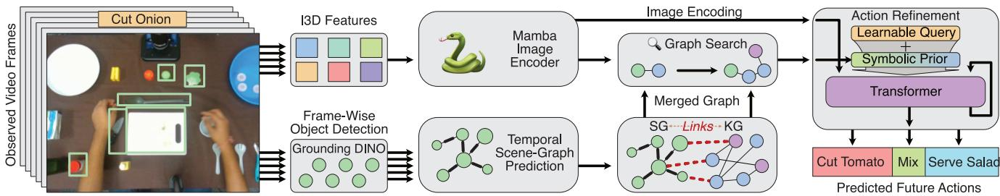  
Figure 1. SymAnt architecture: Utilizing a short video of prior observations, we extract a relevant scene graph and utilize a knowledge graph as additional context to predict a sequence of future actions. We propose a joint-graph search to capture additional context, utilizing it as a prior for an iterative action refinement.

• We introduce SymAnt, a neuro-symbolic framework that fuses scene and knowledge graphs via joint-graph search, providing structured symbolic context for long-horizon action anticipation from short observation windows.

• We show that leveraging a symbolic context enables runtime adaptability, directly influencing the predicted actions based on graph changes.

• We evaluate SymAnt across five benchmarks (Breakfast, 50 Salads, EPIC-KITCHENS, EGTEA Gaze+, Assembly101), achieving state-of-the-art performance on shortobservation settings while maintaining competitive results on longer contexts and retaining a small model.

## 2. Related Work

## 2.1. Symbolic Knowledge for Computer Vision

The integration of structured domain knowledge, particularly through knowledge graphs [42], into vision models is significantly enhancing grounding, interpretability, and performance [5, 54, 55, 88]. Neuro-symbolic vision pipelines [43] leverage the structure and hierarchy of knowledge graphs to enhance vision tasks, including object detection [26, 49], scene graph generation [77], transfer learning [18, 57], vision-language pre-training [4], classification [70, 81], and image captioning [83, 87]. For example, [55] introduces a graph search mechanism over knowledge graphs, and subsequent work [8] extended this to include novel concepts. Recent advances further optimize this graph reasoning; DiffLogic [17] introduces differentiable rule-based inference over large knowledge graphs, while Ontiveros et al. [15] highlight the critical role of the grounding criterion during instantiation. In parallel, scene graphs have also been extensively utilized in computer vision for tasks such as object detection, image captioning, and visual question answering [16, 20, 38, 51, 58]. In the realm of action anticipation, scene graphs have been employed to predict future actions by modeling object interactions [64]. Additionally, neuro-symbolic models like LASER [39] and NAVER [11] employ differentiable reasoning and explicit logic for scene-graph generation and visual grounding. While previous methods used knowledge graphs or scene graphs independently, we integrate both, reasoning over object knowledge, instance counts, and spatial relationships. To our knowledge, our approach is the first to leverage an explicit joint search (with a learned importance network) over scene and knowledge graphs for action anticipation.

## 2.2. Action Anticipation

Action anticipation is the task of predicting future actions from observed video of humans or agents performing a task. Early work focused on third-person video [2, 29, 32, 44]; recent benchmarks [22, 23, 34] have shifted attention to firstperson (egocentric) vision. Early methods for long-term action anticipation used RNNs [2, 27] and TCNs [3] to model action progressions over time. More recently, Transformerbased models [30, 32, 60, 85] have demonstrated superior performance in learning long-range temporal relationships, making them the preferred choice for long-term action anticipation. Recent work [33, 74, 86] has used diffusion models to generate latent embeddings of discrete actions. Recent approaches increasingly incorporate structural and semantic priors. One line of work injects this structure implicitly: modeling hand–object interactions [66], inferring latent goal distributions [65], or distilling language-mode semantics into visual prototypes [24]. In contrast, neurosymbolic approaches introduce explicit structure. For example, NeSCA [9] leverages static knowledge graphs for short-context anticipation. Unlike both implicit methods and prior neuro-symbolic works, we introduce a dynamic joint-graph between scene and knowledge graphs. This explicit prior is iteratively refined and remains fully editable during deployment, allowing us to reduce parameters and the need for extensive observation contexts.

## 3. Methodology

In this section, we introduce our method, SymAnt (Fig. 1), a novel approach for action anticipation that utilizes symbolic domain knowledge as additional context to improve prediction through an iterative action decoder. The central goal of our approach is to bootstrap information from the scene and knowledge graph to inform the generation of plausible action sequences. This symbolic grounding reduces the required observation context while allowing the model’s behavior to be adjusted post-training through edits to the contextual knowledge.

## 3.1. Problem Statement

Given a set of features from an observed video context $( V _ { o } ) , \textbf { F } \in \ \mathbb { R } ^ { L \times G }$ with G dimensions across L frames, the objective of the anticipation task is to predict the subsequent future actions over a specific time horizon following the observed video. These actions consist of action classes $\mathbf { A } \in \mathbb { R } ^ { N \times C }$ and their corresponding durations $\mathbf { d } \in \mathbb { R } ^ { N \times 1 }$ , where $C$ represents the total number of action classes. On a high level, SymAnt utilizes a Mamba-based encoder $( \mathbf { E } = f _ { e n c } ( \mathbf { F } ) )$ to encode the video observations and a novel iterative action decoder $f _ { d e c } ( . . . )$ , initialized with learned prior $f _ { S N } ( \dots )$ from the temporal scene graph and symbolic knowledge. Pseudocode for all algorithms is provided in supplementary material.

## 3.2. Symbolic Context Aggregation

The key to our approach is utilizing symbolic knowledge to derive additional contextual information from the objects that can be seen in a short-context video observation. We achieve this by creating a joint-graph from a scene graph based on the video observations $V _ { o }$ and a fixed knowledge graph built once from the training split, $\mathbf { K } = \{ \mathbf { K } _ { n } , \mathbf { K } _ { A } \}$ providing additional information for the detected entities, where $\mathbf { K } _ { n } , \mathbf { K } _ { A }$ are nodes and adjacency matrix of K, respectively. We construct our knowledge graph to capture the affordances and action dependencies relevant to our experiments (see experiments on KG source in Sec. 4.4.1). Our knowledge graph is built automatically by (i) extracting objects from the dataset annotations, (ii) linking objects to their functional affordances (e.g., bowl → hold), and (iii) linking commonsense object-object relations such as containment, proximity, and temporal co-occurrence derived directly from the dataset training split only, restricted to the observed portion of each video, so neither test data nor future-action labels contribute at any stage. The KG is built once before training and is never updated at inference. Our context aggregation module operates in three key steps given the observed video sequence and a knowledge graph, which are explained as follows:

1. Temporal Scene Graph Generation: Scene graphs excel at capturing spatial relationships between entities; however, for action anticipation, we modify them to capture temporal changes as well. We start by utilizing Grounding DINO [53] on each of observed frames $V _ { o } ^ { l }$ to detect initial concepts $\mathbf { c } ^ { l }$ in the scene, where l is the frame number. This forms the basis of our frame-level scene graphs $\mathbf { S } ^ { l }$ The spatial relationship between two scene entities is predicted with a neural network $f _ { \mathrm { e d g e } } ( )$ , classifying whether or not two nodes have a spatial relationship, and if $\mathbf { S O } ,$ , estimates the relationship type with a respective weight, indicating its importance. The set of spatial relations are: ‘on’, ‘next to’, ‘behind’, ‘in front $o f '$ , ‘above’, ‘across’, ‘below’, ‘inside’, ‘under’, ‘left’, ‘right’, ‘in’. $f _ { \mathrm { e d g e } }$ is trained on Visual Genome [46], using the scenes annotated with these relations, to avoid any form of leakage. Concepts in the SG are represented as $f _ { V i T } ( b o x )$ [25], a latent representation of entity within the bounding box. To aggregate scene graphs $\mathbf { S } ^ { l }$ across multiple time frames and construct a temporal scene graph \mathbf {S} , we adopt a dynamic update mechanism. For each new frame l, any object not already present in the temporal scene graph is added, along with its relationships to the existing nodes. When a relationship between two preexisting nodes is updated, a new relationship is added to the graph while retaining but decaying the importance of previous one, to prevent accumulation of stale information.

2. Graph Merging Module: The goal of this module is to combine scene-specific information from the temporal scene graph \mathbf {S} with domain knowledge from the provided knowledge graph \mathbf {K} based on the common entities present in the environment. Given a temporal S $\mathrm { ~ G ~ } { \bf S } = \{ { \bf S } _ { n } , { \bf S } _ { A } \}$ where $\mathbf { S } _ { n }$ and $\mathbf { S } _ { A }$ are the nodes and adjacency matrix of S respectively, we form connections between the graphs by linking the mutual nodes between the scene and knowledge graph to create the joint-graph $\mathbf { M } = \{ \mathbf { M } _ { n } , \mathbf { M } _ { A } \}$ , which includes the entire scene and knowledge graph. In scenarios where the scene graph contains multiple instances of the same node, all such instances are connected to the corresponding single node in the knowledge graph. The nodes that link the scene and knowledge graphs are referred to as active nodes $\mathbf { M } _ { \mathrm { a c t i v e } }$ . These nodes serve as the starting points for our joint-graph search (see the next section for details about graph search).

3. Joint-Graph Search: The goal of the joint-graph search is to iteratively expand around the currently active nodes, utilizing both spatial and semantic information to gather comprehensive context. The expansion continues until all relevant domain information is obtained, i.e., when no additional nodes contribute meaningful context to the current observation. Our joint-graph search uses a three-stage approach inspired by $[ 6 , 8 , 5 5 ]$ , which comprises:

Table 1. Comparison of anticipation performance with short observations $( \alpha = 0 . 0 5 , 0 . 1 )$ on Breakfast and 50 Salads datasets. SymAnt is best in every setting, by 3.2% on average over NeSCA. Cells marked − for the LLM baselines were not evaluated under our inference budget. The last row reports the standard deviation of our results over the official splits.
<table><tr><td></td><td colspan="4">Breakfast  $( \alpha = 0 . 0 5 )$ </td><td colspan="4">Breakfast  $( \alpha = 0 . 1 )$ </td><td colspan="4">50 Salads  $( \alpha = 0 . 0 5 )$ </td><td colspan="4">50 Salads  $( \alpha = 0 . 1 )$ </td></tr><tr><td>Method</td><td> $\beta = 0 . 1$ </td><td>0.2</td><td>0.3</td><td>0.5</td><td>0.1</td><td>0.2</td><td>0.3</td><td>0.5</td><td>0.1</td><td>0.2</td><td>0.3</td><td>0.5</td><td>0.1</td><td>0.2</td><td>0.3</td><td>0.5</td></tr><tr><td>KG [8]</td><td>5.44</td><td>4.95</td><td>4.22</td><td>3.98</td><td>6.02</td><td>5.15</td><td>4.86</td><td>4.51</td><td>6.92</td><td>6.21</td><td>6.01</td><td>5.58</td><td>7.13</td><td>6.48</td><td>6.07</td><td>5.78</td></tr><tr><td>RNN [2]</td><td>6.16</td><td>5.60</td><td>5.53</td><td>4.96</td><td>7.67</td><td>6.73</td><td>6.15</td><td>5.22</td><td>7.98</td><td>6.90</td><td>6.48</td><td>6.42</td><td>8.78</td><td>7.92</td><td>7.57</td><td>7.26</td></tr><tr><td>DS-r1 [36]</td><td>5.34</td><td>8.25</td><td>5.00</td><td>6.23</td><td>7.41</td><td>10.20</td><td>7.06</td><td>8.09</td><td>6.67</td><td>5.36</td><td>4.04</td><td>2.80</td><td>10.20</td><td>6.92</td><td>4.95</td><td>3.30</td></tr><tr><td>FUTR [32]</td><td>9.54</td><td>7.24</td><td>6.42</td><td>5.58</td><td>14.70</td><td>12.55</td><td>12.10</td><td>11.71</td><td>8.90</td><td>7.46</td><td>7.29</td><td>8.63</td><td>15.17</td><td>11.34</td><td>11.31</td><td>11.36</td></tr><tr><td>GPT-o1 [61]</td><td>7.61</td><td>6.67</td><td>7.89</td><td>5.15</td><td></td><td></td><td></td><td></td><td>15.64</td><td>13.12</td><td>13.38</td><td>11.18</td><td>15.18</td><td>15.07</td><td>13.47</td><td>12.29</td></tr><tr><td>Qwen3-Omni [76]</td><td></td><td></td><td></td><td></td><td></td><td></td><td></td><td></td><td></td><td></td><td></td><td></td><td>21.45</td><td>18.78</td><td>16.53</td><td>12.97</td></tr><tr><td>NeSCA [9]</td><td>9.91</td><td>7.95</td><td>6.86</td><td>5.88</td><td>15.53</td><td>13.52</td><td>13.07</td><td>11.94</td><td>17.86</td><td>16.25</td><td>10.84</td><td>9.38</td><td>23.15</td><td>17.28</td><td>16.62</td><td>13.96</td></tr><tr><td>Ours</td><td>12.19</td><td>9.80</td><td>8.91</td><td>8.15</td><td>17.11</td><td>14.32</td><td>14.06</td><td>12.92</td><td>21.98</td><td>19.41</td><td>17.75</td><td>14.33</td><td>27.92</td><td>23.82</td><td>20.01</td><td>18.83</td></tr><tr><td>Ours (±std)</td><td>1.7</td><td>0.4</td><td>1.1</td><td>0.4</td><td>0.8</td><td>0.5</td><td>1.5</td><td>0.7</td><td>2.2</td><td>2.7</td><td>1.5</td><td>3.1</td><td>1.6</td><td>3.5</td><td>2.2</td><td>3.2</td></tr></table>

• Propagation Network: The propagation network, $f _ { p r o p } ( \dots )$ updates the states of active nodes $\mathbf { M } _ { a c t i v e } .$ , as well as the states of neighboring nodes that are connected to these active nodes given the context of the video F.

• Importance Network: The Importance Network, $f _ { i m p } ( \dots )$ decides whether adjacent nodes to currently active ones should be activated, thereby preventing exponential growth of the graph. The number of iterations of alternating between propagation and importance network is dynamically determined (see supp. Alg. 4)

• Context Network: The Context network, $f _ { c o n t } ( . . . )$ generates a final embedding $\mathbf { z } _ { T }$ using active nodes in the expanded graph, used as context for the decoder.

## 3.3. Video Encoder

In addition to the symbolic knowledge derived from the observed video, we extract features from the video frames using I3D [14], which employs 3D convolutions to learn rich motion and appearance representations. These input features F are transformed using the Mamba [35] model as it improves training and inference speed without compromising accuracy compared to transformer encoders in FUTR [32] and DiffAnt [86] (see ablations for details). We combine image features with a sinusoidal positional encoding $\mathbf { P } \in \mathbb { R } ^ { L \times D }$ , enabling the Mamba encoder to generate refined representations $\mathbf { E } \in \mathbb { R } ^ { L \times D }$ . These representations are then processed through a linear classifier to map them to the discrete actions, enabling recognition of observed actions in videos, denoted as $\tilde { \mathbf { A } } ^ { \mathrm { o b s } }$ . Training these representations for action recognition ensures that they capture meaningful temporal and spatial structures, also providing robustness against noisy object detections. This representation is used as conditioning for the iterative action refinement process, as explained in the next section.

## 3.4. Iterative Symbolic Action Generation

Our action decoder combines the complementary strengths of high-level abstract information encoded in the fully expanded joint-graph and the fine-grained visual details present in the video stream. Our approach is built on the hypothesis that the context embedding $\mathbf { z } _ { T }$ derived from the fully expanded graph inherently contains a noisy representation of future events. Consequently, the decoder, utilizing a transformer backbone, iteratively refines this noisy representation into coherent predictions in T steps. Importantly, each refinement is conditioned on the video features, ensuring that the predictions are semantically meaningful and closely aligned with the observed visual content.

To facilitate focused reasoning for each action while maintaining their interdependencies, we employ a querybased approach [13, 32]. The action queries, denoted as $\mathbf { Q } ~ \in ~ \mathbb { R } ^ { \tilde { N } \times D }$ , consist of N learnable tokens temporally aligned with future action sequences, with each query corresponding to a specific action . These queries are not fixed representations; rather, they are randomly initialized and learned dynamically by backpropagation, as in FUTR [32], allowing the model to refine their embeddings throughout training. These action queries are added element-wise to the context embedding $\mathbf { z } _ { T }$ from joint-graph-search to form the input for action decoder at initial refinement step $T$ (see Alg. 4 in the supplementary material).

To ensure effective learning of the refinement process, we apply supervision at each refinement step. At each refinement step t , the model transforms the action embeddings $\mathbf { z } _ { t }$ into intermediate action outputs $\tilde { \mathbf { A } } _ { t } \in \mathbb { R } ^ { N \times C }$ and timestamp outputs $\tilde { \mathbf { d } } _ { t } \in \mathbb { R } ^ { N \times 1 }$ using an output projection module. This module comprises two fully connected multilayer perceptrons: the first is followed by a softmax over the $C$ action classes, while the second regresses the duration of each query directly. By aligning these intermediate outputs with the ground truth, the model progressively refines its predictions rather than depending solely on the final output. After T refinement steps, the final prediction $\mathbf { z } _ { 0 }$ is processed by the same output projection module to generate the final action labels A˜ and durations d˜, which serve as the model’s outputs. The exact mathematical formulations for our overall training objective and individual loss components are provided in the supplementary material.

Table 2. Comparison of long-term anticipation performance with observation horizons $\alpha = 0 . 2 , 0 . 3$ on the Breakfast and 50 Salads datasets. Results show that SymAnt excels at longer prediction horizons $( \beta = 0 . 5 )$ , with largest margins on 50 Salads.
<table><tr><td></td><td colspan="4">Breakfast  $( \alpha = 0 . 2 )$ </td><td colspan="4">Breakfast  $( \alpha = 0 . 3 )$ </td><td colspan="4">50 Salads  $( \alpha = 0 . 2 )$ </td><td colspan="4">50 Salads  $( \alpha = 0 . 3 )$ </td></tr><tr><td>Method</td><td>β= 0.1</td><td>0.2</td><td>0.3</td><td>0.5</td><td>0.1</td><td>0.2</td><td>0.3</td><td>0.5</td><td>0.1</td><td>0.2</td><td>0.3</td><td>0.5</td><td>0.1</td><td>0.2</td><td>0.3</td><td>0.5</td></tr><tr><td>DS-r1 [36]</td><td>15.77</td><td>11.94</td><td>10.61</td><td>6.60</td><td>16.40</td><td>13.13</td><td>9.87</td><td>6.08</td><td>7.83</td><td>5.87</td><td>3.76</td><td>2.30</td><td>6.00</td><td>4.99</td><td>3.56</td><td>2.39</td></tr><tr><td>RNN [2]</td><td>18.11</td><td>17.20</td><td>15.94</td><td>15.81</td><td>21.64</td><td>20.02</td><td>19.73</td><td>19.21</td><td>30.06</td><td>25.43</td><td>18.74</td><td>13.49</td><td>30.77</td><td>17.19</td><td>14.79</td><td>09.77</td></tr><tr><td>GPT-o1 [61]</td><td></td><td></td><td></td><td></td><td></td><td></td><td></td><td></td><td>21.60</td><td>21.75</td><td>17.86</td><td>12.93</td><td>28.38</td><td>25.08</td><td>20.44</td><td>15.99</td></tr><tr><td>UAAA [1]</td><td>16.71</td><td>15.40</td><td>14.47</td><td>14.20</td><td>20.73</td><td>18.27</td><td>18.42</td><td>16.86</td><td>24.86</td><td>22.37</td><td>19.88</td><td>12.82</td><td>29.10</td><td>20.50</td><td>15.28</td><td>12.31</td></tr><tr><td>TimeCond. [44]</td><td>18.41</td><td>17.21</td><td>16.42</td><td>15.84</td><td>22.75</td><td>20.44</td><td>19.64</td><td>19.75</td><td>32.51</td><td>27.61</td><td>21.26</td><td>15.99</td><td>35.12</td><td>27.05</td><td>22.05</td><td>15.59</td></tr><tr><td>CycleCons [3]</td><td>25.88</td><td>23.42</td><td>22.42</td><td>21.54</td><td>29.66</td><td>27.33</td><td>25.58</td><td>25.20</td><td>34.76</td><td>28.41</td><td>21.82</td><td>15.25</td><td>34.39</td><td>23.70</td><td>18.95</td><td>15.89</td></tr><tr><td>FUTR [32]</td><td>27.70</td><td>24.55</td><td>22.83</td><td>22.04</td><td>32.27</td><td>29.88</td><td>27.49</td><td>25.87</td><td>39.55</td><td>27.54</td><td>23.31</td><td>17.77</td><td>35.15</td><td>24.86</td><td>24.22</td><td>15.26</td></tr><tr><td>ObjPrompt [80]</td><td></td><td></td><td></td><td></td><td></td><td></td><td></td><td></td><td>37.40</td><td>28.90</td><td>24.20</td><td>18.10</td><td>28.00</td><td>24.00</td><td>24.30</td><td>19.30</td></tr><tr><td>ActFusion [33]</td><td>28.25</td><td>25.52</td><td>24.66</td><td>23.25</td><td>35.79</td><td>31.76</td><td>29.64</td><td>28.78</td><td>39.55</td><td>28.60</td><td>23.61</td><td>19.90</td><td>42.80</td><td>27.11</td><td>23.48</td><td>22.07</td></tr><tr><td>S-GEAR [24]</td><td></td><td></td><td></td><td></td><td></td><td></td><td></td><td></td><td>41.0</td><td>28.5</td><td>21.5</td><td>15.3</td><td>41.0</td><td>27.8</td><td>21.4</td><td>16.7</td></tr><tr><td>Diffant [86]</td><td>25.33</td><td>24.59</td><td>24.39</td><td>22.74</td><td>32.13</td><td>31.83</td><td>31.18</td><td>30.77</td><td>36.13</td><td>34.00</td><td>30.46</td><td>25.29</td><td>34.09</td><td>30.14</td><td>26.34</td><td>20.23</td></tr><tr><td>Con-Alig. [62]</td><td>28.00</td><td>24.90</td><td>23.10</td><td>22.10</td><td>33.40</td><td>30.80</td><td>29.00</td><td>26.50</td><td>41.10</td><td>31.40</td><td>24.80</td><td>19.20</td><td>35.80</td><td>27.50</td><td>23.30</td><td>18.10</td></tr><tr><td>LLMAction [72]</td><td>28.60</td><td>25.23</td><td>25.27</td><td>24.26</td><td>34.30</td><td>31.35</td><td>28.71</td><td>27.81</td><td>32.30</td><td>28.75</td><td>22.94</td><td>18.52</td><td>37.97</td><td>24.34</td><td>24.27</td><td>15.02</td></tr><tr><td>ActionLLM [73]</td><td>26.38</td><td>23.32</td><td>21.70</td><td>20.43</td><td>31.77</td><td>29.45</td><td>26.68</td><td>24.55</td><td>43.67</td><td>32.80</td><td>25.73</td><td>19.51</td><td>44.95</td><td>29.06</td><td>23.15</td><td>18.37</td></tr><tr><td>MANTA [79]</td><td>27.70</td><td>25.30</td><td>24.60</td><td>23.80</td><td>34.20</td><td>30.90</td><td>29.10</td><td>27.70</td><td>28.60</td><td>22.80</td><td>19.50</td><td>13.60</td><td>31.30</td><td>21.90</td><td>17.60</td><td>13.00</td></tr><tr><td>TCCA [56]</td><td>28.83</td><td>25.93</td><td>25.19</td><td>23.41</td><td>36.69</td><td>33.39</td><td>31.96</td><td>27.63</td><td>41.99</td><td>33.69</td><td>25.85</td><td>21.96</td><td>37.12</td><td>28.31</td><td>22.85</td><td>18.43</td></tr><tr><td>MixANT [75]</td><td>29.6</td><td>26.3</td><td>25.9</td><td>25.0</td><td>36.2</td><td>32.8</td><td>31.2</td><td>28.7</td><td>30.3</td><td>25.0</td><td>20.9</td><td>15.2</td><td>33.4</td><td>23.7</td><td>19.7</td><td>14.6</td></tr><tr><td>Ours</td><td>28.22</td><td>27.55</td><td>27.02</td><td>25.67</td><td>34.22</td><td>32.06</td><td>31.19</td><td>30.11</td><td>40.78</td><td>35.08</td><td>31.19</td><td>28.19</td><td>35.23</td><td>30.94</td><td>29.34</td><td>25.50</td></tr><tr><td>Ours (±std)</td><td>1.8</td><td>0.8</td><td>1.1</td><td>0.6</td><td>0.7</td><td>1.6</td><td>2.0</td><td>1.5</td><td>5.3</td><td>1.8</td><td>1.5</td><td>5.1</td><td>4.2</td><td>4.6</td><td>2.1</td><td>2.0</td></tr></table>

## 4. Experiments

In this section, we evaluate our approach on five widely used action anticipation datasets: two third-person datasets, 50 Salads [69] and Breakfast [47], and two egocentric datasets, EPIC-KITCHENS [23] and EGTEA Gaze+ [52], as well as the non-cooking Assembly101 [67], and compare the results with neuro-symbolic and neural-only baselines, including fine-tuned and non fine-tuned large language model baselines. For non-finetuned VLMs, we prompt with observed frames, whereas for LLMs we give the groundtruth action labels as input (see supplementary for the full protocol). In these comparisons, SymAnt uses no action labels as input: objects are obtained with an off-the-shelf detector, and the symbolic prior comes from a fixed knowledge graph. Additionally, we present qualitative results on a custom real-world kitchen setup and conduct ablation studies to analyze the contributions of different components of our approach.

## 4.1. Short Context Action Anticipation

We present our experimental results focusing on short observation contexts $( \alpha = 0 . 0 5 , 0 . 1 )$ for long-horizon action anticipation $( \beta = 0 . 1 , 0 . 2 , 0 . 3 , 0 . 5 )$ on the 50 Salads and Breakfast datasets in Table 1, where α is the ratio of observed to total video length and β is ratio of predicted to total video length. We compare SymAnt with neuro-symbolic methods (e.g., NeSCA [9]), neural-only approaches [2, 32], a purely symbolic KG-Baseline [8], and reasoning models, including ChatGPT o1 [61], Deepseek-r1 [36], and Qwen3- Omni [76]. In the short-context anticipation task, bootstrapping symbolic knowledge significantly improves future action prediction, surpassing the closest baseline by 3.2% and LLM ones by 5–10% MoC on average.

## 4.2. Baseline Comparison

In Tab. 2, we report anticipation performance with an extended observation context $( \alpha = 0 . 2 , 0 . 3 )$ , commonly used in prior works [32, 33, 86]. Our comparison includes methods that utilize action labels from observed video [1, 2, 44] as well as approaches that rely solely on latent features such as I3D [3, 32, 56, 62, 80], and LLM baselines ranging from general-purpose [36, 61] to domain-adapted [73]. Furthermore, we evaluate against recent alternative formulations: diffusion-based methods [33, 79, 86] that use a denoising process akin to our iterative refinement, the stochastic memory-propagation approach MixANT [75], and S-GEAR [24], which guides anticipation using implicitly distilled language-model semantics rather than an explicit graph. Note that we exclude ANTICIPATR [60] due to its different evaluation protocol [84], as well as NeSCA [9], which does not report results for this extended observation setting. SymAnt outperforms non-finetuned LLM baselines [36, 61] by an average of 15%. While methods like ActionLLM [73], TCCA, S-GEAR, and MixANT [75] show strong performance at the shorter prediction horizon $( \beta = 0 . 1 )$ , SymAnt achieves the best MoC for all $\beta \geq 0 . 2$ on 50 Salads and on Breakfast at $\alpha = 0 . 2 ;$ on Breakfast at $\alpha = 0 . 3 .$ , TCCA and DiffAnt lead by at most 1.3 MoC, within one standard deviation of our results. Specifically, on the 50 Salads dataset $( \alpha = 0 . 2 )$ , SymAnt outperforms the ActionLLM by over 8% MoC and TCCA by over 6% MoC at the longest horizon $( \beta = 0 . 5 )$ . These results, particularly for longer prediction horizons, validate the effectiveness of our approach in preserving long-term contextual information, a setting where other symbolic and non-symbolic baselines suffer from performance degradation.

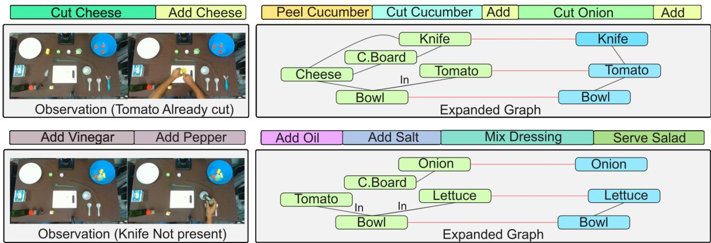  
Figure 2. Qualitative evaluation of scene and knowledge graph integration in a real-world kitchen scenario. Observed video and actions on the left, with predicted actions on the right, demonstrating the relevant portions of the expanded graphs (SG in green, KG in blue).

We further present a comprehensive evaluation of our method on the EPIC-KITCHENS and EGTEA Gaze+ datasets in Tab. 3, shifting the camera perspective from third-person to egocentric. Our comparison spans conventional methods [14, 31, 40, 41, 59], dedicated transformer and diffusion architectures [60, 86], and the latest large-scale fine-tuned LLM-based models [12, 19, 45, 82]. Notably, SymAnt achieves competitive performance with leading methods such as INSIGHT (8.5B) and ICVL (17.5B) while requiring only 3M parameters. This underscores the effectiveness of bootstrapping symbolic contextual knowledge, enabling strong anticipation performance without relying on large-scale model capacity. Furthermore, to test SymAnt beyond cooking, we evaluate on Assembly101 [67], a large-scale dataset of toy-vehicle assembly and disassembly. Its knowledge graph is obtained automatically with the same procedure as in Sec. 3.2, applied to the Assembly101 object vocabulary. We compare in Tab. 4 against transformer-based (FUTR [32]), diffusionbased (GTDA [78], MANTA [79]), and recent stochastic (MixANT [75]) methods that report this benchmark. SymAnt outperforms the strongest baseline, MixANT, by 0.8 MoC at α=0.2, β=0.5 and by 0.5 MoC at α=0.3 for both β=0.3 and β=0.5. As on the cooking benchmarks, the advantage appears at the longest horizon, and the same graph-construction procedure transfers to this domain without domain-specific engineering.

## 4.3. Impact of Knowledge Editing

We conducted both qualitative and quantitative analyses to evaluate the effectiveness of incorporating and editing symbolic context from scene and knowledge graphs, demonstrating how modifications to the graph structure directly influence anticipation of future actions without retraining.

To qualitatively demonstrate the impact of symbolic knowledge, we altered key components in the observation (e.g., removing a knife) which led to changes in the jointgraph, demonstrating symbolic information’s effect on neural action prediction. We captured real-world videos in our dummy kitchen setup and to adapt our model to this setup, we first fine-tuned it on the general salad-making activities dataset from [9], recorded in a similar kitchen environment. We then evaluated our model on multiple cases with an observation horizon of 10% $( \alpha ~ = ~ 0 . 1 )$ to predict the subsequent 50% $( \beta ~ = ~ 0 . 5 )$ . Figure 2 illustrates two such cases, along with their corresponding expanded joint-graphs (showing only the relevant parts) and the subsequently predicted actions. In the first example, a tomato is already cut and placed in a bowl when the observation is made. The scene graph explicitly captures the “in” relation between the tomato and the bowl, allowing our model to recognize that no further tomato-related actions are necessary. In the second example, the scene graph correctly identifies the absence of a knife, and the knowledge graph further reasons about it, ensuring that no cutting action is predicted. Unlike purely neural models that might overlook these subtle contextual details, our method explicitly reasons over individual concepts in the scene. Complementing the qualitative examples, we designed an experiment on the 50 Salads dataset to measure how activating or deactivating individual action nodes in the expanded graph influences the model’s final predictions. Specifically, we focus on the actions Cut Tomato, Cut Lettuce, and Serve Salads. For each action, we generated a filtered subset in which the action is guaranteed to appear in the ground-truth anticipation. Anticipation accuracy for that action is defined as the percentage of samples in which the action appears in any of the model’s N predictions. We compare three conditions: (1) baseline accuracy without graph modifications, (2) manual deactivation of the target node, and (3) manual activation of the target node. The results, shown in Fig. 3, reveal accuracy variations corresponding to the different graph modifications. Removing the target node leads to a substantial drop in accuracy, whereas enforcing its activation increases accuracy to 100%. These findings confirm that the symbolic initialization shapes the model’s predictions, providing a retraining-free mechanism to steer anticipated actions. Supplementary Sec. D shows a realistic correction, where a node edit recovers an action missed due to an occluded object, and when the visual stream overrides edits.

Table 3. Performance (mAP) on EPIC-KITCHENS-55 and EGTEA Gaze+ across all, frequent, and rare splits. Parameter counts are approximated and report trainable parameters only; for SymAnt, the frozen object detector, ViT node encoder, and I3D backbone are excluded.
<table><tr><td>Method</td><td>Params</td><td colspan="3">EPIC-KITCHENS</td><td colspan="3">EGTEA Gaze+</td></tr><tr><td></td><td></td><td>All</td><td>Freq.</td><td>Rare</td><td>All</td><td>Freq.</td><td>Rare</td></tr><tr><td>I3D [14]</td><td>NA</td><td>37.7</td><td>53.5</td><td>23.0</td><td>72.1</td><td>79.3</td><td>53.3</td></tr><tr><td>ActionVLAD [31]</td><td>NA</td><td>29.2</td><td>53.5</td><td>18.6</td><td>73.3</td><td>79.0</td><td>58.6</td></tr><tr><td>TimeCeption [40]</td><td>NA</td><td>35.6</td><td>55.9</td><td>26.1</td><td>74.1</td><td>79.7</td><td>59.7</td></tr><tr><td>VideoGraph [41]</td><td>NA</td><td>22.5</td><td>49.4</td><td>14.0</td><td>67.7</td><td>77.1</td><td>47.2</td></tr><tr><td>EGO-TOPO [59]</td><td>NA</td><td>38.0</td><td>56.9</td><td>29.2</td><td>73.5</td><td>80.7</td><td>54.7</td></tr><tr><td>ANTICIPATR [60]</td><td>NA</td><td>39.1</td><td>58.1</td><td>29.1</td><td>76.8</td><td>83.3</td><td>55.1</td></tr><tr><td>DiffAnt [86]</td><td>80M</td><td>38.1</td><td>55.0</td><td>31.0</td><td>77.3</td><td>83.5</td><td>61.4</td></tr><tr><td>AntGPT [82]</td><td>7.5B</td><td>40.1</td><td>58.8</td><td>31.9</td><td>80.2</td><td>84.8</td><td>72.9</td></tr><tr><td>PALM [45]</td><td>7.5B</td><td>40.4</td><td>59.3</td><td>30.3</td><td>80.7</td><td>85.0</td><td>73.5</td></tr><tr><td>Ours</td><td>3M</td><td>42.47</td><td>59.32</td><td>32.27</td><td>78.66</td><td>84.96</td><td>65.51</td></tr><tr><td>ICVL [12]</td><td>17.5B</td><td>43.3</td><td>61.6</td><td>33.8</td><td>81.0</td><td>85.2</td><td>73.7</td></tr><tr><td>INSIGHT [19]</td><td>8.5B</td><td>45.2</td><td>62.4</td><td>36.0</td><td>81.7</td><td>85.9</td><td>74.4</td></tr></table>

Table 4. Long-term dense anticipation on Assembly101 (MoC). ∗: retrained on Assembly101 [78].
<table><tr><td></td><td colspan="4"> $\beta ( \alpha = 0 . 2 )$ </td><td colspan="4"> $\beta ( \alpha = 0 . 3 )$ </td></tr><tr><td>Method</td><td>0.1</td><td>0.2</td><td>0.3</td><td>0.5</td><td>0.1</td><td>0.2</td><td>0.3</td><td>0.5</td></tr><tr><td>Tri-gram [1]</td><td>2.8</td><td>2.2</td><td>1.9</td><td>1.5</td><td>3.5</td><td>2.7</td><td>2.3</td><td>1.8</td></tr><tr><td>UAAA* [1]</td><td>2.7</td><td>2.1</td><td>1.8</td><td>1.6</td><td>2.4</td><td>2.1</td><td>1.9</td><td>1.7</td></tr><tr><td>FUTR* [32]</td><td>7.5</td><td>5.5</td><td>4.7</td><td>4.1</td><td>7.8</td><td>6.0</td><td>5.2</td><td>4.0</td></tr><tr><td>GTDA [78]</td><td>6.4</td><td>4.5</td><td>3.5</td><td>2.8</td><td>5.9</td><td>4.2</td><td>3.5</td><td>2.9</td></tr><tr><td>MANTA [79]</td><td>6.7</td><td>5.3</td><td>4.2</td><td>3.5</td><td>6.6</td><td>4.7</td><td>4.2</td><td>3.5</td></tr><tr><td>MixANT [75]</td><td>8.0</td><td>7.0</td><td>6.2</td><td>4.4</td><td>8.7</td><td>6.6</td><td>5.6</td><td>4.6</td></tr><tr><td>Ours</td><td>6.15</td><td>5.44</td><td>5.39</td><td>5.16</td><td>7.15</td><td>6.32</td><td>6.08</td><td>5.14</td></tr></table>

## 4.4. Ablation Studies

In the following section, we ablate the individual components of our framework, and report inference-time analyses.

## 4.4.1. Encoder, Decoder and Knowledge Integration

We conduct an ablation study to compare different choices for the encoder, decoder, and symbolic knowledge integration, and assess their impact on action anticipation performance. Table 5 presents results on the Breakfast and 50 Salads datasets on $\alpha = 0 . 2 $ , omitting results for $\beta = 0 . 2$ and 0.3 as they follow a uniform trend across different values of $\beta .$ We also report standard deviations reflecting cross-split variation; since all configurations share these splits, consistent margins smaller than this spread remain meaningful. To test these differences, we conduct two-sided paired ttests on the split-level averages. Rows 1 and 2 compare the Mamba (M) and Transformer (T) encoders. We do not detect a significant difference between them on either dataset $( p ~ = ~ 0 . 1 2 6$ and $p \ = \ 0 . 1 5 1 )$ , suggesting that Mamba is an efficient, drop-in replacement for Transformer given its faster inference speeds ( Tab. 6). Comparing rows 2 and 3 demonstrates that incorporating an iterative action decoder (Refinement, R) significantly enhances long-horizon action anticipation, particularly for larger $\beta$ values. Additionally, rows 3 and 12 highlight the impact of knowledge-guided initialization (I), improving MoC in every setting, by 1.8% on average. Rows 4 and 12 compare the impact of symbolic initialization without video feature conditioning. The lower performance in row 4 underscores the importance of lowlevel visual features for accurate predictions. Comparing rows 5 and 12 highlights the impact of consistency between the training and inference steps for the iterative refinement process. Row 5 adopts a strategy inspired by DDIM [68], where the model is trained on a dense 1000 step refinement process but utilizes accelerated sampling with only 25 inference steps (S). This yields significantly lower accuracy than our proposed method.

Table 5. Ablation on model configurations. Enc.: M (Mamba), T (Transformer). Dec.: R (Iterative Refinement), D (Diffusion), S (DDIM sampling [68]). KG (symbolic context): I (init. from joint SG+KG search), C (cond. on joint SG+KG search), K (init. from KG-only search, scene graph disabled), O (init. from maxpooled $\mathrm { C L I P }$ embeddings, no graph), A (init. from a GAT, no graph search), G (init. from a Visual Genome KG [46]).
<table><tr><td colspan="3"></td><td colspan="2">Breakfast</td><td colspan="2">50 Salads</td></tr><tr><td colspan="3"></td><td colspan="2"> $\beta ( \alpha = 0 . 2 )$ </td><td colspan="2"> $\beta ( \alpha = 0 . 2 )$ </td></tr><tr><td>Enc.</td><td>Dec.</td><td>KG</td><td>0.1</td><td>0.5</td><td>0.1</td><td>0.5</td></tr><tr><td>T</td><td>T</td><td>一</td><td> $2 7 . 0 3 { \scriptstyle \pm 1 . 4 }$ </td><td> $2 0 . 8 2 _ { \pm 0 . 3 }$ </td><td> $3 6 . 7 7 { \scriptstyle \pm 5 . 3 }$ </td><td> $2 0 . 1 2 { \scriptstyle \pm 6 . 9 }$ </td></tr><tr><td>M</td><td>T</td><td>一</td><td> $2 6 . 7 0 { \scriptstyle \pm 1 . 6 }$ </td><td> $2 0 . 2 5 { \scriptstyle \pm 0 . 8 }$ </td><td> $3 6 . 2 0 { \scriptstyle \pm 8 . 3 }$ </td><td> $2 1 . 6 0 { \scriptstyle \pm 2 . 7 }$ </td></tr><tr><td>M</td><td>R</td><td>一</td><td> $2 7 . 2 0 { \scriptstyle \pm 1 . 1 }$ </td><td> $2 3 . 6 0 { \scriptstyle \pm 0 . 4 }$ </td><td> $3 7 . 2 0 { \scriptstyle \pm 4 . 2 }$ </td><td> $2 7 . 7 0 { \scriptstyle \pm 5 . 6 }$ </td></tr><tr><td>一</td><td>R</td><td>I</td><td> $1 7 . 8 1 _ { \pm 1 . 6 }$ </td><td> $1 1 . 8 6 _ { \pm 0 . 7 }$ </td><td> $2 5 . 2 0 { \scriptstyle \pm 7 . 3 }$ </td><td> $1 2 . 4 1 _ { \pm 5 . 6 }$ </td></tr><tr><td>M</td><td>S</td><td>I</td><td> $2 2 . 4 1 { \scriptstyle \pm 2 . 7 }$ </td><td> $1 5 . 5 6 { \scriptstyle \pm 0 . 7 }$ </td><td> $2 9 . 7 6 { \scriptstyle \pm 4 . 5 }$ </td><td> $2 1 . 6 1 { \scriptstyle \pm 7 . 6 }$ </td></tr><tr><td>M</td><td>D</td><td>C</td><td> $2 7 . 5 0 { \scriptstyle \pm 0 . 5 }$ </td><td> $2 4 . 0 8 { \scriptstyle \pm 0 . 5 }$ </td><td> $3 8 . 7 0 { \scriptstyle \pm 6 . 2 }$ </td><td> $2 7 . 4 4 { \scriptstyle \pm 6 . 4 }$ </td></tr><tr><td>M</td><td>R</td><td>C</td><td> $2 7 . 1 0 { \scriptstyle \pm 1 . 6 }$ </td><td> $2 5 . 4 1 _ { \pm 1 . 0 }$ </td><td> $3 9 . 5 8 { \scriptstyle \pm 6 . 5 }$ </td><td> $2 7 . 6 1 { \scriptstyle \pm 6 . 7 }$ </td></tr><tr><td>M</td><td>R</td><td>K</td><td> $2 6 . 6 7 { \scriptstyle \pm 2 . 0 }$ </td><td> $2 4 . 5 6 { \scriptstyle \pm 0 . 5 }$ </td><td> $3 8 . 8 8 { \scriptstyle \pm 1 . 6 }$ </td><td> $2 7 . 4 4 _ { \pm 6 . 5 }$ </td></tr><tr><td>M</td><td>R</td><td>0</td><td> $2 5 . 5 3 { \scriptstyle \pm 0 . 9 }$ </td><td> $1 9 . 6 1 { \scriptstyle \pm 0 . 5 }$ </td><td> $3 4 . 4 7 { \scriptstyle \pm 2 . 0 }$ </td><td> $2 1 . 5 8 { \scriptstyle \pm 3 . 5 }$ </td></tr><tr><td>M</td><td>R</td><td>A</td><td> $2 7 . 1 2 { \scriptstyle \pm 0 . 4 }$ </td><td> $2 4 . 5 4 { \scriptstyle \pm 0 . 3 }$ </td><td> $\underline { { 3 9 . 7 0 } } \pm 7 . 7$ </td><td> $2 7 . 3 5 { \scriptstyle \pm 5 . 0 }$ </td></tr><tr><td>M</td><td>R</td><td>G</td><td> $2 7 . 8 5 \pm 0 . 9$ </td><td> $2 5 . 5 5 \pm 0 . 6$ </td><td> $3 8 . 5 0 { \scriptstyle \pm 3 . 8 }$ </td><td> $2 8 . 1 0 \pm _ { 4 . 9 }$ </td></tr><tr><td>M</td><td>R</td><td>I</td><td> $2 8 . 2 2 { \scriptstyle \pm 1 . 8 }$ </td><td> $2 5 . 6 7 { \scriptstyle \pm 0 . 6 }$ </td><td> $\mathbf { 4 0 . 7 8 _ { \pm 5 . 3 } }$ </td><td> $\mathbf { 2 8 . 1 9 } _ { \pm 5 . 1 }$ </td></tr></table>

Furthermore, rows 6 and 12 reveal that a traditional diffusion-based decoder Diffusion(D) [33, 86], which follows a conventional forward-reverse denoising process, underperforms our iterative refinement approach in every setting. Finally, rows 7 and 12 show that conditioning the decoder on symbolic knowledge (C) instead of using it for initialization lowers accuracy in every setting, emphasizing the effectiveness of our design choice. Rows 8 and 12 further isolate the scene graph’s contribution: a KG-only search (no SG) costs 1–2% MoC. Rows 9 and 10 replace the graph-search with competing knowledge-integration strategies. Max-pooled CLIP [63] embeddings of the detected objects (O) fall below the no-context row 3 in every setting, showing that unstructured semantic input is not by itself beneficial. A 2-hop GAT [71] (instead of graphsearch network) over the same joint-graph nodes (A) recovers only part of the gain and stays 0.8–1.1% MoC below row 12, highlighting the strength of our approach. Row 11 (G) uses the same architecture as row 12 but a Visual Genome KG [46] of kitchen objects plus one-hop neighbors (714 nodes vs. 175 in I). At β=0.5, G scores 25.55 (Breakfast) and 28.10 (50 Salads), within 0.2 MoC of I (25.67/28.19) and above the no-KG row (23.60/27.70). This shows that a dataset-specific knowledge graph is not a prerequisite: a general-purpose source already carries most of the long-horizon gain, without extra domain-specific engineering. Crucially, as detailed in the supplementary material, we observe identical performance dynamics on the EPIC-KITCHENS and EGTEA Gaze+.

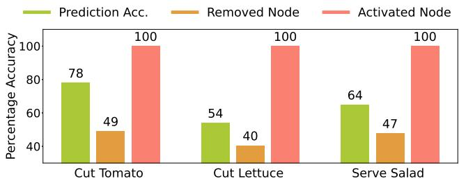  
Figure 3. Quantitative analysis of anticipation with manual graph edits: accuracy drops on deactivation and is 100% on activation.

## 4.4.2. Inference Speed and Efficiency

Beyond prediction accuracy, we assess the computational efficiency of our method. Tab. 6 reports inference times (in ms) for different model configurations, computed on an NVIDIA RTX 6000 GPU. Comparing Mamba (M) and Transformer (T) encoders, Mamba reduces runtime from 1.5 to 1.1 ms without a significant drop in accuracy, owing to its fixed-size state matrix and optimized architecture. The Iterative Refinement (R) decoder scales linearly with the number of steps; we use 10 steps, yielding 14.5 ms while balancing accuracy and latency (see the supplementary material for a step-vs-accuracy analysis). The symbolic context aggregation module adds only 0.9 ms to the core pipeline runtime of 16.5 ms, demonstrating that the joint-graph search improves performance with minimal computational overhead. In a real-world streaming deployment, initial detections can be cached in a sliding window, so detector cost is a one-frame offset per prediction step (see Sec. 3.2). Total per-step latency is ∼21.5 ms with YOLO, ∼31.5 ms with Faster R-CNN, and ∼56.5 ms with Grounding DINO. As the † row in Tab. 6 shows, swapping Grounding DINO for Faster R-CNN nearly halves latency while changing MoC by under 0.7%, enabling a speedcost trade-off without retraining. This also demonstrates that our pipeline is robust to the noise of object detection. This efficiency also extends to parameter footprint: as shown by the parameter counts in Tab. 3 and the model-size analysis in the supplementary material, SymAnt maintains strong anticipation accuracy with far fewer parameters than most baselines, highlighting the advantages of our neurosymbolic design.

Table 6. Module-wise inference time (ms) on 50 Salads; all rows use KG initialization (I). Cont.: symbolic context aggregation. †: SG built with Faster R-CNN.
<table><tr><td rowspan="3">(ms)</td><td colspan="4">Inference Time</td><td colspan="4">Performance</td></tr><tr><td rowspan="2">Dec.</td><td colspan="3"></td><td colspan="2">β(α = 0.2)</td><td colspan="2">β(α = 0.3)</td></tr><tr><td>Enc.</td><td>Dec.</td><td>Cont.</td><td>0.1</td><td>0.5</td><td>0.1</td><td>0.5</td></tr><tr><td>T</td><td>T</td><td>1.5</td><td>1.6</td><td>0.9</td><td>39.48</td><td>23.60</td><td>34.65</td><td>19.50</td></tr><tr><td>M</td><td>T</td><td>1.1</td><td>1.6</td><td>0.9</td><td>39.16</td><td>23.84</td><td>34.72</td><td>19.46</td></tr><tr><td>M</td><td>R(10)</td><td>1.1</td><td>14.5</td><td>0.9</td><td>40.78</td><td>28.19</td><td>35.23</td><td>25.50</td></tr><tr><td>M</td><td>R(10)†</td><td>1.1</td><td>14.5</td><td>0.9</td><td>40.41</td><td>27.55</td><td>35.13</td><td>25.01</td></tr><tr><td>M</td><td>R(100)</td><td>1.1</td><td>110</td><td>0.9</td><td>40.56</td><td>27.98</td><td>35.35</td><td>25.25</td></tr></table>

## 5. Conclusion

In this work, we propose SymAnt, a neuro-symbolic approach that unifies scene and knowledge graphs within a joint-graph search framework, providing an informationrich prior for long-term action anticipation. In experiments across five diverse benchmarks covering first- and thirdperson observations, cooking and assembly activities, we show that this symbolic grounding enables accurate longhorizon anticipation, particularly from short observation contexts, while requiring significantly fewer parameters than most neural alternatives. Moreover, because SymAnt’s predictions are anchored in explicit symbolic graph structures, users can activate or deactivate graph nodes at inference time to steer anticipated actions. These properties position SymAnt as a step towards action anticipation systems that are both data-efficient and adaptable to changing environments and task specifications. We discuss limitations and future work in the supplementary material.

## References

[1] Yazan Abu Farha and Juergen Gall. Uncertainty-aware anticipation of activities. In Proceedings of the IEEE/CVF International Conference on Computer Vision Workshops, pages 0–0, 2019. 5, 7

[2] Yazan Abu Farha, Alexander Richard, and Juergen Gall. When will you do what?-anticipating temporal occurrences of activities. In Proceedings of the IEEE conference on computer vision and pattern recognition, pages 5343–5352, 2018. 2, 4, 5, 15

[3] Yazan Abu Farha, Qiuhong Ke, Bernt Schiele, and Juergen Gall. Long-term anticipation of activities with cycle consistency. In Pattern Recognition: 42nd DAGM German Conference, DAGM GCPR 2020, Tubingen, Germany, Septem-¨ ber 28–October 1, 2020, Proceedings 42, pages 159–173. Springer, 2021. 2, 5

[4] Houda Alberts, Ningyuan Huang, Yash Deshpande, Yibo Liu, Kyunghyun Cho, Clara Vania, and Iacer Calixto. Visualsem: a high-quality knowledge graph for vision and language. In Proceedings of the 1st Workshop on Multilingual Representation Learning, pages 138–152, 2021. 2

[5] Aryan, Bowen Li, Sebastian Scherer, Yun-Jou Lin, and Chen Wang. Airloc: Object-based indoor relocalization. arXiv preprint arXiv:2304.00954, 2023. 2

[6] FNU Aryan, Simon Stepputtis, Sarthak Bhagat, Joseph Campbell, Kwonjoon Lee, Hossein Nourkhiz Mahjoub, and Katia Sycara. Symbolic graph inference for compound scene understanding. In International Workshop on Ontologies and Standardsfor Robotics and Automation (WOSRA 2024), 2024. 4

[7] Ershad Banijamali, Mohsen Rohani, Elmira Amirloo, Jun Luo, and Pascal Poupart. Prediction by anticipation: An action-conditional prediction method based on interaction learning. In Proceedings of the IEEE/CVF International Conference on Computer Vision (ICCV), pages 15601– 15610, 2021. 1

[8] Sarthak Bhagat, Simon Stepputtis, Joseph Campbell, and Katia Sycara. Sample-efficient learning of novel visual concepts. In Conference on Lifelong Learning Agents, pages 637–657. PMLR, 2023. 2, 4, 5

[9] Sarthak Bhagat, Samuel Li, Joseph Campbell, Yaqi Xie, Katia Sycara, and Simon Stepputtis. Let me help you! neurosymbolic short-context action anticipation. IEEE Robotics and Automation Letters, 2024. 2, 4, 5, 6, 15

[10] Achim Buerkle, William Eaton, Niels Lohse, Thomas Bamber, and Pedro Ferreira. EEG based arm movement intention recognition towards enhanced safety in symbiotic humanrobot collaboration. Robotics and Computer-Integrated Manufacturing, 70:102137, 2021. 1

[11] Zhixi Cai, Fucai Ke, Simindokht Jahangard, Maria Garcia de la Banda, Gholamreza Haffari, Peter J. Stuckey, and Hamid Rezatofighi. NAVER: A neuro-symbolic compositional automaton for visual grounding with explicit logic reasoning. In IEEE/CVF International Conference on Computer Vision (ICCV), 2025. 2

[12] Congqi Cao, Lanshu Hu, Yating Yu, and Yanning Zhang. Vision and intention boost large language model in long-term

action anticipation. arXiv preprint arXiv:2505.01713, 2025. $6 , 7$

[13] Nicolas Carion, Francisco Massa, Gabriel Synnaeve, Nicolas Usunier, Alexander Kirillov, and Sergey Zagoruyko. End-toend object detection with transformers. In European confer ence on computer vision, pages 213–229. Springer, 2020. 4

[14] Joao Carreira and Andrew Zisserman. Quo vadis, action recognition? a new model and the kinetics dataset. In proceedings of the IEEE Conference on Computer Vision and Pattern Recognition, pages 6299–6308, 2017. 4, 6, 7, 15

[15] Rodrigo Castellano Ontiveros, Francesco Giannini, Marco Gori, Giuseppe Marra, and Michelangelo Diligenti. Grounding methods for neural-symbolic ai. In International Joint Conference on Artificial Intelligence (IJCAI), pages 4806– 4814, 2025. 2

[16] Xiaojun Chang, Pengzhen Ren, Pengfei Xu, Zhihui Li, Xiaojiang Chen, and Alex Hauptmann. A comprehensive survey of scene graphs: Generation and application. arXiv preprint arXiv:2104.01111, 2021. 2

[17] Shengyuan Chen, Yunfeng Cai, Huang Fang, Xiao Huang, and Mingming Sun. Differentiable neuro-symbolic reasoning on large-scale knowledge graphs. In Advances in Neural Information Processing Systems (NeurIPS), 2023. 2

[18] Tianshui Chen, Liang Lin, Riquan Chen, Xiaolu Hui, and Hefeng Wu. Knowledge-guided multi-label few-shot learning for general image recognition. IEEE Transactions on Pattern Analysis and Machine Intelligence, 44(3):1371– 1384, 2020. 2

[19] Qiaohui Chu, Haoyu Zhang, Meng Liu, Yisen Feng, Haoxiang Shi, and Liqiang Nie. Intention-guided cognitive reasoning for egocentric long-term action anticipation. In Proceed ings of the AAAI Conference on Artificial Intelligence, pages 17436–17444, 2026. 6, 7

[20] Weilin Cong, William Wang, and Wang-Chien Lee. Scene graph generation via conditional random fields. arXiv preprint arXiv:1811.08075, 2018. 2

[21] Florinel-Alin Croitoru, Vlad Hondru, Radu Tudor Ionescu, and Mubarak Shah. Diffusion models in vision: A survey. IEEE Transactions on Pattern Analysis and Machine Intelli gence, 45(9):10850–10869, 2023. 2

[22] Dima Damen, Hazel Doughty, Giovanni Maria Farinella, Sanja Fidler, Antonino Furnari, Evangelos Kazakos, Davide Moltisanti, Jonathan Munro, Toby Perrett, Will Price, et al. Scaling egocentric vision: The epic-kitchens dataset. In Proceedings ofthe European conference on computer vision (ECCV), pages 720–736, 2018. 2

[23] Dima Damen, Hazel Doughty, Giovanni Maria Farinella, Sanja Fidler, Antonino Furnari, Evangelos Kazakos, Davide Moltisanti, Jonathan Munro, Toby Perrett, Will Price, et al. The epic-kitchens dataset: Collection, challenges and baselines. IEEE Transactions on Pattern Analysis and Machine Intelligence, 43(11):4125–4141, 2020. 2, 5, 14

[24] Anxhelo Diko, Danilo Avola, Bardh Prenkaj, Federico Fontana, and Luigi Cinque. Semantically guided representation learning for action anticipation. In European Conference on Computer Vision (ECCV), 2024. 2, 5

[25] Alexey Dosovitskiy, Lucas Beyer, Alexander Kolesnikov, Dirk Weissenborn, Xiaohua Zhai, Thomas Unterthiner,

Mostafa Dehghani, Matthias Minderer, Georg Heigold, Sylvain Gelly, et al. An image is worth 16x16 words: Transformers for image recognition at scale. arXiv preprint arXiv:2010.11929, 2020. 3

[26] Yuan Fang, Kingsley Kuan, Jie Lin, Cheston Tan, and Vijay Chandrasekhar. Object detection meets knowledge graphs. In International Joint Conferences on Artificial Intelligence. International Joint Conferences on Artificial Intelligence, 2017. 2

[27] Antonino Furnari and Giovanni Maria Farinella. What would you expect? anticipating egocentric actions with rollingunrolling lstms and modality attention. In Proceedings of the IEEE/CVF International conference on computer vision, pages 6252–6261, 2019. 2

[28] Harshala Gammulle, Simon Denman, Sridha Sridharan, and Clinton Fookes. Predicting the future: A jointly learnt model for action anticipation. In Proceedings of the IEEE/CVF International Conference on Computer Vision (ICCV), pages 5562–5571, 2019. 1

[29] Jiyang Gao, Zhenheng Yang, and Ram Nevatia. Red: Reinforced encoder-decoder networks for action anticipation. arXiv preprint arXiv:1707.04818, 2017. 2

[30] Rohit Girdhar and Kristen Grauman. Anticipative video transformer. In Proceedings of the IEEE/CVF international conference on computer vision, pages 13505–13515, 2021. 2

[31] Rohit Girdhar, Deva Ramanan, Abhinav Gupta, Josef Sivic, and Bryan Russell. Actionvlad: Learning spatio-temporal aggregation for action classification. In Proceedings of the IEEE conference on computer vision and pattern recognition, pages 971–980, 2017. 6, 7

[32] Dayoung Gong, Joonseok Lee, Manjin Kim, Seong Jong Ha, and Minsu Cho. Future transformer for long-term action anticipation. In Proceedings of the IEEE/CVF Conference on Computer Vision and Pattern Recognition, pages 3052– 3061, 2022. 1, 2, 4, 5, 6, 7, 15

[33] Dayoung Gong, Suha Kwak, and Minsu Cho. Actfusion: a unified diffusion model for action segmentation and anticipation. arXiv preprint arXiv:2412.04353, 2024. 2, 5, 8, 16

[34] Kristen Grauman, Andrew Westbury, Eugene Byrne, Zachary Chavis, Antonino Furnari, Rohit Girdhar, Jackson Hamburger, Hao Jiang, Miao Liu, Xingyu Liu, et al. Ego4d: Around the world in 3,000 hours of egocentric video. In Proceedings of the IEEE/CVF Conference on Computer Vision and Pattern Recognition, pages 18995–19012, 2022. 2

[35] Albert Gu and Tri Dao. Mamba: Linear-time sequence modeling with selective state spaces. arXiv preprint arXiv:2312.00752, 2023. 4

[36] Daya Guo, Dejian Yang, Haowei Zhang, Junxiao Song, Ruoyu Zhang, Runxin Xu, Qihao Zhu, Shirong Ma, Peiyi Wang, Xiao Bi, et al. Deepseek-r1: Incentivizing reasoning capability in llms via reinforcement learning. arXiv preprint arXiv:2501.12948, 2025. 4, 5

[37] Hongji Guo, Nakul Agarwal, Shao-Yuan Lo, Kwonjoon Lee, and Qiang Ji. Uncertainty-aware action decoupling transformer for action anticipation. In Proceedings of the IEEE/CVF Conference on Computer Vision and Pattern Recognition (CVPR), pages 18644–18654, 2024. 1

[38] Marcel Hildebrandt, Hang Li, Rajat Koner, Volker Tresp, and Stephan Gunnemann. Scene graph reasoning for visual ques-¨ tion answering. arXiv preprint arXiv:2007.01072, 2020. 2

[39] Jiani Huang, Ziyang Li, Mayur Naik, and Ser-Nam Lim. LASER: A neuro-symbolic framework for learning spatiotemporal scene graphs with weak supervision. In International Conference on Learning Representations (ICLR), 2025. 2

[40] Noureldien Hussein, Efstratios Gavves, and Arnold WM Smeulders. Timeception for complex action recognition. In Proceedings of the IEEE/CVF Conference on Computer Vision and Pattern Recognition, pages 254–263, 2019. 6, 7

[41] Noureldien Hussein, Efstratios Gavves, and Arnold WM Smeulders. Videograph: Recognizing minutes-long human activities in videos. arXiv preprint arXiv:1905.05143, 2019. 6, 7

[42] Shaoxiong Ji, Shirui Pan, Erik Cambria, Pekka Marttinen, and S Yu Philip. A survey on knowledge graphs: Representation, acquisition, and applications. IEEE transactions on neural networks and learning systems, 33(2):494–514, 2021. 2

[43] Licheng Jiao, Jie Chen, Fang Liu, Shuyuan Yang, Chao You, Xu Liu, Lingling Li, and Biao Hou. Graph representation learning meets computer vision: A survey. IEEE Transac tions on Artificial Intelligence, 4(1):2–22, 2022. 2

[44] Qiuhong Ke, Mario Fritz, and Bernt Schiele. Timeconditioned action anticipation in one shot. In Proceedings of the IEEE/CVF Conference on Computer Vision and Pat tern Recognition, pages 9925–9934, 2019. 2, 5

[45] Sanghwan Kim, Daoji Huang, Yongqin Xian, Otmar Hilliges, Luc Van Gool, and Xi Wang. Palm: Predicting actions through language models. In European Conference on Computer Vision, pages 140–158. Springer, 2024. 6, 7

[46] Ranjay Krishna, Yuke Zhu, Oliver Groth, Justin Johnson, Kenji Hata, Joshua Kravitz, Stephanie Chen, Yannis Kalan tidis, Li-Jia Li, David A Shamma, et al. Visual genome: Connecting language and vision using crowdsourced dense image annotations. International journal of computer vision, 123(1):32–73, 2017. 3, 7, 8

[47] Hilde Kuehne, Ali Arslan, and Thomas Serre. The language of actions: Recovering the syntax and semantics of goaldirected human activities. In Proceedings of the IEEE con ference on computer vision and pattern recognition, pages 780–787, 2014. 5, 14

[48] Bolin Lai, Sam Toyer, Tushar Nagarajan, Rohit Girdhar, Shengxin Zha, James M. Rehg, Kris Kitani, Kristen Grauman, Ruta Desai, and Miao Liu. Human action anticipation: A survey. arXiv preprint arXiv:2410.14045, 2024. 1

[49] Christopher Lang, Alexander Braun, and Abhinav Valada. Robust object detection using knowledge graph embeddings. In DAGM German Conference on Pattern Recognition, pages 445–461. Springer, 2022. 2

[50] Karen Leung, Edward Schmerling, Mengxuan Zhang, Mo Chen, John Talbot, J. Christian Gerdes, and Marco Pavone. On infusing reachability-based safety assurance within planning frameworks for human–robot vehicle interactions. The International Journal of Robotics Research, 39(10–11): 1326–1345, 2020. 1

[51] Yikang Li, Wanli Ouyang, Bolei Zhou, Kun Wang, and Xiaogang Wang. Scene graph generation from objects, phrases and region captions. Proceedings of the IEEE International Conference on Computer Vision, pages 1261–1269, 2017. 2

[52] Yin Li, Miao Liu, and James M Rehg. In the eye of beholder: Joint learning of gaze and actions in first person video. In Proceedings of the European conference on computer vision (ECCV), pages 619–635, 2018. 5, 14

[53] Shilong Liu, Zhaoyang Zeng, Tianhe Ren, Feng Li, Hao Zhang, Jie Yang, Qing Jiang, Chunyuan Li, Jianwei Yang, Hang Su, Jun Zhu, and Lei Zhang. Grounding dino: Marrying dino with grounded pre-training for open-set object detection. In European Conference on Computer Vision (ECCV), 2024. 3

[54] Tomasz Malisiewicz and Alyosha Efros. Beyond categories: The visual memex model for reasoning about object relationships. Advances in neural information processing systems, 22, 2009. 2

[55] Kenneth Marino, Ruslan Salakhutdinov, and Abhinav Gupta. The more you know: Using knowledge graphs for image classification. arXiv preprint arXiv:1612.04844, 2016. 2, 4

[56] Alberto Mate and Mariella Dimiccoli. Temporal context ´ consistency above all: Enhancing long-term anticipation by learning and enforcing temporal constraints. arXiv preprint arXiv:2412.19424, 2024. 5

[57] Sebastian Monka, Lavdim Halilaj, and Achim Rettinger. A survey on visual transfer learning using knowledge graphs. Semantic Web, 13(3):477–510, 2022. 2

[58] Maximilian Mozes, Martin Schmitt, Vladimir Golkov, Hinrich Schutze, and Daniel Cremers. Scene graph gen-¨ eration for better image captioning? arXiv preprint arXiv:2109.11398, 2021. 2

[59] Tushar Nagarajan, Yanghao Li, Christoph Feichtenhofer, and Kristen Grauman. Ego-topo: Environment affordances from egocentric video. In Proceedings of the IEEE/CVF Conference on Computer Vision and Pattern Recognition, pages 163–172, 2020. 6, 7, 15

[60] Megha Nawhal, Akash Abdu Jyothi, and Greg Mori. Rethinking learning approaches for long-term action anticipation. In European Conference on Computer Vision, pages 558–576. Springer, 2022. 2, 5, 6, 7

[61] OpenAI. Introducing OpenAI o1-preview. https:// openai.com/index/introducing-openai-o1- preview/, 2024. 4, 5

[62] Constantin Patsch, Jinghan Zhang, Yuankai Wu, Marsil Zakour, Driton Salihu, and Eckehard Steinbach. Long-term action anticipation based on contextual alignment. In ICASSP 2024-2024 IEEE International Conference on Acoustics, Speech and Signal Processing (ICASSP), pages 5920–5924. IEEE, 2024. 5

[63] Alec Radford, Jong Wook Kim, Chris Hallacy, Aditya Ramesh, Gabriel Goh, Sandhini Agarwal, Girish Sastry, Amanda Askell, Pamela Mishkin, Jack Clark, Gretchen Krueger, and Ilya Sutskever. Learning transferable visual models from natural language supervision. In International Conference on Machine Learning (ICML), 2021. 8

[64] Ivan Rodin, Antonino Furnari, Kyle Min, Subarna Tripathi, and Giovanni Maria Farinella. Action scene graphs for longform understanding of egocentric videos. In Proceedings of the IEEE/CVF Conference on Computer Vision and Pattern Recognition, pages 18622–18632, 2024. 2

[65] Debaditya Roy and Basura Fernando. Predicting the next action by modeling the abstract goal. In International Con ference on Pattern Recognition (ICPR), 2024. 2

[66] Debaditya Roy, Ramanathan Rajendiran, and Basura Fernando. Interaction visual transformer for egocentric action anticipation. In IEEE/CVF Winter Conference on Applica tions ofComputer Vision (WACV), 2024. 2

[67] Fadime Sener, Dibyadip Chatterjee, Daniel Shelepov, Kun He, Dipika Singhania, Robert Wang, and Angela Yao. Assembly101: A large-scale multi-view video dataset for understanding procedural activities. In IEEE/CVF Conference on Computer Vision and Pattern Recognition (CVPR), 2022. 5, 6, 15

[68] Jiaming Song, Chenlin Meng, and Stefano Ermon. Denoising diffusion implicit models. arXiv preprint arXiv:2010.02502, 2020. 7

[69] Sebastian Stein and Stephen J McKenna. Combining embedded accelerometers with computer vision for recognizing food preparation activities. In Proceedings of the 2013 ACM international joint conference on Pervasive and ubiquitous computing, pages 729–738, 2013. 5, 14

[70] Wenqiang Tang, Zhouwang Yang, and Yanzhi Song. Selective interactive networks with knowledge graphs for image classification. Knowledge-Based Systems, 278:110889, 2023. 2

[71] Petar Velickoviˇ c, Guillem Cucurull, Arantxa Casanova,´ Adriana Romero, Pietro Lio, and Yoshua Bengio. Graph at-\` tention networks. In International Conference on Learning Representations (ICLR), 2018. 8

[72] Binglu Wang, Yao Tian, Changhe Wang, and Le Yang. Llmaction: Adapting large language model for long-term action anticipation. In Chinese Conference on Pattern Recogni tion and Computer Vision (PRCV), pages 269–283. Springer, 2024. 5

[73] Binglu Wang, Yao Tian, Shunzhou Wang, and Le Yang. Mul timodal large models are effective action anticipators. IEEE Transactions on Multimedia, 2025. 5

[74] Hanlin Wang, Yilu Wu, Sheng Guo, and Limin Wang. Pdpp: Projected diffusion for procedure planning in instructional videos. In Proceedings of the IEEE/CVF Conference on Computer Vision and Pattern Recognition, pages 14836– 14845, 2023. 2

[75] Syed Talal Wasim, Hamid Suleman, Olga Zatsarynna, Muzammal Naseer, and Juergen Gall. Mixant: Observationdependent memory propagation for stochastic dense action anticipation. In IEEE/CVF International Conference on Computer Vision (ICCV), 2025. 5, 6, 7

[76] Jin Xu, Zhifang Guo, Hangrui Hu, Yunfei Chu, Xiong Wang, Jinzheng He, Yuxuan Wang, Xian Shi, Ting He, Xinfa Zhu, Yuanjun Lv, Yongqi Wang, Dake Guo, He Wang, Linhan Ma, Pei Zhang, Xinyu Zhang, Hongkun Hao, Zishan Guo, Baosong Yang, Bin Zhang, Ziyang Ma, Xipin Wei, Shuai

Bai, Keqin Chen, Xuejing Liu, Peng Wang, Mingkun Yang, Dayiheng Liu, Xingzhang Ren, Bo Zheng, Rui Men, Fan Zhou, Bowen Yu, Jianxin Yang, Le Yu, Jingren Zhou, and Junyang Lin. Qwen3-omni technical report, 2025. arXiv preprint arXiv:2509.17765. 4, 5

[77] Alireza Zareian, Svebor Karaman, and Shih-Fu Chang. Bridging knowledge graphs to generate scene graphs. In Computer Vision–ECCV 2020: 16th European Conference, Glasgow, UK, August 23–28, 2020, Proceedings, Part XXIII 16, pages 606–623. Springer, 2020. 2

[78] Olga Zatsarynna, Emad Bahrami, Yazan Abu Farha, Gianpiero Francesca, and Juergen Gall. Gated temporal diffusion for stochastic long-term dense anticipation. In European Conference on Computer Vision (ECCV), 2024. 6, 7

[79] Olga Zatsarynna, Emad Bahrami, Yazan Abu Farha, Gianpiero Francesca, and Juergen Gall. Manta: Diffusion mamba for efficient and effective stochastic long-term dense action anticipation. In Proceedings of the Computer Vision and Pattern Recognition Conference, pages 3438–3448, 2025. 5, 6, 7

[80] Ce Zhang, Changcheng Fu, Shijie Wang, Nakul Agarwal, Kwonjoon Lee, Chiho Choi, and Chen Sun. Object-centric video representation for long-term action anticipation. In Proceedings of the IEEE/CVF Winter Conference on Applications of Computer Vision, pages 6751–6761, 2024. 5

[81] Dehai Zhang, Menglong Cui, Yun Yang, Po Yang, Cheng Xie, Di Liu, Beibei Yu, and Zhibo Chen. Knowledge graphbased image classification refinement. IEEE Access, 7: 57678–57690, 2019. 2

[82] Qi Zhao, Shijie Wang, Ce Zhang, Changcheng Fu, Minh Quan Do, Nakul Agarwal, Kwonjoon Lee, and Chen Sun. Antgpt: Can large language models help longterm action anticipation from videos? arXiv preprint arXiv:2307.16368, 2023. 6, 7

[83] Wentian Zhao and Xinxiao Wu. Boosting entity-aware image captioning with multi-modal knowledge graph. IEEE Transactions on Multimedia, 2023. 2

[84] Zeyun Zhong, Manuel Martin, Michael Voit, Juergen Gall, and Jurgen Beyerer. A survey on deep learning techniques¨ for action anticipation. arXiv preprint arXiv:2309.17257, 2023. 5

[85] Zeyun Zhong, David Schneider, Michael Voit, Rainer Stiefelhagen, and Jurgen Beyerer. Anticipative feature fusion¨ transformer for multi-modal action anticipation. In Proceedings of the IEEE/CVF Winter Conference on Applications of Computer Vision, pages 6068–6077, 2023. 2

[86] Zeyun Zhong, Chengzhi Wu, Manuel Martin, Michael Voit, Juergen Gall, and Jurgen Beyerer. Diffant: Diffusion mod-¨ els for action anticipation. arXiv preprint arXiv:2311.15991, 2023. 1, 2, 4, 5, 6, 7, 8, 15, 16

[87] Yimin Zhou, Yiwei Sun, and Vasant Honavar. Improving image captioning by leveraging knowledge graphs. In 2019 IEEE winter conference on applications of computer vision (WACV), pages 283–293. IEEE, 2019. 2

[88] Xiangxin Zhu, Dragomir Anguelov, and Deva Ramanan. Capturing long-tail distributions of object subcategories. In Proceedings of the IEEE Conference on Computer Vision and Pattern Recognition, pages 915–922, 2014. 2

[89] Yazan Abu Farha and Jurgen Gall. Ms-tcn: Multi-stage temporal convolutional network for action segmentation. In Proceedings of the IEEE/CVF conference on computer vision and pattern recognition, pages 3575–3584, 2019. 15

# SymAnt: Grounding Long-Horizon Action Anticipation with Adaptable Symbolic Priors

Supplementary Material

## A. Methodology Details

## A.1. Algorithms

In this section, we provide detailed algorithm descriptions for the components of our method. First, Algorithm 1 describes our overall joint graph-search network. Algorithm 2 describes the process of generating the temporal scene graph. Algorithm 3 describes our graph-merging algorithm and Algorithm 4 describes our iterative action denoising approach.

## A.2. Training Losses

This section details the loss functions used in end-to-end training SymAnt. We begin with the action recognition loss for observed actions, followed by the importance loss for joint-graph search. Finally, we describe the iterative refinement loss and initialization loss for the decoder.

## A.2.1. Recognition Loss

We apply an action recognition loss to align the predicted and ground truth action sequences for the observed portion of the video. This serves a dual purpose: first, it ensures that the model learns to recognize past actions accurately; second, it enhances the quality of past video embeddings, making them more informative for future action anticipation. The recognition loss ${ \mathcal { L } } ^ { \mathrm { r e c } }$ is formulated as a crossentropy loss between the predicted action logits $\mathbf { A } ^ { \mathrm { o b s } }$ and ground truth action $\tilde { \mathbf { A } } ^ { \mathrm { o b s } }$ as:

$$
\mathcal { L } ^ { \mathrm { r e c } } = - \sum _ { i = 1 } ^ { L } \sum _ { j = 1 } ^ { C } { \bf A } _ { i , j } ^ { \mathrm { o b s } } \log \tilde { { \bf A } } _ { i , j } ^ { \mathrm { o b s } }\tag{1}
$$

where L is the observed video frames and C is the number of actions.

## A.2.2. Importance Loss

The importance loss ensures that the joint-graph search network correctly identifies and activates the relevant actions and affordances. To achieve this, we compute L2 loss between the predicted importance scores and the ground truth importance scores \mathbf {I} :

$$
\mathcal { L } ^ { \mathrm { i m p } } = \sum _ { w = 1 } ^ { W } \left( \mathbf { I } ^ { w } - \tilde { \mathbf { I } } ^ { w } \right) ^ { 2 }\tag{2}
$$

where $W$ represents the set of active nodes along with their directly connected inactive neighbors. The ground truth importance scores are derived from the future action labels. Specifically, nodes corresponding to actions, affordances, and entities associated with the ground-truth future actions are assigned an importance score of 1 , while all other nodes are assigned a score of 0 . This loss guides the model to focus on the most relevant parts of the joint-graph.

## A.2.3. Action Refinement Loss

The action refinement loss $\mathcal { L } ^ { \mathrm { A R } }$ ensures both the proper functioning of the decoder’s iterative refinement steps and the accuracy of the final predicted actions. It encourages the decoder to progressively refine its predictions while ensuring that the final output actions remain reliable. This loss is computed as a weighted sum of the anticipation loss (defined later) at the intermediate refinement steps and at the final output. The action refinement loss is given by:

$$
\mathcal { L } ^ { \mathrm { A R } } = \lambda \sum _ { t = T - 1 } ^ { 1 } \mathcal { L } ^ { \mathrm { a n t } } ( \tilde { \mathbf { A } _ { t } } , \tilde { \mathbf { d } _ { t } } ) + \mathcal { L } ^ { \mathrm { a n t } } ( \tilde { \mathbf { A } } , \tilde { \mathbf { d } } )\tag{3}
$$

where T is the number of steps in the denoising process, and \lambda is the weight for the intermediate losses, taken as $1 / T$

The anticipation loss is a combination of action loss and duration loss. The action loss $\mathcal { L } _ { \mathrm { a c t i o n } } ^ { \mathrm { a n t } }$ is defined as the crossentropy between ground-truth actions A, which are provided by the dataset and predicted actions $\tilde { \mathbf { A } } .$ , while the duration regression loss $\mathcal { L } _ { \mathrm { d u r a t i o n } } ^ { \mathrm { a n t } }$ is defined using the $L 2$ loss between target durations d and predicted durations d˜.

$$
\mathcal { L } _ { \mathrm { a c t i o n } } ^ { \mathrm { a n t } } = - \sum _ { i = 1 } ^ { N } \sum _ { j = 1 } ^ { C } \mathbf { A } _ { i , j } \log ( \tilde { \mathbf { A } } _ { i , j } )\tag{4}
$$

$$
\mathcal { L } _ { \mathrm { d u r a t i o n } } ^ { \mathrm { a n t } } = \sum _ { i = 1 } ^ { N } ( { \bf d } _ { i } - \tilde { { \bf d } } _ { i } ) ^ { 2 }\tag{5}
$$

## A.2.4. Initialization Loss:

The initialization loss ensures that the symbolic initialization is correctly interpreted by the neural decoder and that this information is preserved throughout the iterative denoising process. Specifically, it enforces that action nodes that are active in the fully expanded joint-graph remain present in the final predictions. The initialization loss is formulated as cross-entropy between active action nodes in the expanded joint-graph and the predicted action logits $\tilde { \mathbf { A } }$

$$
\mathcal { L } ^ { \mathrm { i n i t } } = - \sum _ { i = 1 } ^ { N } \sum _ { j = 1 } ^ { C } \mathbb { 1 } _ { j \in C _ { K } } \log ( \tilde { \mathbf { A } } _ { i , j } )\tag{6}
$$

Algorithm 1 Joint-Graph Search Network   
Input: Observed Video Features: F ; Active Nodes :   
$\mathbf { M } _ { a c t i v e }$   
while True do   
Step 1: Get all inactive neighbors of ${ { \mathbf { M } } _ { a c t i v e } }$   
$\mathbf { M } _ { n e i }  \mathrm { g e t \_ n e i g h b o r s } ( \mathbf { M } _ { a c t i v e } , \mathbf { M } )$   
Step 2: Propagate active nodes and neighbors   
$\mathbf { M } _ { n e i } , \mathbf { M } _ { a c t i v e } \gets f _ { p r o p } ( \mathbf { M } _ { n e i } , \mathbf { M } _ { a c t i v e } , \mathbf { M } )$   
Step 3: Identify Important Neighbors   
for each ${ \bf M } _ { n e i } ^ { i } \in { \bf M } _ { n e i }$ do   
${ \bf I } ^ { i } \gets f _ { i m p } ( { \bf M } _ { n e i } ^ { i } , { \bf F } )$   
if Ii $> \tau$ then   
$\mathbf { M } _ { a c t i v e }  \mathbf { M } _ { a c t i v e } + \mathbf { M } _ { n e i } ^ { i }$   
end if   
end for   
Step 4: Dynamic Propagation for Expansion   
Imax ← max(I)   
if Imax $< \eta$ then   
Break the loop: Expansion threshold did not meet   
end if   
end while   
Step 5: Get the context from fully expanded graph   
${ \bf z } _ { T } = f _ { c o n t } ( { \bf M } _ { a c t i v e } , { \bf F } )$

where $\mathbb { 1 } _ { j \in \mathbf { C } _ { K } }$ is an indicator function that is 1 i $\mathbf { f } ~ j \in \mathbf { C } _ { K }$ and $\mathbf { C } _ { K }$ is a subset of actions that are active in the jointgraph after expansion.

## A.2.5. Total Loss

The total training loss $\mathcal { L } _ { \mathrm { t o t a l } }$ for SymAnt is a weighted summation of all individual loss components described above. These include the recognition loss, importance loss, action refinement loss (which itself includes anticipation and duration losses), and the initialization loss. Formally, it is defined as:

$$
\mathcal { L } _ { \mathrm { t o t a l } } = \mathcal { L } ^ { \mathrm { r e c } } + \gamma \mathcal { L } ^ { \mathrm { i m p } } + \mathcal { L } ^ { \mathrm { A R } } + \delta \mathcal { L } ^ { \mathrm { i n i t } }\tag{7}
$$

where $\gamma ,$ and $\delta$ are scalar weights that control the contribution of importance and initialization loss terms during training which are typically taken 0.1 and 0.01 respectively.

## B. Additional Experimental Details

## B.1. Datasets

Breakfast [47] and 50 Salads [69] are fixed camera datasets. The Breakfast [47] dataset consists of 1,712 videos featuring 52 different individuals making breakfast in 18 different kitchens, totaling 77 hours of footage. Each video is categorized into one of 10 activities related to breakfast preparation and annotated with 48 finegrained actions. The 50 Salads [69] dataset includes 50

$$
V _ { o } = \{ V _ { o } ^ { 1 } , \ldots , V _ { o } ^ { L } \}
$$

$$
\mathbf { S } _ { n }  \varnothing ,
$$

$$
l = 1
$$

$$
\mathbf { S } _ { A } \gets \emptyset
$$

$$
\mathbf { c } ^ { l } \gets
$$

$$
\mathbf { A M } ( V _ { o } ^ { l } )
$$

$$
c _ { i } \in \mathbf { c } ^ { l }
$$

$$
\mathbf { i f } c _ { i } \notin \mathbf { S } _ { n }
$$

$$
{ \bf S } _ { n }  { \bf S } _ { n } \cup \{ c _ { i } \}
$$

$$
( c _ { i } , c _ { j } ) \in \mathbf { c } ^ { l }
$$

$$
( r _ { i j } , w _ { i j } , \mathrm { e x i s t s } _ { i j } ) \gets f _ { \mathrm { e d g e } } ( c _ { i } , c _ { j } )
$$

$$
_ { i j } =
$$

$$
\exists e _ { i j } = ( c _ { i } , c _ { j } , r ^ { \prime } , w ^ { \prime } ) \in \mathbf { S } _ { A }
$$

$$
\mathbf { i f } \ r ^ { \prime } \neq r _ { i j }
$$

$$
w ^ { \prime }  w ^ { \prime } \cdot \kappa
$$

$$
e _ { \mathrm { n e w } }  ( c _ { i } , c _ { j } , r _ { i j } , w _ { i j } )
$$

$$
\mathbf { S } _ { A }  \mathbf { S } _ { A } \cup \{ e _ { \mathrm { n e w } } \}
$$

$$
e _ { \mathrm { n e w } }  ( c _ { i } , c _ { j } , r _ { i j } , w _ { i j } )
$$

$$
\mathbf { S } _ { A }  \mathbf { S } _ { A } \cup \{ e _ { \mathrm { n e w } } \}
$$

$$
\mathbf { S } = ( \mathbf { S } _ { n } , \mathbf { S } _ { A } )
$$

Algorithm 3 Graph Merging Process   
Input: Scene Graph $\mathbf { S } = \{ \mathbf { S } _ { n } , \mathbf { S } _ { A } \}$ ; Knowledge Graph   
${ \bf K } = \{ { \bf K } _ { n } , { \bf K } _ { A } \}$   
Initialize: Merged Graph $\begin{array} { r } { { \bf M } = \{ { \bf M } _ { n } , { \bf M } _ { A } \} = ( { \bf S } , { \bf K } ) ; } \end{array}$   
Active Nodes $\mathbf { M } _ { a c t i v e } = \{ \}$   
for each $\mathbf { S } _ { n } ^ { i } \in \mathbf { S } _ { n }$ do   
Connect $\mathbf { S } _ { n } ^ { i }$ and ${ \bf K } _ { n } ^ { j }$ in M, where ${ \bf K } _ { n } ^ { j }$ is the node cor  
responding to $\mathbf { S } _ { n } ^ { i }$ in K   
$\mathbf { M } _ { a c t i v e }  \mathbf { M } _ { a c t i v e } + \{ \mathbf { S } _ { n } ^ { i } , \mathbf { K } _ { n } ^ { j } \}$   
end for

top-view videos of 25 people preparing a salad, containing over 4 hours of RGB-D video data annotated with 17 fine-grained action labels and 3 high-level activities. Epic Kitchens [23] and EGTEA Gaze+ [52] are egocentric datasets. Epic Kitchens comprises 39,596 segments labeled with 125 verbs, 352 nouns, and 2,513 verb-noun combinations (actions), totaling 55 hours of video. EGTEA Gaze+ contains 28 hours of videos with 10.3K action annotations, including 19 verbs, 51 nouns, and 106 unique actions. Assembly101 [67] moves outside the cooking domain: it contains 362 assembly–disassembly sequences of 101 takeapart toy vehicles, recorded from 12 viewpoints for a total of 4,321 videos and 513 hours, and we use its 202 coarse action classes. We also utilize a real-world mini-kitchen setup from [9] for fine-tuning our model, which contains 20 videos recorded in a controlled kitchen environment.

Algorithm 4 Iterative Symbolic Action Decoding   
Input: Symbolic Context: $\mathbf { z } _ { T }$ , Encoded Observations:   
E, Action Queries: Q   
Initialize: $\mathcal { L } ^ { \mathrm { A R } }  0 ; \mathbf { z } _ { T }  \mathbf { z } _ { T } + \mathbf { Q }$   
for $t = T$ to 1 do   
Step 1: Temporal Encoding   
$\tilde { \mathbf { z } _ { t } } \gets \mathbf { z } _ { t } + \mathbf { T } _ { E } ( t )$   
Step 2: Refinement Step   
$\mathbf { z } _ { t - 1 } =$ refinement step(z˜ , E)   
Step 3: Projection   
$\mathbf { A } _ { t - 1 } ^ { \sim } , \mathbf { d } _ { t - 1 } ^ { \sim }  \mathrm { p r o j }$ ection ne $\mathbf { \sigma } ^ { ( \mathbf { z } _ { t - 1 } ) }$   
Step 4: Calculate Intermediate anticipation Loss   
$\mathcal { L } ^ { \mathrm { A } \bar { \mathrm { R } } } \gets \mathcal { L } ^ { \mathrm { A R } } + \lambda \mathcal { L } ^ { \mathrm { a n t } } ( \tilde { \mathbf { A } _ { t - 1 } } , \tilde { \mathbf { d } _ { t - 1 } } )$   
end for   
Step 5: Calculate Final Anticipation Loss   
$\mathcal { L } ^ { \mathrm { A } \bar { \mathrm { R } } } \gets \mathcal { L } ^ { \mathrm { A R } } + \mathcal { L } ^ { \mathrm { a n t } } ( \tilde { \mathbf { A } } , \tilde { \mathbf { d } } )$

## B.2. Training and Architecture Details

We configure the hidden dimension D to 128 for the Breakfast dataset and 512 for all other datasets. The number of action queries N is set to 8 for Breakfast and 20 for 50 Salads and Assembly101. For Epic Kitchens and EGTEA Gaze+, even though the task involves multi-label action classification [59], we still predict sequential actions, setting $N = 5 0$ . To ensure a fair comparison with state-ofthe-art long-term action anticipation methods, we use preextracted I3D features [14] as input visual features F for the four cooking datasets, provided by [89] and [59]. For Assembly101 we instead use the TSM features released with the dataset [67], as done by the baselines on that benchmark. We sample the I3D features with a stride of 3 for the Breakfast and 50 Salads datasets, the TSM features with the same stride for Assembly101, and with a stride of 1 for Epic Kitchens and EGTEA Gaze+. During training, the observation rate \alpha is set to {0.05, 0.1, 0.2, 0.3, 0.4, 0.5} for Breakfast, 50 Salads and Assembly101, and additionally to {0.6, 0.7, 0.8} for Epic Kitchens and EGTEA. We used the Adam optimizer and trained for 70 epochs for 50 Salads and 50 epochs for the other datasets. The total number of denoising steps is set to $T = 1 0$ , and these configurations were optimized via hyperparameter tuning. The average training time across the four cooking datasets is approximately 5 hours on an Nvidia RTX 6000 GPU, with an inference time of around 16.5 ms per video (using a pre-computed scene graph). Despite incorporating a graph-based symbolic network alongside traditional neural networks, training and inference times remain largely unchanged, as we generate only a single joint graph for each input video. During training, GPU utilization is approximately 18 GB.

## B.3. Large language models evaluation

To compare our model’s performance with state-of-the-art multi-modal foundation models, we evaluated three reasoning models: ChatGPT-o1, Qwen3-Omni and Deepseek-r1. Specifically, for ChatGPT-o1 and Qwen3-Omni which can ingest any number of images before making predictions we sampled images from observed videos (based on the observation ratio α) and prompted the model to predict subsequent future actions along with their relative durations. We then compared the predicted actions with the ground truth using a prediction ratio $\beta ,$ similar to our model’s evaluation. For Deepseek-r1, since its API does not accept images, we prompted it with the ground truth observed actions while keeping the remaining prompt and evaluation the same. Due to budget constraints, we evaluated ChatGPT-o1 using the 0.05 observation split of the Breakfast dataset; this split was chosen because it yields results closest to those on the 50 Salads dataset when compared to our model.

## B.4. Evaluation Metrics

Mean Accuracy over Classes (MoC): We evaluate performance on the Breakfast and 50 Salads datasets using the mean accuracy over classes (MoC). For a given anticipation duration, MoC is computed as the average accuracy per class over all future timestamps. Building on prior work [2, 32, 86], we first observe an initial portion of the video, denoted by \alpha (typically 0.2 or 0.3). To evaluate shortcontext action anticipation, we also include $\alpha = 0 . 0 5$ and 0.1, following [9]. Anticipation begins immediately after the observed frames, but the predicted segment length is determined by $\beta \in \ \{ 0 . 1 , 0 . 2 , 0 . 3 , 0 . 5 \}$ , which is defined as a fraction of the entire video—not just the unobserved portion. We evaluate performance across 4 splits for the Breakfast dataset and 5 splits for the 50 Salads dataset.

Mean Average Precision (mAP): For the Epic Kitchens and EGTEA Gaze+ datasets, we evaluate performance using mean average precision (mAP) following [59], which is a multi-label classification metric that quantifies the accuracy of predicting specific action classes. In our approach, an initial portion of each untrimmed video, \alpha is used as input to forecast all subsequent action classes, which occur over the remaining (1-\alpha ) duration of the video. Consistent with [59], we set $\alpha = \{ 0 . 2 5 , 0 . 5 0 , 0 . 7 5 \}$ during evaluation and report mAP scores separately for low-shot (rare) and many-shot (frequent) scenarios.

Table 7. Comparison of anticipation accuracy across different model configurations for EPIC Kitchens and EGTEA Gaze+ dataset. Enc. (Encoder): M (Mamba), T (Transformer). Dec. (Decoder): R (Iterative Refinement), T (Transformer), D (Diffusion model with explicit forward process [33, 86]). KG (Knowledge Graph Integration): I (Initialization), C (Conditioning), − (None).
<table><tr><td></td><td></td><td></td><td colspan="3">EPIC Kitchens</td><td colspan="3">EGTEA Gaze+</td></tr><tr><td>Enc.</td><td>Dec.</td><td>KG</td><td>All</td><td>Frequent</td><td>Rare</td><td>All</td><td>Frequent</td><td>Rare</td></tr><tr><td>T</td><td>T</td><td>一</td><td>37.9</td><td>55.3</td><td>29.3</td><td>72.1</td><td>75.4</td><td>59.2</td></tr><tr><td>M</td><td>T</td><td>一</td><td>38.6</td><td>56.1</td><td>29.7</td><td>72.1</td><td>76.8</td><td>59.4</td></tr><tr><td>M</td><td>D</td><td>C</td><td>38.5</td><td>55.3</td><td>29.8</td><td>73.6</td><td>78.4</td><td>61.6</td></tr><tr><td>M</td><td>R</td><td>一</td><td>39.7</td><td>56.4</td><td>31.8</td><td>74.4</td><td>79.7</td><td>63.8</td></tr><tr><td>M</td><td>R</td><td>I</td><td>42.4</td><td>59.3</td><td>32.2</td><td>78.7</td><td>84.9</td><td>65.5</td></tr></table>

## C. Further Ablations

## C.1. Encoder, Decoder and Knowledge Integration

We evaluate these encoder, decoder, and symbolic knowledge integration strategies on the EPIC-Kitchens and EGTEA Gaze+ datasets, as summarized in Tab. 7. Consistent with our prior observations, the Mamba (M) and Transformer (T) encoders perform comparably (rows 1 and 2). However, the choice of decoder plays a critical role; incorporating an iterative denoising decoder (Refinement, R) substantially improves mAP (rows 2 and 4). Additionally, knowledge-guided initialization (I) yields an average mAP increase of 2.9% across all splits (rows 4 and 5). Moreover, a conventional diffusion-based decoder (Diffusion, D) following a standard forward-reverse process significantly underperforms compared to our iterative refinement approach (rows 3 and 5). Ultimately, this confirms that explicit symbolic knowledge and our tailored iterative denoising effectively enhance performance over standard neural approaches across diverse datasets and observation ratios.

## C.2. Analysis of Refinement Steps

To analyze the impact of the number of refinement steps on model accuracy, we evaluated performance using different numbers of steps in the refinement process, as shown in Fig. 5. In this experiment, we used Breakfast dataset with an observation ratio of 0.2 and a prediction ratio of 0.5. Since the accuracy achieved at 50 and 100 steps was not statistically better than the mean accuracy obtained at 10 steps, we selected 10 as the ideal number of steps to balance runtime and accuracy. Furthermore, Fig. 4 presents the accuracy at various intermediate refinement steps for a model trained with 10 refinement steps on the Breakfast dataset. For each split, we trained ten models and reported the overall mean and standard deviation of the accuracy at each inference step. Our observations reveal that the accuracy starts low, increases to a peak as more refinement steps are applied, and is accompanied by a decreasing standard deviation. This behavior indicates that our model is effectively capable of iteratively refining its anticipated actions.

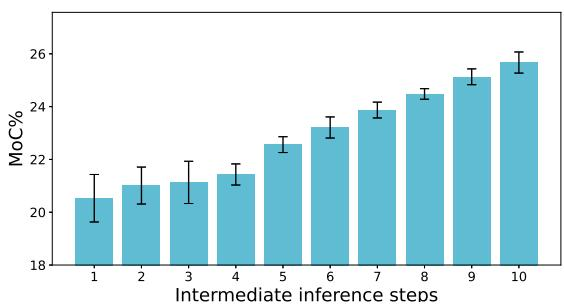  
Figure 4. Analysis of intermediate refinement steps. We report mean accuracy and std. deviation over intermediate inference steps for a model trained for 10 steps.

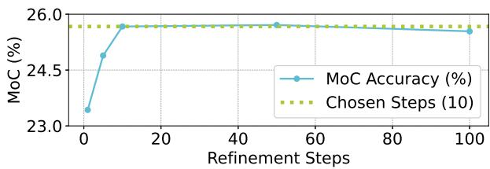  
Figure 5. MoC accuracy vs. number of steps in the refinement process on the Breakfast dataset, showing that accuracy at 50 and 100 steps does not significantly improve compared to 10 steps.

## C.3. Impact of Different Loss Terms

To evaluate the impact of different loss terms on the model’s performance, we conducted an ablation study on various loss components using the Breakfast and 50 Salads datasets, as shown in Tab. 8. The results reveal that recognition loss significantly enhances accuracy, highlighting its importance in the model’s performance. While initialization loss does not lead to substantial improvements in accuracy, both qualitative and quantitative analyses of symbolic knowledge’s influence on the model’s predictions suggest that it plays a critical role in maintaining proper alignment between the neural and symbolic components. This alignment, as discussed in the paper, ultimately improves the overall observability and coherence of the model’s predictions.

## C.4. Parameter Efficiency

Table 9 summarizes results on the Breakfast dataset for different model sizes. Our 3M parameter variant significantly outperforms both traditional baselines such as Diffant (80M) and fine-tuned LLM-based approaches such as LLMAction and ActionLLM (7B each), particularly at longer prediction horizons. Even our 400k variant retains high predictive accuracy, dropping only ∼1.5% compared to the baselines. As also reflected in the cross-dataset parameter counts reported in the main paper, this parameter efficiency generalizes across datasets, underscoring a central advantage of our neuro-symbolic approach: by bootstrapping symbolic knowledge as structured context, SymAnt achieves strong anticipation performance without relying on large-scale model capacity or extensive observation windows.

Table 8. Results for different loss terms on the Breakfast and 50 Salads datasets, highlighting the significant impact of the recognition loss on model performance.
<table><tr><td></td><td></td><td></td><td colspan="4">Breakfast</td><td colspan="4">50 Salads</td></tr><tr><td></td><td></td><td></td><td colspan="2"> $\beta ( \alpha = 0 . 2 )$ </td><td colspan="2"> $\beta ( \alpha = 0 . 3 )$ </td><td colspan="2"> $\beta ( \alpha = 0 . 2 )$ </td><td colspan="2"> $\beta ( \alpha = 0 . 3 )$ </td></tr><tr><td>AR</td><td>Rec.</td><td>Init.</td><td>0.1</td><td>0.5</td><td>0.1</td><td>0.5</td><td>0.1</td><td>0.5</td><td>0.1</td><td>0.5</td></tr><tr><td>√</td><td></td><td></td><td>23.75</td><td>19.21</td><td>26.64</td><td>23.28</td><td>32.19</td><td>22.05</td><td>30.61</td><td>17.52</td></tr><tr><td>√</td><td></td><td>√</td><td>24.02</td><td>19.44</td><td>26.21</td><td>23.75</td><td>32.78</td><td>22.70</td><td>31.74</td><td>17.26</td></tr><tr><td>√</td><td>√</td><td></td><td>28.07</td><td>25.81</td><td>34.12</td><td>29.51</td><td>40.69</td><td>27.98</td><td>35.51</td><td>25.31</td></tr><tr><td>√</td><td>√</td><td>√</td><td>28.22</td><td>25.67</td><td>34.22</td><td>30.11</td><td>40.78</td><td>28.19</td><td>35.23</td><td>25.50</td></tr></table>

Table 9. Parameter efficiency on the Breakfast dataset across different model size variants, showing high performance even with < 1M parameters. Counts are trainable parameters of the anticipation model; the frozen I3D backbone (shared across all baselines) and the swappable SG detector (see the main paper) are excluded as common input pipeline.
<table><tr><td colspan="2"></td><td colspan="2"> $\beta ( \alpha = 0 . 2 )$ </td><td colspan="2"> $\beta ( \alpha = 0 . 3 )$ </td></tr><tr><td>Method</td><td>Params</td><td>0.2</td><td>0.5</td><td>0.2</td><td>0.5</td></tr><tr><td>Ours</td><td>400k</td><td>23.88</td><td>22.87</td><td>28.60</td><td>25.00</td></tr><tr><td>Ours</td><td>800k</td><td>24.54</td><td>21.58</td><td>30.61</td><td>27.63</td></tr><tr><td>FUTR</td><td>1M</td><td>24.55</td><td>22.04</td><td>29.88</td><td>25.87</td></tr><tr><td>Ours</td><td>1.2M</td><td>27.54</td><td>25.05</td><td>31.56</td><td>29.78</td></tr><tr><td>Ours</td><td>3M</td><td>27.55</td><td>25.67</td><td>32.06</td><td>30.11</td></tr><tr><td>ActFusion</td><td>13M</td><td>25.52</td><td>23.25</td><td>31.76</td><td>28.78</td></tr><tr><td>Diffant</td><td>80M</td><td>24.59</td><td>22.74</td><td>31.83</td><td>30.77</td></tr><tr><td>LLMAction</td><td>7B</td><td>25.23</td><td>24.26</td><td>31.35</td><td>27.81</td></tr><tr><td>ActionLLM</td><td>7B</td><td>23.32</td><td>20.43</td><td>29.45</td><td>24.55</td></tr></table>

## D. Qualitative Results on 50 Salads

Figure 6 reports qualitative results on 50 Salads, one of the two datasets used for our main comparisons, and simultaneously illustrates the effect of editing the symbolic prior at inference without retraining. Cases (a) and (b) show that activating or deactivating the tomato nodes adds or removes the corresponding cut tomato predictions, while case (c) shows a video in which the prediction persists despite deactivation. In case (a), the tomato is partially occluded throughout the observed segment, so the unedited model omits the cut tomato actions. A single manual node addition at inference recovers them without retraining. This is the mode of control the symbolic prior is intended to provide, namely correcting a perception failure that a purely neural model

offers no handle on.

In case (b), the unedited model initially predicts the cut tomato actions. When we manually deactivate the tomato nodes, these predictions are successfully removed. Manual inspection of such cases reveals that the visual evidence for a forthcoming cutting action is often ambiguous. For instance, the tomato is already partially cut during the observed segment. Because the visual stream lacks certainty, the symbolic edit is able to successfully dictate the output. Case (c) represents the opposite scenario: the action prediction persists despite node deactivation. Here, the tomato is unoccluded and prominent, and the observed actions unambiguously point to cutting as the next step. In this regime, the decoder falls back on the strong visual stream, which accounts for the residual accuracy under deactivation reported in Fig. 3 of the main paper. Ultimately, these examples establish a consistent pattern: symbolic edits are highly decisive when the visual observation is incomplete or ambiguous but are sometimes overridden by the partial entanglement of the visual and symbolic pathways (Sec. E) when the visual evidence is strong.

## E. Limitations and Future work

While our method demonstrates strong performance for action anticipation, it presents certain limitations. First, SymAnt relies on an off-the-shelf object detector to identify task-relevant entities; consequently, initial detection failures can propagate to downstream anticipation. However, because our architecture treats this component as modular, the pipeline will seamlessly benefit from future advancements in visual recognition models. Second, the framework depends on a knowledge graph. Although our KG construction pipeline generally requires little domain engineering, and our ablations show that the model remains robust to general-purpose KGs and new domains, our future work will focus on automatic knowledge graph extraction directly from foundational models.

Another limitation involves the partial entanglement of visual and symbolic features. As observed in our knowledge editing experiments, manually deactivating an action node drastically reduces, but does not entirely eliminate, the model’s ability to predict that action. This indicates a degree of information leakage, where underlying continuous visual features from the video encoder bypass the symbolic bottleneck. While our results prove that modifying the graph still provides significant control over the predicted sequence, future work will focus on strictly disentangling the explicit symbolic logic from the continuous neural feature flow to enable absolute steerability.

Observation  
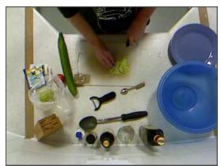

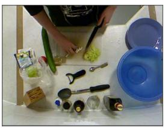

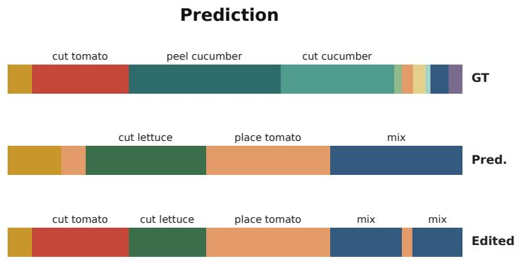  
(a) Activate tomato nodes

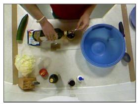

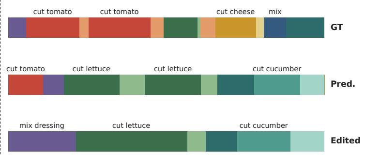  
(b) Deactivate tomato nodes

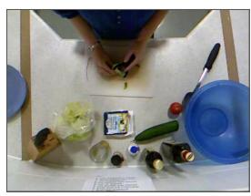

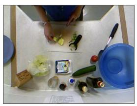

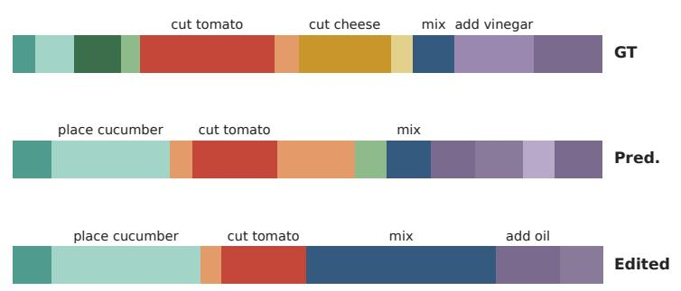  
(c) Deactivate tomato nodes (persists)  
Figure 6. Qualitative anticipation results on 50 Salads with symbolic edits applied at inference. For each example we show the observed segment with two sample frames (left), and the ground-truth future (GT), our prediction (Pred.), and the prediction after editing the tomato nodes of the expanded joint-graph (Edited). (a) the tomato is occluded during the observation and missed by the detector, and activating the nodes recovers the cut tomato actions; (b) deactivating them removes cut tomato actions; (c) a case where the prediction persists despite deactivation, i.e. the visual stream overrides the symbolic prior.