# SynthFaces: Balanced Large Scale Human Dataset

Sergey Karpukhin1, 2 seriy.karp2@gmail.com

Denis Bobkov1, 2 6dbobkov@hse.ru

Kirill Morozov3 2s02230196@gse.cs.msu.ru

1 FusionBrain Lab, AXXX Moscow, Russia

tAibek Alanov1, 2 aalanov@hse.ru

2 HSE University Moscow, Russia

3 MSU Moscow, Russia

## Abstract

The pursuit of fair and equitable AI in human-centric tasks is critically hindered by the inherent biases and privacy risks of real-world datasets, which offer imbalanced representations of identity and often contain sensitive personal information. Consequently, state-of-the-art generative models trained on this skewed data exhibit unfair performance, particularly in identity-preserving generation. In this work we propose a pipeline for controllable generation of dataset with diverse faces for generative models training and finetuning. We achieve this by expanding foundational Arc2Face diffusion model with a flow matching generative model in the manifold of identity embeddings. We demonstrate that such approach achieves both goals of generative fidelity and label diversity not present in real human-centric datasets. As a result we collect and further contextualize a highly balanced identity-centric dataset of humans named SynthFaces. By design, our released images and identities are synthetic, reducing direct reliance on real personal images; we empirically check identity separation with a nearest-neighbor non-leakage metric. We purpose it for training and tuning of fair models for various downstream tasks, and showcase its usability in finetuning an existing adapter-based method for personalized generation.

## Introduction

Human image generation is one of the most common applications of modern generative models. The field originated with unconditional generators such as StyleGAN [4], which allowed to sample novel faces without any control, and was later expanded to text-to-image diffusion models and adapter-based approaches (e.g., PhotoMaker, SDXL-based personalization), which allow conditioning on a novel face from a single image [21, 28, 32, 36] and combined with prompt allowed to place human in different context. Unfortunately, most released face-conditional models report averaged quality, which conceals an important aspect of such methods - do they perform equallyfor different human subgroups? In this work we show that this is not the case, and try to address this problem with our curated dataset SynthFaces collected with focus on balanced human representation.

SynthFaces dataset collection pipeline is designed to address a set of three core problems. 1) Label bias of existing datasets: both existing datasets with human faces, such as FFHQ, SHHQ [4], EasyPortrait [15] and CosmicMan-HQ [19] and generative samplers exhibit severe category imbalance - both unconditional samplers such as StyleGAN [25], as well as by conditional samplers e.g., Arc2Face [26], PhotoMaker [21] produce or reflect skewed distributions over demographic attributes (age, race, gender). 2) Face-similarity quality of conditional samplers: when evaluated per demographic group, conditional personalization models show uneven face preservation quality, which is natural given first problem; 3) Usage of real people identities: existing real datasets, especially large-scale ones, may include identities that did not give consent for deep learning model training or may include identities from under-age groups, using which may be completely unethical and certain datasets have been revoked from public access for that reason [7, 13].

Additionally, we aim to fulfill properties that are largely required for modern humancentric datasets - such properties are mentioned in Table 1, specifically we aim to provide Captions for images, describing both humans and surrounding context, collected images are ID-grouped, meaning that there are multiple images with same person, and lastly we aim to obtain HQ image with high resolution. These properties may be missing for certain types of datasets mentioned in table. For example under Raw Images we denote large-scale raw collections obtained via web-scrapping, are large enough to include all types of faces, however they might still require label-balancing strategy, as well image filtering to obtain high-quality images. HQ Captioned datasets are high quality, but they balance in human representation as we show later, as well as typically do not include multiple images of same person. Face Recognition datasets are typically also without captions, low resolution and also skewed in terms of human representation. In comparison our collected dataset satisfies all of these properties, while also using released images and identities that are synthetic and empirically screened for identity separation.

Table 1: High level comparison of dataset types, in columns Caption denotes that images are paired with prompts, Balanced labels that dataset is balanced over selected demographic labels, ID-grouped that multiple images per person are provided and HQ suggests that images are high resolution and visually high quality
<table><tr><td>Type</td><td>Dataset</td><td>Captions</td><td>Balanced labels</td><td>ID-grouped</td><td>Private</td><td>HQ</td></tr><tr><td>Raw Images</td><td>VGG-Face, WebFace</td><td>唯 no</td><td>partially</td><td>七 yes</td><td>唯 no</td><td>吧 partially</td></tr><tr><td>HQ Captioned</td><td>Cosmic, DeepFashion</td><td>一 yes</td><td>唯 no</td><td>唯 no</td><td>唯 no</td><td>と yes</td></tr><tr><td>Face Recognition</td><td>DCFace, HyperFace</td><td>手 no</td><td>手 no</td><td>d yes</td><td>9 partially</td><td>手 no</td></tr><tr><td></td><td>SynthFaces (ours)</td><td>七 yes</td><td>と yes</td><td>七 yes</td><td>上 yes</td><td>と yes</td></tr></table>

SynthFaces addresses these problems by introducing controllable label diversity into identity representation sampling and by releasing synthetic identities whose separation from real training identities is checked through ID-NonLeak. The resulting dataset is balanced across selected demographic labels, ID-grouped, captioned, and contextualized for highresolution human generation. We systematically study label balance, non-leakage, image quality, and downstream usefulness through generative fine-tuning, face recognition fairness, and demographic VQA in Section 5.

## 2 Related Works

Synthetic face datasets have been studied primarily for face recognition [1, 14, 18]. Existing pipelines combine GAN samples with per-identity adaptation [15, 29], or exploit the conditional space of face foundation models such as Arc2Face [26]. HyperFace [30] explores this hyperspherical space directly, but its generated identities remain demographically imbalanced. Arc2Face and Vec2Face [34] instead perturb real ArcFace embeddings with PCA, requiring real identity embeddings at inference time and offering no explicit separation from them. ID-Flow learns a controllable prior over the identity manifold, samples without reference embeddings at inference time, and evaluates separation using ID-NonLeak (Table 2).

Model fairness seeks to reduce systematic performance differences across demographic subgroups [20, 24]. Our approach intervenes at data construction time by controlling the demographic distribution of sampled identities.

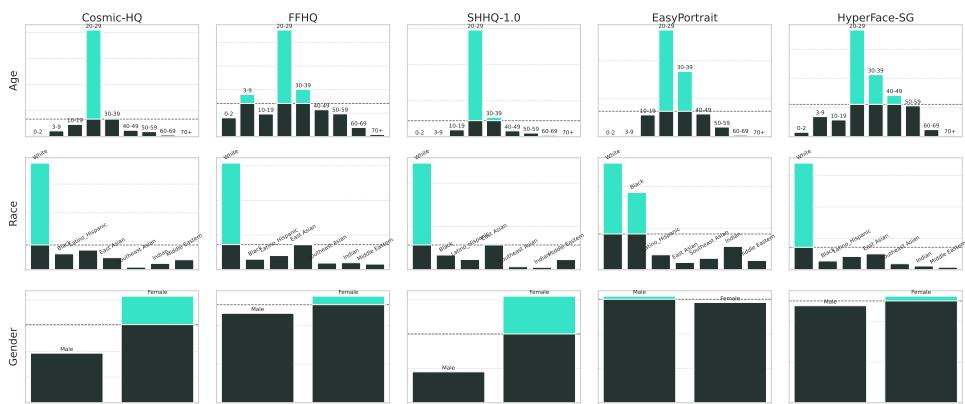  
Figure 1: Distribution of labels across different categories in some of conventional datasets with humans. Dashed lines denotes mean value across labels, color highlights values above mean

Identity-preserving generation Identity-preserving generation conditions image synthesis on a reference face. Introduced with adapter-based methods - IP-Adapter-FaceID [36], PhotoMaker [21], PuLID [8], and InstantID [32]; InfiniteYou [11] further improves fidelity and flexibility. Recent in-context models such as Qwen-Image [33] and Flux-2 [17] can preserve identity across varied contexts, whereas per-subject methods such as DreamBooth [29] require fine-tuning for every new identity. We use these models for contextualization after independently controlling the identity distribution.

## 3 Motivation

## 3.1 Existing datasets biases

To quantify label bias in existing datasets, we annotate them with FairFace classifier [12] and in Figure 1 show that all of the presented datasets demonstrate heavy bias towards certain

labels. Training on such data without empirical balancing strategies can be harmful for generative model fairness and diversity.

## 3.2 Evaluating unfairness in human-centric models

To expose subgroup differences hidden by aggregate metrics, we construct FairBench, a probe set sampled uniformly over FairFace label combinations. Figure 15 shows substantial demographic variation in identity preservation, consistent with the dataset skew in Figure 1. Section 5 evaluates whether balanced training data also improves subgroup parity in face recognition and demographic VQA.

## 4 Dataset construction

In order to build a dataset of synthetic released identities and images, we follow a 3 stage design described in Figure 2. Each stage is motivated by a specific problem of existing pipelines - at stage 1 we ensure that dataset is private while also free of skewed label distribution, at stage 2 we construct maximum fidelity faces from diverse identity representation, and at stage 3 we achieve high resolution and context coupled with captions.

## 4.1 Learning to sample identities

Identity embeddings lie on a unit hypersphere, so treating them as unconstrained Euclidean vectors ignores their geometry. We instead learn a geodesic flow-matching model directly on this manifold.

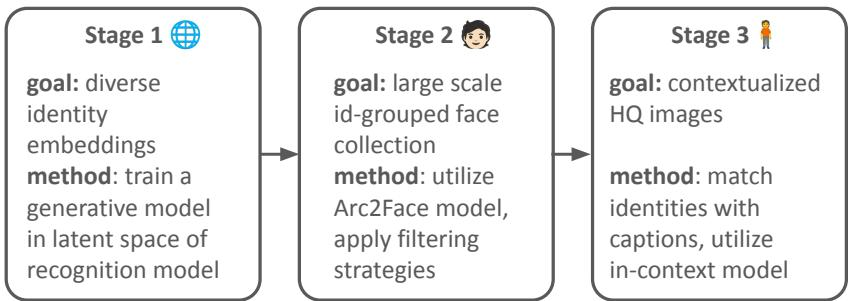  
Figure 2: Dataset multi-stage collection pipeline.

We aim to train a generative model in latent space of identity embeddings. Natural observation is that these embeddings are all unit length and therefore exists on a n-dimensional sphere. Some prior works tried to explore this idea, for example in [30] authors pose problem of sampling diverse embeddings as optimization problem on sphere, and in [3] authors construct von Mises–Fisher based diffusion model that respects manifold geometry. In this work we make a novel adaptation ofnon-Euclideanflow matching to construct a generative model on identity latents. Given $\{ e _ { i } \} _ { i = 1 } ^ { N } \in \mathbb { S } ^ { n }$ , where $\| e _ { i } \| = 1$ for ∀i, we aim to train a $\nu _ { \theta } ( \cdot )$ to approximate velocity field of the tangent bundle TM of sphere manifold between two probability distributions - prior uniform on sphere $\mathbf { U n i f o r m } ( \mathbb { S } ^ { \bar { n } - 1 } )$ and distribution of identity embeddings $p _ { 1 } ( \mathbb { S } ^ { n - 1 } )$ . We follow standard definitions and define geodesic conditional flow as $\phi ( x _ { t } | x _ { 1 } ) = \exp ( k ( t ) \log _ { x _ { 0 } } ( x _ { 1 } ) )$ , where $t \in [ 0 , 1 ]$ . Functions $\exp _ { x _ { 0 } } ( \cdot )$ is a projection from sphere to tangent space $M _ { x _ { 0 } }$ and $\log _ { x _ { 0 } } ( \cdot )$ is the inverse. These projection are explicitly defined for known manifolds such as sphere, which allows to obtain training target without requiring simulation [22]. Overall scheme of flow construction and resulting pipeline with trained model is presented in Figure 3, and the training objective is given in Eq.1. For definitions of projections and background on flow matching check Appendix A.2

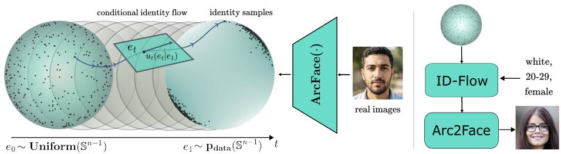  
Figure 3: Left - Conditional identity flow between uniform points on sphere and ArcFace embeddings used for training, constrained to tangent hyperplanes, right - inference scheme together with Arc2Face at stage 2, trained ID-flow samples identity embedding with given control signals and Arc2Face samples image

$$
L _ { G C F M } ( \theta ) = \mathbb { E } _ { t , e _ { 0 } , e _ { 1 } } \| \nu _ { \theta } ( e _ { t } , c ) - \frac { d } { d t } e _ { t | 1 } \| _ { 2 } ^ { 2 }\tag{1}
$$

Since we aim to train a controllable conditional model, along with interpolated $e _ { t }$ learned velocity will accept as input a set of labels $\boldsymbol { c } = [ c _ { 1 } , c _ { 2 } , c _ { 3 } ]$ , representing face. These labels are obtained through training data annotation and represent general face features, such as race, age and gender. During inference we use these to construct diverse dataset by applying classifier-free guidance [9]. We stick with simple multilayer MLP architecture with skipconnections and apply guidance scale 2.0 during sampling of identities. ID-Flow is trained on approximately 50k deduplicated ArcFace embeddings extracted from CosmicMan-HQ, FFHQ, and EasyPortrait; full data collection and model details are given in Appendix A.3.

Table 2: Baseline comparison of Stages 1 and 2. Lower FID is better and higher Precision/Recall/F1/ID-NL scores are better. ID-NL (ID-NonLeak) measures average nearest-neighbor separation from real training identities.
<table><tr><td>Category</td><td>Method</td><td>FID-i↓</td><td>FID-e ↓</td><td>Prec. ↑</td><td>Rec. ↑</td><td>F1↑</td><td>ID-NL↑</td></tr><tr><td rowspan="3">Naive</td><td>uniform</td><td>96.53</td><td>0.277</td><td>0.011</td><td>0.95</td><td>0.02</td><td></td></tr><tr><td>*interpolation</td><td>30.59</td><td>0.035</td><td>0.765</td><td>0.622</td><td>0.68</td><td>0.43</td></tr><tr><td>*PCA</td><td>51.18</td><td>0.048</td><td>0.29</td><td>0.88</td><td>0.44</td><td>0.76</td></tr><tr><td rowspan="4">Model</td><td>StyleGAN</td><td>45.8</td><td>0.111</td><td>0.711</td><td>0.173</td><td>0.28</td><td>一</td></tr><tr><td>Arc2Face</td><td>37.3</td><td>0.118</td><td>0.701</td><td>0.185</td><td>0.29</td><td></td></tr><tr><td>SDXL-Photomaker</td><td>73.9</td><td>0.207</td><td>0.73</td><td>0.01</td><td>0.02</td><td>一</td></tr><tr><td>HyperFace</td><td>61.1</td><td>0.13</td><td>0.57</td><td>0.17</td><td>0.26</td><td></td></tr><tr><td>Ours</td><td>ID-Flow</td><td>39.9</td><td>0.073</td><td>0.35</td><td>0.75</td><td>0.48</td><td>0.741</td></tr></table>

\*Interpolation and PCA baselines use real training embeddings.

We compare against other baselines in terms of a) face image quality b) label diversity. In Table 2 these baselines are: parameter-free or naive such as uniform sampling on sphere, interpolation of embeddings and PCA based sampling, following procedure described in [34], unconditional StyleGAN and conditional model-based samplers - Arc2Face and Photomaker that were used with synthetic identities, as well as recent HyperFace method for synthetic generation. We report image FID (FID-i) with face hold-out set, and generative metrics for identity latents (FID in embedding space (FID-e), Precision, Recall, F1) [16]. During sampling with ID-flow we do not utilize labels from test set, but sample labels from train data statistics for fair comparison. ID-Flow gives the best FID-e, recall, F1, and ID-NonLeak among learned samplers, while keeping image FID close to Arc2Face.

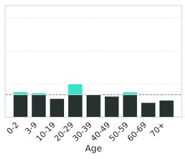

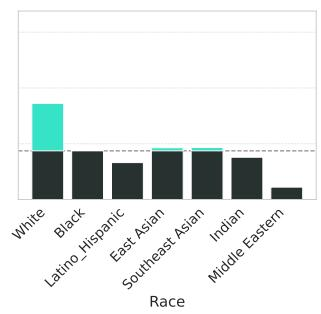

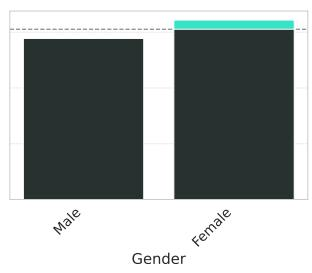  
Figure 4: Distribution of different label categories data generation by ID-Flow. Compared to conventional datasets, our method offers significant data balance for all major characteristics of persons

Compared to other models, our method offers superior identity diversity, since other baseline samplers inherit mode collapse property of synthetic data. Despite strong results of interpolation, we show that it results in leakage of training data into samples (ID-NonLeak) - we measure identity leakage over the training set as an average cosine distance to nearest neighbor from training data - samples from model are almost orthogonal to closest samples from train data, while interpolated samples remain in close angular proximity.

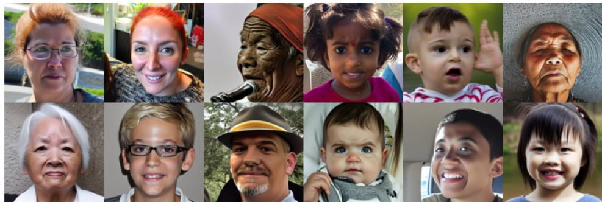  
Figure 5: Diverse samples from ID-Flow. Dataset was sampled with uniform label controls, ensuring greatest variance of identity representations

In Table 3 we numerically compare diversity of generated data when control labels provided to the model across different categories are selected uniformly against baselines reported in Fig. 1. We evaluate diversity through KL-divergence with uniform distribution $K L ( p _ { m o d e l } ( y ) | | U ( y ) )$ averaged across label categories. Additionally we show visual histograms of generated data samples with our method in Figure 4, where it can be observed that compared to baselines in Fig. 1 this stage pipeline of ID-flow with Arc2Face allows to achieve highly balanced data, while also surpassing baselines in terms of face quality. Samples of identities obtainable at this stage are provided in Fig. 5

Table 3: Label diversity
<table><tr><td>Method</td><td>KL</td></tr><tr><td>FFHQ</td><td>0.449</td></tr><tr><td>SHHQ</td><td>0.533</td></tr><tr><td>EasyPortait</td><td>0.508</td></tr><tr><td>CosmicHQ-1.0</td><td>0.576</td></tr><tr><td>HyperFace-10k</td><td>0.49</td></tr><tr><td>PCA</td><td>0.75</td></tr><tr><td>SynthFaces (ours)</td><td>0.048</td></tr></table>

After training an ID-flow, we start by sampling a large amount of unique identity representations, resulting in 28 thousands embeddings. These embeddings as noted by Stage 2 plan, are turned into face images, and various filtering strategies are applied in order to enhance output of this stage and get rid of potential artifacts present in images.

Image statistics filtering we start by analyzing distribution of images characteristics generated by Arc2Face. We evaluate conventional computer vision characteristics of images, such as entropy and saturation. We observe that tail of entropy distribution corresponds to heavily stylized images, low saturation values correspond to black and white images, and high saturation mostly coincides with faces that have unnatural amount of color/light or make up. Therefore we drop around $\mathrm { p } \%$ of images from tails, removing approximately 3k unsatisfactory images. Qualitative examples are provided in supplementary Figure 11.

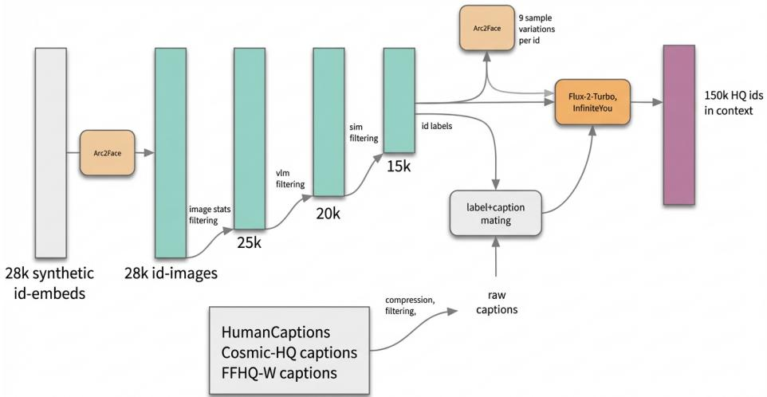  
Figure 6: Data filtering pipeline from Stage 2 to contextualization - in order to minimize amount of corrupted images with faces we 1) remove images in long tails of statistics 2) detect images with artifacts via vision-language model 3) threshold pairwise similarity, ensuring variability of identities in all categories, resulting in the end with approximately 150,000 final images

## 4.2 Data curation pipeline

VLM filtering After basic image statistics filtering we utilize multiple Qwen-VL models to assess obtained images from two perspectives 1) does the person’s face align with labels that were used to generate them 2) does the person’s face contain any visual artifacts. Based of VLM answers we drop all misaligned images and images that contained faces with visual defects, keeping samples which by majority voting of VLMs are assessed as well-aligned. To make sure that only relevant artifacts are dropped, we prompted VLM to reason about noticed artifacts in the images and dropped images only if the reasoning contained specific key-words. Detailed example of VLM prompting is provided in Appendix A.5.

Table 4: Comparison of metrics before and after filtering Stage 2 images. F1/Precision/Recall/FID and KL divergence same as in previous tables, KL is split for separate categories analysis. Note that metrics are computed with skewed test set of face images
<table><tr><td></td><td>F1</td><td>Precision</td><td>Recall</td><td> $\mathbf { F I D } _ { e }$ </td><td> $\mathbf { F I D } _ { i }$ </td><td>KL-age</td><td>KL-race</td><td>KL-gender</td></tr><tr><td>Before</td><td>0.496</td><td>0.425</td><td>0.596</td><td>0.163</td><td>65.59</td><td>0.000108</td><td>0.000042</td><td>0.000001</td></tr><tr><td>After</td><td>0.444</td><td>0.359</td><td>0.580</td><td>0.127</td><td>57.66</td><td>0.121146</td><td>0.006530</td><td>0.003619</td></tr></table>

Similarity filtering Additionally, we made sure that resulting identities are not only diverse in terms of labels, but also in terms of embeddings themselves. For that purpose we evaluated distribution of nearest neighbors in the resulting identities and observed a long tail which is not present in typical datasets. After per-label analysis these higher similarity tails occurred for specific label combinations that were particularly rare in training data used for ID-flow training - e.g. rare race groups or age groups. Therefore we filter by similarity threshold for these specific groups, while also keeping a proportion of data across labels close to uniform. After this stage with obtain highly diverse identities, superior to diversity in other baselines - 15 thousand filtered identities and respective labeled images remain. Detailed analysis of this stage results is given in Appendix A.4. The overall image statistics before and after all filtering strategies applied at this stage are given in Table 4. Filtering improves image quality metrics $( \mathrm { F I D } _ { e }$ and $\operatorname { F I D } _ { i } )$ and removes visible artifacts, but it also reduces F1/precision/recall and worsens KL-age because the most problematic tails are not perfectly uniform distributed across demographic labels.

Table 5: Text-conditioned Flux.2 sampling versus ID-Flow (N=1000 each). Label KL is the mean KL divergence from a uniform distribution over age, race, and gender; ID-div. is mean nearest-neighbor cosine distance.
<table><tr><td>Method</td><td>Label KL ↓</td><td>ID-div. ↑</td></tr><tr><td>Flux.2 T2I, unconditional</td><td>0.891</td><td>0.257</td></tr><tr><td>Flux.2 T2I, balanced prompts</td><td>0.101</td><td>0.201</td></tr><tr><td>ID-Flow (ours)</td><td>0.037</td><td>0.751</td></tr></table>

After filtering, we additionally test whether balanced prompting of a state-of-the-art textto-image model can replace explicit identity-manifold sampling. We generate 1,000 Flux.2- dev-Turbo seed faces using either a generic prompt or cycled demographic descriptors and compare them with 1,000 ID-Flow samples. Table 5 shows that balanced prompting improves Flux.2 label balance, but remains 2.7× farther from uniform than ID-Flow (0.101 vs.

0.037) and yields 3.7× lower identity diversity (0.201 vs. 0.751). Prompt-level demographic control therefore does not provide the balanced and diverse identity distribution required for dataset construction.

## 4.3 Obtaining HQ images

Caption and label matching In order to contextualize images, we collected captions of images from real world datasets like Cosmic-HQ and FFHQ-in-the-Wild and collections of human related texts like HumanCaption [2]. We filtered prompts to exclude any details related to attributes that were controlled during identity sampling, including details with description of facial features. After that we

Table 6: Comparison of HQ dataset metrics with SynthFaces - our dataset offers superior quality over Cosmic-HQ, while allowing richer contextualization without overly large faces
<table><tr><td></td><td>FaceSize</td><td>IR</td><td>CLIP</td></tr><tr><td>Cosmic-HQ</td><td>0.22</td><td>-0.69</td><td>31.20</td></tr><tr><td>FluxSynID []</td><td>0.61</td><td>1.54</td><td>34.07</td></tr><tr><td>SynthFaces</td><td>0.29</td><td>1.38</td><td>33.04</td></tr></table>

roughly annotated these captions into subgroups based of their context, main factor being suitable age, e.g. prompts for child, prompts for adults, etc. After that we randomly sampled captions for each image given its label, matching label with classes with captions that are suitable for these face label values by looking for specific keywords that were used as person descriptors. Details of algorithm are given in Appendix A.6.

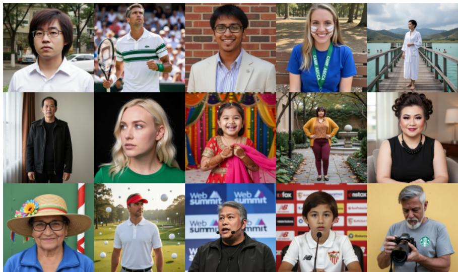  
Figure 7: SynthFaces dataset sample examples - after filtration and caption matching identities are contextualized with Flux-based methods, resulting in total 150,000 high-quality contextualized images with approximately 10 images per identity

Examples of ID-grouped images - multiple contextualized images per synthetic identity, as well as images with more variance in terms of face position in image, are shown in Appendix A.9.

Identity contextualization In order to unite curated identities with captions, we utilize state of the art personalization models - InfiniteYou and in-context model Flux 2, first one aims for consistency while second one allows more fidelity and variability. In order to enhance realism of images generated with InfiniteYou we attach additional LoRAs for realism and deblurring, and to speed up generation with Flux 2 we utilize Turbo checkpoint that from experiments turned to be the best amongst existing models for personalized generation of humans, see qualitative comparison in Appendix A.7. As a result, we obtain a large scale, high quality diverse dataset of synthetic released identities, consisting in total of 150,000 captioned high-resolution images of varying aspect ratios, with approximately 10 images per identity. Resulting samples from this dataset are given in Fig. 7.

Additionally, we evaluate resulting SynthFaces images in terms of image quality by ImageReward(IR) metric [35], text alignment by CLIP and ratio of size of face detection box to size of the image side. Compared with the baselines in Table 6, SynthFaces improves over Cosmic-HQ on ImageReward and CLIP while keeping faces smaller than FluxSynID, whose document-formatted images often lack background context.

## 5 Downstream applications

We evaluate whether SynthFaces data yields fairness benefits in distinct downstream tasks: finetuning personalized generation pipeline, face recognition (FR) verification and demographic attribute classification. Fine-tuning tests usefulness for id-preserving generation, FR tests whether balanced synthetic identities reduce verification disparity, and VQA tests whether balanced human images help demographic attribute recognition.

## 5.1 ID-preserving generation

Metrics We measure two core metrics for face preservation on average to observe mean change after adapter tuning, as well as per category analysis - ID - stands for face similarity between source and generated person, CLIP-T - measures similarity between image and prompt description in latent space of CLIP model.

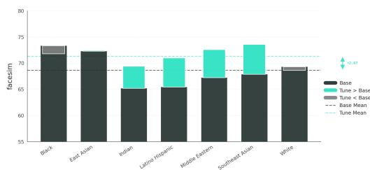

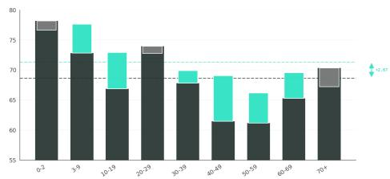  
Figure 8: Face similarity measured across different categories of IpAdapter-FaceID before and after tuning on data generated by ID-flow.

Evaluation We use two evaluation benchmarks - one is FairBench introduced before - which is a collection of balanced faces that includes every possible combinations of labels, it’s textual captions focus only on face description. This benchmark corresponds of to maximum reconstruction of person facial features. Second benchmark named Context is a less diverse in terms of labels, but includes richer prompts specializing in placing people in contexts, demonstrating trade-off between face similarity being lower for smaller faces and more contextualized humans.

Table 7: Effect of tuning pipelines with our dataset, reporting average metric values
<table><tr><td rowspan="2">Method</td><td colspan="2">FairBench</td><td colspan="2">Context</td></tr><tr><td>ID</td><td>CLIP-T</td><td>ID</td><td>CLIP-T</td></tr><tr><td>SD-1.5 + FaceID</td><td>68.63</td><td>32.91</td><td>28.81</td><td>53.56</td></tr><tr><td>SD-1.5 + FaceID (+ tuned)</td><td>71.31</td><td>33.27</td><td>28.49</td><td>51.56</td></tr></table>

Training details Finetuning conditional diffusion model comes with a challenge of data distribution drift. It’s a problem that arises because of discrepancy between data that was used for training original checkpoint and data that is being used for finetuning. Main characteristic that seemingly may hurt performance of these methods in terms of face preservation is learned face size. Face size in collected data serves as hidden factor that can be learned by diffusion model and directly affect similarity metric. Therefore to mitigate effect of this hidden factor we apply approach from [5] termed shortcut finetuning - specifically we attach frozen ControlNet [37] to condition on human pose and face position in source image, making finetuned IP-adapter layers learn only essential features related to face preservation. Details about this approach and hyperparameters for training are given in Appendix A.8.

We provide finetuning results for StableDiffusion coupled with IPAdapter-FaceID. We observe a significant mean improvement in fair face reconstruction benchmark, while keeping comparable performance of contextualized generation. However, it is also important to inspect the change in quality per label. In Fig. 8 we showcase improvement across different label values per age and race groups - improvement is not isolated and ultimately makes performance more uniform. More detailed finetuning results with another personalized generation method are provided in Appendix A.8.

## 5.2 Face Recognition Fairness

Setup We train FR model on a version of our synthetic dataset purposed for this task - we sample 500k images from ID-Flow + Arc2Face with uniform labels, 50 images per identity, and additionally filter identities by similarity threshold in every subgroup. We compare with two other available FR model baselines: SynthFaces-500K (IResNet-100, ArcFace, ∼500K images of 10K identities from our pipeline), Vec2Face [34] (IResNet-50 SE, Arc-Face, ∼300K images, HSFace300K real-web source), and HyperFace [30]. We evaluate on two regimes: (a) five standard FR benchmarks (LFW, CFP-FP, AgeDB-30, CALFW, CPLFW) annotated post-hoc with FairFace [12] demographic labels, and (b) BFW (Balanced Faces in the Wild) [27], a balanced dataset with over ∼900K images balanced across 4 races × 2 genders with human-assigned labels.

Fairness metrics We aim to evaluate fairness of trained FR models. After analyzing standard FR benchmarks we find them to be heavily skewed (AgeDB-30: 88% White; LFW: 66% White, 75% male - see Table 14 in the Appendix), making accuracy-disparity metrics conflate representation with bias. A face verification system accepts or rejects a pair against a threshold τ; the two governing error rates are the False Match Rate (FMR) and False Non-Match Rate (FNMR) [6]. We evaluate at a calibrated operating point: fix the global FMR to target $\alpha \in \{ 1 \% , 0 . 1 \% \}$ via $\tau _ { \alpha } = \mathrm { Q u a n t i l e } _ { \alpha } ( \{ D _ { i } : y _ { i } { = } 0 \} )$ , then measure per-group FNMR. This reflects realistic deployment where an operator fixes a tolerable false-alarm rate. To normalize for absolute model quality and isolate relative group (dis)advantage, we adopt the Skewed Error Ratio (SER), inspired by [31]:

$$
\mathrm { S E R } _ { g } ( \alpha ) = \frac { \mathrm { F N M R } _ { g } ( \alpha ) } { \mathrm { F N M R } _ { \mathrm { g l o b a l } } ( \alpha ) } .\tag{2}
$$

Unlike the original formulation - which takes the ratio of worst to best group — we anchor to the global population FNMR, avoiding division-by-zero when any group achieves perfect recall and decoupling group disadvantage from the best group’s advantage. $\mathrm { S E R } = 1 . 0$ is perfect parity; $\mathrm { S E R } > 1$ indicates disproportionate miss burden. We report $\mathrm { { S E R } _ { \operatorname* { m a x } } = }$ $\mathrm { m a x } _ { g } \mathrm { S E R } _ { g } ( \mathrm { l o w e r } = \mathrm { f a i r e r } )$

Results on standard benchmarks Table 9 reports the maximum racial SER at the tighter $\mathrm { F P R } = 0 . 1 \%$ operating point. SynthFaces-500K achieves the lowest $\mathrm { S E R } _ { \operatorname* { m a x } }$ on 4 of 5 benchmarks and the best

Table 8: BFW fairness aggregate (↓ fairer). Bold = best.
<table><tr><td>Model</td><td>Acc Disp ↓</td><td> $\mathrm { S E R } _ { \operatorname* { m a x } } @ 1 \% \downarrow$ </td><td> $\mathrm { S E R } _ { \mathrm { m a x } } @ 0 . 1 \% \big \downarrow$ </td></tr><tr><td>Vec2Face</td><td>0.087</td><td>1.107</td><td>1.057</td></tr><tr><td>HyperFace</td><td>0.068</td><td>1.143</td><td>1.101</td></tr><tr><td>SynthFaces-500K (ours)</td><td>0.043</td><td>1.074</td><td>1.011</td></tr></table>

mean across all five. The 40% reduction in mean racial SER relative to Vec2Face (1.097 vs. 1.531) indicates that a model trained on our demographically balanced data imposes substantially less differential miss burden on minority groups at high-precision operating points. Additionally accuracy figures are provided in Table 15 in the Appendix, and we also report FPR = 1% SER results in Table 16; SynthFaces-500K’s lower overall accuracy reflects that a model trained on a more balanced dataset may still underperform in terms of global accuracy reported on established benchmarks.

Table 9: Maximum racial SER at $\mathrm { F P R } = 0 . 1 \%$ on standard FR benchmarks (↓ fairer, 1.0 = perfect parity). Bold = best. ⋆ = SynthFaces-500K is fairest.
<table><tr><td>Model</td><td>LFW</td><td>CFP-FP</td><td>AgeDB-30</td><td>CALFW</td><td>CPLFW</td><td>Mean</td></tr><tr><td>Vec2Face-HSFace300K</td><td>2.217</td><td>1.296</td><td>1.560</td><td>1.185</td><td>1.397</td><td>1.531</td></tr><tr><td>HyperFace-10K-LDM</td><td>2.005</td><td>1.096</td><td>1.176</td><td>1.041</td><td>1.085</td><td>1.280</td></tr><tr><td>SynthFaces-500K (ours)</td><td>1.197</td><td>1.062</td><td>1.054</td><td>1.170</td><td>1.003</td><td>1.097</td></tr></table>

Results on BFW Table 8 reports aggregate fairness metrics on the balanced BFW benchmark. SynthFaces-500K achieves the lowest accuracy disparity $( 0 . 0 4 3 \mathrm { v s . } 0 . 0 8 7$ for Vec2Face, 0.068 for HyperFace), the lowest $\operatorname { S E R } _ { \operatorname* { m a x } }$ at both operating points, and near-perfect parity at $\mathrm { F P R } = 0 . 1 \% ( \mathrm { S E R } _ { \operatorname* { m a x } } = 1 . 0 1 1 )$ ; SynthFaces-500K consistently reduces disparity.

## 5.3 Downstream VQA: Demographic Attribute Classification

Setup We fine-tune LLaVA-1.5-7B [23] with LoRA adapters on demographic VQA data from three sources: (a) SynthFaces-HQ - samples from our datasets paired with multiplechoice questions on gender, race, and age derived from pipeline annotations; (b) SynthFaces - mirrors HQ version, but uses non-HQ images with just human faces (c) Vec2Face - a VQA set from arc2face-rendered images annotated with FairFace labels. All runs follow an identical LoRA fine-tuning protocol; checkpoints are selected by fairness/accuracy trade-off on a held-out split.

Metrics For tasks T and S - predictive and sensetive attributes, $T \neq S \in$ {gender,race,age}, we define the cross-attribute accuracy disparity:

$$
\Delta ( T , S ) = \operatorname* { m a x } _ { s \in S } \operatorname { A c c } ( T \mid S = s ) - \operatorname* { m i n } _ { s \in S } \operatorname { A c c } ( T \mid S = s ) .\tag{3}
$$

$\Delta ( T , S ) = 0$ is perfect cross-attribute fairness. We average over all 6 ordered pairs to obtain the average disparity $\bar { \Delta }$ (lower = fairer).

Evaluation We evaluate on a held-out internal VQA benchmark (37,316 questions). To avoid penalising either model for a domain gap, each fine-tuned model is evaluated on images from its own training domain, with a domain-matched untuned LLaVA baseline in each row.

Both SynthFaces variants improve over their domain baselines: SynthFaces-HQ raises avg accuracy from 0.551 to 0.700 $( \overline { { \Delta } } 0 . 1 8 3 {  } \mathbf { 0 . 1 5 1 } )$ ; SynthFacesnonHQ - trained on arc2facestyle renders of the same identities - achieves the strongest result in this domain-aligned evaluation (avg acc 0.797, ∆ 0.138), including +23.3 pp race accuracy over baseline. The domain-controlled

Table 10: Domain-aligned VQA results Avg acc = mean over gender/race/age (↑); $\overline { { \Delta } } \downarrow$ fairer. Bold = best per domain.
<table><tr><td>Domain</td><td>Model</td><td>Avg acc ↑</td><td> $\overline { { \Delta } } \downarrow$ </td></tr><tr><td>HQ</td><td>Baseline</td><td>0.551</td><td>0.183</td></tr><tr><td>HQ</td><td>SynthFaces-HQ (ours)</td><td>0.700</td><td>0.151</td></tr><tr><td>non-HQ</td><td>Baseline</td><td>0.645</td><td>0.176</td></tr><tr><td>non-HQ</td><td>Vec2Face</td><td>0.559</td><td>0.263</td></tr><tr><td>non-HQ</td><td>SynthFaces-nonHQ (ours)</td><td>0.797</td><td>0.138</td></tr></table>

comparison isolates training data composition: SynthFaces-nonHQ vs Vec2Face use identical image style and resolution, yet SynthFaces achieves +0.125 lower $\bar { \Delta }$ and +23.8 pp higher avg accuracy, consistent with its more balanced identity distribution. Vec2Face finetuning, by contrast, regresses on gender and age, suggesting its narrower training distribution degrades the pre-trained model’s demographic priors.

## 6 Conclusion

We introduced SynthFaces, a large-scale, identity-grouped and captioned synthetic human dataset designed for demographic balance while reducing reliance on released images of real individuals. Its ID-Flow sampler provides explicit demographic control while maintaining identity diversity and empirical separation from the real identities used for training. Across personalized generation, face recognition, and demographic VQA, models trained with SynthFaces improve subgroup parity while retaining useful task performance. These results show that controlling identity composition during dataset construction is an effective lever for fairer human-centric models. Future work should reduce dependence on potentially biased face encoders and foundation generators and investigate hybrid real–synthetic balancing strategies.

## 7 Limitations

While SynthFaces addresses key gaps in existing datasets, several limitations should be acknowledged.

Bias inheritance from foundation models. Arc2Face and Flux despite being state of the art generators for corresponding parts of pipeline carry aesthetic and demographic biases from their respective training corpora. Our pipeline guarantees label-level balance across age, race, and gender, but within-group visual diversity and image style remain bounded by what these upstream models can faithfully generate. Demographic combinations that are underrepresented in Arc2Face’s training data may yield lower-fidelity or less varied outputs.

Synthetic-to-real distribution gap. Images produced by diffusion models may contain subtle distributional artifacts absent from real photographs. While our VLM-based filtering step removes overt defects, residual domain differences could limit transferability when SynthFaces-trained models are evaluated on real-world data.

Dependency on upstream model capabilities. The expressive range of generated identities is ultimately constrained by Arc2Face’s capacity for identity preservation and Flux’s generation quality. Improvements to either foundation model would directly benefit downstream dataset quality, but also introduce a moving dependency.

## 8 Ethics statement

The creation of SynthFaces is a direct response to the ethical crisis surrounding web-scraped human-centric datasets, many of which have been rightfully retracted due to non-consensual use of personal images, including those of minors. To reduce these privacy and consent risks, SynthFaces releases synthetic identities generated by our pipeline rather than scraped personal images. Because ID-Flow is trained from ArcFace embeddings extracted from real datasets, we do not claim a formal privacy guarantee; instead, we empirically evaluate nearest-neighbor separation with the ID-NonLeak metric and design the dataset to avoid direct re-use of real personal images.

Furthermore, we address the issue of demographic bias that plagues both real and synthetic datasets. Our pipeline is explicitly designed to generate a balanced representation across age, gender, and ethnicity, creating a resource purposed for training fairer models and mitigating the harmful disparities common in existing technologies. While we acknowledge that no synthetic data is perfect and subtle biases may persist, we believe this work demonstrates a responsible path forward, decoupling progress in human-centric computer vision from the exploitation of personal data.

## 9 Acknowledgment

We gratefully acknowledge HSE University for providing access to its computational cluster, which was used to conduct the experiments presented in this work. Support from the Basic Research Program of HSE University is gratefully acknowledged (HSE-BR-2025-019).

## References

[1] Gwangbin Bae, Martin de La Gorce, Tadas Baltrušaitis, Charlie Hewitt, Dong Chen, Julien Valentin, Roberto Cipolla, and Jingjing Shen. Digiface-1m: 1 million digital face images for face recognition. In Proceedings of the IEEE/CVF Winter Conference on Applications ofComputer Vision, pages 3526–3535, 2023.

[2] Dawei Dai, Long Xu, Yutang Li, Yuanhui Zhang, and Shuyin Xia. Humanvlm: Foundation for human-scene vision-language model. Information Fusion, 123:103271, 2025.

[3] Muskan Dosi, Chiranjeev Chiranjeev, Kartik Thakral, Mayank Vatsa, and Richa Singh. Harmonizing geometry and uncertainty: Diffusion with hyperspheres. arXiv preprint arXiv:2506.10576, 2025.

[4] Jianglin Fu, Shikai Li, Yuming Jiang, Kwan-Yee Lin, Chen Qian, Chen Change Loy, Wayne Wu, and Ziwei Liu. Stylegan-human: A data-centric odyssey of human generation. In European Conference on Computer Vision, pages 1–19. Springer, 2022.

[5] Anujraaj Argo Goyal, Guocheng Gordon Qian, Huseyin Coskun, Aarush Gupta, Himmy Tam, Daniil Ostashev, Ju Hu, Dhritiman Sagar, Sergey Tulyakov, Kfir Aberman, et al. Preventing shortcuts in adapter training via providing the shortcuts. arXiv preprint arXiv:2510.20887, 2025.

[6] Patrick Grother, Mei Ngan, and Kayee Hanaoka. Face recognition vendor test (fvrt): Part 3, demographic effects. National Institute of Standards and Technology Gaithersburg, MD, 2019.

[7] Yandong Guo, Lei Zhang, Yuxiao Hu, Xiaodong He, and Jianfeng Gao. Ms-celeb-1m: A dataset and benchmark for large-scale face recognition. In European conference on computer vision, pages 87–102. Springer, 2016.

[8] Zinan Guo, Yanze Wu, Chen Zhuowei, Peng Zhang, Qian He, et al. Pulid: Pure and lightning id customization via contrastive alignment. Advances in neural information processing systems, 37:36777–36804, 2024.

[9] Jonathan Ho and Tim Salimans. Classifier-free diffusion guidance. arXiv preprint arXiv:2207.12598, 2022.

[10] Raul Ismayilov, Dzemila Sero, and Luuk Spreeuwers. Fluxsynid: A framework for identity-controlled synthetic face generation with document and live images. In Proceedings ofthe IEEE/CVF International Conference on Computer Vision, pages 3698– 3708, 2025.

[11] Liming Jiang, Qing Yan, Yumin Jia, Zichuan Liu, Hao Kang, and Xin Lu. Infiniteyou: Flexible photo recrafting while preserving your identity. In Proceedings of the IEEE/CVF International Conference on Computer Vision, pages 10898–10907, 2025.

[12] Kimmo Karkkainen and Jungseock Joo. Fairface: Face attribute dataset for balanced race, gender, and age for bias measurement and mitigation. In Proceedings of the IEEE/CVF winter conference on applications of computer vision, pages 1548–1558, 2021.

[13] Ira Kemelmacher-Shlizerman, Steven M Seitz, Daniel Miller, and Evan Brossard. The megaface benchmark: 1 million faces for recognition at scale. In Proceedings of the IEEE conference on computer vision and pattern recognition, pages 4873–4882, 2016.

[14] Minchul Kim, Feng Liu, Anil Jain, and Xiaoming Liu. Dcface: Synthetic face generation with dual condition diffusion model. In Proceedings ofthe ieee/cvfconference on computer vision and pattern recognition, pages 12715–12725, 2023.

[15] Karina Kvanchiani, Elizaveta Petrova, Karen Efremyan, Alexander Sautin, and Alexander Kapitanov. Easyportrait–face parsing and portrait segmentation dataset. arXiv preprint arXiv:2304.13509, 2023.

[16] Tuomas Kynkäänniemi, Tero Karras, Samuli Laine, Jaakko Lehtinen, and Timo Aila. Improved precision and recall metric for assessing generative models. Advances in neural information processing systems, 32, 2019.

[17] Black Forest Labs. FLUX.2: Frontier Visual Intelligence. https://bfl.ai/ blog/flux-2, 2025.

[18] Shen Li, Jianqing Xu, Jiaying Wu, Miao Xiong, Ailin Deng, Jiazhen Ji, Yuge Huang, Wenjie Feng, Shouhong Ding, and Bryan Hooi. Id3: Identity-preserving-yet-diversified diffusion models for synthetic face recognition. arXiv preprint arXiv:2409.17576, 2024.

[19] Shikai Li, Jianglin Fu, Kaiyuan Liu, Wentao Wang, Kwan-Yee Lin, and Wayne Wu. Cosmicman: A text-to-image foundation model for humans. In Proceedings of the IEEE/CVF Conference on Computer Vision and Pattern Recognition, pages 6955– 6965, 2024.

[20] Yingji Li, Mengnan Du, Rui Song, Xin Wang, and Ying Wang. A survey on fairness in large language models. arXiv preprint arXiv:2308.10149, 2023.

[21] Zhen Li, Mingdeng Cao, Xintao Wang, Zhongang Qi, Ming-Ming Cheng, and Ying Shan. Photomaker: Customizing realistic human photos via stacked id embedding. In Proceedings of the IEEE/CVF conference on computer vision and pattern recognition, pages 8640–8650, 2024.

[22] Yaron Lipman, Marton Havasi, Peter Holderrieth, Neta Shaul, Matt Le, Brian Karrer, Ricky TQ Chen, David Lopez-Paz, Heli Ben-Hamu, and Itai Gat. Flow matching guide and code. arXiv preprint arXiv:2412.06264, 2024.

[23] Haotian Liu, Chunyuan Li, Qingyang Wu, and Yong Jae Lee. Visual instruction tuning. Advances in neural information processing systems, 36:34892–34916, 2023.

[24] Ninareh Mehrabi, Fred Morstatter, Nripsuta Saxena, Kristina Lerman, and Aram Galstyan. A survey on bias and fairness in machine learning. ACM computing surveys (CSUR), 54(6):1–35, 2021.

[25] Pietro Melzi, Christian Rathgeb, Ruben Tolosana, Ruben Vera-Rodriguez, Dominik Lawatsch, Florian Domin, and Maxim Schaubert. Gandiffface: Controllable generation of synthetic datasets for face recognition with realistic variations. In Proceedings of the IEEE/CVF International Conference on Computer Vision, pages 3086–3095, 2023.

[26] Foivos Paraperas Papantoniou, Alexandros Lattas, Stylianos Moschoglou, Jiankang Deng, Bernhard Kainz, and Stefanos Zafeiriou. Arc2face: A foundation model for id-consistent human faces. In European Conference on Computer Vision, pages 241– 261. Springer, 2024.

[27] Joseph P Robinson, Can Qin, Yann Henon, Samson Timoner, and Yun Fu. Balancing biases and preserving privacy on balanced faces in the wild. IEEE Transactions on Image Processing, 32:4365–4377, 2023.

[28] Robin Rombach, Andreas Blattmann, Dominik Lorenz, Patrick Esser, and Björn Ommer. High-resolution image synthesis with latent diffusion models. In Proceedings of the IEEE/CVF conference on computer vision and pattern recognition, pages 10684– 10695, 2022.

[29] Nataniel Ruiz, Yuanzhen Li, Varun Jampani, Yael Pritch, Michael Rubinstein, and Kfir Aberman. Dreambooth: Fine tuning text-to-image diffusion models for subject-driven generation. In Proceedings of the IEEE/CVF conference on computer vision and pattern recognition, pages 22500–22510, 2023.

[30] Hatef Otroshi Shahreza and Sébastien Marcel. Hyperface: Generating synthetic face recognition datasets by exploring face embedding hypersphere. arXiv preprint arXiv:2411.08470, 2024.

[31] Mei Wang and Weihong Deng. Mitigating bias in face recognition using skewnessaware reinforcement learning. In Proceedings of the IEEE/CVF conference on computer vision and pattern recognition, pages 9322–9331, 2020.

[32] Qixun Wang, Xu Bai, Haofan Wang, Zekui Qin, Anthony Chen, Huaxia Li, Xu Tang, and Yao Hu. Instantid: Zero-shot identity-preserving generation in seconds. arXiv preprint arXiv:2401.07519, 2024.

[33] Chenfei Wu, Jiahao Li, Jingren Zhou, Junyang Lin, Kaiyuan Gao, Kun Yan, Shengming Yin, Shuai Bai, Xiao Xu, Yilei Chen, et al. Qwen-image technical report. arXiv preprint arXiv:2508.02324, 2025.

[34] Haiyu Wu, Jaskirat Singh, Sicong Tian, Liang Zheng, and Kevin Bowyer. Vec2face: Scaling face dataset generation with loosely constrained vectors. In International Conference on Learning Representations, volume 2025, pages 23490–23503, 2025.

[35] Jiazheng Xu, Xiao Liu, Yuchen Wu, Yuxuan Tong, Qinkai Li, Ming Ding, Jie Tang, and Yuxiao Dong. Imagereward: Learning and evaluating human preferences for textto-image generation. Advances in Neural Information Processing Systems, 36:15903– 15935, 2023.

[36] Hu Ye, Jun Zhang, Sibo Liu, Xiao Han, and Wei Yang. Ip-adapter: Text compatible image prompt adapter for text-to-image diffusion models. arXiv preprint arXiv:2308.06721, 2023.

[37] Lvmin Zhang, Anyi Rao, and Maneesh Agrawala. Adding conditional control to textto-image diffusion models. In Proceedings of the IEEE/CVF international conference on computer vision, pages 3836–3847, 2023.

## A Appendix

## A.1 Detailed datasets comparison

In Table 11 we provide a general overview of existing datasets in the field that are potentially suitable for various tasks involving images with humans. For our dataset the usage license is in the process of development, as we aim to make sure that synthetic data is still protected from application in unethical and harmful domains.

## A.2 Definitions and details of flow matching on sphere

## A.2.1 Riemannian Manifolds and the Sphere

A smooth manifold M of dimension d is a topological space that locally resembles Euclidean space $\mathbb { R } ^ { d }$ , though globally it may have curvature. At each point $x \in \mathcal { M }$ , the tangent space $\mathcal { T } _ { x } \mathcal { M }$ consists of all vectors tangent to $\mathcal { M }$ at x. The collection of all tangent spaces forms the tangent bundle $\textstyle { \mathcal { T M } } = \bigcup _ { x \in { \mathcal { M } } } { \mathcal { T } } _ { x } { \mathcal { M } }$ . A Riemannian manifold $( \mathcal { M } , g )$ is equipped with an inner product $g _ { x } ( \cdot , \cdot )$ on each tangent space, enabling the measurement of vector norms and geodesic distances. In this work, we consider the n-dimensional unit sphere $\mathbb { S } ^ { n - 1 } = \{ x \in \mathbb { R } ^ { n } : \| x \| = 1 \}$ embedded in $\mathbb { R } ^ { n }$ , with the Riemannian metric inherited from the Euclidean inner product.

For the sphere, two fundamental maps admit closed-form expressions. The exponential map $\exp _ { x } : \mathcal { T } _ { x } \mathbb { S } ^ { n - 1 } \to \mathbb { S } ^ { n - 1 }$ takes a tangent vector $\nu \in \mathcal { T } _ { \boldsymbol { x } } \mathbb { S } ^ { n - 1 }$ and returns the point reached by following the geodesic starting at x with initial velocity v for unit time:

$$
\exp _ { x } ( \nu ) = \cos ( \| \nu \| ) x + \sin ( \| \nu \| ) \frac { \nu } { \| \nu \| } .\tag{4}
$$

Conversely, the logarithmic map $\log _ { x } : \mathbb { S } ^ { n - 1 } \to \mathcal { T } _ { x } \mathbb { S } ^ { n - 1 }$ returns the unique tangent vector v such that $\exp _ { x } ( \nu ) = y$ , with norm equal to the geodesic distance:

$$
\log _ { x } ( y ) = { \frac { \theta } { \sin \theta } } ( y - \langle x , y \rangle x ) , \quad \theta = \operatorname { a r c c o s } ( \langle x , y \rangle ) ,\tag{5}
$$

where $\langle \cdot , \cdot \rangle$ denotes the standard Euclidean inner product. These maps provide the necessary tools for constructing geodesic interpolations directly on the manifold.

## A.2.2 Geodesic Conditional Flows and Riemannian Flow Matching

Flow matching (FM) is a simulation-free framework for training continuous normalizing flows. In Euclidean space, one defines a conditional probability path $p _ { t } ( x | x _ { 1 } )$ that interpolates between a simple prior $p _ { 0 } = p$ and a data point $x _ { 1 }$ , typically via the linear interpolation $x _ { t } = t x _ { 1 } + ( 1 - t ) x _ { 0 }$ with $x _ { 0 } \sim p$ . The corresponding conditional velocity field is $u _ { t } ( x | x _ { 1 } ) =$ $x _ { 1 } - x _ { 0 }$ . Training then proceeds by regressing a neural network $\nu _ { t } ^ { \theta } ( x )$ to match these conditional velocities via the conditional flow matching (CFM) loss $\mathcal { L } _ { \mathrm { C F M } } = \mathbb { E } _ { t , x _ { 0 } , x _ { 1 } } \Vert \nu _ { t } ^ { \theta } ( x _ { t } ) -$ $( x _ { 1 } - x _ { 0 } ) \| ^ { 2 }$

For Riemannian manifolds, the linear interpolation is replaced by geodesic interpolation. Following [22], we define the geodesic conditionalflow:

$$
\begin{array} { r } { \phi _ { t } ( x _ { 0 } | x _ { 1 } ) = \exp _ { x _ { 0 } } ( \kappa ( t ) \log _ { x _ { 0 } } ( x _ { 1 } ) ) , \quad t \in [ 0 , 1 ] , } \end{array}\tag{6}
$$

Table11:Detailedcomparisonofhumanimagedatasetspurposedforvarioustasks
<table><tr><td>Name</td><td>Task</td><td>Size</td><td>Avg. resolution</td><td>Captions</td><td>Human w/ context</td><td>ID-grouped</td><td>Data Source</td><td>License</td></tr><tr><td>CosmicMan</td><td>text-driven generation</td><td>5.5M</td><td>1488×1255</td><td>yes</td><td>yes</td><td>no</td><td>real</td><td>NON COMMERCIAL</td></tr><tr><td>Human-Art</td><td>detection, generation</td><td>50k</td><td>1115×1287</td><td>yes</td><td>yes</td><td>no</td><td>real &amp; synthetic</td><td>CC, NON COMMERCIAL</td></tr><tr><td>DF-MM</td><td>text-driven generation</td><td>44k</td><td>750×1101</td><td>yes</td><td>no</td><td>no</td><td>real</td><td>NON COMMERCIAL</td></tr><tr><td>LAION-Human</td><td>generation</td><td>1M</td><td>688× 650</td><td>yes</td><td>yes</td><td>no</td><td>real</td><td>CC BY 4.0</td></tr><tr><td>SHHQ</td><td>generation</td><td>40k</td><td>1024× 512</td><td>no</td><td>no</td><td>no</td><td>real</td><td>CCO</td></tr><tr><td>EasyPortrait</td><td>segmentation</td><td>40k</td><td>HD</td><td>no</td><td>no</td><td>no</td><td>real</td><td>custom</td></tr><tr><td>VGGFace2</td><td>facerecog, generation</td><td>3.31M</td><td>LowRes</td><td>no</td><td>no</td><td>yes</td><td>real</td><td>MIT</td></tr><tr><td>MultiID-2M</td><td>multiperson-gen</td><td>1M</td><td>HD</td><td>yes</td><td>yes</td><td>no</td><td>real</td><td>Apache</td></tr><tr><td>FFHQ/FFHQ-in-the-wild</td><td>generation (faces)</td><td>70k</td><td>HD</td><td>no</td><td>no/yes</td><td>no</td><td>real</td><td>CC</td></tr><tr><td>DCFace</td><td>facerecog</td><td>500k</td><td>LowRes</td><td>no</td><td>yes</td><td>yes</td><td>synthetic</td><td>?</td></tr><tr><td>VariFace</td><td>facerecog</td><td>500k</td><td>LowRes</td><td>no</td><td>yes</td><td>yes</td><td>synthetic</td><td>?</td></tr><tr><td>ID3</td><td>facerecog</td><td>500k</td><td>LowRes</td><td>no</td><td>yes</td><td>yes</td><td>synthetic</td><td>?</td></tr><tr><td>HyperSphere</td><td>facerecog</td><td>500k</td><td>LowRes</td><td>no</td><td>yes</td><td>yes</td><td>synthetic</td><td>CC</td></tr><tr><td>Synthetics-DisCo</td><td>facerecog</td><td>LowRes</td><td>650k</td><td>no</td><td>yes</td><td>yes</td><td>synthetic</td><td>CC, NON COMMERCIAL</td></tr><tr><td>FluxSynID</td><td>facerecog</td><td>50k</td><td>HD</td><td>yes</td><td>no</td><td>no</td><td>synthetic</td><td>GNU</td></tr><tr><td>SynthFaces (ours)</td><td>persongen</td><td>150k</td><td>HD</td><td>yes</td><td>yes</td><td>yes</td><td>synthetic</td><td>in process</td></tr></table>

where $\kappa : [ 0 , 1 ]  [ 0 , 1 ]$ is a smooth scheduler satisfying $\kappa ( 0 ) = 0$ and $\kappa ( 1 ) = 1$ . This flow moves $x _ { 0 }$ along the geodesic toward $x _ { 1 }$ at constant speed when $\kappa ( t ) = t$ . The conditional probability path is then $p _ { t } ( x | x _ { 1 } ) = [ \phi _ { t } ( \cdot | x _ { 1 } ) ] _ { \sharp } p ( x _ { 0 } )$ , the push-forward of the prior along the geodesic. The corresponding conditional velocity field is obtained by differentiation (D denotes ’differential’ of map):

$$
u _ { t } ( x _ { t } | x _ { 1 } ) = \dot { \phi } _ { t } ( \phi _ { t } ^ { - 1 } ( x _ { t } | x _ { 1 } ) | x _ { 1 } ) = \dot { \kappa } ( t ) D \exp _ { x _ { 0 } } ( \kappa ( t ) \log _ { x _ { 0 } } ( x _ { 1 } ) ) [ \log _ { x _ { 0 } } ( x _ { 1 } ) ] ,\tag{7}
$$

which for the scheduler $\kappa ( t ) = t$ simplifies to:

$$
u _ { t } ( x _ { t } | x _ { 1 } ) = - D \exp _ { x _ { 1 } } ( ( 1 - t ) \log _ { x _ { 1 } } ( x _ { 0 } ) ) [ \log _ { x _ { 1 } } ( x _ { 0 } ) ] .\tag{8}
$$

Importantly, for the sphere these quantities are available in closed form via the exponential and logarithmic maps, enabling simulation-free training.

## A.2.3 Training Objective and Marginal Velocity

The Riemannian conditional flow matching (RCFM) loss trains a neural vector field $\nu _ { t } ^ { \theta } ( x ) \in$ $\mathcal { T } _ { x } \mathcal { M }$ to match the conditional velocity:

$$
\begin{array} { r } { \mathcal { L } _ { \mathrm { R C F M } } ( \theta ) = \mathbb { E } _ { t \sim \mathcal { U } [ 0 , 1 ] , x _ { 0 } \sim p , x _ { 1 } \sim p _ { \mathrm { d a t a } } } \Vert \nu _ { t } ^ { \theta } ( x _ { t } ) - u _ { t } ( x _ { t } | x _ { 1 } ) \Vert _ { g } ^ { 2 } , } \end{array}\tag{9}
$$

where $\| \cdot \| _ { g }$ is the Riemannian norm on $\mathcal { T } _ { x _ { t } } \mathcal { M }$ and $x _ { t } = \phi _ { t } ( x _ { 0 } | x _ { 1 } )$ . The marginal probability path $\begin{array} { r } { p _ { t } ( x ) = \int p _ { t } ( x | x _ { 1 } ) p _ { \mathrm { d a t a } } ( x _ { 1 } ) \mathrm { d v o l } _ { x _ { 1 } } } \end{array}$ is generated by marginal velocity field given by the conditional expectation:

$$
\begin{array} { r } { u _ { t } ( x ) = \mathbb { E } _ { x _ { 1 } \sim p _ { 1 | t } ( \cdot | x ) } [ u _ { t } ( x | x _ { 1 } ) ] , } \end{array}\tag{10}
$$

where $p _ { 1 | t } ( x _ { 1 } | \boldsymbol { x } ) = p _ { t } ( x | \boldsymbol { x } _ { 1 } ) p _ { \mathrm { d a t a } } ( x _ { 1 } ) / p _ { t } ( \boldsymbol { x } )$ is the posterior. By the marginalization trick (Theorem 10, [22]), the minimizer of the RCFM loss indeed recovers $u _ { t } ( x )$ . At inference, samples are generated by drawing $x _ { 0 } \sim p \ \left( \mathrm { e . g . } \right)$ , uniform on the sphere) and integrating the learned vector field $\dot { x } _ { t } = \nu _ { t } ^ { \theta } ( x _ { t } )$ from $t = 0$ to $t = 1$ using a Riemannian ODE solver. For the sphere, integration can be performed by projecting updates onto the tangent space and mapping back via the exponential map at each step.

## A.3 Additional data and model details

Data collection Our training stage is conducted fully in latent space of ArcFace embedding. To obtain them, we first processed images from Cosmic-HQ, FFHQ, EasyPortait and also enriched with images of people from the internet. We included only embeddings that were detectable with fixed bounding box size set to 640, since embeddings tend to significantly differ depending on detection size. We implement a deduplication stage, where all collected embeddings are filtered out by a threshold value of 0.4 pairwise cosine similarity, ensuring diverse faces are used for training and avoiding identity collapse, where model learns only fixed amount of identities. Then we also annotate all collected images with Fair-Face, providing age/race/gender labels, and remove embeddings that correspond to images that failed labeling stage. As a result, we train on around 50k identity embeddings with labels. For evaluation we use hold-out set of Cosmic-HQ images and CelebA, which weren’t used during training, and apply same pipeline to obtain embeddings and labels, without deduplication stage.

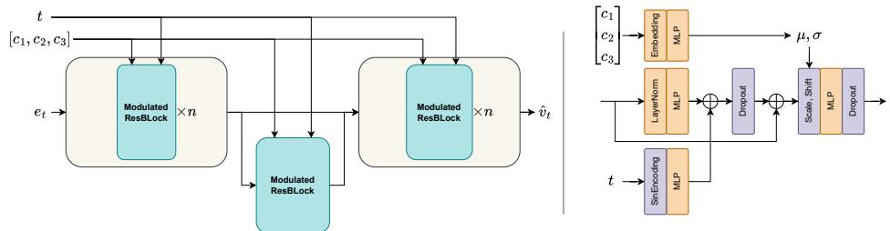  
Figure 9: Left - high level architecture of the ID-flow model, with conceptual parts corresponding to encoder/decoder architecture, Right - architecture of Modulated ResBlock, which consists of parts inspired by DiT architectures, but without attention mechanisms, orange color highlights trainable parameters

Model details and ablations Model consists mainly of several MLP layers with intermediate activations combined with LayerNorm, Dropout and modulation layers to condition on labels - visual diagram of architecture is given in Figure 9. Since we encode 3 independent labels for each category, corresponding layers that predict values for scale and shift operation have ×3 dimensionality output size. Ablated model parameters are given in Table 12.

Table 12: Ablated parameters of model
<table><tr><td>block_num</td><td>hidden_dim</td><td>c_embed dim</td><td>attention</td><td>activation</td><td>optimizer</td><td>schedule</td></tr><tr><td>2,</td><td>128,</td><td>128,</td><td></td><td>LeakyRelu</td><td>SGD,</td><td></td></tr><tr><td>4,</td><td>256,</td><td>256,</td><td>yes,</td><td>Sigmoid</td><td>Adam,</td><td>const,</td></tr><tr><td>6</td><td>512</td><td>512,</td><td>no</td><td>SoftSign GeLu</td><td>AdamW</td><td>linear warmup</td></tr></table>

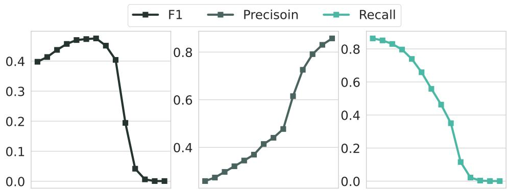  
Figure 10: Trade-off of inference quality of the model embedding samples between fidelity and variability of the samples. We change guidance scale values in range from 1.0 to 8.0

In the end we choose configuration of block\_num = 2 (meaning 2 blocks in encoder and decoder parts), hidden\_ $\scriptstyle \mathtt { d i m } = 5 1 2 , \mathtt { c \_ e m b e d \_ d i m } = 1 2 8$ , GeLU activations. We removed attention blocks, as even with minimal amount of attention heads model began to overfit and collapsed into few identities. Resulting lightweight model has around 11M parameters, was trained for 1000 epochs with Adam optimizer with constant learning rate set to 0.0003. We applied small inter-batch slerp interpolation between embeddings as augmentation technique. Total training took around 3.5 hours on a single V100 GPU.

Inference trade-off Our ID-flow model offers a superior trade-off compared to other baselines in terms of embedding fidelity/variance. However this can be directly controlled by playing with guidance scale parameter of identity-flow model. In Fig. 10 we show resulting Pareto front for F1, Precision and Recall - model transitions from variability/low-quality to mode collapse behavior.

## A.4 Similarity filtering of identities

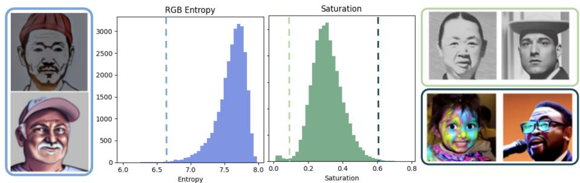  
Figure 11: Examples removed by image-statistics filtering. Low entropy corresponds to heavily stylized samples; low saturation identifies grayscale images, while high saturation exposes unnatural colors and lighting artifacts.

In order to measure diversity of embeddings themselves, we analyzed distribution of pairwise distance to closest neighbor within data itself. It can be seen in Figure 12 these distributions before and after filtering images based of this metric thresholding - tails of labels that under-perform are dropped, sacrificing ideal uniform distribution of labels for better face diversity. Comparison of diversity metrics to compare before and after are given in Table 13. The reason for such difference in diversity performance is expected due to inherit bias of underlying training data - even after filtering, certain categories remain unrepresented, which hurts model variability.

Table 13: Embedding diversity measured as mean cosine distance to closest neighbor within data. After filtering Stage 2 faces match in quality filtered label data that was used for training and HyperFace baseline
<table><tr><td>Baseline</td><td>ID-diversity</td></tr><tr><td>Real train data</td><td>0.305</td></tr><tr><td>HyperFace</td><td>0.306</td></tr><tr><td>ID-flow samples (before filtering)</td><td>0.355</td></tr><tr><td>ID-flow samples (after filtering)</td><td>0.295</td></tr></table>

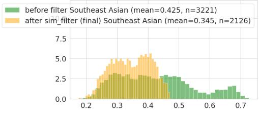

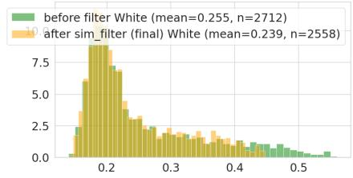

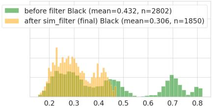

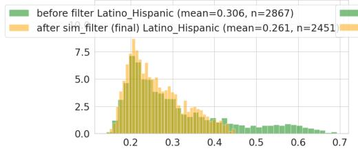

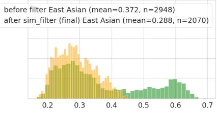

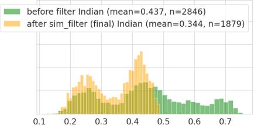

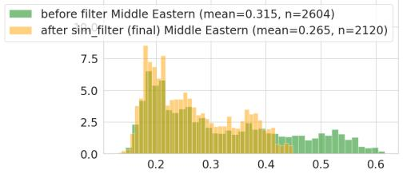

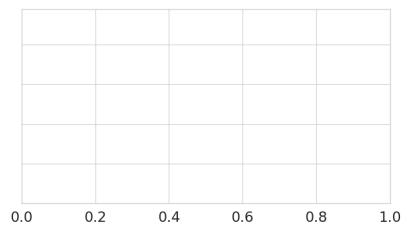  
Figure 12: Distribution of similarities within data before and after filtering w.r.t. label of data. Each section correspond to distribution with certain race label attached - effect of filtering eliminates tails present for certain labels

## A.5 VLM filtering stage

In Figure 13 we provide example of prompt used with Qwen3-VL-30B - specifically with exampels of images where typical artifacts are detected. We highlight keywords in VLM answer that were used to detect positive filtering results and not halucinations related to overall quality of faces generated by Arc2Face.

## A.6 Label matching captions with HQ images

In Algorithms 1 and 2 we describe two-stage strategy to match captions of real images with labels of identities. Firstly, we define a finite set of groups that we classify captions into - these groups are mainly defined by age and gender, e.g. adult\_male and child\_female, and then we collect a final collection of captions for identities by sampling from appropriate group depending on label values of identity. Race labels are intentionally not used for caption matching, so that contextual prompts do not encode race-specific descriptors. This approach has two advantages 1) its algorithmic cost is $O ( n + m )$ , where n is number of processed captions and m number of processed labels 2) it allows to avoid heavy cases where captions are not suitable for identity, avoiding synthesizing controversial or unnatural content.

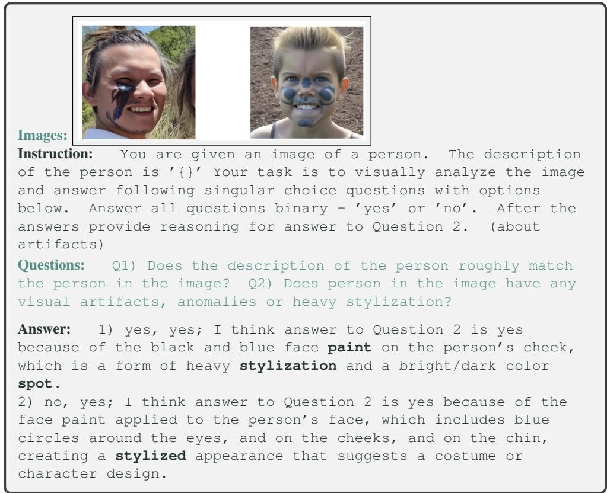  
Figure 13: VLM-filtering output examples of stage 2 - VLM is prompted to visually analyze face in the image, its alignment with labels, detect any artifacts and reason about them

## A.7 In-context model for human generation analysis

In order to choose optimal latest model for Stage 3 we manually analyzed various modern pipelines that are suited for generation while preserving identity face - including Qwen Image and latest Flux 2.0 models. Despite these models being understudied for this application, some significant challenges arise for these types models - especially character consistency with respect to prompt. Figure 14 shows that for most pipelines realistic preservation of face remains open problem and is largely dependent on prompt.

## A.8 ID-preserving generation details and results

In Figure 15 we highlight performance imbalance of some conventional pipelines, where for different categories face preservation may significantly deviate.

Algorithm 1 Process and Classify Captions   
1: procedure PROCESSCAPTIONS(captions,age\_labels,gender\_labels)   
2: categorized\_captions ← empty dictionary   
3: for all (caption,age,gender) in (captions,age\_labels,gender\_labels) do   
4: Determine target category for caption (by key-words and LLM processing):   
5: e.g. baby, child (male/female), or adult (male/female)   
6: Sample random age-appropriate person-descriptor (e.g., child vs adult)   
7: Replace generic person descriptors with age-appropriate terms (not just   
man/woman)   
8: Store processed caption under its target category   
9: end for   
10: return categorized\_captions   
11: end procedure

Algorithm 2 Sample prompts for identity labels   
1: procedure SAMPLEPROMPTS(age\_labels,gender\_labels,categorized\_captions)   
2: prompts ← empty list   
3: for all (age,gender) in (age\_labels,gender\_labels) do   
4: Match (age, gender) pair to suitable category (child, adult, etc.)   
5: Fetch next available caption from that category   
6: Append caption to prompts list   
7: end for   
8: return prompts   
9: end procedure

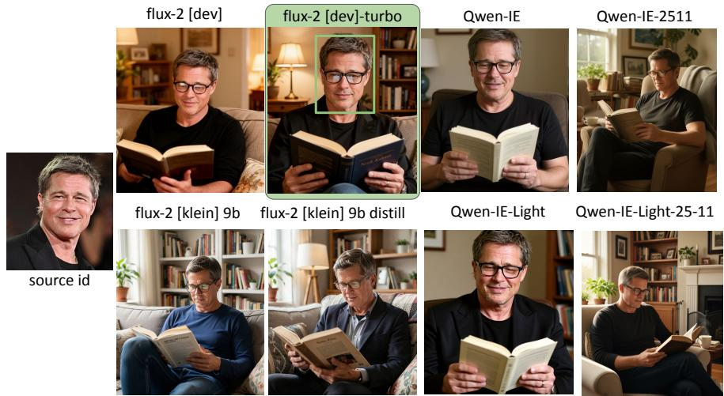  
Figure 14: Comparison of various models and checkpoints of Flux-2 and Qwen-IE for contextualization stage. It can be seen that only Flux-2 [dev]- turbo achieves both preservation and fidelity. Images generated with same prompt "Realistic image of man from image 1, in glasses reading book at home"

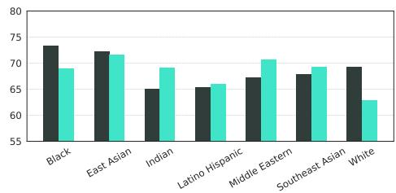

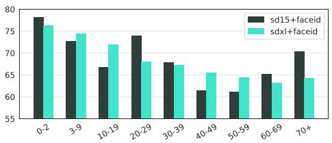  
Figure 15: Face similarity metric unfairness for different age categories in identity preserving generation - measured preservation across labels is far from balanced

SD-1.5+FaceID For finetuning IpAdapter-FaceID we additionally process collected dataset. Since this adapter uses global diffusion loss, we filter out images with more then one human in the image. To enable shortcut finetuning for selected images we additionally extract openpose control signals. We do not train image projector layers and only finetune blocks of IpAdapter added inside StableDiffusion Unet. We use Adam-W optimizer with ${ \tt 1 r } = 3 e - 5$ and do not apply warmup, bs=8. In total we train model for 2500 iterations.

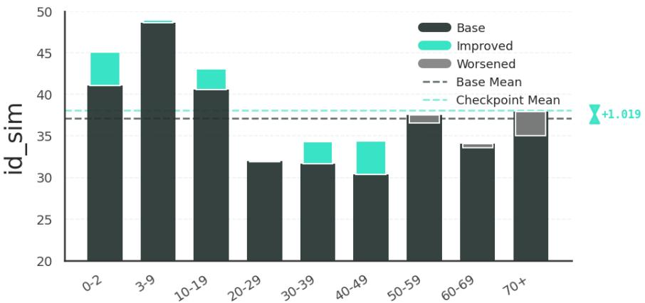  
Figure 16: Finetuning results for Photomaker - FairBench benchmark shows average improvement of quality, while also balancing performance between categories

SDXL+Photomaker In order to finetune Photomaker we do not rely on shortcut finetuning, but instead follow training recipe described in original paper. We modify collected captions by ensuring trigger-word is added single time next to person descriptor. We finetune LoRA modules attached to linear layers in attention blocks with rank=16 with Adam-W optimizer, learning rate set to 1e − 5, use linear warm up for approximately 2k iterations and train in total for 20000 iterations with bs=4. In Figure 16 we provide result of finetuning with our dataset - it has a narrower effect of improvement then result for FaceID, which can be attributed to complexity of finetuning task with this model.

## A.9 More samples from SynthFaces dataset

In Fig. 17 we show more HQ samples from synthfaces dataset, grouped by same identity.

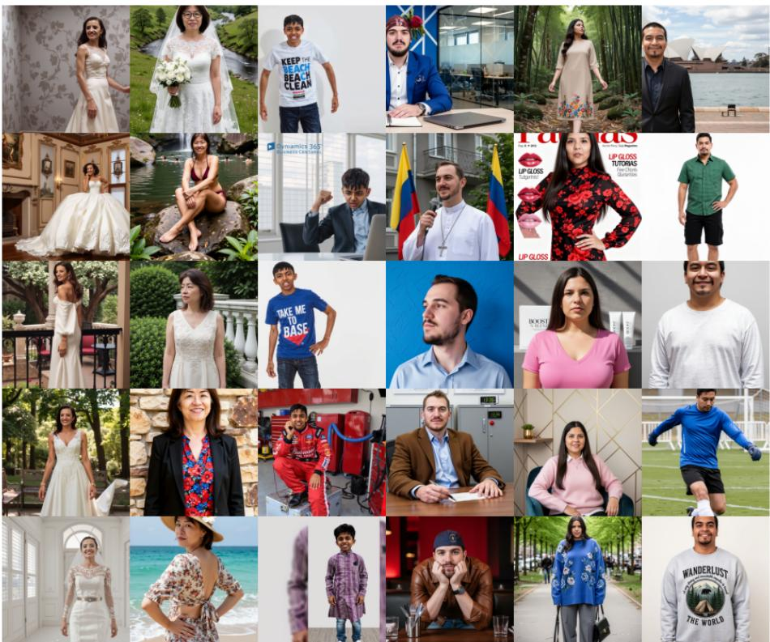  
Figure 17: More samples from SynthFaces dataset, including non-square resolution images cropped around faces. Each column corresponds to images of the same synthetic identity.

## A.10 Fairness Evaluation: Supplementary Tables

Demographic distribution in standard FR benchmarks. Tables 14. quantifies the racial skew in standard FR benchmarks, annotated with FairFace [12]. The heavy White-male dominance motivates the use of SER over accuracy-based fairness metrics. Other tables showcase global accuracy and SER metrics on FR benchmarks.

<table><tr><td>Benchmark</td><td>White</td><td>M. Eastern</td><td>Black</td><td>E. Asian</td><td>Latino</td><td>Indian</td><td>SE Asian</td></tr><tr><td>LFW</td><td>65.9</td><td>15.9</td><td>6.7</td><td>5.4</td><td>3.7</td><td>1.0</td><td>1.5</td></tr><tr><td>CFP-FP</td><td>67.4</td><td>9.0</td><td>11.6</td><td>1.7</td><td>5.7</td><td>3.9</td><td>0.8</td></tr><tr><td>AgeDB-30</td><td>88.0</td><td>7.8</td><td>0.9</td><td>0.4</td><td>2.3</td><td>0.6</td><td>&lt;0.1</td></tr><tr><td>CALFW</td><td>68.7</td><td>13.8</td><td>7.1</td><td>5.2</td><td>3.5</td><td>0.9</td><td>0.7</td></tr><tr><td>CPLFW</td><td>62.7</td><td>19.6</td><td>7.7</td><td>5.6</td><td>2.8</td><td>0.9</td><td>0.8</td></tr></table>

Table14:Racedistribution(%ofpairs)instandardFRbenchmarksannotatedwithFairFace.

Table 15: Global accuracy and AUC on standard FR benchmarks (↑ better). SynthFaces-500K’s lower accuracy reflects its earlier training stage.
<table><tr><td></td><td colspan="2">LFW</td><td colspan="2">CFP-FP</td><td colspan="2">AgeDB-30</td><td colspan="2">CALFW</td><td colspan="2">CPLFW</td><td colspan="2">Mean</td></tr><tr><td>Model</td><td>Acc</td><td>AUC</td><td>Acc</td><td>AUC</td><td>Acc</td><td>AUC</td><td>Acc</td><td>AUC</td><td>Acc</td><td>AUC</td><td>Acc</td><td>AUC</td></tr><tr><td>SynthFaces-500K</td><td>0.913</td><td>0.971</td><td>0.727</td><td>0.803</td><td>0.713</td><td>0.791</td><td>0.791</td><td>0.867</td><td>0.679</td><td>0.741</td><td>0.764</td><td>0.835</td></tr><tr><td>Vec2Face</td><td>0.993</td><td>0.999</td><td>0.913</td><td>0.969</td><td>0.945</td><td>0.984</td><td>0.946</td><td>0.973</td><td>0.877</td><td>0.927</td><td>0.935</td><td>0.970</td></tr><tr><td>HyperFace</td><td>0.983</td><td>0.998</td><td>0.880</td><td>0.945</td><td>0.855</td><td>0.931</td><td>0.879</td><td>0.944</td><td>0.825</td><td>0.891</td><td>0.884</td><td>0.942</td></tr></table>

Table 16: Maximum racial SER at FPR = 1% on standard FR benchmarks (↓ fairer). ⋆ = SynthFaces-500K is fairest.
<table><tr><td>Model</td><td>LFW</td><td>CFP-FP</td><td>AgeDB-30</td><td>CALFW</td><td>CPLFW</td><td>Mean</td></tr><tr><td>SynthFaces-500K (ours)</td><td>1.482</td><td>1.133</td><td>1.117</td><td>1.087</td><td>1.040</td><td>1.172</td></tr><tr><td>Vec2Face-HSFace300K</td><td>1.536</td><td>1.347</td><td>1.670</td><td>1.196</td><td>1.344</td><td>1.419</td></tr><tr><td>HyperFace-10K-LDM</td><td>2.061</td><td>1.155</td><td>1.686</td><td>1.032</td><td>1.137</td><td>1.414</td></tr></table>