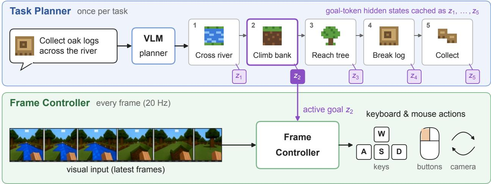
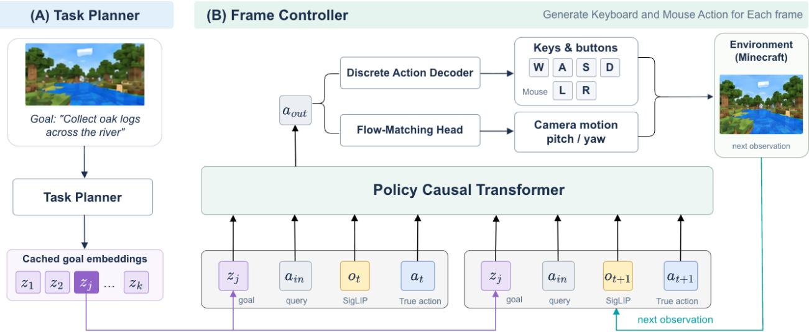
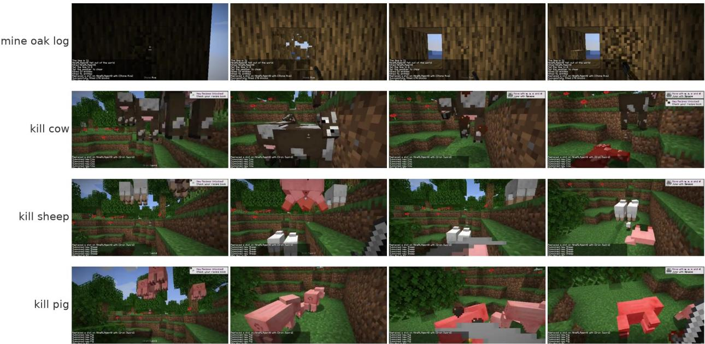
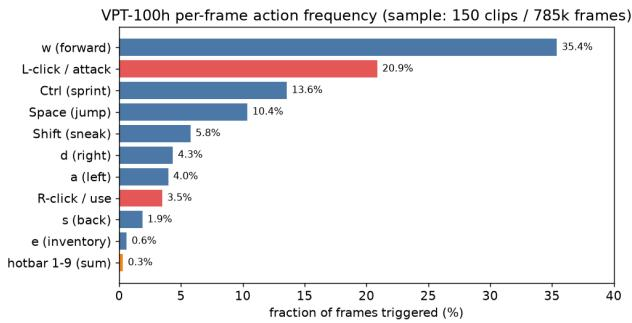
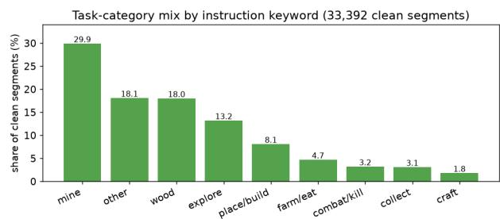
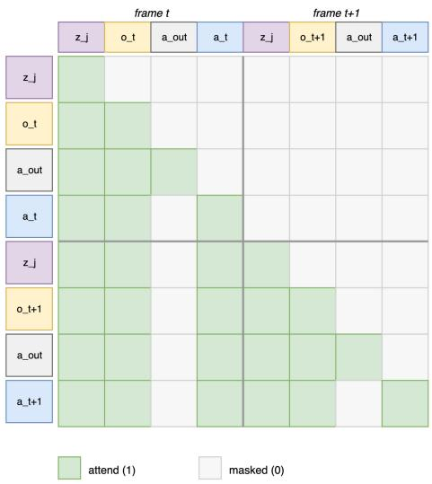
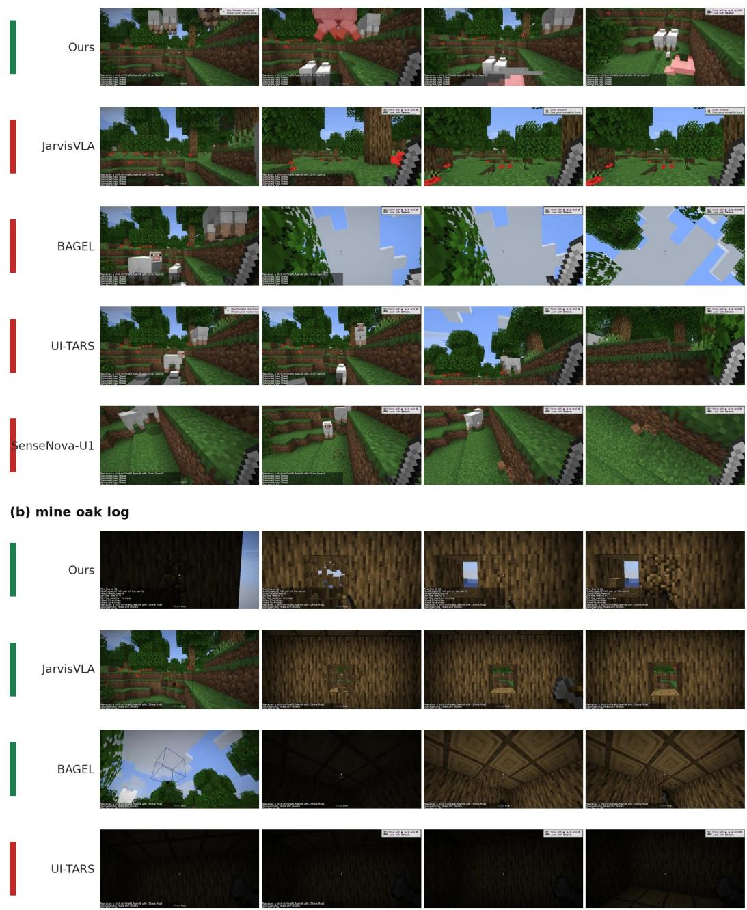

# TaskFrame: Connecting Task-Level Planning with Frame-Level Control for Game Agents

Guangzhi Wang1∗, Junfu Pu1∗†, Yiran Wang1∗, Xingyilang Yin2∗, Honghao Chen1, Cheng Cheng1, Lingen Li3, Yinan Zhou4, Jiarui Wu3, Yinuo Jiang5, Hongbo Jin6, Xiaodong Cun1,7‡, Ying Shan1

1Tencent ARC Lab, 2University of Macau, 3The Chinese University of Hong Kong, 4City University of Hong Kong, 5Huazhong University of Science and Technology, 6Peking University, 7Great Bay University ∗Equal contribution., †Project lead., ‡Corresponding author.

Building general game agents requires both high-level task reasoning and low-latency action control in rapidly changing visual environments. These capabilities favor models with substantially diferent computational profiles, making them dificult to realize within a single model. In this work, we present TaskFrame, a hierarchical planner–controller framework that connects task-level planning with frame-level keyboard-and-mouse control. A vision-language task planner decomposes a high-level goal into an ordered sequence of atomic instructions and is optimized through supervised learning and dependency-aware GRPO. The hidden states of special goal tokens that terminate each atomic instruction provide continuous goal embeddings that are cached and reused across control steps. A causal Transformer controller combines the embedding of the active goal with recent observations to predict discrete keyboard and mouse-button actions and continuous camera motion at every game step. We train the system in three stages: planner training, controller pretraining, and joint alignment. Experiments in Minecraft show that TaskFrame is competitive with general-purpose vision-language models on instruction decomposition, and that in closed-loop evaluation the agent achieves a higher combat success rate than the evaluated baselines.

Date: October 30, 2026 Project page: https://task-frame.github.io/

## 1 Introduction

Games have long been a demanding testbed for artificial general intelligence (AGI), as successful gameplay requires the integration of perception, reasoning, planning, and decision making into goal-directed behavior. Existing eforts have reached or surpassed expert human performance in board games, Atari, multiplayer poker, and complex real-time strategy games (Silver et al., 2016, 2017; Schrittwieser et al., 2020; OpenAI et al., 2019; Badia et al., 2020; Brown and Sandholm, 2019; Vinyals et al., 2019). More recently, research has shifted toward embodied game agents that follow language instructions and act directly from pixels in open-ended virtual worlds (SIMA Team, 2025; Magne et al., 2026; Yue et al., 2026; Li et al., 2025a; Hafner et al., 2025). Unlike agents specialized for a fixed environment or objective, such systems provide a natural setting for studying whether an agent can understand diverse goals, adapt its behavior to changing visual situations, and execute complex tasks through a general action interface.

Building such an embodied agent remains dificult because task-level reasoning and frame-level control operate at diferent frequencies. Understanding a scene, grounding an instruction, and determining the correct sequence of subgoals require a large, high-capacity model. In contrast, executing those subgoals requires a lightweight controller that can continuously incorporate the latest frame and emit actions with low latency. This challenge is especially evident in visually dynamic games, where abrupt camera motion and sudden events must be handled through a hybrid action space combining discrete keyboard presses with continuous mouse movement. Running a large reasoning model at every control step is prohibitively expensive, whereas a small reactive policy alone lacks the semantic capacity to reliably interpret and organize complex instructions and visual history.

  
Figure 1 Overview of TaskFrame. Once per task, the task planner decomposes a high-level instruction into ordered atomic goals, each terminated by a special goal token whose hidden state is cached as a goal embedding. At every frame, the frame controller takes the embedding of the active goal and the latest visual input and emits native keyboard-and-mouse actions.

Existing work addresses parts of this tension through several strategies. Hierarchical agents use a language model to select skills or produce high-level plans for a goal-conditioned controller (Ahn et al., 2022; Wang et al., 2023c; Yuan et al., 2023; Li et al., 2025b). In physical robotics, dual-system Vision-Language-Action (VLA) models separate a slower semantic module from a faster visuomotor policy (NVIDIA et al., 2025; Figure AI, 2025; Zhang et al., 2024; Bu et al., 2024; Shi et al., 2025), while action chunking amortizes inference by predicting multiple actions at once, with recent methods improving parallel decoding or asynchronous execution (Kim et al., 2025; Black et al., 2025). A practical game agent must connect these mechanisms through an interface that supports both structured planning and responsive control. The high-level model must translate an open-vocabulary goal into a complete and correctly ordered sequence of atomic goals, and the controller must keep incorporating the latest visual observation at every action step.

We present TaskFrame, a hierarchical game agent that connects task-level planning with frame-level control through planner-produced goal representations (Figure 1). Its high-capacity task planner is trained to perform visually grounded instruction decomposition, with dedicated data and a dependency-aware reinforcement learning objective that addresses both step-count and ordering correctness. Each atomic goal it emits is terminated by a special goal token, and the hidden states at these tokens are cached and passed to a lightweight frame controller as continuous goal embeddings. The controller combines the embedding of the active goal with recent frames to emit discrete keyboard and mouse-button actions and continuous camera motion at every game step, so the large planner stays outside the frame-level control loop. We train the system in three stages: the planner is trained for decomposition, the controller is trained to produce actions from each frame, and the two modules are finally aligned jointly.

We train the controller on human gameplay with native keyboard-and-mouse actions recorded directly from players, and the planner on the hierarchical annotations of GameHorizon Suite (Wang et al., 2026), which provide atomic instructions, compositional goals, and dependency relations. Our 9B planner outperforms GPT-4o and Qwen3.5-397B-A17B on instruction decomposition. In closed-loop Minecraft evaluation, TaskFrame reaches a 51% average success rate on combat tasks, the highest among the evaluated models, and ablations examine each component. To summarize, our contributions are as follows:

• We introduce TaskFrame, a hierarchical game agent in which a vision-language planner decomposes goals once per task and conditions a frame-level keyboard-and-mouse controller, which acts at every game step, through the hidden states of special goal tokens.

• We propose a dependency-aware GRPO objective for instruction decomposition that rewards necessary precedence relations separately from conventional ordering, derived from pairwise dependency

annotations.

• We propose a three-stage training recipe that pretrains the controller with a generic goal encoder and then aligns it with the planner through LoRA adapters, and we equip the controller with a hybrid discrete and flow-matching action head. We evaluate the planner on two decomposition benchmarks and the full agent in closed-loop Minecraft control.

## 2 Related Work

Game agents. MineRL and VPT established large-scale imitation from human Minecraft play (Guss et al., 2019; Baker et al., 2022), and MineDojo added an open-ended environment with internet-scale knowledge (Fan et al., 2022). STEVE-1, GROOT, ROCKET-1, and MineDreamer condition low-level policies on text, reference videos, visual-temporal prompts, or imagined goals (Lifshitz et al., 2023; Cai et al., 2024b, 2025; Zhou et al., 2024), while JARVIS-VLA and OmniJARVIS post-train VLMs to emit keyboard-and-mouse actions directly (Li et al., 2025a; Wang et al., 2024), following robotic VLAs (Brohan et al., 2023; Kim et al., 2024). Recent systems generalize across tasks and games (Wang et al., 2025; SIMA Team, 2025; Tan et al., 2025, 2024) and control games through native keyboard-and-mouse interfaces at frame rate (Yue et al., 2026; Magne et al., 2026). TaskFrame instead connects explicit, trained task decomposition to frame-level control and keeps the large VLM outside the per-frame loop.

Hierarchical task planning. Language-model planners ground decisions in skill afordances (Ahn et al., 2022), use environment feedback (Huang et al., 2022), or write code over control primitives (Liang et al., 2023). In Minecraft, Plan4MC, DEPS, Voyager, JARVIS-1, and Optimus-1/2 plan over learned skills or dispatch multimodal plans to goal-conditioned controllers (Yuan et al., 2023; Wang et al., 2023b,a,c; Li et al., 2024, 2025b). These planners are prompted or supervised to produce plans but are not optimized for whether their steps respect task dependencies. Reinforcement learning with verifiable rewards, popularized by GRPO and its variants (Shao et al., 2024; DeepSeek-AI, 2025; Liu et al., 2025), ofers a way to do so: we use the must-precede annotations of GameHorizon Suite (Wang et al., 2026) to define a reward that separates necessary precedence from conventional ordering.

Dual-system control. Dual-system policies pair a slow semantic module with a fast visuomotor policy (Kahneman, 2011). Hi Robot and RT-H pass language between the two (Shi et al., 2025; Belkhale et al., 2024), and π predicts a textual subtask before decoding actions (Physical Intelligence et al., 2025); HiRT, RoboDual, GR00T N1, and Helix pass latent features from a slowly updated VLM (Zhang et al., 2024; Bu et al., 2024; NVIDIA et al., 2025; Figure AI, 2025), LCB trains a dedicated latent token as the bridge (Shentu et al., 2024), and Acting While Understanding updates semantic conditions asynchronously (Yan et al., 2026). Action chunking, better action tokenization, and overlapping generation with execution further improve control eficiency (Zhao et al., 2023; Chi et al., 2025; Black et al., 2024; Pertsch et al., 2025; Kim et al., 2025; Black et al., 2025; Shukor et al., 2025). Like HiRT and LCB, TaskFrame passes latent goals from a VLM to a fast policy, but its planner is first optimized for ordered decomposition, and its latent goals are the hidden states of goal tokens emitted within that decomposition, so one planner pass yields both an interpretable plan and one embedding per step.

## 3 Method

TaskFrame connects task-level planning with frame-level game control (Figure 2). A vision-language task planner B maps an observation and a high-level instruction to an ordered sequence of atomic goals, each terminated by a special goal token τ whose hidden state serves as a continuous representation of that goal. A causal frame controller P consumes the representation of the active goal together with its recent frame and action history and predicts native keyboard-and-mouse actions at every game step.

Training proceeds in three stages. First, we train the planner for visually grounded instruction decomposition with supervised fine-tuning (SFT) and dependency-aware GRPO (Section 3.1). Second, we pretrain the controller on atomic-segment gameplay, using a frozen, generic vision-language model as its goal encoder (Section 3.2). Third, we replace this encoder with the trained planner and jointly adapt the controller and LoRA adapters in the planner with the action objective (Section 3.3). At control step $t ,$ the controller observes a frame $O _ { t } ^ { - } \in \mathbb { R } ^ { H \times W \times 3 }$ and predicts

  
Figure 2 Overview of TaskFrame, a hierarchical planner–controller agent that separates task-level planning from frame-level control. (A) Task Planner. A vision–language model decomposes a high-level goal (e.g., “collect oak logs across the river”) into an ordered sequence of atomic goals, each terminated by a special goal token. The hidden states at these tokens are cached as goal embeddings $z _ { 1 } , \dots , z _ { k }$ . (B) Frame Controller. A per-frame autoregressive policy. Each frame consumes the active goal embedding $z _ { j }$ , an action-query token $a _ { \mathrm { i n } } ,$ , a SigLIP image token $o _ { t }$ , and the action $a _ { t }$ , which only later frames attend to. A causal Transformer aggregates them into the action-output token $a _ { \mathrm { o u t } } .$ , which is decoded into discrete keyboard and mouse-button presses and continuous camera motion. The planner runs once per high-level goal, while the controller acts at every game step.

$$
a _ { t } = ( a _ { t } ^ { \mathrm { k e y } } , a _ { t } ^ { \mathrm { b t n } } , a _ { t } ^ { \mathrm { m o u s e } } ) ,\tag{1}
$$

where the first two components are discrete actions and the last is the continuous camera motion produced by the mouse, represented as yaw and pitch changes $a _ { t } ^ { \mathrm { m o u s e } } = \left( \Delta \psi _ { t } , \Delta \theta _ { t } \right) \in \mathbb { R } ^ { 2 }$ in degrees.

## 3.1 Task Planner

Visually grounded decomposition. The task planner B converts a visual observation and a high-level instruction into an ordered sequence of atomic goals. Given an observation o and a high-level instruction g, it generates

$$
\hat { \cal S } = ( \hat { s } _ { 1 } , \dots , \hat { s } _ { \hat { k } } ) \sim \pi _ { \theta } ( \cdot \mid o , g ) ,\tag{2}
$$

where each $\hat { s } _ { j }$ is an atomic instruction. We train the planner on the hierarchical gameplay annotations of GameHorizon Suite (Wang et al., 2026), which associate high-level goals with temporally aligned atomic instructions and annotate precedence dependencies between them. During training, the target number of goals k is supplied through a fixed reasoning prefix, yielding $\pi _ { \theta } ( \cdot \mid o , g , k )$ ; at inference it is not supplied.

Starting from Qwen3.5-9B, we freeze the vision encoder and train the language model and multimodal connector on the reference output sequence $\mathbf { y } ,$ whose goals are each terminated by a goal token (Equation (11)):

$$
\mathcal { L } _ { \mathrm { S F T } } = - \sum _ { t = 1 } ^ { | \mathbf { y } | } \log \pi _ { \theta } ( y _ { t } \mid o , g , k , y _ { < t } ) .\tag{3}
$$

This stage teaches the planner to describe atomic goals in a consistent decomposition format and provides the initial policy for subsequent refinement. Data statistics, hyperparameters, and an analysis of why naive SFT overfits to annotation phrasing are given in Section A.

Dependency-aware refinement. A reference plan records one execution sequence, although multiple orderings may be valid. We refine the SFT policy with GRPO (Shao et al., 2024; DeepSeek-AI, 2025) using separate rewards for step-count agreement and dependency-aware ordering.

For each input, generated steps are aligned one-to-one with reference steps using Hungarian assignment. Pairwise similarity combines content-word F1 and a character-level matching ratio:

$$
\sin ( a , b ) = 0 . 5 \operatorname { F 1 _ { c o n t e n t } } ( a , b ) + 0 . 5 \operatorname { r a t i o _ { c h a r } } ( a , b ) .\tag{4}
$$

Let pos[i] denote the generated position assigned to reference step i. The count reward is

$$
R _ { k } = \operatorname* { m a x } \left( 0 , 1 - \frac { | \hat { k } - k | } { k } \right) .\tag{5}
$$

We distinguish two ordering scores. Dependency satisfaction, $S _ { \mathrm { d e p } }$ , measures the fraction of annotated must-precede relations respected by the generated plan. Conventional-order agreement, $S _ { \mathrm { c o n v } }$ , measures agreement with the reference order among pairs without an annotated dependency. The latter expresses a preference for the recorded sequence rather than a requirement for task feasibility.

Let D be the set of must-precede dependencies annotated in GameHorizon Suite (Wang et al., 2026) for a plan and

$$
{ \cal F } = \{ ( i , j ) : i < j , ( i , j ) \notin D , ( j , i ) \notin D \} .\tag{6}
$$

For a complete alignment,

$$
S _ { \mathrm { d e p } } = \frac { 1 } { | D | } \sum _ { ( i , j ) \in D } \mathbf { 1 } [ \mathrm { p o s } [ i ] < \mathrm { p o s } [ j ] ] ,\tag{7}
$$

$$
S _ { \mathrm { c o n v } } = { \frac { 1 } { | F | } } \sum _ { ( i , j ) \in F } { \bf 1 } [ \mathrm { p o s } [ i ] < \mathrm { p o s } [ j ] ] .\tag{8}
$$

We combine these scores as

$$
R _ { \mathrm { o r d } } = { \bf 1 } [ \hat { k } = k ] \left( 0 . 8 S _ { \mathrm { d e p } } + 0 . 2 S _ { \mathrm { c o n v } } \right) ,\tag{9}
$$

$$
R = 0 . 3 R _ { k } + 0 . 7 R _ { \mathrm { o r d } } .\tag{10}
$$

The soft count reward distinguishes diferent degrees of length mismatch. The order reward requires the correct step count and a complete alignment, and prioritizes necessary dependencies over conventional ordering. When one ordering component is undefined, we use the available component alone. GRPO uses mean-centered group rewards and a KL penalty to the SFT reference policy. The 0.8/0.2 split is derived from annotation statistics in Section A.4.

Goal representations. Each atomic goal in the decomposition is terminated by a special goal token τ, so the output sequence is

$$
\mathbf { y } = [ \operatorname { t o k } ( { \hat { s } } _ { 1 } ) , \tau , \dots , \operatorname { t o k } ( { \hat { s } } _ { \hat { k } } ) , \tau ] .\tag{11}
$$

Let $p _ { j }$ be the position of the j-th goal token. The hidden state at this position provides a continuous representation of goal $\hat { s } _ { j }$

$$
z _ { j } = H _ { \boldsymbol \theta } ( o , g , \mathbf { y } ) _ { p _ { j } } ,\tag{12}
$$

which summarizes the goal in the context of the observation, the high-level instruction, and the preceding steps. The decoded language supports decomposition supervision and evaluation, while the controller consumes only zj .

## 3.2 Frame Controller

The frame controller is a per-frame autoregressive policy that emits native keyboard-and-mouse actions from visual observations. We build on the policy-transformer design of Yue et al. (2026), in which a causal Transformer reads a per-frame token group and produces a single action-output token that is decoded into keyboard and mouse actions. We make two changes: the controller is conditioned on the planner’s visionlanguage goal embedding in addition to the visual observation, and continuous camera motion is modeled with a flow-matching head for smooth control.

Frame-level conditioning. Training samples are windows of T consecutive frames, starting at $t _ { 0 }$ , that lie within one annotated atomic segment. At frame t, the controller consumes the goal embedding z (Section 3.3), a visual token $o _ { t }$ obtained by feeding the frame into a frozen SigLIP encoder (Zhai et al., 2023) followed by a Perceiver resampler, a learned action-query token $a _ { \mathrm { i n } }$ , and the tokens of action $a _ { t } ,$ which only later frames can attend to. The output of the causal Transformer $f _ { \phi }$ at the position of $a _ { \mathrm { i n } }$ is the action-output token

$$
a _ { t } ^ { \mathrm { o u t } } = f _ { \phi } ( z , o _ { t _ { 0 } : t } , a _ { t _ { 0 } : t - 1 } ; a _ { \mathrm { i n } } ) , \qquad t _ { 0 } \leq t < t _ { 0 } + T ,\tag{13}
$$

from which the action heads decode $p _ { \phi } ( a _ { t } \mid a _ { t } ^ { \mathrm { o u t } } )$ . The previous actions $a _ { t _ { 0 } : t - 1 }$ are ground truth during training and the controller’s own outputs at inference

Hybrid action head. The action-output token $a _ { t } ^ { \mathrm { o u t } }$ is decoded by two heads. Discrete keyboard keys and mouse buttons are produced by a small autoregressive action decoder that samples the action tokens one at a time from $a _ { t } ^ { \mathrm { { o u t } } }$ (Yue et al., 2026). Continuous camera motion is instead generated by a lightweight flow-matching head (Lipman et al., 2023; Liu et al., 2023), which avoids discretizing small corrections and can represent several plausible directions. The action objective is

$$
\mathcal { L } _ { \mathrm { a c t } } = \mathcal { L } _ { \mathrm { k e y } } + \mathcal { L } _ { \mathrm { b t n } } + \lambda _ { \mathrm { m o u s e } } \mathcal { L } _ { \mathrm { m o u s e } } ,\tag{14}
$$

where $\mathcal { L } _ { \mathrm { k e y } }$ and ${ \mathcal { L } } _ { \mathrm { b t n } }$ are the cross-entropy losses of the autoregressive decoder and ${ \mathcal { L } } _ { \mathrm { m o u s e } }$ is the flow-matching loss.

Action conditioning and causal masking. Following Yue et al. (2026), the action-output token at frame t cannot attend to the same-frame action tokens, which would leak the target, and no token attends to the action-output token; all other tokens are causal (Figure 5).

## 3.3 Planner–Controller Alignment

During controller pretraining (Stage 2), the goal embedding z0 is produced by a frozen, generic vision-language model ${ \mathcal { E } } _ { 0 }$ (Qwen3.5-9B) from the frame at the start of the window and its atomic instruction s. In the third stage, we replace ${ \mathcal { E } } _ { 0 }$ with the GRPO-trained planner B, augmented with LoRA adapters (Hu et al., 2022) ∆ in every Transformer block of its language model. Each training window provides one annotated atomic goal s, so the planner reads the first frame of the window and s, followed by the goal token, and the hidden state at that token becomes the condition,

$$
z _ { B } = H _ { B + \Delta } \big ( \big [ o _ { t _ { 0 } } , \mathrm { t o k } ( s ) , \tau \big ] \big ) _ { \tau } ,\tag{15}
$$

which replaces $z _ { \mathrm { 0 } }$ as the goal embedding z in Equation (13). The objective in Equation (14) updates all controller parameters and $\Delta$ while the base planner weights remain frozen. The resulting adapted planner is the single planner used at inference, for both decomposition and goal embeddings. Additional training details of this stage are given in Section B.3.

## 3.4 Multi-Rate Inference

Inference runs at two rates. Task rate: for a high-level goal g, the adapted planner decodes the plan $( \hat { s } _ { 1 } , \dots , \hat { s } _ { \hat { k } } )$ once, without a supplied step count, emitting a goal token after every atomic goal; the hidden states at these tokens are cached as $( z _ { 1 } , \dots , z _ { \hat { k } } )$ (Equation (12)). Frame rate: the controller receives only the cached embedding of the active goal, $z _ { j } ,$ combines it with the frames and actions of the current window, and emits an action at every game step. The decoded text is available for inspection and evaluation but is not passed to the controller.

## 4 Experiments

We ask three questions: 1) Does TaskFrame act well in closed loop (Section 4.2)? 2) Does its planner produce good plans (Section 4.3)? 3) How should planning and control be connected (Section 4.4)?

Table 1 Closed-loop success rate (%) on atomic Minecraft tasks over 3 evaluation seeds, with 12 episodes per kill task and 6 per mining task in each seed. Averages are reported with a binomial estimate of their standard deviation across seeds; per-task mining results are in Section C.3.
<table><tr><td rowspan="2">Model</td><td colspan="5">Kill Entities</td><td rowspan="2">Mine Blocks</td></tr><tr><td>Cow</td><td>Sheep</td><td>Pig</td><td>国 Zombie</td><td>Avg.</td></tr><tr><td>VPT-BC (Baker et al., 2022)</td><td>17</td><td>17</td><td>17</td><td>8</td><td>15±5.4</td><td>Avg. of 4 38 ±9.2</td></tr><tr><td>VPT-RL (Baker et al., 2022)</td><td>8</td><td>17</td><td>8</td><td>0</td><td>8±4.5</td><td>29 ±8.8</td></tr><tr><td>STEVE-1 (Lifshitz et al., 2023)</td><td>17</td><td>8</td><td>17</td><td>8</td><td>13±5.2</td><td>62 ±9.2</td></tr><tr><td>JARVIS-VLA-7B (Li et al., 2025a)</td><td>17</td><td>33</td><td>50</td><td>25</td><td>31 ±6.6</td><td>100±5.3</td></tr><tr><td>TaskFrame (Ours)</td><td>67</td><td>58</td><td>42</td><td>35</td><td>51 ±7.0</td><td>96 ±6.2</td></tr></table>

## 4.1 Setup

Training. The controller is trained on about 100 hours of VPT contractor gameplay (Baker et al., 2022) with native keyboard-and-mouse actions, using the atomic instructions of GameHorizon Suite (Wang et al., 2026) as conditions. Training windows contain T = 21 frames (about one second at 20 Hz) and never cross an atomic-segment boundary. The backbone is a 30-layer causal Transformer of width 1024. The planner is trained on the decomposition annotations of GameHorizon Suite.

Closed-loop evaluation. We follow the programmatic protocol of JARVIS-VLA (Li et al., 2025a) and MCU (Zheng et al., 2025) in MineStudio (Cai et al., 2024a) and evaluate two types of tasks: mine tasks place the equipped agent inside a chamber of the target block, isolating block breaking from search, and kill tasks spawn target animals a few blocks ahead of an agent holding a sword. Episodes last at most 400 steps. We compare with VPT-BC, VPT-RL (Baker et al., 2022), STEVE-1 (Lifshitz et al., 2023), and JARVIS-VLA-7B (Li et al., 2025a). Task configurations and baseline settings are given in Section C.

Planner evaluation. Soft Semantic F1 We utilize (SSF1) to measure step content on 2.1K held-out plans. The planner sees one frame and the high-level instruction without the step count, and the predicted and reference steps are matched by sentence-embedding similarity, so paraphrases are accepted while missing or redundant steps are penalized. Task2 of GameHorizon Suite (Wang et al., 2026) measures step ordering on 250 questions: given the step count, the planner generates a plan, which is matched to the most similar of four candidate orderings; ties and unparseable plans count as errors. More details are provided in Section A.2.

## 4.2 Closed-Loop Control

Main results. Table 1 reports the results. TaskFrame reaches an average kill success of 51%, compared with 31% for JARVIS-VLA-7B, and performs best on cow, sheep, and zombie. This gap is about twice the combined standard deviation. On mining, both TaskFrame and JARVIS-VLA-7B succeed in almost every episode, so this category is close to saturated in our setting. VPT-BC, VPT-RL, and STEVE-1 reach 8–15% on kill tasks and 29–62% on mining. Overall, TaskFrame achieves the best combat performance among the evaluated models while remaining on par with JARVIS-VLA-7B on mining.

Qualitative results. Figure 3 shows closed-loop rollouts. In combat, the controller turns toward the target animals, approaches them through the grass, and keeps attacking until the target is killed, even when several animals of diferent types are in view; in mining, it repeatedly breaks the log in front of it.

## 4.3 Task Planning

As shown in Table 2, our 9B planner reaches an SSF1 of 0.3459 and a Task2 accuracy of 40.0%, exceeding GPT-4o and Qwen3.5-397B-A17B on both metrics while remaining below the two Gemini models, which are evaluated zero-shot like the other general-purpose baselines. Over the backbone, SFT raises SSF1 from 0.2874

  
Figure 3 Closed-loop rollouts of TaskFrame. Each row shows four frames of one successful episode on an atomic task. Comparisons with baselines are shown in Figure 6.

to 0.3312 and Task2 accuracy from 23.2% to 38.8%, and GRPO further improves both metrics and lowers the Unparsed rate from 14.0% to 11.6%. The gain in SSF1, which uses sentence embeddings rather than the reward’s step matcher and supplies no step count, indicates that GRPO does not merely fit its own reward.

## 4.4 Connecting Planning and Control

Planner and controller roles. To isolate the value of the hierarchy and of joint alignment, we predict actions on held-out gameplay with high-level goals (Table 3; setup in Section C.6). Planner only generates actions directly with the planner; controller only uses an empty goal; cascade passes the planner’s decoded instructions as text to the Stage-2 controller; TaskFrame passes the aligned planner’s goal embeddings; and oracle goals uses annotated atomic instructions as an upper bound.

The planner alone beats the unconditioned controller, but it emits actions for a whole window from a single observation and cannot react within the window; the controller alone cannot tell which behavior is intended. The cascade recovers most of the gap, and the aligned goal embeddings of TaskFrame give the best results on all metrics; since both use the same decomposition, the gap between them isolates the efect of joint alignment. Oracle goals add little, so most remaining error lies in the controller rather than in the decomposition.

Goal conditioning in closed loop. We keep the trained model fixed and change only the goal it receives, evaluating each setting on the kill tasks with 48 episodes per task in each of three seeds (Table 4; per-task results in Section C.5). With an empty goal, kill success drops from 51% to 25%; some success remains because every spawned animal is a valid target. A mismatched goal lowers it further to 13%, so the controller actively follows the goal rather than ignoring it, and withholding the observation from the planner costs 20 points, showing that the visual grounding of the goal helps

Camera head. We compare the flow-matching camera head with the discrete head of Yue et al. (2026), which classifies camera motion into bins and takes their expected value. The two controllers difer only in the camera head and are trained with the same data and schedule (Table 5; setup in Section B.4). Flow matching lowers the mean absolute error from $2 . 1 ^ { \circ }$ to $1 . 7 ^ { \circ }$

Table 5 Camera MAE (◦) on held-out gameplay.
<table><tr><td>Camera head</td><td>Yaw↓</td><td>Pitch↓</td></tr><tr><td>Discrete bins</td><td>2.1</td><td>1.2</td></tr><tr><td>Flow matching</td><td>1.7</td><td>1.0</td></tr></table>

Table 2 Planner performance. SSF1 is evaluated without a supplied step count, whereas Task2 provides the target count. Unparsed is the percentage of questions without a valid decision.
<table><tr><td rowspan="2"></td><td rowspan="2">SSF1 ↑</td><td colspan="2">Task2</td></tr><tr><td>Acc. (%) ↑</td><td>Unparsed (%) ↓</td></tr><tr><td rowspan="3">Gemini 3.5 Flash (Google DeepMind, 2026a) Gemini 3.6 Flash (Google DeepMind, 2026b) GPT-4o (OpenAI, 2024)</td><td>0.3815</td><td>44.4</td><td>13.6</td></tr><tr><td>0.3808</td><td>46.8</td><td>15.2</td></tr><tr><td>0.2720 0.2643</td><td>36.0</td><td>14.0</td></tr><tr><td rowspan="3">Qwen3-Omni-30B-A3B (Qwen Team, 2025) Qwen3.5-397B-A17B (Qwen Team, 2026a) Qwen3.6-35B-A3B (Qwen Team, 2026b)</td><td></td><td>34.0</td><td>11.6</td></tr><tr><td>0.2990</td><td>35.6</td><td>12.4</td></tr><tr><td>0.2951</td><td>34.4</td><td>8.4</td></tr><tr><td rowspan="3">BAGEL-7B-MoT (Deng et al., 2025) SenseNova-U1-8B-MoT (Diao et al., 2026)</td><td></td><td>28.0</td><td>14.4</td></tr><tr><td></td><td>27.6</td><td>14.4</td></tr><tr><td>0.2874</td><td>23.2</td><td>23.2</td></tr><tr><td rowspan="3">+ SFT + GRPO (TaskFrame planner)</td><td>0.3312</td><td>38.8</td><td>14.0</td></tr><tr><td>0.3459</td><td>40.0</td><td>11.6</td></tr><tr><td></td><td></td><td></td></tr></table>

Table 4 Closed-loop kill success (%) when only the supplied goal is changed.

Table 3 Ofline action prediction on held-out gameplay with highlevel goals.
<table><tr><td rowspan=1 colspan=1>Method</td><td rowspan=1 colspan=1>Key F1 ↑ Btn. F1 ↑ Cam. RMSE ↓</td></tr><tr><td rowspan=1 colspan=1>Planner only</td><td rowspan=1 colspan=1>0.21      0.38          6.6</td></tr><tr><td rowspan=1 colspan=1>Controller only</td><td rowspan=1 colspan=1>0.16      0.32         6.8</td></tr><tr><td rowspan=2 colspan=1>Cascade (text)TaskFrame</td><td rowspan=1 colspan=1>0.24      0.45         5.9</td></tr><tr><td rowspan=1 colspan=1>0.27     0.49         5.6</td></tr><tr><td rowspan=1 colspan=1>Oracle goals</td><td rowspan=1 colspan=1>0.29      0.52         5.4</td></tr></table>

<table><tr><td rowspan=1 colspan=4>Goal</td><td rowspan=1 colspan=1>Kill avg. ↑</td></tr><tr><td rowspan=1 colspan=4>TaskFrame (full)</td><td rowspan=3 colspan=1>51 ±3.525 ±3.013 ±2.3</td></tr><tr><td rowspan=1 colspan=2>Empty goal</td><td rowspan=1 colspan=2></td><td rowspan=1 colspan=1></td></tr><tr><td rowspan=1 colspan=4>Mismatched goal</td></tr><tr><td rowspan=1 colspan=4>Planner w/o observation</td><td rowspan=1 colspan=1>31 ±3.1</td></tr></table>

for yaw and from $1 . 2 ^ { \circ }$ to $1 . 0 ^ { \circ }$ for pitch. Binning rounds small corrections to the nearest bin and averages over several plausible directions, which hurts most when aiming at a moving target.

## 5 Conclusion

We presented TaskFrame, a hierarchical game agent that separates task-level planning from frame-level keyboard-and-mouse control. A vision-language planner, trained with supervised decomposition and dependency-aware GRPO, turns a high-level instruction into an ordered sequence of atomic goals and outperforms general-purpose models such as GPT-4o and Qwen3.5-397B-A17B on instruction decomposition. The hidden states of the goal tokens in its plan serve as goal embeddings. A causal Transformer controller with a hybrid action head converts the active embedding and recent frames into native actions at every game step. In closed-loop Minecraft evaluation, the agent achieves the highest combat success rate among all evaluated models. Ablations further show that the controller relies on the goal condition and that the aligned goal embeddings are more efective than passing decoded text between the two modules.

Limitations. The agent does not decide on its own when an atomic goal is done, so it relies on an external execution protocol to switch to the next goal, and it does not replan after a failure. In addition, the controller sees only about one second of history, which is short for long-horizon tasks. Finally, all experiments are conducted in Minecraft, and extending the method to other games remains a challenging direction for future work.

## References

Michael Ahn, Anthony Brohan, Noah Brown, Yevgen Chebotar, Omar Cortes, Byron David, Chelsea Finn, Chuyuan Fu, Keerthana Gopalakrishnan, Karol Hausman, et al. Do as i can, not as i say: Grounding language in robotic afordances. arXiv preprint arXiv:2204.01691, 2022.

Adrià Puigdomènech Badia, Bilal Piot, Steven Kapturowski, Pablo Sprechmann, Alex Vitvitskyi, Zhaohan Daniel Guo, and Charles Blundell. Agent57: Outperforming the Atari human benchmark. In Proceedings of the 37th International Conference on Machine Learning, volume 119 of Proceedings of Machine Learning Research, pages 507–517. PMLR, 2020. https://proceedings.mlr.press/v119/badia20a.html.

Bowen Baker, Ilge Akkaya, Peter Zhokhov, Joost Huizinga, Jie Tang, Adrien Ecofet, Brandon Houghton, Raul Sampedro, and Jef Clune. Video pretraining (vpt): Learning to act by watching unlabeled online videos. In Advances in neural information processing systems, volume 35, pages 24639–24654, 2022.

Suneel Belkhale, Tianli Ding, Ted Xiao, Pierre Sermanet, Quan Vuong, Jonathan Tompson, Yevgen Chebotar, Debidatta Dwibedi, and Dorsa Sadigh. RT-H: Action hierarchies using language. arXiv preprint arXiv:2403.01823, 2024.

Kevin Black, Noah Brown, Danny Driess, Adnan Esmail, Michael Equi, Chelsea Finn, Niccolo Fusai, Lachy Groom, Karol Hausman, Brian Ichter, et al. π0: A vision-language-action flow model for general robot control. arXiv preprint arXiv:2410.24164, 2024.

Kevin Black, Manuel Y. Galliker, and Sergey Levine. Real-time execution of action chunking flow policies. arXiv preprint arXiv:2506.07339, 2025.

Anthony Brohan, Noah Brown, Justice Carbajal, Yevgen Chebotar, Xi Chen, Krzysztof Choromanski, Tianli Ding, Danny Driess, Avinava Dubey, Chelsea Finn, et al. Rt-2: Vision-language-action models transfer web knowledge to robotic control. arXiv preprint arXiv:2307.15818, 2023.

Noam Brown and Tuomas Sandholm. Superhuman AI for multiplayer poker. Science, 365(6456):885–890, 2019. doi: 10.1126/science.aay2400.

Qingwen Bu, Hongyang Li, Li Chen, Jisong Cai, Jia Zeng, Heming Cui, Maoqing Yao, and Yu Qiao. Towards synergistic, generalized and eficient dual-system for robotic manipulation. arXiv preprint arXiv:2410.08001, 2024.

Shaofei Cai, Zhancun Mu, Kaichen He, Bowei Zhang, Xinyue Zheng, Anji Liu, and Yitao Liang. MineStudio: A streamlined package for Minecraft AI agent development. arXiv preprint arXiv:2412.18293, 2024a.

Shaofei Cai, Bowei Zhang, Zihao Wang, Xiaojian Ma, Anji Liu, and Yitao Liang. Groot: Learning to follow instructions by watching gameplay videos. In International Conference on Learning Representations, 2024b.

Shaofei Cai, Zihao Wang, Kewei Lian, Zhancun Mu, Xiaojian Ma, Anji Liu, and Yitao Liang. Rocket-1: Mastering open-world interaction with visual-temporal context prompting. In Proceedings of the IEEE/CVF Conference on Computer Vision and Pattern Recognition (CVPR), pages 12122–12131, 2025.

Cheng Chi, Zhenjia Xu, Siyuan Feng, Eric Cousineau, Yilun Du, Benjamin Burchfiel, Russ Tedrake, and Shuran Song. Difusion policy: Visuomotor policy learning via action difusion. The International Journal of Robotics Research, 44(10-11):1684–1704, 2025.

DeepSeek-AI. DeepSeek-R1: Incentivizing reasoning capability in LLMs via reinforcement learning. arXiv preprint arXiv:2501.12948, 2025.

Chaorui Deng, Deyao Zhu, Kunchang Li, Chenhui Gou, Feng Li, Zeyu Wang, Shu Zhong, Weihao Yu, Xiaonan Nie, Ziang Song, et al. Emerging properties in unified multimodal pretraining. arXiv preprint arXiv:2505.14683, 2025.

Haiwen Diao, Penghao Wu, Hanming Deng, Jiahao Wang, Shihao Bai, Silei Wu, Weichen Fan, Wenjie Ye, Wenwen Tong, Xiangyu Fan, et al. Sensenova-u1: Unifying multimodal understanding and generation with NEO-unify architecture. arXiv preprint arXiv:2605.12500, 2026.

Linxi Fan, Guanzhi Wang, Yunfan Jiang, Ajay Mandlekar, Yuncong Yang, Haoyi Zhu, Andrew Tang, De-An Huang, Yuke Zhu, and Anima Anandkumar. Minedojo: Building open-ended embodied agents with internet-scale knowledge. In Advances in neural information processing systems, volume 35, pages 18343–18362, 2022.

Figure AI. Helix: A vision-language-action model for generalist humanoid control. Technical report, 2025. https: //www.figure.ai/news/helix.

Google DeepMind. Gemini 3.5 Flash model card. https://deepmind.google/models/model-cards/gemini-3-5-flash/, May 2026a.

Google DeepMind. Gemini 3.6 Flash model card. https://deepmind.google/models/model-cards/gemini-3-6-flash/, July 2026b.

William H. Guss, Brandon Houghton, Nicholay Topin, Phillip Wang, Cayden Codel, Manuela Veloso, and Ruslan Salakhutdinov. MineRL: A large-scale dataset of Minecraft demonstrations. In International Joint Conference on Artificial Intelligence, 2019.

Danijar Hafner, Jurgis Pasukonis, Jimmy Ba, and Timothy Lillicrap. Mastering diverse control tasks through world models. Nature, 640(8059):647–653, April 2025. doi: 10.1038/s41586-025-08744-2. https://doi.org/10.1038/ s41586-025-08744-2.

Edward J. Hu, Yelong Shen, Phillip Wallis, Zeyuan Allen-Zhu, Yuanzhi Li, Shean Wang, Lu Wang, and Weizhu Chen. LoRA: Low-rank adaptation of large language models. In International Conference on Learning Representations, 2022.

Wenlong Huang, Fei Xia, Ted Xiao, Harris Chan, Jacky Liang, Pete Florence, Andy Zeng, Jonathan Tompson, Igor Mordatch, Yevgen Chebotar, et al. Inner monologue: Embodied reasoning through planning with language models. In Conference on Robot Learning, 2022.

Daniel Kahneman. Thinking, Fast and Slow. Farrar, Straus and Giroux, 2011.

Moo Jin Kim, Karl Pertsch, Siddharth Karamcheti, Ted Xiao, Ashwin Balakrishna, Suraj Nair, Rafael Rafailov, Ethan Foster, Grace Lam, Pannag Sanketi, et al. Openvla: An open-source vision-language-action model. arXiv preprint arXiv:2406.09246, 2024.

Moo Jin Kim, Chelsea Finn, and Percy Liang. Fine-tuning vision-language-action models: Optimizing speed and success. arXiv preprint arXiv:2502.19645, 2025.

Muyao Li, Zihao Wang, Kaichen He, Xiaojian Ma, and Yitao Liang. Jarvis-vla: Post-training large-scale vision language models to play visual games with keyboards and mouse. In Findings of the Association for Computational Linguistics: ACL 2025, pages 17878–17899, 2025a.

Zaijing Li, Yuquan Xie, Rui Shao, Gongwei Chen, Dongmei Jiang, and Liqiang Nie. Optimus-1: Hybrid multimodal memory empowered agents excel in long-horizon tasks. In Advances in Neural Information Processing Systems, 2024.

Zaijing Li, Yuquan Xie, Rui Shao, Gongwei Chen, Dongmei Jiang, and Liqiang Nie. Optimus-2: Multimodal minecraft agent with goal-observation-action conditioned policy. In IEEE/CVF Conference on Computer Vision and Pattern Recognition, 2025b.

Jacky Liang, Wenlong Huang, Fei Xia, Peng Xu, Karol Hausman, Brian Ichter, Pete Florence, and Andy Zeng. Code as policies: Language model programs for embodied control. In IEEE International Conference on Robotics and Automation, 2023.

Shalev Lifshitz, Keiran Paster, Harris Chan, Jimmy Ba, and Sheila McIlraith. Steve-1: A generative model for text-to-behavior in minecraft. In Advances in neural information processing systems, volume 36, pages 69900–69929, 2023.

Yaron Lipman, Ricky T. Q. Chen, Heli Ben-Hamu, Maximilian Nickel, and Matt Le. Flow matching for generative modeling. In International Conference on Learning Representations, 2023.

Xingchao Liu, Chengyue Gong, and Qiang Liu. Flow straight and fast: Learning to generate and transfer data with rectified flow. In International Conference on Learning Representations, 2023.

Zichen Liu, Changyu Chen, Wenjun Li, Penghui Qi, Tianyu Pang, Chao Du, Wee Sun Lee, and Min Lin. Understanding R1-Zero-like training: A critical perspective. arXiv preprint arXiv:2503.20783, 2025.

Loïc Magne, Anas Awadalla, Guanzhi Wang, Yinzhen Xu, Joshua Belofsky, Fengyuan Hu, Joohwan Kim, Ludwig Schmidt, Georgia Gkioxari, Jan Kautz, Yisong Yue, Yejin Choi, Yuke Zhu, and Linxi Fan. Nitrogen: An open foundation model for generalist gaming agents. In Proceedings of the IEEE/CVF Conference on Computer Vision and Pattern Recognition (CVPR), pages 21511–21521, 2026.

NVIDIA, Johan Bjorck, Fernando Castaneda, Nikita Cherniadev, Xingye Da, Runyu Ding, Linxi Fan, Yu Fang, Dieter Fox, Fengyuan Hu, et al. GR00T N1: An open foundation model for generalist humanoid robots. arXiv preprint arXiv:2503.14734, 2025.

OpenAI. GPT-4o system card. arXiv preprint arXiv:2410.21276, 2024.

OpenAI, Christopher Berner, Greg Brockman, Brooke Chan, Vicki Cheung, Przemysław Dębiak, Christy Dennison, David Farhi, Quirin Fischer, Shariq Hashme, Chris Hesse, Rafal Józefowicz, Scott Gray, Catherine Olsson, Jakub Pachocki, Michael Petrov, Henrique P. d. O. Pinto, Jonathan Raiman, Tim Salimans, Jeremy Schlatter, Jonas Schneider, Szymon Sidor, Ilya Sutskever, Jie Tang, Filip Wolski, and Susan Zhang. Dota 2 with large scale deep reinforcement learning. arXiv preprint arXiv:1912.06680, 2019. https://arxiv.org/abs/1912.06680.

Karl Pertsch, Kyle Stachowicz, Brian Ichter, Danny Driess, Suraj Nair, Quan Vuong, Oier Mees, Chelsea Finn, and Sergey Levine. FAST: Eficient action tokenization for vision-language-action models. arXiv preprint arXiv:2501.09747, 2025.

Physical Intelligence, Kevin Black, Noah Brown, James Darpinian, Karan Dhabalia, Danny Driess, Adnan Esmail, Michael Equi, Chelsea Finn, Niccolo Fusai, et al. π : A vision-language-action model with open-world generalization. arXiv preprint arXiv:2504.16054, 2025.

Qwen Team. Qwen3-Omni technical report. arXiv preprint arXiv:2509.17765, 2025.

Qwen Team. Qwen3.5: Towards native multimodal agents. https://qwen.ai/blog?id=qwen3.5, February 2026a.

Qwen Team. Qwen3.6-35B-A3B: Agentic coding power, now open to all. https://qwen.ai/blog?id=qwen3.6-35b-a3b, April 2026b.

Julian Schrittwieser, Ioannis Antonoglou, Thomas Hubert, Karen Simonyan, Laurent Sifre, Simon Schmitt, Arthur Guez, Edward Lockhart, Demis Hassabis, Thore Graepel, Timothy Lillicrap, and David Silver. Mastering Atari, Go, chess and shogi by planning with a learned model. Nature, 588:604–609, 2020. doi: 10.1038/s41586-020-03051-4.

Zhihong Shao, Peiyi Wang, Qihao Zhu, Runxin Xu, Junxiao Song, Xiao Bi, Haowei Zhang, Mingchuan Zhang, Y. K. Li, Y. Wu, and Daya Guo. DeepSeekMath: Pushing the limits of mathematical reasoning in open language models. arXiv preprint arXiv:2402.03300, 2024.

Yide Shentu, Philipp Wu, Aravind Rajeswaran, and Pieter Abbeel. From LLMs to actions: Latent codes as bridges in hierarchical robot control. In IEEE/RSJ International Conference on Intelligent Robots and Systems, 2024.

Lucy Xiaoyang Shi, Brian Ichter, Michael Equi, Liyiming Ke, Karl Pertsch, Quan Vuong, James Tanner, Anna Walling, Haohuan Wang, Niccolo Fusai, et al. Hi robot: Open-ended instruction following with hierarchical vision-language-action models. In International Conference on Machine Learning, 2025.

Mustafa Shukor, Dana Aubakirova, Francesco Capuano, Pepijn Kooijmans, Steven Palma, Adil Zouitine, Michel Aractingi, Caroline Pascal, Martino Russi, Andres Marafioti, Simon Alibert, Matthieu Cord, Thomas Wolf, and Remi Cadene. SmolVLA: A vision-language-action model for afordable and eficient robotics. arXiv preprint arXiv:2506.01844, 2025.

David Silver, Aja Huang, Chris J. Maddison, Arthur Guez, Laurent Sifre, George van den Driessche, Julian Schrittwieser, Ioannis Antonoglou, Veda Panneershelvam, Marc Lanctot, Sander Dieleman, Dominik Grewe, John Nham, Na Kalchbrenner, Ilya Sutskever, Timothy Lillicrap, Madeleine Leach, Koray Kavukcuoglu, Thore Graepel, and Demis Hassabis. Mastering the game of Go with deep neural networks and tree search. Nature, 529:484–489, 2016. doi: 10.1038/nature16961.

David Silver, Julian Schrittwieser, Karen Simonyan, Ioannis Antonoglou, Aja Huang, Arthur Guez, Thomas Hubert, Lucas Baker, Matthew Lai, Adrian Bolton, Yutian Chen, Timothy Lillicrap, Fan Hui, Laurent Sifre, George van den Driessche, Thore Graepel, and Demis Hassabis. Mastering the game of Go without human knowledge. Nature, 550: 354–359, 2017. doi: 10.1038/nature24270.

SIMA Team. Sima 2: A generalist embodied agent for virtual worlds. arXiv preprint arXiv:2512.04797, 2025.

Weihao Tan, Wentao Zhang, Xinrun Xu, Haochong Xia, Ziluo Ding, Boyu Li, Bohan Zhou, Junpeng Yue, Jiechuan Jiang, Yewen Li, et al. Cradle: Empowering foundation agents towards general computer control. arXiv preprint arXiv:2403.03186, 2024.

Weihao Tan, Xiangyang Li, Yunhao Fang, Heyuan Yao, Shi Yan, Hao Luo, Tenglong Ao, Huihui Li, Hongbin Ren, Bairen Yi, et al. Lumine: An open recipe for building generalist agents in 3D open worlds. arXiv preprint arXiv:2511.08892, 2025.

Oriol Vinyals, Igor Babuschkin, Wojciech M. Czarnecki, Michael Mathieu, Andrew Dudzik, Junyoung Chung, David H. Choi, Richard Powell, Timo Ewalds, Petko Georgiev, Junhyuk Oh, Dan Horgan, Manuel Kroiss, Ivo Danihelka, Aja Huang, Laurent Sifre, Trevor Cai, John P. Agapiou, Max Jaderberg, Alexander S. Vezhnevets, Remi Leblond,

Tobias Pohlen, Valentin Dalibard, David Budden, Yury Sulsky, James Molloy, Tom L. Paine, Caglar Gulcehre, Ziyu Wang, Tobias Pfaf, Yuhuai Wu, Roman Ring, Dani Yogatama, Dario Wunsch, Katrina McKinney, Oliver Smith, Tom Schaul, Timothy Lillicrap, Koray Kavukcuoglu, Demis Hassabis, Chris Apps, and David Silver. Grandmaster level in StarCraft II using multi-agent reinforcement learning. Nature, 575:350–354, 2019.

Wan Team. Wan: Open and advanced large-scale video generative models. arXiv preprint arXiv:2503.20314, 2025.

Guanzhi Wang, Yuqi Xie, Yunfan Jiang, Ajay Mandlekar, Chaowei Xiao, Yuke Zhu, Linxi Fan, and Anima Anandkumar. Voyager: An open-ended embodied agent with large language models. arXiv preprint arXiv:2305.16291, 2023a.

Yiran Wang, Xingyilang Yin, Junfu Pu, Guangzhi Wang, Kaifeng Li, Mingyu Ouyang, Huiqiang Sun, Lingen Li, Cheng Cheng, Wangbo Yu, Honghao Chen, Xiaodong Cun, Chi-Man Pun, Zhiguo Cao, and Ying Shan. GameHorizon Suite: Multi-horizon data and evaluation in gameplay. arXiv preprint arXiv:2609.25001, 2026. https://arxiv.org/abs/2609.25001.

Zihao Wang, Shaofei Cai, Guanzhou Chen, Anji Liu, Xiaojian Ma, and Yitao Liang. Describe, explain, plan and select: Interactive planning with large language models enables open-world multi-task agents. arXiv preprint arXiv:2302.01560, 2023b.

Zihao Wang, Shaofei Cai, Anji Liu, Yonggang Jin, Jinbing Hou, Bowei Zhang, Haowei Lin, Zhaofeng He, Zilong Zheng, Yaodong Yang, Xiaojian Ma, and Yitao Liang. JARVIS-1: Open-world multi-task agents with memory-augmented multimodal language models. arXiv preprint arXiv:2311.05997, 2023c.

Zihao Wang, Shaofei Cai, Zhancun Mu, Haowei Lin, Ceyao Zhang, Xuejie Liu, Qing Li, Anji Liu, Xiaojian Ma, and Yitao Liang. OmniJARVIS: Unified vision-language-action tokenization enables open-world instruction following agents. In Advances in Neural Information Processing Systems, 2024.

Zihao Wang, Xujing Li, Yining Ye, Junjie Fang, Haoming Wang, Longxiang Liu, Shihao Liang, Junting Lu, Zhiyong Wu, Jiazhan Feng, et al. Game-tars: Pretrained foundation models for scalable generalist multimodal game agents. arXiv preprint arXiv:2510.23691, 2025.

Shenhao Yan, Ge Wang, Qi Liu, Weilin Meng, Jiahao Yang, Chengsi Yao, Fan Feng, Xiaoguang Ma, Yiming Zhao, and Yatong Han. Acting while understanding: Asynchronous semantic-action decoupling for real-time vision-languageaction models. arXiv preprint arXiv:2606.15285, 2026.

Haoqi Yuan, Chi Zhang, Hongcheng Wang, Feiyang Xie, Penglin Cai, Hao Dong, and Zongqing Lu. Skill reinforcement learning and planning for open-world long-horizon tasks. arXiv preprint arXiv:2303.16563, 2023.

Yuguang Yue, Irakli Salia, Samuel Hunt, Chris Green, Wenzhe Shi, and Jonathan J Hunt. Scaling behavior cloning improves causal reasoning: An open model for real-time video game playing. arXiv preprint arXiv:2601.04575, 2026.

Xiaohua Zhai, Basil Mustafa, Alexander Kolesnikov, and Lucas Beyer. Sigmoid loss for language image pre-training. In Proceedings of the IEEE/CVF International Conference on Computer Vision, pages 11975–11986, 2023.

Jianke Zhang, Yanjiang Guo, Xiaoyu Chen, Yen-Jen Wang, Yucheng Hu, Chengming Shi, and Jianyu Chen. HiRT: Enhancing robotic control with hierarchical robot transformers. In Conference on Robot Learning, 2024.

Tony Z. Zhao, Vikash Kumar, Sergey Levine, and Chelsea Finn. Learning fine-grained bimanual manipulation with low-cost hardware. In Robotics: Science and Systems, 2023.

Xinyue Zheng, Haowei Lin, Kaichen He, Zihao Wang, Qiang Fu, Haobo Fu, Zilong Zheng, and Yitao Liang. MCU: An evaluation framework for open-ended game agents. In International conference on machine learning, pages 78221–78259. PMLR, 2025.

Enshen Zhou, Yiran Qin, Zhenfei Yin, Yuzhou Huang, Ruimao Zhang, Lu Sheng, Yu Qiao, and Jing Shao. MineDreamer: Learning to follow instructions via chain-of-imagination for simulated-world control. arXiv preprint arXiv:2403.12037, 2024.

## Appendix

## A Task Planner Details

## A.1 Decomposition data

We use the Minecraft decomposition corpus of GameHorizon Suite (Wang et al., 2026); its construction, annotation procedure, and statistics are described there. We split it by complete video clip, yielding 57,901 training examples from 1,119 clips and 2,200 held-out examples from 50 disjoint clips; the held-out set is the SSF1 evaluation set of Section 4. After adding the second description style and the paraphrased instructions and downsampling thematic examples without replacement, the SFT training set contains 40,068 examples: 10,442 causal, 2,914 original-segment, and 26,712 thematic.

## A.2 Evaluation protocols

Soft Semantic F1. The model receives one observation frame and a high-level instruction without the reference step count. Predicted and reference steps are encoded with all-mpnet-base-v2, and pairs with cosine similarity below 0.65 are excluded before alignment. Causal examples use order-preserving one-to-one alignment, whereas thematic examples use unrestricted Hungarian assignment. For n reference steps, m predicted steps, and matched pairs M,

$$
{ \mathrm { S S F 1 } } = { \frac { 2 \sum _ { ( i , j ) \in { \mathcal { M } } } \cos ( e _ { i } , { \hat { e } } _ { j } ) } { n + m } } .\tag{16}
$$

We report the mean over the 2,200 held-out examples; unparseable outputs receive zero.

Task2. We use the high-level-to-atomic decomposition task (Task2) of GameHorizon Suite (Wang et al., 2026) with a generate-and-align protocol on 250 Minecraft questions. The model receives one observation frame, a high-level instruction, and the target step count, and generates a numbered plan. Each question provides four permutations of the same canonical step set. Generated steps are aligned with the canonical steps using the similarity in Equation (4), the aligned sequence is compared with each candidate by Kendall correlation, and the unique highest-scoring candidate is selected. The Unparsed rate is the percentage of questions without a valid decision, including ties; these count as incorrect.

## A.3 Training hyperparameters

Table 6 Planner training hyperparameters.
<table><tr><td></td><td>SFT</td><td>GRPO</td></tr><tr><td>Initialization</td><td>Qwen3.5-9B</td><td>SFT checkpoint</td></tr><tr><td>Trainable modules</td><td>language model, connector</td><td>language model, connector</td></tr><tr><td>Training data</td><td>40,068 examples, 1 epoch</td><td>2,207 examples</td></tr><tr><td>Peak learning rate</td><td> $2 \times 1 0 ^ { - 5 }$ </td><td> $1 \times 1 0 ^ { - 6 }$ </td></tr><tr><td>Schedule</td><td>cosine, 0.5% warmup</td><td>cosine, 3% warmup</td></tr><tr><td>Weight decay</td><td>0.01</td><td></td></tr><tr><td>Batch</td><td>4 per GPU × 8 GPUs</td><td>32 generations per step</td></tr><tr><td>Generations per input</td><td></td><td>8</td></tr><tr><td>KL coefficient  $\beta$ </td><td></td><td>0.04</td></tr><tr><td>Max. sequence / generation length</td><td>8,192</td><td>512</td></tr><tr><td>Gradient clipping</td><td></td><td>1.0</td></tr><tr><td>Parallelism</td><td>ZeRO-3</td><td>ZeRO-3, colocated inference (TP=2)</td></tr></table>

The vision encoder is frozen in both stages. Following Liu et al. (2025), GRPO uses mean-centered group rewards without dividing by the within-group standard deviation: when all candidates in a group score

similarly, a very small standard deviation would amplify negligible reward diferences into large advantages, whereas unnormalized rewards preserve the intended relative scale of the count and order terms.

## A.4 Dependency annotations and reward weights

The dependency annotations of GameHorizon Suite (Wang et al., 2026) show that causal plans are much more constrained than thematic ones, and that a large fraction of thematic plans are essentially unordered, so a single canonical-order reward would over-constrain the thematic majority.

To set the weights of Equation (10), we simulate the value of each ordering signal on the annotated graphs. A uniformly random permutation reaches 19.8% on the Task2 ordering criterion. Satisfying all annotated dependencies adds 30.8 points, whereas additionally following the recorded order on the remaining free pairs adds only 4.6 points. The implied contributions of dependency and conventional ordering are approximately 87:13, which motivates the 0.8/0.2 split between $S _ { \mathrm { d e p } }$ and $S _ { \mathrm { c o n v } }$

## A.5 GRPO training dynamics

Table 7 GRPO training statistics over the first 450 steps (means within each window).

<table><tr><td>Steps</td><td>Total reward</td><td>Count score</td><td>Order score</td><td>KL</td><td>Grad. norm</td></tr><tr><td>1-50</td><td>0.313</td><td>0.630</td><td>0.178</td><td>0.003</td><td>1.669</td></tr><tr><td>51-150</td><td>0.331</td><td>0.664</td><td>0.188</td><td>0.021</td><td>1.619</td></tr><tr><td>151-250</td><td>0.356</td><td>0.694</td><td>0.211</td><td>0.050</td><td>1.408</td></tr><tr><td>251-350</td><td>0.379</td><td>0.702</td><td>0.240</td><td>0.044</td><td>1.496</td></tr><tr><td>351-450</td><td>0.369</td><td>0.704</td><td>0.226</td><td>0.040</td><td>1.150</td></tr></table>

The count score rises from 0.630 to 0.704, and the order score improves from 0.178 to 0.226–0.240 before plateauing. KL to the SFT policy stays between 0.02 and 0.05 after warmup, and the gradient norm decreases without signs of policy collapse. Generated plans average 73–86 tokens and never reach the 512-token limit, so count errors are not truncation artifacts.

## A.6 Why naive SFT generalizes poorly

Our first SFT run balanced categories by duplicating minority examples. Its training loss decreased steadily, but on an external diagnostic built from VPT-20h (539 four-way questions over 498 clips that share no recordings with our training data; chance is 25%), accuracy fell to 39.5%, below the backbone’s 51.2%. Grouping questions by how closely the gold steps match the phrasing of the training annotations shows that the SFT model beats the backbone on the most familiar quartile (76.1% vs. 70.1%) but falls below chance on the least familiar one (17.0% vs. 35.6%). The model thus learns a narrow decomposition skill tied to annotation phrasing, which a clip-level holdout from the training distribution did not expose. These findings motivated our SFT recipe (Section A.1): we balance categories by downsampling thematic examples instead of duplicating minority ones, describe each atomic target in two styles, and paraphrase high-level instructions.

## B Frame Controller Details

## B.1 Training data

The controller is trained on the VPT-100h gameplay of GameHorizon Suite (Wang et al., 2026), about 100 hours of first-person Minecraft play by human contractors (Baker et al., 2022) with per-frame keyboard, mouse, and camera actions and atomic-instruction annotations; we use its 1,132 training clips and 35 validation clips at 20 fps and refer to it for data collection and annotation details. Frames are resized from 640 × 360 to 256 × 256 without cropping to preserve the full field of view, and GUI frames (inventory and crafting screens) are excluded. We split each clip into clean segments in which the instruction is constant and no GUI frame occurs, giving 33,392 segments; training windows are tiled inside a single segment, which removes the roughly 16% of windows that would otherwise straddle an instruction boundary.

  
Figure 4 Statistics of the controller training data. Left: per-frame action frequency on a sample of 150 clips (785K frames). Right: task category mix of clean segments, grouped by instruction keyword.

The data is strongly long-tailed (Figure 4). Moving forward occurs in 35.4% of frames and attacking in 20.9%, whereas using or placing items occurs in 3.5% and hotbar selection in only 0.3%; 54.7% of frames contain no key press. Combat accounts for only 3.2% of clean segments. We therefore oversample segments by category and by rare actions: combat segments by a factor of 6, placement and building by 3, and segments containing a use action by 1.5.

## B.2 Action space

The keyboard head predicts up to four simultaneous keys from 26 classes: no key, W, A, S, D, space (jump), left and right shift (sneak), left control (sprint), E (inventory), Q (drop), F (swap hands), Z, the four arrow keys, and hotbar slots 1–9. The mouse-button head predicts up to two simultaneous buttons from four classes (none, attack, use, middle). Both are decoded autoregressively from the action-output token. The flow-matching head predicts camera motion as yaw and pitch increments in degrees, converted from recorded pixel displacement at 0.15◦ per pixel and normalized by per-axis standard deviations estimated from the data (about 5◦ for yaw and 2◦ for pitch). Camera targets are masked on GUI frames.

## B.3 Architecture and optimization

Auxiliary losses. During joint alignment (Stage 3), the adapted planner is additionally trained to describe the actions taken in the current window as a short sequence of action phrases, with a cross-entropy loss (weight 1.5) that up-weights rare action categories such as camera, interaction, and hotbar actions. The reported controller was additionally trained with an auxiliary video-prediction loss (weight 0.1): a branch initialized from Wan2.1-T2V-1.3B (Wan Team, 2025) predicted 8 future frames from the controller’s hidden states and was discarded at inference, so it does not afect the policy’s architecture or inference cost. In our experiments, removing this loss had little efect on performance, and we do not consider it part of the method.

## B.4 Flow-matching camera head

We compare the flow-matching camera head with a discrete head that classifies camera motion into bins and predicts their expected value, following Yue et al. (2026). The two controllers are identical except for the camera head, and both are trained with the same data and schedule and evaluated on the held-out VPT-100h validation split; results are in Table 5.

Table 8 Frame controller hyperparameters.
<table><tr><td>Backbone Initialization</td><td>causal Transformer, 30 layers, width 1024, 16 heads pretrained policy of Yue et al. (2026), layers duplicated to 30 with near-identity initialization</td></tr><tr><td>Context Visual encoder</td><td>T = 21 frames (≈1 s), attention window 21 frames frozen SigLIP, 256 × 256 input; 256 patches compressed to 1 token per frame by a Perceiver resampler</td></tr><tr><td>Goal condition Stage-2 goal encoder</td><td>hidden state at the goal token, MLP projection</td></tr><tr><td>Stage-3 planner</td><td>frozen Qwen3.5-9B, current frame and the instruction GRPO planner (Qwen3.5-9B) with LoRA rank 64, α = 128,</td></tr><tr><td>Keyboard / button decoder</td><td>learning rate  $5 \times 1 0 ^ { - 6 }$  autoregressive, 26 / 4 classes</td></tr><tr><td>Mouse head</td><td>flow matching, hidden size 512, 10 Euler steps</td></tr><tr><td>Loss weights</td><td> $\lambda _ { \mathrm { m o u s e } } = 1 . 0$ </td></tr><tr><td>Optimizer</td><td>AdamW,  $\beta = ( 0 . 9 , 0 . 9 9 9 )$  , weight decay  $1 0 ^ { - 4 }$ </td></tr><tr><td>Learning rate</td><td> $5 \times 1 0 ^ { - 5 }$  , 500 warmup steps</td></tr><tr><td>Batch</td><td>2 per GPU × 16 GPUs, bf16 mixed precision</td></tr><tr><td>Gradient clipping</td><td>1.0</td></tr></table>

## C Closed-Loop Evaluation Details

## C.1 Task configurations

All tasks run in MineStudio (Cai et al., 2024a) with 256 × 256 observations for TaskFrame, a 400-step limit, and success defined as the first positive reward from the corresponding event. Mine tasks equip the agent with the required pickaxe or axe and fill a hollow $7 \times 5 \times 7$ shell of the target block around it, so a target is visible and reachable from any direction; the instruction is, for example, “Mine stone blocks using a pickaxe.” Kill tasks equip an iron sword and spawn four target animals 2–6 blocks in front of the agent, with the instruction “Attack and kill the cow with a sword.”; the zombie task is run at night with night vision. Task configurations are frozen and shared across all compared models.

## C.2 Baseline settings

JARVIS-VLA-7B is served with vLLM and decoded with its own tokenized action space and µ-law camera discretization at 640 × 360, using the sampling temperature of its oficial rollout (0.9). UI-TARS-1.5-7B, which appears only in the qualitative comparison of Section C.4, receives 640 × 360 observations with its native interleaved screenshot-and-action history, and each decision is held for 20 game steps because the model emits GUI events at well below 1 Hz. Its prompt describes the efect of each action without suggesting a strategy, and we sample with temperature 0.7, because greedy decoding on near-identical consecutive frames repeats the same action indefinitely. Its GUI events (click, drag, hotkey) are mapped to game actions by a fixed adapter.

## C.3 Per-task mining results

Table 9 reports the per-task mining results summarized by the Mine column of Table 1. TaskFrame and JARVIS-VLA-7B succeed in almost every episode, so these tasks do not separate the two models.

## C.4 Qualitative comparison with baselines

Figure 6 compares rollouts of TaskFrame with those of the baselines on the same scenes; green and red bars mark successful and failed episodes. We additionally include the unified multimodal models BAGEL (Deng et al., 2025) and SenseNova-U1 (Diao et al., 2026), run zero-shot through the same action adapter as UI-TARS-1.5-7B. On kill sheep, only TaskFrame succeeds: JARVIS-VLA-7B wanders without engaging the sheep, BAGEL turns the camera toward the sky and does not recover, UI-TARS-1.5-7B turns away from the targets, and SenseNova-U1 approaches a sheep but does not kill it. Mining oak logs is easier: TaskFrame, JARVIS-VLA-7B, and BAGEL succeed, whereas UI-TARS-1.5-7B remains in front of the wall without breaking it.

  
Figure 5 Causal attention mask of the frame controller, adopted from Yue et al. (2026) and shown for two consecutive frames. Rows are query tokens and columns are key tokens; green cells are attended and gray cells are masked. Each frame contributes the goal condition $z _ { j } ,$ , the visual token $o _ { t } .$ , the action-output token $a ^ { \mathrm { o u t } }$ , and the ground-truth action $a _ { t } .$ . No token attends to $a ^ { \mathrm { o u t } }$ , and $a ^ { \mathrm { o u t } }$ at frame t attends to previous ground-truth actions but not to the same-frame action $a _ { t }$

Table 9 Per-task closed-loop success rate $( \% )$ on mining tasks over 3 evaluation seeds (6 episodes per seed), with binomial estimates of the standard deviation across seeds.
<table><tr><td rowspan="3">Model</td><td colspan="5">Mine Blocks</td></tr><tr><td>Stone</td><td>Iron ore</td><td>田  $_ { \mathrm { C o a l ~ o r e } }$ </td><td>2  $\mathrm { O a k \ l o g }$ </td><td> ${ \mathrm { A v g . } }$ </td></tr><tr><td>VPT-BC (Baker et al., 2022)</td><td> $6 7 \pm 1 9 . 6 $ </td><td> $1 7 \pm 1 6 . 8$ </td><td> $1 7 \pm 1 6 . 8$ </td><td> $5 0 \pm 2 0 . 4$ </td><td> $3 8 \pm 9 . 2$ </td></tr><tr><td>VPT-RL (Baker et al., 2022)</td><td> $5 0 \pm 2 0 . 4$ </td><td> $0 \pm 1 0 . 5$ </td><td> $1 7 \pm 1 6 . 8$ </td><td> $5 0 \pm 2 0 . 4$ </td><td> $2 9 \pm 8 . 8$ </td></tr><tr><td>STEVE-1 (Lifshitz et al., 2023)</td><td> $8 3 \pm 1 6 . 8$ </td><td> $3 3 \pm 1 9 . 6$ </td><td> $5 0 \pm 2 0 . 4$ </td><td> $8 3 \pm 1 6 . 8$ </td><td> $6 2 \pm 9 . 2 $ </td></tr><tr><td> $\mathrm { J A R V I S  – V L A – 7 B }$  (Li et al., 2025a)</td><td> ${ \bf 1 0 0 \pm 1 0 . 5 }$ </td><td> ${ 1 0 0 \pm 1 0 . 5 }$ </td><td> ${ \bf 1 0 0 \pm 1 0 . 5 }$ </td><td> ${ 1 0 0 \pm 1 0 . 5 }$ </td><td> ${ \bf 1 0 0 \pm 5 . 3 }$ </td></tr><tr><td>TaskFrame (Ours)</td><td> ${ \bf 1 0 0 \pm 1 0 . 5 }$ </td><td> ${ 1 0 0 \pm 1 0 . 5 }$ </td><td> $8 3 \pm 1 6 . 8$ </td><td> ${ \bf 1 0 0 \pm 1 0 . 5 }$ </td><td> $9 6 \pm 6 . 2$ </td></tr></table>

## C.5 Goal-conditioning ablation

We keep the trained model fixed and change only the goal it receives: an empty instruction (controller only), the instruction of a diferent task such as mining in a combat scene (mismatched goal), or a goal embedding computed without showing the image to the planner (planner w/o observation). Table 10 gives the per-task results summarized in Table 4.

## C.6 Offline action-prediction setup

The comparison in Table 3 uses 50 clips that are disjoint from both planner and controller training, each annotated with a high-level goal and its temporally aligned atomic segments. The high-level goal and the first frame are given to the system, atomic goals are advanced at the annotated segment boundaries, and actions are predicted at every frame given the ground-truth history and compared with the recorded actions. Planner only fine-tunes the planner with LoRA to generate a compact action sequence for each window from frames and the active instruction. Cascade passes the planner’s decoded atomic instructions as text to the Stage-2 controller, whose frozen generic encoder never saw planner outputs. We report macro-F1 over key classes and mouse buttons and camera RMSE in degrees.

Table 10 Closed-loop goal-conditioning ablations on kill tasks (success rate, %, over 3 seeds with 48 episodes per task each; ± values are binomial estimates of the standard deviation across seeds). The model is unchanged; only the goal supplied at inference difers.
<table><tr><td>Setting</td><td>田 Cow</td><td>中 Sheep</td><td>田 Pig</td><td>国 Zombie</td><td>Avg.</td></tr><tr><td>TaskFrame (full)</td><td> $6 7 \pm 6 . 8$ </td><td> ${ \pm } { \mathsf { 8 } } \pm { \mathsf { 7 } } . 1$ </td><td> ${ \pm } 2 \mathrm { \pm } 7 . 1$ </td><td> $\pm 6 . 9$ </td><td>51 ±3.5</td></tr><tr><td>Controller only (empty goal)</td><td> $4 2 \pm 7 . 1$ </td><td> $3 3 \pm 6 . 8$ </td><td> $1 7 \pm 5 . 4$ </td><td> $8 \pm 3 . 9$ </td><td> $2 5 \pm 3 . 0$ </td></tr><tr><td>Mismatched goal</td><td> $2 5 \pm 6 . 3$ </td><td> $1 7 \pm 5 . 4$ </td><td> $8 \pm 3 . 9$ </td><td> $0 \pm 1 . 5$ </td><td> $1 3 \pm 2 . 3$ </td></tr><tr><td>Planner w/o observation</td><td> $5 0 \pm 7 . 2$ </td><td> $4 2 \pm 7 . 1$ </td><td> $2 5 \pm 6 . 3$ </td><td> $8 \pm 3 . 9$ </td><td> $3 1 \pm 3 . 1$ </td></tr></table>

## C.7 Original JARVIS-VLA configurations

We also evaluate kill\_zombie and mine\_stone with the original JARVIS-VLA task configurations (Table 11). The zombie task spawns a single zombie at night and equips the agent with a diamond sword. The stone task spawns the agent at a random location without placing stone nearby, so the agent must first find exposed stone.

Table 11 Success rate (%) under the original JARVIS-VLA task configurations over 3 seeds, with binomial estimates of the standard deviation across seeds (12 episodes per task in each seed).
<table><tr><td></td><td>国</td><td></td></tr><tr><td>Model</td><td> ${ \mathrm { K i l l ~ z o m b i e } }$ </td><td>Mine stone</td></tr><tr><td>JARVIS-VLA-7B</td><td> $4 2 \pm 1 4 . 3$ </td><td> $1 7 \pm 1 1 . 4$ </td></tr><tr><td>TaskFrame (Ours)</td><td> ${ \pm } 1 1 . 4$ </td><td> $0 \pm 5 . 6$ </td></tr></table>

TaskFrame doubles the zombie success of JARVIS-VLA-7B but fails the original stone task, whereas JARVIS-VLA-7B succeeds in 17% of episodes. Unlike the mining scenes of Table 1, this task requires locating stone from a random spawn before mining, a search behavior that extends well beyond the controller’s one-second context and is rare in atomic training segments. We therefore attribute the gap to exploration rather than to block breaking, which TaskFrame performs reliably once the target is in view.

(a) kill sheep  
  
Figure 6 Qualitative comparison on (a) kill sheep and (b) mine oak log. Each row shows four frames of one episode, from left to right. Green and red bars indicate success and failure.