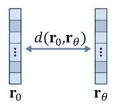
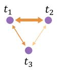
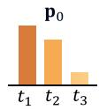
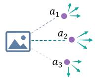
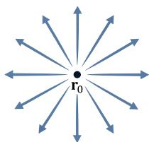
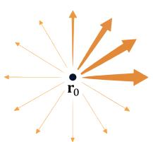
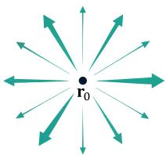
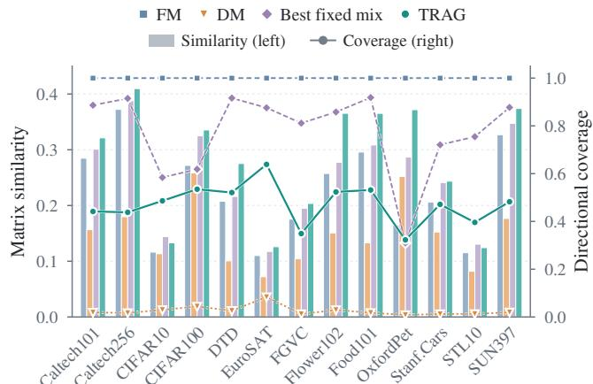
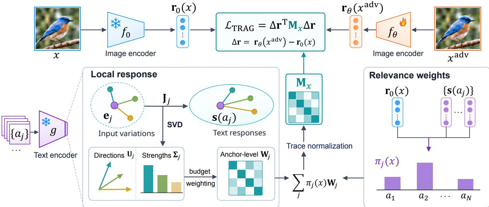
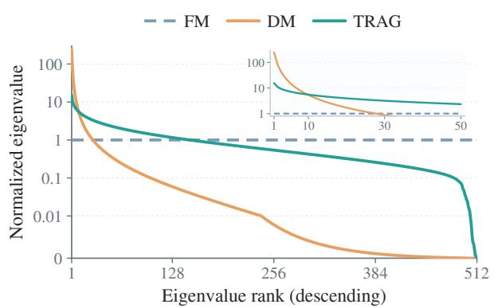

# Textual Response-Aware Guidance for Zero-Shot Adversarial Robustness of Vision-Language Models

Yubo Cui1, Xianchao Guan1, Zheng Zhang1,2

1Harbin Institute of Technology, Shenzhen, China; 2Shenzhen Loop Area Institute, Shenzhen, China {yubo cui, guanxianchao}@stu.hit.edu.cn, darrenzz219@gmail.com

## Abstract

Vision-language models (VLMs) exhibit strong zero-shot generalization but remain vulnerable to adversarial attacks. Existing adversarial fine-tuning methods often use pre-trained model guidance to preserve image–text alignment while improving robustness. Our analysis of visual representation drift reveals complementary limitations of two representative forms of guidance. Matching visual features provides broad coverage by constraining all directions equally, but lacks semantic emphasis. Matching prediction distributions prioritizes semantically relevant directions, but remains limited by the candidate texts and prediction probabilities. These limitations can hinder preservation of pre-trained image–text relationships and degrade zero-shot performance. To address these issues, we propose Textual Response-Aware Guidance (TRAG), which constrains visual representation drift using the pretrained text encoder’s responses to local variations in input embeddings. Specifically, TRAG constructs anchorlevel constraints from the response directions and magnitudes around semantic anchors, then aggregates them using pre-trained image–anchor relevance, yielding an imageadaptive constraint. Extensive experiments across architectures and tasks demonstrate state-of-the-art clean and robust performance. Further analysis shows that TRAG helps preserve pre-trained image–text relationships.

## 1. Introduction

Vision-language models (VLMs) [32, 47] achieve strong zero-shot generalization through large-scale pre-training on image–text pairs. By aligning visual and textual representations in a shared embedding space, VLMs support applications such as image classification [51] and image– text retrieval [16], and provide visual backbones for large vision-language models (LVLMs) [22]. However, similar to conventional deep neural networks [9, 38], VLMs remain vulnerable to adversarial examples. Small, carefully crafted image perturbations can induce incorrect predictions, undermining model reliability [49, 50]. Adversarial fine-tuning improves robustness but can compromise zeroshot generalization [27]. A central challenge is therefore to preserve the pre-trained image–text alignment underlying zero-shot transfer while improving adversarial robustness.

  
Feature distance

  
Weighted text differences

  
Local text responses

  
(a) Feature matching  
(b) Distribution matching

  
(c) TRAG (ours)  
Figure 1. Directional constraints on visual representation drift. Thicker lower arrows indicate stronger penalties. (a) Feature matching constrains drift equally in all directions. (b) Prediction distribution matching weights directions associated with differences between candidate textual representations using pre-trained prediction probabilities. (c) TRAG constructs anchor-level constraints from local responses of the pre-trained text encoder and aggregates them using pre-trained image–anchor relevance.

Existing methods often use guidance from the pretrained model to preserve image–text alignment during adversarial fine-tuning. Some match visual features between the fine-tuned and pre-trained models [34, 42], whereas others match prediction distributions over candidate texts [5, 40]. Both forms of guidance aim to preserve pre-trained image–text relationships, which depend on projections of visual representations along different directions in the shared embedding space. For normalized representations, projections onto textual representations determine individual image–text similarities, while projections onto differences between textual representations determine relative similarities [32]. Changes in visual representations along different directions can affect these relationships differently How guidance constrains these changes can therefore influence the preservation of image–text relationships.

From this perspective, we analyze both forms of guidance as directional constraints on drift from pre-trained visual representations, revealing complementary limitations. As illustrated in Figs. 1(a) and 1(b), matching visual features constrains drift equally in all directions, providing broad coverage but no semantic emphasis. Matching prediction distributions instead prioritizes semantically relevant directions associated with differences between candidate textual representations, but remains limited by the candidate texts and prediction probabilities. Zero-shot generalization, however, requires preserving diverse image–text relationships across unseen tasks. These limitations can leave such relationships insufficiently protected and degrade zeroshot performance. We therefore seek directional references for potential semantic variations to construct guidance with broad coverage and semantic emphasis.

To address these limitations, we propose Textual Response-Aware Guidance (TRAG), which uses local responses of the pre-trained text encoder to constrain visual representation drift. Using known texts as semantic anchors, we examine its responses to local variations in their input embeddings. As shown in Fig. 1(c), the response directions and magnitudes characterize local changes in textual representations, providing directional references for potential semantic variations beyond the given texts. With a fixed total weight for directional penalties, we derive anchor-level constraints by minimizing the average worstcase error in preserving image–text relationships associated with these local changes. Finally, we aggregate them using pre-trained image–anchor relevance on clean images, yielding an image-adaptive constraint for adversarial fine-tuning.

Extensive experiments demonstrate TRAG’s state-ofthe-art clean and robust performance. We validate these advantages across multiple VLM architectures on zero-shot classification and image–text retrieval, covering both classsupervised and image–text fine-tuning settings under multiple threat models. These benefits extend to image captioning and visual question answering in LVLMs. Further analyses and ablations show that TRAG helps preserve pretrained image–text relationships during robust adaptation. Our main contributions are as follows:

• We analyze the directional constraints that feature matching and prediction distribution matching impose on visual representation drift, revealing complementary limitations in preserving pre-trained image–text relationships.

• We propose TRAG, which derives anchor-level constraints from local responses of the pre-trained text encoder and aggregates them using image–anchor relevance, yielding an image-adaptive constraint.

• We demonstrate state-of-the-art clean and robust performance across architectures and tasks, with analyses and ablations showing that TRAG helps preserve pre-trained image–text relationships.

## 2. Related Work

Adversarial robustness of VLMs. Adversarial attacks can induce incorrect predictions in deep neural networks through small, carefully crafted image perturbations, posing security risks [9, 38]. Adversarial training is a widely adopted defense that uses min–max optimization to improve robustness, alternating between generating adversarial examples against the current model and updating its parameters [25]. For VLMs, TeCoA [27] fine-tunes the image encoder with a text-guided contrastive objective to improve zero-shot adversarial robustness. Subsequent methods increase separation between class textual representations [19] or adjust classification margins [24]. Other approaches align regions along adversarial paths [7] or image– text subspaces [6]. Adversarial prompt learning optimizes textual prompts [18] or both textual and visual prompts [52] while keeping the pre-trained encoders fixed. Test-time defenses improve inference robustness through prompt tuning [36, 41] or input counterattacks [44].

Pre-trained model guidance. To mitigate degradation in zero-shot generalization, existing methods use pre-trained model guidance to preserve image–text alignment during adversarial fine-tuning. At the feature level, FARE [34] matches adversarial visual features to the pre-trained model’s clean features. QT-AFT [42] combines feature matching with richer textual supervision from high-quality image captions. At the prediction level, PMG-AFT [40] combines an adversarial task objective with prediction distribution matching against the pre-trained model. AGFT [5] replaces hard-label supervision with the pre-trained model’s soft alignment distributions, calibrated through temperature scaling. TGA-ZSR [48] preserves text-guided spatial attention using the original model as a reference. AdvFLYP [45] combines contrastive adversarial fine-tuning on web image– text pairs with feature matching and prediction distribution matching. We analyze the directional constraints imposed by representative feature and prediction distribution matching objectives. TRAG uses local responses of the pre-trained text encoder to construct an image-adaptive constraint on visual representation drift.

## 3. Preliminaries and Analysis

We introduce the basic setting and analyze how two representative forms of pre-trained guidance constrain visual representation drift. Geometric diagnostics further examine their complementary limitations and inform guidance for preserving diverse image–text relationships.

## 3.1. Preliminaries

Vision-language models. VLMs such as CLIP [32] use an image encoder $f _ { \theta } : \mathcal { X }  \mathbb { R } ^ { d }$ and a text encoder $g : \mathcal { T } $ $\mathbb { R } ^ { d }$ to map images and texts into a shared embedding space, where $\mathcal { X }$ and $\tau$ denote the image and text input spaces. We update only the image encoder parameters θ during finetuning and use the original pre-trained image encoder $f _ { 0 }$ as a frozen reference. The pre-trained text encoder $g$ is shared by both models and remains fixed. For an image x and a text input t, their normalized representations are

$$
\mathbf { r } _ { \theta } ( x ) = { \frac { f _ { \theta } ( x ) } { \| f _ { \theta } ( x ) \| _ { 2 } } } , \qquad \mathbf { s } ( t ) = { \frac { g ( t ) } { \| g ( t ) \| _ { 2 } } } .\tag{1}
$$

Their inner product gives image–text similarity. For candidate texts $\mathcal { T } _ { \mathrm { c a n d } } = \{ t _ { j } \} _ { j = 1 } ^ { C }$ , the prediction distribution is

$$
p _ { \theta } ( j \mid x ; \mathcal { T } _ { \mathrm { c a n d } } ) = \frac { \exp \bigl ( \mathbf { r } _ { \theta } ( x ) ^ { \top } \mathbf { s } ( t _ { j } ) / \tau \bigr ) } { \sum _ { k = 1 } ^ { C } \exp ( \mathbf { r } _ { \theta } ( x ) ^ { \top } \mathbf { s } ( t _ { k } ) / \tau ) } ,\tag{2}
$$

where $\tau > 0$ is the temperature inherited from pre-training. The pre-trained model’s normalized visual representation $\mathbf { r } _ { 0 } ( x )$ and prediction distribution $p _ { 0 } ( j \ | \ x ; \mathcal { T } _ { \mathrm { c a n d } } )$ are obtained by replacing $f _ { \theta }$ with $f _ { 0 }$

Adversarial fine-tuning. Given a clean image $x ,$ an adversarial attack seeks a perturbation δ that increases the model’s loss, subject to $x ^ { \mathrm { a d v } } = x + \delta \in B ( x , \epsilon )$ . Here, $B ( x , \epsilon ) = \{ x ^ { \prime } \in \mathcal { X } : \| x ^ { \prime } - x \| _ { \infty } \leq \epsilon \}$ , where ϵ denotes the perturbation budget. Adversarial fine-tuning updates the image encoder of a pre-trained VLM using these adversarial examples. TeCoA [27] uses the following text-guided contrastive loss for a mini-batch $\{ x _ { i } \}$ from ImageNet [33]:

$$
\mathcal { L } _ { \mathrm { T e C o A } } \left( \theta ; \{ x _ { i } ^ { \mathrm { a d v } } \} , \mathcal { T } _ { \mathrm { c a n d } } , \{ y _ { i j } \} \right)\tag{3}
$$

$$
= - \mathbb { E } _ { i , j } \left[ y _ { i j } \log \frac { \exp \left( \mathbf { r } _ { \theta } ( x _ { i } ^ { \mathrm { a d v } } ) ^ { \top } \mathbf { s } ( t _ { j } ) / \tau \right) } { \sum _ { k = 1 } ^ { C } \exp \left( \mathbf { r } _ { \theta } ( x _ { i } ^ { \mathrm { a d v } } ) ^ { \top } \mathbf { s } ( t _ { k } ) / \tau \right) } \right] ,
$$

where $y _ { i j } = 1$ indicates a positive image–text pair $( x _ { i } , t _ { j } )$ and $y _ { i j } = 0$ otherwise. The min–max objective is

$$
\operatorname* { m i n } _ { \theta } \mathbb { E } _ { \{ x _ { i } \} \sim \mathcal { D } } \bigg [ \operatorname* { m a x } _ { x _ { i } ^ { \mathrm { a d v } } \in B ( x _ { i } , \epsilon ) } \mathcal { L } _ { \mathrm { T e C o A } } \bigg ] ,\tag{4}
$$

where $\mathcal { D }$ is the source dataset. The inner maximization finds adversarial images; the outer minimization updates θ. The resulting model is evaluated zero-shot on downstream tasks without task-specific adaptation.

## 3.2. Directional Analysis of Guidance

To understand how pre-trained guidance preserves image– text relationships, we analyze two representative forms: feature matching (FM) and prediction distribution matching (DM). Both constrain visual representation drift from the original model’s clean representation:

$$
\Delta \mathbf { r } ( x , x ^ { \mathrm { a d v } } ) = \mathbf { r } _ { \theta } ( x ^ { \mathrm { a d v } } ) - \mathbf { r } _ { 0 } ( x ) .\tag{5}
$$

This drift reflects both model adaptation and input perturbation. It changes individual image–text similarities by $\mathbf { s } ( t ) ^ { \top } \Delta \mathbf { r }$ and relative similarities to $t _ { i }$ versus $t _ { j }$ by $[ { \bf s } ( t _ { i } ) -$

  
Figure 2. Geometric diagnostics of CLIP ViT-B/32 before finetuning. Bars (left) show similarity to downstream class geometry; lines (right) show directional coverage. The best fixed FM–DM mix is selected by mean similarity per dataset.

$\mathbf { s } ( t _ { j } ) ] ^ { \top } \Delta \mathbf { r }$ . Drift along different directions can therefore affect image–text relationships differently.

Feature matching. FM encourages current visual representations to remain close to those of the pre-trained model [34, 42]. We analyze the normalized form:

$$
\begin{array} { r } { \mathcal { L } _ { \mathrm { F M } } = \Vert \mathbf { r } _ { \theta } ( x ^ { \mathrm { a d v } } ) - \mathbf { r } _ { 0 } ( x ) \Vert _ { 2 } ^ { 2 } = \Delta \mathbf { r } ^ { \top } \mathbf { I } _ { d } \Delta \mathbf { r } . } \end{array}\tag{6}
$$

The identity matrix constrains drift equally in all directions. This provides broad protection for image–text relationships without favoring semantically relevant directions.

Prediction distribution matching. DM uses pre-trained predictions as soft supervision [5, 40]. We analyze forward KL $D _ { \mathrm { K L } } ( \mathbf { p } _ { 0 } \| \mathbf { p } _ { \boldsymbol { \theta } } )$ over fixed candidate texts $\tau _ { \mathrm { c a n d } }$ , where p and p denote the original clean and current adversarial distributions, respectively. Around $\mathbf { r } _ { 0 } ( x )$

$$
\mathcal { L } _ { \mathrm { D M } } = \frac { 1 } { 2 } \Delta \mathbf { r } ^ { \top } \mathbf { H } _ { 0 } \Delta \mathbf { r } + O ( \| \Delta \mathbf { r } \| _ { 2 } ^ { 3 } ) ,\tag{7}
$$

where $\mathbf { s } _ { i } = \mathbf { s } ( t _ { i } )$ and the reference Hessian is

$$
\mathbf { H } _ { 0 } = \frac { 1 } { 2 \tau ^ { 2 } } \sum _ { i , j = 1 } ^ { C } [ \mathbf { p } _ { 0 } ] _ { i } [ \mathbf { p } _ { 0 } ] _ { j } ( \mathbf { s } _ { i } - \mathbf { s } _ { j } ) ( \mathbf { s } _ { i } - \mathbf { s } _ { j } ) ^ { \top } .\tag{8}
$$

The outer products penalize drift along differences between candidate textual representations, with each pair weighted by $[ \mathbf { p } _ { 0 } ] _ { i } [ \mathbf { p } _ { 0 } ] _ { j }$ . DM thus provides semantic emphasis, but remains limited by the candidate texts and prediction probabilities. Further derivations and connections to specific methods are provided in the appendix.

FM and DM thus exhibit complementary limitations. Preserving the diverse image–text relationships needed for zero-shot transfer requires controlling drift along semantic directions relevant to unseen tasks. These limitations can hinder such preservation across potential semantic variations and degrade zero-shot performance.

  
Figure 3. Overview of TRAG. We construct anchor-level constraints $\mathbf { W } _ { j }$ from the text encoder’s local response directions and magni tudes under a fixed-budget criterion. Pre-trained image–anchor relevance on clean images weights their aggregation. After global trace normalization, ${ \bf M } _ { x }$ constrains visual representation drift during adversarial fine-tuning.

## 3.3. Geometric Diagnostics

To complement the directional analysis, we examine the matrices defining these constraints before fine-tuning. We use the normalized participation ratio of their eigenvalues [21] to measure how broadly directional weights are distributed. The lines in Fig. 2 show maximal coverage for FM but low coverage for DM. The eigenvalue spectra in Fig. 4 illustrate DM’s concentrated directional weights.

To assess relevance to downstream tasks, we use the covariance of normalized downstream class textual representations as a reference for task-relevant semantic directions. We compare each constraint matrix with this covariance using the normalized Frobenius inner product. The bars in Fig. 2 show lower similarity for FM and DM than for TRAG. Their best fixed mixtures generally have lower similarity despite often having greater coverage than TRAG.

Together, these analyses motivate guidance with broad coverage and semantic emphasis for preserving diverse image–text relationships across unseen tasks. We therefore seek directional references for potential semantic variations to design constraints on visual representation drift.

## 4. Methodology

We describe the construction of TRAG and its use in adversarial fine-tuning, as illustrated in Fig. 3. We first derive anchor-level constraints from local responses of the pretrained text encoder under a fixed penalty budget (Sec. 4.1). We then aggregate them using pre-trained image–anchor relevance and formulate the training objective (Sec. 4.2).

## 4.1. Anchor-Level Constraint Construction

Zero-shot transfer requires preserving diverse image–text relationships for downstream tasks unknown during finetuning. Known texts provide semantic reference points but may not fully capture these needs. Starting from known concepts, we therefore seek directional references for potential semantic variations. The pre-trained text encoder’s learned mapping translates local input embedding changes into textual representation changes in the shared space. Using these texts as semantic anchors, we construct drift constraints from local response directions and magnitudes.

Local textual responses. Let $\mathcal { A } = \{ a _ { j } \} _ { j = 1 } ^ { N }$ denote the anchor set. For anchor $a _ { j } , \mathbf { e } _ { j } \in \mathbb { R } ^ { n _ { j } d _ { e } }$ concatenates the embeddings of its $n _ { j }$ body tokens, excluding start and end tokens, where $d _ { e }$ is the token embedding dimension. With the encoder frozen and other inputs fixed, its normalizedoutput Jacobian has a thin singular value decomposition:

$$
\mathbf { J } _ { j } = { \frac { \partial \mathbf { s } ( a _ { j } ) } { \partial \mathbf { e } _ { j } } } = \mathbf { U } _ { j } \boldsymbol { \Sigma } _ { j } \mathbf { V } _ { j } ^ { \intercal } .\tag{9}
$$

Left singular vectors describe response directions in the shared space; singular values quantify their magnitudes.

For a small embedding change $\Delta \mathbf { e } _ { j }$ , the linear response $\Delta \mathbf { s } _ { j } = \mathbf { J } _ { j } \Delta \mathbf { e } _ { j }$ approximates the textual representation difference from the anchor. Following Sec. 3.2, visual drift ∆r changes relative similarity to the locally varied representation versus the anchor by approximately $\Delta \mathbf { s } _ { i } ^ { \top } \Delta \mathbf { r }$ . We use $\Delta \mathbf { s } _ { j }$ as a local proxy for potential semantic variations.

Directional penalty allocation. We model $\Delta \mathbf { e } _ { j }$ as a random input proxy. The response second moment $\mathbf { K } _ { j } \mathbf { \Psi } =$ $\mathbb { E } [ \Delta \mathbf { s } _ { j } \Delta \mathbf { s } _ { j } ^ { \top } ]$ summarizes average squared responses across directions. We choose a positive semidefinite matrix Q to penalize drift through $\Delta \mathbf { r } ^ { \top } \mathbf { Q } \Delta \mathbf { r }$ . Its eigenvalues are directional penalty weights, with a fixed sum tr $( \mathbf { Q } ) = d .$

Table 1. Zero-shot classification with CLIP ViT-B/32. Models are fine-tuned on ImageNet with training/test budgets of 2/255. Bold and underlined values mark the best and second-best fine-tuned results; Average spans all 16 datasets.
<table><tr><td>Eval.</td><td>Method</td><td>Ca01</td><td>Ca256</td><td>CIAR10</td><td>CAR10</td><td>DTD</td><td>ESAT</td><td>FGVC</td><td>FIw102</td><td>F001</td><td>ImageNet</td><td>Ia-R</td><td>Imae-S</td><td>Oxforddet</td><td>Stancars</td><td>SUNN397 ST710</td><td></td></tr><tr><td rowspan="7">Cleəaan</td><td>CLIP TeCoA PMG-AFT</td><td>88.71</td><td>84.66</td><td>87.55</td><td>62.56</td><td>41.38 43.72</td><td>19.17</td><td>66.15</td><td>83.51</td><td>61.89</td><td>66.26</td><td>40.75</td><td>87.33</td><td>58.62</td><td>97.28</td><td>60.10</td><td>65.60</td></tr><tr><td></td><td>82.89 72.92</td><td>73.45</td><td>40.84 50.87</td><td>30.74</td><td>19.59</td><td>11.25</td><td>42.86</td><td>41.83</td><td>55.66</td><td>49.28</td><td>27.54</td><td>75.23</td><td>25.28</td><td>90.22</td><td>47.67</td><td>49.20</td></tr><tr><td></td><td>86.46 77.32</td><td>80.13</td><td></td><td>31.65</td><td>22.90</td><td>12.51</td><td>45.22</td><td>52.50</td><td>61.19</td><td>54.91</td><td>33.74</td><td>79.54</td><td>32.75</td><td>93.34</td><td>50.24</td><td>54.08</td></tr><tr><td>FARE</td><td>86.51 79.72</td><td></td><td>78.40</td><td>57.50 34.04</td><td>17.59</td><td>14.94</td><td>52.23</td><td>64.72</td><td>56.87</td><td>57.53</td><td>35.61</td><td>83.19</td><td>48.71</td><td>93.77</td><td>52.05</td><td>57.09</td></tr><tr><td>TGA-ZSR</td><td>82.84 76.13</td><td>80.75</td><td></td><td>49.01 28.72</td><td>14.10</td><td>9.78</td><td>43.92</td><td>45.16</td><td>70.53</td><td>57.33</td><td>38.16</td><td>77.82</td><td>25.74</td><td>93.19</td><td>47.88</td><td>52.57</td></tr><tr><td>QT-AFT</td><td>86.18 78.54</td><td>82.47</td><td>56.50</td><td>34.20</td><td>11.13</td><td>14.31</td><td>51.32</td><td>62.08</td><td>55.12</td><td>56.13</td><td>34.47</td><td>81.91</td><td>47.07</td><td>94.38</td><td>51.38</td><td>56.07</td></tr><tr><td>AGFT</td><td>86.22 78.83</td><td>83.10</td><td>58.22</td><td>33.24</td><td>19.29 22.80</td><td>13.47 13.47</td><td>45.59 49.93</td><td>59.22 62.78</td><td>59.85 71.16</td><td>58.36 61.49</td><td>36.60</td><td>83.00</td><td>41.01 45.29</td><td>95.25 95.69</td><td>50.38 53.39</td><td>56.35 59.60</td></tr><tr><td rowspan="8">Roust</td><td>TRAG (Ours)</td><td>87.49 81.20</td><td></td><td>86.01</td><td>62.32 35.00</td><td></td><td></td><td></td><td></td><td></td><td></td><td>41.37</td><td>84.20</td><td></td><td></td><td></td><td></td></tr><tr><td>CLIP</td><td>0.61 0.18</td><td>0.11</td><td>0.57</td><td>0.37</td><td>0.46</td><td>0.63</td><td>0.55</td><td>0.11</td><td>0.27</td><td>0.45</td><td>0.17</td><td>0.08</td><td>0.50</td><td>0.12</td><td>0.45 17.74</td><td>0.35</td></tr><tr><td>TeCoA</td><td>60.23 46.48</td><td>42.25</td><td>20.88</td><td>17.23</td><td>10.93</td><td>2.10</td><td>16.78</td><td>11.41</td><td>23.25</td><td>24.26</td><td>14.31</td><td>38.15</td><td>6.06</td><td>69.15 76.75</td><td>21.93</td><td>26.33 31.99</td></tr><tr><td>PMG-AFT</td><td>66.43</td><td>54.00</td><td>51.21</td><td>27.62 20.00</td><td>11.87</td><td>3.21 2.94</td><td>18.11</td><td>17.73</td><td>32.13</td><td>30.66</td><td>18.72</td><td>52.13</td><td>9.34</td><td>74.44</td><td>18.53</td><td></td></tr><tr><td>FARE</td><td>61.81 63.14</td><td>51.49</td><td>49.13</td><td>27.71 19.36</td><td>7.67</td><td></td><td>16.46</td><td>17.74</td><td>23.80</td><td>27.94</td><td>16.64</td><td>44.74</td><td>9.04</td><td></td><td></td><td>29.34</td></tr><tr><td>TGA-ZSR</td><td>62.86</td><td>50.21 51.94</td><td>49.10 52.69</td><td>24.27 14.84 29.04</td><td>0.78</td><td>1.95</td><td>15.54 17.35</td><td>12.71</td><td>38.72 24.41</td><td>29.62 28.59</td><td>20.34 16.85</td><td>49.48</td><td>5.73 9.16</td><td>74.59 77.14</td><td>18.09</td><td>29.32</td></tr><tr><td>QT-AFT</td><td></td><td></td><td>53.56</td><td>20.37 20.48</td><td>1.60 11.04</td><td>2.58 4.83</td><td>18.52</td><td>18.46 19.86</td><td>32.77</td><td>32.97</td><td>20.54</td><td>45.56 55.64</td><td>12.16</td><td>79.49</td><td>19.17 22.35</td><td>29.86 33.60</td></tr><tr><td>AGFT TRAG (Ours)</td><td>66.77 67.11</td><td>55.82 57.37</td><td>56.82</td><td>30.87 33.69</td><td>21.44</td><td>11.24</td><td>3.45</td><td>19.01 19.87</td><td>41.48</td><td>34.25</td><td>22.68</td><td>58.86</td><td>11.40</td><td>80.99</td><td>21.84</td><td>35.09</td></tr></table>

For each response, $\Delta \mathbf { s } _ { i } ^ { \top } \Delta \mathbf { r }$ measures the error in relative image–text similarity under the linear proxy model. Using a common unit penalty bound, we take the largest squared error over abstract drifts and then average over responses:

$$
\mathcal { R } ( \mathbf { Q } ; \mathbf { K } _ { j } ) = \mathbb { E } _ { \Delta \mathbf { s } _ { j } } \left[ \operatorname* { m a x } _ { \Delta \mathbf { r } ^ { \top } \mathbf { Q } \Delta \mathbf { r } \leq 1 } ( \Delta \mathbf { s } _ { j } ^ { \top } \Delta \mathbf { r } ) ^ { 2 } \right] .\tag{10}
$$

Proposition 1 (Budget allocation). Suppose $\Delta \mathbf { s } _ { j }$ has a finite, nonzero second moment. For $\textbf { Q } \succeq \textbf { 0 }$ satisfying $\mathrm { r a n g e } ( \mathbf { K } _ { j } ) \subseteq \mathrm { r a n g e } ( \mathbf { Q } )$ , the risk is $\mathcal { R } ( \mathbf { Q } ; \mathbf { K } _ { j } ) \ =$ $\operatorname { t r } ( \mathbf { K } _ { j } \mathbf { Q } ^ { \dagger } )$ , where $\mathbf { Q } ^ { \dagger }$ denotes the Moore–Penrose pseudoinverse [31]. Under $\operatorname { t r } ( \mathbf { Q } ) = d ,$ , a minimizer is

$$
\mathbf { Q } ^ { \star } = \frac { d \sqrt { \mathbf { K } _ { j } } } { \operatorname { t r } ( \sqrt { \mathbf { K } _ { j } } ) } .\tag{11}
$$

The proof is provided in the appendix.

We use a zero-mean isotropic proxy with $\mathrm { C o v } ( \Delta \mathbf { e } _ { j } ) =$ ${ \mathbf { I } } _ { n _ { j } d _ { e } } / n _ { j }$ . Equal variance across input directions lets the pre-trained text encoder determine the response geometry, while $1 / n _ { j }$ keeps the expected total input variation energy independent of the body-token count. This gives

$$
\mathbf { K } _ { j } = \mathbb { E } [ \Delta \mathbf { s } _ { j } \Delta \mathbf { s } _ { j } ^ { \top } ] = \frac { \mathbf { J } _ { j } \mathbf { J } _ { j } ^ { \top } } { n _ { j } } .\tag{12}
$$

Proposition 1 yields the anchor-level constraint shape

$$
\mathbf { W } _ { j } = \sqrt { \mathbf { K } _ { j } } = \frac { \mathbf { U } _ { j } \pmb { \Sigma } _ { j } \mathbf { U } _ { j } ^ { \top } } { \sqrt { n _ { j } } } .\tag{13}
$$

The penalty $\Delta \mathbf { r } ^ { \top } \mathbf { W } _ { j } \Delta \mathbf { r }$ weights squared drift projections onto response directions by singular values scaled by

$1 / \sqrt { n _ { j } }$ . The single-anchor optimum $\mathbf { Q } ^ { \star }$ rescales $\mathbf { W } _ { j }$ to trace d. We retain the unnormalized $\mathbf { W } _ { j }$ to preserve response strengths across anchors; Sec. $4 . 2$ allocates their scales jointly under a shared budget before aggregation.

## 4.2. Image-Adaptive Guidance and Fine-Tuning

Image-adaptive aggregation. Although downstream tasks are unknown, a clean image x provides cues about which concept neighborhoods are relevant. We therefore use pretrained image–anchor relevance as a proxy for their relative importance:

$$
\pi _ { j } ( x ) = { \frac { \exp \bigl ( \mathbf { r } _ { 0 } ( x ) ^ { \top } \mathbf { s } ( a _ { j } ) / \tau \bigr ) } { \sum _ { k = 1 } ^ { N } \exp \bigl ( \mathbf { r } _ { 0 } ( x ) ^ { \top } \mathbf { s } ( a _ { k } ) / \tau \bigr ) } } .\tag{14}
$$

For fixed x, let $\mathbf { Q } _ { j }$ denote component constraint matrices satisfying the semidefiniteness and range conditions of Proposition 1. We minimize the weighted proxy risk $\begin{array} { r l } { \sum _ { j = 1 } ^ { N } \dot { \pi } _ { j } ( x ) \mathcal { R } ( \mathbf { Q } _ { j } ; \mathbf { K } _ { j } ) } & { { } } \end{array}$ , subject to the shared budget $\begin{array} { r } { \sum _ { j = 1 } ^ { N } \pi _ { j } ( x ) \operatorname { t r } ( \mathbf { Q } _ { j } ) = d . } \end{array}$ A closed-form solution scales all $\mathbf { W } _ { j }$ by a common factor, as derived in the appendix. Aggregating these components with weights $\pi _ { j } ( x )$ gives:

$$
\mathbf { M } _ { x } = \frac { d \sum _ { j = 1 } ^ { N } \pi _ { j } ( x ) \mathbf { W } _ { j } } { \sum _ { j = 1 } ^ { N } \pi _ { j } ( x ) \operatorname { t r } ( \mathbf { W } _ { j } ) } .\tag{15}
$$

The common normalization fixes $\operatorname { t r } ( \mathbf { M } _ { x } ) = d$ while preserving relative response strengths across anchors.

Adversarial fine-tuning. For a mini-batch $\left\{ \left( x _ { i } , t _ { i } \right) \right\}$ where $t _ { i }$ denotes a paired text or the corresponding class text, write $\Delta \mathbf { r } _ { i } = \Delta \mathbf { r } ( x _ { i } , x _ { i } ^ { \mathrm { a d v } } )$ ). We average the TRAG penalty over images:

$$
\mathcal { L } _ { \mathrm { T R A G } } = \mathbb { E } _ { i } \left[ \Delta \mathbf { r } _ { i } ^ { \top } \mathbf { M } _ { x _ { i } } \Delta \mathbf { r } _ { i } \right] .\tag{16}
$$

Table 2. Different test budgets. ViT-B/32 models are trained at 2/255. Results are means over 16 datasets; Avg. further averages robust accuracy over all four listed test budgets.
<table><tr><td rowspan="2">Method</td><td rowspan="2">Clean</td><td colspan="5">Robust Accuracy</td></tr><tr><td>1/255</td><td>2/255</td><td>3/255</td><td>4/255</td><td> $\operatorname { A v g } .$ </td></tr><tr><td>TeCoA</td><td>49.20</td><td>37.42</td><td>26.33</td><td>17.40</td><td>10.75</td><td>22.97</td></tr><tr><td>PMG-AFT</td><td>54.08</td><td>42.88</td><td>31.99</td><td>22.26</td><td>14.53</td><td>27.92</td></tr><tr><td>FARE</td><td>57.09</td><td>42.81</td><td>29.34</td><td>18.33</td><td>10.76</td><td>25.31</td></tr><tr><td>TGA-ZSR</td><td>52.57</td><td>40.50</td><td>29.32</td><td>19.47</td><td>11.69</td><td>25.24</td></tr><tr><td>QT-AFT</td><td>56.07</td><td>42.52</td><td>29.86</td><td>19.33</td><td>11.77</td><td>25.87</td></tr><tr><td>AGFT</td><td>56.35</td><td>44.83</td><td>33.60</td><td>23.44</td><td>15.13</td><td>29.25</td></tr><tr><td>TRAG (Ours)</td><td>59.60</td><td>47.07</td><td>35.09</td><td>24.25</td><td>15.38</td><td>30.45</td></tr></table>

Table 3. Different training budgets. Mean accuracy (%) over 16 datasets; ViT-B/32 uses matched training/test budgets.
<table><tr><td rowspan="2">Method</td><td colspan="2">1/255</td><td colspan="2">3/255</td><td colspan="2">4/255</td></tr><tr><td>Clean</td><td>Robust</td><td>Clean</td><td>Robust</td><td>Clean</td><td>Robust</td></tr><tr><td>TeCoA</td><td>56.31</td><td>38.43</td><td>42.87</td><td>18.87</td><td>37.45</td><td>13.95</td></tr><tr><td>PMG-AFT</td><td>59.58</td><td>42.72</td><td>46.29</td><td>22.63</td><td>42.01</td><td>17.59</td></tr><tr><td>FARE</td><td>61.90</td><td>38.66</td><td>52.46</td><td>22.80</td><td>47.74</td><td>17.88</td></tr><tr><td>TGA-ZSR</td><td>58.37</td><td>37.66</td><td>47.72</td><td>23.16</td><td>43.86</td><td>18.71</td></tr><tr><td>QT-AFT</td><td>61.03</td><td>39.55</td><td>52.06</td><td>23.40</td><td>48.00</td><td>18.66</td></tr><tr><td>AGFT</td><td>60.94</td><td>43.18</td><td>52.54</td><td>26.55</td><td>48.97</td><td>21.41</td></tr><tr><td>TRAG (Ours)</td><td>63.66</td><td>44.39</td><td>56.35</td><td>28.12</td><td>54.55</td><td>22.18</td></tr></table>

The task loss $\mathcal { L } _ { \mathrm { t a s k } }$ can be $\mathcal { L } _ { \mathrm { T e C o A } }$ for classification or InfoNCE [29] for paired image–text training. We optimize

$$
\operatorname* { m i n } _ { \theta } \mathbb { E } _ { \{ ( x _ { i } , t _ { i } ) \} \sim \mathcal { D } } \left[ \operatorname* { m a x } _ { x _ { i } ^ { \mathrm { a d v } } \in B ( x _ { i } , \epsilon ) } \left( \mathcal { L } _ { \mathrm { t a s k } } + \lambda \mathcal { L } _ { \mathrm { T R A G } } \right) \right] ,\tag{17}
$$

where $\lambda \geq 0$ controls the relative guidance strength.

We approximate the inner maximization over the batch images using projected gradient descent (PGD) [25]. Both the attack and outer update use the same combined loss. Only the image encoder is updated; the original model, text encoder, and temperature remain frozen. The clean references $\mathbf { r } _ { 0 } ( x _ { i } )$ , relevance weights $\pi _ { j } ( x _ { i } )$ , and matrices $\mathbf { M } _ { x _ { i } }$ remain fixed throughout each attack.

We precompute anchor representations ${ \bf s } ( a _ { j } )$ and matrices $\mathbf { W } _ { j }$ once before fine-tuning. Inference uses the adapted image encoder within the original VLM pipeline, with no additional computation from TRAG.

## 5. Experiments

## 5.1. Zero-Shot Image Classification

Experimental setup. We fine-tune CLIP ViT-B/32 on ImageNet [33] and evaluate on ImageNet and 15 zeroshot datasets: Caltech-101 [8], Caltech-256 [11], CIFAR-10 [15], CIFAR-100 [15], DTD [2], EuroSAT [12], FGVC Aircraft [26], Flowers102 [28], Food-101 [1], ImageNet-R [13], ImageNet-S [39], Oxford-IIIT Pet [30], Stanford Cars [14], STL-10 [3], and SUN397 [43]. Unless otherwise stated, training and evaluation use an $\ell _ { \infty }$ budget of 2/255.

Table 4. Different backbones. Mean accuracy (%) over 16 datasets; training and test budgets are 2/255.
<table><tr><td rowspan="2">Method</td><td colspan="2">ViT-B/16</td><td colspan="2">ViT-L/14</td><td colspan="2">RN101</td></tr><tr><td>Clean</td><td>Robust</td><td>Clean</td><td>Robust</td><td>Clean</td><td>Robust</td></tr><tr><td>TeCoA</td><td>53.38</td><td>30.18</td><td>64.12</td><td>39.99</td><td>31.65</td><td>16.45</td></tr><tr><td>PMG-AFT</td><td>55.40</td><td>30.83</td><td>63.85</td><td>43.40</td><td>47.01</td><td>27.69</td></tr><tr><td>FARE</td><td>60.28</td><td>32.69</td><td>69.06</td><td>45.03</td><td>51.87</td><td>20.26</td></tr><tr><td>TGA-ZSR</td><td>51.66</td><td>32.16</td><td>60.82</td><td>40.34</td><td></td><td></td></tr><tr><td>QT-AFT</td><td>60.05</td><td>33.35</td><td>69.05</td><td>45.36</td><td>45.46</td><td>21.64</td></tr><tr><td>AGFT</td><td>58.68</td><td>36.25</td><td>67.37</td><td>46.78</td><td>51.15</td><td>28.82</td></tr><tr><td>TRAG (Ours)</td><td>62.95</td><td>39.08</td><td>70.78</td><td>49.54</td><td>55.39</td><td>29.54</td></tr></table>

For TRAG, we use five epochs, 5-step PGD with step size $1 / 2 5 5 .$ , and $\lambda = 1 5$ . The 1,000 ImageNet class names serve as anchors.

We reproduce TeCoA [27], PMG-AFT [40], FARE [34], TGA-ZSR [48], QT-AFT [42], and AGFT [5] using their respective training configurations. All methods share the evaluation protocol. Following FARE in attack selection, we use APGD-CE and targeted APGD-DLR from AutoAttack [4], with 20 iterations each. We report per-dataset accuracy and averages across the 16 datasets. Further details are provided in the appendix.

Main results. Table 1 shows that TRAG achieves the highest average clean and robust accuracy among fine-tuned methods: 59.60% and 35.09%, respectively. These exceed the strongest baseline for each metric by 2.51 and 1.49 percentage points. TRAG leads on 11 datasets for clean accuracy and 12 for robust accuracy, covering both ImageNet and zero-shot benchmarks. For instance, TRAG improves CIFAR-100 clean and robust classification accuracy over AGFT by 4.10 and 2.82 percentage points, respectively.

Different test budgets. Table 2 evaluates checkpoints trained at 2/255 under test budgets from 1/255 to 4/255. TRAG leads in mean robust accuracy at all four budgets, including those above its training budget. The margin over AGFT narrows from 2.24 points at 1/255 to 0.25 points at 4/255, showing smaller margins at larger budgets.

Different training budgets. We also train separate models at 1/255, 3/255, and 4/255 and evaluate each at its training budget (Table 3). TRAG attains the best mean clean and robust accuracy in all three settings with λ fixed. At 4/255, it outperforms the strongest baseline, AGFT, by 5.58 points in clean accuracy and 0.77 points in robust accuracy.

Different backbones. Table 4 extends the comparison to ViT-B/16, ViT-L/14, and RN101. TRAG again achieves the highest mean clean and robust accuracy for each backbone, supporting its applicability to both transformer and convolutional image encoders. The ViT-L/14 model achieves 70.78% clean and 49.54% robust accuracy, improving on the best respective baselines by 1.72 and 2.76 points.

Table 5. Zero-shot image–text retrieval after CC3M fine-tuning. TR/IR denote image-to-text/text-to-image recall (%). Robust results use image PGD at 2/255. Bold/underlined values mark the best/second-best fine-tuned results.
<table><tr><td rowspan="3">Model</td><td rowspan="3">Method</td><td colspan="7">Flickr30k</td><td colspan="8">COCO</td></tr><tr><td colspan="4">Clean</td><td colspan="4">Robust</td><td colspan="4">Clean</td><td colspan="4">Robust</td></tr><tr><td>TR@1</td><td>TR@10 IR@1 IR@10</td><td></td><td></td><td></td><td>TR@1 TR@10 IR@1 IR@10</td><td></td><td></td><td>TR@1</td><td>TR@10 IR@1 IR@10</td><td></td><td></td><td>TR@1</td><td>TR@10 IR@1</td><td></td><td>IR@10</td></tr><tr><td rowspan="10">CLI-VP V/16</td><td>CLIP</td><td>82.60</td><td>99.10</td><td>62.08</td><td>92.02</td><td>0.30</td><td>1.40 0.16</td><td>1.08</td><td></td><td>53.18</td><td>85.14</td><td>33.32</td><td>68.95</td><td>0.10</td><td>0.36</td><td>0.04</td><td>0.30</td></tr><tr><td>TeCoA</td><td>69.20</td><td>92.90</td><td>55.96</td><td>87.44</td><td>45.00</td><td>75.40</td><td>34.44</td><td>71.26</td><td>41.32</td><td>76.00</td><td>28.02</td><td>64.09</td><td>21.90</td><td>52.80</td><td>15.09</td><td>43.73</td></tr><tr><td>PMG-AFT</td><td>76.00</td><td>95.50</td><td>59.44</td><td>89.16</td><td>54.70</td><td>83.20</td><td>42.20</td><td>77.08</td><td>45.58</td><td>79.24</td><td>30.68</td><td>66.93</td><td>29.72</td><td>62.22</td><td>19.10</td><td>51.55</td></tr><tr><td>FARE</td><td>78.70</td><td>96.90</td><td>61.62</td><td>90.42</td><td>52.50</td><td>84.80</td><td>39.34</td><td>76.24</td><td>45.04</td><td>80.62</td><td>31.28</td><td>67.16</td><td>25.66</td><td>58.90</td><td>17.41</td><td>48.40</td></tr><tr><td>TGA-ZSR</td><td>75.10</td><td>96.10</td><td>61.74</td><td>91.08</td><td>49.30</td><td>80.70</td><td>38.58</td><td>75.90</td><td>45.92</td><td>79.94</td><td>33.16</td><td>69.68</td><td>25.56</td><td>57.18</td><td>17.16</td><td>48.98</td></tr><tr><td>QT-AFT</td><td>80.60</td><td>97.00</td><td>64.48</td><td>91.66</td><td>55.10</td><td>85.20</td><td>44.80</td><td>79.26</td><td>46.10</td><td>81.26</td><td>34.27</td><td>70.50</td><td>28.12</td><td>61.70</td><td>20.15</td><td>52.94</td></tr><tr><td>AGFT</td><td>77.20</td><td>96.20</td><td>60.70</td><td>89.38</td><td>56.80</td><td>86.60</td><td>43.02</td><td>78.50</td><td>45.84</td><td>80.00</td><td>31.31</td><td>67.50</td><td>29.78</td><td>63.78</td><td>19.22</td><td>52.57</td></tr><tr><td>AdvFLYP</td><td>75.90</td><td>95.90</td><td>60.38</td><td>89.74</td><td>54.00</td><td>84.70</td><td>42.90</td><td>77.64</td><td>44.64</td><td>79.06</td><td>31.52</td><td>67.90</td><td>27.38</td><td>60.72</td><td>19.22</td><td>51.72</td></tr><tr><td>TRAG (Ours)</td><td>81.10</td><td>97.20</td><td>65.78</td><td>92.36</td><td>58.70</td><td>88.70</td><td>46.72</td><td>81.34</td><td>49.20</td><td>83.10</td><td>35.77</td><td>71.70</td><td>30.96</td><td>64.92</td><td>21.63</td><td>55.34</td></tr><tr><td colspan="2">CoCa</td><td>89.10</td><td>99.90</td><td>74.52</td><td>95.52</td><td>6.90</td><td>19.70</td><td>3.94</td><td>17.28</td><td>62.88</td><td>89.96</td><td>45.60</td><td>79.06</td><td>3.34</td><td>10.90</td><td>1.86</td><td>9.19</td></tr><tr><td rowspan="10">C0cC /14</td><td>TeCoA</td><td>76.70</td><td>95.70</td><td>64.86</td><td>91.30</td><td>43.50</td><td>75.50</td><td>36.62</td><td>71.90</td><td>50.36</td><td>83.28</td><td>37.76</td><td>73.61</td><td>23.74</td><td>55.26</td><td>17.93</td><td>47.92</td></tr><tr><td>PMG-AFT</td><td>80.00</td><td>96.60</td><td>65.82</td><td>91.32</td><td>55.70</td><td>85.10</td><td>43.88</td><td>78.74</td><td>52.26</td><td>85.18</td><td>37.89</td><td>73.50</td><td>32.16</td><td>65.18</td><td>22.14</td><td>54.96</td></tr><tr><td>FARE</td><td>84.90</td><td>98.60</td><td>70.26</td><td>93.96</td><td>61.60</td><td>89.40</td><td>49.20</td><td>82.98</td><td>54.12</td><td>86.56</td><td>40.93</td><td>76.20</td><td>34.52</td><td>67.66</td><td>25.78</td><td>59.86</td></tr><tr><td>TGA-ZSR</td><td>77.00</td><td>94.70</td><td>63.76</td><td>90.36</td><td>46.40</td><td>77.70</td><td>38.94</td><td>74.22</td><td>50.24</td><td>83.54</td><td>36.16</td><td>72.08</td><td>26.98</td><td>59.08</td><td>19.33</td><td>50.70</td></tr><tr><td>QT-AFT</td><td>86.40</td><td>98.80</td><td>70.72</td><td>94.14</td><td>65.80</td><td>91.00</td><td>51.90</td><td>84.62</td><td>57.38</td><td>87.46</td><td>41.93</td><td>77.41</td><td>38.08</td><td>72.24</td><td>27.47</td><td>62.26</td></tr><tr><td>AGFT</td><td>79.60</td><td>96.90</td><td>66.42</td><td>91.82</td><td>58.10</td><td>86.40</td><td>45.64</td><td>79.76</td><td>53.34</td><td>85.74</td><td>38.40</td><td>74.24</td><td>33.42</td><td>67.26</td><td>22.80</td><td>56.42</td></tr><tr><td>AdvFLYP</td><td>80.50</td><td>97.10</td><td>65.92</td><td>91.52</td><td>59.20</td><td>87.10</td><td>46.96</td><td>80.84</td><td>52.32</td><td>84.64</td><td>38.08</td><td>73.53</td><td>33.50</td><td>67.70</td><td>24.16</td><td>57.67</td></tr><tr><td>TRAG (Ours)</td><td>87.00</td><td>99.20</td><td>71.40</td><td>94.66</td><td>67.40</td><td>92.10</td><td>54.02</td><td>86.10</td><td>59.96</td><td>89.06</td><td>42.98</td><td>78.07</td><td>42.20</td><td>75.28</td><td>29.26</td><td>64.37</td></tr><tr><td></td><td></td><td></td><td></td><td></td><td></td><td></td><td></td><td></td><td></td><td></td><td></td><td></td><td></td><td></td><td></td><td></td></tr></table>

Table 6. Text and multimodal attacks. Flickr30k results for CLIP ViT-B/16 fine-tuned on CC3M. TR@m/IR@m average R@1 and R@10 in each direction.
<table><tr><td rowspan="2">Method</td><td colspan="2">BERT-Attack</td><td colspan="2">Sep-Attack</td><td colspan="2">Co-Attack</td></tr><tr><td>TR@m</td><td>IR@m</td><td>TR@m</td><td>IR@m</td><td>TR@m</td><td>IR@m</td></tr><tr><td>TeCoA</td><td>41.85</td><td>34.74</td><td>26.05</td><td>21.79</td><td>51.65</td><td>38.76</td></tr><tr><td>PMG-AFT</td><td>47.25</td><td>37.54</td><td>31.40</td><td>26.68</td><td>58.05</td><td>43.27</td></tr><tr><td>FARE</td><td>53.15</td><td>41.34</td><td>33.50</td><td>26.54</td><td>55.35</td><td>41.74</td></tr><tr><td>TGA-ZSR</td><td>46.85</td><td>38.12</td><td>28.50</td><td>24.34</td><td>53.65</td><td>41.65</td></tr><tr><td>QT-AFT</td><td>51.45</td><td>42.50</td><td>33.80</td><td>28.69</td><td>58.85</td><td>45.46</td></tr><tr><td>AGFT</td><td>49.80</td><td>38.32</td><td>34.95</td><td>27.38</td><td>59.00</td><td>43.77</td></tr><tr><td>AdvFLYP</td><td>48.15</td><td>39.16</td><td>31.50</td><td>27.55</td><td>58.05</td><td>44.73</td></tr><tr><td>TRAG (Ours)</td><td>54.20</td><td>42.81</td><td>35.40</td><td>29.46</td><td>61.80</td><td>46.85</td></tr></table>

## 5.2. Cross-Modal Retrieval

We fine-tune CLIP ViT-B/16 and CoCa ViT-L/14 on CC3M [35] and evaluate zero-shot retrieval on Flickr30k [46] and COCO [20]. We additionally include AdvFLYP [45] alongside the baselines in Sec. 5.1. Detailed settings are provided in the appendix.

Table 5 shows that TRAG achieves the best clean and robust recall among fine-tuned methods for both models, datasets, and retrieval directions. For CoCa on COCO, robust TR@1 and IR@1 improve over QT-AFT by 4.12 and 1.79 percentage points, respectively. These results extend the benefits to image–text fine-tuning.

Text and multimodal attacks. Table 6 further evaluates CLIP on Flickr30k under text-only BERT-Attack [17] and multimodal Sep-Attack and Co-Attack [49]. TRAG leads on all six reported metrics, with gains of up to 2.80 percentage points. Its observed benefits thus extend to text and joint image–text perturbations.

## 5.3. Robustness Transfer to LVLMs

We replace the image encoder of LLaVA-1.5-7B [23] with the ViT-L/14 encoder fine-tuned on ImageNet in Sec. 5.1, keeping the remaining modules unchanged. Following FARE [34], we evaluate captioning on COCO and Flickr30k and visual question answering on TextVQA [37] and VQAv2 [10]. Settings are provided in the appendix.

Table 7 shows that TRAG achieves the best robust results in seven of the eight task–attack combinations, while maintaining competitive clean performance. On COCO, it reaches 73.47 CIDEr under Ensemble, exceeding the strongest baseline by 2.16 points. These results extend TRAG’s benefits to generative multimodal tasks without additional LVLM fine-tuning.

## 5.4. Ablation Studies and Analysis

Pre-trained constraints. We replace TRAG with FM, DM, and two combinations under the same fine-tuning pipeline. Table 8 compares a trace-normalized FM–DM quadratic mix and a direct FM+DM loss, with coefficients and search ranges detailed in the appendix. The mixtures approach TRAG’s robust accuracy but yield lower clean accuracy. Against the quadratic mix with λ = 10, TRAG gains 2.27 points in clean accuracy with nearly unchanged robust accuracy (35.09% vs. 35.05%).

Directional weight spectra. Figure 4 complements the constraint ablations with eigenvalue spectra before finetuning. After trace normalization, FM assigns equal weights, DM concentrates its weights in relatively few directions, and TRAG distributes them more broadly while retaining nonuniform penalties. These spectra illustrate constraint structure without directly predicting robustness.

Relationship preservation. We examine 64 images per zero-shot dataset using clean inputs and adversarial candidates retained without fallback to the original image. Relative to the pre-trained clean reference, we measure feature drift, the variance of class-similarity changes weighted by pre-trained probabilities, and retention of originally correct predictions. The variance measures changes in pairwise class relationships; diagnostic details are provided in the appendix. Table 9 shows that TRAG allows greater feature drift than FM and the quadratic mix while preserving these relationships better, both before and after attack. DM has slightly lower adversarial relationship error (11.07 vs. 11.22), while TRAG’s prediction retention is numerically higher (42.66% vs. 41.97%); these differences remain within sampling uncertainty. Relationship preservation does not imply robustness.

Table 7. Robustness transfer to LLaVA-1.5-7B. ImageNet-adapted ViT-L/14 encoders are evaluated using CIDEr for captioning and accuracy (%) for VQA. Both attacks use an $\ell _ { \infty }$ budget of 2/255 in pixel space.
<table><tr><td rowspan="2">Method</td><td colspan="3">COCO</td><td colspan="3">Flickr30k</td><td colspan="3">TextVQA</td><td colspan="3">VQAv2</td></tr><tr><td>Clean</td><td>APGD</td><td>Ensemble</td><td>Clean</td><td>APGD</td><td>Ensemble</td><td>Clean</td><td>APGD</td><td>Ensemble</td><td>Clean</td><td>APGD</td><td>Ensemble</td></tr><tr><td>TeCoA</td><td>101.94</td><td>53.76</td><td>40.41</td><td>59.07</td><td>32.23</td><td>19.05</td><td>24.48</td><td>12.80</td><td>13.26</td><td>65.60</td><td>39.76</td><td>40.92</td></tr><tr><td>PMG-AFT</td><td>93.12</td><td>51.50</td><td>35.78</td><td>50.69</td><td>32.27</td><td>18.28</td><td>24.08</td><td>13.14</td><td>12.60</td><td>62.76</td><td>36.06</td><td>39.06</td></tr><tr><td>FARE</td><td>115.67</td><td>92.47</td><td>70.05</td><td>72.88</td><td>54.34</td><td>39.44</td><td>32.40</td><td>19.82</td><td>20.90</td><td>67.86</td><td>48.14</td><td>50.74</td></tr><tr><td>TGA-ZSR</td><td>100.14</td><td>57.60</td><td>42.12</td><td>53.69</td><td>33.80</td><td>20.86</td><td>23.68</td><td>14.18</td><td>13.34</td><td>63.10</td><td>38.88</td><td>41.54</td></tr><tr><td>QT-AFT</td><td>117.91</td><td>91.65</td><td>71.31</td><td>74.27</td><td>54.49</td><td>37.92</td><td>32.26</td><td>19.44</td><td>19.82</td><td>68.36</td><td>47.98</td><td>49.90</td></tr><tr><td>AGFT</td><td>102.91</td><td>54.69</td><td>38.43</td><td>62.84</td><td>30.57</td><td>18.67</td><td>26.12</td><td>13.32</td><td>14.14</td><td>63.90</td><td>36.58</td><td>39.50</td></tr><tr><td>TRAG (Ours)</td><td>116.15</td><td>93.77</td><td>73.47</td><td>71.38</td><td>55.85</td><td>40.86</td><td>32.68</td><td>19.72</td><td>21.00</td><td>69.26</td><td>48.74</td><td>51.14</td></tr></table>

Table 8. Pre-trained constraint ablations. Mean accuracy (%) over 16 datasets with ViT-B/32 at 2/255. Representative quadratic mixtures and a direct FM+DM loss are compared under the same adversarial fine-tuning pipeline and task objective.
<table><tr><td>Constraint</td><td>Clean</td><td>Robust</td></tr><tr><td>FM</td><td>58.69</td><td>34.44</td></tr><tr><td>DM</td><td>54.81</td><td>34.91</td></tr><tr><td>Quadratic mix (λ = 5)</td><td>56.33</td><td>35.08</td></tr><tr><td>Quadratic mix (λ = 10)</td><td>57.33</td><td>35.05</td></tr><tr><td>FM + DM</td><td>56.91</td><td>35.01</td></tr><tr><td>TRAG (Ours)</td><td>59.60</td><td>35.09</td></tr></table>

  
Figure 4. Directional weight spectra before fine-tuning. Eigenvalues are sorted per image and averaged over 1,000 ImageNet images after normalizing each matrix to trace 512. The inset enlarges the first 50 ranks to show the leading directional weights.

Table 9. Post-fine-tuning relationship preservation. Means over 15 zero-shot datasets, with 64 images per dataset. C/A: clean/adversarial inputs. Relation error is scaled by 105. Retention (%) is measured on images classified correctly by pre-trained CLIP before adaptation and averaged across tasks.
<table><tr><td>Guidance</td><td colspan="2">Feature drift</td><td colspan="2">Relation error ↓</td><td>Retention ↑</td></tr><tr><td></td><td>C</td><td>A</td><td>C</td><td>A</td><td>A</td></tr><tr><td>FM</td><td>0.184</td><td>0.214</td><td>8.11</td><td>13.36</td><td>41.84</td></tr><tr><td>DM</td><td>0.332</td><td>0.353</td><td>7.71</td><td>11.07</td><td>41.97</td></tr><tr><td>Quadratic mix</td><td>0.202</td><td>0.229</td><td>7.47</td><td>11.90</td><td>42.00</td></tr><tr><td>AGFT</td><td>0.605</td><td>0.619</td><td>9.05</td><td>11.28</td><td>41.30</td></tr><tr><td>FARE</td><td>0.166</td><td>0.200</td><td>7.39</td><td>14.90</td><td>37.13</td></tr><tr><td>TRAG (Ours)</td><td>0.249</td><td>0.277</td><td>6.68</td><td>11.22</td><td>42.66</td></tr></table>

## 6. Conclusion

We presented TRAG, which guides adversarial fine-tuning of VLMs using local responses of the pre-trained text encoder. Our analysis reveals complementary limitations of feature and prediction-distribution matching. TRAG constructs anchor-level constraints from response directions and magnitudes, then aggregates them by image–anchor relevance to constrain visual representation drift. Experiments demonstrate state-of-the-art clean and robust performance in zero-shot classification and cross-modal retrieval, with robustness benefits extending to LVLMs. Ablations and posterior diagnostics support preserving pretrained image–text relationships while allowing adaptation. Local responses remain proxies for potential concept variations, and relationship preservation alone does not characterize robustness. TRAG thus provides a practical way to use pre-trained text knowledge for robust visual adaptation without additional inference cost.

## References

[1] Lukas Bossard, Matthieu Guillaumin, and Luc Van Gool. Food-101–mining discriminative components with random forests. In ECCV, pages 446–461, 2014. 6

[2] Mircea Cimpoi, Subhransu Maji, Iasonas Kokkinos, Sammy Mohamed, and Andrea Vedaldi. Describing textures in the wild. In CVPR, pages 3606–3613, 2014. 6

[3] Adam Coates, Andrew Ng, and Honglak Lee. An analysis of single-layer networks in unsupervised feature learning. In Proceedings ofthefourteenth international conference on artificial intelligence and statistics, pages 215–223, 2011. 6

[4] Francesco Croce and Matthias Hein. Reliable evaluation of adversarial robustness with an ensemble of diverse parameter-free attacks. In ICML, pages 2206–2216, 2020. 6

[5] Yubo Cui, Xianchao Guan, Zijun Xiong, and Zheng Zhang. Agft: Alignment-guided fine-tuning for zero-shot adversarial robustness of vision-language models. In IEEE/CVF Conference on Computer Vision and Pattern Recognition, CVPR 2026, Denver, CO, USA, June 3-7, 2026, pages 22836– 22846. Computer Vision Foundation, 2026. 1, 2, 3, 6

[6] Junhao Dong, Piotr Koniusz, Liaoyuan Feng, Yifei Zhang, Hao Zhu, Weiming Liu, Xinghua Qu, and Yew-Soon Ong. Robustifying zero-shot vision language models by subspaces alignment. In 2025 IEEE/CVF International Conference on Computer Vision (ICCV), pages 21037–21047. IEEE, 2025. 2

[7] Junhao Dong, Piotr Koniusz, Yifei Zhang, Hao Zhu, Weiming Liu, Xinghua Qu, and Yew-Soon Ong. Improving zeroshot adversarial robustness in vision-language models by closed-form alignment of adversarial path simplices. In Forty-second International Conference on Machine Learning, 2025. 2

[8] Li Fei-Fei, Rob Fergus, and Pietro Perona. Learning generative visual models from few training examples: An incremental bayesian approach tested on 101 object categories. In CVPRW, pages 178–178, 2004. 6

[9] Ian J Goodfellow, Jonathon Shlens, and Christian Szegedy. Explaining and harnessing adversarial examples. In 3rd International Conference on Learning Representations, ICLR 2015, San Diego, CA, USA, May 7-9, 2015, Conference Track Proceedings, 2015. 1, 2

[10] Yash Goyal, Tejas Khot, Douglas Summers-Stay, Dhruv Batra, and Devi Parikh. Making the v in vqa matter: Elevating the role of image understanding in visual question answering. In Proceedings of the IEEE conference on computer vision and pattern recognition, pages 6904–6913, 2017. 7

[11] Gregory Griffin, Alex Holub, Pietro Perona, et al. Caltech-256 object category dataset. Technical report, Technical Report 7694, California Institute of Technology Pasadena, 2007. 6

[12] Patrick Helber, Benjamin Bischke, Andreas Dengel, and Damian Borth. Eurosat: A novel dataset and deep learning benchmark for land use and land cover classification. IEEE Journal of Selected Topics in Applied Earth Observations and Remote Sensing, 12(7):2217–2226, 2019. 6

[13] Dan Hendrycks, Steven Basart, Norman Mu, Saurav Kadavath, Frank Wang, Evan Dorundo, Rahul Desai, Tyler Zhu,

Samyak Parajuli, Mike Guo, et al. The many faces of robustness: A critical analysis of out-of-distribution generalization. In ICCV, pages 8340–8349, 2021. 6

[14] Jonathan Krause, Michael Stark, Jia Deng, and Li Fei-Fei. 3d object representations for fine-grained categorization. In Proceedings of the IEEE international conference on computer vision workshops, pages 554–561, 2013. 6

[15] Alex Krizhevsky et al. Learning multiple layers of features from tiny images. 2009. 6

[16] Junnan Li, Dongxu Li, Caiming Xiong, and Steven Hoi. Blip: Bootstrapping language-image pre-training for unified vision-language understanding and generation. In International conference on machine learning, pages 12888–12900. PMLR, 2022. 1

[17] Linyang Li, Ruotian Ma, Qipeng Guo, Xiangyang Xue, and Xipeng Qiu. Bert-attack: Adversarial attack against bert using bert. In Proceedings of the 2020 conference on empiri cal methods in natural language processing (EMNLP), pages 6193–6202, 2020. 7

[18] Lin Li, Haoyan Guan, Jianing Qiu, and Michael Spratling. One prompt word is enough to boost adversarial robustness for pre-trained vision-language models. In 2024 IEEE/CVF Conference on Computer Vision and Pattern Recognition (CVPR), pages 24408–24419. IEEE, 2024. 2

[19] Xiao Li, Wei Zhang, Yining Liu, Zhanhao Hu, Bo Zhang, and Xiaolin Hu. Language-driven anchors for zero-shot adversarial robustness. In 2024 IEEE/CVF Conference on Computer Vision and Pattern Recognition (CVPR), pages 24686–24695. IEEE, 2024. 2

[20] Tsung-Yi Lin, Michael Maire, Serge Belongie, James Hays, Pietro Perona, Deva Ramanan, Piotr Dollar, and C Lawrence´ Zitnick. Microsoft coco: Common objects in context. In European conference on computer vision, pages 740–755. Springer, 2014. 7

[21] Ashok Litwin-Kumar, Kameron Decker Harris, Richard Axel, Haim Sompolinsky, and LF Abbott. Optimal degrees of synaptic connectivity. Neuron, 93(5):1153–1164, 2017. 4

[22] Haotian Liu, Chunyuan Li, Qingyang Wu, and Yong Jae Lee. Visual instruction tuning. Advances in neural information processing systems, 36:34892–34916, 2023. 1

[23] Haotian Liu, Chunyuan Li, Yuheng Li, and Yong Jae Lee. Improved baselines with visual instruction tuning. In 2024 IEEE/CVF Conference on Computer Vision and Pattern Recognition (CVPR), pages 26286–26296. IEEE, 2024. 7

[24] Fengji Ma, Hei Victor Cheng, Chenxing Li, and Li Liu. Tima: Text-image mutual awareness for balancing zero-shot adversarial robustness and generalization ability. In Proceed ings of the AAAI Conference on Artificial Intelligence, pages 24235–24243, 2026. 2

[25] Aleksander Madry, Aleksandar Makelov, Ludwig Schmidt, Dimitris Tsipras, and Adrian Vladu. Towards deep learning models resistant to adversarial attacks. In 6th International Conference on Learning Representations, ICLR 2018, Van couver, BC, Canada, April 30 - May 3, 2018, Conference Track Proceedings, 2018. 2, 6

[26] Subhransu Maji, Esa Rahtu, Juho Kannala, Matthew Blaschko, and Andrea Vedaldi. Fine-grained visual classification of aircraft. Technical report, 2013. 6

[27] Chengzhi Mao, Scott Geng, Junfeng Yang, Xin Wang, and Carl Vondrick. Understanding zero-shot adversarial robustness for large-scale models. In The Eleventh International Conference on Learning Representations, ICLR 2023, Kigali, Rwanda, May 1-5, 2023, 2023. 1, 2, 3, 6

[28] Maria-Elena Nilsback and Andrew Zisserman. Automated flower classification over a large number of classes. In 2008 Sixth Indian conference on computer vision, graphics & image processing, pages 722–729, 2008. 6

[29] Aaron van den Oord, Yazhe Li, and Oriol Vinyals. Representation learning with contrastive predictive coding. arXiv preprint arXiv:1807.03748, 2018. 6

[30] Omkar M Parkhi, Andrea Vedaldi, Andrew Zisserman, and CV Jawahar. Cats and dogs. In CVPR, pages 3498–3505, 2012. 6

[31] Roger Penrose. A generalized inverse for matrices. In Mathematical proceedings of the Cambridge philosophical society, pages 406–413. Cambridge University Press, 1955. 5

[32] Alec Radford, Jong Wook Kim, Chris Hallacy, Aditya Ramesh, Gabriel Goh, Sandhini Agarwal, Girish Sastry, Amanda Askell, Pamela Mishkin, Jack Clark, et al. Learning transferable visual models from natural language supervision. In International conference on machine learning, pages 8748–8763. PmLR, 2021. 1, 2

[33] Olga Russakovsky, Jia Deng, Hao Su, Jonathan Krause, Sanjeev Satheesh, Sean Ma, Zhiheng Huang, Andrej Karpathy, Aditya Khosla, Michael Bernstein, et al. Imagenet large scale visual recognition challenge. International journal of computer vision, 115(3):211–252, 2015. 3, 6

[34] Christian Schlarmann, Naman Deep Singh, Francesco Croce, and Matthias Hein. Robust clip: Unsupervised adversarial fine-tuning of vision embeddings for robust large vision-language models. In Forty-first International Conference on Machine Learning, ICML 2024, Vienna, Austria, July 21-27, 2024, pages 43685–43704. PMLR / OpenReview.net, 2024. 1, 2, 3, 6, 7

[35] Piyush Sharma, Nan Ding, Sebastian Goodman, and Radu Soricut. Conceptual captions: A cleaned, hypernymed, image alt-text dataset for automatic image captioning. In Proceedings of the 56th Annual Meeting of the Association for Computational Linguistics (Volume 1: Long Papers), pages 2556–2565, 2018. 7

[36] Lijun Sheng, Jian Liang, Zilei Wang, and Ran He. R-tpt: Improving adversarial robustness of vision-language models through test-time prompt tuning. In Proceedings of the IEEE/CVF Conference on Computer Vision and Pattern Recognition, pages 29958–29967, 2025. 2

[37] Amanpreet Singh, Vivek Natarajan, Meet Shah, Yu Jiang, Xinlei Chen, Dhruv Batra, Devi Parikh, and Marcus Rohrbach. Towards vqa models that can read. In 2019 IEEE/CVF Conference on Computer Vision and Pattern Recognition (CVPR), pages 8309–8318. IEEE, 2019. 7

[38] Christian Szegedy, Wojciech Zaremba, Ilya Sutskever, Joan Bruna, Dumitru Erhan, Ian Goodfellow, and Rob Fergus. Intriguing properties of neural networks. In 2nd International Conference on Learning Representations, ICLR 2014, Banff, AB, Canada, April 14-16, 2014, Conference Track Proceedings, 2014. 1, 2

[39] Haohan Wang, Songwei Ge, Zachary Lipton, and Eric P Xing. Learning robust global representations by penalizing local predictive power. In NeurIPS, 2019. 6

[40] Sibo Wang, Jie Zhang, Zheng Yuan, and Shiguang Shan. Pretrained model guided fine-tuning for zero-shot adversarial robustness. In 2024 IEEE/CVF Conference on Computer Vi sion and Pattern Recognition (CVPR), pages 24502–24511. IEEE, 2024. 1, 2, 3, 6

[41] Xin Wang, Kai Chen, Jiaming Zhang, Jingjing Chen, and Xingjun Ma. Tapt: Test-time adversarial prompt tuning for robust inference in vision-language models. In 2025 IEEE/CVF Conference on Computer Vision and Pattern Recognition (CVPR), pages 19910–19920. IEEE, 2025. 2

[42] Futa Waseda, Saku Sugawara, and Isao Echizen. Quality text, robust vision: The role of language in enhancing visual robustness of vision-language models. In Proceedings ofthe 33rd ACM International Conference on Multimedia, pages 4808–4816, 2025. 1, 2, 3, 6

[43] Jianxiong Xiao, James Hays, Krista A Ehinger, Aude Oliva, and Antonio Torralba. Sun database: Large-scale scene recognition from abbey to zoo. In 2010 IEEE computer society conference on computer vision and pattern recognition, pages 3485–3492, 2010. 6

[44] Songlong Xing, Zhengyu Zhao, and Nicu Sebe. Clip is strong enough to fight back: Test-time counterattacks towards zero-shot adversarial robustness of clip. In 2025 IEEE/CVF Conference on Computer Vision and Pattern Recognition (CVPR), pages 15172–15182. IEEE, 2025. 2

[45] Songlong Xing, Weijie Wang, Zhengyu Zhao, Jindong Gu, Philip Torr, and Nicu Sebe. Finetune like you pretrain: Boosting zero-shot adversarial robustness in vision-language models. In Proceedings of the IEEE/CVF Conference on Computer Vision and Pattern Recognition (CVPR) Findings, pages 737–747, 2026. 2, 7

[46] Peter Young, Alice Lai, Micah Hodosh, and Julia Hocken maier. From image descriptions to visual denotations: New similarity metrics for semantic inference over event descrip tions. Transactions ofthe associationfor computational lin guistics, 2:67–78, 2014. 7

[47] Jiahui Yu, Zirui Wang, Vijay Vasudevan, Legg Yeung, Mojtaba Seyedhosseini, and Yonghui Wu. Coca: Contrastive captioners are image-text foundation models. Trans. Mach. Learn. Res., 2022, 2022. 1

[48] Lu Yu, Haiyang Zhang, and Changsheng Xu. Text-guided attention is all you need for zero-shot robustness in visionlanguage models. Advances in Neural Information Processing Systems, 37:96424–96448, 2024. 2, 6

[49] Jiaming Zhang, Qi Yi, and Jitao Sang. Towards adversarial attack on vision-language pre-training models. In Proceed ings of the 30th ACM international conference on multimedia, pages 5005–5013, 2022. 1, 7

[50] Yunqing Zhao, Tianyu Pang, Chao Du, Xiao Yang, Chongxuan Li, Ngai-Man Man Cheung, and Min Lin. On evaluating adversarial robustness of large vision-language models. Advances in Neural Information Processing Systems, 36:54111–54138, 2023. 1

[51] Kaiyang Zhou, Jingkang Yang, Chen Change Loy, and Ziwei Liu. Learning to prompt for vision-language models. In

ternational journal of computer vision, 130(9):2337–2348, 2022. 1

[52] Yiwei Zhou, Xiaobo Xia, Zhiwei Lin, Bo Han, and Tongliang Liu. Few-shot adversarial prompt learning on vision-language models. Advances in Neural Information Processing Systems, 37:3122–3156, 2024. 2