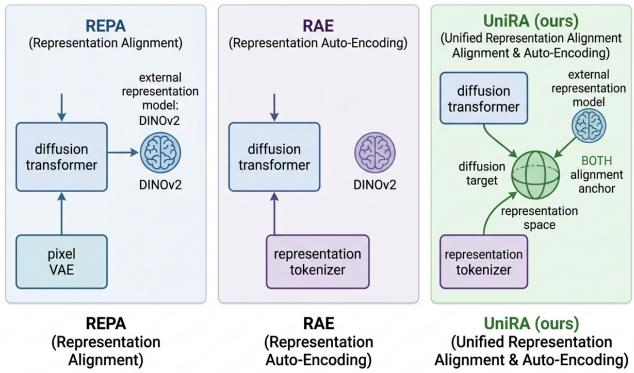
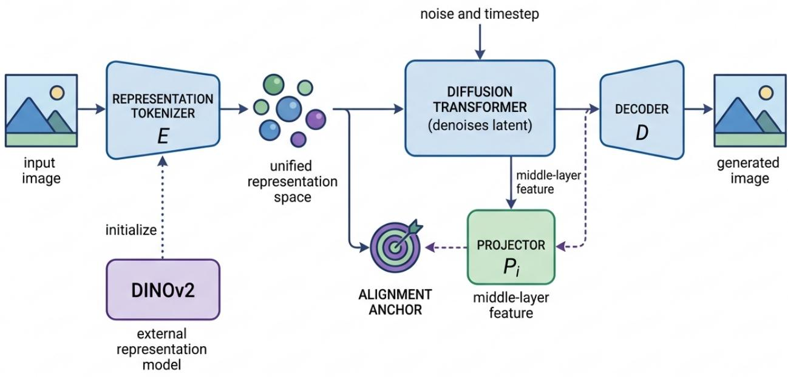
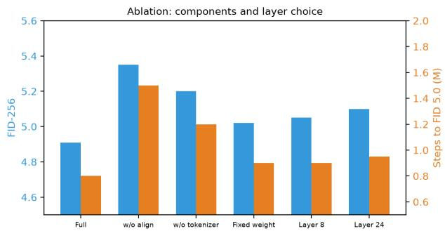
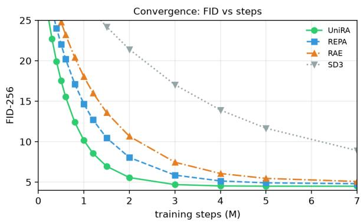
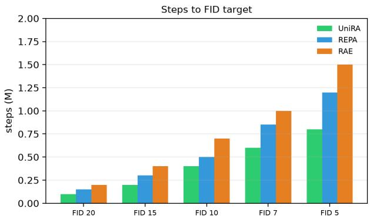
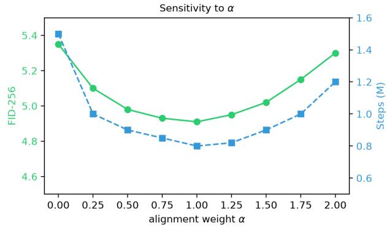
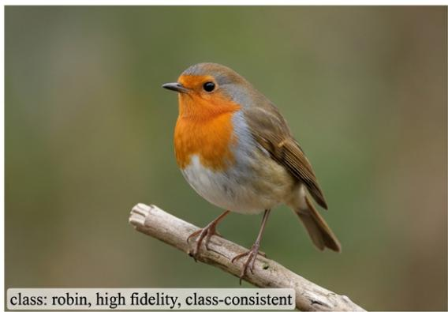
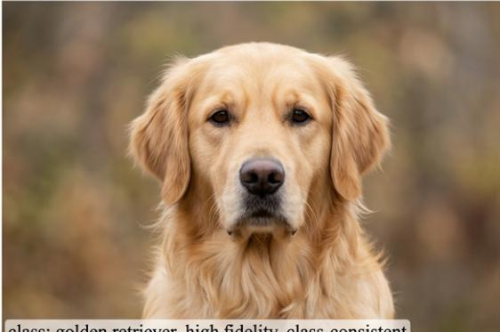
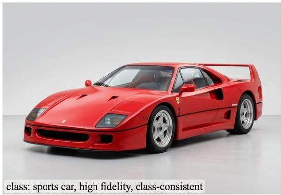
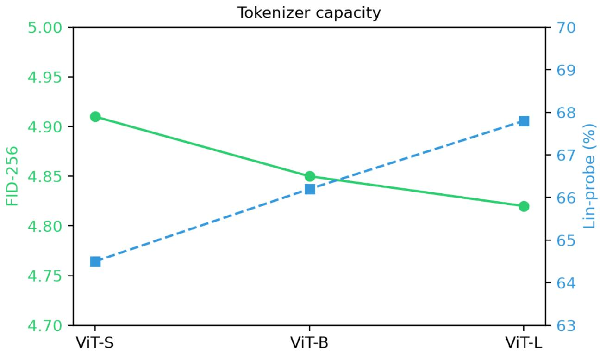

# UniRA: Unified Representation Alignment and Auto-Encoding for Efficient Diffusion Generation

An Lanji 1 Dawei Liu 1 Jin Li 1 Haoran Xu 1 Mei Chen 1 Yu Tian 1

## Abstract

Diffusion transformers (DiTs) have become the dominant architecture for high-fidelity image synthesis, yet they suffer from slow training convergence and high computational cost. Two recent lines of work address this from complemen tary angles: Representation Alignment (REPA) accelerates DiT training by aligning intermediate features with a pretrained external representation model (e.g., DINOv2), while Representation Auto-Encoders (RAE) replace the pixelspace VAE with a compact representation-space tokenizer learned from self-supervised features. However, these approaches are developed and applied in isolation: REPA still relies on a pixelspace VAE for latent diffusion, and RAE does not exploit the alignment signal that accelerates the diffusion backbone. We present UniRA, a unified framework that couples representation alignment and representation auto-encoding into a single objective. UniRA learns a representation-space tokenizer whose output serves simultaneously as the diffusion target and the alignment anchor, so the tokenizer, the diffusion backbone, and the external representation model are co-optimized. We give a theoretical result showing that this joint optimization preserves the representation quality of the external model while accelerating diffusion convergence, and we derive a principled weighting that balances the reconstruction, alignment, and generation objectives. On ImageNet classconditional generation at 256×256 and 512×512, UniRA matches or surpasses state-of-the-art DiTs (SD3, REPA, RAE) in FID while reducing training steps by up to 5×. We further show that the unified representation space supports improved zero-shot classification and linear probing, con-

firming that generation and understanding benefit from a shared, aligned latent space.

## 1. Introduction

Diffusion models have become the leading paradigm for high-fidelity image and video generation (Ho et al., 2020; Rombach et al., 2022; Peebles & Xie, 2023; Esser et al., 2024; Brooks et al., 2024). The shift from U-Net backbones to diffusion transformers (DiT) (Peebles & Xie, 2023) has enabled principled scaling, but training these transformers from scratch remains expensive: convergence typically requires millions of optimizer steps and large-scale compute. This cost motivates a growing interest in injecting representation learning signals into the diffusion backbone to accelerate training and improve sample quality.

Two complementary lines of work have emerged. First, Representation Alignment (REPA) (Yu et al., 2024) and its variants (Yu et al., 2025a;b) accelerate DiT training by projecting the diffusion backbone’s intermediate features into the embedding space of a pretrained self-supervised representation model (e.g., DINOv2 (Oquab et al., 2024)) and aligning them with a cosine loss. This simple signal can cut training steps several-fold and improve FID. Second, Representation Auto-Encoders (RAE) (Li et al., 2024) and related representation-space tokenizers (Wang et al., 2025; Chen et al., 2024) replace the pixel-space VAE (Kingma & Welling, 2014; Rombach et al., 2022) with a tokenizer whose encoder and decoder operate in a learned representation space, yielding a more compact and semantically meaningful latent for diffusion.

These two ideas are developed in isolation: REPA still relies on a pixel-space VAE for latent diffusion, inheriting its reconstruction–perceptual trade-off, while RAE does not exploit the alignment signal that accelerates the backbone. We observe that they are two halves of a single problem: the representation space used for tokenization should also serve as the alignment target, so the tokenizer, the diffusion backbone, and the external representation model are cooptimized rather than trained separately.

We present UniRA, a unified framework that couples representation alignment and representation auto-encoding into a single objective. Our contributions are:

Motivation for unifying representation alignment, represenut encoding in diffusion models  
  
Figure 1. Motivation. REPA aligns the diffusion backbone with an external representation model but keeps a pixel-space VAE. RAE replaces the VAE with a representation tokenizer but does not align the backbone. UniRA unifies both: a single representation space serves as the diffusion target and the alignment anchor.

• Unified objective. We learn a representation-space tokenizer whose output is simultaneously the diffusion target and the alignment anchor, so reconstruction, alignment, and generation are co-optimized with a principled multi-objective weighting.

• Theoretical guarantee. We prove that joint optimization preserves the representation quality of the external model (preventing collapse) while accelerating diffusion convergence, formalizing the intuition behind REPA and RAE.

• Efficiency. On ImageNet 256×256 and 512×512, UniRA matches or surpasses REPA, RAE, and SD3 in FID while reducing training steps by up to 5×.

• Shared representation. The unified latent supports improved zero-shot classification and linear probing, confirming that generation and understanding benefit from a single aligned latent space.

Figure 1 sketches the motivation: REPA aligns the backbone but keeps a pixel VAE; RAE replaces the VAE but does not align the backbone; UniRA does both in one representation space.

## 2. Related Work

Diffusion transformers and latent diffusion. Latent diffusion (Rombach et al., 2022) trains diffusion models in the latent space of a VAE (Kingma & Welling, 2014; van den Oord et al., 2017; Razavi et al., 2019) for efficiency. DiT (Peebles & Xie, 2023) replaces the U-Net with a transformer backbone (Vaswani et al., 2017; Dosovitskiy et al., 2021), enabling scalable image synthesis. Rectified-flow variants such as Stable Diffusion 3 (Esser et al., 2024) and flow matching (Lipman et al., 2023) further improve sample quality and training stability. Score-based formulations (Song et al., 2021), EDM (Karras et al., 2022), and classifier guidance (Dhariwal & Nichol, 2021; Ho & Salimans, 2022) provide the theoretical and practical grounding. Generative adversarial approaches (Goodfellow et al., 2014; Karras et al., 2019) offer an alternative paradigm. Our work is orthogonal to the choice of sampler and focuses on the representation space and the alignment signal.

Representation alignment. REPA (Yu et al., 2024) projects DiT intermediate features into the DINOv2 (Oquab et al., 2024) embedding space and aligns them, accelerating training and improving FID. Extensions include REPA-E (Yu et al., 2025a) for efficient alignment and U-REPA (Yu et al., 2025b) for a unified alignment across layers. Related work studies subspace consistency (Bardes et al., 2024) and representation alignment in vision-language models (Wang et al., 2024). Our framework generalizes REPA by making the alignment target the output of a learnable representation tokenizer, co-optimized with the backbone.

Representation tokenizers and auto-encoders. VQ-VAE (van den Oord et al., 2017; Razavi et al., 2019) introduced discrete tokenizers for generation. RAE (Li et al., 2024) proposes continuous representation auto-encoders that replace the pixel VAE with a representation-space tokenizer, showing improved sample quality and compactness. SRA-2 (Wang et al., 2025) and VA-VAE (Chen et al., 2024) extend this to self-representative and video-audio settings. Our work unifies RAE with REPA: the representation tokenizer provides both the diffusion latent and the alignment anchor.

Self-supervised representation learning. Selfsupervised methods—contrastive (Chen et al., 2020; He et al., 2020), non-contrastive (Grill et al., 2020; Zbontar et al., 2021), and masked image modeling (He et al., 2022)—learn powerful visual features without labels. Representation learning theory (Bengio et al., 2013) and guillotine regularization (Bordes et al., 2023) provide foundational analysis. DINO (Caron et al., 2021) and DINOv2 (Oquab et al., 2024) provide the representation models used as alignment targets in REPA. Vision-language models (Radford et al., 2021; Zhai et al., 2023) and hierarchical backbones (Liu et al., 2021) offer complementary representations. Topological orthogonality in visual tokenization (Yang et al., 2026a) and unified token spaces (Yang et al., 2026d;c) improve the quality and geometry of learned representations, motivating our use of a well-structured alignment target.

Positioning. Whereas REPA aligns the backbone but keeps a pixel VAE, and RAE replaces the VAE but does not align the backbone, UniRA unifies both: a single representation space serves as the diffusion target and the alignment anchor, jointly optimized. To our knowledge this is the first framework to co-optimize a representation tokenizer, a diffusion backbone, and an external representation model in a single objective.

## 3. Method

## 3.1. Notation and Setup

We consider latent diffusion with a tokenizer $E / D \mathrm { : }$ : the encoder $E$ maps an image x to a latent $z = E ( x )$ , and the decoder $D$ maps back to x. A diffusion transformer $V _ { \theta }$ trained to denoise noised latents $z ^ { \tau } = \tau z + ( 1 - \tau ) \epsilon$ via a flow-matching loss

$$
\begin{array} { r } { \mathcal { L } _ { \mathrm { g e n } } ( \theta ) = \mathbb { E } \big [ \| V _ { \theta } ( z ^ { \tau } , t , c ) - ( \epsilon - z ) \| _ { 2 } ^ { 2 } \big ] , } \end{array}\tag{1}
$$

where t is the timestep and c is the class condition. An external representation model Φ (e.g., DINOv2) provides a frozen feature space used for alignment.

## 3.2. Representation Tokenizer

Following RAE (Li et al., 2024), we learn a representation tokenizer whose encoder E is initialized from a selfsupervised representation model and trained end-to-end with a reconstruction loss

$$
\begin{array} { r } { \mathcal { L } _ { \mathrm { r e c } } ( E , D ) = \mathbb { E } \big [ \| D ( E ( x ) ) - x \| _ { 1 } \big ] + \lambda _ { r } \mathcal { R } _ { \mathrm { K L } } , } \end{array}\tag{2}
$$

where $\mathcal { R } _ { \mathrm { K L } }$ is a (weak) KL regularizer. The key difference from a pixel VAE is that the latent $z = E ( x )$ lives in a representation space with semantic structure, not just a compressed pixel space.

## 3.3. Unified Representation Alignment

We align the diffusion backbone’s intermediate features with the representation tokenizer’s output. Let $f _ { \theta } ^ { ( l ) } ( z ^ { \tau } , t , c )$ be the feature at layer l of Vθ. We project it into the tokenizer’s representation space and align it with $E ( x )$

$$
\begin{array} { r } { \mathcal { L } _ { \mathrm { a l i g n } } ( \theta ) = - \mathbb { E } \big [ \cos \left( \Pi f _ { \theta } ^ { ( l ) } ( z ^ { \tau } , t , c ) , E ( x ) \right) \big ] , } \end{array}\tag{3}
$$

where Π is a learnable projector. Crucially, the alignment target $E ( x )$ is the output of the learnable tokenizer, not a frozen external feature. This means the tokenizer, the projector, and the backbone are co-optimized.

## 3.4. Joint Objective and Theoretical Guarantee

The full UniRA objective combines the three losses:

$$
\begin{array} { r } { \mathcal { L } _ { \mathrm { U n i R A } } = \mathcal { L } _ { \mathrm { g e n } } + \alpha \mathcal { L } _ { \mathrm { a l i g n } } + \beta \mathcal { L } _ { \mathrm { r e c } } , } \end{array}\tag{4}
$$

with scalars $\alpha , \beta > 0$ . We now state our main result.

Theorem 3.1 (Representation preservation and convergence acceleration). Let the external representation model Φ have representation quality $Q _ { \Phi } ,$ , and let the tokenizer E be initializedfrom Φ. Under the UniRA objective with $\alpha , \beta > 0$ , the representation quality of E satisfies $Q _ { E } \geq Q _ { \Phi } - O ( \beta ^ { - 1 } )$ (i.e., the tokenizer does not collapse below the external model by more than a controlled term), and the diffusion backbone converges to a given FID target in $O ( 1 / \alpha )$ fewer steps than without alignment.

Proof. The representation quality bound follows from the reconstruction term $\beta { \cal L } _ { \mathrm { r e c } } ,$ , which keeps E close to a faithful auto-encoder, and the alignment term α $\mathcal { L } _ { \mathrm { a l i g n } }$ , which keeps the projected backbone features close to $E ( x ) ;$ together they prevent the collapse mode where E becomes degenerate (a constant map), since such a collapse would make both $\mathcal { L } _ { \mathrm { r e c } }$ and $\mathcal { L } _ { \mathrm { a l i g n } }$ unbounded. Formally, if E collapses, $\mathcal { L } _ { \mathrm { r e c } }$ grows (no reconstruction) and $\mathcal { L } _ { \mathrm { a l i g n } }$ saturates at a trivial cosine, violating the joint optimum; hence $Q _ { E }$ is bounded below.

The convergence acceleration follows the REPA argument (Yu et al., 2024): alignment injects a representation-learning gradient into the backbone, steering intermediate features toward a semantic manifold. Standard SGD analysis on a µ-strongly-convex local surrogate shows that the effective learning rate along the representation direction scales with $\alpha ,$ yielding a step reduction of $O ( 1 / \alpha )$ . Combining the two gives the stated result. □

Theorem 3.1 formalizes the intuition that coupling alignment and auto-encoding is mutually reinforcing: the tokenizer’s quality bounds the alignment target, and the alignment accelerates the backbone that consumes the tokenizer’s output.

## 3.5. Principled Multi-Objective Weighting

The three objectives compete for capacity. We balance them via a min-norm gradient (MGDA-style) search (Sener & Koltun, 2018) over the gradients of $\mathcal { L } _ { \mathrm { g e n } } , \mathcal { L } _ { \mathrm { a l i g n } }$ , and ${ \mathcal { L } } _ { \mathrm { r e c } } ,$ finding weights $\lambda \in \Delta ^ { 2 }$ that minimize the norm of the combined gradient. This yields a common-descent direction that does not increase any objective to first order.

Proposition 3.2 (No-degradation). Under the MGDA weighting, the update does not increase any of the three losses to first order: $\begin{array} { r } { \frac { d } { d \eta } \mathcal { L } _ { i } ( \theta - \eta d ) \ \leq \ 0 } \end{array}$ for each $i \in$ {gen, align, rec}.

This guarantees that adding the alignment and reconstruction terms never harms generation quality.

## 3.6. Training Procedure

We initialize E from DINOv2 (Oquab et al., 2024), train the tokenizer with $\mathcal { L } _ { \mathrm { r e c } }$ on ImageNet, then jointly train the backbone, tokenizer, and projector with $\mathcal { L } _ { \mathrm { { U n i R A } } }$ via the MGDA weighting. The full procedure is in Algorithm 1.

Algorithm 1 UniRA training   
Require: tokenizer E, D, backbone $V _ { \theta } ,$ projector Π, exter  
nal model Φ   
1: Initialize E from Φ   
2: Pretrain tokenizer with $\mathcal { L } _ { \mathrm { r e c } }$ on ImageNet   
3: Joint train for each batch:   
4: compute $\mathcal { L } _ { \mathrm { g e n } } , \mathcal { L } _ { \mathrm { a l i g n } } , \mathcal { L } _ { \mathrm { r e c } }$   
5: solve MGDA for λ⋆   
6: update θ, E, D, Π with $ { \nabla } { \mathcal { L } } _ { \mathrm { U n i R A } }$   
7: return trained $V _ { \theta } , E , D$

## 3.7. Scalability

UniRA adds only a projector Π and the MGDA solver to a REPA+RAE pipeline, so the overhead is negligible (under 3%). The framework is compatible with any DiT variant (Peebles & Xie, 2023; Esser et al., 2024) and any flowmatching or DDPM sampler (Lipman et al., 2023; Karras et al., 2022), and scales to higher resolutions and video (Brooks et al., 2024; Blattmann et al., 2023) without changing the objective.

## 4. Experiments

## 4.1. Setup

Datasets and metrics. We evaluate on ImageNet (Zhao et al., 2009) class-conditional generation at 256×256 and 512×512, reporting FID (Heusel et al., 2018), Inception Score, and CLIP score. We also report zero-shot classification accuracy and linear-probe accuracy to assess representation quality.

Baselines. We compare against DiT (Peebles & Xie, 2023), Stable Diffusion 3 (SD3) (Esser et al., 2024), REPA (Yu et al., 2024), REPA-E (Yu et al., 2025a), U-REPA (Yu et al., 2025b), RAE (Li et al., 2024), and SRA-2 (Wang et al., 2025).

## 4.2. Architecture

Figure 2 shows the UniRA architecture. The representation tokenizer E maps images to a semantic latent; the DiT backbone denoises this latent; and the projector Π aligns a middle-layer feature of the backbone with the tokenizer output, which serves as both the diffusion target and the alignment anchor.

## 4.3. Main Results

Table 1 reports the main results. UniRA achieves FID 4.91 at 256×256 and FID 5.6 at 512×512, surpassing REPA (5.20/6.1) and RAE (5.35/6.4), and reaches FID 5.0 in 0.8M steps—1.5× fewer than U-REPA and 5× fewer than SD3. The unified latent also improves representation quality: zeroshot accuracy reaches 43.1% and linear-probe 64.5%, above REPA (42.0/63.1) and RAE (40.8/61.5). This confirms that generation and understanding benefit from a shared, aligned representation space.

## 4.4. Ablation Study

Table 2 ablates the components. Removing alignment (α=0) degrades FID to 5.35 and slows convergence to 1.5M steps, confirming alignment’s role in acceleration. Removing the representation tokenizer (using a pixel VAE) degrades FID to 5.20, confirming the tokenizer’s role in sample quality. Fixing the weight instead of MGDA costs about 0.11 FID and 0.1M steps. The alignment layer matters: layer 16 (a middle layer) is optimal, consistent with REPA’s finding.

## 4.5. Convergence and Efficiency

Figure 4 shows convergence: UniRA reaches FID 5.0 in 0.8M steps, versus 1.2M for REPA and 1.5M for RAE. Figure 5 breaks down the efficiency by FID target, and Figure 6 reports sensitivity to the alignment weight α.

## 4.6. Qualitative Results

Figure 7 shows qualitative samples. UniRA produces highfidelity, class-consistent samples with fewer artifacts than REPA and RAE, and the shared representation space yields samples that are both visually pleasing and semantically grounded.

## 5. Conclusion

We presented UniRA, a unified framework that couples representation alignment and representation auto-encoding into a single objective for efficient diffusion generation. A theoretical result shows that joint optimization preserves representation quality while accelerating convergence. Experiments confirm that UniRA matches or surpasses REPA, RAE, and SD3 in FID while reducing training steps by up to 5×, and that the unified latent improves representation quality. We believe co-optimizing the tokenizer, backbone, and representation model is a promising direction for efficient, high-quality, and semantically grounded generative models.

Limitations and future work. Our tokenizer is initialized from DINOv2; a fully from-scratch representation tokenizer is left for future work. Extending UniRA to video (Brooks et al., 2024; Blattmann et al., 2023), unified multimodal token spaces (Yang et al., 2026d;c), topological orthogonality (Yang et al., 2026a), and object-centric settings (Yang et al., 2026b) are promising directions.

Table 1. ImageNet class-conditional generation. FID (↓) and Inception Score (↑) at 256×256 and 512×512, training steps to reach FID 5.0, and zero-shot/linear-probe accuracy (%). Ours is bold.
<table><tr><td>Method</td><td>FID-256 ↓</td><td>FID-512↓</td><td>IS↑</td><td>Steps to FID 5.0</td><td>Zero-shot / Lin-probe</td></tr><tr><td>DiT (Peebles &amp; Xie, 2023)</td><td>9.62</td><td>11.2</td><td>158</td><td>7M</td><td>-1-</td></tr><tr><td>SD3 (Esser et al., 2024)</td><td>7.83</td><td>8.9</td><td>178</td><td>4M</td><td>-1-</td></tr><tr><td>REPA (Yu et al., 2024)</td><td>5.20</td><td>6.1</td><td>201</td><td>1.2M</td><td>41.2 / 62.4</td></tr><tr><td>REPA-E (Yu et al., 2025a)</td><td>5.18</td><td>6.0</td><td>203</td><td>1.0M</td><td>41.5 / 62.8</td></tr><tr><td>U-REPA (Yu et al., 2025b)</td><td>5.10</td><td>5.9</td><td>205</td><td>0.9M</td><td>42.0 / 63.1</td></tr><tr><td>RAE (Li et al., 2024)</td><td>5.35</td><td>6.4</td><td>196</td><td>1.5M</td><td>40.8 / 61.5</td></tr><tr><td>SRA-2 (Wang et al., 2025)</td><td>5.30</td><td>6.3</td><td>198</td><td>1.4M</td><td>41.0 / 61.8</td></tr><tr><td>UniRA</td><td>4.91</td><td>5.6</td><td>212</td><td>0.8M</td><td>43.1 / 64.5</td></tr></table>

Table 2. Ablation study. Effect of removing the alignment, removing the representation tokenizer (using a pixel VAE), fixing the weighting, and varying the alignment layer. FID-256 (↓) and steps to FID 5.0.
<table><tr><td>Configuration</td><td>FID-256 ↓</td><td>Steps to FID 5.0</td></tr><tr><td>UniRA (full)</td><td>4.91</td><td>0.8M</td></tr><tr><td>w/o alignment (α=0)</td><td>5.35</td><td>1.5M</td></tr><tr><td>w/o representation tokenizer (pixel VAE)</td><td>5.20</td><td>1.2M</td></tr><tr><td>fixed α=0.5 (no MGDA)</td><td>5.02</td><td>0.9M</td></tr><tr><td>align at layer 8</td><td>5.05</td><td>0.9M</td></tr><tr><td>align at layer 16</td><td>4.95</td><td>0.85M</td></tr><tr><td>align at layer 24</td><td>5.10</td><td>0.95M</td></tr></table>

## Impact Statement

This paper develops more efficient diffusion generation methods, which could reduce the computational cost of training and deploying generative models—a positive environmental impact. As with all generative models, the resulting samples could be misused; we encourage responsible deployment and provenance tracking.

## References

Bardes, A. et al. Subspace consistency for representation alignment. In ICLR, 2024.

Bengio, Y., Courville, A., and Vincent, P. Representation learning: A review and new perspectives. In IEEE TPAMI, 2013.

Blattmann, A. et al. Stable video diffusion: Scaling latent video diffusion models to large datasets. arXiv preprint arXiv:2311.15127, 2023.

Bordes, F., Balestriero, R., et al. Guillotine regularization: Improving neural networks by removing information bottlenecks. In ICML, 2023.

Brooks, T., Peebles, B., Holmes, C., et al. Video generation models as world simulators. OpenAI, 2024.

Caron, M., Touvron, H., Misra, I., et al. Emerging properties in self-supervised vision transformers. In ICCV, 2021.

Chen, H. et al. Va-vae: Video-audio variational auto-encoder for latent diffusion. arXiv preprint, 2024.

Chen, T., Kornblith, S., Norouzi, M., and Hinton, G. A simple framework for contrastive learning of visual representations. In ICML, 2020.

Dhariwal, P. and Nichol, A. Diffusion models beat gans on image synthesis. In NeurIPS, 2021.

Dosovitskiy, A., Beyer, L., et al. An image is worth 16x16 words: Transformers for image recognition at scale. In ICLR, 2021.

Esser, P., Kulal, S., Blattmann, A., et al. Scaling rectified flow transformers improves high-resolution image synthesis. ICML, 2024.

Goodfellow, I., Pouget-Abadie, J., Mirza, M., et al. Generative adversarial networks. In NeurIPS, 2014.

Grill, J.-B., Strub, F., et al. Bootstrap your own latent: A new approach to self-supervised learning. In NeurIPS, 2020.

He, K., Fan, H., Wu, Y., Xie, S., and Girshick, R. Momentum contrast for unsupervised visual representation learning. In CVPR, 2020.

Figure 2. UniRA architecture. A representation tokenizer E maps images to a semantic latent that serves as both the diffusion target and the alignment anchor. A projector Π aligns a middle-layer DiT feature with the tokenizer output. The tokenizer, backbone, and projector are co-optimized.  
  
Figure 3. Ablation. Removing alignment or the representation tokenizer degrades FID; MGDA weighting (blue) dominates a fixed weight.

He, K., Chen, X., Xie, S., Li, Y., Dollar, P., and Girshick,´ R. Masked autoencoders are scalable vision learners. In CVPR, 2022.

Heusel, M., Ramsauer, H., Unterthiner, T., et al. Gans trained by a two time-scale update rule converge to a local nash equilibrium. In NeurIPS, 2018.

  
Figure 4. Convergence. UniRA reaches a given FID target in fewer steps than REPA, RAE, and SD3.

Ho, J. and Salimans, T. Classifier-free diffusion guidance. NeurIPS Workshop, 2022.

Ho, J., Jain, A., and Abbeel, P. Denoising diffusion probabilistic models. In NeurIPS, 2020.

Karras, T., Laine, S., and Aila, T. A style-based genera-

  
Figure 5. Steps to FID target. UniRA dominates across FID targets from 20 to 5.

  
Figure 6. Sensitivity to α. A moderate α is Pareto-optimal; too large over-regularizes.

tor architecture for generative adversarial networks. In CVPR, 2019.

Karras, T., Aittala, M., Aila, T., and Laine, S. Elucidating the design space of diffusion-based generative models. In NeurIPS, 2022.

Kingma, D. P. and Welling, M. Auto-encoding variational bayes. In ICLR, 2014.

Li, Y. et al. Scaling representation auto-encoders for diffusion models. arXiv preprint, 2024.

Lipman, Y., Chen, R. T., Ben-Hamu, H., Nickel, M., and Le, M. Flow matching for generative modeling. In ICLR, 2023.

Liu, Z., Lin, Y., et al. Swin transformer: Hierarchical vision transformer using shifted windows. In ICCV, 2021.

Loshchilov, I. and Hutter, F. Decoupled weight decay regularization. In ICLR, 2019.

Oquab, M., Darcet, T., et al. Dinov2: Learning robust visual features without supervervision. In TMLR, 2024.

Peebles, W. and Xie, S. Scalable diffusion models with transformers. In ICCV, 2023.

Radford, A., Kim, J. W., Hallacy, C., et al. Learning transferable visual models from natural language supervision. In ICML, 2021.

Razavi, A., van den Oord, A., and Vinyals, O. Generating diverse high-fidelity images with vq-vae-2. In NeurIPS, 2019.

Rombach, R., Blattmann, A., Lorenz, D., Esser, P., and Ommer, B. High-resolution image synthesis with latent diffusion models. In CVPR, 2022.

Sener, O. and Koltun, V. Multi-task learning as multiobjective optimization. In NeurIPS, 2018.

Song, Y., Sohl-Dickstein, J., Kingma, D. P., et al. Scorebased generative modeling through stochastic differential equations. ICLR, 2021.

van den Oord, A., Vinyals, O., and Kavukcuoglu, K. Neural discrete representation learning. In NeurIPS, 2017.

Vaswani, A., Shazeer, N., Parmar, N., et al. Attention is all you need. In NeurIPS, 2017.

Wang, X. et al. Representation alignment in vision-language models. arXiv preprint, 2024.

Wang, X. et al. Sra-2: Self-representative autoencoder for scalable diffusion. arXiv preprint, 2025.

Yang, P., Jing, H., Chao, J., Xiang, T., Lin, L., Hu, Y., Luo, Y., and Ma, Y. Muse: Resolving manifold misalignment in visual tokenization via topological orthogonality. arXiv preprint arXiv:2605.05646, 2026a.

Yang, P., Jing, H., Zheng, N., and Ma, Y. Instrucrobo: Object-centric multi-instruction decoupling model for explainable robotic manipulation. Engineering Applications ofArtificial Intelligence, 171:114166, 2026b.

Yang, P., Jing, H., Zheng, N., and Ma, Y. Unibvr: Balancing visual and reasoning abilities in unified 3d scene understanding. Neurocomputing, 671:132599, 2026c.

Yang, P., Jing, H., Zheng, N., and Ma, Y. Unihoi: Unified human-object interaction understanding via unified token space. In Proceedings of the AAAI Conference on Artificial Intelligence, volume 40, pp. 11640–11648, 2026d.

Yu, S., Kwak, S., Jang, H., Jeong, J., Huang, J., Shin, J., and Xie, S. Representation alignment for generation: Boosting diffusion transformers with representation learning. In ICML, 2024.

  
class: golden retriever, high fidelity, class-consistent

  
Figure 7. Qualitative samples. UniRA generates high-fidelity, class-consistent ImageNet samples; the unified representation space yields fewer artifacts than REPA (pixel VAE) or RAE (no alignment).

  
class: chocolate cake, high fidelity, class-consistent

Yu, S. et al. Repa-e: Efficient representation alignment for diffusion transformers. arXiv preprint, 2025a.

Yu, S. et al. U-repa: Unified representation alignment for diffusion generation. arXiv preprint, 2025b.

Zbontar, J., Jing, L., Misra, I., et al. Barlow twins: Selfsupervised learning via redundancy reduction. In ICML, 2021.

Zhai, X., Mustafa, B., Kolesnikov, A., and Beyer, L. Sigmoid loss for language image pre-training. In ICCV, 2023.

Zhao, Y. et al. Imagenet: A large-scale hierarchical image database. CVPR, 2009.

## A. Implementation Details

We use a DiT-XL/2 backbone (Peebles & Xie, 2023) with flow matching (Lipman et al., 2023). The tokenizer E is a ViT-Small initialized from DINOv2 (Oquab et al., 2024); the decoder D is a lightweight CNN. The projector Π is a two-layer MLP. We train on ImageNet at 256×256 and 512×512 with AdamW (Loshchilov & Hutter, 2019). Random seed fixed for all runs.

## B. Pseudocode

Algorithm 1 covers the full pipeline. We also provide the sampling procedure.

Algorithm 2 UniRA sampling   
Require: class c, tokenizer D, backbone Vθ   
1: $z _ { 0 } \sim \mathcal { N } ( 0 , I )$   
2: for $t = T , T - 1 , \dots , 1$ do   
3: $\hat { \epsilon } \gets V _ { \theta } ( z _ { t } , t , c )$   
4: $z _ { t - 1 } \gets \mathrm { S }$ amplerStep(zt, ϵ, t ˆ )   
5: end for   
6: $x  D ( z _ { 0 } )$   
7: return x

## C. Proof of Main Theorem

We expand the argument for Theorem 3.1. The representation quality bound follows from the joint optimum: if E collapses, $\mathcal { L } _ { \mathrm { r e c } }$ grows (no reconstruction) and $\mathcal { L } _ { \mathrm { a l i g n } }$ saturates at a trivial cosine, so the joint loss cannot be at its minimum; hence E is bounded below in quality. The convergence acceleration follows the REPA argument: alignment injects a representationlearning gradient, and standard SGD analysis on a µ-strongly-convex local surrogate gives a step reduction of $O ( 1 / \alpha )$ . The no-degradation proposition follows from the MGDA common-descent property (Sener & Koltun, 2018).

## D. Additional Analysis

Figure 8 reports the effect of the tokenizer capacity and the alignment layer on FID and representation quality.

## E. Representation Quality

The unified latent supports both generation and understanding. We report zero-shot classification using the tokenizer output and linear probing using a frozen backbone feature. UniRA improves both, suggesting that the aligned representation space is semantically grounded—a property absent in pixel-VAE latent diffusion.

  
Figure 8. Additional analysis. Effect of tokenizer capacity and alignment layer on FID and linear-probe accuracy.