# VeriCUA: Verification as A<sub>g</sub>entic Ex<sub>p</sub>loration for Com<sub>p</sub>uter-Usin<sub>g</sub> A<sub>g</sub>ents

Qiushi Sun<sup>1,2\*</sup>, Da Yu<sup>1</sup>, Alexander Knop<sup>1</sup>, Amer Sinha<sup>1</sup>, Lingpeng Kong<sup>2</sup>, Ben Kao<sup>2</sup>, Ravi Kumar<sup>1</sup> and Pritish Kamath<sup>1</sup> <sup>1</sup>Goo<sub>g</sub>le<sub>,</sub> <sup>2</sup>The Universit<sub>y</sub> of Hon<sub>g</sub> Kon<sub>g</sub>

Buildin<sub>g</sub> and scalin<sub>g</sub> com<sub>p</sub>uter-usin<sub>g</sub> a<sub>g</sub>ents (CUAs) across deskto<sub>p,</sub> mobile<sub>,</sub> and web environments <sub>re u</sub>i<sub>res re</sub>li<sub>a</sub>bl<sub>e</sub> t<sub>as</sub>k<sub>-com</sub> l<sub>e</sub>ti<sub>on ver</sub>ifi<sub>ca</sub>ti<sub>on</sub> f<sub>or</sub> d<sub>a</sub>t<sub>a cura</sub>ti<sub>on, eva</sub>l<sub>ua</sub>ti<sub>on, an</sub>d <sub>re</sub>i<sub>n</sub>f<sub>orcemen</sub>t l<sub>earn-</sub> ing. T<sub>y</sub>pical automated approaches prompt vision-language models (VLMs) to judge trajectories or <sub>genera</sub>t<sub>e programs</sub> t<sub>o</sub> i<sub>nspec</sub>t <sub>app</sub>li<sub>ca</sub>ti<sub>on s</sub>t<sub>a</sub>t<sub>e.</sub> H<sub>owever,</sub> b<sub>o</sub>th <sub>re</sub>l<sub>y on par</sub>ti<sub>a</sub>l <sub>v</sub>i<sub>ews o</sub>f <sub>comp</sub>l<sub>ex</sub> di<sub>g</sub>it<sub>a</sub>l environments. VLM judges are restricted to supplied observations, while generated programs depend on accessible state. These views can omit decisive evidence or leave completion judgments unsupported. T<sub>a</sub>il<sub>or</sub>i<sub>ng separa</sub>t<sub>e ver</sub>ifi<sub>ers</sub> t<sub>o</sub> dif<sub>eren</sub>t <sub>p</sub>l<sub>a</sub>tf<sub>orms an</sub>d <sub>access se</sub>tti<sub>ngs a</sub>dd<sub>s</sub> f<sub>ur</sub>th<sub>er eng</sub>i<sub>neer</sub>i<sub>ng cos</sub>t<sub>.</sub> W<sub>e presen</sub>t V<sub>er</sub>iCUA<sub>, a p</sub>l<sub>a</sub>tf<sub>orm-agnos</sub>ti<sub>c</sub> f<sub>ramewor</sub>k f<sub>or ver</sub>ifi<sub>ca</sub>ti<sub>on</sub> th<sub>roug</sub>h <sub>agen</sub>ti<sub>c exp</sub>l<sub>ora</sub>ti<sub>on.</sub> It t<sub>rea</sub>t<sub>s ver</sub>ifi<sub>ca</sub>ti<sub>on as</sub> d<sub>ynam</sub>i<sub>c ev</sub>id<sub>ence ga</sub>th<sub>er</sub>i<sub>ng an</sub>d <sub>assessmen</sub>t <sub>w</sub>ithi<sub>n a s</sub>h<sub>are</sub>d <sub>proce</sub>d<sub>ure</sub> f<sub>or on</sub>li<sub>ne</sub> <sub>an</sub>d <sub>o</sub>fli<sub>ne se</sub>tti<sub>n s across</sub> l<sub>a</sub>tf<sub>orms an</sub>d <sub>o</sub>b<sub>serva</sub>ti<sub>on mo</sub>d<sub>a</sub>liti<sub>es.</sub> Aft<sub>er</sub> i<sub>ns ec</sub>ti<sub>n</sub> th<sub>e ava</sub>il<sub>a</sub>bl<sub>e con</sub>t<sub>ex</sub>t t<sub>o cons</sub>t<sub>ruc</sub>t <sub>a</sub> t<sub>as</sub>k <sub>ru</sub>b<sub>r</sub>i<sub>c,</sub> th<sub>e ver</sub>ifi<sub>er se</sub>l<sub>ec</sub>t<sub>s</sub> GUI <sub>or co</sub>d<sub>e c</sub>h<sub>ec</sub>k<sub>s</sub> f<sub>or unreso</sub>l<sub>ve</sub>d <sub>requ</sub>i<sub>remen</sub>t<sub>s an</sub>d <sub>com</sub>bi<sub>nes</sub> th<sub>e</sub>i<sub>r</sub> fi<sub>n</sub>di<sub>ngs un</sub>d<sub>er exp</sub>li<sub>c</sub>it <sub>ev</sub>id<sub>ence ru</sub>l<sub>es.</sub> E<sub>xper</sub>i<sub>men</sub>t<sub>s s</sub>h<sub>ow</sub> i<sub>mprove</sub>d <sub>agreemen</sub>t <sub>w</sub>ith <sub>re</sub>f<sub>erence</sub> l<sub>a</sub>b<sub>e</sub>l<sub>s over</sub> th<sub>e compare</sub>d b<sub>ase</sub>li<sub>nes across</sub> th<sub>ese se</sub>tti<sub>ngs, w</sub>ith th<sub>e</sub> l<sub>arges</sub>t <sub>o</sub>fli<sub>ne ga</sub>i<sub>ns on</sub> h<sub>ar</sub>d cases and stronger rejection of false completion claims online. Further analyses connect these gains to <sub>comp</sub>l<sub>emen</sub>t<sub>ary ev</sub>id<sub>ence an</sub>d t<sub>es</sub>t<sub>-</sub>ti<sub>me exp</sub>l<sub>ora</sub>ti<sub>on.</sub>

## 1<sub>.</sub> I<sub>n</sub>t<sub>ro</sub>d<sub>uc</sub>ti<sub>on</sub>

Vision-lan<sub>g</sub>ua<sub>g</sub>e models (VLMs) have enabled com<sub>p</sub>uter-usin<sub>g</sub> a<sub>g</sub>ents (CUAs) to navi<sub>g</sub>ate the di<sub>g</sub>ital world throu<sub>g</sub>h software interfaces (Rawles et al., 2025; Xie et al., 2024; Zhou et al., 2024). Given a natural-language instruction, an agent observes the interface, plans, and acts, leaving a trajectory <sub>o</sub>f th<sub>oug</sub>ht<sub>s, ac</sub>ti<sub>ons, an</sub>d <sub>o</sub>b<sub>serva</sub>ti<sub>ons.</sub> Di<sub>g</sub>it<sub>a</sub>l t<sub>as</sub>k<sub>s span app</sub>li<sub>ca</sub>ti<sub>ons</sub> i<sub>n w</sub>hi<sub>c</sub>h <sub>success can</sub> d<sub>epen</sub>d on visual presentation, application records, or changes to persisted files. A trajectory can appear <sub>success</sub>f<sub>u</sub>l <sub>even w</sub>h<sub>en e</sub>dit<sub>s rema</sub>i<sub>n unsave</sub>d <sub>or an opera</sub>ti<sub>on</sub> f<sub>a</sub>il<sub>s w</sub>ith<sub>ou</sub>t <sub>a v</sub>i<sub>s</sub>ibl<sub>e warn</sub>i<sub>ng.</sub> Th<sub>e</sub> <sub>agen</sub>t <sub>may a</sub>l<sub>so repor</sub>t <sub>comp</sub>l<sub>e</sub>ti<sub>on a</sub>ft<sub>er</sub> f<sub>u</sub>lfilli<sub>ng on</sub>l<sub>y par</sub>t <sub>o</sub>f th<sub>e</sub> i<sub>ns</sub>t<sub>ruc</sub>ti<sub>on.</sub> A<sub>ccep</sub>ti<sub>ng suc</sub>h <sub>a run</sub> <sub>as success</sub>f<sub>u</sub>l <sub>pro</sub>d<sub>uces a</sub> f<sub>a</sub>l<sub>se pos</sub>iti<sub>ve, ma</sub>ki<sub>ng</sub> th<sub>e</sub> di<sub>s</sub>ti<sub>nc</sub>ti<sub>on</sub> b<sub>e</sub>t<sub>ween a</sub>tt<sub>emp</sub>t<sub>e</sub>d <sub>ac</sub>ti<sub>ons an</sub>d th<sub>e</sub>i<sub>r</sub> actual efects central to verification. Developing these agents therefore requires reliable judgments throu<sub>g</sub>hout evaluation, data curation (Sun et al., 2025), and reinforcement learnin<sub>g</sub> (Xue et al., 2026a), includin<sub>g</sub> a<sub>pp</sub>lications for which no task-s<sub>p</sub>ecific checker has been su<sub>pp</sub>lied.

A<sub>n execu</sub>ti<sub>on can</sub> b<sub>e ver</sub>ifi<sub>e</sub>d <sub>on</sub>li<sub>ne</sub> f<sub>rom</sub> th<sub>e resu</sub>lti<sub>ng mac</sub>hi<sub>ne s</sub>t<sub>a</sub>t<sub>e or o</sub>fli<sub>ne</sub> f<sub>rom</sub> it<sub>s re</sub>t<sub>a</sub>i<sub>ne</sub>d trajectory. Evidence can come from rendered interfaces, structured observations, or artifacts such as files and database records. VLM judges assess trajectories from selected observations (Pan et al., 2024), while automaticall<sub>y g</sub>enerated checkers ins<sub>p</sub>ect a<sub>pp</sub>lication state throu<sub>g</sub>h model-written <sub>p</sub>ro<sub>g</sub>rams (Xue et al., 2026b). A fixed set of frames ma<sub>y</sub> omit a decisive efect, and a <sub>g</sub>enerated <sub>q</sub>uer<sub>y</sub> <sub>may</sub> t<sub>arge</sub>t <sub>s</sub>t<sub>a</sub>t<sub>e</sub> th<sub>a</sub>t d<sub>oes</sub> <sub>no</sub>t <sub>answer</sub> th<sub>e</sub> <sub>ver</sub>ifi<sub>ca</sub>ti<sub>on</sub> <sub>ques</sub>ti<sub>on.</sub> Pl<sub>a</sub>tf<sub>orm-na</sub>ti<sub>ve</sub> <sub>s</sub>i<sub>gna</sub>l<sub>s</sub> <sub>suppor</sub>t <sub>more</sub> s<sub>p</sub>ecialized jud<sub>g</sub>ments and validation (Chae et al., 2025; Sun et al., 2026b), but their availabilit<sub>y</sub> varies with the application and access setting. Agentic approaches actively inspect trajectories or environments (Cui et al., 2026; Sana<sub>y</sub>ei et al., 2026; Wan et al., 2026). A shared <sub>p</sub>rocedure must <sub>see</sub>k <sub>re</sub>l<sub>evan</sub>t <sub>ev</sub>id<sub>ence un</sub>d<sub>er</sub> th<sub>ese access cons</sub>t<sub>ra</sub>i<sub>n</sub>t<sub>s an</sub>d <sub>roun</sub>d it<sub>s conc</sub>l<sub>us</sub>i<sub>ons</sub> i<sub>n</sub> th<sub>e o</sub>b<sub>serva</sub>ti<sub>ons.</sub>

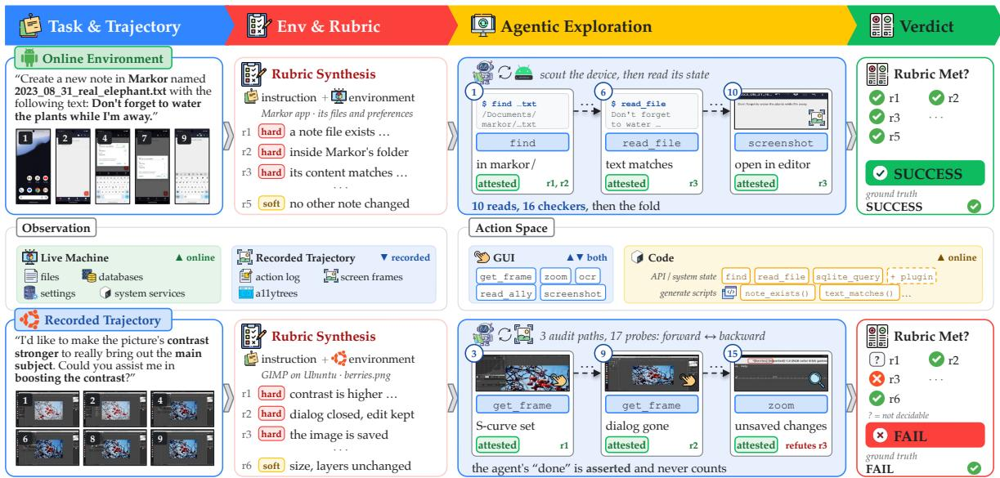  
Figure 1 | VeriCUA inspects the available environment or recording before constructing a rubric, then <sub>ga</sub>th<sub>ers ev</sub>id<sub>ence</sub> t<sub>o ver</sub>if<sub>y</sub> it<sub>s requ</sub>i<sub>remen</sub>t<sub>s.</sub>

T<sub>o a</sub>dd<sub>ress</sub> th<sub>ese ev</sub>id<sub>ence an</sub>d <sub>access</sub> li<sub>m</sub>it<sub>a</sub>ti<sub>ons, we presen</sub>t V<sub>er</sub>iCUA<sub>, a p</sub>l<sub>a</sub>tf<sub>orm-agnos</sub>ti<sub>c</sub> f<sub>ramewor</sub>k that formulates CUA verification as a<sub>g</sub>entic ex<sub>p</sub>loration (Fi<sub>g</sub>ure 1). It <sub>p</sub>rovides a shared <sub>p</sub>rocedure f<sub>or</sub> <sub>o</sub>fli<sub>ne</sub> <sub>an</sub>d <sub>on</sub>li<sub>ne</sub> <sub>ver</sub>ifi<sub>ca</sub>ti<sub>on</sub> <sub>us</sub>i<sub>ng</sub> th<sub>e</sub> <sub>sources</sub> <sub>an</sub>d i<sub>nspec</sub>ti<sub>on</sub> t<sub>oo</sub>l<sub>s</sub> <sub>ava</sub>il<sub>a</sub>bl<sub>e</sub> i<sub>n</sub> <sub>eac</sub>h <sub>se</sub>tti<sub>ng.</sub> V<sub>er</sub>ifi<sub>ca</sub>ti<sub>on</sub> b<sub>eg</sub>i<sub>ns a</sub>ft<sub>er</sub> th<sub>e execu</sub>ti<sub>ng agen</sub>t’<sub>s a</sub>tt<sub>emp</sub>t <sub>en</sub>d<sub>s.</sub> Th<sub>e ver</sub>ifi<sub>er</sub> fi<sub>rs</sub>t <sub>exp</sub>l<sub>ores</sub> th<sub>e ava</sub>il<sub>a</sub>bl<sub>e</sub> <sub>con</sub>t<sub>ex</sub>t t<sub>o</sub> <sub>un</sub>d<sub>ers</sub>t<sub>an</sub>d th<sub>e</sub> <sub>app</sub> <sub>an</sub>d it<sub>s</sub> t<sub>as</sub>k <sub>ar</sub>tif<sub>ac</sub>t<sub>s,</sub> th<sub>en</sub> <sub>uses</sub> th<sub>ese</sub> <sub>o</sub>b<sub>serva</sub>ti<sub>ons</sub> <sub>w</sub>ith th<sub>e</sub> i<sub>ns</sub>t<sub>ruc</sub>ti<sub>on</sub> t<sub>o cons</sub>t<sub>ruc</sub>t <sub>a ru</sub>b<sub>r</sub>i<sub>c o</sub>f fi<sub>ne-gra</sub>i<sub>ne</sub>d <sub>requ</sub>i<sub>remen</sub>t<sub>s.</sub> Thi<sub>s con</sub>t<sub>ex</sub>t h<sub>e</sub>l<sub>ps</sub> i<sub>n</sub>t<sub>erpre</sub>t t<sub>as</sub>k <sub>concep</sub>t<sub>s an</sub>d l<sub>oca</sub>t<sub>e po</sub>t<sub>en</sub>ti<sub>a</sub>l <sub>ev</sub>id<sub>ence, espec</sub>i<sub>a</sub>ll<sub>y w</sub>h<sub>en</sub> th<sub>e app</sub>li<sub>ca</sub>ti<sub>on</sub> i<sub>s un</sub>f<sub>am</sub>ili<sub>ar.</sub> Th<sub>e ver</sub>ifi<sub>er c</sub>h<sub>ooses</sub> GUI <sub>or co</sub>d<sub>e</sub> t<sub>oo</sub>l<sub>s</sub> t<sub>o c</sub>h<sub>ec</sub>k th<sub>e ru</sub>b<sub>r</sub>i<sub>c</sub>’<sub>s requ</sub>i<sub>remen</sub>t<sub>s.</sub> Fi<sub>n</sub>di<sub>ngs</sub> f<sub>rom</sub> th<sub>ese c</sub>h<sub>ec</sub>k<sub>s revea</sub>l <sub>w</sub>h<sub>a</sub>t <sub>rema</sub>i<sub>ns</sub> <sub>unreso</sub>l<sub>ve</sub>d <sub>an</sub>d <sub>gu</sub>id<sub>e</sub> f<sub>ur</sub>th<sub>er</sub> i<sub>nspec</sub>ti<sub>on</sub> <sub>o</sub>f <sub>re</sub>l<sub>evan</sub>t f<sub>rames,</sub> <sub>ar</sub>tif<sub>ac</sub>t<sub>s,</sub> <sub>or</sub> <sub>ano</sub>th<sub>er</sub> <sub>ava</sub>il<sub>a</sub>bl<sub>e</sub> <sub>source.</sub>

V<sub>er</sub>iCUA’<sub>s un</sub>ifi<sub>e</sub>d d<sub>es</sub>i<sub>gn separa</sub>t<sub>es</sub> th<sub>e ver</sub>ifi<sub>ca</sub>ti<sub>on wor</sub>kfl<sub>ow</sub> f<sub>rom</sub> th<sub>e</sub> i<sub>n</sub>t<sub>er</sub>f<sub>aces</sub> th<sub>roug</sub>h <sub>w</sub>hi<sub>c</sub>h <sub>ev</sub>id<sub>ence</sub> i<sub>s o</sub>bt<sub>a</sub>i<sub>ne</sub>d<sub>.</sub> Ofli<sub>ne ver</sub>ifi<sub>ca</sub>ti<sub>on nav</sub>i<sub>ga</sub>t<sub>es re</sub>t<sub>a</sub>i<sub>ne</sub>d <sub>screen</sub> f<sub>rames an</sub>d <sub>ac</sub>ti<sub>on</sub> l<sub>ogs, us</sub>i<sub>ng</sub> <sub>s</sub>t<sub>ruc</sub>t<sub>ure</sub>d <sub>o</sub>b<sub>serva</sub>ti<sub>ons suc</sub>h <sub>as access</sub>ibilit<sub>y</sub> t<sub>rees w</sub>h<sub>en recor</sub>d<sub>e</sub>d<sub>.</sub> O<sub>n</sub>li<sub>ne ver</sub>ifi<sub>ca</sub>ti<sub>on can</sub> i<sub>nspec</sub>t th<sub>e access</sub>ibl<sub>e mac</sub>hi<sub>ne s</sub>t<sub>a</sub>t<sub>e</sub> l<sub>e</sub>ft b<sub>y</sub> th<sub>e execu</sub>ti<sub>ng agen</sub>t th<sub>roug</sub>h GUI <sub>or co</sub>d<sub>e</sub> t<sub>oo</sub>l<sub>s,</sub> i<sub>nc</sub>l<sub>u</sub>di<sub>ng</sub> fil<sub>es,</sub> d<sub>a</sub>t<sub>a</sub>b<sub>ases, an</sub>d <sub>sys</sub>t<sub>em serv</sub>i<sub>ces.</sub> Th<sub>ese sources answer</sub> dif<sub>eren</sub>t <sub>ques</sub>ti<sub>ons a</sub>b<sub>ou</sub>t th<sub>e reques</sub>t<sub>e</sub>d <sub>ou</sub>t<sub>come.</sub> A<sub>n ac</sub>ti<sub>on</sub> l<sub>og recor</sub>d<sub>s an a</sub>tt<sub>emp</sub>t<sub>e</sub>d <sub>e</sub>dit<sub>, w</sub>hil<sub>e a</sub> fil<sub>e rea</sub>d <sub>can s</sub>h<sub>ow w</sub>h<sub>e</sub>th<sub>er</sub> th<sub>e e</sub>dit<sub>e</sub>d <sub>con</sub>t<sub>en</sub>t <sub>pers</sub>i<sub>s</sub>t<sub>e</sub>d<sub>.</sub> A <sub>repor</sub>t th<sub>a</sub>t th<sub>e</sub> t<sub>as</sub>k i<sub>s comp</sub>l<sub>e</sub>t<sub>e rema</sub>i<sub>ns a c</sub>l<sub>a</sub>i<sub>m</sub> t<sub>o ver</sub>if<sub>y.</sub> Th<sub>e</sub> f<sub>ramewor</sub>k li<sub>n</sub>k<sub>s</sub> fi<sub>n</sub>di<sub>ngs</sub> t<sub>o</sub> th<sub>e</sub>i<sub>r suppor</sub>ti<sub>ng o</sub>b<sub>serva</sub>ti<sub>ons an</sub>d <sub>recor</sub>d<sub>s source proper</sub>ti<sub>es suc</sub>h <sub>as</sub> f<sub>rame</sub> ti<sub>m</sub>i<sub>ng or s</sub>t<sub>a</sub>t<sub>e</sub> <sub>pers</sub>i<sub>s</sub>t<sub>ence.</sub> E<sub>xp</sub>li<sub>c</sub>it <sub>ev</sub>id<sub>ence ru</sub>l<sub>es com</sub>bi<sub>ne</sub> th<sub>e</sub> fi<sub>n</sub>di<sub>ngs</sub> i<sub>n</sub>t<sub>o a</sub> t<sub>as</sub>k <sub>ver</sub>di<sub>c</sub>t <sub>w</sub>hil<sub>e re</sub>t<sub>a</sub>i<sub>n</sub>i<sub>ng w</sub>hi<sub>c</sub>h <sub>requ</sub>i<sub>remen</sub>t<sub>s are suppor</sub>t<sub>e</sub>d<sub>, re</sub>f<sub>u</sub>t<sub>e</sub>d<sub>, or unreso</sub>l<sub>ve</sub>d<sub>.</sub>

W<sub>e eva</sub>l<sub>ua</sub>t<sub>e</sub> thi<sub>s s</sub>h<sub>are</sub>d <sub>proce</sub>d<sub>ure</sub> i<sub>n o</sub>fli<sub>ne an</sub>d <sub>on</sub>li<sub>ne scenar</sub>i<sub>os on mu</sub>lti<sub>p</sub>l<sub>e p</sub>l<sub>a</sub>tf<sub>orms.</sub> V<sub>er</sub>iCUA <sub>ac</sub>hi<sub>eves</sub> hi<sub>g</sub>h<sub>er agreemen</sub>t <sub>w</sub>ith <sub>re</sub>f<sub>erence</sub> l<sub>a</sub>b<sub>e</sub>l<sub>s</sub> th<sub>an</sub> th<sub>e compare</sub>d b<sub>ase</sub>li<sub>nes</sub> i<sub>n</sub> b<sub>o</sub>th <sub>se</sub>tti<sub>ngs.</sub> It <sub>a</sub>l<sub>so</sub> rejects more false completion claims than the VLM judge in the online study. The action-space study <sub>s</sub>h<sub>ows</sub> th<sub>a</sub>t <sub>a</sub>ddi<sub>ng co</sub>d<sub>e-</sub>b<sub>ase</sub>d <sub>s</sub>t<sub>a</sub>t<sub>e rea</sub>d<sub>s ena</sub>bl<sub>es more</sub> d<sub>ec</sub>i<sub>s</sub>i<sub>ons w</sub>ith<sub>ou</sub>t i<sub>ncreas</sub>i<sub>ng</sub> f<sub>a</sub>l<sub>se pos</sub>iti<sub>ves.</sub> At <sub>a ma</sub>t<sub>c</sub>h<sub>e</sub>d <sub>num</sub>b<sub>er o</sub>f <sub>ver</sub>ifi<sub>ca</sub>ti<sub>on passes, a</sub>ddi<sub>ng v</sub>i<sub>sua</sub>l <sub>ev</sub>id<sub>ence</sub> i<sub>mproves agreemen</sub>t <sub>an</sub>d d<sub>ec</sub>i<sub>s</sub>i<sub>on</sub> <sub>coverage compare</sub>d <sub>w</sub>ith <sub>repea</sub>ti<sub>ng</sub> th<sub>e same con</sub>fi<sub>gura</sub>ti<sub>on.</sub>

O<sub>ur con</sub>t<sub>r</sub>ib<sub>u</sub>ti<sub>ons are summar</sub>i<sub>ze</sub>d b<sub>e</sub>l<sub>ow:</sub>

• G<sub>enera</sub>l<sub>-</sub>P<sub>urpose</sub> A<sub>gen</sub>ti<sub>c</sub> V<sub>er</sub>ifi<sub>ca</sub>ti<sub>on.</sub> V<sub>er</sub>iCUA f<sub>ormu</sub>l<sub>a</sub>t<sub>es</sub> CUA <sub>ver</sub>ifi<sub>ca</sub>ti<sub>on</sub> <sub>as</sub> <sub>agen</sub>ti<sub>c</sub> <sub>exp</sub>l<sub>ora</sub>ti<sub>on,</sub> <sub>prov</sub>idi<sub>ng</sub> <sub>a</sub> <sub>s</sub>h<sub>are</sub>d <sub>para</sub>di<sub>gm</sub> f<sub>or</sub> <sub>o</sub>fli<sub>ne</sub> <sub>an</sub>d <sub>on</sub>li<sub>ne</sub> t<sub>as</sub>k<sub>s</sub> <sub>across</sub> <sub>p</sub>l<sub>a</sub>tf<sub>orms</sub> <sub>an</sub>d <sub>ava</sub>il<sub>a</sub>bl<sub>e</sub> <sub>ev</sub>id<sub>ence</sub> sources.

• Ad<sub>ap</sub>ti<sub>ve</sub> E<sub>v</sub>id<sub>ence</sub> G<sub>a</sub>th<sub>er</sub>i<sub>ng.</sub> C<sub>on</sub>t<sub>ex</sub>t i<sub>nspec</sub>ti<sub>on groun</sub>d<sub>s</sub> t<sub>as</sub>k <sub>ru</sub>b<sub>r</sub>i<sub>cs</sub> i<sub>n</sub> th<sub>e ava</sub>il<sub>a</sub>bl<sub>e env</sub>i<sub>ronmen</sub>t <sub>or</sub> <sub>recor</sub>di<sub>ng.</sub> Th<sub>e</sub> <sub>ver</sub>ifi<sub>er</sub> <sub>se</sub>l<sub>ec</sub>t<sub>s</sub> GUI <sub>or</sub> <sub>co</sub>d<sub>e</sub> <sub>c</sub>h<sub>ec</sub>k<sub>s</sub> f<sub>or</sub> <sub>unreso</sub>l<sub>ve</sub>d <sub>requ</sub>i<sub>remen</sub>t<sub>s</sub> <sub>an</sub>d <sub>com</sub>bi<sub>nes</sub> fi<sub>n</sub>di<sub>ngs</sub> <sub>un</sub>d<sub>er</sub> <sub>source-spec</sub>ifi<sub>c</sub> <sub>ev</sub>id<sub>ence</sub> <sub>ru</sub>l<sub>es.</sub>

• E<sub>va</sub>l<sub>ua</sub>ti<sub>on</sub> A<sub>cross</sub> Pl<sub>a</sub>tf<sub>orms.</sub> E<sub>xper</sub>i<sub>men</sub>t<sub>s s</sub>h<sub>ow</sub> i<sub>mprove</sub>d <sub>agreemen</sub>t <sub>w</sub>ith <sub>re</sub>f<sub>erence</sub> l<sub>a</sub>b<sub>e</sub>l<sub>s across</sub> th<sub>e eva</sub>l<sub>ua</sub>t<sub>e</sub>d <sub>p</sub>l<sub>a</sub>tf<sub>orms.</sub> A<sub>na</sub>l<sub>yses s</sub>h<sub>ow</sub> h<sub>ow ev</sub>id<sub>ence access an</sub>d <sub>comp</sub>l<sub>emen</sub>t<sub>ary exp</sub>l<sub>ora</sub>ti<sub>on</sub> <sub>a</sub>f<sub>ec</sub>t d<sub>ec</sub>i<sub>s</sub>i<sub>on coverage an</sub>d <sub>re</sub>li<sub>a</sub>bilit<sub>y.</sub>

## 2<sub>.</sub> R<sub>e</sub>l<sub>a</sub>t<sub>e</sub>d W<sub>or</sub>k

Com<sub>p</sub>uter-Usin<sub>g</sub> A<sub>g</sub>ents and Their Evaluation. Com<sub>p</sub>uter-usin<sub>g</sub> a<sub>g</sub>ents are evaluated on web<sub>,</sub> mobile, and deskto tasks (Rawles et al., 2025; Xie et al., 2024; Zhou et al., 2024), with dedicated environments coverin<sub>g</sub> scientific a<sub>pp</sub>lications (Sun et al., 2026c). These benchmarks t<sub>yp</sub>icall<sub>y</sub> use t<sub>as</sub>k<sub>-spec</sub>ifi<sub>c programma</sub>ti<sub>c eva</sub>l<sub>ua</sub>t<sub>ors</sub> t<sub>o c</sub>h<sub>ec</sub>k th<sub>e resu</sub>lti<sub>ng app</sub>li<sub>ca</sub>ti<sub>on s</sub>t<sub>a</sub>t<sub>e.</sub> H<sub>uman-</sub>l<sub>a</sub>b<sub>e</sub>l<sub>e</sub>d t<sub>ra-</sub> jectory datasets provide reference judgments across applications (Sun et al., 2026a), while audits of benchmark evaluators identif<sub>y</sub> errors in the checks used to <sub>p</sub>roduce reference labels (Xie et al., 2025). Benchmarks of environment-aware judges assess evidence acquisition and verification of states and execution <sub>p</sub>rocesses (Shi et al., 2026). Com<sub>p</sub>letion jud<sub>g</sub>ments also su<sub>pp</sub>ort data curation and training beyond benchmark evaluation. Trajectory synthesis pipelines use verifier scores to select exam<sub>p</sub>les (Sun et al., 2025), and continual reinforcement learnin<sub>g</sub> relies on automated feedback durin environment ada tation (Xue et al., 2026a). Rubric-based reward modelin further uses s<sub>y</sub>nthetic criteria derived from <sub>p</sub>referred and rejected res<sub>p</sub>onses (Liu et al., 2026). Safet<sub>y</sub>-oriented evaluation additionall<sub>y</sub> examines whether a<sub>g</sub>ent behavior satisfies workflow constraints (Sun et al., 2026b). The ran<sub>g</sub>e of a<sub>pp</sub>lications and evaluation criteria creates demand for verification that can l<sub>oca</sub>t<sub>e re</sub>l<sub>evan</sub>t <sub>ev</sub>id<sub>ence</sub> th<sub>roug</sub>h <sub>ava</sub>il<sub>a</sub>bl<sub>e</sub> i<sub>n</sub>t<sub>er</sub>f<sub>aces,</sub> i<sub>nc</sub>l<sub>u</sub>di<sub>ng</sub> t<sub>as</sub>k<sub>s w</sub>ith<sub>ou</sub>t <sub>a</sub> d<sub>e</sub>di<sub>ca</sub>t<sub>e</sub>d <sub>eva</sub>l<sub>ua</sub>t<sub>or.</sub>

Verifying Trajectories and Reward Models. VLM judges assess task completion from trajectory observations (Pan et al., 2024), while structured critics evaluate task re uirements or intermediate milestones (Li et al., 2026). Task-ada<sub>p</sub>tive rubrics can be <sub>g</sub>enerated from task descri<sub>p</sub>tions to <sub>g</sub>uide trajector<sub>y</sub> evaluation (Din<sub>g</sub>, 2026). Generated verifiers construct <sub>p</sub>ro<sub>g</sub>rams that ins<sub>p</sub>ect a<sub>pp</sub>lication state (Xue et al., 2026b). Reward benchmarks evaluate the reliability of trajectory judgments against reference labels across tasks and <sub>p</sub>latforms (Lin et al., 2025; Sun et al., 2026a). A<sub>g</sub>ent-based evaluators assess intermediate task re<sub>q</sub>uirements in code-<sub>g</sub>eneration workflows (Zhu<sub>g</sub>e et al., 2025). A<sub>g</sub>entic approaches gather additional evidence by iteratively inspecting recorded trajectories (Wan et al., 2026) or interactin<sub>g</sub> with the execution environment (Cui et al., 2026). Evidence-first verification <sub>separa</sub>t<sub>es</sub> i<sub>nves</sub>ti<sub>ga</sub>ti<sub>on</sub> f<sub>rom va</sub>lid<sub>a</sub>ti<sub>on, c</sub>h<sub>ec</sub>ki<sub>ng propose</sub>d <sub>c</sub>l<sub>a</sub>i<sub>ms aga</sub>i<sub>ns</sub>t th<sub>e</sub>i<sub>r s</sub>t<sub>a</sub>t<sub>e or</sub> t<sub>race sources</sub> before acce<sub>p</sub>tin<sub>g</sub> rubric verdicts (Sana<sub>y</sub>ei et al., 2026). These a<sub>pp</sub>roaches motivate both seekin<sub>g</sub> task-relevant evidence and assessing how it supports a judgment. VeriCUA builds its rubric after i<sub>nspec</sub>ti<sub>ng</sub> th<sub>e ava</sub>il<sub>a</sub>bl<sub>e env</sub>i<sub>ronmen</sub>t <sub>or recor</sub>di<sub>ng,</sub> th<sub>en se</sub>l<sub>ec</sub>t<sub>s</sub> GUI <sub>or co</sub>d<sub>e c</sub>h<sub>ec</sub>k<sub>s</sub> f<sub>or unreso</sub>l<sub>ve</sub>d <sub>requ</sub>i<sub>remen</sub>t<sub>s.</sub> S<sub>ource-aware ru</sub>l<sub>es com</sub>bi<sub>ne</sub> th<sub>e resu</sub>lti<sub>ng</sub> fi<sub>n</sub>di<sub>ngs w</sub>ithi<sub>n a s</sub>h<sub>are</sub>d <sub>o</sub>fli<sub>ne an</sub>d <sub>on</sub>li<sub>ne</sub> <sub>ver</sub>ifi<sub>ca</sub>ti<sub>on wor</sub>kfl<sub>ow.</sub>

## 3<sub>.</sub> M<sub>e</sub>th<sub>o</sub>d

## 3<sub>.</sub>1<sub>.</sub> V<sub>er</sub>ifi<sub>ca</sub>ti<sub>on</sub> <sub>as</sub> A<sub>c</sub>ti<sub>ve</sub> E<sub>v</sub>id<sub>ence</sub> G<sub>a</sub>th<sub>er</sub>i<sub>ng</sub>

Gi<sub>ven</sub> <sub>an</sub> i<sub>ns</sub>t<sub>ruc</sub>ti<sub>on</sub> $^ { g , }$ an executing agent produces a trajectory $\tau = [ o _ { 0 } , a _ { 0 } , \dots , o _ { T } ]$ <sub>o</sub>f <sub>o</sub>b<sub>serva</sub>ti<sub>ons</sub> <sub>an</sub>d <sub>ac</sub>ti<sub>ons,</sub> t<sub>oge</sub>th<sub>er w</sub>ith <sub>any recor</sub>d<sub>e</sub>d <sub>reason</sub>i<sub>ng, an</sub>d l<sub>eaves</sub> th<sub>e env</sub>i<sub>ronmen</sub>t i<sub>n s</sub>t<sub>a</sub>t<sub>e</sub> $s _ { T }$ . VeriCUA b<sub>eg</sub>i<sub>ns a</sub>ft<sub>er</sub> thi<sub>s a</sub>tt<sub>emp</sub>t <sub>en</sub>d<sub>s an</sub>d <sub>assesses w</sub>h<sub>e</sub>th<sub>er</sub> th<sub>e execu</sub>ti<sub>on</sub> f<sub>u</sub>lfill<sub>e</sub>d <sub>� us</sub>i<sub>ng</sub> th<sub>e sources ava</sub>il<sub>a</sub>bl<sub>e</sub> t<sub>o</sub> th<sub>e ver</sub>ifi<sub>er.</sub> Alth<sub>oug</sub>h t<sub>as</sub>k <sub>comp</sub>l<sub>e</sub>ti<sub>on</sub> i<sub>s</sub> bi<sub>nary,</sub> th<sub>e ver</sub>ifi<sub>er ou</sub>t<sub>pu</sub>t<sub>s</sub> $y \in \cdot$ {success, fail, abstain}, <sub>a</sub>ll<sub>ow</sub>i<sub>ng a</sub>b<sub>s</sub>t<sub>en</sub>ti<sub>on w</sub>h<sub>en</sub> th<sub>e ga</sub>th<sub>ere</sub>d <sub>ev</sub>id<sub>ence</sub> i<sub>s</sub> i<sub>nsu</sub>fi<sub>c</sub>i<sub>en</sub>t t<sub>o suppor</sub>t <sub>a</sub> d<sub>ec</sub>i<sub>s</sub>i<sub>on.</sub>

Th<sub>e ava</sub>il<sub>a</sub>bl<sub>e sources</sub> $\boldsymbol { S } ~ = ~ \{ S _ { 1 } , \ldots , S _ { m } \}$ can include a retained trajectory, recorded accessibility trees (a11ytrees), a <sup>f</sup>rozen mac<sup>hi</sup>ne snaps<sup>h</sup>ot, or access<sup>ibl</sup>e post-execut<sup>i</sup>on mac<sup>hi</sup>ne state. O<sup>fli</sup>ne <sub>ver</sub>ifi<sub>ca</sub>ti<sub>on uses re</sub>t<sub>a</sub>i<sub>ne</sub>d <sub>o</sub>b<sub>serva</sub>ti<sub>ons, w</sub>hil<sub>e on</sub>li<sub>ne ver</sub>ifi<sub>ca</sub>ti<sub>on can</sub> i<sub>nspec</sub>t <sub>expose</sub>d <sub>mac</sub>hi<sub>ne s</sub>t<sub>a</sub>t<sub>e</sub> <sub>a</sub>l<sub>ongs</sub>id<sub>e any re</sub>t<sub>a</sub>i<sub>ne</sub>d <sub>execu</sub>ti<sub>on recor</sub>d<sub>s.</sub> Wh<sub>en a requ</sub>i<sub>remen</sub>t <sub>concerns a c</sub>h<sub>ange ma</sub>d<sub>e</sub> d<sub>ur</sub>i<sub>ng</sub> <sub>execu</sub>ti<sub>on, an ava</sub>il<sub>a</sub>bl<sub>e pre-execu</sub>ti<sub>on re</sub>f<sub>erence can a</sub>l<sub>so serve as a source.</sub>

The shared workflow in Figure 1 begins with context inspection, which gathers information about the application and available observations into context �. Rubric synthesis uses $g$ <sub>an</sub>d <sub>�</sub> t<sub>o pro</sub>d<sub>uce</sub> requirements � that make the instruction checkable. During active exploration, the verifier selects checks for these requirements and uses their results to decide what to inspect next. Finally, rule-based arbitration combines the findings under the setting’s evidence rules and handles any unresolved re<sub>q</sub>u<sup>i</sup>rements.

At ste<sub>p</sub> �<sub>,</sub> an ins<sub>p</sub>ection action $\alpha _ { k } = ( \nu _ { k } , x _ { k } ) \in \mathcal { A } ( S )$ <sub>pa</sub>i<sub>rs a</sub> t<sub>oo</sub>l $\upsilon _ { k }$ <sub>w</sub>ith <sub>argumen</sub>t<sub>s</sub> $x _ { k }$ . Let $\mathcal { E } _ { k - 1 }$ d<sub>eno</sub>t<sub>e</sub> th<sub>e</sub> i<sub>nspec</sub>ti<sub>on recor</sub>d b<sub>e</sub>f<sub>ore</sub> thi<sub>s s</sub>t<sub>ep,</sub> i<sub>n</sub>iti<sub>a</sub>li<sub>ze</sub>d <sub>w</sub>ith <sub>any re</sub>t<sub>a</sub>i<sub>ne</sub>d <sub>con</sub>t<sub>ex</sub>t<sub>-</sub>i<sub>nspec</sub>ti<sub>on ou</sub>t<sub>pu</sub>t<sub>s</sub> $\varepsilon _ { 0 }$ Th<sub>e ver</sub>ifi<sub>er se</sub>l<sub>ec</sub>t<sub>s an</sub>d <sub>execu</sub>t<sub>es</sub> th<sub>e nex</sub>t <sub>c</sub>h<sub>ec</sub>k <sub>accor</sub>di<sub>ng</sub> t<sub>o</sub>

$$
\alpha _ { k } \sim \pi _ { V } ( { \bf \cdot } \mid g , c , R , \mathcal { E } _ { k - 1 } ) , \qquad \mathrm { E x e c u t e } ( \alpha _ { k } , S ) \longrightarrow ( \tilde { o } _ { k } , t _ { k } ) ,\tag{1}
$$

<sub>w</sub>h<sub>ere</sub> $\tilde { o } _ { k }$ i<sub>s</sub> th<sub>e re</sub>t<sub>urne</sub>d t<sub>oo</sub>l <sub>o</sub>b<sub>serva</sub>ti<sub>on an</sub>d $t _ { k }$ <sub>recor</sub>d<sub>s</sub> it<sub>s ev</sub>id<sub>ence</sub> t<sub>ype an</sub>d <sub>source a</sub>tt<sub>r</sub>ib<sub>u</sub>t<sub>es,</sub> assigned by the tool-execution layer (the harness). The executed check $( \alpha _ { k } , \tilde { o } _ { k } , t _ { k } )$ <sub>an</sub>d it<sub>s assoc</sub>i<sub>a</sub>t<sub>e</sub>d fi<sub>n</sub>di<sub>ngs are a</sub>dd<sub>e</sub>d t<sub>o</sub> f<sub>orm</sub> $\varepsilon _ { k }$ . Afinding assesses how an observation supports or refutes a particular <sub>ru</sub>b<sub>r</sub>i<sub>c requ</sub>i<sub>remen</sub>t<sub>.</sub> Th<sub>e ver</sub>ifi<sub>er con</sub>ti<sub>nues un</sub>til th<sub>e</sub> h<sub>ar</sub>d <sub>requ</sub>i<sub>remen</sub>t<sub>s are se</sub>ttl<sub>e</sub>d <sub>or</sub> it<sub>s</sub> i<sub>nspec</sub>ti<sub>on</sub> b<sub>u</sub>d<sub>ge</sub>t i<sub>s ex</sub>h<sub>aus</sub>t<sub>e</sub>d<sub>.</sub> Aft<sub>er</sub> � i<sub>nspec</sub>ti<sub>on s</sub>t<sub>eps,</sub> th<sub>e ar</sub>bit<sub>er</sub> d<sub>er</sub>i<sub>ves a ver</sub>di<sub>c</sub>t f<sub>rom</sub> $\mathcal { E } _ { L }$

## 3.2. Environment-Aware Rubric S<sub>y</sub>nthesis

A<sub>n</sub> i<sub>ns</sub>t<sub>ruc</sub>ti<sub>on spec</sub>ifi<sub>es</sub> th<sub>e reques</sub>t<sub>e</sub>d <sub>resu</sub>lt b<sub>u</sub>t <sub>may</sub> l<sub>eave</sub> it<sub>s app</sub>li<sub>ca</sub>ti<sub>on-spec</sub>ifi<sub>c</sub> i<sub>n</sub>t<sub>erpre</sub>t<sub>a</sub>ti<sub>on</sub> i<sub>mp</sub>li<sub>c</sub>it<sub>.</sub> A <sub>reques</sub>t t<sub>o save a no</sub>t<sub>e,</sub> f<sub>or examp</sub>l<sub>e,</sub> d<sub>oes no</sub>t <sub>necessar</sub>il<sub>y</sub> id<sub>en</sub>tif<sub>y</sub> th<sub>e app</sub>li<sub>ca</sub>ti<sub>on</sub>’<sub>s s</sub>t<sub>orage</sub> di<sub>rec</sub>t<sub>ory or exp</sub>l<sub>a</sub>i<sub>n w</sub>hi<sub>c</sub>h <sub>v</sub>i<sub>ew revea</sub>l<sub>s w</sub>h<sub>e</sub>th<sub>er</sub> th<sub>e no</sub>t<sub>e pers</sub>i<sub>s</sub>t<sub>e</sub>d<sub>.</sub> G<sub>enera</sub>ti<sub>ng requ</sub>i<sub>remen</sub>t<sub>s w</sub>ith<sub>ou</sub>t thi<sub>s</sub> <sub>con</sub>t<sub>ex</sub>t <sub>can</sub> i<sub>n</sub>t<sub>ro</sub>d<sub>uce</sub> <sub>assump</sub>ti<sub>ons</sub> <sub>a</sub>b<sub>ou</sub>t fil<sub>es</sub> <sub>or</sub> i<sub>n</sub>t<sub>er</sub>f<sub>ace</sub> <sub>e</sub>l<sub>emen</sub>t<sub>s</sub> th<sub>a</sub>t th<sub>e</sub> <sub>app</sub>li<sub>ca</sub>ti<sub>on</sub> d<sub>oes</sub> <sub>no</sub>t e<sup>x</sup>pose.

B<sub>e</sub>f<sub>ore cons</sub>t<sub>ruc</sub>ti<sub>ng</sub> th<sub>e ru</sub>b<sub>r</sub>i<sub>c,</sub> V<sub>er</sub>iCUA <sub>uses</sub> th<sub>e ava</sub>il<sub>a</sub>bl<sub>e</sub> i<sub>nspec</sub>ti<sub>on</sub> t<sub>oo</sub>l<sub>s</sub> t<sub>o ga</sub>th<sub>er con</sub>t<sub>ex</sub>t <sub>�.</sub> O<sub>n</sub>li<sub>ne</sub> i<sub>nspec</sub>ti<sub>on can</sub> id<sub>en</sub>tif<sub>y app</sub>li<sub>ca</sub>ti<sub>on pac</sub>k<sub>ages, re</sub>l<sub>evan</sub>t di<sub>rec</sub>t<sub>or</sub>i<sub>es, an</sub>d <sub>expose</sub>d d<sub>a</sub>t<sub>a</sub>b<sub>ase sc</sub>h<sub>emas;</sub> <sub>o</sub>fli<sub>ne</sub> i<sub>nspec</sub>ti<sub>on rev</sub>i<sub>ews</sub> th<sub>e recor</sub>d<sub>e</sub>d <sub>s</sub>t<sub>eps,</sub> f<sub>rames, an</sub>d <sub>ava</sub>il<sub>a</sub>bl<sub>e s</sub>t<sub>ruc</sub>t<sub>ure</sub>d <sub>o</sub>b<sub>serva</sub>ti<sub>ons.</sub> F<sub>rom</sub> th<sub>e</sub> i<sub>ns</sub>t<sub>ruc</sub>ti<sub>on</sub> $g$ <sub>an</sub>d <sub>o</sub>b<sub>serve</sub>d <sub>con</sub>t<sub>ex</sub>t $c ,$ th<sub>e</sub> <sub>ver</sub>ifi<sub>er</sub> <sub>cons</sub>t<sub>ruc</sub>t<sub>s</sub> <sub>a</sub> <sub>ru</sub>b<sub>r</sub>i<sub>c</sub> $R = \{ ( r _ { i } , h _ { i } ) \} _ { i = 1 } ^ { n }$ <sub>, w</sub>h<sub>ere eac</sub>h $r _ { i }$ i<sub>s</sub> <sub>a c</sub>h<sub>ec</sub>k<sub>a</sub>bl<sub>e</sub> t<sub>as</sub>k <sub>requ</sub>i<sub>remen</sub>t <sub>an</sub>d $h _ { i } \in$ {hard, soft} indicates whether it is mandatory for success or <sub>an a</sub>dditi<sub>ona</sub>l <sub>c</sub>h<sub>ec</sub>k<sub>.</sub> R<sub>equ</sub>i<sub>remen</sub>t<sub>s can concern a resu</sub>lti<sub>ng s</sub>t<sub>a</sub>t<sub>e or a c</sub>h<sub>ange re</sub>l<sub>a</sub>ti<sub>ve</sub> t<sub>o an ava</sub>il<sub>a</sub>bl<sub>e</sub> <sub>pre-execu</sub>ti<sub>on</sub> <sub>re</sub>f<sub>erence.</sub>

Each hard requirement must be justified by the outcomes requested in the instruction, while context <sub>supp</sub>li<sub>es</sub> it<sub>s app</sub>li<sub>ca</sub>ti<sub>on-spec</sub>ifi<sub>c mean</sub>i<sub>ng an</sub>d h<sub>e</sub>l<sub>ps</sub> l<sub>oca</sub>t<sub>e ev</sub>id<sub>ence.</sub> I<sub>n</sub> th<sub>e no</sub>t<sub>e-sav</sub>i<sub>ng examp</sub>l<sub>e,</sub> th<sub>e</sub> <sub>reques</sub>t<sub>e</sub>d t<sub>ex</sub>t <sub>an</sub>d <sub>pers</sub>i<sub>s</sub>t<sub>ence are</sub> t<sub>as</sub>k <sub>requ</sub>i<sub>remen</sub>t<sub>s; a</sub> di<sub>scovere</sub>d di<sub>rec</sub>t<sub>ory</sub> i<sub>s a p</sub>l<sub>ace</sub> t<sub>o</sub> i<sub>nspec</sub>t f<sub>or</sub> <sub>ev</sub>id<sub>ence.</sub> Thi<sub>s</sub> di<sub>s</sub>ti<sub>nc</sub>ti<sub>on</sub> k<sub>eeps ev</sub>id<sub>ence</sub> l<sub>oca</sub>ti<sub>ons</sub> f<sub>rom</sub> b<sub>ecom</sub>i<sub>ng a</sub>dditi<sub>ona</sub>l <sub>con</sub>diti<sub>ons</sub> f<sub>or success.</sub> Th<sub>e ru</sub>b<sub>r</sub>i<sub>c gu</sub>id<sub>es su</sub>b<sub>sequen</sub>t <sub>c</sub>h<sub>ec</sub>k<sub>s, w</sub>hi<sub>c</sub>h <sub>ass</sub>i<sub>gn eac</sub>h <sub>requ</sub>i<sub>remen</sub>t <sub>a s</sub>t<sub>a</sub>t<sub>us o</sub>f <sub>met, unmet, or</sub> <sub>unknown.</sub> S<sub>o</sub>ft <sub>c</sub>h<sub>ec</sub>k<sub>s</sub> <sub>prov</sub>id<sub>e</sub> <sub>a</sub>dditi<sub>ona</sub>l fi<sub>n</sub>di<sub>ngs</sub> <sub>w</sub>ith<sub>ou</sub>t <sub>re</sub>l<sub>ax</sub>i<sub>ng</sub> <sub>any</sub> h<sub>ar</sub>d <sub>requ</sub>i<sub>remen</sub>t<sub>.</sub>

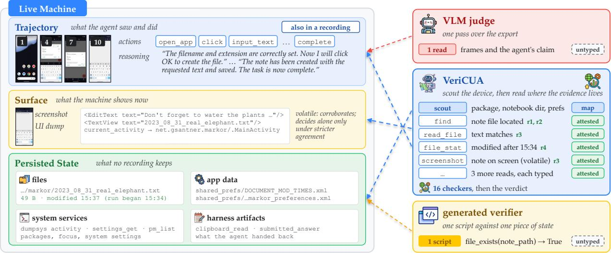  
Figure 2 | VeriCUA gathers evidence from retained trajectories and, when accessible, the current i<sub>n</sub>t<sub>er</sub>f<sub>ace an</sub>d <sub>un</sub>d<sub>er</sub>l<sub>y</sub>i<sub>ng mac</sub>hi<sub>ne s</sub>t<sub>a</sub>t<sub>e.</sub> E<sub>ac</sub>h <sub>rea</sub>d <sub>re</sub>t<sub>a</sub>i<sub>ns</sub> it<sub>s source a</sub>tt<sub>r</sub>ib<sub>u</sub>t<sub>es.</sub>

## 3.3. Ada<sub>p</sub>tive H<sub>y</sub>brid Action S<sub>p</sub>ace

Th<sub>e</sub> <sub>ac</sub>ti<sub>on</sub> <sub>space</sub> <sub>connec</sub>t<sub>s</sub> th<sub>e</sub> <sub>ru</sub>b<sub>r</sub>i<sub>c</sub> t<sub>o</sub> th<sub>e</sub> <sub>sources</sub> th<sub>a</sub>t <sub>can</sub> <sub>answer</sub> it<sub>s</sub> <sub>requ</sub>i<sub>remen</sub>t<sub>s.</sub> Fi<sub>gure</sub> 2 di<sub>s</sub>ti<sub>ngu</sub>i<sub>s</sub>h<sub>es</sub> th<sub>ree v</sub>i<sub>ews o</sub>f t<sub>as</sub>k <sub>s</sub>t<sub>a</sub>t<sub>e:</sub>

• Trajectory. Retained frames, actions, and reasoning record what the executing agent observed <sub>an</sub>d <sub>a</sub>tt<sub>emp</sub>t<sub>e</sub>d<sub>.</sub> Th<sub>e ver</sub>ifi<sub>er can searc</sub>h th<sub>e ac</sub>ti<sub>on</sub> l<sub>og,</sub> i<sub>nspec</sub>t <sub>se</sub>l<sub>ec</sub>t<sub>e</sub>d f<sub>rames, an</sub>d <sub>rea</sub>d <sub>recor</sub>d<sub>e</sub>d a11ytrees w<sup>h</sup>en ava<sup>il</sup>a<sup>bl</sup>e.

• Surface. The current machine interface can be inspected through a new screenshot or a UI hierarchy read. A recorded screenshot belongs to the historical trajectory; this view provides a f<sub>res</sub>h <sub>o</sub>b<sub>serva</sub>ti<sub>on o</sub>f th<sub>e access</sub>ibl<sub>e mac</sub>hi<sub>ne.</sub>

• Persisted State. Files, application databases, and stored settings can retain efects that the current i<sub>n</sub>t<sub>er</sub>f<sub>ace</sub> d<sub>oes no</sub>t <sub>s</sub>h<sub>ow.</sub> C<sub>o</sub>d<sub>e</sub> t<sub>oo</sub>l<sub>s can</sub> i<sub>nspec</sub>t th<sub>em</sub> th<sub>roug</sub>h fil<sub>e rea</sub>d<sub>s,</sub> d<sub>a</sub>t<sub>a</sub>b<sub>ase quer</sub>i<sub>es, or</sub> <sub>quer</sub>i<sub>es</sub> t<sub>o</sub> <sub>expose</sub>d <sub>serv</sub>i<sub>ces.</sub>

Th<sub>e</sub> h<sub>arness</sub> <sub>recor</sub>d<sub>s</sub> <sub>pers</sub>i<sub>s</sub>t<sub>ence</sub> f<sub>or</sub> <sub>eac</sub>h <sub>rea</sub>d<sub>.</sub> Al<sub>ongs</sub>id<sub>e</sub> <sub>s</sub>t<sub>ore</sub>d <sub>ar</sub>tif<sub>ac</sub>t<sub>s,</sub> li<sub>ve</sub> <sub>mac</sub>hi<sub>ne</sub> <sub>access</sub> <sub>prov</sub>id<sub>es</sub> <sub>vo</sub>l<sub>a</sub>til<sub>e</sub> <sub>o</sub>b<sub>serva</sub>ti<sub>ons</sub> <sub>suc</sub>h <sub>as</sub> <sub>curren</sub>t UI d<sub>umps</sub> <sub>an</sub>d h<sub>arness</sub> <sub>ar</sub>tif<sub>ac</sub>t<sub>s.</sub>

GUI t<sub>oo</sub>l<sub>s</sub> <sub>suppor</sub>t <sub>v</sub>i<sub>sua</sub>l i<sub>nspec</sub>ti<sub>on</sub> th<sub>roug</sub>h f<sub>rame</sub> <sub>se</sub>l<sub>ec</sub>ti<sub>on,</sub> <sub>reg</sub>i<sub>on</sub> <sub>en</sub>l<sub>argemen</sub>t<sub>,</sub> <sub>an</sub>d <sub>op</sub>ti<sub>ca</sub>l <sub>c</sub>h<sub>ar-</sub> acter reco<sub>g</sub>nition (OCR), while code tools <sub>q</sub>uer<sub>y</sub> ex<sub>p</sub>osed machine state. The online verifier can also synthesize a checker: a sequence of permitted reads paired with a predicate that evaluates a <sub>requ</sub>i<sub>remen</sub>t<sub>.</sub> Th<sub>e</sub> h<sub>arness execu</sub>t<sub>es</sub> th<sub>e rea</sub>d<sub>s; s</sub>t<sub>ruc</sub>t<sub>ure</sub>d <sub>pre</sub>di<sub>ca</sub>t<sub>es use a res</sub>t<sub>r</sub>i<sub>c</sub>t<sub>e</sub>d <sub>eva</sub>l<sub>ua</sub>t<sub>or, w</sub>hil<sub>e</sub> visual or semantic comparisons use a model judgment. A single online inspection action $\alpha _ { k }$ can <sub>execu</sub>t<sub>e a c</sub>h<sub>ec</sub>k<sub>er compr</sub>i<sub>s</sub>i<sub>ng severa</sub>l <sub>rea</sub>d<sub>s an</sub>d it<sub>s pre</sub>di<sub>ca</sub>t<sub>e eva</sub>l<sub>ua</sub>ti<sub>on.</sub>

Th<sub>e</sub> <sub>ver</sub>ifi<sub>er</sub> <sub>c</sub>h<sub>ooses</sub> it<sub>s</sub> <sub>nex</sub>t i<sub>nspec</sub>ti<sub>on</sub> f<sub>rom</sub> th<sub>e</sub> fi<sub>n</sub>di<sub>ngs</sub> <sub>a</sub>l<sub>rea</sub>d<sub>y</sub> <sub>co</sub>ll<sub>ec</sub>t<sub>e</sub>d<sub>,</sub> f<sub>ocus</sub>i<sub>ng</sub> <sub>on</sub> <sub>requ</sub>i<sub>remen</sub>t<sub>s</sub> th<sub>a</sub>t <sub>rema</sub>i<sub>n unreso</sub>l<sub>ve</sub>d <sub>w</sub>ithi<sub>n</sub> th<sub>e ava</sub>il<sub>a</sub>bl<sub>e access.</sub> A t<sub>ex</sub>t <sub>ma</sub>t<sub>c</sub>h <sub>may</sub> l<sub>eave pers</sub>i<sub>s</sub>t<sub>ence unreso</sub>l<sub>ve</sub>d <sub>an</sub>d <sub>promp</sub>t <sub>a</sub> fil<sub>e rea</sub>d<sub>; an unc</sub>l<sub>ear</sub> f<sub>rame may promp</sub>t <sub>a crop or</sub> i<sub>nspec</sub>ti<sub>on o</sub>f <sub>a</sub> l<sub>a</sub>t<sub>er</sub> f<sub>rame.</sub> Th<sub>e</sub> h<sub>arness recor</sub>d<sub>s</sub> th<sub>e execu</sub>t<sub>e</sub>d t<sub>oo</sub>l<sub>, argumen</sub>t<sub>s, an</sub>d <sub>source me</sub>t<sub>a</sub>d<sub>a</sub>t<sub>a,</sub> i<sub>nc</sub>l<sub>u</sub>di<sub>ng</sub> f<sub>rame</sub> ti<sub>m</sub>i<sub>ng or</sub> th<sub>e</sub> <sub>pers</sub>i<sub>s</sub>t<sub>ence o</sub>f <sub>quer</sub>i<sub>e</sub>d <sub>s</sub>t<sub>a</sub>t<sub>e.</sub> Th<sub>e execu</sub>t<sub>e</sub>d <sub>rea</sub>d d<sub>e</sub>t<sub>erm</sub>i<sub>nes</sub> th<sub>ese a</sub>tt<sub>r</sub>ib<sub>u</sub>t<sub>es, w</sub>hi<sub>c</sub>h <sub>are a</sub>tt<sub>ac</sub>h<sub>e</sub>d t<sub>o</sub> th<sub>e resu</sub>lti<sub>ng</sub> fi<sub>n</sub>di<sub>ngs.</sub> Th<sub>e comp</sub>l<sub>e</sub>t<sub>e</sub> t<sub>oo</sub>l i<sub>nven</sub>t<sub>ory</sub> i<sub>s g</sub>i<sub>ven</sub> i<sub>n</sub> A<sub>ppen</sub>di<sub>x</sub> A<sub>.</sub>2<sub>.</sub>

## 3<sub>.</sub>4<sub>.</sub> E<sub>v</sub>id<sub>ence</sub> Di<sub>sc</sub>i<sub>p</sub>li<sub>ne</sub>

V<sub>er</sub>iCUA li<sub>n</sub>k<sub>s eac</sub>h fi<sub>n</sub>di<sub>ng</sub> t<sub>o an execu</sub>t<sub>e</sub>d <sub>rea</sub>d<sub>,</sub> th<sub>en app</sub>li<sub>es source cons</sub>t<sub>ra</sub>i<sub>n</sub>t<sub>s an</sub>d <sub>corro</sub>b<sub>ora</sub>ti<sub>on</sub> <sub>ru</sub>l<sub>es</sub> b<sub>e</sub>f<sub>ore</sub> <sub>ass</sub>i<sub>gn</sub>i<sub>ng</sub> <sub>requ</sub>i<sub>remen</sub>t <sub>s</sub>t<sub>a</sub>t<sub>uses.</sub>

G<sub>roun</sub>d<sub>e</sub>d Fi<sub>n</sub>di<sub>ngs.</sub> E<sub>ac</sub>h fi<sub>n</sub>di<sub>ng</sub> id<sub>en</sub>tifi<sub>es a ru</sub>b<sub>r</sub>i<sub>c requ</sub>i<sub>remen</sub>t<sub>, s</sub>t<sub>a</sub>t<sub>es</sub> th<sub>e suppor</sub>t <sub>or re</sub>f<sub>u</sub>t<sub>a</sub>ti<sub>on</sub> i<sub>n</sub>f<sub>erre</sub>d f<sub>rom an o</sub>b<sub>serva</sub>ti<sub>on, an</sub>d <sub>c</sub>it<sub>es</sub> th<sub>e execu</sub>t<sub>e</sub>d <sub>c</sub>h<sub>ec</sub>k th<sub>a</sub>t <sub>re</sub>t<sub>urne</sub>d th<sub>e o</sub>b<sub>serva</sub>ti<sub>on.</sub> Th<sub>e</sub> h<sub>arness</sub> rejects citations that match no executed call and attaches each valid citation’s observation and source <sub>a</sub>tt<sub>r</sub>ib<sub>u</sub>t<sub>es</sub> t<sub>o</sub> th<sub>e</sub> fi<sub>n</sub>di<sub>ng.</sub> S<sub>ource a</sub>tt<sub>r</sub>ib<sub>u</sub>t<sub>es an</sub>d <sub>corro</sub>b<sub>ora</sub>ti<sub>ng pro</sub>b<sub>es</sub> th<sub>en</sub> d<sub>e</sub>t<sub>erm</sub>i<sub>ne</sub> h<sub>ow eac</sub>h li<sub>n</sub>k<sub>e</sub>d <sub>assessmen</sub>t <sub>con</sub>t<sub>r</sub>ib<sub>u</sub>t<sub>es</sub> t<sub>o a requ</sub>i<sub>remen</sub>t’<sub>s s</sub>t<sub>a</sub>t<sub>us.</sub>

Source-Aware Evidence. The attested/asserted source labels distinguish observations of task state f<sub>rom recor</sub>d<sub>s o</sub>f th<sub>e execu</sub>ti<sub>ng agen</sub>t’<sub>s</sub> i<sub>n</sub>t<sub>en</sub>t <sub>or c</sub>l<sub>a</sub>i<sub>ms.</sub> A <sub>pos</sub>t<sub>-ac</sub>ti<sub>on</sub> f<sub>rame, a</sub> fil<sub>e rea</sub>d<sub>, or a</sub> d<sub>a</sub>t<sub>a</sub>b<sub>ase</sub> <sub>query</sub> <sub>can</sub> <sub>prov</sub>id<sub>e</sub> <sub>a</sub>tt<sub>es</sub>t<sub>e</sub>d <sub>ev</sub>id<sub>ence.</sub> Th<sub>e</sub> <sub>execu</sub>ti<sub>ng</sub> <sub>agen</sub>t’<sub>s</sub> <sub>comp</sub>l<sub>e</sub>ti<sub>on</sub> <sub>message</sub> <sub>an</sub>d <sub>a</sub> <sub>pre-ac</sub>ti<sub>on</sub> f<sub>rame s</sub>h<sub>ow</sub>i<sub>ng an</sub> i<sub>n</sub>t<sub>en</sub>d<sub>e</sub>d <sub>opera</sub>ti<sub>on are asser</sub>t<sub>e</sub>d <sub>ev</sub>id<sub>ence</sub> f<sub>or</sub> th<sub>a</sub>t <sub>opera</sub>ti<sub>on</sub>’<sub>s ou</sub>t<sub>come.</sub> A<sub>sser</sub>t<sub>e</sub>d <sub>ev</sub>id<sub>ence can</sub> di<sub>rec</sub>t f<sub>ur</sub>th<sub>er</sub> i<sub>nspec</sub>ti<sub>on</sub> b<sub>u</sub>t <sub>canno</sub>t <sub>a</sub>l<sub>one mar</sub>k <sub>a requ</sub>i<sub>remen</sub>t <sub>met.</sub>

S<sub>ource a</sub>tt<sub>r</sub>ib<sub>u</sub>t<sub>es</sub> f<sub>ur</sub>th<sub>er cons</sub>t<sub>ra</sub>i<sub>n w</sub>h<sub>a</sub>t <sub>an o</sub>b<sub>serva</sub>ti<sub>on can suppor</sub>t<sub>,</sub> i<sub>nc</sub>l<sub>u</sub>di<sub>ng w</sub>h<sub>e</sub>th<sub>er a recor</sub>d<sub>e</sub>d i<sub>mage prece</sub>d<sub>es or</sub> f<sub>o</sub>ll<sub>ows</sub> th<sub>e ac</sub>ti<sub>on w</sub>h<sub>ose e</sub>f<sub>ec</sub>t i<sub>s</sub> b<sub>e</sub>i<sub>ng c</sub>h<sub>ec</sub>k<sub>e</sub>d<sub>.</sub> O<sub>n</sub>li<sub>ne rea</sub>d<sub>s</sub> di<sub>s</sub>ti<sub>ngu</sub>i<sub>s</sub>h <sub>per-</sub> <sub>s</sub>i<sub>s</sub>t<sub>en</sub>t <sub>ar</sub>tif<sub>ac</sub>t<sub>s</sub> f<sub>rom vo</sub>l<sub>a</sub>til<sub>e</sub> i<sub>n</sub>t<sub>er</sub>f<sub>ace s</sub>t<sub>a</sub>t<sub>e, w</sub>hi<sub>c</sub>h <sub>can answer</sub> dif<sub>eren</sub>t <sub>ques</sub>ti<sub>ons a</sub>b<sub>ou</sub>t th<sub>e same</sub> <sub>requ</sub>i<sub>remen</sub>t<sub>.</sub> F<sub>or examp</sub>l<sub>e, a screen</sub> di<sub>sp</sub>l<sub>ay</sub>i<sub>ng e</sub>dit<sub>e</sub>d t<sub>ex</sub>t <sub>can suppor</sub>t it<sub>s v</sub>i<sub>s</sub>ibl<sub>e con</sub>t<sub>en</sub>t<sub>s, w</sub>hil<sub>e a</sub> fil<sub>e</sub> <sub>rea</sub>d <sub>can</sub> <sub>c</sub>h<sub>ec</sub>k <sub>w</sub>h<sub>e</sub>th<sub>er</sub> th<sub>a</sub>t t<sub>ex</sub>t <sub>was</sub> <sub>save</sub>d<sub>.</sub> A fi<sub>n</sub>di<sub>ng</sub> <sub>mus</sub>t <sub>a</sub>dd<sub>ress</sub> th<sub>e</sub> t<sub>as</sub>k <sub>requ</sub>i<sub>remen</sub>t<sub>,</sub> <sub>an</sub>d it<sub>s</sub> <sub>o</sub>b<sub>serva</sub>ti<sub>on mus</sub>t <sub>sa</sub>ti<sub>s</sub>f<sub>y</sub> th<sub>e source con</sub>diti<sub>ons</sub> f<sub>or</sub> th<sub>e</sub> i<sub>n</sub>f<sub>erence</sub> b<sub>e</sub>i<sub>ng ma</sub>d<sub>e.</sub>

R<sub>u</sub>l<sub>e-</sub>B<sub>ase</sub>d A<sub>r</sub>bit<sub>ra</sub>ti<sub>on.</sub> Th<sub>e ar</sub>bit<sub>er app</sub>li<sub>es</sub> th<sub>e se</sub>tti<sub>ng</sub>’<sub>s con</sub>fi<sub>rma</sub>ti<sub>on an</sub>d <sub>re</sub>f<sub>u</sub>t<sub>a</sub>ti<sub>on ru</sub>l<sub>es</sub> t<sub>o</sub> th<sub>e</sub> stored findin<sub>g</sub>s E , assi<sub>g</sub>nin<sub>g</sub> each re<sub>q</sub>uirement a status of met, unmet, or unknown. A met status <sub>requ</sub>i<sub>res a</sub>tt<sub>es</sub>t<sub>e</sub>d <sub>suppor</sub>t<sub>, w</sub>hil<sub>e unmet requ</sub>i<sub>res corro</sub>b<sub>ora</sub>ti<sub>ng re</sub>f<sub>u</sub>t<sub>a</sub>ti<sub>ons</sub> f<sub>rom separa</sub>t<sub>e pro</sub>b<sub>es.</sub> E<sub>v</sub>id<sub>ence</sub> th<sub>a</sub>t d<sub>oes no</sub>t <sub>se</sub>ttl<sub>e</sub> th<sub>e requ</sub>i<sub>remen</sub>t l<sub>eaves</sub> it <sub>unknown.</sub> Th<sub>e</sub> t<sub>as</sub>k <sub>ver</sub>di<sub>c</sub>t i<sub>s success w</sub>h<sub>en</sub> <sub>a</sub>ll h<sub>ar</sub>d <sub>requ</sub>i<sub>remen</sub>t<sub>s are met, an</sub>d <sub>fail w</sub>h<sub>en any</sub> i<sub>s unmet.</sub> If <sub>some rema</sub>i<sub>n unknown an</sub>d <sub>none</sub> i<sub>s unmet,</sub> th<sub>e</sub> t<sub>as</sub>k i<sub>s unreso</sub>l<sub>ve</sub>d <sub>an</sub>d f<sub>o</sub>ll<sub>ows</sub> th<sub>e se</sub>tti<sub>ng</sub>’<sub>s a</sub>b<sub>s</sub>t<sub>en</sub>ti<sub>on or</sub> f<sub>a</sub>llb<sub>ac</sub>k <sub>po</sub>li<sub>cy.</sub> A<sub>ggrega</sub>ti<sub>on</sub> i<sub>s</sub> d<sub>e</sub>t<sub>erm</sub>i<sub>n</sub>i<sub>s</sub>ti<sub>c</sub> f<sub>or</sub> fi<sub>xe</sub>d fi<sub>n</sub>di<sub>ngs an</sub>d <sub>ru</sub>l<sub>es;</sub> th<sub>e s</sub>t<sub>ore</sub>d <sub>recor</sub>d<sub>s a</sub>ll<sub>ow con</sub>fi<sub>rma</sub>ti<sub>on</sub> th<sub>res</sub>h<sub>o</sub>ld<sub>s</sub> t<sub>o</sub> b<sub>e</sub> <sub>re-eva</sub>l<sub>ua</sub>t<sub>e</sub>d <sub>w</sub>ith<sub>ou</sub>t <sub>repea</sub>ti<sub>ng</sub> i<sub>nspec</sub>ti<sub>on ac</sub>ti<sub>ons.</sub>

## 3<sub>.</sub>5<sub>.</sub> O<sub>n</sub>li<sub>ne an</sub>d Ofli<sub>ne</sub> I<sub>ns</sub>t<sub>an</sub>ti<sub>a</sub>ti<sub>ons</sub>

O<sub>n</sub>li<sub>ne an</sub>d <sub>o</sub>fli<sub>ne ver</sub>ifi<sub>ca</sub>ti<sub>on s</sub>h<sub>are</sub> th<sub>e same wor</sub>kfl<sub>ow over</sub> th<sub>e sources</sub> ill<sub>us</sub>t<sub>ra</sub>t<sub>e</sub>d i<sub>n</sub> Fi<sub>gure</sub> 2<sub>.</sub> A<sub>ccess</sub> <sub>con</sub>diti<sub>ons</sub> d<sub>e</sub>t<sub>erm</sub>i<sub>ne</sub> th<sub>e ava</sub>il<sub>a</sub>bl<sub>e c</sub>h<sub>ec</sub>k<sub>s an</sub>d th<sub>e</sub> t<sub>rea</sub>t<sub>men</sub>t <sub>o</sub>f <sub>unreso</sub>l<sub>ve</sub>d t<sub>as</sub>k<sub>s.</sub>

O<sub>n</sub>li<sub>ne.</sub> O<sub>n</sub>li<sub>ne mac</sub>hi<sub>ne access a</sub>ll<sub>ows</sub> th<sub>e ver</sub>ifi<sub>er</sub> t<sub>o com</sub>bi<sub>ne</sub> GUI i<sub>nspec</sub>ti<sub>on w</sub>ith <sub>co</sub>d<sub>e-</sub>b<sub>ase</sub>d <sub>c</sub>h<sub>ec</sub>k<sub>s o</sub>f <sub>s</sub>t<sub>ore</sub>d <sub>ar</sub>tif<sub>ac</sub>t<sub>s.</sub> T<sub>as</sub>k<sub>-spec</sub>ifi<sub>c c</sub>h<sub>ec</sub>k<sub>ers can</sub> b<sub>e reuse</sub>d <sub>across repea</sub>t<sub>e</sub>d <sub>execu</sub>ti<sub>ons o</sub>f th<sub>e</sub> <sub>same</sub> t<sub>as</sub>k <sub>w</sub>ith <sub>compa</sub>tibl<sub>e</sub> <sub>app</sub>li<sub>ca</sub>ti<sub>on</sub> <sub>sc</sub>h<sub>emas.</sub> P<sub>ers</sub>i<sub>s</sub>t<sub>en</sub>t <sub>a</sub>tt<sub>es</sub>t<sub>e</sub>d <sub>rea</sub>d<sub>s</sub> <sub>can</sub> <sub>con</sub>fi<sub>rm</sub> <sub>requ</sub>i<sub>remen</sub>t<sub>s,</sub> <sub>w</sub>hil<sub>e vo</sub>l<sub>a</sub>til<sub>e o</sub>b<sub>serva</sub>ti<sub>ons prov</sub>id<sub>e corro</sub>b<sub>ora</sub>ti<sub>on.</sub> Th<sub>e ver</sub>ifi<sub>er a</sub>b<sub>s</sub>t<sub>a</sub>i<sub>ns on unreso</sub>l<sub>ve</sub>d t<sub>as</sub>k<sub>s</sub> t<sub>o avo</sub>id <sub>ass</sub>i<sub>gn</sub>i<sub>ng</sub> t<sub>ra</sub>i<sub>n</sub>i<sub>ng or</sub> filt<sub>er</sub>i<sub>ng</sub> l<sub>a</sub>b<sub>e</sub>l<sub>s unsuppor</sub>t<sub>e</sub>d b<sub>y</sub> th<sub>e co</sub>ll<sub>ec</sub>t<sub>e</sub>d <sub>ev</sub>id<sub>ence.</sub>

Oflin<sub>e.</sub> V<sub>er</sub>iCUA <sub>au</sub>dit<sub>s</sub> fi<sub>xe</sub>d<sub>,</sub> ti<sub>me-s</sub>t<sub>ampe</sub>d <sub>recor</sub>di<sub>ngs</sub> th<sub>roug</sub>h <sub>mu</sub>lti<sub>p</sub>l<sub>e</sub> <sub>pa</sub>th<sub>s,</sub> <sub>see</sub>ki<sub>ng</sub> <sub>suppor</sub>t th<sub>roug</sub>h f<sub>orwar</sub>d i<sub>nspec</sub>ti<sub>on an</sub>d <sub>re</sub>f<sub>u</sub>t<sub>a</sub>ti<sub>ons</sub> th<sub>roug</sub>h b<sub>ac</sub>k<sub>war</sub>d i<sub>nspec</sub>ti<sub>on.</sub> A <sub>requ</sub>i<sub>remen</sub>t i<sub>s met</sub> <sub>w</sub>h<sub>en</sub> <sub>every</sub> <sub>comp</sub>l<sub>e</sub>t<sub>e</sub>d <sub>pa</sub>th <sub>prov</sub>id<sub>es</sub> <sub>a</sub>tt<sub>es</sub>t<sub>e</sub>d <sub>suppor</sub>t<sub>.</sub> F<sub>or</sub> t<sub>as</sub>k<sub>s</sub> l<sub>e</sub>ft <sub>unreso</sub>l<sub>ve</sub>d<sub>,</sub> th<sub>e</sub> <sub>repor</sub>t<sub>e</sub>d configuration uses an initial judgment: a single-pass VLM assessment of the retained trajectory <sub>compu</sub>t<sub>e</sub>d b<sub>e</sub>f<sub>ore exp</sub>l<sub>ora</sub>ti<sub>on an</sub>d <sub>w</sub>ithh<sub>e</sub>ld f<sub>rom</sub> th<sub>e au</sub>dit <sub>pa</sub>th<sub>s.</sub> Thi<sub>s</sub> f<sub>a</sub>llb<sub>ac</sub>k <sub>supp</sub>li<sub>es</sub> th<sub>e</sub> fi<sub>na</sub>l <sub>ver</sub>di<sub>c</sub>t <sub>w</sub>hil<sub>e unreso</sub>l<sub>ve</sub>d <sub>requ</sub>i<sub>remen</sub>t<sub>s rema</sub>i<sub>n unkn</sub>o<sub>wn.</sub> D<sub>e</sub>t<sub>a</sub>il<sub>e</sub>d <sub>se</sub>tti<sub>ng ru</sub>l<sub>es an</sub>d i<sub>nspec</sub>ti<sub>on</sub> bud<sub>g</sub>ets are <sub>g</sub>iven in A<sub>pp</sub>endices A.1 and B.3.

## 4. Ex<sub>p</sub>eriments

## 4.1. Ex<sub>p</sub>erimental Setu<sub>p</sub>

Benchmarks. In online environments, we run AndroidWorld (Rawles et al., 2025) on an Android emulator, OSWorld (Xie et al., 2024) in a virtual machine, and ScienceBoard (Sun et al., 2026c) in it<sub>s sc</sub>i<sub>en</sub>tifi<sub>c</sub> d<sub>es</sub>kt<sub>op env</sub>i<sub>ronmen</sub>t<sub>.</sub> E<sub>ac</sub>h <sub>ep</sub>i<sub>so</sub>d<sub>e</sub> i<sub>s execu</sub>t<sub>e</sub>d b<sub>y</sub> th<sub>e</sub> b<sub>enc</sub>h<sub>mar</sub>k’<sub>s own agen</sub>t <sub>sca</sub>f<sub>o</sub>ld<sub>,</sub> <sub>an</sub>d th<sub>e ver</sub>ifi<sub>er pro</sub>b<sub>es</sub> th<sub>e resu</sub>lti<sub>ng mac</sub>hi<sub>ne s</sub>t<sub>a</sub>t<sub>e a</sub>ft<sub>er</sub> th<sub>e ep</sub>i<sub>so</sub>d<sub>e en</sub>d<sub>s.</sub> F<sub>or o</sub>fli<sub>ne ver</sub>ifi<sub>ca</sub>ti<sub>on, we</sub> evaluate recorded WebArena trajectories from three executin<sub>g</sub> a<sub>g</sub>ents (Zhou et al., 2024) and the human-labeled OSReward trajectories (Sun et al., 2026a), which s<sub>p</sub>an four <sub>p</sub>latforms and several age<sup>nt</sup>s.

Protoco<sup>l</sup>. A<sup>ll</sup> ver<sup>ifi</sup>ers an<sup>d b</sup>ase<sup>li</sup>nes run on gemini-3-flash-preview, an<sup>d</sup> t<sup>h</sup>e <sup>b</sup>ac<sup>kb</sup>one stu<sup>d</sup>y re-runs t<sup>h</sup>em on gemini-3.1-pro-preview. In on<sup>li</sup>ne env<sup>i</sup>ronments, go<sup>ld i</sup>s eac<sup>h b</sup>enc<sup>h</sup>mar<sup>k’</sup>s o<sup>fi</sup>c<sup>i</sup>a<sup>l</sup> eva<sup>l</sup>uator an<sup>d</sup> t<sup>h</sup>e execut<sup>i</sup>ng agents a<sup>l</sup>so run on gemini-3-flash-preview. On We<sup>b</sup>Arena we prov<sup>id</sup>e a11ytree var<sup>i</sup>ants o<sup>f</sup> t<sup>h</sup>e <sup>i</sup>nput <sup>b</sup>eyon<sup>d</sup> t<sup>h</sup>e GUI, to t<sup>h</sup>e ver<sup>ifi</sup>er an<sup>d</sup> t<sup>h</sup>e ju<sup>d</sup>ges a<sup>lik</sup>e. T<sup>h</sup>e <sub>rema</sub>i<sub>n</sub>i<sub>ng pro</sub>t<sub>oco</sub>l d<sub>e</sub>t<sub>a</sub>il<sub>s are prov</sub>id<sub>e</sub>d i<sub>n</sub> A<sub>ppen</sub>di<sub>x</sub> B<sub>.</sub>

Baselines. We compare against a VLM judge, an automatically generated verifier, and two structured judges. Implementation details are provided in Appendix B.2.

• VLM judge. A single-pass judge such as TRM (Sun et al., 2025), which assesses the supplied <sub>o</sub>b<sub>serva</sub>ti<sub>ons</sub> i<sub>n one mo</sub>d<sub>e</sub>l <sub>ca</sub>ll <sub>an</sub>d <sub>re</sub>t<sub>urns a ver</sub>di<sub>c</sub>t <sub>or a score.</sub>

• Auto-Generated Verifier (Xue et al., 2026b). A model-<sub>g</sub>enerated evaluator scri<sub>p</sub>t <sub>p</sub>er task, run <sub>once aga</sub>i<sub>ns</sub>t th<sub>e mac</sub>hi<sub>ne</sub> f<sub>or a</sub> bi<sub>nary ver</sub>di<sub>c</sub>t<sub>.</sub>

• CUAJud<sub>g</sub>e (Xue et al., 2026a). A checklist jud<sub>g</sub>e that derives ke<sub>y p</sub>oints from the task and checks th<sub>em</sub> <sub>aga</sub>i<sub>ns</sub>t <sub>samp</sub>l<sub>e</sub>d f<sub>rames</sub> i<sub>n</sub> <sub>one</sub> <sub>ca</sub>ll<sub>.</sub>

• OS-Themis (Li et al., 2026). A milestone jud<sub>g</sub>e that checks ordered milestones and reviews them.

The VLM judge runs in both settings, the auto-generated verifier only in online verification, and CUAJ<sub>u</sub>d<sub>ge an</sub>d OS<sub>-</sub>Th<sub>em</sub>i<sub>s on</sub>l<sub>y</sub> i<sub>n o</sub>fli<sub>ne ver</sub>ifi<sub>ca</sub>ti<sub>on.</sub>

M<sub>e</sub>t<sub>r</sub>i<sub>cs.</sub> W<sub>e repor</sub>t <sub>agreemen</sub>t <sub>w</sub>ith <sub>go</sub>ld<sub>, prec</sub>i<sub>s</sub>i<sub>on, reca</sub>ll<sub>, an</sub>d F1 f<sub>or</sub> th<sub>e success c</sub>l<sub>ass, an</sub>d th<sub>e</sub> f<sub>a</sub>l<sub>se pos</sub>iti<sub>ve ra</sub>t<sub>e, w</sub>ith <sub>a</sub>b<sub>s</sub>t<sub>en</sub>ti<sub>ons coun</sub>t<sub>e</sub>d <sub>as fail.</sub> F<sub>or ver</sub>ifi<sub>ers</sub> th<sub>a</sub>t <sub>a</sub>b<sub>s</sub>t<sub>a</sub>i<sub>n we a</sub>l<sub>so repor</sub>t th<sub>e</sub> d<sub>ec</sub>i<sub>s</sub>i<sub>on</sub> <sub>ra</sub>t<sub>e</sub> <sub>an</sub>d th<sub>e</sub> <sub>accuracy</sub> <sub>on</sub> d<sub>ec</sub>id<sub>e</sub>d <sub>ep</sub>i<sub>so</sub>d<sub>es.</sub> V<sub>er</sub>di<sub>c</sub>t <sub>conven</sub>ti<sub>ons</sub> <sub>are</sub> <sub>g</sub>i<sub>ven</sub> i<sub>n</sub> A<sub>ppen</sub>di<sub>x</sub> B<sub>.</sub>4<sub>.</sub>

## 4<sub>.</sub>2<sub>.</sub> O<sub>n</sub>li<sub>ne</sub> V<sub>er</sub>ifi<sub>ca</sub>ti<sub>on</sub>

A<sub>ccu</sub>r<sub>acy a</sub>nd F<sub>a</sub>l<sub>se</sub> P<sub>os</sub>iti<sub>ves.</sub> A<sub>cross</sub> th<sub>e</sub> th<sub>ree on</sub>li<sub>ne env</sub>i<sub>ronmen</sub>t<sub>s,</sub> V<sub>er</sub>iCUA h<sub>as</sub> th<sub>e</sub> hi<sub>g</sub>h<sub>es</sub>t accurac<sub>y</sub> and lowest false-<sub>p</sub>ositive rate (Table 1). The auto-<sub>g</sub>enerated verifier has hi<sub>g</sub>her accurac<sub>y</sub> than the VLM judge in each environment. The largest gap is on ScienceBoard, where generated checks are <sub>no</sub>t <sub>re</sub>li<sub>a</sub>bl<sub>y a</sub>li<sub>gne</sub>d <sub>w</sub>ith th<sub>e</sub> t<sub>arge</sub>t <sub>sc</sub>i<sub>en</sub>tifi<sub>c so</sub>ft<sub>ware.</sub> S<sub>cr</sub>i<sub>p</sub>t<sub>s cons</sub>t<sub>ruc</sub>t<sub>e</sub>d <sub>w</sub>ith<sub>ou</sub>t <sub>con</sub>t<sub>ex</sub>t i<sub>nspec</sub>ti<sub>on</sub> <sub>can</sub> <sub>query</sub> i<sub>ncorrec</sub>t <sub>s</sub>t<sub>a</sub>t<sub>e</sub> l<sub>oca</sub>ti<sub>ons.</sub> V<sub>er</sub>iCUA i<sub>nspec</sub>t<sub>s</sub> th<sub>e</sub> <sub>app</sub>li<sub>ca</sub>ti<sub>on</sub> <sub>con</sub>t<sub>ex</sub>t b<sub>e</sub>f<sub>ore</sub> <sub>genera</sub>ti<sub>ng</sub> <sub>c</sub>h<sub>ec</sub>k<sub>s,</sub> <sub>an</sub>d it<sub>s</sub> f<sub>a</sub>l<sub>se-pos</sub>iti<sub>ve ra</sub>t<sub>e</sub> i<sub>s roug</sub>hl<sub>y a quar</sub>t<sub>er o</sub>f th<sub>e genera</sub>t<sub>e</sub>d <sub>ver</sub>ifi<sub>er</sub>’<sub>s.</sub> Th<sub>e genera</sub>t<sub>e</sub>d <sub>ver</sub>ifi<sub>er</sub> h<sub>as</sub> hi<sub>g</sub>h<sub>er</sub> <sub>reca</sub>ll <sub>on</sub> OSW<sub>or</sub>ld <sub>an</sub>d S<sub>c</sub>i<sub>ence</sub>B<sub>oar</sub>d<sub>,</sub> <sub>w</sub>hil<sub>e</sub> V<sub>er</sub>iCUA h<sub>as</sub> hi<sub>g</sub>h<sub>er</sub> <sub>prec</sub>i<sub>s</sub>i<sub>on</sub> <sub>an</sub>d <sub>accuracy.</sub>

Table 1 | Performance in online environments.
<table><tr><td colspan="2">Environment Judge</td><td>Prec Rec</td><td>F1</td><td>Acc False Positive Rate ↓ Decided Decided Acc</td><td></td><td></td></tr><tr><td rowspan="3"></td><td>VLM judge</td><td>79.3 69.7</td><td>74.2 78.4</td><td>15.4</td><td>100%</td><td>78.4%</td></tr><tr><td>AndroidWorld Auto-Generated verifier 77.8</td><td>84.8</td><td>81.2 82.4</td><td>16.9</td><td>100%</td><td>82.4%</td></tr><tr><td>VeriCUA</td><td>90.6 87.9</td><td>89.2 90.5</td><td>7.7</td><td>82%</td><td>95.1%</td></tr><tr><td rowspan="3">OSWorld</td><td>VLM judge</td><td>68.2 75.0</td><td>71.4 73.4</td><td>27.9</td><td>100%</td><td>73.4%</td></tr><tr><td>Auto-Generated verifier 70.6 78.1 74.2 75.9</td><td></td><td></td><td>25.9</td><td>100%</td><td>75.9%</td></tr><tr><td>VeriCUA</td><td>80.3 71.3 75.5 79.5</td><td></td><td>13.9</td><td>78%</td><td>88.7%</td></tr><tr><td rowspan="3"></td><td>VLM judge</td><td>42.9 60.0</td><td>50.0 71.6</td><td>24.8</td><td>100%</td><td>71.6%</td></tr><tr><td>ScienceBoard Auto-Generated verifier 50.9 72.5</td><td></td><td>59.8 76.9</td><td>21.7</td><td>100%</td><td>76.9%</td></tr><tr><td>VeriCUA</td><td></td><td>77.4 60.0 67.6 86.4</td><td>5.4</td><td>70%</td><td>91.6%</td></tr></table>

D<sub>ec</sub>idi<sub>ng</sub> <sub>an</sub>d Ab<sub>s</sub>t<sub>a</sub>i<sub>n</sub>i<sub>ng.</sub> B<sub>o</sub>th b<sub>ase</sub>li<sub>nes</sub> <sub>re</sub>t<sub>urn</sub> <sub>a</sub> <sub>ver</sub>di<sub>c</sub>t <sub>on</sub> <sub>every</sub> <sub>ep</sub>i<sub>so</sub>d<sub>e,</sub> <sub>so</sub> th<sub>e</sub>i<sub>r</sub> d<sub>ec</sub>id<sub>e</sub>d <sub>accuracy</sub> <sub>equa</sub>l<sub>s</sub> th<sub>e</sub>i<sub>r overa</sub>ll <sub>accuracy.</sub> V<sub>er</sub>iCUA <sub>a</sub>b<sub>s</sub>t<sub>a</sub>i<sub>ns w</sub>h<sub>en</sub> it<sub>s</sub> fi<sub>n</sub>di<sub>ngs canno</sub>t <sub>se</sub>ttl<sub>e</sub> th<sub>e</sub> t<sub>as</sub>k <sub>or w</sub>h<sub>en</sub> d<sub>ec</sub>id<sub>e</sub>d <sub>ver</sub>ifi<sub>ca</sub>ti<sub>on</sub> <sub>passes</sub> di<sub>sagree.</sub> It<sub>s</sub> <sub>accuracy</sub> <sub>on</sub> d<sub>ec</sub>id<sub>e</sub>d <sub>ep</sub>i<sub>so</sub>d<sub>es</sub> i<sub>s</sub> hi<sub>g</sub>h<sub>er</sub> <sub>across</sub> <sub>a</sub>ll th<sub>ree</sub> <sub>env</sub>i<sub>ronmen</sub>t<sub>s.</sub> C<sub>oun</sub>ti<sub>ng a</sub>b<sub>s</sub>t<sub>en</sub>ti<sub>ons as f</sub>a<sub>il can</sub> l<sub>ower reca</sub>ll <sub>w</sub>ith<sub>ou</sub>t <sub>a</sub>ddi<sub>ng</sub> f<sub>a</sub>l<sub>se pos</sub>iti<sub>ves.</sub> Thi<sub>s</sub> policy favors conservative selection of successful trajectories for data curation or reward assignment.

## 4<sub>.</sub>3<sub>.</sub> Ofli<sub>ne</sub> V<sub>er</sub>ifi<sub>ca</sub>ti<sub>on</sub>

Table 2 | Performance in ofline verification.
<table><tr><td rowspan="2">Judge</td><td colspan="2">OSReward-Hard</td><td colspan="2">OSReward</td><td colspan="2">WebArena</td><td colspan="2">AndroidWorld</td><td colspan="2">OSWorld</td></tr><tr><td>Acc</td><td>BalAcc</td><td>Acc</td><td>BalAcc</td><td>Acc</td><td>BalAcc</td><td>Acc</td><td>BalAcc</td><td>Acc</td><td>BalAcc</td></tr><tr><td>TRM</td><td>57.4</td><td>64.8</td><td>82.2</td><td>83.1</td><td>79.6</td><td>79.8</td><td>88.3</td><td>89.6</td><td>80.3</td><td>73.7</td></tr><tr><td>CUAJudge</td><td>63.4</td><td>62.5</td><td>83.7</td><td>82.6</td><td>81.3</td><td>81.8</td><td>91.2</td><td>90.7</td><td>83.4</td><td>78.2</td></tr><tr><td>OS-Themis</td><td>65.7</td><td>63.2</td><td>80.2</td><td>79.8</td><td>75.4</td><td>74.3</td><td>89.4</td><td>89.0</td><td>82.1</td><td>79.0</td></tr><tr><td>VeriCUA</td><td>70.4</td><td>68.3</td><td>87.2</td><td>86.3</td><td>82.7</td><td>83.1</td><td>94.3</td><td>94.1</td><td>86.3</td><td>81.2</td></tr></table>

A<sub>cross</sub> B<sub>enc</sub>h<sub>mar</sub>k<sub>s an</sub>d Difi<sub>cu</sub>lt<sub>y.</sub> I<sub>n o</sub>fli<sub>ne ver</sub>ifi<sub>ca</sub>ti<sub>on,</sub> V<sub>er</sub>iCUA h<sub>as</sub> th<sub>e</sub> hi<sub>g</sub>h<sub>es</sub>t <sub>accuracy an</sub>d b<sub>a</sub>l<sub>ance</sub>d <sub>accuracy</sub> <sub>across</sub> th<sub>e</sub> b<sub>enc</sub>h<sub>mar</sub>k<sub>s</sub> i<sub>n</sub> T<sub>a</sub>bl<sub>e</sub> 2<sub>.</sub> O<sub>n</sub> OSR<sub>ewar</sub>d<sub>,</sub> it<sub>s</sub> <sub>accuracy</sub> <sub>a</sub>d<sub>van</sub>t<sub>age</sub> <sub>over</sub> the strongest compared judge is larger on the hard subset than on the full set. The gains on hard trajectories support active evidence gathering when task completion is dificult to assess from fixed <sub>o</sub>b<sub>serva</sub>ti<sub>ons.</sub>

R<sub>o</sub>b<sub>us</sub>t<sub>ness an</sub>d E<sub>v</sub>id<sub>ence</sub> Li<sub>m</sub>it<sub>s.</sub> O<sub>n</sub> W<sub>e</sub>bA<sub>rena,</sub> V<sub>er</sub>iCUA <sub>rema</sub>i<sub>ns a</sub>h<sub>ea</sub>d <sub>across</sub> th<sub>e</sub> th<sub>ree ro</sub>ll<sub>ou</sub>t agents and when baseline judges receive accessibility trees alone. The per-agent and observation <sub>compar</sub>i<sub>sons are repor</sub>t<sub>e</sub>d i<sub>n</sub> A<sub>ppen</sub>di<sub>x</sub> C<sub>.</sub>2<sub>.</sub> Ofli<sub>ne ver</sub>ifi<sub>ca</sub>ti<sub>on</sub> i<sub>s</sub> li<sub>m</sub>it<sub>e</sub>d b<sub>y</sub> th<sub>e o</sub>b<sub>serva</sub>ti<sub>ons re</sub>t<sub>a</sub>i<sub>ne</sub>d in the recording. When these do not resolve the task, VeriCUA uses its initial-judgment fallback. This occurs on 23% of WebArena trajectories. Appendix D presents online and ofline examples with the <sub>ev</sub>id<sub>ence un</sub>d<sub>er</sub>l<sub>y</sub>i<sub>ng</sub> th<sub>e</sub>i<sub>r ver</sub>di<sub>c</sub>t<sub>s.</sub>

## 5. Anal<sub>y</sub>sis

## 5.1. GUI Versus H<sub>y</sub>brid Action S<sub>p</sub>ace

GUI O<sub>n</sub>l<sub>y versus</sub> H<sub>y</sub>b<sub>r</sub>id<sub>.</sub> O<sub>n on</sub>li<sub>ne</sub> A<sub>n</sub>d<sub>ro</sub>idW<sub>or</sub>ld<sub>, a</sub>ddi<sub>ng co</sub>d<sub>e-</sub>b<sub>ase</sub>d <sub>s</sub>t<sub>a</sub>t<sub>e c</sub>h<sub>ec</sub>k<sub>s</sub> t<sub>o</sub> GUI i<sub>nspec</sub>ti<sub>on</sub> increases the decision rate and recall while leavin<sub>g</sub> false <sub>p</sub>ositives unchan<sub>g</sub>ed (Fi<sub>g</sub>ure 3). In the <sub>pa</sub>i<sub>re</sub>d <sub>ana</sub>l<sub>ys</sub>i<sub>s,</sub> <sub>every</sub> <sub>a</sub>dditi<sub>ona</sub>l <sub>correc</sub>t d<sub>ec</sub>i<sub>s</sub>i<sub>on</sub> f<sub>rom</sub> th<sub>e</sub> <sub>co</sub>d<sub>e</sub> <sub>c</sub>h<sub>anne</sub>l i<sub>s</sub> <sub>suppor</sub>t<sub>e</sub>d b<sub>y</sub> <sub>a</sub> fil<sub>e</sub> <sub>or</sub> <sub>app</sub>li<sub>ca</sub>ti<sub>on-s</sub>t<sub>ore rea</sub>d<sub>.</sub> A<sub>ccess</sub> t<sub>o s</sub>t<sub>ore</sub>d <sub>s</sub>t<sub>a</sub>t<sub>e</sub> th<sub>ere</sub>f<sub>ore reso</sub>l<sub>ves requ</sub>i<sub>remen</sub>t<sub>s</sub> th<sub>a</sub>t GUI <sub>o</sub>b<sub>serva</sub>ti<sub>ons</sub> l<sub>eave unse</sub>ttl<sub>e</sub>d<sub>.</sub>

## 5.2. The Efect Of Observation

D<sup>if</sup>erent O<sup>b</sup>servat<sup>i</sup>ons. On We<sup>b</sup>Arena, a<sup>ddi</sup>ng a11ytrees to screens<sup>h</sup>ots ra<sup>i</sup>ses Ver<sup>i</sup>CUA<sup>’</sup>s <sup>d</sup>ec<sup>i</sup>s<sup>i</sup>on <sub>ra</sub>t<sub>e w</sub>hil<sub>e</sub> l<sub>eav</sub>i<sub>ng accuracy unc</sub>h<sub>ange</sub>d<sub>.</sub> T<sub>rees a</sub>l<sub>one y</sub>i<sub>e</sub>ld th<sub>e</sub> hi<sub>g</sub>h<sub>es</sub>t d<sub>ec</sub>i<sub>s</sub>i<sub>on ra</sub>t<sub>e an</sub>d l<sub>owes</sub>t <sub>cos</sub>t<sub>, a</sub>t l<sub>ower</sub> <sub>accuracy.</sub> T<sub>a</sub>bl<sub>e</sub> C<sub>.</sub>2 i<sub>n</sub> A<sub>ppen</sub>di<sub>x</sub> C<sub>.</sub>2 <sub>repor</sub>t<sub>s</sub> th<sub>e</sub> <sub>o</sub>b<sub>serva</sub>ti<sub>on-</sub>i<sub>npu</sub>t <sub>a</sub>bl<sub>a</sub>ti<sub>on.</sub> Th<sub>e</sub> <sub>compar</sub>i<sub>son</sub> with baseline judges uses trajectories from three rollout agents. Their accuracy changes little between tree-onl<sub>y</sub> and combined in<sub>p</sub>uts, and VeriCUA remains ahead under both settin<sub>g</sub>s (Fi<sub>g</sub>ure 4b). Per-a<sub>g</sub>ent <sub>resu</sub>lt<sub>s are g</sub>i<sub>ven</sub> i<sub>n</sub> T<sub>a</sub>bl<sub>e</sub> C<sub>.</sub>4<sub>.</sub>

M<sub>ore</sub> Ob<sub>serva</sub>ti<sub>ons.</sub> W<sub>e a</sub>l<sub>so vary</sub> th<sub>e num</sub>b<sub>er o</sub>f fi<sub>na</sub>l f<sub>rames g</sub>i<sub>ven</sub> t<sub>o</sub> th<sub>e s</sub>i<sub>ng</sub>l<sub>e-ca</sub>ll OSR<sub>ewar</sub>d judge (Figure 4a). Additional frames improve its accuracy on the hard subset, but the judge remains b<sub>e</sub>l<sub>ow</sub> V<sub>er</sub>iCUA<sub>.</sub> A<sub>ccuracy</sub> <sub>on</sub> th<sub>e</sub> f<sub>u</sub>ll <sub>se</sub>t <sub>c</sub>h<sub>anges</sub> <sub>on</sub>l<sub>y</sub> <sub>mo</sub>d<sub>es</sub>tl<sub>y.</sub>

## 5.3. Test-Time Ex<sub>p</sub>loration

C<sub>om</sub>bi<sub>n</sub>i<sub>ng</sub> P<sub>asses.</sub> O<sub>n</sub> th<sub>e mu</sub>lti<sub>-pass</sub> A<sub>n</sub>d<sub>ro</sub>idW<sub>or</sub>ld <sub>su</sub>it<sub>e,</sub> th<sub>ree passes use</sub> th<sub>e</sub> d<sub>e</sub>f<sub>au</sub>lt <sub>con</sub>fi<sub>gura</sub>ti<sub>on</sub> <sub>o</sub>f <sub>co</sub>d<sub>e an</sub>d <sub>s</sub>t<sub>ruc</sub>t<sub>ure</sub>d<sub>-s</sub>t<sub>a</sub>t<sub>e c</sub>h<sub>ec</sub>k<sub>s.</sub> A<sub>n a</sub>dditi<sub>ona</sub>l <sub>pass ena</sub>bl<sub>es v</sub>i<sub>sua</sub>l i<sub>nspec</sub>ti<sub>on</sub> th<sub>roug</sub>h <sub>screens</sub>h<sub>o</sub>t<sub>s</sub> <sub>an</sub>d fil<sub>e-</sub>i<sub>mage rea</sub>d<sub>s, re</sub>f<sub>erre</sub>d t<sub>o as</sub> th<sub>e v</sub>i<sub>s</sub>i<sub>on</sub> f<sub>a</sub>llb<sub>ac</sub>k<sub>.</sub> All <sub>passes an</sub>d th<sub>e au</sub>t<sub>o-genera</sub>t<sub>e</sub>d b<sub>ase</sub>li<sub>ne</sub> <sub>s</sub>h<sub>are one res</sub>t<sub>ore</sub>d <sub>snaps</sub>h<sub>o</sub>t <sub>per ep</sub>i<sub>so</sub>d<sub>e.</sub> Th<sub>e com</sub>bi<sub>na</sub>ti<sub>on ru</sub>l<sub>e re</sub>t<sub>a</sub>i<sub>ns a</sub> d<sub>ec</sub>id<sub>e</sub>d <sub>ver</sub>di<sub>c</sub>t <sub>an</sub>d <sub>a</sub>b<sub>s</sub>t<sub>a</sub>i<sub>ns</sub> <sub>w</sub>h<sub>en</sub> d<sub>ec</sub>id<sub>e</sub>d <sub>passes</sub> di<sub>sagree.</sub> C<sub>om</sub>bi<sub>n</sub>i<sub>ng</sub> th<sub>e</sub> d<sub>e</sub>f<sub>au</sub>lt <sub>passes g</sub>i<sub>ves mo</sub>d<sub>es</sub>t <sub>ga</sub>i<sub>ns over</sub> th<sub>e s</sub>t<sub>ronges</sub>t <sub>s</sub>i<sub>ng</sub>l<sub>e pass.</sub> Addi<sub>ng</sub> th<sub>e v</sub>i<sub>sua</sub>l <sub>pass</sub> i<sub>mproves agreemen</sub>t <sub>an</sub>d d<sub>ec</sub>i<sub>s</sub>i<sub>on ra</sub>t<sub>e</sub> f<sub>ur</sub>th<sub>er,</sub> b<sub>o</sub>th <sub>reac</sub>hi<sub>ng</sub> 87% (Fi<sub>g</sub>ure 5a). The visual <sub>p</sub>ass also im<sub>p</sub>roves these metrics when the number of <sub>p</sub>asses is matched.

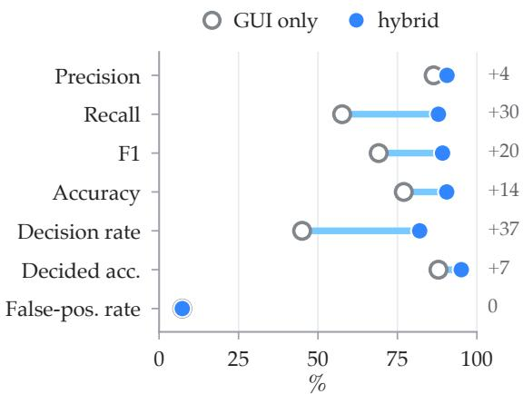

Figure 3 | Each metric of VeriCUA with GUI actions <sub>a</sub>l<sub>one</sub> <sub>an</sub>d <sub>w</sub>ith th<sub>e</sub> h<sub>y</sub>b<sub>r</sub>id <sub>ac</sub>ti<sub>on</sub> <sub>space</sub> <sub>on</sub> th<sub>e</sub> <sub>on</sub>li<sub>ne</sub> A<sub>n</sub>d<sub>ro</sub>idW<sub>or</sub>ld <sub>su</sub>it<sub>e.</sub> H<sub>o</sub>ll<sub>ow mar</sub>k<sub>ers are</sub> GUI <sub>on</sub>l<sub>y,</sub> fill<sub>e</sub>d <sub>mar</sub>k<sub>ers</sub> th<sub>e</sub> h<sub>y</sub>b<sub>r</sub>id <sub>space, an</sub>d th<sub>e co</sub>l<sub>umn a</sub>t th<sub>e</sub> <sub>r</sub>i<sub>g</sub>ht <sub>g</sub>i<sub>ves</sub> th<sub>e</sub> <sub>c</sub>h<sub>ange.</sub>

(a) Last N frames for a single-call judge, OSReward  
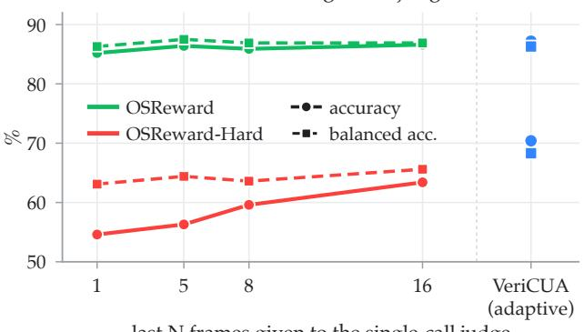  
last N frames given to the single-call judge

(b) Judges given a11ytrees  
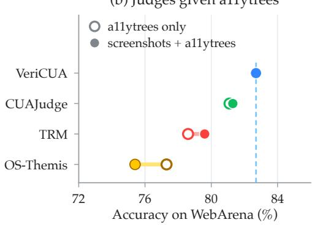  
Figure 4 | More observation for a single-call judge. (a) The OSReward judge reading the last � frames of each trajectory, with VeriCUA at the right; OSReward’s default is five. (b) The WebArena judges rea<sup>di</sup>ng a11ytrees a<sup>l</sup>one or w<sup>i</sup>t<sup>h</sup> screens<sup>h</sup>ots, aga<sup>i</sup>nst Ver<sup>i</sup>CUA (<sup>d</sup>as<sup>h</sup>e<sup>d</sup>).

Combined verdicts produce fewer incorrect fail decisions than majority voting over the same passes (Table C.5, A<sub>pp</sub>endix C.3).

M<sub>a</sub>t<sub>c</sub>h<sub>e</sub>d B<sub>u</sub>d<sub>ge</sub>t<sub>.</sub> W<sub>e</sub> <sub>a</sub>l<sub>so</sub> <sub>compare</sub> <sub>accuracy</sub> <sub>un-</sub> d<sub>er a ma</sub>t<sub>c</sub>h<sub>e</sub>d <sub>ver</sub>ifi<sub>ca</sub>ti<sub>on</sub> b<sub>u</sub>d<sub>ge</sub>t <sub>on</sub> th<sub>e</sub> fl<sub>as</sub>h b<sub>ac</sub>k<sub>-</sub> bone (Table 3). The <sub>p</sub>rotocol allocates re<sub>p</sub>eated runs to TRM<sub>,</sub> a fixed ste<sub>p</sub> limit to CUAJud<sub>g</sub>e<sub>,</sub> and an ex<sub>p</sub>loration limit to VeriCUA. VeriCUA retains hi<sub>g</sub>her accurac<sub>y</sub> on OSReward and OSReward-Hard. R<sub>es</sub>t<sub>r</sub>i<sub>c</sub>ti<sub>ng</sub> it<sub>s</sub> b<sub>u</sub>d<sub>ge</sub>t <sub>pro</sub>d<sub>uces a sma</sub>ll <sub>accuracy</sub> d<sub>ecrease</sub> f<sub>rom</sub> th<sub>e</sub> d<sub>e</sub>f<sub>au</sub>lt <sub>con</sub>fi<sub>gura</sub>ti<sub>on w</sub>hil<sub>e pre-</sub> serving the lead over the compared judges.

Table 3 | Accuracy under matched budgets.
<table><tr><td colspan="2">Judge OSReward OSReward-Hard</td></tr><tr><td>TRM (N=10)</td><td>83.5 58.5</td></tr><tr><td>CUAJudge</td><td>84.8 64.5</td></tr><tr><td>VeriCUA</td><td>86.4 68.7</td></tr></table>

D<sub>e</sub>t<sub>ec</sub>tin<sub>g</sub> F<sub>a</sub>l<sub>se</sub> C<sub>o</sub>m<sub>p</sub>l<sub>e</sub>ti<sub>o</sub>n R<sub>epo</sub>rt<sub>s.</sub> W<sub>e a</sub>n<sub>a</sub>l<sub>y</sub>z<sub>e</sub> f<sub>a</sub>l<sub>se co</sub>m<sub>p</sub>l<sub>e</sub>ti<sub>o</sub>n r<sub>epo</sub>rt<sub>s ac</sub>r<sub>oss</sub> th<sub>e</sub> thr<sub>ee o</sub>nlin<sub>e</sub> environments, usin<sub>g</sub> an AndroidWorld subset (Fi<sub>g</sub>ure 5b). VeriCUA rejects about 80% of these re<sub>p</sub>orts <sub>an</sub>d <sub>ou</sub>t<sub>per</sub>f<sub>orms</sub> b<sub>o</sub>th b<sub>ase</sub>li<sub>nes</sub> i<sub>n eac</sub>h <sub>env</sub>i<sub>ronmen</sub>t<sub>.</sub> Th<sub>e</sub> dif<sub>erence</sub> i<sub>s</sub> l<sub>arges</sub>t <sub>on</sub> S<sub>c</sub>i<sub>ence</sub>B<sub>oar</sub>d<sub>,</sub> where the generated verifier rarely rejects an incorrect completion claim. Figure D.1 in Appendix D ill<sub>us</sub>t<sub>ra</sub>t<sub>es an</sub> A<sub>n</sub>d<sub>ro</sub>idW<sub>or</sub>ld <sub>case</sub> i<sub>n w</sub>hi<sub>c</sub>h <sub>rea</sub>d<sub>s o</sub>f th<sub>e me</sub>di<sub>a s</sub>t<sub>ore re</sub>f<sub>u</sub>t<sub>e</sub> th<sub>e agen</sub>t’<sub>s repor</sub>t<sub>.</sub>

(a) Verifier passes combined, AndroidWorld  
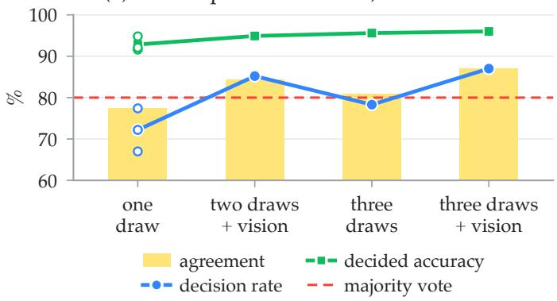

(b) False completion reports rejected  
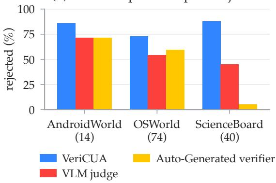  
Fi<sub>g</sub>ure 5 | (a) Combinin<sub>g</sub> verifier <sub>p</sub>asses im<sub>p</sub>roves a<sub>g</sub>reement and decision rate. (b) Rejection of the <sub>agen</sub>t’<sub>s</sub> f<sub>a</sub>l<sub>se</sub> <sub>comp</sub>l<sub>e</sub>ti<sub>on</sub> <sub>repor</sub>t<sub>s.</sub>

## 5.4. Gains From A Stron<sub>g</sub>er Backbone

R<sub>ep</sub>l<sub>ac</sub>i<sub>ng</sub> th<sub>e</sub> fl<sub>as</sub>h b<sub>ac</sub>kb<sub>one w</sub>ith th<sub>e</sub> <sub>p</sub>ro backbone im<sub>p</sub>roves VeriCUA’s accurac<sub>y</sub> and balanced accurac<sub>y</sub> on OSReward-Hard (Table 4). The com<sub>p</sub>ared jud<sub>g</sub>es show <sub>sma</sub>ll<sub>er</sub> <sub>or</sub> <sub>nega</sub>ti<sub>ve</sub> <sub>c</sub>h<sub>anges,</sub> i<sub>n</sub>di<sub>ca</sub>ti<sub>ng</sub> th<sub>a</sub>t <sub>s</sub>t<sub>ronger mo</sub>d<sub>e</sub>l<sub>s</sub> b<sub>ene</sub>fit th<sub>e ver</sub>ifi<sub>ca-</sub> ti<sub>on me</sub>th<sub>o</sub>d<sub>s</sub> dif<sub>eren</sub>tl<sub>y.</sub> All f<sub>ramewor</sub>k<sub>s</sub> i<sub>mprove</sub> i<sub>n</sub> th<sub>e on</sub>li<sub>ne</sub> A<sub>n</sub>d<sub>ro</sub>idW<sub>or</sub>ld <sub>com-</sub> <sub>par</sub>i<sub>son,</sub> <sub>w</sub>ith V<sub>er</sub>iCUA <sub>re</sub>t<sub>a</sub>i<sub>n</sub>i<sub>ng</sub> th<sub>e</sub> hi<sub>g</sub>h<sub>-</sub>

Table 4 | Backbone comparison on OSReward-Hard.
<table><tr><td rowspan="2">Judge</td><td colspan="3">Acc</td><td colspan="2">BalAcc</td></tr><tr><td>Flash</td><td>Pro</td><td>Δ</td><td>Flash Pro</td><td>Δ</td></tr><tr><td>CUAJudge OS-Themis</td><td>63.4 65.7</td><td>62.7 66.1</td><td>-0.7 +0.4</td><td>62.5 58.4 63.2 61.1</td><td>-4.1 -2.1</td></tr></table>

est accurac<sub>y</sub> on both backbones (Table C.8, A<sub>pp</sub>endix C.4).

## 5<sub>.</sub>5<sub>.</sub> C<sub>on</sub>fid<sub>en</sub>t F<sub>a</sub>il<sub>ures an</sub>d G<sub>o</sub>ld<sub>-</sub>L<sub>a</sub>b<sub>e</sub>l A<sub>u</sub>dit

F<sub>or o</sub>fli<sub>ne ver</sub>ifi<sub>ca</sub>ti<sub>on, we compare</sub> i<sub>n</sub>iti<sub>a</sub>l fail judgments with the subset that explo-<sub>ra</sub>ti<sub>on a</sub>l<sub>so reso</sub>l<sub>ves as f</sub>a<sub>il.</sub> S<sub>e</sub>l<sub>ec</sub>ti<sub>on ra</sub>i<sub>ses</sub> f<sub>a</sub>il<sub>ure</sub> <sub>prec</sub>i<sub>s</sub>i<sub>on</sub> <sub>on</sub> <sub>eac</sub>h b<sub>enc</sub>h<sub>mar</sub>k <sub>w</sub>hil<sub>e</sub> <sub>re-</sub> taining fewer of the initial failure judgments (Fi<sub>g</sub>ure 6).

Di<sub>sagreemen</sub>t<sub>s can a</sub>l<sub>so</sub> id<sub>en</sub>tif<sub>y suspec</sub>t<sub>e</sub>d <sub>er-</sub> <sub>rors</sub> i<sub>n</sub> th<sub>e re</sub>f<sub>erence</sub> l<sub>a</sub>b<sub>e</sub>l<sub>s.</sub> A bli<sub>n</sub>d<sub>e</sub>d <sub>mo</sub>d<sub>e</sub>l adjudicator supports VeriCUA on 63% of the flagged trajectories, with the clearest support <sub>on</sub> OSW<sub>or</sub>ld<sub>.</sub> Th<sub>ese</sub> <sub>resu</sub>lt<sub>s</sub> <sub>sugges</sub>t th<sub>a</sub>t <sub>ver</sub>ifi<sub>-</sub> cation can help identify failed trajectories and <sub>pr</sub>i<sub>or</sub>iti<sub>ze</sub> <sub>suspec</sub>t<sub>e</sub>d l<sub>a</sub>b<sub>e</sub>l <sub>errors</sub> f<sub>or</sub> i<sub>nspec</sub>ti<sub>on.</sub> A<sub>ppe</sub>ndix C<sub>.</sub>6 d<sub>e</sub>t<sub>a</sub>il<sub>s</sub> th<sub>e</sub> <sub>suppo</sub>rtin<sub>g</sub> <sub>a</sub>n<sub>a</sub>l<sub>yses.</sub>

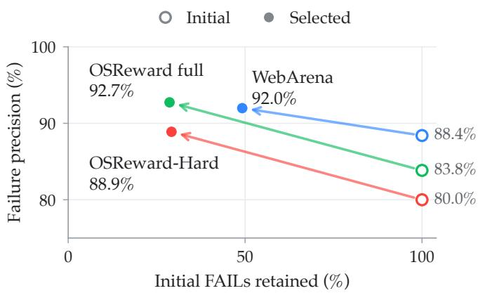  
Figure 6 | Failure precision and retention.

## 6<sub>.</sub> C<sub>o</sub>n<sub>c</sub>l<sub>us</sub>i<sub>o</sub>n

We <sub>p</sub>resented VeriCUA<sub>,</sub> a <sub>p</sub>latform-a<sub>g</sub>nostic framework for verif<sub>y</sub>in<sub>g</sub> com<sub>p</sub>uter-usin<sub>g</sub> a<sub>g</sub>ents throu<sub>g</sub>h <sub>agen</sub>ti<sub>c exp</sub>l<sub>ora</sub>ti<sub>on.</sub> Th<sub>e ver</sub>ifi<sub>er</sub> i<sub>nspec</sub>t<sub>s ava</sub>il<sub>a</sub>bl<sub>e con</sub>t<sub>ex</sub>t b<sub>e</sub>f<sub>ore cons</sub>t<sub>ruc</sub>ti<sub>ng a</sub> t<sub>as</sub>k <sub>ru</sub>b<sub>r</sub>i<sub>c,</sub> th<sub>en</sub> <sub>se</sub>l<sub>ec</sub>t<sub>s</sub> GUI <sub>or co</sub>d<sub>e c</sub>h<sub>ec</sub>k<sub>s</sub> t<sub>o ga</sub>th<sub>er ev</sub>id<sub>ence</sub> f<sub>or unreso</sub>l<sub>ve</sub>d <sub>requ</sub>i<sub>remen</sub>t<sub>s.</sub> S<sub>ource-aware ar</sub>bit<sub>ra</sub>ti<sub>on</sub> <sub>com</sub>bi<sub>nes</sub> th<sub>e</sub> fi<sub>n</sub>di<sub>ngs w</sub>ithi<sub>n a s</sub>h<sub>are</sub>d <sub>wor</sub>kfl<sub>ow</sub> f<sub>or o</sub>fli<sub>ne recor</sub>di<sub>ngs an</sub>d <sub>on</sub>li<sub>ne env</sub>i<sub>ronmen</sub>t<sub>s.</sub> A<sub>cross</sub> th<sub>e eva</sub>l<sub>ua</sub>t<sub>e</sub>d l<sub>a</sub>tf<sub>orms,</sub> V<sub>er</sub>iCUA i<sub>m roves a reemen</sub>t <sub>w</sub>ith <sub>re</sub>f<sub>erence</sub> l<sub>a</sub>b<sub>e</sub>l<sub>s over</sub> th<sub>e com are</sub>d baselines, with fewer false positives online and the largest ofline gains on hard trajectories. Analyses <sub>s</sub>h<sub>ow</sub> th<sub>a</sub>t <sub>comp</sub>l<sub>emen</sub>t<sub>ary</sub> <sub>ev</sub>id<sub>ence</sub> <sub>sources</sub> <sub>an</sub>d <sub>ver</sub>ifi<sub>ca</sub>ti<sub>on</sub> <sub>passes</sub> i<sub>mprove</sub> d<sub>ec</sub>i<sub>s</sub>i<sub>on</sub> <sub>coverage,</sub> <sub>w</sub>hil<sub>e</sub> <sub>s</sub>t<sub>ronger</sub> b<sub>ac</sub>kb<sub>ones</sub> f<sub>ur</sub>th<sub>er</sub> i<sub>mprove accuracy.</sub> Th<sub>ese resu</sub>lt<sub>s suppor</sub>t <sub>agen</sub>ti<sub>c ver</sub>ifi<sub>ca</sub>ti<sub>on</sub> f<sub>or</sub> CUA <sub>eva</sub>l<sub>ua</sub>ti<sub>on an</sub>d <sub>mo</sub>ti<sub>va</sub>t<sub>e</sub> it<sub>s use</sub> i<sub>n</sub> d<sub>a</sub>t<sub>a cura</sub>ti<sub>on an</sub>d <sub>re</sub>i<sub>n</sub>f<sub>orcemen</sub>t l<sub>earn</sub>i<sub>ng.</sub>

## Referen<sub>c</sub>e<sub>s</sub>

H. Chae<sub>,</sub> S. Kim<sub>,</sub> J. Cho<sub>,</sub> S. Kim<sub>,</sub> S. Moon<sub>,</sub> G. Hwan<sub>g</sub>bo<sub>,</sub> D. Lim<sub>,</sub> M. Kim<sub>,</sub> Y. Hwan<sub>g,</sub> M. Gwak<sub>,</sub> D. Choi<sub>,</sub> M. Kan<sub>g,</sub> G. Im<sub>,</sub> B. Cho<sub>,</sub> H. Kim<sub>,</sub> J. H. Han<sub>,</sub> T. Kwon<sub>,</sub> M. Kim<sub>,</sub> B. woo Kwak<sub>,</sub> D. Kan<sub>g,</sub> and J. Yeo. Web-shepherd: Advancing PRMs for reinforcing web agents. In The Thirty-ninth Annual Conference

on Neural Information Processing Systems, 2025. URL https://openreview.net/forum?id= G2kMroO9UV.

C. Cui, J. Huang, S. Wang, L. Zheng, Q. Kong, and Z. Zeng. Agentic reward modeling: Verifying gui agent via progressive trajectory-grounded interaction, 2026. URL https://arxiv.org/abs/ 2602.00575.

L<sub>.</sub> Di<sub>ng.</sub> Ad<sub>aru</sub>b<sub>r</sub>i<sub>c:</sub> T<sub>as</sub>k<sub>-a</sub>d<sub>ap</sub>ti<sub>ve</sub> <sub>ru</sub>b<sub>r</sub>i<sub>cs</sub> f<sub>or</sub> <sub>re</sub>li<sub>a</sub>bl<sub>e</sub> ll<sub>m</sub> <sub>agen</sub>t <sub>eva</sub>l<sub>ua</sub>ti<sub>on</sub> <sub>an</sub>d <sub>rewar</sub>d l<sub>earn</sub>i<sub>ng.</sub> 2026<sub>.</sub> URL https://github.com/alphadl/AdaRubrics.

Z. Li<sub>,</sub> Z. Wu<sub>,</sub> Y. Zhao<sub>,</sub> B. Yan<sub>g,</sub> J. Xie<sub>,</sub> Z. Liu<sub>,</sub> Z. Liu<sub>,</sub> K. Jin<sub>,</sub> J. Lian<sub>g,</sub> Z. Li<sub>,</sub> F. Wu<sub>,</sub> B. Zhou<sub>,</sub> Z. Wan<sub>g,</sub> <sub>an</sub>d Z<sub>.</sub> Di<sub>ng.</sub> O<sub>s-</sub>th<sub>em</sub>i<sub>s:</sub> A <sub>sca</sub>l<sub>a</sub>bl<sub>e cr</sub>iti<sub>c</sub> f<sub>ramewor</sub>k f<sub>or genera</sub>li<sub>s</sub>t <sub>gu</sub>i <sub>rewar</sub>d<sub>s,</sub> 2026<sub>.</sub> URL https://arxiv.org/abs/2603.19191.

H. Lin, X. Tan, Y. Qin, Z. Xu, Y. Shi, Z. Li, G. Li, S. Cai, S. Cai, C. Fu, K. Li, and X. Sun. Cuarewardbench: A benchmark for evaluating reward models on computer-using agent, 2025. URL https://arxiv. org/abs/2510.18596.

T. Liu<sub>,</sub> R. Xu<sub>,</sub> T. Yu<sub>,</sub> I. Hon<sub>g,</sub> C. Yan<sub>g,</sub> T. Zhao<sub>,</sub> and H. Wan<sub>g</sub>. O<sub>p</sub>enRubrics: Towards scalable s<sub>y</sub>nthetic rubric generation for reward modeling and LLM alignment. In Proceedings of the 64th Annual Meeting of the Association for Computational Linguistics (Volume 1: Long Papers), pages 17417– 17437<sub>,</sub> San Die<sub>g</sub>o<sub>,</sub> California<sub>,</sub> United States<sub>,</sub> Jul<sub>y</sub> 2026. Association for Com<sub>p</sub>utational Lin<sub>g</sub>uistics. ISBN 979-8-8917<sup>6</sup>-390-<sup>6</sup>. <sup>d</sup>o<sup>i</sup>: 10.18<sup>6</sup>53/v1/202<sup>6</sup>.ac<sup>l</sup>-<sup>l</sup>ong.791. URL https://aclanthology. org/2026.acl-long.791/.

J. Pan<sub>,</sub> Y. Zhan<sub>g,</sub> N. Tomlin<sub>,</sub> Y. Zhou<sub>,</sub> S. Levine<sub>,</sub> and A. Suhr. Autonomous evaluation and refinement of digital agents. In First Conference on Language Modeling, 2024. URL https://openreview. net/forum?id=NPAQ6FKSmK.

C. Rawles<sub>,</sub> S. Clinckemaillie<sub>,</sub> Y. Chan<sub>g,</sub> J. Waltz<sub>,</sub> G. Lau<sub>,</sub> M. Fair<sub>,</sub> A. Li<sub>,</sub> W. E. Bisho<sub>p,</sub> W. Li<sub>,</sub> F. Cam<sub>p</sub>bell-Ajala, D. K. Toyama, R. J. Berry, D. Tyamagundlu, T. P. Lillicrap, and O. Riva. Androidworld: A dynamic benchmarking environment for autonomous agents. In The Thirteenth International Conference on Learning Representations, 2025. URL https://openreview.net/forum?id= il5yUQsrjC.

R. Sana<sub>y</sub>ei<sub>,</sub> R.-G. Dumitru<sub>,</sub> S. Hou<sub>,</sub> M. Rezaei<sub>,</sub> H. Riaz<sub>,</sub> R. Vacareanu<sub>,</sub> M. Yan<sub>g,</sub> Y. Liu<sub>,</sub> M. Surdeanu<sub>,</sub> an<sup>d</sup> D. Y. Z<sup>h</sup>ang. Evi<sup>d</sup>ence-<sup>fi</sup>rst agentic veri<sup>fi</sup>cation, 2026. URL https://arxiv.org/abs/2610. 17724v1.

W. Shi, Y. Wang, Y. Zhao, Y. Chen, F. Feng, X. Hao, X. Su, Q. GU, H. Su, X. Cai, and X. He. AJ-bench: Benchmarking agent-as-a-judge for environment-aware evaluation. In Findings of the Association for Computational Linguistics: ACL 2026, pages 25371–25413, San Diego, California, United States, Jul<sub>y</sub> 2026. Association for Com<sub>p</sub>utational Lin<sub>g</sub>uistics. ISBN 979-8-89176-395-1. doi: 10.18653/ v1/2026.<sup>fi</sup>n<sup>d</sup>ings-ac<sup>l</sup>.1269. URL https://aclanthology.org/2026.findings-acl.1269/.

Q. Sun, K. Cheng, Z. Ding, C. Jin, Y. Wang, F. Xu, Z. Wu, C. Jia, L. Chen, Z. Liu, et al. Os-genesis: Automating gui agent trajectory construction via reverse task synthesis. In Proceedings of the 63rd Annual Meeting of the Association for Computational Linguistics (Volume 1: Long Papers), pages 5555–5579<sub>,</sub> 2025.

Q. Sun, K. Cheng, Y. Wang, B. Yang, H. Yan, L. Chen, F. Xu, Z. Ding, N. Chen, J. Cao, et al. Osreward: Instituting standardized evaluation for cross-platform computer-use reward models. arXiv preprint arXiv:2607.28609, 2026a.

Q. Sun, M. Li, Z. Liu, Z. Xie, F. Xu, Z. Yin, K. Cheng, Z. Li, Z. Ding, Q. Liu, Z. Wu, Z. Zhang, B. Kao, <sub>an</sub>d L<sub>.</sub> K<sub>ong.</sub> OS<sub>-sen</sub>ti<sub>ne</sub>l<sub>:</sub> T<sub>owar</sub>d<sub>s sa</sub>f<sub>e</sub>t<sub>y-en</sub>h<sub>ance</sub>d <sub>mo</sub>bil<sub>e</sub> GUI <sub>agen</sub>t<sub>s v</sub>i<sub>a</sub> h<sub>y</sub>b<sub>r</sub>id <sub>va</sub>lid<sub>a</sub>ti<sub>on</sub> i<sub>n</sub> realistic workflows. In Proceedings of the 64th Annual Meeting of the Association for Computational Linguistics (Volume 1: Long Papers), pages 9529–9553, San Diego, California, United States, Ju<sup>l</sup>y 202<sup>6b</sup>. Assoc<sup>i</sup>at<sup>i</sup>on <sup>f</sup>or Computat<sup>i</sup>ona<sup>l</sup> L<sup>i</sup>ngu<sup>i</sup>st<sup>i</sup>cs. ISBN 979-8-8917<sup>6</sup>-390-<sup>6</sup>. URL https: //aclanthology.org/2026.acl-long.431/.

Q. Sun, Z. Liu, C. Ma, Z. Ding, F. Xu, Z. Yin, H. Zhao, Z. Wu, K. Cheng, Z. Liu, J. Wang, Q. Li, X. Tang, T. Xie, X. Feng, X. Li, B. Kao, W. Wang, B. Qi, L. Kong, and Z. Wu. Scienceboard: Evaluating multimodal autonomous agents in realistic scientific workflows. In The Fourteenth International Conference on Learning Representations, 2026c. URL https://openreview.net/forum?id= bJvwJahJeF.

Y. Wan, Z. Zhang, J. Wang, and L. Zhu. Seekjudge: A practical reward framework for reinforcement learning in computer-use agents. arXiv preprint arXiv:2607.23263, 2026.

T. Xie<sub>,</sub> D. Zhan<sub>g,</sub> J. Chen<sub>,</sub> X. Li<sub>,</sub> S. Zhao<sub>,</sub> R. Cao<sub>,</sub> T. J. Hua<sub>,</sub> Z. Chen<sub>g,</sub> D. Shin<sub>,</sub> F. Lei<sub>,</sub> Y. Liu<sub>,</sub> Y. Xu<sub>,</sub> S. Zhou<sub>,</sub> S. Savarese<sub>,</sub> C. Xion<sub>g,</sub> V. Zhon<sub>g,</sub> and T. Yu. OSWorld: Benchmarkin<sub>g</sub> multimodal a<sub>g</sub>ents for open-ended tasks in real computer environments. In The Thirty-eight Conference on Neural Information Processing Systems Datasets and Benchmarks Track, 2024. URL https://openreview. net/forum?id=tN61DTr4Ed.

T. Xie<sub>,</sub> M. Yuan<sub>,</sub> D. Zhan<sub>g,</sub> X. Xion<sub>g,</sub> Z. Shen<sub>,</sub> Z. Zhou<sub>,</sub> X. Wan<sub>g,</sub> Y. Chen<sub>,</sub> J. Den<sub>g,</sub> J. Chen<sub>,</sub> B. Wan<sub>g,</sub> H. Wu, J. Chen, J. Wang, D. Lu, H. Hu, and T. Yu. Introducing osworld-verified. xlang.ai, July 2025. URL https://xlang.ai/blog/osworld-verified.

T. Xue<sub>,</sub> Z. Liao<sub>,</sub> T. Shi<sub>,</sub> Z. Wan<sub>g,</sub> K. Zhan<sub>g,</sub> D. Son<sub>g,</sub> Y. Su<sub>,</sub> and H. Sun. Autonomous continual learnin<sub>g</sub> for environment adaptation of computer-use agents, 2026a. URL https://arxiv.org/abs/ 2602.10356.

T. Xue<sub>,</sub> C. Pen<sub>g,</sub> M. Huan<sub>g,</sub> L. Guo<sub>,</sub> T. Han<sub>,</sub> H. Wan<sub>g,</sub> J. Wan<sub>g,</sub> X. Zhan<sub>g,</sub> X. Yan<sub>g,</sub> D. Zhao<sub>,</sub> J. Din<sub>g,</sub> X. Ma, Y. Xie, P. Pei, X. Cai, and X. Qiu. Evocua: Evolving computer use agents via learning from sca<sup>l</sup>a<sup>bl</sup>e synt<sup>h</sup>etic experience, 2026<sup>b</sup>. URL https://arxiv.org/abs/2601.15876.

S. Zhou<sub>,</sub> F. F. Xu<sub>,</sub> H. Zhu<sub>,</sub> X. Zhou<sub>,</sub> R. Lo<sub>,</sub> A. Sridhar<sub>,</sub> X. Chen<sub>g,</sub> T. Ou<sub>,</sub> Y. Bisk<sub>,</sub> D. Fried<sub>,</sub> U. Alon<sub>,</sub> and G. Neubig. Webarena: A realistic web environment for building autonomous agents. In The Twelfth International Conference on Learning Representations, 2024. URL https://openreview.net/ forum?id=oKn9c6ytLx.

M. Zhu<sub>g</sub>e<sub>,</sub> C. Zhao<sub>,</sub> D. R. Ashle<sub>y,</sub> W. Wan<sub>g,</sub> D. Khizbullin<sub>,</sub> Y. Xion<sub>g,</sub> Z. Liu<sub>,</sub> E. Chan<sub>g,</sub> R. Krishnamoorthi<sub>,</sub> Y. Tian, Y. Shi, V. Chandra, and J. Schmidhuber. Agent-as-a-judge: Evaluate agents with agents. In Forty-second International Conference on Machine Learning, 2025. URL https://openreview. net/forum?id=Nn9POI9Ekt.

## A<sub>pp</sub>endix Contents

A Im<sub>p</sub>lementation Details 15   
A<sub>.</sub>1 V<sub>er</sub>ifi<sub>ca</sub>ti<sub>on</sub> S<sub>e</sub>tti<sub>n s</sub> 15   
A.2 Action S<sub>p</sub>ace and Evidence T<sub>yp</sub>es 16   
A.3 Evidence A<sub>gg</sub>re<sub>g</sub>ation 16   
A.4 Read-Onl<sub>y</sub> Enforcement 17   
A.5 Online Environment Ada<sub>p</sub>ters 17   
A<sub>.</sub>6 R<sub>eco</sub>rd<sub>e</sub>d Ob<sub>se</sub>rv<sub>a</sub>ti<sub>o</sub>n Pr<sub>ocess</sub>in<sub>g</sub> 17   
B E<sub>xper</sub>i<sub>men</sub>t<sub>a</sub>l S<sub>e</sub>t<sub>up an</sub>d E<sub>va</sub>l<sub>ua</sub>ti<sub>on</sub> P<sub>ro</sub>t<sub>oco</sub>l 18   
B.1 Evaluation Sets 18   
B.2 Baseline Im<sub>p</sub>lementations 18   
B<sub>.</sub>3 V<sub>er</sub>ifi<sub>er</sub> C<sub>on</sub>fi<sub>gura</sub>ti<sub>on</sub> 19   
B.4 Evaluation Metrics 19   
C Additi<sub>ona</sub>l R<sub>esu</sub>lt<sub>s an</sub>d A<sub>na</sub>l<sub>ys</sub>i<sub>s</sub> 19   
C.1 Action S<sub>p</sub>ace and Evidence Rules 19   
C.2 Observation In uts and Rollout A ents 20   
C.3 Test-Time Scalin<sub>g</sub> and Bud<sub>g</sub>et 21   
C.4 Backbone Com<sub>p</sub>arisons 22   
C.5 Com utational Cost . 23   
C<sub>.</sub>6 C<sub>on</sub>fid<sub>en</sub>t F<sub>a</sub>il<sub>ures an</sub>d G<sub>o</sub>ld<sub>-</sub>L<sub>a</sub>b<sub>e</sub>l A<sub>u</sub>dit 23   
D Case Studies 24   
D.1 Online Environments 24   
D.2 Recorded Trajectories . 26   
E Li<sub>m</sub>it<sub>a</sub>ti<sub>ons an</sub>d B<sub>roa</sub>d<sub>er</sub> I<sub>mpac</sub>t<sub>s</sub> 27   
F Prom<sub>p</sub>ts 28   
F.1 Recorded-Trajectory Verification . 28   
F<sub>.</sub>2 O<sub>n</sub>li<sub>ne</sub> V<sub>er</sub>ifi<sub>ca</sub>ti<sub>on</sub> 29

## A. Im<sub>p</sub>lementation Details

## A<sub>.</sub>1<sub>.</sub> Verification Settin<sub>g</sub>s

T<sub>a</sub>bl<sub>e</sub> A<sub>.</sub>1 li<sub>s</sub>t<sub>s</sub> <sub>w</sub>h<sub>a</sub>t <sub>eac</sub>h <sub>se</sub>tti<sub>ng</sub> d<sub>e</sub>t<sub>erm</sub>i<sub>nes</sub> <sub>a</sub>t <sub>eac</sub>h <sub>s</sub>t<sub>age</sub> <sub>o</sub>f th<sub>e</sub> <sub>proce</sub>d<sub>ure.</sub>

Table A.1 | What each setting determines in the shared procedure.
<table><tr><td>Stage</td><td>Aspect</td><td>Online environment</td><td>Recorded trajectory</td></tr><tr><td>Inspect context</td><td>application context</td><td>packages, directories, stores, and exposed schemas</td><td>recorded steps, frames, and structured observations</td></tr><tr><td>Synthesize rubric</td><td>grounded task requirements</td><td>instruction and observed machine context</td><td>instruction and observed recording context</td></tr><tr><td>Explore</td><td>evidence gathering</td><td>adaptive GUI reads and code checks, up to K audit paths, seeking support including synthesized checkers</td><td>and refutations</td></tr><tr><td></td><td>attested types</td><td>environment read, UI dump, harness post-effect frame, precise read, artifact</td><td>computation, structured state</td></tr><tr><td></td><td></td><td>source attributes persistence, persistent or volatile</td><td>frame timing, before or after the relevant action</td></tr><tr><td>Arbitrate</td><td>requirement confirmation</td><td>one persistent attested confirmation attested support from every</td><td>completed path</td></tr><tr><td></td><td>unresolved task</td><td>abstention, counted as FAIL in binary evaluation</td><td>initial-judgment fallback</td></tr></table>

## A.2. Action S<sub>p</sub>ace and Evidence T<sub>yp</sub>es

T<sub>a</sub>bl<sub>e</sub> A<sub>.</sub>2 li<sub>s</sub>t<sub>s</sub> th<sub>e</sub> <sub>ver</sub>b<sub>s</sub> b<sub>y</sub> <sub>s</sub>t<sub>a</sub>t<sub>e</sub> <sub>source</sub> <sub>an</sub>d <sub>mo</sub>d<sub>a</sub>lit<sub>y,</sub> t<sub>oge</sub>th<sub>er</sub> <sub>w</sub>ith th<sub>e</sub> <sub>ev</sub>id<sub>ence</sub> t<sub>ype</sub> <sub>eac</sub>h <sub>one</sub> s<sup>t</sup>a<sup>m</sup>ps.

Table A.2 | The action space by state source and modality, with the evidence type each verb stamps.
<table><tr><td>State Source</td><td>Modality</td><td>Verbs</td><td>Evidence Type</td><td>Class</td></tr><tr><td>actions and reasoning</td><td>text</td><td>find_steps, inspect_action</td><td>agent claim</td><td>asserted</td></tr><tr><td rowspan="2">screen frames</td><td>code</td><td>compute</td><td>sandboxed computation</td><td>attested</td></tr><tr><td>GUI</td><td>overview, get_frame, zoom, ocr</td><td>post-effect frame; precise read</td><td>attested</td></tr><tr><td>a11ytrees</td><td>structured</td><td>read_a11y,search_a11y</td><td>pre-action frame structured state</td><td>asserted attested</td></tr><tr><td>machine</td><td>code</td><td>file_exists, find, list_dir,</td><td>environment read</td><td>attested</td></tr><tr><td rowspan="5"></td><td></td><td>file_stat, read_file, sqlite_query, content_query</td><td>(persistent)</td><td></td></tr><tr><td>code</td><td>dumpsys, current_activity, settings_get, getprop, pm_list</td><td>environment read (persistent or volatile)</td><td>attested</td></tr><tr><td>GUI, structured</td><td>screenshot, ui_dump</td><td>screenshot; UI dump (volatile)</td><td>attested</td></tr><tr><td>text</td><td>submitted_answer,</td><td>harness artifact</td><td>attested</td></tr><tr><td></td><td>clipboard_read</td><td></td><td></td></tr></table>

Th<sub>e ge</sub>tt<sub>er</sub> i<sub>nven</sub>t<sub>ory</sub> h<sub>as seven</sub>t<sub>een ver</sub>b<sub>s,</sub> li<sub>s</sub>t<sub>e</sub>d i<sub>n</sub> T<sub>a</sub>bl<sub>e</sub> A<sub>.</sub>3 <sub>w</sub>ith th<sub>e</sub>i<sub>r pers</sub>i<sub>s</sub>t<sub>ence</sub> t<sub>ags.</sub> Th<sub>e</sub> i<sub>mage-</sub> rea<sup>di</sup>ng ver<sup>b</sup>s are ena<sup>bl</sup>e<sup>d i</sup>n t<sup>h</sup>e v<sup>i</sup>s<sup>i</sup>on <sup>f</sup>a<sup>llb</sup>ac<sup>k</sup> con<sup>fi</sup>gurat<sup>i</sup>on, clipboard\_read runs <sup>l</sup>ast <sup>b</sup>ecause <sup>i</sup>t <sup>di</sup>stur<sup>b</sup>s t<sup>h</sup>e screen, an<sup>d</sup> a m<sup>i</sup>ss <sup>f</sup>rom find counts on<sup>l</sup>y as wea<sup>k</sup> ev<sup>id</sup>ence.

Table A.3 | Persistence tags of the online getter inventory.  
<sub>p</sub>ers<sup>i</sup>stent settings\_get, getprop, file\_exists, file\_stat, read\_file,   
list\_dir, find, sqlite\_query, content\_query, pm\_list,   
view\_file\_image   
<sub>vo</sub>l<sub>a</sub>til<sub>e</sub> dumpsys, ui\_dump, current\_activity, clipboard\_read,   
submitted\_answer, screencap (t<sup>h</sup>e screens<sup>h</sup>ot ver<sup>b</sup> o<sup>f</sup> Ta<sup>bl</sup>e A.2)

Extension Contract. A new source enters as exactl<sub>y</sub> (i) its read verbs, (ii) its evidence t<sub>yp</sub>es with their attested or asserted classification, and (iii) an initial view for the cold-start jud<sub>g</sub>ment; ever<sub>y</sub> l<sub>a</sub>t<sub>er s</sub>t<sub>age consumes</sub> t<sub>ypes, so no</sub>thi<sub>ng</sub> d<sub>owns</sub>t<sub>ream c</sub>h<sub>anges.</sub> Th<sub>e access</sub>ibilit<sub>y c</sub>h<sub>anne</sub>l <sub>en</sub>t<sub>ere</sub>d thi<sub>s</sub> <sub>way, an</sub>d th<sub>e mac</sub>hi<sub>ne c</sub>h<sub>anne</sub>l <sub>repea</sub>t<sub>e</sub>d th<sub>e pa</sub>tt<sub>ern w</sub>ith it<sub>s own</sub> i<sub>nven</sub>t<sub>ory.</sub>

## A.3. Evidence A<sub>gg</sub>re<sub>g</sub>ation

On recorded trajectories, up to � audit paths gather support through forward inspection and seek refutations through backward inspection. The default � = 3 permits early stopping after two paths a<sub>g</sub>ree on ever<sub>y</sub> hard re<sub>q</sub>uirement. A re<sub>q</sub>uirement is met onl<sub>y</sub> throu<sub>g</sub>h attested su<sub>pp</sub>ort from ever<sub>y</sub> <sub>comp</sub>l<sub>e</sub>t<sub>e</sub>d <sub>pa</sub>th <sub>an</sub>d <sub>unmet on</sub>l<sub>y w</sub>ith <sub>corro</sub>b<sub>ora</sub>ti<sub>ng re</sub>f<sub>u</sub>t<sub>a</sub>ti<sub>ons</sub> f<sub>rom separa</sub>t<sub>e pro</sub>b<sub>es.</sub> If th<sub>e ev</sub>id<sub>ence</sub> does not settle the task, the initial judgment supplies the fallback verdict without adding attested suppo<sup>rt t</sup>o u<sup>nknown r</sup>equ<sup>ir</sup>e<sup>m</sup>e<sup>nt</sup>s.

I<sub>n on</sub>li<sub>ne env</sub>i<sub>ronmen</sub>t<sub>s,</sub> i<sub>n</sub>iti<sub>a</sub>l i<sub>nspec</sub>ti<sub>on maps</sub> th<sub>e</sub> d<sub>ev</sub>i<sub>ce</sub>’<sub>s pac</sub>k<sub>ages, s</sub>t<sub>ores, an</sub>d <sub>sc</sub>h<sub>emas</sub> b<sub>e</sub>f<sub>ore</sub> <sub>ru</sub>b<sub>r</sub>i<sub>c syn</sub>th<sub>es</sub>i<sub>s.</sub> Th<sub>e o</sub>b<sub>serve</sub>d <sub>con</sub>t<sub>ex</sub>t i<sub>n</sub>f<sub>orms</sub> th<sub>e ru</sub>b<sub>r</sub>i<sub>c an</sub>d <sub>su</sub>b<sub>sequen</sub>t <sub>c</sub>h<sub>ec</sub>k<sub>er cons</sub>t<sub>ruc</sub>ti<sub>on; eac</sub>h <sub>requ</sub>i<sub>remen</sub>t <sub>rece</sub>i<sub>ves c</sub>h<sub>ec</sub>k<sub>ers on more</sub> th<sub>an one sur</sub>f<sub>ace w</sub>h<sub>ere poss</sub>ibl<sub>e; pre</sub>di<sub>ca</sub>t<sub>es are eva</sub>l<sub>ua</sub>t<sub>e</sub>d by a restricted evaluator or, for semantic comparisons, by a judge call; a requirement is met by one pers<sup>i</sup>stent atteste<sup>d</sup> con<sup>fi</sup>rmat<sup>i</sup>on an<sup>d</sup> unmet <sup>b</sup>y two corro<sup>b</sup>orat<sup>i</sup>ng re<sup>f</sup>utat<sup>i</sup>ons (t<sup>h</sup>e unmet\_min threshold, which trades decided e<sub>p</sub>isodes for <sub>p</sub>recision when raised). An unresolved task <sub>p</sub>roduces an <sub>a</sub>b<sub>s</sub>t<sub>en</sub>ti<sub>on, w</sub>hi<sub>c</sub>h bi<sub>nary eva</sub>l<sub>ua</sub>ti<sub>on coun</sub>t<sub>s as fail.</sub> A<sub>cross passes,</sub> th<sub>e com</sub>bi<sub>na</sub>ti<sub>on ru</sub>l<sub>e</sub> t<sub>a</sub>k<sub>es</sub> th<sub>e</sub> d<sub>ec</sub>id<sub>e</sub>d <sub>ver</sub>di<sub>c</sub>t <sub>an</sub>d <sub>a</sub>b<sub>s</sub>t<sub>a</sub>i<sub>ns w</sub>h<sub>en</sub> t<sub>wo</sub> d<sub>ec</sub>id<sub>e</sub>d <sub>ver</sub>di<sub>c</sub>t<sub>s</sub> di<sub>sagree.</sub>

## A.4. Read-Onl<sub>y</sub> Enforcement

O<sub>n recor</sub>di<sub>ngs</sub> th<sub>e rea</sub>d<sub>-on</sub>l<sub>y proper</sub>t<sub>y</sub> i<sub>s s</sub>t<sub>ruc</sub>t<sub>ura</sub>l<sub>, s</sub>i<sub>nce every ver</sub>b i<sub>s a pure</sub> f<sub>unc</sub>ti<sub>on o</sub>f fil<sub>es on</sub> di<sub>s</sub>k<sub>.</sub> O<sub>n a mac</sub>hi<sub>ne</sub> th<sub>e ver</sub>b<sub>s come</sub> f<sub>rom a</sub> fi<sub>xe</sub>d <sub>a</sub>ll<sub>ow</sub>li<sub>s</sub>t<sub>, argumen</sub>t<sub>s</sub> th<sub>a</sub>t <sub>cou</sub>ld <sub>smugg</sub>l<sub>e s</sub>h<sub>e</sub>ll <sub>con</sub>t<sub>ro</sub>l <sub>are</sub> rejected, and a digest of the plan’s persistent targets is compared before and after execution.

## A.5. Online Environment Ada<sub>p</sub>ters

Andr<sub>o</sub>idW<sub>o</sub>rld<sub>.</sub> I<sub>n on</sub>li<sub>ne env</sub>i<sub>ronmen</sub>t<sub>s,</sub> V<sub>er</sub>iCUA <sub>runs aga</sub>i<sub>ns</sub>t A<sub>n</sub>d<sub>ro</sub>idW<sub>or</sub>ld <sub>on an</sub> A<sub>n</sub>d<sub>ro</sub>id <sub>emu</sub>l<sub>a</sub>t<sub>or.</sub> T<sup>h</sup>e <sup>h</sup>arness <sup>h</sup>as root access over adb, so every store t<sup>h</sup>e <sup>b</sup>enc<sup>h</sup>mar<sup>k’</sup>s own eva<sup>l</sup>uator can rea<sup>d i</sup>s <sub>rea</sub>d<sub>a</sub>bl<sub>e</sub> b<sub>y</sub> th<sub>e</sub> <sub>ver</sub>ifi<sub>er.</sub> E<sub>ac</sub>h <sub>ep</sub>i<sub>so</sub>d<sub>e</sub> i<sub>s</sub> <sub>execu</sub>t<sub>e</sub>d b<sub>y</sub> th<sub>e</sub> b<sub>enc</sub>h<sub>mar</sub>k’<sub>s</sub> <sub>agen</sub>t <sub>sca</sub>f<sub>o</sub>ld<sub>;</sub> <sub>w</sub>h<sub>en</sub> it <sub>en</sub>d<sub>s,</sub> th<sub>e</sub> h<sub>arness saves</sub> th<sub>e</sub> d<sub>ev</sub>i<sub>ce s</sub>t<sub>a</sub>t<sub>e as a snaps</sub>h<sub>o</sub>t <sub>an</sub>d <sub>ver</sub>ifi<sub>ca</sub>ti<sub>on runs aga</sub>i<sub>ns</sub>t th<sub>a</sub>t <sub>snaps</sub>h<sub>o</sub>t<sub>, so any</sub> <sub>ver</sub>ifi<sub>ca</sub>ti<sub>on pass can</sub> b<sub>e rep</sub>l<sub>aye</sub>d <sub>on</sub> th<sub>e</sub> id<sub>en</sub>ti<sub>ca</sub>l <sub>en</sub>d <sub>s</sub>t<sub>a</sub>t<sub>e.</sub> B<sub>e</sub>f<sub>ore</sub> th<sub>e ep</sub>i<sub>so</sub>d<sub>e s</sub>t<sub>ar</sub>t<sub>s,</sub> th<sub>e</sub> h<sub>arness</sub> <sub>recor</sub>d<sub>s a pre-s</sub>t<sub>a</sub>t<sub>e anc</sub>h<sub>or o</sub>f th<sub>e app</sub>li<sub>ca</sub>ti<sub>on s</sub>t<sub>orage, aga</sub>i<sub>ns</sub>t <sub>w</sub>hi<sub>c</sub>h <sub>requ</sub>i<sub>remen</sub>t<sub>s a</sub>b<sub>ou</sub>t <sub>a c</sub>h<sub>ange</sub> <sub>are compare</sub>d<sub>.</sub> Th<sub>e agen</sub>t’<sub>s su</sub>b<sub>m</sub>itt<sub>e</sub>d <sub>answer</sub> i<sub>s ex</sub>t<sub>rac</sub>t<sub>e</sub>d b<sub>y</sub> th<sub>e</sub> h<sub>arness an</sub>d <sub>expose</sub>d th<sub>roug</sub>h th<sub>e</sub> submitted\_answer getter as t<sup>h</sup>e art<sup>if</sup>act un<sup>d</sup>er test.

T<sup>h</sup>e emu<sup>l</sup>ator <sup>i</sup>s a <sup>h</sup>ea<sup>dl</sup>ess P<sup>i</sup>xe<sup>l 6 i</sup>mage at API <sup>l</sup>eve<sup>l</sup> 33 (An<sup>d</sup>ro<sup>id</sup> 13) w<sup>i</sup>t<sup>h</sup> root access over adb. S<sub>naps</sub>h<sub>o</sub>t<sub>s are</sub> t<sub>a</sub>k<sub>en</sub> th<sub>roug</sub>h th<sub>e emu</sub>l<sub>a</sub>t<sub>or conso</sub>l<sub>e once</sub> th<sub>e o</sub>fi<sub>c</sub>i<sub>a</sub>l <sub>eva</sub>l<sub>ua</sub>t<sub>or</sub> h<sub>as run.</sub>

OSW<sub>o</sub>rld <sub>a</sub>nd S<sub>c</sub>i<sub>e</sub>n<sub>ce</sub>B<sub>oa</sub>rd<sub>.</sub> OSW<sub>or</sub>ld <sub>runs</sub> i<sub>n a v</sub>i<sub>r</sub>t<sub>ua</sub>l <sub>mac</sub>hi<sub>ne an</sub>d S<sub>c</sub>i<sub>ence</sub>B<sub>oar</sub>d i<sub>n</sub> it<sub>s own</sub> <sub>sc</sub>i<sub>en</sub>tifi<sub>c</sub> d<sub>es</sub>kt<sub>op</sub> <sub>env</sub>i<sub>ronmen</sub>t<sub>.</sub> B<sub>o</sub>th <sub>are</sub> <sub>ver</sub>ifi<sub>e</sub>d th<sub>roug</sub>h th<sub>e</sub> <sub>same</sub> <sub>a</sub>ll<sub>ow</sub>li<sub>s</sub>t<sub>e</sub>d <sub>rea</sub>d<sub>-on</sub>l<sub>y</sub> <sub>ge</sub>tt<sub>ers</sub> <sub>over</sub> th<sub>e mac</sub>hi<sub>ne, an</sub>d S<sub>c</sub>i<sub>ence</sub>B<sub>oar</sub>d’<sub>s eva</sub>l<sub>ua</sub>t<sub>or rea</sub>d<sub>s</sub> th<sub>e s</sub>t<sub>a</sub>t<sub>e o</sub>f th<sub>e sc</sub>i<sub>en</sub>tifi<sub>c app</sub>li<sub>ca</sub>ti<sub>ons</sub> i<sub>ns</sub>id<sub>e</sub> th<sub>e</sub> VM<sub>.</sub> B<sub>o</sub>th <sub>use</sub> th<sub>e v</sub>i<sub>r</sub>t<sub>ua</sub>l <sub>mac</sub>hi<sub>ne</sub> i<sub>ma es</sub> th<sub>a</sub>t th<sub>e</sub> b<sub>enc</sub>h<sub>mar</sub>k<sub>s s</sub>hi <sub>, w</sub>ith<sub>ou</sub>t <sub>mo</sub>difi<sub>ca</sub>ti<sub>on.</sub>

## A<sub>.</sub>6<sub>.</sub> R<sub>eco</sub>rd<sub>e</sub>d Ob<sub>se</sub>r<sub>va</sub>ti<sub>o</sub>n Pr<sub>ocess</sub>in<sub>g</sub>

A recorded trajectory enters as the agent’s actions and reasoning, its screen frames, and, when the p<sup>l</sup>at<sup>f</sup>orm recor<sup>d</sup>e<sup>d</sup> t<sup>h</sup>em, <sup>i</sup>ts a11ytrees. Frame semant<sup>i</sup>cs, w<sup>h</sup>et<sup>h</sup>er <sup>f</sup>rame � captures t<sup>h</sup>e state <sup>b</sup>e<sup>f</sup>ore <sub>or</sub> <sub>a</sub>ft<sub>er</sub> <sub>ac</sub>ti<sub>on</sub> �<sub>,</sub> i<sub>s</sub> d<sub>ec</sub>l<sub>are</sub>d <sub>per</sub> d<sub>a</sub>t<sub>ase</sub>t <sub>an</sub>d d<sub>e</sub>t<sub>erm</sub>i<sub>nes</sub> th<sub>e</sub> <sub>pos</sub>t<sub>-e</sub>f<sub>ec</sub>t <sub>an</sub>d <sub>pre-ac</sub>ti<sub>on</sub> <sub>ev</sub>id<sub>ence</sub> types. T<sup>h</sup>e a11ytrees are con<sup>d</sup>ense<sup>d b</sup>e<sup>f</sup>ore t<sup>h</sup>ey are rea<sup>d</sup>. OSRewar<sup>d</sup> trajector<sup>i</sup>es are pure GUI w<sup>i</sup>t<sup>h</sup> pre-act<sup>i</sup>on <sup>f</sup>rame semant<sup>i</sup>cs; We<sup>b</sup>Arena trajector<sup>i</sup>es carry a11ytrees.

Th<sub>e con</sub>d<sub>enser wr</sub>it<sub>es one</sub> li<sub>ne per no</sub>d<sub>e o</sub>f th<sub>e</sub> b<sub>rowser</sub>’<sub>s access</sub>ibilit<sub>y</sub> d<sub>ump,</sub> i<sub>n</sub>d<sub>en</sub>t<sub>e</sub>d b<sub>y</sub> d<sub>ep</sub>th<sub>, w</sub>ith th<sub>e no</sub>d<sub>e</sub> id<sub>, ro</sub>l<sub>e, name, an</sub>d t<sub>en re</sub>t<sub>a</sub>i<sub>ne</sub>d <sub>proper</sub>ti<sub>es suc</sub>h <sub>as va</sub>l<sub>ue, c</sub>h<sub>ec</sub>k<sub>e</sub>d<sub>,</sub> f<sub>ocuse</sub>d<sub>, an</sub>d <sub>ur</sub>l<sub>.</sub> I<sub>gnore</sub>d <sub>no</sub>d<sub>es</sub> <sub>an</sub>d <sub>name</sub>l<sub>ess</sub> <sub>no</sub>d<sub>es</sub> <sub>w</sub>ith<sub>ou</sub>t <sub>proper</sub>ti<sub>es</sub> <sub>are</sub> d<sub>roppe</sub>d<sub>,</sub> <sub>an</sub>d <sub>names</sub> <sub>are</sub> <sub>cu</sub>t t<sub>o</sub> 110 <sub>c</sub>h<sub>arac</sub>t<sub>ers.</sub> A <sub>rea</sub>d <sub>re</sub>t<sub>urns</sub> <sub>a</sub>t <sub>mos</sub>t 150 li<sub>nes</sub> <sub>w</sub>ith <sub>a</sub> <sub>no</sub>t<sub>e</sub> <sub>on</sub> h<sub>ow</sub> <sub>many</sub> <sub>no</sub>d<sub>es</sub> <sub>were</sub> l<sub>e</sub>ft <sub>ou</sub>t<sub>,</sub> <sub>a</sub> <sub>query</sub> <sub>re</sub>t<sub>urns</sub> <sub>a</sub>t <sub>mos</sub>t 40 <sub>ma</sub>t<sub>c</sub>hi<sub>ng</sub> li<sub>nes,</sub> <sub>an</sub>d <sub>a</sub> <sub>searc</sub>h <sub>across</sub> <sub>s</sub>t<sub>eps</sub> <sub>re</sub>t<sub>urns</sub> th<sub>e</sub> fi<sub>rs</sub>t <sub>ma</sub>t<sub>c</sub>h i<sub>n</sub> <sub>eac</sub>h <sub>o</sub>f <sub>up</sub> t<sub>o</sub> 12 <sub>s</sub>t<sub>eps.</sub> E<sub>ac</sub>h trajectory enters as one record that lists, per step, the agent’s thought and action, the page URL, and th<sub>e pa</sub>th<sub>s o</sub>f th<sub>e screens</sub>h<sub>o</sub>t <sub>an</sub>d th<sub>e</sub> t<sub>ree.</sub>

## B<sub>.</sub> E<sub>xper</sub>i<sub>men</sub>t<sub>a</sub>l S<sub>e</sub>t<sub>up an</sub>d E<sub>va</sub>l<sub>ua</sub>ti<sub>on</sub> P<sub>ro</sub>t<sub>oco</sub>l

## B.1. Evaluation Sets

T<sub>a</sub>bl<sub>e</sub> B<sub>.</sub>1 <sub>summar</sub>i<sub>zes</sub> th<sub>e eva</sub>l<sub>ua</sub>ti<sub>on se</sub>t<sub>s.</sub>

Table B.1 | Evaluation sets.
<table><tr><td>Set</td><td>Size</td><td>Gold</td><td>Notes</td></tr><tr><td>OSReward-Hard</td><td>284</td><td>human labels</td><td>hard subset of OSReward</td></tr><tr><td>OSReward full</td><td>1019</td><td>human labels</td><td></td></tr><tr><td>WebArena</td><td>715</td><td>official checkers</td><td>239 / 235 / 241 rollouts by Claude Sonnet 4.6, Gemini 3.1 Pro, Gemini 3 Flash</td></tr><tr><td>AndroidWorld</td><td>116</td><td>official evaluator</td><td>M3A Agents</td></tr><tr><td>OSWorld, online</td><td>361</td><td>official evaluator</td><td>one rollout per task; actor success 44.3%</td></tr><tr><td>ScienceBoard, online</td><td>169</td><td>official evaluator</td><td>actor success 23.7%</td></tr></table>

M<sub>u</sub>lti<sub>-</sub>P<sub>ass</sub> S<sub>u</sub>it<sub>e.</sub> Th<sub>e</sub> <sub>mu</sub>lti<sub>-pass</sub> <sub>su</sub>it<sub>e</sub> k<sub>eeps</sub> <sub>every</sub> <sub>snaps</sub>h<sub>o</sub>t <sub>on</sub> <sub>w</sub>hi<sub>c</sub>h th<sub>e</sub> <sub>agen</sub>t <sub>c</sub>l<sub>a</sub>i<sub>me</sub>d <sub>comp</sub>l<sub>e</sub>ti<sub>on</sub> b<sub>u</sub>t <sub>go</sub>ld <sub>says fail, on w</sub>hi<sub>c</sub>h th<sub>e con</sub>fi<sub>gura</sub>ti<sub>ons</sub> di<sub>sagree, or on w</sub>hi<sub>c</sub>h <sub>any pass a</sub>b<sub>s</sub>t<sub>a</sub>i<sub>ne</sub>d<sub>.</sub>

## B.2. Baseline Im<sub>p</sub>lementations

Ofline Verification. TRM scores the trajectory from 1 to 5 in a single call from the instruction, every th<sub>oug</sub>ht <sub>an</sub>d <sub>ac</sub>ti<sub>on,</sub> <sub>an</sub>d th<sub>e</sub> l<sub>as</sub>t th<sub>ree</sub> f<sub>rames;</sub> CUAJ<sub>u</sub>d<sub>ge</sub> <sub>c</sub>h<sub>ec</sub>k<sub>s</sub> <sub>up</sub> t<sub>o</sub> <sub>s</sub>i<sub>x</sub> t<sub>as</sub>k<sub>-</sub>d<sub>er</sub>i<sub>ve</sub>d k<sub>ey</sub> <sub>po</sub>i<sub>n</sub>t<sub>s</sub> <sub>aga</sub>i<sub>ns</sub>t th<sub>e</sub> fi<sub>rs</sub>t <sub>an</sub>d l<sub>as</sub>t <sub>o</sub>f <sub>up</sub> t<sub>o s</sub>i<sub>x</sub> f<sub>rames</sub> i<sub>n a s</sub>i<sub>ng</sub>l<sub>e ca</sub>ll<sub>;</sub> OS<sub>-</sub>Th<sub>em</sub>i<sub>s ver</sub>ifi<sub>es up</sub> t<sub>o</sub> f<sub>our or</sub>d<sub>ere</sub>d <sub>m</sub>il<sub>es</sub>t<sub>ones over up</sub> t<sub>o e</sub>i<sub>g</sub>ht f<sub>rames an</sub>d <sub>rev</sub>i<sub>ews</sub> th<sub>em</sub> i<sub>n a secon</sub>d <sub>ca</sub>ll<sub>.</sub>

The three ofline judges run under one harness at temperature 0, with images downsampled to a l<sub>ong s</sub>id<sub>e o</sub>f 1280 <sub>p</sub>i<sub>xe</sub>l<sub>s,</sub> th<sub>e</sub> fi<sub>rs</sub>t <sub>an</sub>d l<sub>as</sub>t f<sub>rames p</sub>i<sub>nne</sub>d<sub>, no se</sub>lf<sub>-cons</sub>i<sub>s</sub>t<sub>ency vo</sub>ti<sub>ng, an</sub>d <sub>a parse</sub> failure mapped to fail. TRM thresholds its 1–5 score at 4 and is the only judge that sees the agent’s th<sub>oug</sub>ht<sub>s.</sub> CUAJ<sub>u</sub>d<sub>ge</sub> <sub>co</sub>ll<sub>apses</sub> th<sub>e</sub> <sub>or</sub>i<sub>g</sub>i<sub>na</sub>l f<sub>our-s</sub>t<sub>age</sub> <sub>p</sub>i<sub>pe</sub>li<sub>ne</sub> i<sub>n</sub>t<sub>o</sub> <sub>one</sub> <sub>ca</sub>ll<sub>,</sub> d<sub>ropp</sub>i<sub>ng</sub> th<sub>e</sub> d<sub>e</sub>di<sub>ca</sub>t<sub>e</sub>d f<sub>rame-se</sub>l<sub>ec</sub>ti<sub>on an</sub>d i<sub>n</sub>it<sub>-versus-</sub>fi<sub>na</sub>l <sub>mo</sub>d<sub>u</sub>l<sub>es.</sub> OS<sub>-</sub>Th<sub>em</sub>i<sub>s co</sub>ll<sub>apses</sub> th<sub>e mu</sub>lti<sub>-agen</sub>t <sub>cr</sub>iti<sub>c</sub> t<sub>o</sub> t<sub>wo ca</sub>ll<sub>s</sub> <sub>w</sub>ith th<sub>e</sub> b<sub>u</sub>d<sub>ge</sub>t <sub>cu</sub>t t<sub>o</sub> f<sub>our m</sub>il<sub>es</sub>t<sub>ones an</sub>d <sub>e</sub>i<sub>g</sub>ht f<sub>rames aga</sub>i<sub>ns</sub>t th<sub>e or</sub>i<sub>g</sub>i<sub>na</sub>l <sub>s</sub>i<sub>x an</sub>d t<sub>we</sub>l<sub>ve;</sub> T<sub>a</sub>bl<sub>e</sub> C<sub>.</sub>6 <sub>s</sub>h<sub>ows</sub> th<sub>a</sub>t <sub>res</sub>t<sub>or</sub>i<sub>ng</sub> th<sub>e or</sub>i<sub>g</sub>i<sub>na</sub>l b<sub>u</sub>d<sub>ge</sub>t <sub>c</sub>h<sub>anges</sub> littl<sub>e.</sub>

Online Environments. The online VLM judge answers in one word from the instruction and the fi<sub>na</sub>l <sub>screens</sub>h<sub>o</sub>t <sub>an</sub>d <sub>never a</sub>b<sub>s</sub>t<sub>a</sub>i<sub>ns;</sub> th<sub>e au</sub>t<sub>o-genera</sub>t<sub>e</sub>d <sub>ver</sub>ifi<sub>er wr</sub>it<sub>es one eva</sub>l<sub>ua</sub>t<sub>or scr</sub>i<sub>p</sub>t <sub>per</sub> t<sub>as</sub>k <sub>w</sub>ith f<sub>u</sub>ll d<sub>ev</sub>i<sub>ce access an</sub>d <sub>runs</sub> it <sub>once.</sub>

Th<sub>e au</sub>t<sub>o-genera</sub>t<sub>e</sub>d <sub>ver</sub>ifi<sub>er rece</sub>i<sub>ves</sub> th<sub>e</sub> i<sub>ns</sub>t<sub>ruc</sub>ti<sub>on w</sub>ith it<sub>s concre</sub>t<sub>e parame</sub>t<sub>ers,</sub> th<sub>e same gener</sub>i<sub>c</sub> <sup>d</sup>ev<sup>i</sup>ce context our synt<sup>h</sup>es<sup>i</sup>s rece<sup>i</sup>ves, unrestr<sup>i</sup>cte<sup>d h</sup>ost-s<sup>id</sup>e adb an<sup>d</sup> Pyt<sup>h</sup>on, an<sup>d</sup> t<sup>h</sup>e agent<sup>’</sup>s su<sup>b</sup>m<sup>i</sup>tte<sup>d</sup> answer on answer-scored tasks. It does not receive the trajectory, the results of context inspection, or th<sub>e pre-s</sub>t<sub>a</sub>t<sub>e anc</sub>h<sub>or, an</sub>d it <sub>runs</sub> l<sub>as</sub>t <sub>on eac</sub>h <sub>en</sub>d <sub>s</sub>t<sub>a</sub>t<sub>e.</sub>

Majority Voting. Majority voting combines the same three verifier draws by vote with abstentions f<sub>o</sub>ld<sub>e</sub>d t<sub>o fail.</sub>

## B<sub>.</sub>3<sub>.</sub> V<sub>er</sub>ifi<sub>er</sub> C<sub>on</sub>fi<sub>gura</sub>ti<sub>on</sub>

Ofline Verification. The default runs � = 3 paths and stops after two when they agree on the status of every hard requirement, which happens on about two fifths of the trajectories. A path spends up t<sub>o</sub> f<sub>our</sub> t<sub>oo</sub>l <sub>ca</sub>ll<sub>s</sub> <sub>ga</sub>th<sub>er</sub>i<sub>ng</sub> <sub>suppor</sub>t <sub>an</sub>d th<sub>en</sub> <sub>a</sub>t l<sub>eas</sub>t f<sub>our,</sub> <sub>or</sub> t<sub>wo</sub> <sub>per</sub> h<sub>ar</sub>d <sub>requ</sub>i<sub>remen</sub>t<sub>,</sub> h<sub>un</sub>ti<sub>ng</sub> <sub>re</sub>f<sub>u</sub>t<sub>a</sub>ti<sub>ons.</sub> E<sub>ac</sub>h <sub>ca</sub>ll <sub>re</sub>t<sub>urns</sub> <sub>one</sub> <sub>o</sub>b<sub>serva</sub>ti<sub>on,</sub> f<sub>rames</sub> <sub>are</sub> d<sub>ownsca</sub>l<sub>e</sub>d t<sub>o</sub> <sub>a</sub>t <sub>mos</sub>t 1288 <sub>p</sub>i<sub>xe</sub>l<sub>s</sub> <sub>on</sub> th<sub>e</sub> l<sub>ong s</sub>id<sub>e, an</sub>d <sub>on</sub>l<sub>y</sub> th<sub>e</sub> l<sub>as</sub>t <sub>e</sub>i<sub>g</sub>ht i<sub>mages s</sub>t<sub>ay</sub> i<sub>n con</sub>t<sub>ex</sub>t<sub>.</sub>

Th<sub>e ru</sub>b<sub>r</sub>i<sub>c comes</sub> f<sub>rom</sub> th<sub>ree can</sub>did<sub>a</sub>t<sub>e</sub> d<sub>ecompos</sub>iti<sub>ons conso</sub>lid<sub>a</sub>t<sub>e</sub>d i<sub>n a</sub> f<sub>our</sub>th <sub>ca</sub>ll<sub>.</sub> Th<sub>e sea</sub>l<sub>e</sub>d i<sub>n</sub>iti<sub>a</sub>l judgment reads the last five frames together with the thought and action log and is reused only as th<sub>e</sub> f<sub>a</sub>llb<sub>ac</sub>k<sub>.</sub>

O<sub>n</sub>li<sub>ne</sub> E<sub>nv</sub>i<sub>ronmen</sub>t<sub>s.</sub> R<sub>u</sub>b<sub>r</sub>i<sub>c syn</sub>th<sub>es</sub>i<sub>s</sub> d<sub>raws</sub> t<sub>wo can</sub>did<sub>a</sub>t<sub>e ru</sub>b<sub>r</sub>i<sub>cs a</sub>t t<sub>empera</sub>t<sub>ure</sub> 0<sub>.</sub>7 <sub>an</sub>d <sub>conso</sub>l<sub>-</sub> id<sub>a</sub>t<sub>es</sub> th<sub>em</sub> i<sub>n a</sub> thi<sub>r</sub>d <sub>ca</sub>ll <sub>a</sub>t t<sub>empera</sub>t<sub>ure</sub> 0<sub>; c</sub>h<sub>ec</sub>k<sub>er syn</sub>th<sub>es</sub>i<sub>s ma</sub>k<sub>es</sub> t<sub>wo para</sub>ll<sub>e</sub>l <sub>ca</sub>ll<sub>s a</sub>t t<sub>empera</sub>t<sub>ure</sub> 0<sub>.</sub>7 <sub>an</sub>d <sub>as</sub>k<sub>s</sub> f<sub>or</sub> t<sub>wo c</sub>h<sub>ec</sub>k<sub>ers per</sub> h<sub>ar</sub>d <sub>requ</sub>i<sub>remen</sub>t <sub>on</sub> dif<sub>eren</sub>t <sub>sur</sub>f<sub>aces w</sub>h<sub>ere</sub> th<sub>e s</sub>t<sub>a</sub>t<sub>e a</sub>ll<sub>ows</sub> it<sub>;</sub> <sub>con</sub>t<sub>ex</sub>t i<sub>nspec</sub>ti<sub>on</sub> <sub>uses</sub> <sub>one</sub> <sub>ca</sub>ll <sub>over</sub> <sub>a</sub>t <sub>mos</sub>t th<sub>ree</sub> <sub>pac</sub>k<sub>ages</sub> <sub>an</sub>d <sub>s</sub>i<sub>x</sub> d<sub>a</sub>t<sub>a</sub>b<sub>ases,</sub> f<sub>o</sub>ll<sub>owe</sub>d b<sub>y</sub> <sub>one</sub> schema probe; a semantic predicate costs one judge call at temperature 0 over at most three images.

N<sub>o</sub> <sub>ca</sub>ll <sub>carr</sub>i<sub>es</sub> <sub>a</sub> t<sub>o</sub>k<sub>en</sub> <sub>cap,</sub> <sub>an</sub>d <sub>eac</sub>h h<sub>as</sub> <sub>a</sub> 180<sub>-secon</sub>d ti<sub>meou</sub>t <sub>w</sub>ith <sub>up</sub> t<sub>o</sub> <sub>s</sub>i<sub>x</sub> <sub>re</sub>t<sub>r</sub>i<sub>es.</sub>

## B.4. Evaluation Metrics

Th<sub>e</sub> bi<sub>nary eva</sub>l<sub>ua</sub>ti<sub>on</sub> t<sub>rea</sub>t<sub>s su</sub>cc<sub>ess as</sub> th<sub>e pos</sub>iti<sub>ve c</sub>l<sub>ass.</sub> Ab<sub>s</sub>t<sub>en</sub>ti<sub>ons are coun</sub>t<sub>e</sub>d <sub>as f</sub>a<sub>il</sub> f<sub>or</sub> <sub>agreemen</sub>t<sub>,</sub> <sub>prec</sub>i<sub>s</sub>i<sub>on,</sub> <sub>reca</sub>ll<sub>,</sub> F1<sub>,</sub> <sub>an</sub>d th<sub>e</sub> f<sub>a</sub>l<sub>se</sub> <sub>pos</sub>iti<sub>ve</sub> <sub>ra</sub>t<sub>e.</sub> F<sub>or</sub> <sub>ver</sub>ifi<sub>ers</sub> th<sub>a</sub>t <sub>a</sub>b<sub>s</sub>t<sub>a</sub>i<sub>n,</sub> <sub>we</sub> <sub>a</sub>l<sub>so</sub> <sub>repor</sub>t th<sub>e</sub> d<sub>ec</sub>i<sub>s</sub>i<sub>on</sub> <sub>ra</sub>t<sub>e</sub> <sub>an</sub>d th<sub>e</sub> <sub>accuracy</sub> <sub>on</sub> d<sub>ec</sub>id<sub>e</sub>d <sub>ep</sub>i<sub>so</sub>d<sub>es.</sub>

## C<sub>.</sub> Additi<sub>ona</sub>l R<sub>esu</sub>lt<sub>s an</sub>d A<sub>na</sub>l<sub>ys</sub>i<sub>s</sub>

## C.1. Action S<sub>p</sub>ace and Evidence Rules

A<sub>c</sub>ti<sub>o</sub>n<sub>-</sub>S<sub>pace</sub> Abl<sub>a</sub>ti<sub>o</sub>n<sub>.</sub> Th<sub>e va</sub>l<sub>ues</sub> b<sub>e</sub>hi<sub>n</sub>d Fi<sub>gure</sub> 3 <sub>are</sub> i<sub>n</sub> T<sub>a</sub>bl<sub>e</sub> C<sub>.</sub>1<sub>.</sub>

Table C.1 | Action-space ablation in the online AndroidWorld environment.
<table><tr><td>Action Space</td><td>Prec</td><td>Rec</td><td>F1</td><td>Acc</td><td>False Positives</td><td>Decided</td><td>Decided Acc</td></tr><tr><td>GUI only</td><td>86.4</td><td>57.6</td><td>69.1</td><td>77.0</td><td>3/41</td><td>45%</td><td>87.9%</td></tr><tr><td>Hybrid (default)</td><td>90.6</td><td>87.9</td><td>89.2</td><td>90.5</td><td>3/41</td><td>82%</td><td>95.1%</td></tr></table>

E<sub>v</sub>id<sub>ence</sub> R<sub>u</sub>l<sub>es</sub> A<sub>n</sub>d R<sub>eca</sub>ll<sub>.</sub> Fi<sub>gure</sub> C<sub>.</sub>1 <sub>s</sub>h<sub>ows w</sub>hi<sub>c</sub>h <sub>ar</sub>bit<sub>er ru</sub>l<sub>es carry</sub> th<sub>e resu</sub>lt <sub>on</sub> th<sub>e</sub> fi<sub>rs</sub>t A<sub>n</sub>d<sub>ro</sub>idW<sub>or</sub>ld <sub>su</sub>it<sub>e</sub> <sub>an</sub>d h<sub>ow</sub> <sub>ep</sub>i<sub>so</sub>d<sub>e</sub> <sub>reca</sub>ll f<sub>a</sub>ll<sub>s</sub> <sub>w</sub>ith th<sub>e</sub> <sub>num</sub>b<sub>er</sub> <sub>o</sub>f h<sub>ar</sub>d <sub>requ</sub>i<sub>remen</sub>t<sub>s.</sub>

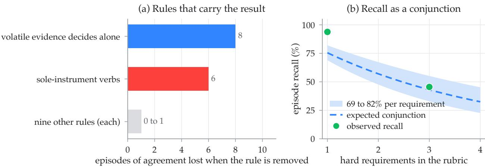  
Figure C.1 | Evidence rules and recall on the first AndroidWorld suite.

## C.2. Observation In<sub>p</sub>uts and Rollout A<sub>g</sub>ents

VeriCUA B<sub>y</sub> Observation In<sub>p</sub>ut. Table C.2 <sub>g</sub>ives VeriCUA’s accurac<sub>y,</sub> decision rate<sub>,</sub> share of verdicts <sub>res</sub>ti<sub>ng on s</sub>t<sub>ruc</sub>t<sub>ure</sub>d <sub>ev</sub>id<sub>ence, an</sub>d <sub>cos</sub>t <sub>un</sub>d<sub>er eac</sub>h <sub>o</sub>b<sub>serva</sub>ti<sub>on</sub> i<sub>npu</sub>t <sub>on</sub> W<sub>e</sub>bA<sub>rena.</sub>

Table C.2 | VeriCUA by observation input on WebArena.
<table><tr><td>Input</td><td>Acc</td><td>BalAcc</td><td>Decided</td><td>Structured Evidence</td><td>Tokens</td></tr><tr><td>Screenshots</td><td>80.0</td><td>80.0</td><td>33%</td><td>0%</td><td>234K</td></tr><tr><td>Screenshots + a11ytrees</td><td>80.0</td><td>80.0</td><td>75%</td><td>73%</td><td>252K</td></tr><tr><td>a11ytrees</td><td>76.7</td><td>76.7</td><td>85%</td><td>93%</td><td>178K</td></tr></table>

WebArena Per Rollout Agent. The WebArena results combine trajectories collected from three <sub>ro</sub>ll<sub>ou</sub>t <sub>agen</sub>t<sub>s.</sub> T<sub>a</sub>bl<sub>e</sub> C<sub>.</sub>3 <sub>g</sub>i<sub>ves</sub> th<sub>e resu</sub>lt<sub>s</sub> f<sub>or eac</sub>h <sub>agen</sub>t <sub>an</sub>d f<sub>or</sub> th<sub>e com</sub>bi<sub>ne</sub>d <sub>se</sub>t<sub>.</sub>

Table C.3 | WebArena results by rollout agent and overall.
<table><tr><td></td><td colspan="6">Rollout Agent</td><td colspan="2">Overall</td></tr><tr><td></td><td colspan="2">Claude Sonnet 4.6</td><td colspan="2">Gemini 3.1 Pro</td><td colspan="2">Gemini 3 Flash</td><td colspan="2"></td></tr><tr><td></td><td>Acc</td><td>BalAcc</td><td>Acc</td><td>BalAcc</td><td>Acc</td><td>BalAcc</td><td>Acc</td><td>BalAcc</td></tr><tr><td>VeriCUA (GUI + a11ytree)</td><td>79.9</td><td>80.3</td><td>84.3</td><td>85.3</td><td>83.8</td><td>83.9</td><td>82.7</td><td>83.1</td></tr><tr><td>CUAJudge</td><td>79.1</td><td>79.8</td><td>82.1</td><td>83.4</td><td>82.6</td><td>81.9</td><td>81.3</td><td>81.8</td></tr><tr><td>TRM</td><td>76.2</td><td>77.0</td><td>79.1</td><td>80.8</td><td>83.4</td><td>81.0</td><td>79.6</td><td>79.8</td></tr><tr><td>OS-Themis</td><td>70.3</td><td>69.8</td><td>80.0</td><td>79.4</td><td>75.9</td><td>74.1</td><td>75.4</td><td>74.3</td></tr></table>

Tree-Fe<sup>d</sup> Base<sup>li</sup>nes On We<sup>b</sup>Arena. T<sup>h</sup>e ju<sup>d</sup>ges are re-run w<sup>i</sup>t<sup>h</sup> a11ytrees a<sup>l</sup>one as t<sup>h</sup>e<sup>i</sup>r <sup>i</sup>nput, <sup>i</sup>n p<sup>l</sup>ace o<sup>f</sup> t<sup>h</sup>e GUI an<sup>d</sup> a11ytree <sup>i</sup>nput o<sup>f</sup> Ta<sup>bl</sup>e C.3, per ro<sup>ll</sup>out agent an<sup>d</sup> overa<sup>ll</sup> (Ta<sup>bl</sup>e C.4). Ver<sup>i</sup>CUA reta<sup>i</sup>ns <sup>i</sup>ts GUI an<sup>d</sup> a11ytree <sup>i</sup>nput <sup>i</sup>n t<sup>hi</sup>s compar<sup>i</sup>son.

Ta<sup>bl</sup>e C.4 | Accuracy an<sup>d</sup> <sup>b</sup>a<sup>l</sup>ance<sup>d</sup> accuracy on We<sup>b</sup>Arena w<sup>i</sup>t<sup>h</sup> t<sup>h</sup>e ju<sup>d</sup>ges rea<sup>di</sup>ng a11ytrees.
<table><tr><td rowspan="2"></td><td colspan="2">Claude Sonnet 4.6</td><td colspan="2">Gemini 3.1 Pro</td><td colspan="2">Gemini 3 Flash</td><td colspan="2">Overall</td></tr><tr><td>Acc</td><td>BalAcc</td><td>Acc</td><td>BalAcc</td><td>Acc</td><td>BalAcc</td><td>Acc</td><td>BalAcc</td></tr><tr><td>VeriCUA (GUI + a11ytree)</td><td>79.9</td><td>80.3</td><td>84.3</td><td>85.3</td><td>83.8</td><td>83.9</td><td>82.7</td><td>83.1</td></tr><tr><td>CUAJudge, tree-fed</td><td>77.8</td><td>77.9</td><td>83.0</td><td>84.3</td><td>82.6</td><td>80.0</td><td>81.1</td><td>80.8</td></tr><tr><td>TRM, tree-fed</td><td>74.5</td><td>74.9</td><td>80.4</td><td>81.4</td><td>80.9</td><td>77.4</td><td>78.6</td><td>78.1</td></tr><tr><td>OS-Themis, tree-fed</td><td>74.5</td><td>73.5</td><td>79.6</td><td>78.7</td><td>78.0</td><td>74.9</td><td>77.3</td><td>75.7</td></tr></table>

## C.3. Test-Time Scalin<sub>g</sub> and Bud<sub>g</sub>et

M<sub>u</sub>lti<sub>-</sub>P<sub>ass</sub> C<sub>om</sub>bi<sub>na</sub>ti<sub>on</sub> I<sub>n</sub> Th<sub>e</sub> O<sub>n</sub>li<sub>ne</sub> E<sub>nv</sub>i<sub>ronmen</sub>t<sub>.</sub> Th<sub>e mu</sub>lti<sub>-pass</sub> A<sub>n</sub>d<sub>ro</sub>idW<sub>or</sub>ld <sub>su</sub>it<sub>e compares</sub> <sub>repea</sub>t<sub>e</sub>d <sub>runs o</sub>f th<sub>e</sub> d<sub>e</sub>f<sub>au</sub>lt <sub>co</sub>d<sub>e an</sub>d <sub>s</sub>t<sub>ruc</sub>t<sub>ure</sub>d<sub>-s</sub>t<sub>a</sub>t<sub>e con</sub>fi<sub>gura</sub>ti<sub>on w</sub>ith <sub>a run</sub> th<sub>a</sub>t <sub>ena</sub>bl<sub>es v</sub>i<sub>sua</sub>l i<sub>nspec</sub>ti<sub>on, ca</sub>ll<sub>e</sub>d th<sub>e v</sub>i<sub>s</sub>i<sub>on</sub> f<sub>a</sub>llb<sub>ac</sub>k<sub>.</sub> Th<sub>ese ver</sub>ifi<sub>er runs an</sub>d th<sub>e au</sub>t<sub>o-genera</sub>t<sub>e</sub>d b<sub>ase</sub>li<sub>ne s</sub>h<sub>are one</sub> <sub>res</sub>t<sub>ore</sub>d <sub>snaps</sub>h<sub>o</sub>t <sub>per ep</sub>i<sub>so</sub>d<sub>e.</sub> T<sub>a</sub>bl<sub>e</sub> C<sub>.</sub>5 <sub>repor</sub>t<sub>s</sub> i<sub>n</sub>di<sub>v</sub>id<sub>ua</sub>l <sub>an</sub>d <sub>com</sub>bi<sub>ne</sub>d <sub>resu</sub>lt<sub>s.</sub> Addi<sub>ng v</sub>i<sub>sua</sub>l i<sub>nspec</sub>ti<sub>on</sub> i<sub>mproves agreemen</sub>t <sub>an</sub>d d<sub>ec</sub>i<sub>s</sub>i<sub>on ra</sub>t<sub>e over repea</sub>t<sub>e</sub>d d<sub>e</sub>f<sub>au</sub>lt <sub>runs,</sub> i<sub>nc</sub>l<sub>u</sub>di<sub>ng a</sub>t <sub>a ma</sub>t<sub>c</sub>h<sub>e</sub>d pass count. The combination rule also produces fewer incorrect fail verdicts than majority voting.

Table C.5 | Multi-pass combination in the online environment.
<table><tr><td>Pass</td><td>Agreement</td><td>Decision Rate</td><td>Decided Acc</td><td>False Positives</td><td>Wrong FAILS</td></tr><tr><td>draw 1</td><td>75.7</td><td>72.2</td><td>91.6</td><td>3</td><td>4</td></tr><tr><td>draw 2</td><td>79.1</td><td>77.4</td><td>92.1</td><td>3</td><td>4</td></tr><tr><td>draw 3</td><td>77.4</td><td>67.0</td><td>94.8</td><td>1</td><td>3</td></tr><tr><td>draw with vision fallback</td><td>76.5</td><td>73.0</td><td>90.5</td><td>3</td><td>5</td></tr><tr><td>three draws combined</td><td>80.9</td><td>78.3</td><td>95.6</td><td>2</td><td>2</td></tr><tr><td>three draws + vision fallback</td><td>87.0</td><td>87.0</td><td>96.0</td><td>2</td><td>2</td></tr><tr><td>draws 1, 2 + vision (equal cost)</td><td>84.3</td><td>85.2</td><td>94.9</td><td>3</td><td>2</td></tr><tr><td>three draws, majority vote</td><td>80.0</td><td>100</td><td>80.0</td><td>3</td><td>20</td></tr><tr><td>auto-generated verifier</td><td>78.3</td><td>100</td><td>78.3</td><td>4</td><td>21</td></tr></table>

B<sub>ase</sub>li<sub>ne</sub> B<sub>u</sub>d<sub>ge</sub>t<sub>.</sub> T<sub>a</sub>bl<sub>e</sub> C<sub>.</sub>6 <sub>repor</sub>t<sub>s</sub> th<sub>e</sub> OS<sub>-</sub>Th<sub>em</sub>i<sub>s</sub> b<sub>u</sub>d<sub>ge</sub>t <sub>a</sub>bl<sub>a</sub>ti<sub>on.</sub>

Table C.6 | OS-Themis budget ablation, mean balanced accuracy.
<table><tr><td>Configuration</td><td>BalAcc</td></tr><tr><td>OS-Themis, 4 milestones / 8 frames (used in the main text)</td><td>74.2</td></tr><tr><td>OS-Themis, 6 milestones / 12 frames (original budget)</td><td>75.9</td></tr><tr><td>CUAJudge</td><td>76.8</td></tr></table>

## C.4. Backbone Com<sub>p</sub>arisons

Single-Call Judges On Other Backbones. Results for the single-call judge of OSReward on several <sup>b</sup>ac<sup>kb</sup>ones appear a<sup>l</sup>ongs<sup>id</sup>e Ver<sup>i</sup>CUA on gemini-3-flash-preview <sup>i</sup>n Ta<sup>bl</sup>e C.7.

Table C.7 | The OSReward single-call judge by backbone, with VeriCUA for reference.

<table><tr><td rowspan="2">Judge</td><td colspan="2">OSReward-Hard</td><td colspan="2">OSReward full</td></tr><tr><td>Acc</td><td>BalAcc</td><td>Acc</td><td>BalAcc</td></tr><tr><td>VeriCUA (Gemini 3 Flash)</td><td>70.4</td><td>68.3</td><td>87.2</td><td>86.3</td></tr><tr><td>Gemini 3 Flash</td><td>57.0</td><td>65.2</td><td>87.0</td><td>88.2</td></tr><tr><td>Gemini 3.1 Pro</td><td>61.6</td><td>61.6</td><td>87.9</td><td>88.2</td></tr><tr><td>Claude Sonnet 4.6</td><td>59.2</td><td>68.1</td><td>87.7</td><td>88.9</td></tr><tr><td>Claude Opus 4.6</td><td>67.3</td><td>68.6</td><td>89.5</td><td>90.2</td></tr><tr><td>Claude Opus 4.8</td><td>69.7</td><td>69.7</td><td>89.7</td><td>90.0</td></tr><tr><td>GPT-5.5</td><td>67.3</td><td>67.0</td><td>89.5</td><td>89.8</td></tr></table>

B<sub>ac</sub>kb<sub>one</sub> St<sub>u</sub>d<sub>y</sub> I<sub>n</sub> Th<sub>e</sub> O<sub>n</sub>li<sub>ne</sub> E<sub>nv</sub>i<sub>ronmen</sub>t<sub>.</sub> T<sub>a</sub>bl<sub>e</sub> C<sub>.</sub>8 <sub>repea</sub>t<sub>s</sub> th<sub>e</sub> fl<sub>as</sub>h<sub>-</sub>t<sub>o-pro compar</sub>i<sub>son o</sub>f T<sub>a</sub>bl<sub>e</sub> 4 i<sub>n</sub> th<sub>e on</sub>li<sub>ne</sub> A<sub>n</sub>d<sub>ro</sub>idW<sub>or</sub>ld <sub>env</sub>i<sub>ronmen</sub>t<sub>.</sub>

Table C.8 | Accuracy and balanced accuracy in the online AndroidWorld environment with each f<sub>ramewor</sub>k <sub>on</sub> th<sub>e</sub> fl<sub>as</sub>h <sub>an</sub>d <sub>pro</sub> ti<sub>ers.</sub>
<table><tr><td rowspan="2">Judge</td><td colspan="3">Acc</td><td colspan="3">BalAcc</td></tr><tr><td>Flash</td><td>Pro</td><td>Δ</td><td>Flash</td><td>Pro</td><td>Δ</td></tr><tr><td>VLM judge</td><td>78.4</td><td>79.7</td><td>+1.3</td><td>77.5</td><td>78.5</td><td>+1.0</td></tr><tr><td>Auto-generated verifier</td><td>82.4</td><td>85.1</td><td>+2.7</td><td>82.7</td><td>85.4</td><td>+2.7</td></tr><tr><td>VeriCUA</td><td>90.5</td><td>91.9</td><td>+1.4</td><td>90.3</td><td>91.8</td><td>+1.5</td></tr></table>

## C.5. Com<sub>p</sub>utational Cost

Token usage per trajectory or episode is reported in Table C.9.

Table C.9 | Cost per trajectory or episode.
<table><tr><td>Setting</td><td>Method</td><td>Tokens</td></tr><tr><td>offline, WebArena (tree-fed, flash)</td><td>three judges together (4 calls)</td><td>43K-61K</td></tr><tr><td>offline, WebArena (GUI, pro)</td><td>three judges together (4 calls)</td><td>25K</td></tr><tr><td>offline, OSReward (GUI)</td><td>three judges together (4 calls)</td><td>33K-35K</td></tr><tr><td>offline, WebArena</td><td>VeriCUA</td><td>150K-208K</td></tr><tr><td>offline, OSReward</td><td>VeriCUA</td><td>345K-378K</td></tr><tr><td>online, first suite</td><td>auto-generated verifier</td><td>16.2K (60 s)</td></tr><tr><td>online, first suite</td><td>VeriCUA</td><td>39.2K (97 s)</td></tr><tr><td>online, multi-pass suite</td><td>auto-generated verifier</td><td>21K</td></tr><tr><td>online, multi-pass suite</td><td>VeriCUA, per pass</td><td>43K-51K</td></tr></table>

O<sub>n</sub> A<sub>n</sub>d<sub>ro</sub>idW<sub>or</sub>ld<sub>, a snaps</sub>h<sub>o</sub>t l<sub>oa</sub>d <sub>res</sub>t<sub>ores</sub> th<sub>e en</sub>d <sub>s</sub>t<sub>a</sub>t<sub>e</sub> i<sub>n a</sub>b<sub>ou</sub>t fift<sub>een secon</sub>d<sub>s.</sub> O<sub>ne ver</sub>ifi<sub>er pass</sub> t<sub>a</sub>k<sub>es a</sub>b<sub>ou</sub>t 100 <sub>secon</sub>d<sub>s per ep</sub>i<sub>so</sub>d<sub>e, o</sub>f <sub>w</sub>hi<sub>c</sub>h <sub>c</sub>h<sub>ec</sub>k<sub>er syn</sub>th<sub>es</sub>i<sub>s</sub> t<sub>a</sub>k<sub>es a</sub>b<sub>ou</sub>t h<sub>a</sub>lf <sub>an</sub>d <sub>pre</sub>di<sub>ca</sub>t<sub>e</sub> <sub>eva</sub>l<sub>ua</sub>ti<sub>on a</sub>b<sub>ou</sub>t <sub>a</sub> thi<sub>r</sub>d<sub>, w</sub>ith <sub>ge</sub>tt<sub>er execu</sub>ti<sub>on an</sub>d <sub>con</sub>t<sub>ex</sub>t i<sub>nspec</sub>ti<sub>on</sub> t<sub>a</sub>ki<sub>ng un</sub>d<sub>er</sub> t<sub>en secon</sub>d<sub>s</sub> to<sub>g</sub>et<sup>h</sup>er.

## C<sub>.</sub>6<sub>.</sub> C<sub>on</sub>fid<sub>en</sub>t F<sub>a</sub>il<sub>ures an</sub>d G<sub>o</sub>ld<sub>-</sub>L<sub>a</sub>b<sub>e</sub>l A<sub>u</sub>dit

Confident Failure Verdicts. For ofline verification, we start with all initial fail judgments and retain those for which exploration also yields a decided fail. Initial judgments use the last five <sub>ava</sub>il<sub>a</sub>bl<sub>e</sub> f<sub>rames.</sub> E<sub>v</sub>id<sub>ence aggrega</sub>ti<sub>on uses</sub> th<sub>ree pa</sub>th<sub>s, a met</sub> th<sub>res</sub>h<sub>o</sub>ld <sub>o</sub>f 0<sub>.</sub>67<sub>, an</sub>d <sub>an unmet</sub> f<sub>rac</sub>ti<sub>on o</sub>f 0<sub>.</sub>4<sub>.</sub>

F<sub>a</sub>il<sub>ure prec</sub>i<sub>s</sub>i<sub>on</sub> i<sub>s</sub> th<sub>e</sub> f<sub>rac</sub>ti<sub>on o</sub>f <sub>pre</sub>di<sub>c</sub>t<sub>e</sub>d <sub>fail ver</sub>di<sub>c</sub>t<sub>s</sub> th<sub>a</sub>t <sub>ma</sub>t<sub>c</sub>h th<sub>e re</sub>f<sub>erence</sub> l<sub>a</sub>b<sub>e</sub>l<sub>s.</sub> R<sub>e</sub>t<sub>en</sub>ti<sub>on</sub> i<sub>s</sub> the selected subset size divided by the number of initial fail judgments. Figure 6 connects these two <sub>se</sub>l<sub>ec</sub>ti<sub>ons w</sub>ithi<sub>n eac</sub>h <sub>co</sub>h<sub>or</sub>t<sub>;</sub> T<sub>a</sub>bl<sub>e</sub> C<sub>.</sub>10 <sub>prov</sub>id<sub>es</sub> th<sub>e</sub>i<sub>r coun</sub>t<sub>s.</sub> W<sub>e</sub>bA<sub>rena uses</sub> it<sub>s o</sub>fi<sub>c</sub>i<sub>a</sub>l <sub>re</sub>f<sub>erence</sub> l<sub>a</sub>b<sub>e</sub>l<sub>s, an</sub>d OSR<sub>ewar</sub>d <sub>uses</sub> h<sub>uman</sub> l<sub>a</sub>b<sub>e</sub>l<sub>s.</sub> OSR<sub>ewar</sub>d<sub>-</sub>H<sub>ar</sub>d i<sub>s</sub> i<sub>nc</sub>l<sub>u</sub>d<sub>e</sub>d i<sub>n</sub> OSR<sub>ewar</sub>d f<sub>u</sub>ll<sub>.</sub>

Table C.10 | Initial failure judgments and the subset retained after exploration.
<table><tr><td rowspan="2">Dataset</td><td rowspan="2">Total N</td><td colspan="2">Initial FAIL</td><td colspan="2">Selected FAIL</td><td rowspan="2">Retained (%)</td></tr><tr><td>Correct / n Prec. (%)</td><td></td><td>Correct / n Prec. (%)</td><td></td></tr><tr><td>WebArena</td><td>715</td><td>381/431</td><td>88.4</td><td>195/212</td><td>92.0</td><td>49.2</td></tr><tr><td>OSReward full</td><td>1019</td><td>524/625</td><td>83.8</td><td>166/179</td><td>92.7</td><td>28.6</td></tr><tr><td>OSReward-Hard</td><td>284</td><td>148/185</td><td>80.0</td><td>48/54</td><td>88.9</td><td>29.2</td></tr></table>

Gold-Label Audit. The gold-label audit uses 814 recorded trajectories from AndroidWorld, OSWorld, and WebArena. A trajectory is flagged when a decided VeriCUA verdict contradicts the benchmark’s gold label, which happens on 81 of them. A single-blind adjudicator, a model from a diferent family than the verifier’s backbone, then re-judges each flagged trajectory from scratch. It sees only the i<sub>ns</sub>t<sub>ruc</sub>ti<sub>on,</sub> th<sub>e</sub> <sub>agen</sub>t’<sub>s</sub> th<sub>oug</sub>ht <sub>an</sub>d <sub>ac</sub>ti<sub>on</sub> l<sub>og,</sub> <sub>an</sub>d <sub>up</sub> t<sub>o</sub> t<sub>en</sub> <sub>even</sub>l<sub>y</sub> <sub>space</sub>d f<sub>rames</sub> i<sub>nc</sub>l<sub>u</sub>di<sub>ng</sub> th<sub>e</sub> l<sub>as</sub>t <sub>one, never</sub> th<sub>e ver</sub>ifi<sub>er</sub>’<sub>s ver</sub>di<sub>c</sub>t<sub>,</sub> th<sub>e go</sub>ld l<sub>a</sub>b<sub>e</sub>l<sub>, or</sub> th<sub>e ver</sub>ifi<sub>er</sub>’<sub>s reason</sub>i<sub>ng, an</sub>d it <sub>may answer</sub> success, fail, or unsure.

A flag counts as confirmed when the adjudicator sides with VeriCUA against gold. Of the 81 flags, 51 <sub>are con</sub>fi<sub>rme</sub>d<sub>,</sub> 20 <sub>re</sub>f<sub>u</sub>t<sub>e</sub>d<sub>, an</sub>d 10 l<sub>e</sub>ft <sub>unsure, w</sub>ith <sub>unsure</sub> k<sub>ep</sub>t i<sub>n</sub> th<sub>e</sub> d<sub>enom</sub>i<sub>na</sub>t<sub>or.</sub> O<sub>n</sub> OSW<sub>or</sub>ld<sub>,</sub> the adjudicator confirms 37 of 57 flags. A second adjudicator, run under the same blind protocol, <sub>con</sub>fi<sub>rms</sub> 34 <sub>o</sub>f th<sub>e</sub> 51 fl<sub>ags</sub> it d<sub>ec</sub>id<sub>es, exc</sub>l<sub>u</sub>di<sub>ng</sub> it<sub>s unsure cases</sub> f<sub>rom</sub> th<sub>a</sub>t d<sub>enom</sub>i<sub>na</sub>t<sub>or.</sub> I<sub>n</sub> th<sub>e</sub> <sub>on</sub>li<sub>ne</sub> OSW<sub>or</sub>ld <sub>env</sub>i<sub>ronmen</sub>t<sub>, a</sub>b<sub>ou</sub>t 18 <sub>o</sub>f V<sub>er</sub>iCUA’<sub>s</sub> 28 f<sub>a</sub>l<sub>se pos</sub>iti<sub>ves are ep</sub>i<sub>so</sub>d<sub>es</sub> th<sub>a</sub>t th<sub>e o</sub>fi<sub>c</sub>i<sub>a</sub>l <sub>eva</sub>l<sub>ua</sub>t<sub>or mar</sub>k<sub>s fail</sub> i<sub>n error.</sub>

## D<sub>.</sub> Case Studies

E<sub>ac</sub>h <sub>car</sub>d <sub>s</sub>h<sub>ows</sub> th<sub>e</sub> i<sub>ns</sub>t<sub>ruc</sub>ti<sub>on an</sub>d th<sub>e</sub> f<sub>rames or mac</sub>hi<sub>ne rea</sub>d<sub>s</sub> th<sub>e ver</sub>ifi<sub>er c</sub>it<sub>e</sub>d<sub>.</sub> Th<sub>e summar</sub> b<sub>e</sub>l<sub>ow</sub> it <sub>g</sub>i<sub>ves</sub> th<sub>e</sub> <sub>ver</sub>di<sub>c</sub>t <sub>aga</sub>i<sub>ns</sub>t <sub>go</sub>ld <sub>an</sub>d th<sub>e</sub> b<sub>ase</sub>li<sub>nes,</sub> th<sub>e</sub> <sub>ru</sub>b<sub>r</sub>i<sub>c</sub> <sub>w</sub>ith <sub>eac</sub>h <sub>requ</sub>i<sub>remen</sub>t’<sub>s</sub> fi<sub>na</sub>l <sub>s</sub>t<sub>a</sub>t<sub>us,</sub> <sub>an</sub>d th<sub>e</sub> t<sub>ype</sub>d <sub>ev</sub>id<sub>ence</sub> th<sub>e ar</sub>bit<sub>er use</sub>d<sub>.</sub>

## D.1. Online Environments

Th<sub>e ver</sub>ifi<sub>er rea</sub>d<sub>s</sub> th<sub>e</sub> li<sub>ve mac</sub>hi<sub>ne a</sub>ft<sub>er</sub> th<sub>e ep</sub>i<sub>so</sub>d<sub>e en</sub>d<sub>s.</sub>

MOBILE

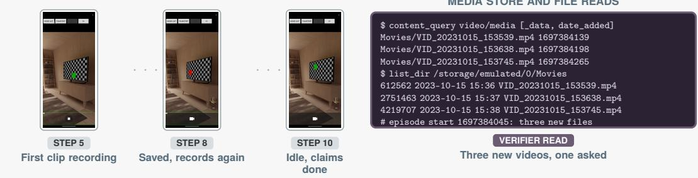

MISS REASON The VLM judge sees an idle camera with a saved thumbnail, and the generated script returns on the first video it finds without counting; both certify the run.

## VERIFICATION SUMMARY

## Gold fail Agent claimed complete

RUBRIC

✗ Exactly one new video since the episode began.

◦ The new video sits in a standard media directory.

## VLM judge success Generated verifier success VeriCUA fail

## EVIDENCE

• content\_query on the video media store, persistent: three rows added after the start.

• list\_dir and find over Movies, persistent: the same three files, written one minute apart.

• Three of the four verifier passes decide fail on this evidence; the fourth abstains.

Figure D.1 | A false completion claim refuted from the media store. The agent recorded three clips for one requested video, <sub>an</sub>d b<sub>o</sub>th b<sub>ase</sub>li<sub>nes cer</sub>tifi<sub>e</sub>d th<sub>e run.</sub>

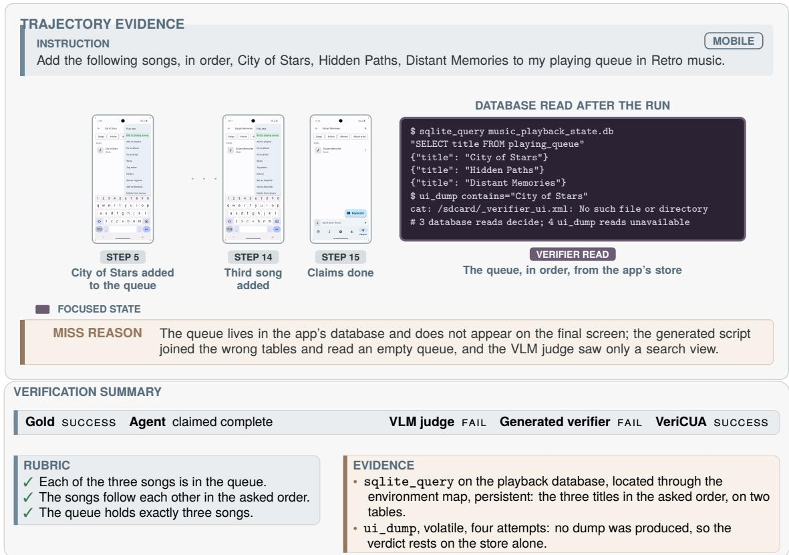  
Figure D.2 | A success that only the app’s store can attest. The queue is read from the playback database in the asked order, <sub>w</sub>hil<sub>e</sub> b<sub>o</sub>th b<sub>ase</sub>li<sub>nes</sub> f<sub>a</sub>il th<sub>e run.</sub>

## D.2. Recorded Trajectories

H<sub>ere</sub> th<sub>e ver</sub>ifi<sub>er</sub> h<sub>as no</sub>thi<sub>ng</sub> b<sub>u</sub>t th<sub>e</sub> f<sub>rames an</sub>d l<sub>ogs</sub> th<sub>e recor</sub>di<sub>ng</sub> k<sub>ep</sub>t<sub>.</sub>

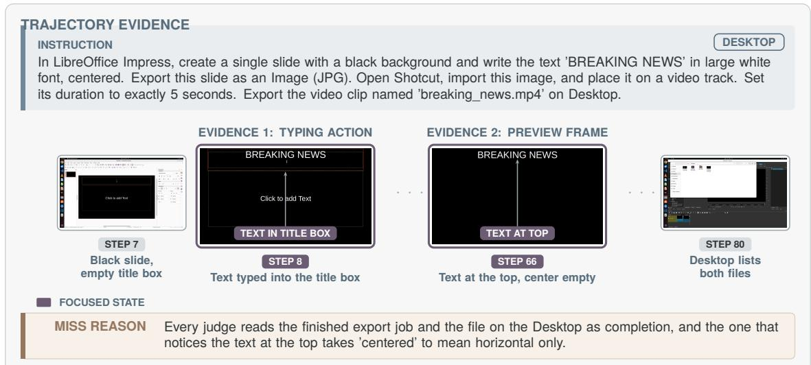

## VERIFICATION SUMMARY

RUBRIC

✗ The text is centered in the video frame.

◦ Six further requirements on the files, colors, and duration, left unsettled.

## EVIDENCE

• The preview frame at step 66, post-efect frame: the text sits at the top over an empty black field, read on all three paths.

• inspect\_action at step 7, post-efect frame: the text was typed into the slide’s title placeholder, which fixed its position.

Figure D.3 | A long desktop recording that every judge passes on the finished export. The verifier reads the preview frame <sub>an</sub>d fi<sub>n</sub>d<sub>s</sub> th<sub>e</sub> t<sub>ex</sub>t <sub>a</sub>t th<sub>e</sub> t<sub>op ra</sub>th<sub>er</sub> th<sub>an cen</sub>t<sub>ere</sub>d<sub>.</sub>  
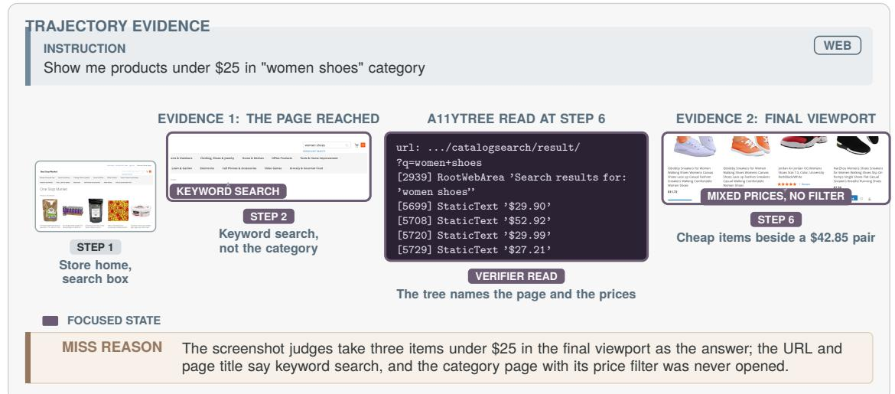

## VERIFICATION SUMMARY

Gold fail Agent stopped without a claim TRM success CUAJudge success OS-Themis success VeriCUA fail

## RUBRIC

✗ The page is the women’s shoes category.

✗ Every listed price is under \$25.

## EVIDENCE

• read\_a11y at step 6, structured state: the URL and the page title name a keyword search for “women shoes”, read on all three paths.

• The same tree lists several prices above \$25, so no price filter was applied.

F<sup>i</sup>gure D.4 | A we<sup>b</sup> trajectory w<sup>h</sup>ose <sup>fi</sup>na<sup>l</sup> screen s<sup>h</sup>ows c<sup>h</sup>eap s<sup>h</sup>oes. T<sup>h</sup>e a11ytree names t<sup>h</sup>e page a <sup>k</sup>eywor<sup>d</sup> searc<sup>h</sup> <sub>ra</sub>th<sub>er</sub> th<sub>an</sub> th<sub>e</sub> <sub>ca</sub>t<sub>egory</sub> <sub>page</sub> <sub>an</sub>d li<sub>s</sub>t<sub>s</sub> <sub>pr</sub>i<sub>ces</sub> <sub>a</sub>b<sub>ove</sub> th<sub>e</sub> li<sub>m</sub>it<sub>.</sub>

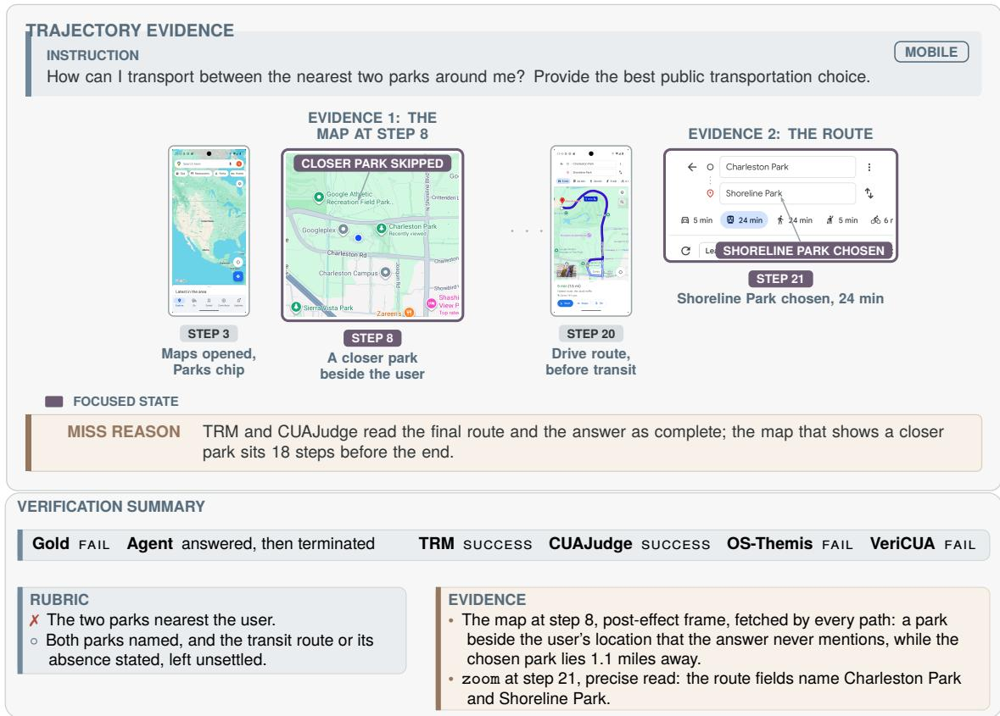  
Figure D.5 | A mobile recording whose answer reads well. The map 18 steps before the end shows a closer park than the one the agent chose, and two of three judges passed it.

## E<sub>.</sub> Li<sub>m</sub>it<sub>a</sub>ti<sub>ons</sub> <sub>an</sub>d B<sub>roa</sub>d<sub>er</sub> I<sub>mpac</sub>t<sub>s</sub>

V<sub>er</sub>iCUA t<sub>ra</sub>d<sub>es cos</sub>t f<sub>or ev</sub>id<sub>ence.</sub> A <sub>ver</sub>ifi<sub>ca</sub>ti<sub>on pass</sub> i<sub>ssues</sub> t<sub>ens o</sub>f t<sub>oo</sub>l <sub>ca</sub>ll<sub>s an</sub>d <sub>mo</sub>d<sub>e</sub>l <sub>ca</sub>ll<sub>s per</sub> trajectory, an order of magnitude more than a single-call judge, so it suits filtering and reward assignment better than interactive use. On recorded trajectories it abstains wherever the recording h<sub>o</sub>ld<sub>s no ev</sub>id<sub>ence</sub> f<sub>or a requ</sub>i<sub>remen</sub>t<sub>.</sub> Th<sub>ose a</sub>b<sub>s</sub>t<sub>en</sub>ti<sub>ons are a coverage</sub> li<sub>m</sub>it<sub>, an</sub>d <sub>on</sub>li<sub>ne access</sub> lift<sub>s</sub> it <sub>on</sub>l<sub>y</sub> f<sub>or env</sub>i<sub>ronmen</sub>t<sub>s</sub> th<sub>a</sub>t <sub>can</sub> b<sub>e</sub> i<sub>ns</sub>t<sub>rumen</sub>t<sub>e</sub>d<sub>.</sub> A <sub>s</sub>t<sub>oc</sub>h<sub>as</sub>ti<sub>c ver</sub>ifi<sub>er a</sub>l<sub>so nee</sub>d<sub>s</sub> it<sub>s</sub> d<sub>raw-</sub>t<sub>o-</sub>d<sub>raw</sub> spread reported beside every comparison, as we do. Reliable trajectory verification lowers the cost <sub>o</sub>f t<sub>ra</sub>i<sub>n</sub>i<sub>ng compu</sub>t<sub>er-us</sub>i<sub>ng agen</sub>t<sub>s an</sub>d <sub>o</sub>f <sub>au</sub>diti<sub>ng</sub> b<sub>enc</sub>h<sub>mar</sub>k l<sub>a</sub>b<sub>e</sub>l<sub>s.</sub> Th<sub>e same mac</sub>hi<sub>nery cou</sub>ld b<sub>e</sub> <sub>m</sub>i<sub>suse</sub>d t<sub>o cer</sub>tif<sub>y agen</sub>t<sub>s</sub> th<sub>a</sub>t <sub>ac</sub>t <sub>on rea</sub>l <sub>sys</sub>t<sub>ems, w</sub>hi<sub>c</sub>h i<sub>s one reason</sub> V<sub>er</sub>iCUA <sub>never wr</sub>it<sub>es</sub> t<sub>o</sub> th<sub>e</sub> <sub>env</sub>i<sub>ronmen</sub>t it <sub>ver</sub>ifi<sub>es.</sub>

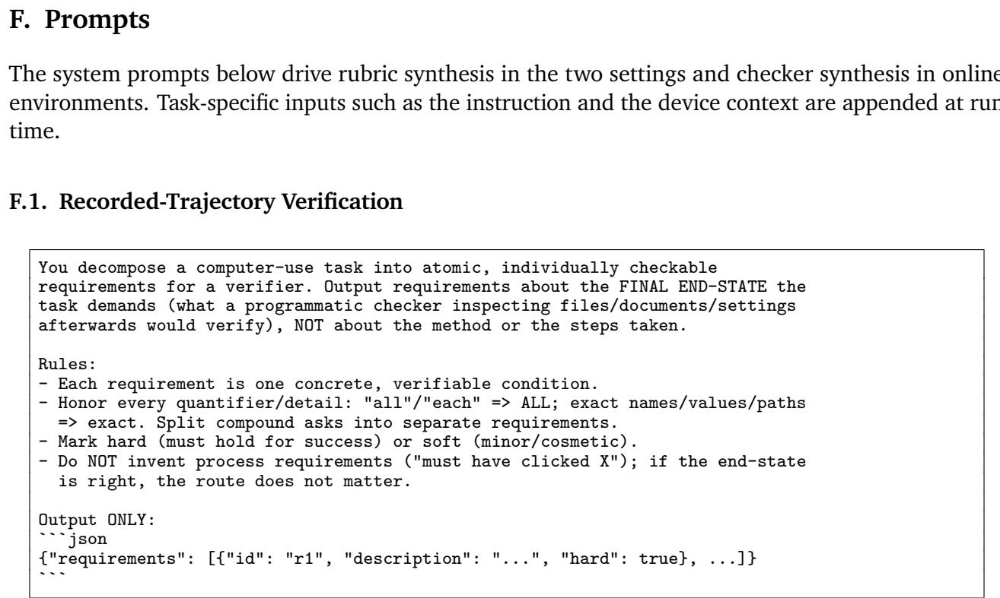  
Prompt F.1 | Rubric synthesis on recorded trajectories.

## F<sub>.</sub>2<sub>.</sub> O<sub>n</sub>li<sub>ne</sub> V<sub>er</sub>ifi<sub>ca</sub>ti<sub>on</sub>

```jsonl
You author verification requirements for tasks executed on an Android device.
Given a task instruction, produce the END-STATE requirements a strict human
examiner would check AFTER the task supposedly finished.
Rules:
- END-STATE only: describe what must be true of the device state, never the
procedure ("brightness setting equals maximum", not "user opened settings").
- Atomic: one checkable fact per requirement. Split name vs content vs location.
- Strict reading: if the instruction names a value, place, or format, it is
required exactly; include implicit artifacts (a created note must exist AND
contain the given text).
- hard=true for requirements whose failure fails the task; hard=false for
cosmetic/soft ones.
Only what the instruction implies: do NOT add adjacent settings, modes, or
hygiene the instruction never mentions (no invented requirements).
COUNTS ARE EXACT: "take one video" means exactly one new video was created,
not at least one; "log the reimbursable transactions" means exactly that set
was added — nothing missing, nothing extra. When the instruction quantifies,
produce a requirement for the exact count or exact set of NEW artifacts
(relative to the episode start), not mere existence.
- Do NOT bind platform-specific encodings or exact constants the instruction
does not state: say "the minimum value the system allows", never "(0)".
Resolving concrete encodings is the checkers' job, not yours.
- Do NOT bind storage locations or app conventions the instruction does not
name ("a photo was taken" requires a new image in SOME standard media
location, not specifically DCIM). Location is a requirement only when the
instruction states one.
Output ONLY JSON:
```json
{"requirements": [{"id": "r1", "description": "...", "hard": true}]}
```  
Prompt F.2 | Rubric synthesis in online environments.

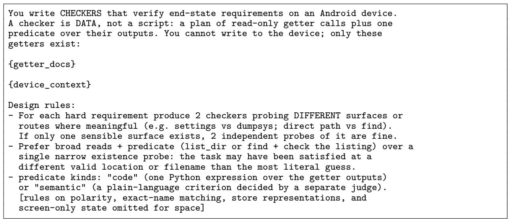  
Prompt F.3 | Checker synthesis in online environments, shortened where marked.