# The DynaCell Evaluation Suite for Dynamic 3D Virtual Staining of Live Cells

Alexandr A. Kalinin<sup>1∗</sup> Dihan Zheng<sup>2∗</sup> Taylla Milena Theodoro<sup>1∗</sup> Ivan Ivanov<sup>1</sup> Eduardo Hirata-Miyasaki<sup>1</sup> See-Chi Lee<sup>1</sup> Aofei Liu<sup>1</sup> Sricharan Reddy Varra<sup>1</sup> Talon Chandler<sup>1</sup> Soorya Pradeep<sup>1</sup> Chad Liu<sup>1</sup> Manuel D. Leonetti<sup>1</sup> Carolina Arias<sup>1</sup> Bo Huang<sup>2†</sup> Shalin B. Mehta<sup>1†</sup>

<sup>1</sup>Biohub, San Francisco, 94158 <sup>2</sup>UCSF, San Francisco, 94158

## Abstract

Understanding how cells respond to perturbations over time is central to cell biology and drug discovery. Live-cell imaging captures the dynamics of perturbationinduced phenotypes in individual cells. While fluorescence imaging can visualize specific molecular phenotypes, labeling and repeated illumination often affect cell health. Virtual staining offers an alternative by predicting these fluorescence images from images acquired without fluorescent labels. Although many virtual staining models have been developed, their performance on volumetric time-lapse data remains poorly characterized. We address this gap with an evaluation suite for 3D time-lapse virtual staining of live cells. The suite combines paired 3D time-lapse images acquired with and without fluorescent labels, a set of baseline models, and three metric tiers measuring pixel-level fidelity, organelle segmentation performance, and single-cell phenotype similarity. Using this evaluation suite, we study metric and model behavior across 3 cell types, 2 microscopes, 4 organelles, and 3 perturbation states. We find that regression baselines better predict the spatial localization of target organelles, whereas the generative baseline better captures the distribution of phenotypes across cells. These differences expose trade-offs between structural and phenotypic fidelity that are obscured by single-metric evaluation and suggest how virtual staining models can be developed for diverse downstream tasks such as localization, segmentation, tracking, and phenotypic profiling. We release the curated datasets, baseline checkpoints, and evaluation code as part of DynaCell, a broader framework for image-based profiling of cell-state dynamics.

## 1 Introduction

Image-based profiling of cells under genetic and chemical perturbations has become central to scalable cell biology and drug discovery [1, 2]. Many perturbations induce changes in organelle or ganization and cellular state that unfold over time at different rates. However, capturing these dy namics with repeated live-cell measurements requires balancing the molecular specificity of flu orescence imaging against phototoxicity, photobleaching, and other effects on cell health. Virtual staining addresses this trade-off by predicting fluorescence-like images of cell structures from transmitted-light images acquired without fluorescent labels (“label-free” imaging). The same cells can then be imaged repeatedly over time, without genetic modification or fluorescent dyes [3, 4, 5]. Many image-to-image translation models have been developed for cell virtual staining [3, 4, 6, 7, 8, 9, 10, 11, 12, 13, 14, 15, 16] and applied to downstream tasks including nucleus and cell segmentation [17, 18], label-free tracking [19, 20], and perturbation profiling [8, 9]. However, their performance on volumetric time-lapse data remains poorly characterized, limiting both the practical use of virtual staining in biological studies and further method development.

## 3D time-lapse paired label-free and fluorescence imagingA

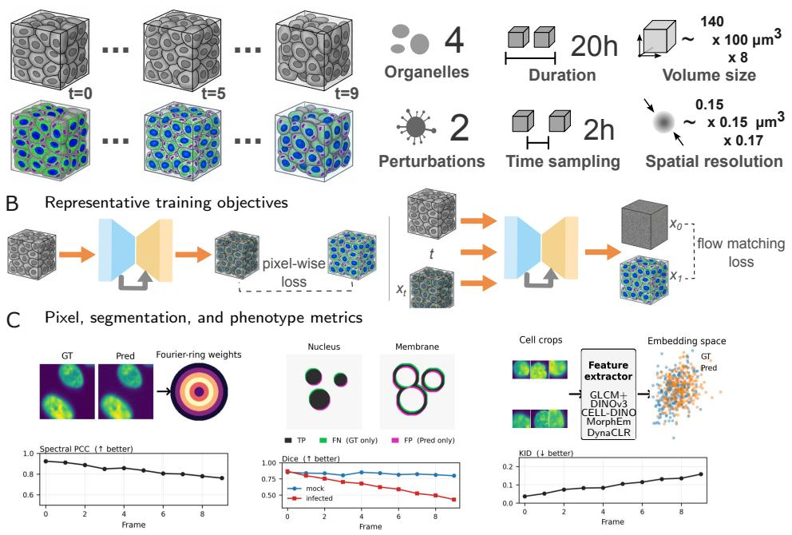  
Figure 1: DynaCell evaluation suite. The suite consists of (A) high-resolution 3D time-lapse multichannel datasets, (B) regression, adversarial, and generative virtual-staining baselines trained and evaluated with a consistent protocol, and (C) three metric tiers that compare experimental fluorescence with virtual stains at the pixel, segmentation, and phenotype levels. Spectral PCC reduces sensitivity to noise in experimental fluorescence.

Evaluation of virtual staining for live-cell profiling is constrained by limited paired live-cell data and inconsistent protocols. Public paired collections are predominantly static and 2D [21, 22, 23, 24]. Paired 3D data are less common, particularly time-lapse series capturing cell-state changes in response to perturbations [4, 25, 6, 26]. Most studies report only pixel-level reconstruction metrics [3, 4, 7, 10, 11, 12, 13, 24], which measure resemblance to the target but not whether predictions can replace experimental fluorescence in organelle localization, segmentation, cell tracking, or phenotypic profiling. Segmentation [6, 14, 15, 16] and feature-level metrics [8, 9, 16] are less common and are rarely combined under shared splits and baselines.

To address these gaps, we introduce an evaluation suite for 3D time-lapse virtual staining of live cells, built around three linked components (Fig. 1). This evaluation suite is part of DynaCell, a broader framework for image-based profiling of cell-state dynamics.

Data. To enable model comparison on dynamic live-cell data, we contribute a high-resolution 3D time-lapse A549 dataset acquired with paired label-free and light-sheet fluorescence imaging (Fig. 1A). The dataset covers 20 hours of imaging of 4 organelle targets: nucleus, plasma membrane, endoplasmic reticulum (ER), and mitochondria. Infection with Zika virus (ZIKV) or Dengue virus (DENV) induces organelle remodeling over time [27, 28]. A semi-automated preprocessing and quality-control pipeline reduces the raw data to a curated, model-ready subset (App. F.4). The curated dataset contains 262 field-of-view (FOV) time-lapse series across 12 organelle–condition combinations (four organelles under Mock, ZIKV, or DENV conditions). The test set contains 12 FOVs per organelle–condition combination; the remaining quality-controlled FOVs form the A549 training set. We also contribute reprocessed, curated subsets of other datasets for evaluation across cell types and microscopes: the Allen Institute WTC-11 human induced pluripotent stem cell (hiPSC) dataset [25] and the Biohub human embryonic kidney (HEK293T) dataset [26].

Baseline models. To establish reference models, we train regression baselines ranging from a widely used 3D U-Net variant [4] to modern convolutional models with masked-autoencoder pretraining [15]. We also implement a 3D extension of the popular pix2pix model [29] and a 3D flow-matching model based on the 2D diffusion model CELL-Diff [30] (Fig. 1B).

Metrics. To evaluate virtual stains beyond image reconstruction alone, we use a three-tier panel spanning pixel-level fidelity, organelle-segmentation utility, and single-cell phenotype similarity (Fig. 1C). We also introduce a frequency-aware variant of the Pearson correlation coefficient (PCC) to reduce sensitivity to noise in experimental fluorescence targets.

We release preprocessed data, trained model checkpoints, and reusable evaluation code for reproducible comparison. Together, these components help determine when virtual stains can support live-cell biological measurements, how failure modes can inform metric selection and model training, and how model choices affect downstream use.

## 2 Background and Related Work

Virtual staining methods. Early virtual staining models [4, 3] were U-Net [31] variants trained with pixel-wise mean absolute error (MAE) or mean squared error (MSE) regression losses. Subsequent work modernized the convolutional backbone [6, 15], added self-attention modules [7], predicted multiple organelles [12], or pretrained encoders on unannotated label-free images [10, 13, 15]. Training objectives have also incorporated structural similarity [14, 15], segmentation [14, 16], and adversarial losses [8, 14, 11, 24, 32]. Generative models that sample from a conditional distribution offer an alternative to regression. These models, including conditional diffusion [9, 30] and autoregressive [33] models, remain limited to 2D virtual staining.

Virtual staining datasets and benchmarks. Virtual staining models and their evaluation are currently limited by the available paired data, because 2D images contain no depth information needed for resolving 3D organelle structure [34, 35, 36], static volumes contain no temporal information about cellular dynamics or perturbation responses, and small collections cover few cell states and conditions. Paired 2D static-snapshot datasets are available [21, 22, 23, 24], but only Light My Cells [22], Trizna et al. [23], and VIRVS [24] provide both baselines and scoring protocols, and none combine pixel, segmentation, and phenotype metrics. Paired 3D collections are rare and still lack a time axis [4, 6, 25]. Public paired 3D time-lapse data are scarce [26] and lack the scale, organelle coverage, and perturbation panels needed for systematic evaluation (App. Tab. 2).

Metrics for evaluating virtual staining. Pixel-level metrics such as peak signal-to-noise ratio (PSNR), structural similarity index measure (SSIM) [37], normalized root mean square error (NRMSE), and PCC dominate virtual-staining evaluation [3, 4, 7, 12, 24, 10, 11, 13, 22]. Naturalimage quality metrics span only a small part of their nominal range, and their values vary with cell line, seeding density, and fluorescence channel [38]. Microscopy-specific metrics such as Fourier shell correlation [39, 40] and MicroSSIM [41] are used less frequently [16, 38], although they can be more sensitive to fine spatial structures of organelles. Segmentation metrics are computed on masks derived from predicted and reference fluorescence. They are reported less commonly [6, 23, 14, 15, 16] and measure whether a virtual stain can support downstream tasks such as organelle localization or cell tracking. Feature-level metrics are also uncommon [8, 9, 32, 42, 16]. They use feature extractors such as CellProfiler [43] or learned encoders to represent each cell, then compare predictions and experiments in the resulting feature spaces.

Generalization. Tonks et al. [32] found that 2D virtual-nucleus and virtual-cytoplasm models trained on control conditions generalized to toxic conditions with the high compound concentrations and apoptosis-inducing compounds, whereas generalization to unseen cell types depended on the cell type. CellProfiler [43] features revealed failures missed by pixel- and instance-level scores. Cytoland [15] showed that data augmentation and self-supervised pretraining improved the robustness of virtual staining across imaging parameters, cell states, and cell types.

The DynaCell evaluation suite addresses these gaps together. We reprocess a curated subset of the Allen Institute WTC-11 hiPSC dataset, the largest available paired 3D live-cell dataset, for paired training and in-distribution evaluation (Sec. 3.2). We combine the iPSC dataset with a new 3D timelapse A549 dataset covering four organelles and three perturbation states (Sec. 3.1), regression, adversarial, and generative baselines trained with a consistent protocol (Sec. 5), and a three-tier evaluation that combines pixel, segmentation, and feature-level metrics (Sec. 4).

## 3 Evaluation Data

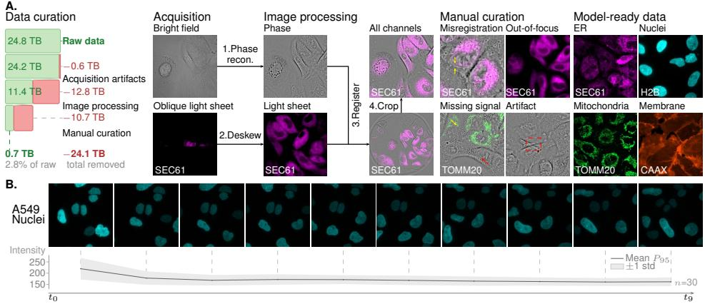  
Figure 2: A549 preprocessing and photobleaching. (A) Preprocessing the raw 3D movies (∼25 TB) includes quantitative phase reconstruction in the label-free channel, fluorescence deskewing, 3D channel registration, cropping, manual curation, and subsampling. The resulting Zarr store is <1 TB. (B) Nuclear fluorescence intensity decreases during imaging, motivating the frequencyaware Spectral PCC metric (Sec. 4).

## 3.1 A549 dataset (Biohub imaging infectomics dataset)

The A549 dataset contains 3D time-lapse volumes of live A549 cells. Each transmitted-light (“labelfree”) image is paired with a fluorescence image of the same cells at the same time point (Fig. 1A). Volumes are acquired on the Mantis microscope [26], which simultaneously captures label-free and light-sheet fluorescence channels at near-isotropic sampling with $0 . 1 7 4 \times 0 . 1 4 9 4 \times 0 . 1 4 9 4 \mu \mathrm { m }$ (ZYX) voxel spacing. Low-phototoxicity light-sheet illumination enables continuous imaging over 20 hours. At each time point, each FOV includes a brightfield stack paired with a light-sheet fluorescence stack for one of the four markers: H2B (nucleus), a CAAX membrane-targeting motif (plasma membrane), SEC61B (endoplasmic reticulum), or TOMM20 (mitochondria) [44]. These four organelles are perturbed by Zika and Dengue infection, which has previously been shown to cause their remodeling [27, 28]. These organelles span nuclear morphology, cell boundaries, and intracellular architecture, revealing cell-state dynamics across scales.

Data preprocessing and curation. We reconstruct quantitative phase volumes from brightfield stacks [45], deskew the light-sheet fluorescence stacks, and register the two modalities using a separate calibration field of view containing fluorescent beads [26]. We crop the registered data to retain overlapping regions around the focal plane and exclude time points affected by acquisition or pro cessing failures. We subsample the A549 time-lapses onto a shared 2-hour grid to compare plates at matching times after infection. Lastly, manual inspection identifies remaining problems, including out-of-focus images, missing fluorescence, and imaging artifacts. Together, image processing and curation reduce the raw data to a model-ready subset for each organelle (Fig. 2A; details in App. F.4). Even with light-sheet imaging, fluorescent labels photobleach over the multihour acquisition, reduc ing fluorescence intensity over time (Fig. 2B). This signal variation motivates the frequency-aware Spectral PCC metric (Sec. 4).

Splits and benchmarking axes. The dataset contains 118 training FOVs and 144 test FOVs, with balanced test coverage across organelles and conditions and approximately 17,000 test cells. Training and test FOVs come from distinct well positions. For each model, we hold out 20% of the training FOVs for validation with a fixed random seed and do not train on them. The test set is never used for training, checkpoint selection, or hyperparameter tuning. We also include an untreated, unpaired movie sampled every 10 min to evaluate temporal consistency (Sec. 6.5). Further data acquisition and split details are provided in App. A.1.

## 3.2 iPSC dataset (Allen Institute WTC-11 hiPSC dataset)

The iPSC dataset is curated from the Allen Institute WTC-11 hiPSC dataset [25], from which we select the four benchmark organelles: endogenously tagged ER (SEC61B) and mitochondria (TOMM20), and chemically stained nucleus (Hoechst) and plasma membrane (CellMask). These cells were imaged live on a 3D confocal microscope. We reconstruct quantitative phase from brightfield stacks [45], yielding paired phase–fluorescence data from a different cell type and microscope than A549. After quality control, the training set contains 500 FOVs each for nucleus, membrane, and mitochondria, and 423 for ER. The test set has 100 FOVs per organelle. Volume sizes (ZYX) are $4 4 \times 6 2 4 \times 9 2 4$ for training and $4 0 \times 5 1 2 \times 5 1 2$ for testing.

## 3.3 HEK293T evaluation data

To help separate cell-type from microscope variation, we reuse 8 single-timepoint HEK293T FOVs from the Mantis dataset [26]: 4 with the cell membrane marker KRAS and 4 with the mitochondrial marker TOMM70A. These images were acquired on the same microscope as the A549 data and processed using phase reconstruction, fluorescence deskewing, channel registration, and cropping. The resulting 64 × 960 × 1184 (ZYX) volumes contain approximately 120 cells per organelle. HEK293T is used only for evaluation; no HEK293T data are used for training (App. A.3).

## 4 Evaluation Metrics

We evaluate virtual stains across three metric tiers (Fig. 1C). Each measures a different aspect of prediction quality, and together they reveal trade-offs that a single metric may obscure.

Pixel fidelity. Pixel-level metrics test whether the prediction agrees with experimental fluorescence at the spatial precision needed for direct visualization, colocalization, and intensity measurements. We report PSNR, SSIM, and NRMSE in both their conventional and scale-invariant (si-) forms, together with PCC, Fourier shell correlation (FSC) [40, 46], MicroSSIM [41], and Spectral PCC. For each scale-invariant metric, we linearly rescale the prediction to best match the target intensities. These metrics remain sensitive to small spatial offsets and treat experimental fluorescence as the reference, even though fluorescence is itself a noisy measurement of the underlying biology.

Spectral PCC. Live-cell imaging over extended periods causes photobleaching (Fig. 2B) and reduces the signal-to-noise ratio (SNR). High frequencies become dominated by noise, while low frequencies reflect autofluorescence and illumination shading rather than organelle structure. Standard PCC penalizes a prediction for not reproducing these non-biological artifacts in the target images. We propose Spectral PCC, a Fourier-domain correlation coefficient that excludes the lowest-frequency bins and weights the remaining frequencies by target signal above a noise floor estimated from the high-frequency tail (App. B.1).

Segmentation utility. Segmentation metrics test whether a predicted stain can substitute for experimental fluorescence in a downstream segmentation pipeline. For nucleus and membrane, we identify the focal plane and compute a maximum-intensity projection of the three Z slices centered on the focal plane. We then segment both predicted and target projections using the Cellpose v4 cpdino-ViT-L model [47] and compute instance Dice and average precision (AP). We report AP at an intersection-over-union (IoU) threshold of 0.50 and mean AP over IoU thresholds 0.50:0.95. For ER and mitochondria, we use the Allen Cell and Structure Segmenter [48, 25]. We also compute semantic Dice, IoU, precision, recall, and accuracy from binary masks for all four organelles. Because manual ground-truth masks are unavailable for A549, we cannot compare segmenters quantitatively, but visual inspection suggests that Cellpose v4 is more robust than the Allen Cell and Structure Seg menter (App. B.2).

Phenotype similarity. Phenotype metrics check whether a predicted stain preserves the distribution of single-cell morphology used in biological profiling, even when an individual prediction does not match its experimental counterpart voxel by voxel. For nucleus and membrane, we localize single cells by applying Cellpose v4 to target fluorescence. For ER and mitochondria, we apply Cellpose v4 to fluorescence predictions generated from phase images by Cytoland [15]. We then apply the same masks to every model’s prediction and its paired fluorescence target, avoiding model-dependent cell selection. We represent each cell with feature vectors (embeddings) from five feature extractors: GLCM+, DINOv3 [49], DynaCLR [50], CELL-DINO [51], and MorphEm [52] (App. Fig. 7). GLCM+ combines gray-level co-occurrence matrix (GLCM) features with intensity-moment, gradient, and Laplacian descriptors, giving 22 handcrafted 3D features. CELL-DINO adapts DINOv2 to fluorescence microscopy, while MorphEm is a channel-adaptive encoder pretrained on CHAMMI-75. Because the pretrained extractors we use operate on 2D inputs, we use maximum projections of five Z slices centered on the in-focus plane, whereas GLCM+ is computed on the full 3D volume. In each extractor’s feature space, we compute the median cosine similarity between paired cells, together with the Frechet Inception Distance (FID) [53] and Kernel Inception Distance (KID) [54]´ between the predicted and experimental distributions (App. B.3). We abbreviate the GLCM+ median cosine similarity as “GLCM+ cos.”

## 5 Baseline Models

The main benchmark (Fig. 1B) compares four models: the regression baselines FNet3D and VS-Cyto3D, adversarial Pix2Pix3D, and generative CELL-Diff3D. We also evaluate CELL-Diff3D’s conditional-mean inference and a VSCyto3D reference initialized with random weights. We train separate models for nucleus, membrane, ER, and mitochondria. App. Fig. 8 shows the model architectures and training objectives.

Regression baselines. Regression baselines produce one spatially registered fluorescence estimate for each label-free input. FNet3D [4] uses a 3D U-Net trained with MSE loss. VSCyto3D [15] is a ConvNeXtV2 U-Net with an encoder pretrained with a fully convolutional masked autoencoder [55]. We train VSCyto3D with a combined MAE/SSIM loss. We also evaluate an untrained VSCyto3D (“Rand-init”) to provide an empirical lower bound for interpreting the metrics (Sec. 6.1). We train VSCyto3D without encoder pretraining to isolate the contribution of pretraining (App. C.4).

Adversarial baseline. We introduce Pix2Pix3D, a new volumetric adaptation of the popular pix2pix model [29] implemented for this benchmark. Pix2Pix3D extends the conditional adversarial objective [29] to volumetric data using a 3D U-Net generator and a multiscale 3D PatchGAN discriminator [56]. Training combines the non-saturating adversarial objective [57] with an $L _ { 1 }$ reconstruction loss and R1 [58] and LeCam [59] regularization. We also maintain an exponential moving average of the generator weights (App. Tab. 7). Pix2Pix3D learns a deterministic mapping from input to target space [29], receiving no noise input and producing one prediction per phase volume.

Generative baseline. The generative baseline allows a given phase volume to correspond to different organelle morphologies, especially for fine structures only partly visible in phase. We introduce CELL-Diff3D, a 3D flow-matching extension of the 2D diffusion-based CELL-Diff model [30]. CELL-Diff3D samples plausible fluorescence volumes conditioned on phase, allowing us to evaluate population-level phenotypic realism. Independently generated 3D tiles can disagree at their boundaries and create seams. We therefore develop an iterative generation scheme based on flowmatching inpainting to maintain consistency across tiles during large-volume inference (App. C.6.2). We also evaluate CELL-Diff3D’s single-pass conditional mean (App. C.6.3).

Training and inference protocol. For each organelle and model family, we train on iPSC, A549, and the joint iPSC+A549 set, then evaluate every version on both cell types. We report batch size, learning rate, patch size, loss, and target normalization in App. Tab. 7. All model families use the same training pools, held-out test sets, and 80/20 training/validation ratio. All baselines use the shared augmentation pipeline (App. Tab. 8), except FNet3D, which uses only random flips [4].

## 6 Results

We use the DynaCell evaluation suite to study how virtual staining quality changes with the training dataset and model family. Pixel fidelity, segmentation, and phenotype similarity measure qualities

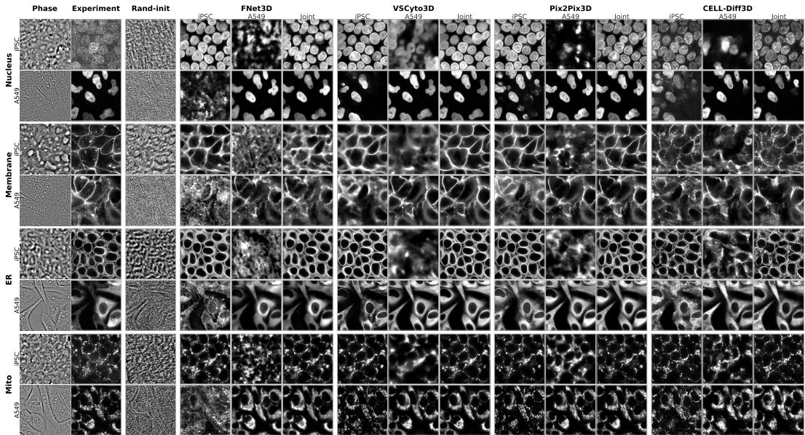  
Figure 3: Organelle prediction overview across models and training sets. Single in-focus XY slices of virtual-staining predictions for nucleus, cell membrane, ER, and mitochondria on the iPSC test set (top) and A549 test set (bottom). Columns show the phase input, experimental stain, and predictions from randomly initialized VSCyto3D (Rand-init), FNet3D, VSCyto3D, Pix2Pix3D, and CELL-Diff3D. The four learned models are each trained on iPSC, A549, or both datasets.

relevant to different downstream tasks, so we interpret these metrics together. We report key findings below and further predictions across organelles and conditions in App. D.4.

## 6.1 Generalization gaps inform metric selection

We trained each model on iPSC, A549, or both datasets jointly and evaluated the models on both cell types. Testing single-dataset models on the other dataset assesses generalization to out-ofdistribution (OOD) data. Models generally reproduce organelle location and shape more accurately on the dataset used for training (Fig. 3). Some metrics reflect these generalization gaps more reliably than others. We started with a large library of metrics and selected those that enable robust analysis of OOD generalization gaps.

Predictions from a randomly initialized VSCyto3D model (“Rand-init”) contain little recognizable organelle structure and provide an empirical lower bound for interpreting the metrics. FNet3D’s OOD predictions retain fluorescence-like texture but fail to reproduce the target organelle’s location or shape, largely due to FNet3D training using small patches and basic augmentations (App. C.2).

We evaluated every metric in the pixel (App. Tab. 4), segmentation (App. Tab. 5), and phenotype (App. Tab. 6) tiers using Rand-init and FNet3D’s OOD predictions (App. B.5). Several metrics scored these poor predictions as favorably as in-distribution predictions, in one of two ways. Some do so on the same test images and therefore miss the failure. Others rank the failure correctly on its own test set but score it as favorably as an in-distribution prediction on the other test set, because their absolute values depend on the test images [38].

Among the KID metrics computed with learned feature extractors, CELL-DINO KID and MorphEm KID most consistently assigned less favorable scores to poor FNet3D OOD predictions. CELL-DINO KID also separated the models clearly, and the resulting rankings remained consistent with rankings in the other learned feature spaces under OOD evaluation. GLCM+ cos scored poor FNet3D OOD predictions below the in-distribution results for three of the four organelles, more consistently than any other phenotype metric. We therefore selected five complementary metrics per organelle for the remaining analyses: si-SSIM and Spectral PCC for pixel fidelity, Dice for segmentation, and CELL-DINO KID and GLCM+ cos for phenotype similarity. We use instance Dice for nucleus and membrane to assess individual objects, and semantic Dice for ER and mitochondria, whose masks represent organelle structures rather than separate cells. We compare the feature extractors in detail in App. B.4.

Table 1: Prediction metrics across training and test datasets, per organelle. Rows show five selected metrics for VSCyto3D, Pix2Pix3D, and CELL-Diff3D. Dice denotes instance Dice for nucleus and membrane and semantic Dice for ER and mitochondria. SPCC denotes Spectral PCC. CD KID denotes CELL-DINO KID. Columns are grouped by test dataset, then model and training dataset; Joint denotes training on the combined iPSC and A549 data. For each organelle, metric, and test dataset, bold compares all models across all training sets, marking the best mean and means within its SD, computed at the displayed precision. App. B.5 reports the full FNet3D panel used to select these rows. SD values are omitted for readability. Colored squares denote pixel, segmenta tion, and phenotype metrics; arrows show the direction of metric improvement.
<table><tr><td rowspan="3"></td><td colspan="8">iPSC test</td><td colspan="8">A549 test</td></tr><tr><td colspan="2">VSCyto3D</td><td colspan="2"></td><td colspan="2">Pix2Pix3D</td><td colspan="2">CELL-Diff3D</td><td colspan="2">VSCyto3D</td><td colspan="2">Pix2Pix3D</td><td colspan="2"></td><td colspan="2">CELL-Diff3D</td></tr><tr><td>Metric</td><td>iPSC</td><td>A549 Joint</td><td>iPSC</td><td>A549</td><td>Joint</td><td>iPSC</td><td>A549</td><td>Joint</td><td>A549 iPSC</td><td>Joint</td><td>A549</td><td>iPSC</td><td>Joint</td><td>A549</td><td>iPSC Joint</td></tr><tr><td>Nucleus</td><td></td><td></td><td></td><td></td><td></td><td></td><td></td><td></td><td></td><td></td><td></td><td></td><td></td><td></td><td></td><td></td></tr><tr><td>si-SSIM (↑)</td><td>0.58</td><td>0.38</td><td>0.58 0.58</td><td>0.38</td><td>0.56</td><td>0.47</td><td>0.31</td><td>0.46</td><td>0.89</td><td>0.68</td><td>0.90</td><td>0.89</td><td>0.77 0.89</td><td>0.83</td><td>0.52</td><td>0.85</td></tr><tr><td>SPCC (↑)</td><td>0.90</td><td>0.56</td><td>0.90 0.90</td><td>0.59</td><td>0.89</td><td>0.81</td><td>0.38</td><td>0.81</td><td>0.89</td><td>0.70</td><td>0.90</td><td>0.91</td><td>0.86 0.91</td><td>0.87</td><td>0.72</td><td>0.89</td></tr><tr><td> Dice (↑)</td><td>0.89</td><td>0.63</td><td>0.89 0.89</td><td>0.64</td><td>0.89</td><td>0.84</td><td>0.39</td><td>0.83</td><td>0.90</td><td>0.69</td><td>0.91</td><td>0.92</td><td>0.73 0.92</td><td>0.76</td><td>0.67</td><td>0.84</td></tr><tr><td>CD KID (↓)</td><td>24.93</td><td>30.62</td><td>24.91 23.99</td><td>29.14</td><td>16.40</td><td>1.72</td><td>12.28</td><td>1.65</td><td>30.88</td><td>19.80</td><td>29.53</td><td>26.04</td><td>19.43 20.10</td><td>4.16</td><td>9.95</td><td>4.04</td></tr><tr><td>GLCM+ cos (↑)</td><td>-0.00</td><td>-0.10</td><td>0.00 0.02</td><td>-0.18</td><td>0.02</td><td>0.26</td><td>-0.18</td><td>0.24</td><td>0.36</td><td>0.22</td><td>0.35</td><td>0.39</td><td>0.35 0.39</td><td>0.52</td><td>-0.06</td><td>0.55</td></tr><tr><td>Membrane</td><td></td><td></td><td></td><td></td><td></td><td></td><td></td><td></td><td></td><td></td><td></td><td></td><td></td><td></td><td></td><td></td></tr><tr><td>si-SSIM (↑)</td><td>0.58</td><td>0.31</td><td>0.60 0.60</td><td>0.35</td><td>0.59</td><td>0.47</td><td>0.32</td><td>0.48</td><td>0.64</td><td>0.43</td><td>0.65</td><td>0.64 0.42</td><td>0.64</td><td>0.57</td><td>0.41</td><td>0.57</td></tr><tr><td>SPCC (↑)</td><td>0.89</td><td>0.26</td><td>0.89 0.88</td><td>0.53</td><td>0.88</td><td>0.82</td><td>0.49</td><td>0.83</td><td>0.88</td><td>0.57</td><td>0.89</td><td>0.89 0.57</td><td>0.89</td><td>0.83</td><td>0.63</td><td>0.83</td></tr><tr><td> Dice (↑)</td><td>0.63</td><td>0.39</td><td>0.71 0.69</td><td>0.26</td><td>0.69</td><td>0.52</td><td>0.26</td><td>0.54</td><td>0.71</td><td>0.36</td><td>0.70</td><td>0.69 0.39</td><td>0.69</td><td>0.63</td><td>0.17</td><td>0.62</td></tr><tr><td>CD KID (↓)</td><td>43.62</td><td>36.80</td><td>36.76 31.30</td><td>34.94</td><td>27.11</td><td>4.22</td><td>16.13</td><td>3.58</td><td>24.96</td><td>39.36</td><td>25.83</td><td>19.97</td><td>19.86 18.64</td><td>1.85</td><td>8.82</td><td>2.14</td></tr><tr><td>GLCM+ cos (↑)</td><td>0.26</td><td>0.08</td><td>0.28 0.28</td><td>0.11</td><td>0.30</td><td>0.30</td><td>0.13</td><td>0.33</td><td>0.35</td><td>0.10</td><td>0.36</td><td>0.38</td><td>0.15 0.39</td><td>0.51</td><td>0.11</td><td>0.55</td></tr><tr><td>ER</td><td></td><td></td><td></td><td></td><td></td><td></td><td></td><td></td><td></td><td></td><td></td><td></td><td></td><td></td><td></td><td></td></tr><tr><td>si-SSIM (↑)</td><td>0.36</td><td>0.13</td><td>0.36 0.38</td><td>0.15</td><td>0.37</td><td>0.23</td><td>0.13</td><td>0.23</td><td>0.53</td><td>0.37</td><td>0.53</td><td>0.53</td><td>0.39 0.53</td><td>0.42</td><td>0.33</td><td>0.40</td></tr><tr><td>SPCC (↑)</td><td>0.88</td><td>0.47</td><td>0.88 0.90</td><td>0.53</td><td>0.88</td><td>0.79</td><td>0.51</td><td>0.78</td><td>0.82</td><td>0.68</td><td>0.83</td><td>0.83</td><td>0.72 0.83</td><td>0.71</td><td>0.70</td><td>0.73</td></tr><tr><td>Dice (↑)</td><td>0.26</td><td>0.01</td><td>0.26 0.27</td><td>0.03</td><td>0.27</td><td>0.23</td><td>0.10</td><td>0.23</td><td>0.14</td><td>0.10</td><td>0.15</td><td>0.12</td><td>0.10 0.14</td><td>0.14</td><td>0.15</td><td>0.14</td></tr><tr><td>CD KID (↓)</td><td>36.64</td><td>40.07</td><td>37.04 32.13</td><td>38.81</td><td>26.63</td><td>3.16</td><td>16.86</td><td>2.38</td><td>28.33</td><td>23.82</td><td>28.61</td><td>19.97</td><td>19.07 22.04</td><td>4.26</td><td>5.80</td><td>4.73</td></tr><tr><td>GLCM+ cos (↑)</td><td>0.17</td><td>0.01</td><td>0.18 0.18</td><td>0.11</td><td>0.19</td><td>0.41</td><td>0.15</td><td>0.43</td><td>0.13</td><td>0.03</td><td>0.16</td><td>0.17</td><td>0.06 0.19</td><td>0.21</td><td>0.06</td><td>0.22</td></tr><tr><td>Mitochondria</td><td></td><td></td><td></td><td></td><td></td><td></td><td></td><td></td><td></td><td></td><td></td><td></td><td></td><td></td><td></td><td></td></tr><tr><td>si-SSIM (↑)</td><td>0.54</td><td>0.32</td><td>0.54 0.58</td><td>0.36</td><td>0.57</td><td>0.43</td><td>0.31</td><td>0.42</td><td>0.73</td><td>0.57</td><td>0.74</td><td>0.76 0.60</td><td>0.76</td><td>0.64</td><td>0.52</td><td>0.66</td></tr><tr><td>SPCC (↑)</td><td>0.89</td><td>0.53</td><td>0.90 0.92</td><td>0.65</td><td>0.92</td><td>0.85</td><td>0.55</td><td>0.84</td><td>0.89</td><td>0.79</td><td>0.90</td><td>0.92 0.82</td><td>0.92</td><td>0.81</td><td>0.75</td><td>0.84</td></tr><tr><td> Dice (↑)</td><td>0.43</td><td>0.07</td><td>0.43 0.47</td><td>0.19</td><td>0.46</td><td>0.32</td><td>0.12</td><td>0.30</td><td>0.37</td><td>0.22</td><td>0.38</td><td>0.38 0.25</td><td>0.39 27.13</td><td>0.25 6.72</td><td>0.20 12.06</td><td>0.27 5.68</td></tr><tr><td>CD KID (↓)</td><td>30.45 0.13</td><td>37.70 0.06</td><td>31.25 35.40 0.13 0.12</td><td>32.57 0.12</td><td>28.05 0.14</td><td>3.13 0.66</td><td>21.84 0.19</td><td>6.04 0.56</td><td>30.24 0.15</td><td>33.81 0.11</td><td>29.51 0.16</td><td>32.08 33.59 0.20 0.13</td></table>

None of the five selected metrics scores the poor FNet3D OOD predictions in Fig. 3 at least as favorably as the in-distribution model on the same test images. Spectral PCC, Dice, and si-SSIM also never do so across test sets, whereas GLCM+ cos does so on one of four organelles and CELL-DINO KID on two (App. B.5). We therefore compare models within each test set and interpret the metric panel alongside the prediction images.

## 6.2 Joint training recovers cross-dataset performance

Prediction quality decreases when single-dataset models are tested on the other cell type, although VSCyto3D, Pix2Pix3D, and CELL-Diff3D predictions usually degrade less than FNet3D predictions. Transfer from A549 to iPSC remains difficult across all four organelles. Training on both datasets largely closes this gap: jointly trained models approach the corresponding in-distribution Spectral PCC and Dice scores on both test sets (Tab. 1; App. Tab. 12).

We also test membrane and mitochondria predictions on HEK293T images acquired with the same Mantis microscope as the A549 images. This comparison reduces the microscope difference, al though the fluorescence markers also differ between the two cell types. The decrease in OOD prediction quality is smaller for transfer from A549 to HEK293T than from A549/Mantis to iPSC/confocal, and jointly trained models perform best on HEK293T for both organelles (App. D.1).

## 6.3 Regression and generative models are suitable for different downstream tasks

The model families differ across evaluation tiers. Pix2Pix3D remains comparable to VSCyto3D in Spectral PCC and Dice. Generative CELL-Diff3D has the best CELL-DINO KID for every organelle, training set, and iPSC/A549 test set. The other learned feature spaces support the same overall result, although they disagree on the ordering of the remaining models (App. B.4).

Comparisons using the same generator architecture show the same trade-off without changing model capacity. Pix2Pix3D and the regression ablation more accurately reproduce the paired target, while generative CELL-Diff3D better matches the population phenotype distribution. GLCM+ cos, although a paired measure, also favors CELL-Diff3D in all eight organelle and test-set groups of Tab. 1, because the smoother texture of regression and adversarial predictions lies outside the experimental GLCM+ distribution. Thus, regression and adversarial predictions are better suited to organelle localization, segmentation, counting, and tracking, whereas generative predictions are better suited to assessing population morphology and uncertainty (App. C.5).

## 6.4 Generative predictions best preserve perturbation responses

We compare membrane predictions at the first and last paired timepoints for mock-infected controls (Mock) and the DENV and ZIKV conditions (Fig. 4A). The experimental phenotype distributions of Mock and infected cells separate more strongly over the A549 time course. To test whether virtual stains preserve this change, we measure the shift from Mock to infected cells in the mean singlecell embedding. We then compare the direction of this shift between predicted and experimental fluorescence. Generative CELL-Diff3D agrees most closely with the experimental response under both DENV and ZIKV (Fig. 4B). We describe the comparison and report the full results in App. D.6.

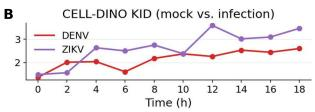

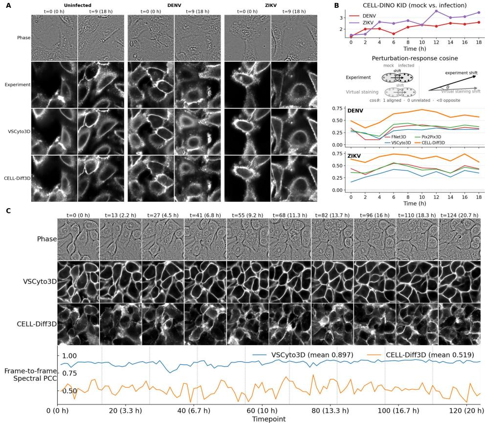

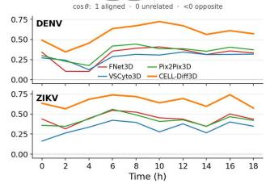  
Figure 4: A549 predictions across perturbation and time. Membrane predictions from A549- trained models. (A) One field per condition at the first and last paired timepoints. (B) Experimental separation between Mock and infected cells and the agreement between predicted and experimental mean-embedding shifts across the 2-hour grid. (C) Predictions on one unpaired field acquired every 10 min, with Spectral PCC between consecutive predicted volumes below.

## 6.5 Prediction quality and consistency vary over time

We evaluate two temporal properties of virtual staining predictions. The first, temporal robustness, is the stability of prediction accuracy as the perturbation progresses, which we measure against paired fluorescence at each timepoint of the 2-hour A549 datasets under mock and infected conditions. Across experimental conditions and types of metrics, the ranking of models changes over time points (App. Tab. 21, 26). The second, temporal consistency, is the agreement between successive predictions; it requires dense sampling but no fluorescence, so we measure it on the 10-minute unpaired label-free movie. CELL-Diff3D predictions are less consistent between adjacent frames than the regression and adversarial predictions across all four organelles (Fig. 4C; App. Figs. 19 and 20). Because the movie has no paired fluorescence target, these comparisons measure self-consistency rather than temporal accuracy. We report the complete analyses in App. D.6.

## 7 Discussion

Our results show that virtual staining quality depends on the training data, the downstream task, and when predictions are evaluated. OOD failures reveal weaknesses in commonly used metrics, motivating evaluation across pixel fidelity, segmentation, and phenotype similarity. Some metrics miss these failures on the same images; others rank them correctly within a test set, but their values shift between test sets, so absolute scores should be compared within a test set, consistent with an independent analysis of Cell Painting data [38]. Joint training recovers performance on the two represented datasets. The choice of model involves a separate trade-off. Regression and adversarial models more accurately reproduce individual organelles, whereas generative predictions better preserve population phenotype distributions and perturbation responses. Better population agreement, however, does not imply more consistent predictions over time. Together, these findings show why a single reconstruction score or timepoint is insufficient to judge virtual stains for live-cell profiling. The DynaCell evaluation suite provides a shared basis for choosing models according to the biological measurement they need to support. A 2D variant of the benchmark, which trains each model family on single in-focus planes and scores it at one focus plane per field of view, is about 27× cheaper to train; it reproduces the coarse model tiers but often not the best-ranked family (App. D.2). A lite test split with half the test volumes reverses none of the model orderings that the full benchmark resolves (App. D.3). The evaluation suite also supports uses beyond model selection. A new metric can be tested on whether it separates known failure modes, such as OOD collapse and target photobleaching, from genuine prediction errors. A virtual stain can be checked for whether it preserves infection responses before it replaces fluorescence in a perturbation screen. Models trained on one cell type and microscope can be tested on another. A densely sampled paired release would extend these uses to temporal consistency and time-aware models.

## 8 Limitations and Future Work

Our results support comparisons of paired 3D reconstruction, segmentation, phenotype distributions, and performance over time for the cell types, microscopes, organelles, and perturbations studied here. Important extensions include varying cell type and microscope independently, adding manual segmentation labels and a broader range of perturbations, and collecting densely sampled paired movies. The pretrained phenotype extractors use 2D maximum projections because most available deep feature extractors are 2D. Only GLCM+ is computed in 3D. We do not evaluate time-aware models. On the shared 2-hour grid, consecutive frames do not form trajectories that such models could exploit, so they would reduce to per-frame models. The one densely sampled movie also has no paired fluorescence to score them against. We therefore leave temporal stability and timeaware training objectives to future work. Dense paired movies are limited by the photobleaching and phototoxicity of correlative light-sheet imaging, and collecting them is the next step. App. E discusses these limitations and planned baseline extensions in detail.

## 9 Data and code availability

The A549 dataset is released under CC-BY-4.0. The reprocessed iPSC dataset is distributed under the Allen Institute Terms of Use. Code for the DynaCell evaluation suite is available under BSD-3-Clause at https://github.com/mehta-lab/VisCy/tree/dynacell-models. OME-Zarr stores are hosted through AWS Open Data. Trained checkpoints for all baselines are at s3://dynacell/v1/models/, with a manifest at https://dynacell.s3.us-west-2.amazonaws.com/v1/models/README.md. A public sample is available at https://dynacell.s3.uswest-2.amazonaws.com/v1/demo/dynacell a549 demo.zip. App. A gives the data-hosting details, Croissant metadata, and full license terms.

## Acknowledgments

We thank Jason Swedlow, Cathy Stolitzka, Maadhav Kothari, Kevin Liu, and Emanuele Bezzi for enabling data sharing through AWS Open Data. We thank Alan Lowe and Markus Marks for suggesting the randomly initialized models as a baseline. This work was supported by the Biohub Imaging Residency Program, Biohub San Francisco and its donors Priscilla Chan and Mark Zuckerberg, and NIH R01GM131641 (B.H.).

## References

[1] Srinivas Niranj Chandrasekaran, Hugo Ceulemans, Justin D Boyd, and Anne E Carpenter. Image-based profiling for drug discovery: due for a machine-learning upgrade? Nature Reviews Drug Discovery, 20(2):145–159, 2021. doi: 10.1038/s41573-020-00117-w. URL https://doi.org/10.1038/s41573-020-00117-w.

[2] Erik Serrano, John Peters, Jesko Wagner, Rebecca E Graham, Zhenghao Chen, Brian Y Feng, Gisele Miranda, Alexandr A Kalinin, Loan Vulliard, Jenna Tomkinson, Cameron Mattson, Michael J Lippincott, Ziqi Kang, Divya Sitani, Dave Bunten, Srijit Seal, Neil O Carragher, Anne E Carpenter, Shantanu Singh, Paula A Marin Zapata, Juan C Caicedo, and Gregory P Way. Progress and new challenges in image-based profiling. Molecular Systems Biology, 2026. doi: 10.1038/s44320-026-00197-7. URL https://doi.org/10.1038/ s44320-026-00197-7.

[3] Eric M Christiansen, Samuel J Yang, D Michael Ando, Ashkan Javaherian, Gaia Skibinski, Scott Lipnick, Elliot Mount, Alison O’Neil, Kevan Shah, Alvin K Lee, et al. In silico labeling: predicting fluorescent labels in unlabeled images. Cell, 173(3):792–803, 2018.

[4] Chek Ounkomol, Sharmishtaa Seshamani, Mary M Maleckar, Forrest Collman, and Gregory R Johnson. Label-free prediction of three-dimensional fluorescence images from transmittedlight microscopy. Nature Methods, 15(11):917–920, 2018. doi: 10.1038/s41592-018-0111-2.

[5] Nitsan Elmalam, Lion Ben Nedava, and Assaf Zaritsky. In silico labeling in cell biology: Potential and limitations. Current Opinion in Cell Biology, 89:102378, 2024. doi: 10.1016/j. ceb.2024.102378.

[6] Syuan-Ming Guo, Li-Hao Yeh, Jenny Folkesson, Ivan E Ivanov, Anitha P Krishnan, Matthew G Keefe, Ezzat Hashemi, David Shin, Bryant B Chhun, Nathan H Cho, Manuel D Leonetti, May H Han, Tomasz J Nowakowski, and Shalin B Mehta. Revealing architectural order with quantitative label-free imaging and deep learning. eLife, 9:e55502, 2020. doi: 10.7554/eLife. 55502.

[7] Zixuan Wang, Yao Xie, and Shuiwang Ji. Global voxel transformer networks for augmented microscopy. Nature Machine Intelligence, 3(2):161–171, 2021. doi: 10.1038/ s42256-020-00283-x.

[8] Jan Oscar Cross-Zamirski, Elodie Mouchet, Graham Williams, Carola-Bibiane Schonlieb,¨ Riku Turkki, and Yinhai Wang. Label-free prediction of cell painting from brightfield images. Scientific Reports, 12(1):10001, 2022. doi: 10.1038/s41598-022-12914-x.

[9] Jan Oscar Cross-Zamirski, Praveen Anand, Guy Williams, Elizabeth Mouchet, Yinhai Wang, and Carola-Bibiane Schonlieb. Class-guided image-to-image diffusion: Cell painting from ¨ brightfield images with class labels. In 2023 IEEE/CVF International Conference on Computer Vision Workshops (ICCVW), pages 3802–3811. IEEE, 2023. doi: 10.1109/ICCVW60793. 2023.00411.

[10] Daniel Franco-Barranco, Aitor Gonzalez-Marfil, and Ignacio Arganda-Carreras. Self-´ supervised Vision Transformers for image-to-image labeling: a BiaPy solution to the Light-MyCells challenge. In 2024 IEEE International Symposium on Biomedical Imaging (ISBI), pages 1–5, 2024. doi: 10.1109/ISBI56570.2024.10635818.

[11] Trang Le and Emma Lundberg. High-resolution in silico painting with generative models. bioRxiv, 2024. doi: 10.1101/2024.05.31.596710.

[12] Donghao Zhou, Chunlong Gu, Jing Xu, Fang Liu, Qian Wang, Guangyong Chen, and Pheng-Ann Heng. RepMode: Learning to re-parameterize diverse experts for subcellular structure prediction. In 2023 IEEE/CVF Conference on Computer Vision and Pattern Recognition (CVPR), pages 3312–3322. IEEE, 2023. doi: 10.1109/CVPR52729.2023.00323.

[13] Yu Zhou, Shuo Zhao, Justin Sonneck, and Jianxu Chen. 2D label-free prediction of multiple organelles across different transmitted-light microscopy images with Bag-of-Experts. In 2024 IEEE International Symposium on Biomedical Imaging (ISBI), pages 1–4, 2024. doi: 10.1109/ ISBI56570.2024.10635298.

[14] Rui Wang, Daniel Butt, Sam Cross, Paul Verkade, and Alin Achim. Bright-field to fluorescence microscopy image translation for cell nuclei health quantification. Biological Imaging, 3:e12, 2023. doi: 10.1017/S2633903X23000120.

[15] Ziwen Liu, Eduardo Hirata-Miyasaki, Soorya Pradeep, Johanna V Rahm, Christian Foley, Talon Chandler, Ivan E Ivanov, Hunter O Woosley, See-Chi Lee, Sudip Khadka, et al. Robust virtual staining of landmark organelles with cytoland. Nature Machine Intelligence, 7(6):901– 915, 2025.

[16] Alexandr A Kalinin, Paula Llanos, Theresa Maria Sommer, Giovanni Sestini, Xinhai Hou, Jonathan Z Sexton, Xiang Wan, Ivo Dinov, Brian D Athey, Nicolas Rivron, et al. Foreground-aware virtual staining for accurate 3D cell morphological profiling. arXiv preprint arXiv:2507.05383, 2025.

[17] Chenyi Ling, Michael Halter, Anne Plant, Michael Majurski, Jeffrey Stinson, and Joe Chalfoun. Analyzing U-Net robustness for single cell nucleus segmentation from phase contrast images. In 2020 IEEE/CVF Conference on Computer Vision and Pattern Recognition Workshops (CVPRW). IEEE, 2020. doi: 10.1109/CVPRW50498.2020.00491.

[18] Dmytro Fishman, Sten-Oliver Salumaa, Daniel Majoral, Tonis Laasfeld, Samantha Peel, Jan˜ Wildenhain, Alexander Schreiner, Kaupo Palo, and Leopold Parts. Practical segmentation of nuclei in brightfield cell images with neural networks trained on fluorescently labelled samples. Journal ofMicroscopy, 284(1):12–24, 2021. doi: 10.1111/jmi.13038.

[19] Jordao Bragantini, Ilan Theodoro, Xiang Zhao, Teun A. P. M. Huijben, Eduardo Hirata-˜ Miyasaki, Shruthi VijayKumar, Akilandeswari Balasubramanian, Tiger Lao, Richa Agrawal, Sheng Xiao, Jan Lammerding, Shalin B. Mehta, Alexandre X. Falcao, Adrian Jacobo, Merlin˜ Lange, and Lo¨ıc A. Royer. Ultrack: pushing the limits of cell tracking across biological scales. Nature Methods, 22(11):2423–2436, 2025. doi: 10.1038/s41592-025-02778-0.

[20] Taylla Milena Theodoro, Allyson Quinn Ryan, Rachel Banks, Eduardo Hirata-Miyasaki, Tiger Lao, Shloka Jaisingh, Adrian Jacobo, Shalin B Mehta, and Ivan Ivanov. DynaTrack: labelagnostic smart tracking for mapping dynamics of organ development. In High-Throughput Biophotonics: Imaging, Spectroscopy, and Beyond XI, volume 13862, page 32. SPIE, 2026. doi: 10.1117/12.3080090.

[21] Srinivas Niranj Chandrasekaran, Jeanelle Ackerman, Eric Alix, D Michael Ando, John Arevalo, Melissa Bennion, Nicolas Boisseau, Adriana Borowa, Justin D Boyd, Laurent Brino, et al. JUMP Cell Painting dataset: morphological impact of 136,000 chemical and genetic perturbations. bioRxiv, 2023. doi: 10.1101/2023.03.23.534023.

[22] Dorian Kauffmann, Guillaume Gay, Julio Mateos-Langerak, Oriane Pourcelot, Virginie Georget, Maelle Carraz, Juliette Van Dijk, St ¨ ephanie Bosch, Elsa Castellani, Qiyan Mao, et al. 2D´ multimodal image collection for fluorescence prediction from transmitted light microscopy. Scientific Data, page 7004, 2026. doi: 10.1038/s41597-026-07004-w.

[23] Elena Y Trizna, Aleksandr M Sinitca, Asya I Lyanova, Diana R Baidamshina, Pavel V Zelenikhin, Dmitrii I Kaplun, Airat R Kayumov, and Mikhail I Bogachev. Brightfield vs fluorescent staining dataset–a test bed image set for machine learning based virtual staining. Scientific Data, 10(1):160, 2023. doi: 10.1038/s41597-023-02065-7.

[24] Maria Wyrzykowska, Gabriel della Maggiora, Nikita Deshpande, Ashkan Mokarian, and Artur Yakimovich. A benchmark for virus infection reporter virtual staining in fluorescence and brightfield microscopy. Scientific Data, 12:892, 2025. doi: 10.1038/s41597-025-05194-3.

[25] Matheus P Viana, Jianxu Chen, Theo A Knijnenburg, Ritvik Vasan, Calysta Yan, Joy E Arakaki, Matte Bailey, Ben Berry, Antoine Borensztejn, Eva M Brown, et al. Integrated intracellular organization and its variations in human ips cells. Nature, 613(7943):345–354, 2023.

[26] Ivan E Ivanov, Eduardo Hirata-Miyasaki, Talon Chandler, Rasmi Cheloor-Kovilakam, Ziwen Liu, Soorya Pradeep, Chad Liu, Madhura Bhave, Sudip Khadka, Carolina Arias, Manuel D Leonetti, Bo Huang, and Shalin B Mehta. Mantis: high-throughput 4D imaging and analysis of the molecular and physical architecture of cells. PNAS Nexus, 3(9):pgae323, 2024. doi: 10.1093/pnasnexus/pgae323.

[27] Yanxia Huang, Qinyu Peng, Xu Tian, Cancan Chen, Xuanfeng Zhu, Changbai Huang, Zhiting Huo, Yang Liu, Chao Yang, Chao Liu, and Ping Zhang. Nuclear membrane protein SUN2 promotes replication of flaviviruses through modulating cytoskeleton reorganization mediated by NS1. Nature Communications, 15(1):296, 2024. doi: 10.1038/s41467-023-44580-6.

[28] Wesley Freppel, Viviana Andrea Barragan Torres, Olus Uyar, Ana¨ıs Anton, Zaynab Nouhi, Mathilde Broquiere, Cl\` ement Mazeaud, A´ ¨ıssatou A¨ıcha Sow, Alexanne Leveill´ e, Claudia´ Gilbert, Nicolas Tremblay, Jonathan Einterz Owen, Cheyanne L. Bemis, Xavier Laulhe, Alain´ Lamarre, Christopher J. Neufeldt, Ian Gael Rodrigue-Gervais, Andreas Pichlmair, Denis Gi-¨ rard, Pietro Scaturro, Laura Hulea, and Laurent Chatel-Chaix. Dengue virus and zika virus alter endoplasmic reticulum-mitochondria contact sites to regulate respiration and apoptosis. iScience, 28(1):111599, 2025. doi: 10.1016/j.isci.2024.111599.

[29] Phillip Isola, Jun-Yan Zhu, Tinghui Zhou, and Alexei A Efros. Image-to-image translation with conditional adversarial networks. In Proceedings of the IEEE Conference on Computer Vision and Pattern Recognition (CVPR), pages 1125–1134, 2017.

[30] Dihan Zheng and Bo Huang. Bridging protein sequences and microscopy images with unified diffusion models. In Forty-second International Conference on Machine Learning, 2025.

[31] Olaf Ronneberger, Philipp Fischer, and Thomas Brox. U-net: Convolutional networks for biomedical image segmentation. Medical Image Computing and Computer-Assisted Intervention (MICCAI), pages 234–241, 2015.

[32] Samuel Tonks, Cuong Nguyen, Steve Hood, Ryan Musso, Ceridwen Hopely, Steve Titus, Minh Doan, Iain Styles, and Alexander Krull. Can virtual staining for high-throughput screening generalize? In Computer Vision – ECCV 2024 Workshops, pages 34–50. Springer Nature Switzerland, 2025. doi: 10.1007/978-3-031-91721-9 3.

[33] Sandeep Kambhampati, Eric Zimmermann, Emre Hayir, Kevin K Yang, Fei Chen, and Alex X Lu. Vermeer: Autoregressive generative modeling of microscopy predicts protein localization. bioRxiv, pages 2026–06, 2026.

[34] Michael G Meyer, Mark Fauver, J Richard Rahn, Thomas Neumann, Florence W Patten, Eric J Seibel, and Alan C Nelson. Automated cell analysis in 2D and 3D: A comparative study. Pattern Recognition, 42(1):141–146, 2009. doi: 10.1016/j.patcog.2008.06.018.

[35] Alexandr A Kalinin, Ari Allyn-Feuer, Alex Ade, Gordon-Victor Fon, Walter Meixner, David Dilworth, Jeffrey R de Wet, Gerald A Higgins, Gen Zheng, Amy Creekmore, John W Wiley, James E Verdone, Robert W Veltri, Kenneth J Pienta, Donald S Coffey, Brian D Athey, and Ivo D Dinov. 3D cell nuclear morphology: Microscopy imaging dataset and voxel-based morphometry classification results. In 2018 IEEE/CVF Conference on Computer Vision and Pattern Recognition Workshops (CVPRW), pages 2272–2280, 2018.

[36] Alexandr A Kalinin, Xinhai Hou, Alex S Ade, Gordon-Victor Fon, Walter Meixner, Gerald A Higgins, Jonathan Z Sexton, Xiang Wan, Ivo D Dinov, Matthew J O’Meara, and Brian D Athey. Valproic acid-induced changes of 4D nuclear morphology in astrocyte cells. Molecular Biology ofthe Cell, 32(18):1624–1633, 2021. doi: 10.1091/mbc.E20-08-0502.

[37] Zhou Wang, Alan C Bovik, Hamid R Sheikh, and Eero P Simoncelli. Image quality assessment: from error visibility to structural similarity. IEEE transactions on image processing, 13 (4):600–612, 2004.

[38] Wei-shan Li and Gregory P Way. On doubting image quality assessment metrics for microscopy virtual staining. bioRxiv, 2026. doi: 10.64898/2026.08.31.748410.

[39] George Harauz and Marin van Heel. Exact filters for general geometry three dimensional reconstruction. Optik., 73(4):146–156, 1986.

[40] Sami Koho, Giorgio Tortarolo, Marco Castello, Takahiro Deguchi, Alberto Diaspro, and Giuseppe Vicidomini. Fourier ring correlation simplifies image restoration in fluorescence microscopy. Nature communications, 10(1):3103, 2019.

[41] Ashesh Ashesh, Joran Deschamps, and Florian Jug. Microssim: Improved structural similarity for comparing microscopy data. In European Conference on Computer Vision, pages 252–266. Springer, 2024.

[42] Samuel Tonks, Steve Hood, Ryan Musso, Ceridwen Hopely, Steve Titus, Minh Doan, Iain Styles, and Alexander Krull. A proper scoring rule for virtual staining. arXiv preprint arXiv:2602.23305, 2026.

[43] David R Stirling, Madison J Swain-Bowden, Alice M Lucas, Anne E Carpenter, Beth A Cimini, and Allen Goodman. Cellprofiler 4: improvements in speed, utility and usability. BMC bioinformatics, 22(1):433, 2021.

[44] Miguel Cid-Rosas, Michelle Grunberg, Alejandro Mat´ıa, See-Chi Lee, Hunter Woosley, Soorya Pradeep, Shivali Kanwar, Sudip Khadka, Shalin B Mehta, Ruth Huttenhain, Vincent Turon-Lagot, and Carolina Arias. V-SWITCH: A single-vector OFF-to-ON fluorescent reporter of live RNA virus infections. bioRxiv, 2026. doi: 10.64898/2026.04.08.717260.

[45] Talon Chandler, Ivan E Ivanov, Gabriel Sturm, Sheng Xiao, Xiang Zhao, Alexander Hillsley, Allyson Quinn Ryan, Ziwen Liu, Sricharan Reddy Varra, Ilan Theodoro, et al. Waveorder: A differentiable wave-optical framework for scalable biological microscopy with diverse modalities. arXiv preprint arXiv:2412.09775, 2024.

[46] Alexandr A Kalinin, Anne E Carpenter, Shantanu Singh, and Matthew J O’Meara. cubic: CUDA-accelerated 3D bioimage computing. In Proceedings of the IEEE/CVF International Conference on Computer Vision (ICCV) Workshops, 2025.

[47] Marius Pachitariu, Michael Rariden, and Carsen Stringer. Cellpose-SAM: superhuman generalization for cellular segmentation. BioRxiv, pages 2025–04, 2025.

[48] Jianxu Chen, Liya Ding, Matheus P Viana, HyeonWoo Lee, M Filip Sluezwski, Benjamin Morris, Melissa C Hendershott, Ruian Yang, Irina A Mueller, and Susanne M Rafelski. The Allen Cell and Structure Segmenter: a new open source toolkit for segmenting 3D intracellular structures in fluorescence microscopy images. bioRxiv, 2018. doi: 10.1101/491035.

[49] Oriane Simeoni, Huy V Vo, Maximilian Seitzer, Federico Baldassarre, Maxime Oquab, Cijo´ Jose, Vasil Khalidov, Marc Szafraniec, Seungeun Yi, Michael Ramamonjisoa, et al. Dinov3. ¨ arXiv preprint arXiv:2508.10104, 2025.

[50] Eduardo Hirata-Miyasaki, Soorya Pradeep, Ziwen Liu, Alishba Imran, Taylla Milena Theodoro, Ivan E Ivanov, Sudip Khadka, See-Chi Lee, Michelle Grunberg, Hunter Woosley, et al. DynaCLR: Contrastive learning of cellular dynamics with temporal regularization. arXiv preprint arXiv:2410.11281, 2024.

[51] Theo Moutakanni, Camille Couprie, Seungeun Yi, Michael Doron, Zitong S Chen, Nikita´ Moshkov, Elouan Gardes, Mathilde Caron, Hugo Touvron, Armand Joulin, Piotr Bojanowski, Wolfgang M Pernice, and Juan C Caicedo. Cell-DINO: Self-supervised image-based embeddings for cell fluorescent microscopy. PLOS Computational Biology, 21(12):e1013828, 2025. doi: 10.1371/journal.pcbi.1013828.

[52] Vidit Agrawal, John Peters, Tyler N Thompson, Mohammad Vali Sanian, Chau Pham, Nikita Moshkov, Arshad Kazi, Aditya Pillai, Jack Freeman, Byunguk Kang, Samouil L Farhi, Ernest Fraenkel, Ron M Stewart, Lassi Paavolainen, Bryan A Plummer, and Juan C Caicedo. CHAMMI-75: Pre-training multi-channel models with heterogeneous microscopy images. In International Conference on Learning Representations, 2026.

[53] Martin Heusel, Hubert Ramsauer, Thomas Unterthiner, Bernhard Nessler, and Sepp Hochreiter. Gans trained by a two time-scale update rule converge to a local nash equilibrium. Advances in neural information processing systems, 30, 2017.

[54] Mikołaj Binkowski, Danica J Sutherland, Michael Arbel, and Arthur Gretton. Demystifying ´ mmd gans. arXiv preprint arXiv:1801.01401, 2018.

[55] Sanghyun Woo, Shoubhik Debnath, Ronghang Hu, Xinlei Chen, Zhuang Liu, In So Kweon, and Saining Xie. ConvNeXt V2: Co-designing and scaling convnets with masked autoencoders. In Proceedings of the IEEE/CVF conference on computer vision and pattern recognition, pages 16133–16142, 2023.

[56] Ting-Chun Wang, Ming-Yu Liu, Jun-Yan Zhu, Andrew Tao, Jan Kautz, and Bryan Catanzaro. High-resolution image synthesis and semantic manipulation with conditional GANs. In Proceedings of the IEEE Conference on Computer Vision and Pattern Recognition, pages 8798–8807, 2018.

[57] Ian Goodfellow, Jean Pouget-Abadie, Mehdi Mirza, Bing Xu, David Warde-Farley, Sherjil Ozair, Aaron Courville, and Yoshua Bengio. Generative adversarial nets. In Advances in Neural Information Processing Systems, volume 27, pages 2672–2680, 2014.

[58] Lars Mescheder, Andreas Geiger, and Sebastian Nowozin. Which training methods for GANs do actually converge? In Proceedings of the 35th International Conference on Machine Learning, volume 80 of Proceedings of Machine Learning Research, pages 3481–3490. PMLR, 2018.

[59] Hung-Yu Tseng, Lu Jiang, Ce Liu, Ming-Hsuan Yang, and Weilong Yang. Regularizing generative adversarial networks under limited data. In Proceedings of the IEEE/CVF Conference on Computer Vision and Pattern Recognition, pages 7921–7931, 2021.

[60] Allen Institute for Cell Science. hiPSC Single-cell Image Dataset. https://www. allencell.org/3d-cell-viewer.html, 2018. Used under the Allen Institute Terms of Use, https://www.allencell.org/terms-of-use.html.

[61] MONAI Consortium. MONAI: Medical open network for AI. https://github.com/ Project-MONAI/MONAI, 2022.

[62] Yaron Lipman, Ricky T. Q. Chen, Heli Ben-Hamu, Maximilian Nickel, and Matthew Le. Flow matching for generative modeling. In The Eleventh International Conference on Learning Representations, 2023. URL https://openreview.net/forum?id=PqvMRDCJT9t.

[63] Tuomas Kynka¨anniemi, Tero Karras, Samuli Laine, Jaakko Lehtinen, and Timo Aila. Improved¨ precision and recall metric for assessing generative models. In Advances in Neural Information Processing Systems, 2019.

## Appendix

A Dataset details and release 17   
A.1 A549 acquisition intervals and split composition . 17   
A.2 Comparison with related resources 17   
A.3 HEK293T evaluation data: acquisition details 17   
A.4 Broader impact and responsible use 17   
A.5 License, hosting, and long-term maintenance 18   
A.6 Public data sample 18   
B Metrics and validation 18   
B.1 Spectral PCC: motivation and computation . 18   
B.2 Nuclear-segmenter comparison 21   
B.3 Computation of feature similarities 21   
B.4 Agreement among phenotype feature extractors 23   
B.5 Metric reliability 24   
C Models, training, and ablations 29   
C.1 Shared training and augmentations 29   
C.2 FNet3D patch size and augmentation ablation 31   
C.3 FNet3D temporal-sampling ablation 31   
C.4 Effect of FCMAE pretraining . 34   
C.5 Comparing objectives with the same generator . 34   
C.6 CELL-Diff3D flow-matching baseline 34   
C.7 Compute costs of training the models 40   
D Extended results 41   
D.1 Results across cell types and microscopes 41   
D.2 A 2D variant of the benchmark 42   
D.3 A lite test split . 43   
D.4 Per-organelle prediction overview across training sets 44   
D.5 Phenotype Precision and Recall across organelles 45   
D.6 Temporal and perturbation-value analyses 46   
E Detailed limitations and future work 53   
F Datasheet for the A549 and iPSC datasets 53

## A Dataset details and release

## A.1 A549 acquisition intervals and split composition

The original A549 time-lapse series were acquired at intervals of 10, 30, or 120 min. We subsample all plates onto a common 2-hour grid spanning approximately 5–23 hours post-infection (hpi), yielding 10 timepoints for most FOVs. The training set contains 118 FOVs: 30 each for nucleus, membrane, and mitochondria, and 28 for ER. The test set contains 12 FOVs per organelle–condition combination across four organelles and three conditions, giving 144 FOVs. Each released test volume has dimensions 48 × 640 × 960 (ZYX), and the test set contains approximately 17,000 cells across the four organelles. Test FOVs come from well positions absent from the training set. One additional untreated FOV is retained at its native 10-min interval for unpaired temporal-consistency evaluation (Sec. 6.5).

## A.2 Comparison with related resources

Tab. 2 compares the A549 and iPSC datasets and HEK293T evaluation data used by the DynaCell evaluation suite with other paired label-free and fluorescence resources.

Table 2: Paired label-free/fluorescence resources on the axes used by the DynaCell evaluation suite. The three organelle columns are nested counts: available targets, targets imaged over time, and time-lapse targets imaged under perturbation with a matched control. Tiers are pixel (px), segmentation (seg), and phenotype (phe) metrics applied to the predicted stain. A dash is a measured absence; n/r is not reported. Pair counts use one label-free–target pair as the common unit. The A549 and iPSC datasets and HEK293T evaluation data contain 6,998 paired 3D volumes, of which 4,822 are scored by the benchmark protocol. † Mantis counts come from the deposited stores; ‡ JUMP reports profiling rather than a virtual-staining score; § and ¶ denote non-like-for-like phenotype and viability scores, respectively.
<table><tr><td>Dataset</td><td>3D</td><td>Live</td><td>Perturbation</td><td>Organelles</td><td>... as time-lapse</td><td>... under perturbation</td><td>Cell types</td><td>Protocol</td><td>Tiers</td><td>Paired examples</td></tr><tr><td>Light My Cells (2026)</td><td>no</td><td>yes</td><td>no</td><td>4</td><td>0</td><td>0</td><td>n/r</td><td>yes</td><td>px, phe §</td><td>4,602 (2D)</td></tr><tr><td>Trizna et al. (2023)</td><td>no</td><td>yes</td><td>drug</td><td>0</td><td>0</td><td>0</td><td>1</td><td>yes</td><td>seg I</td><td>504 (2D)</td></tr><tr><td>VIRVS (2025)</td><td>no</td><td>mixed</td><td>5 viruses</td><td>0</td><td>0</td><td>0</td><td>3</td><td>yes</td><td>px, seg</td><td>3,820 (2D)</td></tr><tr><td>JUMP Cell Painting (2023)</td><td>no</td><td>no</td><td>chem + gene</td><td>8</td><td>0</td><td>0</td><td>1-2</td><td>no</td><td>−‡</td><td>1.9 M (2D)</td></tr><tr><td>Ounkomol et al. (2018)</td><td>yes</td><td>yes</td><td>no</td><td>12</td><td>0</td><td>0</td><td>4</td><td>no</td><td>px</td><td>¯420 (3D)</td></tr><tr><td>Guo et al. QLIPP (2020)</td><td>yes</td><td>no</td><td>no</td><td>3</td><td>0</td><td>0</td><td>tissue</td><td>no</td><td>px</td><td>320 (3D)</td></tr><tr><td>Mantis — A549 (2024)</td><td>yes</td><td>yes</td><td>no</td><td>2</td><td>2</td><td>0</td><td>1</td><td>no</td><td>1</td><td>960 (3D) †</td></tr><tr><td>Mantis — HEK OpenCell (2024)</td><td>yes</td><td>yes</td><td>OC43</td><td>15</td><td>6</td><td>0 †</td><td>1</td><td>no</td><td>seg</td><td>1,792 (3D) †</td></tr><tr><td>Viana et al. WTC-11 (2023) A549 + iPSC + HEK293T eval.</td><td>yes yes</td><td>yes</td><td>no ZIKV /DENV</td><td>25 4</td><td>0 4</td><td>0 4</td><td>1 3</td><td>no</td><td></td><td>54,300 (3D)</td></tr><tr><td></td><td></td><td>yes</td><td></td><td></td><td></td><td></td><td></td><td>yes</td><td>px, seg, phe</td><td>6,998 (3D)</td></tr></table>

## A.3 HEK293T evaluation data: acquisition details

HEK293T serves as a held-out evaluation set acquired on the Mantis microscope. We evaluate four 64 × 960 × 1184 ZYX membrane volumes and four mitochondria volumes (approximately 120 cells per organelle), selected from 8 of 80 positions in S-BIAD1287. HEK293T and A549 share the microscope but use different markers (KRAS versus CAAX; TOMM70A versus TOMM20), so the measured gap includes both cell-type and marker effects.

## A.4 Broader impact and responsible use

Reducing phototoxicity and spectral crowding in live-cell imaging remains a challenge in cell biology and drug discovery: each additional fluorescent probe increases the light dose and narrows the spectral window available to other probes. Virtual staining can alleviate these constraints by predicting organelle-specific fluorescence from a single label-free acquisition, allowing continuous observation without additional genetic modification or fluorescent dyes. The DynaCell evaluation suite assesses this capability on living, perturbed cells across complementary measures of image quality and biological utility.

Responsible use requires recognizing that virtually stained images are model predictions, not direct measurements. The virtual stains evaluated here have been validated only on the cell lines, perturbation conditions, and microscope platforms represented in this benchmark; their accuracy in other contexts has not been established. Results from the DynaCell evaluation suite must not be used for clinical or diagnostic decision-making. Its perturbation-response scores compare research images and are not clinical assays. Cell-line provenance (A549: ATCC CCL-185, an immortalized human lung adenocarcinoma line; WTC-11: Coriell GM25256, a hiPSC line with established consent for research use) is documented in App. F.

## A.5 License, hosting, and long-term maintenance

Dataset licenses. The A549 and iPSC datasets have different licenses. The A549 dataset (acquired on Mantis at Biohub SF) is released under the Creative Commons Attribution 4.0 International License (CC-BY-4.0). The iPSC dataset is a curated, preprocessed derivative of the Allen Institute WTC-11 hiPSC dataset [60, 25]. It is redistributed under the upstream Allen Institute Terms of Use (https://www.allencell.org/terms-of-use.html), which permit use, redistribution, and creation of derivative works for research or other noncommercial purposes. Commercial redistribution requires written permission from the Allen Institute. Users of the iPSC dataset must comply with the Allen Institute Terms of Use and cite the original dataset under the Allen Institute Citation Policy (https://www.allencell.org/citation-policy.html); the A549 dataset carries no such restriction. Benchmark code, preprocessing pipelines, and evaluation scripts are released under the BSD-3-Clause License at https://github.com/mehta-lab/VisCy/tree/dynacell-models.

Author responsibility statement. The authors confirm the licenses declared above and accept full responsibility for any violation of rights. Where the redistributed iPSC dataset is concerned, the authors have only the rights granted to them by the Allen Institute Terms of Use and pass through those rights, unmodified, to downstream users.

Hosting and persistent identifiers. OME-Zarr datasets are hosted through the AWS Open Data Sponsorship Program at s3://dynacell/v1/ and are publicly accessible without registration. A human-readable manifest with direct HTTPS URLs, per-file sizes, a version log, and license documentation is available at https://dynacell.s3.us-west-2.amazonaws.com/v1/README.md. Benchmark code is versioned on GitHub at https://github.com/mehta-lab/VisCy/tree/dynacell-models and is regularly maintained. It will be released through PyPI upon publication.

Long-term maintenance. Biohub SF commits to maintaining access through AWS Open Data and the GitHub code repository over the long term, with no plans for removal. The named technical contact is Shalin B. Mehta (shalin.mehta@czbiohub.org); errors and inconsistencies can be reported via GitHub Issues at https://github.com/mehta-lab/VisCy.

Datasheet and machine-readable metadata. A datasheet following Gebru et al. appears in App. F; Croissant metadata with responsible-AI fields accompanies the release.

## A.6 Public data sample

The public data sample is available at https://dynacell.s3.us-west-2.amazonaws.com/v1/ demo/dynacell\_a549\_demo.zip (745 MiB; contains the OME-Zarr bundle, single-cell embeddings, demo scripts, and README). Time-lapse movies that illustrate the temporal kinetics in Fig. 4C and other demonstrations are available in the data-release S3 bucket. The data and evaluation tutorial appear in the README at https://dynacell.s3.us-west-2.amazonaws.com/v1/README.md.

## B Metrics and validation

## B.1 Spectral PCC: motivation and computation

Motivation. Even with the Mantis light-sheet microscope, the endogenously tagged A549 cells photobleach over the multihour movie. The result is a frequency-dependent SNR: low-frequency bands carry organelle structure with high SNR, while high-frequency bands are dominated by Poisson photon noise and acquisition artifacts that a virtual-staining model cannot predict. Standard PCC weights every Fourier component equally, so a prediction that suppresses noise is penalized for not matching the target noise. As bleaching pushes more bands below the noise floor, this penalty can produce a declining PCC curve that partly reflects target SNR rather than prediction quality.

Approach. We propose Spectral PCC, a weighted Pearson correlation in the Fourier domain. The weights estimate which target frequencies carry signal. Given a prediction xˆ and target x on a grid with voxel spacing ∆, we compute the score as follows:

1. Subtract the mean from xˆ and x, then apply a Tukey window to suppress edge ringing.

2. Compute the FFTs $F _ { \hat { \mathbf { x } } } ( \mathbf { k } )$ and $F _ { \mathbf { x } } ( \mathbf { k } )$

3. Form the radial power spectrum of the target by azimuthally averaging $| F _ { \mathbf { x } } ( \mathbf { k } ) | ^ { 2 }$ into bins indexed by |k|, giving $\bar { P ( k ) }$

4. Estimate the noise floor N as the mean power in the highest-frequency 20% of bins, exploiting the white-noise assumption that pure Poisson noise contributes uniform power across frequency.

5. Define per-bin weights $w ( k ) = \operatorname* { m a x } ( 0 , P ( k ) - N )$ and normalize so that max<sub>k</sub> $w ( k ) = 1$

6. Suppress the lowest few bins via a hard zero (DC, slow background drift, autofluorescence, illumination shading) or a soft cosine taper.

7. For each Fourier voxel, use the weight w(|k|) of its radial bin and compute

$$
\mathrm { S p e c t r a l P C C } ( \hat { \mathbf { x } } , \mathbf { x } ) = \frac { \sum _ { \mathbf { k } } w ( | \mathbf { k } | ) \Re \big \{ { F _ { \hat { \mathbf { x } } } ( \mathbf { k } ) F _ { \mathbf { x } } ^ { * } ( \mathbf { k } ) } \big \} } { \sqrt { \sum _ { \mathbf { k } } w ( | \mathbf { k } | ) \ : | { F _ { \hat { \mathbf { x } } } ( \mathbf { k } ) } | ^ { 2 } \cdot \sum _ { \mathbf { k } } w ( | \mathbf { k } | ) \ : | { F _ { \mathbf { x } } ( \mathbf { k } ) } | ^ { 2 } } } .\tag{1}
$$

The default high-frequency-tail estimator is a simple scalar choice. It assumes that the target signal spectrum has decayed below noise by the highest 20% of bins. This assumption appears to hold for these diffraction-limited data but should be revisited for super-resolution or strongly band-limited imaging.

Properties. The metric inherits four properties from this construction. First, SpectralPCC ∈ [−1, 1], with 1 for identical images and −1 for perfect anti-correlation. Second, when the noise floor is zero and the target spectrum is broadband, all weights collapse to a constant and the metric reduces to standard PCC by Parseval’s theorem. Third, when high-frequency bands are noise-dominated, their weights vanish, so the score is invariant to whether the prediction reproduces that noise. Fourth, the noise floor is estimated for each image rather than fixed, so the metric tracks the changing reliability of the target across a time series instead of conflating it with prediction quality.

Hyperparameters. We use a radial bin width of one Fourier index, a tail fraction of 0.2 for noisefloor estimation, a Tukey apodization window, and a low-frequency exclusion of the first three bins to prevent DC and slow background drift from inflating the score. These match the configuration shipped with the released evaluation pipeline.

Validation with synthetic and A549 data. We validated the metric on a synthetic phantom of fluorescent beads convolved with a physically accurate widefield optical transfer function and corrupted with Poisson noise under exponential bleaching. In this simulation, the underlying signal is fixed and only the noise floor changes. Standard PCC decreases as the bleaching SNR falls, while Spectral PCC remains close to unity, correctly indicating that the prediction has not changed. The same pattern occurs empirically on the A549 Mantis test set (Fig. 5): a membrane time course visibly photobleaches over ten timepoints (mean in-cell target intensity falls by 17.6%), lowering the radial power spectrum while the noise floor stays nearly constant. Across 12 Mock-condition FOVs, Spectral PCC for membrane predictions from jointly trained FNet3D decreases by only 1.63% from t=0 to t=9. Over the same interval, PCC decreases by 5.59% and si-SSIM by 19.43%, while si-NRMSE increases by 26.59%. These trajectories support reporting intensity-sensitive and scale-invariant scores alongside Spectral PCC.

This robustness reduces sensitivity to high-frequency degradation. In a controlled corruption ladder, we normalize each score change by the median gap between the best and worst in-distribution models. A lateral Gaussian blur with $\sigma = 4$ voxels changes Spectral PCC by only 0.01 of this between-model spread, compared with 3.12 for si-SSIM. We therefore use si-SSIM and FSC, rather than Spectral PCC alone, when interpreting resolution.

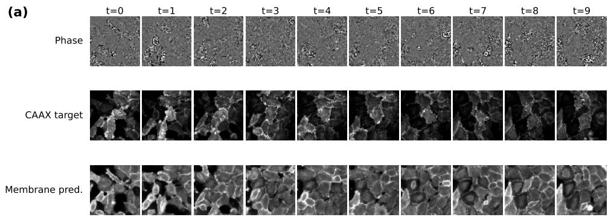

(b)  
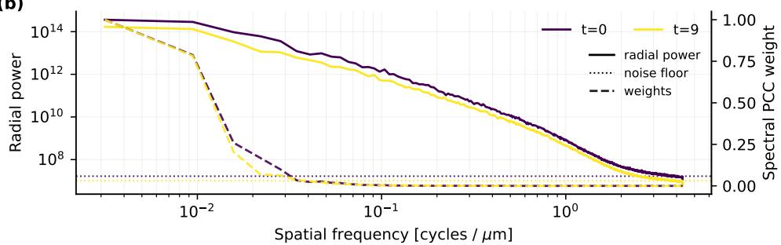

(c)  
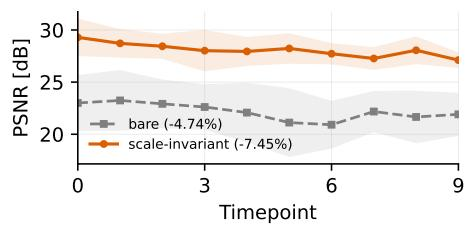

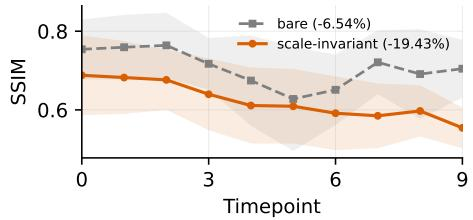

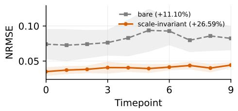

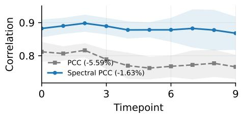  
Figure 5: Pixel metrics under photobleaching on the A549 Mock test set. (a) Phase input, CAAX fluorescence target, and FNet3D membrane prediction over one ten-frame FOV, shown on fixed row-wise intensity scales. (b) Radial power spectra of the t=0 and t=9 frames from the same FOV (solid); per-image noise-floor estimates as horizontal dotted lines (mean of the highest 20% of radial bins); and per-frequency Spectral PCC weights as dashed curves on the right axis. Bleaching lowers signal power below about 1 cycle/µm while leaving the high-frequency noise floor nearly unchanged. The weights are nonzero only where the spectrum exceeds the noise floor and decrease slightly as t increases. (c) Per-timepoint conventional and scale-invariant PSNR, SSIM, and NRMSE, together with PCC and Spectral PCC, for jointly trained FNet3D membrane predictions (mean ± one SD across 12 FOVs). Parenthetical values give the first-to-last relative change; Spectral PCC changes least among the correlation and scale-invariant structural scores.

## B.2 Nuclear-segmenter comparison

The Allen Cell and Structure Segmenter and Cellpose v4 cpdino-ViT-L produce similar targetnucleus footprints across all three A549 conditions (Fig. 6). Their mean footprint IoU is 0.776, 0.798, and 0.774 for Mock, DENV, and ZIKV, respectively, with no empty Cellpose frames. Relative to Mock, the segmented footprint decreases by approximately 9% for Allen and 11% for Cellpose under infection. These matched changes do not support an infection-specific failure of either backend; the choice of Cellpose reflects visual inspection, not validation against manual annotations.

(a)  
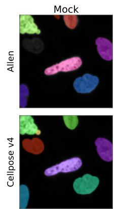

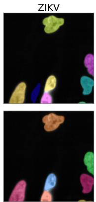

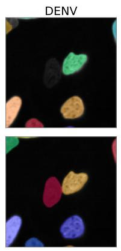

(b)  
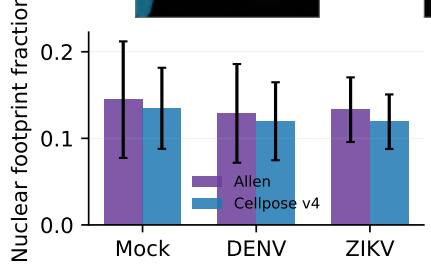

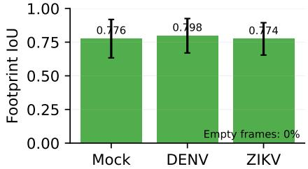  
Figure 6: Allen–Cellpose nuclear-segmenter comparison on A549. (a) Representative targetfluorescence masks for Mock, ZIKV, and DENV at the last timepoint. (b) Nuclear footprint fraction and Allen–Cellpose footprint IoU across the full paired A549 test series (mean ± 1 SD over FOVs). Both methods shift comparably under infection, and Cellpose yields no empty frames.

## B.3 Computation of feature similarities

We compute feature-based metrics at the single-cell level to assess whether virtual stains preserve phenotypic information beyond pixel-level agreement. The pipeline consists of three steps: cellregion extraction, feature extraction, and feature-space comparison (Fig. 7).

Cell-region extraction. We identify individual cell regions with a membrane-based segmentation workflow. Because membrane segmentation is often more robust on virtually stained membrane images than on experimental fluorescence [15], we predict the nucleus and membrane channels from the label-free input using pretrained VSCyto3D from Cytoland [15]. The 3D membrane prediction is projected along the axial dimension, and Cellpose v4 with the cpdino-ViT-L model [47] produces 2D instance masks. We broadcast these masks along the axial dimension to define 3D cell regions.

Feature extraction. For each segmented cell, we extract features from the prediction and corresponding experimental fluorescence using five extractors. GLCM+ takes the full 3D volume and the broadcast 3D cell mask, producing 22 handcrafted features: seven GLCM/Haralick texture descriptors and 15 intensity-distribution and local-gradient/Laplacian descriptors. DINOv3, DynaCLR, CELL-DINO, and MorphEm operate on 2D images. For these models, we select a target-defined focus plane, maximum-project the five-plane slab centered on it, crop each cell with its 2D instance mask, and encode the crop. Before GLCM+ features are compared, near-constant and redundant features are removed once per organelle, using experimental cells only, pooled across the iPSC and A549 test sets. A feature is removed if one value is more than 20 times as frequent as any other or fewer than 1% of its values are distinct, and from every pair of features with absolute Pearson correlation above 0.9, the one more correlated with the remaining features is removed. This keeps 9, 10, 12 and 12 of the 22 features for nucleus, membrane, ER and mitochondria, and every model is scored on the same subset. Each retained feature is then standardized with the mean and standard deviation of the experimental cells of the same test set, applied identically to predicted and experimental cells, so an offset or change of scale in a prediction remains visible in GLCM+ cos, FID and KID. Standardized values are clipped at ±20; this affects 2 of 23,970 experimental cells and leaves the model ranking unchanged for any larger bound. GLCM+ therefore penalizes predictions that do not reproduce the texture of the experimental images, including texture a model smooths away.

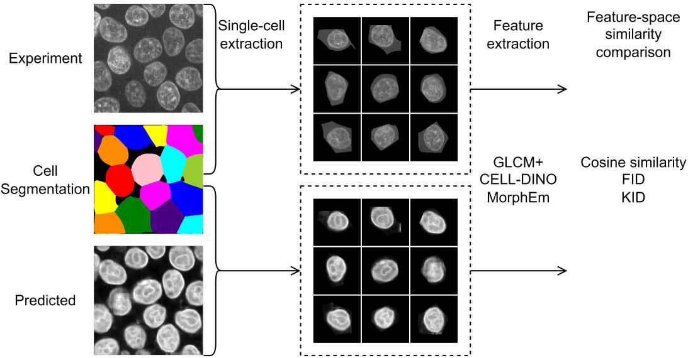  
Figure 7: Computation of single-cell feature metrics. Individual cells are segmented from VS-Cyto3D nucleus and membrane predictions using Cellpose; the same masks are applied to every predicted and experimental fluorescence pair. GLCM+ computes 22 handcrafted 3D features from masked volumes. DINOv3, DynaCLR, CELL-DINO, and MorphEm encode 2D cell crops from a maximum projection of the target-defined five-plane focus slab. Feature agreement is quantified by paired cosine similarity and distributional FID and KID in each space.

Paired feature similarity. Paired feature similarity measures cell-level agreement between a predicted image and its matched experimental image. For each image pair, we use the same cell segmentation masks to extract features from corresponding cells in the predicted and experimental fluorescence images.

Let $\mathbf { f } _ { b , i } ^ { \mathrm { p r e d } }$ and $\mathbf { f } _ { b , i } ^ { \mathrm { g t } }$ denote the feature vectors extracted from the predicted and experimental images for cell i in image pair b. We compute the cosine similarity for each matched cell,

$$
s _ { b , i } = \frac { \left. \mathbf { f } _ { b , i } ^ { \mathrm { p r e d } } , \mathbf { f } _ { b , i } ^ { \mathrm { g t } } \right. } { \left\| \mathbf { f } _ { b , i } ^ { \mathrm { p r e d } } \right\| _ { 2 } \left\| \mathbf { f } _ { b , i } ^ { \mathrm { g t } } \right\| _ { 2 } } .\tag{2}
$$

We summarize each image pair by the median cosine similarity across all matched cells in that pair,

$$
S _ { \mathrm { c o s } } ^ { ( b ) } = { \mathrm { m e d i a n } } _ { i } \left( s _ { b , i } \right) .\tag{3}
$$

The final paired feature-similarity score is the mean of these image-level scores across all matched image pairs,

$$
S _ { \mathrm { c o s } } = \frac { 1 } { B } \sum _ { b = 1 } ^ { B } S _ { \mathrm { c o s } } ^ { ( b ) } ,\tag{4}
$$

where B is the number of image pairs in the test set. This metric evaluates whether each predicted image preserves the single-cell phenotypic representations of its paired experimental fluorescence image.

Distribution-level feature metrics. Distribution-level feature metrics compare the predicted and experimental feature distributions over the entire test dataset. Unlike paired feature similarity, these metrics do not compute a separate score for each image pair. Instead, we pool all single-cell features from the predicted images and all single-cell features from the experimental images across the full test set, then compute one distribution-level score for the dataset.

We compare the pooled predicted and experimental feature distributions using Frechet Inception´ Distance (FID) and Kernel Inception Distance (KID). These metrics evaluate whether the virtual stains reproduce the population-level phenotype distribution in the experimental fluorescence images.

Let

$$
\begin{array} { r l r l } & { \mathcal { F } _ { p } = \left\{ \mathbf { f } _ { b , i } ^ { \mathrm { p r e d } } \right\} _ { b = 1 , i = 1 } ^ { B , { N _ { b } } } , } & & { \mathcal { F } _ { g } = \left\{ \mathbf { f } _ { b , i } ^ { \mathrm { g t } } \right\} _ { b = 1 , i = 1 } ^ { B , { N _ { b } } } } \end{array}
$$

denote the pooled predicted and experimental single-cell features from all image pairs in the test set, where $N _ { b }$ is the number of segmented cells in image pair $b .$ Let their empirical means be $\mu _ { p }$ and $\mu _ { g } .$ , and their covariance matrices be $\Sigma _ { p }$ and $\Sigma _ { g }$ . FID is defined as

$$
\begin{array} { r } { \mathrm { F I D } = \Vert \pmb { \mu _ { p } } - \pmb { \mu _ { g } } \Vert _ { 2 } ^ { 2 } + \operatorname { T r } \left( \pmb { \Sigma _ { p } } + \pmb { \Sigma _ { g } } - 2 \left( \pmb { \Sigma _ { p } } \pmb { \Sigma _ { g } } \right) ^ { 1 / 2 } \right) . } \end{array}\tag{5}
$$

Lower FID indicates closer agreement between the predicted and experimental feature distributions under a Gaussian approximation.

KID estimates the squared maximum mean discrepancy (MMD) between the pooled predicted and experimental features using a third-degree polynomial kernel. We repeatedly sample equal-size subsets without replacement and average the unbiased MMD estimator. For predicted features $\{ { \bf x } _ { i } \} _ { i = 1 } ^ { s }$ and experimental features $\{ \mathbf { y } _ { j } \} _ { j = 1 } ^ { s }$ in one subset,

$$
\widehat { \mathrm { M M D } } _ { u } ^ { 2 } = \frac { 1 } { s ( s - 1 ) } \sum _ { i \neq i ^ { \prime } } k ( { \mathbf x } _ { i } , { \mathbf x } _ { i ^ { \prime } } ) + \frac { 1 } { s ( s - 1 ) } \sum _ { j \neq j ^ { \prime } } k ( { \mathbf y } _ { j } , { \mathbf y } _ { j ^ { \prime } } ) - \frac { 2 } { s ^ { 2 } } \sum _ { i = 1 } ^ { s } \sum _ { j = 1 } ^ { s } k ( { \mathbf x } _ { i } , { \mathbf y } _ { j } ) .\tag{6}
$$

KID is the mean of $\widehat { \mathrm { M M D } } _ { u } ^ { 2 }$ across the sampled subsets. We use the polynomial kernel

$$
k ( \mathbf x , \mathbf y ) = \left( \frac { 1 } { d } \mathbf x ^ { \top } \mathbf y + 1 \right) ^ { 3 } ,\tag{7}
$$

where $d$ is the feature dimension. Lower KID indicates closer agreement between the predicted and experimental single-cell feature distributions. Because the estimator is unbiased, finite-sample values can be slightly negative; values near zero indicate no detectable difference.

Limit of polynomial-kernel KID. Polynomial-kernel MMD is the squared distance between distribution embeddings in the kernel feature space. A degree-three polynomial kernel compares moments only through order three, so low KID need not imply that a prediction covers the full experimental distribution. A predictor concentrated near common experimental features can therefore score well while missing rare or diverse phenotypes. We separate fidelity from diversity using Precision and Recall in App. D.5. More generally, KID, FID, and Precision and Recall compare pooled distributions and cannot test whether each cell’s prediction is correct; information gain scores percell predictive distributions directly [42].

## B.4 Agreement among phenotype feature extractors

We compared KID across five feature extractors using predictions from the four main models in 24 matched settings: four organelles, three training sets (iPSC, A549, or both), and two test sets (iPSC and A549). Because KID has a different numerical scale in each feature space, we compare model rankings rather than raw values across extractors (Tab. 3).

Table 3: Model ranking sensitivity to feature extractor. Each extractor ranks the four main models by KID in 24 matched settings: four organelles, iPSC/A549/joint training, and iPSC/A549 testing. Mean rank uses 1 for the lowest KID and average ranks for ties. Wins count settings where sampled CELL-Diff3D has strictly lower KID than all three other models. A ranking is separated when every adjacent KID gap exceeds twice the combined resampling SD $\sqrt { s _ { a } ^ { 2 } + s _ { b } ^ { 2 } }$ ; this is a descriptive threshold, not a significance test. Mean Kendall $\tau _ { b }$ averages ranking agreement with each of the four other extractors over all 24 settings (96 comparisons per extractor; 1 indicates identical rankings). OOD worse counts strictly higher KID for OOD-trained models than for same-dataset-trained models on the indicated test set (four models × four organelles). The iPSC row compares A549 versus iPSC training; the A549 row compares iPSC versus A549 training. Joint training is excluded from these two rows.
<table><tr><td rowspan="2">Statistic</td><td colspan="5">Feature extractor</td></tr><tr><td>GLCM+</td><td>DINOv3</td><td>DynaCLR</td><td>CELL-DINO</td><td>MorphEm</td></tr><tr><td>FNet3D mean rank</td><td>2.46</td><td>3.33</td><td>2.42</td><td>3.33</td><td>3.46</td></tr><tr><td>VSCyto3D mean rank</td><td>3.25</td><td>3.21</td><td>3.83</td><td>3.38</td><td>3.33</td></tr><tr><td>Pix2Pix3D mean rank</td><td>2.75</td><td>2.38</td><td>2.67</td><td>2.29</td><td>2.04</td></tr><tr><td>CELL-Diff3D mean rank</td><td>1.54</td><td>1.08</td><td>1.08</td><td>1.00</td><td>1.17</td></tr><tr><td>CELL-Diff3D wins</td><td>18/24</td><td>22/24</td><td>23/24</td><td>24/24</td><td>22/24</td></tr><tr><td>Separated rankings</td><td>12/24</td><td>17/24</td><td>17/24</td><td>17/24</td><td>19/24</td></tr><tr><td>Mean Kendall  $\tau _ { b }$ </td><td>+0.39</td><td>+0.55</td><td>+0.49</td><td>+0.53</td><td>+0.55</td></tr><tr><td>OOD worse: iPSC test</td><td>12/16</td><td>14/16</td><td>8/16</td><td>14/16</td><td>14/16</td></tr><tr><td>OOD worse: A549 test</td><td>9/16</td><td>10/16</td><td>6/16</td><td>11/16</td><td>13/16</td></tr></table>

CELL-Diff3D predictions have the lowest KID among the four models in 22–24 of the 24 comparisons, depending on the learned feature extractor. With GLCM+ features, they have the lowest KID in 18 comparisons. The learned feature extractors differ mainly in how they rank the other three models. GLCM+ separates the full model ranking relative to KID resampling variation in 12 settings, compared with 17–19 for the learned extractors. Thus, CELL-Diff3D’s advantage in population-level phenotype similarity holds across the learned feature spaces and in most settings with handcrafted features.

The extractors also differ in their sensitivity to OOD predictions. With the test set fixed, DynaCLR assigns higher KID to OOD predictions than to same-dataset predictions in only 14 of 32 comparisons, versus 21–27 for the other extractors. These results support using CELL-DINO KID for the main comparison, with GLCM+ cos providing a separate measure of paired-cell similarity.

## B.5 Metric reliability

We assessed metric reliability using two sets of predictions whose poor quality is clear in Fig. 3. Rand-init predictions contain little recognizable organelle structure, while FNet3D’s OOD predictions have little spatial agreement with the experimental target. Both should therefore score worse than the in-distribution predictions. We do not assume an ordering between Rand-init and FNet3D’s OOD predictions or between the two OOD directions.

Tabs. 4–6 report all metrics defined in Sec. 4, grouped into pixel, segmentation, and phenotype tiers. Colored entries show FNet3D OOD predictions that receive a score at least as favorable as that of an in-distribution FNet3D prediction despite their poor visual quality. We distinguish two kinds of failure. A same-test-set failure (red) scores an OOD prediction at least as favorably as the in-distribution model on the same images (A549→A549 for iPSC→A549; iPSC→iPSC for A549→iPSC), so the metric misses the failure. A cross-test-set failure (purple) ranks the OOD prediction correctly on its own test set but scores it at least as favorably as the in-distribution prediction on the other test set, so the metric’s absolute values depend on the test images [38]. Rand-init predictions give an empirical floor for each test set: Rand-init nucleus MicroSSIM is 0.52 on iPSC but 0.77 on A549. These results motivated the five metrics retained in Tab. 1.

Pixel tier. Many pixel metrics assign unexpectedly favorable scores to the poor OOD predictions (Tab. 4). PSNR, SSIM, NRMSE, and MicroSSIM do so for three of the four organelles, si-PSNR for two, and si-NRMSE for one. On the same test images, only PSNR, SSIM, and NRMSE do so, each for two of the four organelles. MicroSSIM, si-PSNR, and si-NRMSE rank the OOD predictions below the in-distribution model on the same images and fail only across test sets. In contrast, si-SSIM, PCC, Spectral PCC, and both FSC axes consistently score the OOD predictions below the in-distribution results in both comparisons. We therefore retain si-SSIM rather than SSIM. The siprefix indicates that the prediction is fitted to the target with a least-squares affine transformation and that the data range is taken from the target. The unprefixed form rescales the prediction and target independently to [0, 1]. The results for si-PSNR and si-NRMSE show that this affine fit alone does not make a metric comparable across test sets.

FSC reports the resolution in µm at which the shell correlation falls below its threshold, separately for the lateral and axial directions; lower values are better. If the correlation never crosses the threshold, FSC returns no value. All fields of view resolve in the in-distribution cases, compared with 68 of 120 for the FNet3D OOD nucleus prediction and 4 of 120 for the A549 Rand-init membrane prediction. FSC may therefore underestimate the degradation because its averages exclude unresolved fields. We use FSC and si-SSIM, rather than Spectral PCC alone, when assessing resolution loss (App. B.1).

Segmentation tier. The segmentation metrics agree more closely with the images (Tab. 5). Se mantic Dice, IoU, pixel precision and recall, instance Dice, AP@0.50, and mAP assign lower scores to the FNet3D OOD predictions than to the in-distribution predictions wherever these metrics are defined. Pixel accuracy is the exception for ER and mitochondria (for mitochondria also on the same test images) because background voxels dominate these sparse targets and keep accuracy near 1 even for poor predictions. In this full-metric table, “Dice” denotes semantic Dice, and instance Dice is listed separately. Precision, recall, and accuracy marked “px” are computed from binary-mask voxels. Instance Dice, AP@0.50, and mAP are defined only for nucleus and membrane. Instance Dice averages each object’s best Dice overlap in both directions; missed and spurious objects contribute zero. Pairs with no objects in either mask have undefined instance Dice and are excluded from its averages. For subsequent model comparisons, we retain instance Dice for nucleus and membrane and semantic Dice for ER and mitochondria. Semantic Dice is modest even in distribution for ER (0.09– 0.24) and mitochondria (0.38–0.46), so these values distinguish relative performance but should not be treated as absolute measures of prediction quality.

Phenotype tier. Most phenotype metrics do not consistently reflect the poor OOD predictions (Tab. 6). Fourteen of the fifteen extractor–metric combinations assign an unexpectedly favorable score on at least two organelles. GLCM+ cos is the only exception, doing so only for nucleus. CELL-DINO KID and MorphEm KID each give favorable scores to poor predictions on two organelles, compared with three for DINOv3 KID and four for GLCM+ KID and DynaCLR KID. On the same test images, all three DynaCLR metrics fail on all four organelles, GLCM+ KID on three, GLCM+ FID on two, and each DINOv3 metric on mitochondria. The CELL-DINO and MorphEm metrics and GLCM+ cos fail only across test sets, although CELL-DINO KID separates the A549 ER predictions by only 0.4, close to its resampling SD of 0.2–0.3. We retain CELL-DINO KID because it separates the models more consistently in the comparison of feature extractors (App. B.4) and report GLCM+ cos as a complementary paired-cell measure. FID and KID values are comparable across model predictions within a feature space but not across feature extractors, whose numerical scales differ substantially. We therefore interpret phenotype metrics together with the pixel and segmentation results and the prediction images.

Table 4: Metric behavior across in-distribution and OOD predictions, per organelle. Pixelfidelity tier. Red marks an OOD prediction scored at least as favorably as the in-distribution model on the same test images; Purple marks one scored below the in-distribution model on the same test images but at least as favorably as an in-distribution prediction on another test set. Colored squares denote the metric tier: pixel.
<table><tr><td rowspan="2"></td><td colspan="2">Rand-init</td><td colspan="4">FNet3D</td></tr><tr><td>iPSC</td><td>A549</td><td>iPSC→ iPSC</td><td>A549→ iPSC</td><td>A549→ A549</td><td>iPSC→ A549</td></tr><tr><td>Metric</td><td></td><td></td><td></td><td></td><td></td><td></td></tr><tr><td>Nucleus</td><td> $1 1 . 7 \pm 3 . 7$ </td><td> $7 . 3 \pm 0 . 4$ </td><td> $1 7 . 5 \pm 4 . 3$ </td><td> $1 5 . 5 \pm 3 . 3$ </td><td> $2 2 . 5 \pm 2 . 0$ </td><td> $2 1 . 1 \pm 1 . 3$ </td></tr><tr><td>PSNR (↑) si-PSNR (↑)</td><td> $2 8 . 8 \pm 4 . 3$ </td><td> $2 2 . 6 \pm 1 . 7$ </td><td> $3 1 . 2 \pm 4 . 0$ </td><td> $2 8 . 9 \pm 4 . 2$ </td><td> $2 8 . 8 \pm 2 . 1$ </td><td> $2 2 . 6 \pm 1 . 7$ </td></tr><tr><td></td><td> $0 . 3 3 \pm 0 . 0 7$ </td><td> $0 . 1 5 \pm 0 . 0 3$ </td><td> $0 . 4 0 \pm 0 . 1 5$ </td><td> $0 . 3 1 \pm 0 . 1 4$ </td><td> $0 . 6 0 \pm 0 . 1 1$ </td><td> $0 . 7 0 \pm 0 . 0 7$ </td></tr><tr><td> SSIM (↑)</td><td> $0 . 2 6 \pm 0 . 1 9$ </td><td> $0 . 2 1 \pm 0 . 1 2$ </td><td> $0 . 5 6 \pm 0 . 1 6$ </td><td> $0 . 2 6 \pm 0 . 1 9$ </td><td> $0 . 8 8 \pm 0 . 0 2$ </td><td> $0 . 2 1 \pm 0 . 1 2$ </td></tr><tr><td>si-SSIM (↑)</td><td></td><td> $- 0 . 0 1 \pm 0 . 0 1$ </td><td> $0 . 6 2 \pm 0 . 1 1$ </td><td> $0 . 0 5 \pm 0 . 0 9$ </td><td> $0 . 8 7 \pm 0 . 0 5$ </td><td> $0 . 0 5 \pm 0 . 0 6$ </td></tr><tr><td> PCC (↑)</td><td> $- 0 . 0 2 \pm 0 . 0 1$ </td><td></td><td> $0 . 1 5 \pm 0 . 0 7$ </td><td> $0 . 1 8 \pm 0 . 0 7$ </td><td> $0 . 0 8 \pm 0 . 0 2$ </td><td> $0 . 0 9 \pm 0 . 0 1$ </td></tr><tr><td>NRMSE (↓)</td><td> $0 . 2 8 \pm 0 . 1 0$   $0 . 0 4 \pm 0 . 0 2$ </td><td> $0 . 4 3 \pm 0 . 0 2$   $0 . 0 8 \pm 0 . 0 1$ </td><td> $0 . 0 3 \pm 0 . 0 1$ </td><td> $0 . 0 4 \pm 0 . 0 2$ </td><td> $0 . 0 4 \pm 0 . 0 1$ </td><td> $0 . 0 8 \pm 0 . 0 1$ </td></tr><tr><td> $\equiv \mathrm { s i - N R M S E } \left( \downarrow \right)$  MicroSSIM (↑)</td><td> $0 . 5 2 \pm 0 . 0 8$ </td><td> $0 . 7 7 \pm 0 . 0 4$ </td><td> $0 . 6 7 \pm 0 . 0 9$ </td><td> $0 . 4 7 \pm 0 . 0 8$ </td><td> $0 . 8 6 \pm 0 . 0 3$ </td><td> $0 . 7 8 \pm 0 . 0 5$ </td></tr><tr><td> $\mathbf { \tau } { = } \mathbf { S p e c t r a l } \mathbf { P C C } \mathbf { \dot { ( } } \mathbf { \dot { \tau } { ) } }$ </td><td> $- 0 . 2 3 \pm 0 . 1 4$ </td><td> $0 . 1 6 \pm 0 . 1 2$ </td><td> $0 . 8 9 \pm 0 . 0 6$ </td><td> $0 . 1 1 \pm 0 . 1 9$ </td><td> $0 . 9 1 \pm 0 . 0 5$ </td><td> $0 . 0 5 \pm 0 . 1 8$ </td></tr><tr><td> $\mathbf { \tau } _ { \mathbf { \overline { { F S C } } } } \mathbf { \left( X Y , \mu m \right) } \mathbf { \tilde { ( } \downarrow ) }$ </td><td> $8 . 0 5 \pm 4 . 9 5$ </td><td> $2 9 . 7 2 \pm 8 . 3 5$ </td><td> $0 . 7 7 \pm 0 . 2 0$ </td><td> $6 . 3 4 \pm 3 . 7 1$ </td><td> $0 . 8 4 \pm 0 . 1 8$ </td><td> $1 9 . 5 7 \pm 1 6 . 4 8$ </td></tr><tr><td> $\equiv \mathrm { F S C } \left( \mathbf { Z } , \mu \mathbf { \dot { m } } \right) \left( \downarrow \right) ^ { \cdot }$ </td><td> $6 . 0 2 \pm 1 . 3 0$ </td><td></td><td> $2 . 0 6 \pm 0 . 3 7$ </td><td> $5 . 1 9 \pm 1 . 7 6$ </td><td> $1 . 5 1 \pm 0 . 1 9$ </td><td> $6 . 4 1 \pm 1 . 5 4$ </td></tr><tr><td></td><td></td><td></td><td></td><td></td><td></td><td></td></tr><tr><td>Membrane PSNR (↑)</td><td> $7 . 7 \pm 0 . 7$ </td><td> $7 . 8 \pm 0 . 5$ </td><td> $1 9 . 0 \pm 4 . 0$ </td><td> $1 4 . 2 \pm 2 . 0$ </td><td> $2 4 . 3 \pm 1 . 9$ </td><td> $1 3 . 1 \pm 2 . 4$ </td></tr><tr><td>si-PSNR (↑)</td><td> $2 8 . 3 \pm 3 . 6$ </td><td> $2 3 . 9 \pm 1 . 3$ </td><td> $3 1 . 0 \pm 3 . 3$ </td><td> $2 8 . 6 \pm 3 . 6$ </td><td>28.0 ± 1.4</td><td></td></tr><tr><td>SSIM (↑)</td><td></td><td></td><td></td><td> $0 . 2 9 \pm 0 . 1 0$ </td><td> $0 . 7 8 \pm 0 . 0 7$ </td><td>24.4 ± 1.3</td></tr><tr><td>si-SSIM (↑)</td><td> $0 . 1 6 \pm 0 . 0 5$   $0 . 2 8 \pm 0 . 1 6$ </td><td> $0 . 1 5 \pm 0 . 0 3$ </td><td> $0 . 5 5 \pm 0 . 1 4$   $0 . 5 8 \pm 0 . 1 2$ </td><td> $0 . 3 0 \pm 0 . 1 6$ </td><td> $0 . 6 3 \pm 0 . 0 9$ </td><td> $0 . 3 1 \pm 0 . 0 8$ </td></tr><tr><td> PCC (↑)</td><td> $0 . 0 4 \pm 0 . 0 3$ </td><td>0.17 ± 0.05</td><td>0.66 ± 0.11</td><td> $0 . 1 8 \pm 0 . 1 5$ </td><td> $0 . 7 8 \pm 0 . 0 5$ </td><td> $0 . 3 5 \pm 0 . 0 6$ </td></tr><tr><td>NRMSE (↓)</td><td> $0 . 4 1 \pm 0 . 0 3$ </td><td> $- 0 . 0 3 \pm 0 . 0 2$   $0 . 4 1 \pm 0 . 0 2$ </td><td>0.12 ± 0.05</td><td>0.20 ± 0.04</td><td>0.06 ± 0.01</td><td> $0 . 3 2 \pm 0 . 0 7$ </td></tr><tr><td> si-NRMSE (↓)</td><td></td><td> $0 . 0 6 \pm 0 . 0 1$ </td><td> $0 . 0 3 \pm 0 . 0 1$ </td><td> $0 . 0 4 \pm 0 . 0 1$ </td><td> $0 . 0 4 \pm 0 . 0 1$ </td><td>0.23 ± 0.06</td></tr><tr><td> MicroSSIM (↑)</td><td> $\smash { 0 . 0 4 \neq 0 . 0 1 }$   $0 . 4 6 \pm 0 . 1 6$ </td><td> $0 . 5 4 \pm 0 . 0 6$ </td><td>0.59 ± 0.17</td><td>0.49 ± 0.16</td><td>0.80 ± 0.03</td><td> $0 . 0 6 \pm 0 . 0 1$   $0 . 6 4 \pm 0 . 0 5$ </td></tr><tr><td> $\mathbf { \tau } { = } \mathbf { S p e c t r a l P C C } \mathbf { \eta } ( \uparrow )$ </td><td> $0 . 3 2 \pm 0 . 2 3$ </td><td> $- 0 . 3 3 \pm 0 . 1 6$ </td><td> $0 . 8 9 \pm 0 . 1 1$ </td><td> $0 . 4 0 \pm 0 . 3 4$ </td><td> $0 . 8 8 \pm 0 . 0 5$ </td><td> $0 . 5 9 \pm 0 . 1 1$ </td></tr><tr><td>FSC (XY, µm) (↓)</td><td> $6 . 2 1 \pm 4 . 3 7$ </td><td>6.08 ± 0.57</td><td> $1 . 3 9 \pm 0 . 4 9$ </td><td> $5 . 6 6 \pm 3 . 2 0$ </td><td> $0 . 6 4 \pm 0 . 1 2$ </td><td>2.14 ± 3.74</td></tr><tr><td>FSC (Z, µm) (↓)</td><td> $5 . 0 4 \pm 2 . 1 8$ </td><td> $8 . 1 2 \pm 0 . 0 2$ </td><td> $2 . 7 3 \pm 0 . 4 2$ </td><td> $5 . 1 9 \pm 1 . 9 4$ </td><td> $1 . 2 3 \pm 0 . 3 7$ </td><td> $5 . 3 5 \pm 1 . 4 8$ </td></tr><tr><td>ER</td><td></td><td></td><td></td><td></td><td></td><td></td></tr><tr><td> PSNR (↑)</td><td> $8 . 7 \pm 0 . 9$ </td><td> $9 . 4 \pm 1 . 9$ </td><td> $1 7 . 9 \pm 1 . 4$ </td><td> $1 8 . 0 \pm 2 . 2$ </td><td> $1 9 . 3 \pm 2 . 7$ </td><td> $1 9 . 6 \pm 1 . 8$ </td></tr><tr><td>si-PSNR (↑)</td><td> $2 2 . 3 \pm 1 . 0$ </td><td> $2 2 . 1 \pm 1 . 6$ </td><td> $2 5 . 3 \pm 1 . 2$ </td><td> $2 2 . 5 \pm 1 . 1$ </td><td> $2 5 . 5 \pm 1 . 6$ </td><td>22.3 ± 1.5</td></tr><tr><td>SSIM (↑)</td><td> $0 . 2 0 \pm 0 . 0 2$ </td><td> $0 . 2 9 \pm 0 . 0 8$ </td><td> $0 . 4 9 \pm 0 . 0 5$ </td><td> $0 . 3 7 \pm 0 . 0 7$ </td><td> $0 . 6 3 \pm 0 . 0 9$ </td><td> $0 . 5 8 \pm 0 . 0 8$ </td></tr><tr><td>si-SSIM (↑)</td><td> $0 . 0 7 \pm 0 . 0 2$ </td><td> $0 . 1 0 \pm 0 . 0 4$ </td><td> $0 . 3 5 \pm 0 . 0 7$ </td><td> $0 . 0 9 \pm 0 . 0 7$ </td><td> $0 . 5 2 \pm 0 . 0 8$ </td><td> $0 . 0 8 \pm 0 . 0 4$ </td></tr><tr><td> PCC (↑)</td><td> $- 0 . 0 1 \pm 0 . 0 3$ </td><td> $0 . 0 1 \pm 0 . 0 3$ </td><td> $0 . 7 0 \pm 0 . 0 7$ </td><td> $0 . 0 9 \pm 0 . 1 8$ </td><td> $0 . 7 3 \pm 0 . 0 5$ </td><td> $0 . 1 6 \pm 0 . 1 1$ </td></tr><tr><td>NRMSE (↓)</td><td> $0 . 3 7 \pm 0 . 0 4$ </td><td> $0 . 3 5 \pm 0 . 0 7$ </td><td> $0 . 1 3 \pm 0 . 0 2$ </td><td> $0 . 1 3 \pm 0 . 0 3$ </td><td> $0 . 1 1 \pm 0 . 0 3$ </td><td> $0 . 1 1 \pm 0 . 0 2$ </td></tr><tr><td> si-NRMSE (↓)</td><td> $0 . 0 8 \pm 0 . 0 1$ </td><td> $0 . 0 8 \pm 0 . 0 1$ </td><td> $0 . 0 5 \pm 0 . 0 1$ </td><td> $0 . 0 8 \pm 0 . 0 1$ </td><td> $0 . 0 5 \pm 0 . 0 1$ </td><td></td></tr><tr><td>MicroSSIM (↑)</td><td> $0 . 2 4 \pm 0 . 0 7$ </td><td> $0 . 5 5 \pm 0 . 0 5$ </td><td> $0 . 5 4 \pm 0 . 0 9$ </td><td> $0 . 2 9 \pm 0 . 0 7$ </td><td> $0 . 7 5 \pm 0 . 0 3$ </td><td> $0 . 0 8 \pm 0 . 0 1$ </td></tr><tr><td>Spectral PCC (↑)</td><td> $0 . 0 6 \pm 0 . 1 9$ </td><td> $0 . 1 3 \pm 0 . 1 4$ </td><td> $0 . 8 8 \pm 0 . 0 7$ </td><td> $0 . 0 5 \pm 0 . 3 1$ </td><td> $0 . 8 0 \pm 0 . 0 6$ </td><td> $0 . 6 1 \pm 0 . 0 5$ </td></tr><tr><td> $\mathbf { \tau } _ { \mathbb { F } \mathbf { \tilde { S } } \mathbf { C } } \left( \mathbf { X Y } , \mu \mathbf { m } \right) \left( \downarrow \right)$ </td><td> $7 . 3 9 \pm 4 . 4 2$ </td><td> $2 0 . 6 3 \pm 5 . 1 8$ </td><td> $0 . 6 4 \pm 0 . 0 7$ </td><td> $6 . 8 9 \pm 3 . 7 4$ </td><td> $0 . 9 4 \pm 0 . 5 4$ </td><td> $0 . 3 2 \pm 0 . 2 1$ </td></tr><tr><td>FSC (Z, µm) (↓)</td><td> $5 . 4 4 \pm 1 . 7 4$ </td><td>4.30 ± 0.82</td><td> $1 . 7 8 \pm 0 . 2 4$ </td><td> $6 . 0 5 \pm 1 . 3 4$ </td><td> $2 . 3 9 \pm 0 . 9 9$ </td><td> $5 . 0 3 \pm 1 . 8 9$  6.53 ± 1.36</td></tr><tr><td>Mitochondria</td><td></td><td></td><td></td><td></td><td></td><td></td></tr><tr><td>PSNR (↑)</td><td> $9 . 2 \pm 0 . 8$ </td><td> $8 . 4 \pm 1 . 4$ </td><td>21.7 ± 1.5</td><td> $2 0 . 8 \pm 1 . 9$ </td><td> $2 1 . 7 \pm 3 . 9$ </td><td> $2 2 . 2 \pm 2 . 8$ </td></tr><tr><td> $\mathbf { \equiv } \mathrm { s i } \mathbf { - } \mathbf { P S N \dot { R } } \left( \uparrow \right)$ </td><td> $2 5 . 7 \pm 1 . 5$ </td><td> $2 5 . 6 \pm 1 . 5$ </td><td>28.6 ± 1.5</td><td> $2 5 . 8 \pm 1 . { \bar { 5 } }$ </td><td> $2 9 . 8 \pm 1 . 8$ </td><td> $2 5 . 7 \pm 1 . 5$ </td></tr><tr><td> SSIM (↑)</td><td> $0 . 2 6 \pm 0 . 0 4$ </td><td> $0 . 2 3 \pm 0 . 0 9$ </td><td> $0 . 5 0 \pm 0 . 0 7$ </td><td> $0 . 5 6 \pm 0 . 0 7$ </td><td> $0 . 6 6 \pm 0 . 1 4$ </td><td> $0 . 6 5 \pm 0 . 1 4$ </td></tr><tr><td>si-SSIM (↑)</td><td> $0 . 2 1 \pm 0 . 0 6$ </td><td> $0 . 2 7 \pm 0 . 1 1$ </td><td> $0 . 5 5 \pm 0 . 0 6$ </td><td> $0 . 2 6 \pm 0 . 0 7$ </td><td> $0 . 7 5 \pm 0 . 0 7$ </td><td> $0 . 2 2 \pm 0 . 0 9$ </td></tr><tr><td>PCC (↑)</td><td> $0 . 0 1 \pm 0 . 0 3$ </td><td> $0 . 0 0 \pm 0 . 0 4$ </td><td> $0 . 7 0 \pm 0 . 0 3$ </td><td> $0 . 1 7 \pm 0 . 0 7$ </td><td> $0 . 7 8 \pm 0 . 0 5$ </td><td> $0 . 1 6 \pm 0 . 0 4$ </td></tr><tr><td> $\mathbf { \overline { { \Gamma } } } \equiv \mathbf { N R M S E } \left( \downarrow \right)$ </td><td> $0 . 3 5 \pm 0 . 0 3$ </td><td> $0 . 3 8 \pm 0 . 0 5$ </td><td> $0 . 0 8 \pm 0 . 0 2$ </td><td> $0 . 0 9 \pm 0 . 0 2$ </td><td> $0 . 0 9 \pm 0 . 0 5$ </td><td> $0 . 0 8 \pm 0 . 0 3$ </td></tr><tr><td>si-NRMSE (↓)</td><td> $0 . 0 5 \pm 0 . 0 1$ </td><td> $0 . 0 5 \pm 0 . 0 1$ </td><td> $0 . 0 4 \pm 0 . 0 1$ </td><td> $0 . 0 5 \pm 0 . 0 1$ </td><td> $0 . 0 3 \pm 0 . 0 1$ </td><td> $0 . 0 5 \pm 0 . 0 1$ </td></tr><tr><td>MicroSSIM (↑)</td><td> $0 . 4 5 \pm 0 . 0 4$ </td><td> $0 . 6 7 \pm 0 . 0 7$ </td><td> $0 . 7 2 \pm 0 . 0 4$ </td><td> $0 . 4 0 \pm 0 . 1 1$ </td><td> $0 . 8 2 \pm 0 . 0 4$ </td><td> $0 . 6 9 \pm 0 . 0 7$ </td></tr><tr><td> Spectral PCC (↑)</td><td> $- 0 . 0 4 \pm 0 . 1 8$ </td><td> $0 . 1 3 \pm 0 . 0 9$ </td><td> $0 . 9 1 \pm 0 . 0 3$ </td><td> $0 . 3 3 \pm 0 . 1 7$ </td><td> $0 . 9 2 \pm 0 . 0 3$ </td><td> $0 . 2 2 \pm 0 . 1 0$ </td></tr><tr><td> $\mathbf { \tau } _ { \mathrm { { I F S C } } } ^ { } \left( \mathbf { X Y } , \mu \mathbf { m } \right) \left( \downarrow \right)$ </td><td> $5 . 6 7 \pm 2 . 6 1$ </td><td> $1 6 . 3 7 \pm 1 3 . 5 5$ </td><td> $0 . 6 3 \pm 0 . 0 1$ </td><td> $4 . 2 4 \pm 2 . 6 8$ </td><td> $1 . 1 0 \pm 0 . 7 1$ </td><td> $5 . 2 4 \pm 1 . 6 2$ </td></tr><tr><td> $\equiv \mathrm { F S C } \left( \mathrm { Z } , \mu \mathrm { \dot { m } } \right) \left( \downarrow \right)$ </td><td> $6 . 7 8 \pm 1 . 4 3$ </td><td> $7 . 1 2 \pm 1 . 5 8$ </td><td> $1 . 6 0 \pm 0 . 1 7$ </td><td> $5 . 0 6 \pm 1 . 0 6$ </td><td> $2 . 1 4 \pm 0 . 8 5$ </td><td> $6 . 0 2 \pm 1 . 8 9$ </td></tr></table>

Table 5: Metric behavior across in-distribution and OOD predictions, per organelle. Segmentation-utility tier. Red marks an OOD prediction scored at least as favorably as the in distribution model on the same test images; Purple marks one scored below the in-distribution model on the same test images but at least as favorably as an in-distribution prediction on another test set. Colored squares denote the metric tier: segmentation.
<table><tr><td rowspan="2"></td><td colspan="2">Rand-init</td><td colspan="4">FNet3D</td></tr><tr><td>iPSC</td><td>A549</td><td>iPSC→ iPSC</td><td> $\mathbf { A 5 4 9 } $  iPSC</td><td> $\mathbf { A 5 4 9 } $  A549</td><td>iPSC→ A549</td></tr><tr><td colspan="7">Nucleus</td></tr><tr><td> Dice (↑)</td><td> $0 . 0 2 \pm 0 . 0 9$ </td><td> $0 . 0 0 \pm 0 . 0 1$ </td><td> $0 . 9 5 \pm 0 . 0 4$ </td><td> $0 . 1 5 \pm 0 . 1 7$ </td><td> $0 . 9 6 \pm 0 . 0 2$ </td><td> $0 . 0 6 \pm 0 . 0 7$ </td></tr><tr><td> IoU (↑)</td><td> $0 . 0 1 \pm 0 . 0 6$ </td><td> $0 . 0 0$ </td><td> $0 . 9 0 \pm 0 . 0 6$ </td><td> $0 . 0 9 \pm 0 . 1 1$ </td><td> $0 . 9 3 \pm 0 . 0 3$ </td><td> $0 . 0 3 \pm 0 . 0 4$ </td></tr><tr><td>Precision (px) (↑)</td><td> $0 . 0 6 \pm 0 . 2 1$ </td><td> $0 . 0 0 \pm 0 . 0 2$ </td><td> $0 . 9 5 \pm 0 . 0 5$ </td><td> $0 . 5 2 \pm 0 . 3 6$ </td><td> $0 . 9 6 \pm 0 . 0 3$ </td><td> $0 . 3 1 \pm 0 . 3 2$ </td></tr><tr><td> $\mathbf { \equiv } [ \mathbf { R e c a l l \left( p x \right) } ^ { \mathbf { i } } \left( \uparrow \right)$ </td><td> $0 . 0 1 \pm 0 . 0 7$ </td><td>0.00</td><td> $0 . 9 5 \pm 0 . 0 3$ </td><td> $0 . 1 0 \pm 0 . 1 3$ </td><td> $0 . 9 7 \pm 0 . 0 1$ </td><td> $0 . 0 3 \pm 0 . 0 5$ </td></tr><tr><td>Accuracy (px) (↑)</td><td> $0 . 4 9 \pm 0 . 0 9$ </td><td> $0 . 8 7 \pm 0 . 0 5$ </td><td> $0 . 9 5 \pm 0 . 0 3$ </td><td> $0 . 5 2 \pm 0 . 0 8$ </td><td> $0 . 9 9 \pm 0 . 0 1$ </td><td> $0 . 8 6 \pm 0 . 0 5$ </td></tr><tr><td>Instance Dice (↑)</td><td> $0 . 0 1 \pm 0 . 0 7$ </td><td> $0 . 0 0 \pm 0 . 0 1$ </td><td> $0 . 8 9 \pm 0 . 0 8$ </td><td> $0 . 1 4 \pm 0 . 1 4$ </td><td> $0 . 9 1 \pm 0 . 0 5$ </td><td> $0 . 0 5 \pm 0 . 0 6$ </td></tr><tr><td>AP@0.50 (↑)</td><td> $0 . 0 1 \pm 0 . 0 5$ </td><td>0.00</td><td> $0 . 8 7 \pm 0 . 1 4$ </td><td> $0 . 0 5 \pm 0 . 0 9$ </td><td> $0 . 8 8 \pm 0 . 1 1$ </td><td> $0 . 0 1 \pm 0 . 0 3$ </td></tr><tr><td>mAP (↑)</td><td> $0 . 0 0 \pm 0 . 0 3$ </td><td>0.00</td><td> $0 . 7 1 \pm 0 . 1 5$ </td><td> $0 . 0 2 \pm 0 . 0 4$ </td><td> $0 . 7 6 \pm 0 . 1 2$ </td><td> $0 . 0 1 \pm 0 . 0 1$ </td></tr><tr><td colspan="7">Membrane</td></tr><tr><td>Dice (↑)</td><td> $0 . 1 1 \pm 0 . 1 3$ </td><td> $0 . 0 0 \pm 0 . 0 1$ </td><td> $0 . 8 7 \pm 0 . 1 4$ </td><td> $0 . 0 6 \pm 0 . 1 4$ </td><td> $0 . 7 8 \pm 0 . 1 3$ </td><td> $0 . 3 5 \pm 0 . 2 0$ </td></tr><tr><td> IoU (↑)</td><td> $0 . 0 6 \pm 0 . 0 8$ </td><td> $0 . 0 0 \pm 0 . 0 1$ </td><td> $0 . 7 9 \pm 0 . 1 6$ </td><td> $0 . 0 4 \pm 0 . 1 0$ </td><td> $0 . 6 5 \pm 0 . 1 5$ </td><td> $0 . 2 3 \pm 0 . 1 5$ </td></tr><tr><td>Precision (px) (↑)</td><td> $0 . 5 8 \pm 0 . 4 6$ </td><td> $0 . 0 2 \pm 0 . 1 5$ </td><td> $0 . 9 4 \pm 0 . 1 \dot { 4 }$ </td><td> $0 . 3 1 \pm 0 . 4 6$ </td><td> $0 . 7 7 \pm 0 . 1 6$ </td><td> $0 . 7 4 \pm 0 . 2 7$ </td></tr><tr><td> Recall (px) (↑)</td><td> $0 . 0 6 \pm 0 . 0 8$ </td><td> $0 . 0 0 \pm 0 . 0 1$ </td><td> $0 . 8 4 \pm 0 . 1 1$ </td><td> $0 . 0 4 \pm 0 . 1 0$ </td><td> $0 . 8 1 \pm 0 . 1 4$ </td><td> $0 . 2 5 \pm 0 . 1 8$ </td></tr><tr><td>Accuracy (px) (↑)</td><td> $0 . 6 0 \pm 0 . 0 9$ </td><td> $0 . 6 2 \pm 0 . 1 5$ </td><td> $0 . 9 1 \pm 0 . 0 7$ </td><td> $0 . 5 9 \pm 0 . 1 0$ </td><td> $0 . 8 4 \pm 0 . 0 7$ </td><td> $0 . 6 9 \pm 0 . 1 3$ </td></tr><tr><td>Instance Dice (↑)</td><td> $0 . 0 9 \pm 0 . 1 0$ </td><td> $0 . 0 0 \pm 0 . 0 2$ </td><td> $0 . 6 7 \pm 0 . 1 2$ </td><td> $0 . 0 4 \pm 0 . 0 9$ </td><td> $0 . 7 0 \pm 0 . 1 3$ </td><td> $0 . 3 1 \pm 0 . 1 6$ </td></tr><tr><td>AP@0.50 (↑)</td><td> $0 . 0 1 \pm 0 . 0 2$ </td><td> $0 . 0 0 \pm 0 . 0 1$ </td><td> $0 . 5 0 \pm 0 . 1 9$ </td><td> $0 . 0 1 \pm 0 . 0 3$ </td><td> $0 . 6 0 \pm 0 . 1 9$ </td><td> $0 . 1 4 \pm 0 . 1 4$ </td></tr><tr><td> mAP (↑)</td><td> $0 . 0 0 \pm 0 . 0 1$ </td><td>0.00</td><td> $0 . 1 9 \pm 0 . 0 9$ </td><td> $0 . 0 0 \pm 0 . 0 1$ </td><td> $0 . 3 7 \pm 0 . 1 3$ </td><td> $0 . 0 5 \pm 0 . 0 6$ </td></tr><tr><td colspan="7">ER</td></tr><tr><td>Dice (↑)</td><td> $0 . 0 7 \pm 0 . 0 3$ </td><td> $0 . 0 8 \pm 0 . 0 3$ </td><td> $0 . 2 4 \pm 0 . 0 5$ </td><td> $0 . 0 5 \pm 0 . 0 3$ </td><td> $0 . 0 9 \pm 0 . 0 3$ </td><td> $0 . 0 7 \pm 0 . 0 1$ </td></tr><tr><td> IoU (↑)</td><td> $0 . 0 4 \pm 0 . 0 1$ </td><td> $0 . 0 4 \pm 0 . 0 1$ </td><td> $0 . 1 4 \pm 0 . 0 3$ </td><td> $0 . 0 2 \pm 0 . 0 1$ </td><td> $0 . 0 5 \pm 0 . 0 2$ </td><td> $0 . 0 3 \pm 0 . 0 1$ </td></tr><tr><td>Precision (px) (↑)</td><td> $0 . 0 6 \pm 0 . 0 3$ </td><td> $0 . 0 5 \pm 0 . 0 2$ </td><td> $0 . 5 5 \pm 0 . 0 5$ </td><td> $0 . 1 0 \pm 0 . 0 3$ </td><td> $0 . 3 2 \pm 0 . 1 0$ </td><td> $0 . 1 0 \pm 0 . 0 3$ </td></tr><tr><td>Recall (px) (↑)</td><td> $0 . 1 0 \pm 0 . 0 3$ </td><td> $0 . { \overset { - } { 1 } } { \overset { - } { 9 } } \pm { \overset { - } { 0 } } . { \overset { - } { 0 } } 3$ </td><td> $0 . 1 6 \pm 0 . 0 4$ </td><td> $0 . 0 3 \pm 0 . 0 2$ </td><td> $0 . 0 6 \pm 0 . 0 3$ </td><td> $0 . 0 5 \pm 0 . 0 1$ </td></tr><tr><td> Accuracy (px) (↑)</td><td> $0 . 8 0 \pm 0 . 0 2$ </td><td> $0 . 7 7 \pm 0 . 0 2$ </td><td> $0 . 9 2 \pm 0 . 0 2$ </td><td> $0 . 9 0 \pm 0 . 0 2$ </td><td> $0 . 9 4 \pm 0 . 0 2$ </td><td> $0 . 9 2 \pm 0 . 0 2$ </td></tr><tr><td colspan="7">Mitochondria</td></tr><tr><td></td><td> $0 . 0 9 \pm 0 . 0 3$ </td><td> $0 . 0 7 \pm 0 . 0 2$ </td><td> $0 . 4 6 \pm 0 . 0 4$ </td><td> $0 . 1 1 \pm 0 . 0 3$ </td><td> $0 . 3 8 \pm 0 . 0 7$ </td><td></td></tr><tr><td>Dice (↑) IoU (↑)</td><td> $0 . 0 5 \pm 0 . 0 2$ </td><td> $0 . 0 3 \pm 0 . 0 1$ </td><td> $0 . 3 0 \pm 0 . 0 3$ </td><td> $0 . 0 6 \pm 0 . 0 2$ </td><td> $0 . 2 4 \pm 0 . 0 5$ </td><td> $0 . 0 2 \pm 0 . 0 1$   $0 . 0 1 \pm 0 . 0 1$ </td></tr><tr><td>Precision (px) (↑)</td><td> $0 . 0 6 \pm 0 . 0 2$ </td><td> $0 . 0 4 \pm 0 . 0 1$ </td><td> $0 . 5 1 \pm 0 . 0 6$ </td><td> $0 . 1 5 \pm 0 . 0 5$ </td><td> $0 . 4 2 \pm 0 . 0 7$ </td><td> $0 . 0 8 \pm 0 . 0 2$ </td></tr><tr><td> Recall (px) (↑)</td><td> $0 . 2 0 \pm 0 . 0 4$ </td><td> $0 . 2 3 \pm 0 . 0 4$ </td><td> $0 . 4 2 \pm 0 . 0 6$ </td><td> $0 . 1 1 \pm 0 . 0 5$ </td><td> $0 . 3 6 \pm 0 . 0 9$ </td><td> $0 . 0 1 \pm 0 . 0 1$ </td></tr><tr><td> Accuracy (px) (↑)</td><td> $0 . 7 5 \pm 0 . 0 3$ </td><td> $0 . 7 5 \pm 0 . 0 3$ </td><td> $0 . 9 4 \pm 0 . 0 1$ </td><td> $0 . 8 9 \pm 0 . 0 3$ </td><td> $0 . 9 6 \pm 0 . 0 1$ </td><td> $0 . 9 6 \pm 0 . 0 1$ </td></tr><tr><td></td><td></td><td></td><td></td><td></td><td></td><td></td></tr></table>

Table 6: Metric behavior across in-distribution and OOD predictions, per organelle. Phenotype-similarity tier. Red marks an OOD prediction scored at least as favorably as the indistribution model on the same test images; Purple marks one scored below the in-distribution model on the same test images but at least as favorably as an in-distribution prediction on another test set. Colored squares denote the metric tier: phenotype.
<table><tr><td rowspan="2"></td><td colspan="2">Rand-init</td><td colspan="4">FNet3D</td></tr><tr><td>iPSC</td><td>A549</td><td>iPSC→ iPSC</td><td>A549→ iPSC</td><td>A549→ A549</td><td>iPSC→ A549</td></tr><tr><td colspan="7">Metric Nucleus</td></tr><tr><td>GLCM+ cos (↑)</td><td>-0.06</td><td>-0.10</td><td>0.00</td><td>-0.21</td><td>0.39</td><td>0.14</td></tr><tr><td>GLCM+ FID (↓)</td><td>34.00</td><td>281.08</td><td>175.64</td><td>338.58</td><td>8.14</td><td>8.29</td></tr><tr><td>GLCM+ KID (↓)</td><td>64.28 ± 0.31</td><td>31120.73± 41.63</td><td>10114.81 ± 450.35</td><td>73201.77 ± 1969.79</td><td>7.57 ± 0.47</td><td>2.60 ± 0.03</td></tr><tr><td>DINOv3 Median cos (↑)</td><td>0.54</td><td>0.42</td><td>0.73</td><td>0.59</td><td>0.78</td><td>0.62</td></tr><tr><td>DINOv3 FID (↓)</td><td>825</td><td>1367</td><td>359</td><td>724</td><td>376</td><td>788</td></tr><tr><td>DINOv3 KID (↓)</td><td>4.25 ± 0.07</td><td>8.26 ± 0.04</td><td>1.79 ± 0.04</td><td>3.80 ± 0.07</td><td>2.49 ± 0.03</td><td>5.15 ± 0.04</td></tr><tr><td>DynaCLR Median cos (↑)</td><td>0.78</td><td>0.49</td><td>0.16</td><td>0.66</td><td>0.59</td><td>0.67</td></tr><tr><td>DynaCLR FID (↓)</td><td>273</td><td>717</td><td>1051</td><td>404</td><td>466</td><td>330</td></tr><tr><td>DynaCLR KID (↓)</td><td>2.07 ± 0.03</td><td>4.13 ± 0.01</td><td>6.62 ± 0.08</td><td>2.95 ± 0.03</td><td>2.74 ± 0.02</td><td>1.60 ± 0.01</td></tr><tr><td>CÉLL-DINO Median cos (↑)</td><td>0.07</td><td>0.09</td><td>0.13</td><td>0.07</td><td>0.30</td><td>0.19</td></tr><tr><td>CELL-DINO FID (↓)</td><td>4754</td><td>5029</td><td>4015</td><td>4598</td><td>3133</td><td>3695</td></tr><tr><td>CELL-DINO KID (↓)</td><td>43.3 ± 0.3</td><td>54.1 ± 0.1</td><td>24.6 ± 0.2</td><td>38.7 ± 0.2</td><td>21.5 ± 0.1</td><td>30.4 ± 0.1</td></tr><tr><td>MorphEm Median cos (↑)</td><td>0.19</td><td>0.30</td><td>0.27</td><td>0.22</td><td>0.71</td><td>0.38</td></tr><tr><td>MorphEm FID (↓)</td><td>4749</td><td>4169</td><td>4080</td><td>4376</td><td>1447</td><td>2993</td></tr><tr><td>MorphEm KID (↓)</td><td>793 ± 6</td><td>738 ± 2</td><td>510 ± 4</td><td>623 ± 4</td><td>184 ± 1</td><td>518 ± 1</td></tr><tr><td colspan="7">Membrane</td></tr><tr><td>GLCM+ cos (↑)</td><td>-0.04</td><td>-0.06</td><td>0.20</td><td>0.03</td><td>0.32</td><td>0.09</td></tr><tr><td>GLCM+ FID (↓)</td><td>57.89</td><td>825.76</td><td>23.10</td><td>21.57</td><td>9.27</td><td>29.91</td></tr><tr><td>■GLCM+ KID (↓)</td><td>228.27 ± 1.57</td><td>568204.87 ± 403.35</td><td>25.61 ± 0.49</td><td>20.14± 0.28</td><td>4.27 ± 0.04</td><td>38.46 ± 0.11</td></tr><tr><td>DINOv3 Median cos (↑)</td><td>0.55</td><td>0.51</td><td>0.66</td><td>0.56</td><td>0.75</td><td>0.69</td></tr><tr><td>-DINOv3 FID (↓)</td><td>766</td><td>962</td><td>504</td><td>827</td><td>361</td><td>399</td></tr><tr><td>DINÓv3 KID (↓)</td><td>3.36 ± 0.04</td><td>4.63 ± 0.01</td><td>2.51 ± 0.05</td><td>4.22 ± 0.07</td><td>1.59 ± 0.01</td><td>1.64 ± 0.01</td></tr><tr><td>DynaCLR Median cos (↑)</td><td>0.74</td><td>0.49</td><td>0.45</td><td>0.56</td><td>0.62</td><td>0.76</td></tr><tr><td>DynaCLR FID (↓)</td><td>333</td><td>660</td><td>628</td><td>471</td><td>455</td><td>179</td></tr><tr><td>DynaCLR KID (↓)</td><td>2.07 ± 0.03</td><td>4.30 ± 0.01</td><td>4.35 ± 0.06</td><td>3.29 ± 0.06</td><td>3.00 ± 0.01</td><td>1.03 ± 0.01</td></tr><tr><td>CÉLL-DINO Median cos (↑)</td><td>0.13</td><td>0.10</td><td>0.21</td><td>0.17</td><td>0.41</td><td>0.27</td></tr><tr><td>CELL-DINO FID (↓)</td><td>4325</td><td>5060</td><td>3714</td><td>4047</td><td>2594</td><td>3388</td></tr><tr><td>CELL-DINO KID (↓)</td><td>40.7 ± 0.3</td><td>55.4 ± 0.1</td><td>36.4 ± 0.2</td><td>41.7 ± 0.3</td><td>25.1 ± 0.1</td><td>36.2 ± 0.1</td></tr><tr><td>MorphEm Median cos (↑)</td><td>0.40</td><td>0.31</td><td>0.62</td><td>0.58</td><td>0.82</td><td>0.70</td></tr><tr><td>MorphEm FID (↓)</td><td>3405</td><td>4272</td><td>1903</td><td>2019</td><td>782</td><td>1046</td></tr><tr><td>MorphEm KID (↓)</td><td>718 ± 5</td><td>914 ± 1</td><td>447 ± 5</td><td>466 ± 4</td><td>205 ± 1</td><td>242 ± 1</td></tr><tr><td colspan="7">ER</td></tr><tr><td>GLCM+ cos (↑)</td><td>-0.05</td><td>-0.04</td><td>0.17</td><td>0.02</td><td>0.22</td><td>-0.03</td></tr><tr><td>GLCM+ FID (↓)</td><td>91.50</td><td>70.84</td><td>136.36</td><td>235.58</td><td>27.18</td><td>16.01</td></tr><tr><td>■GLCM+ KID (↓)</td><td>506.29 ± 2.79</td><td>215.69 ± 0.89</td><td>1905.38 ± 42.11</td><td>9202.61 ± 211.27</td><td>37.01 ± 4.36</td><td>6.25±0.21</td></tr><tr><td>DINOv3 Median cos (↑)</td><td>0.56</td><td>0.50</td><td>0.72</td><td>0.57</td><td>0.71</td><td>0.67</td></tr><tr><td>DINOv3 FID (↓)</td><td>869</td><td>1006</td><td>523</td><td>875</td><td>475</td><td>506</td></tr><tr><td>DINOv3 KID (↓)</td><td>5.50 ± 0.10</td><td>5.20 ± 0.10</td><td>3.69 ± 0.06</td><td>5.72 ± 0.09</td><td>2.58 ± 0.07</td><td>2.65 ± 0.08</td></tr><tr><td>DynaCLR Median cos (↑)</td><td>0.84</td><td>0.66</td><td>0.45</td><td>0.41</td><td>0.37</td><td>0.84</td></tr><tr><td>DynaCLR FID (↓)</td><td>178</td><td>448</td><td>789</td><td>747</td><td>838</td><td>136</td></tr><tr><td>DynaCLR KID (↓)</td><td>1.30 ± 0.02</td><td>3.37 ± 0.03</td><td>5.19 ± 0.05</td><td>4.97 ± 0.06</td><td>6.08 ± 0.05</td><td>0.89 ± 0.01</td></tr><tr><td>CÉLL-DINO Median cos (↑)</td><td>0.13</td><td>0.08</td><td>0.16 4218</td><td>0.09</td><td>0.19</td><td>0.13</td></tr><tr><td>CELL-DINO FID (↓)</td><td>4348</td><td>5046</td><td></td><td>4654</td><td>3820</td><td>4005</td></tr><tr><td>CELL-DINO KID (↓)</td><td>42.5 ± 0.3</td><td>50.3 ± 0.4</td><td>34.5 ± 0.2</td><td>42.6 ± 0.2</td><td>30.3 ± 0.2</td><td>30.7 ± 0.3</td></tr><tr><td>MorphEm Median cos (↑) MorphEm FID (↓)</td><td>0.45</td><td>0.30</td><td>0.59 2327</td><td>0.51</td><td>0.48</td><td>0.44</td></tr><tr><td>MorphEm KID (↓)</td><td>3085 715 ± 6</td><td>4154 693 ± 6</td><td>563 ± 4</td><td>2601 638 ± 5</td><td>2447 378 ± 5</td><td>2658 495 ± 5</td></tr><tr><td colspan="7">Mitochondria</td></tr><tr><td>GLCM+ cos (↑)</td><td>-0.02</td><td>0.01</td><td>0.16</td><td>0.03</td><td>0.27</td><td>0.00</td></tr><tr><td>GLCM+ FID (↓)</td><td>199.31</td><td>122.74</td><td>182.37</td><td>233.11</td><td>35.39</td><td>56.12</td></tr><tr><td>GLCM+ KID (↓)</td><td>4834.83 ± 21.26</td><td>1157.15 ± 9.03</td><td>4933.10 ± 175.35</td><td>9675.48 ± 381.95</td><td>75.57 ± 7.52</td><td>150.84 ± 2.25</td></tr><tr><td>DINOv3 Median cos (↑)</td><td>0.54</td><td>0.42</td><td>0.62</td><td>0.66</td><td>0.67</td><td>0.57</td></tr><tr><td>DINOv3 FID (↓)</td><td>874</td><td>1250</td><td>751</td><td>535</td><td>645</td><td>728</td></tr><tr><td>DINOv3 KID (↓)</td><td>4.77 ± 0.06 0.76</td><td>6.34 ± 0.06 0.62</td><td>4.70 ± 0.10 0.51</td><td>3.12 ± 0.05 0.64</td><td>3.99 ± 0.07 0.51</td><td>3.64 ± 0.06 0.76</td></tr><tr><td>DynaCLR Median cos (↑) DynaCLR FID (↓)</td></table>

## C Models, training, and ablations

Fig. 8 shows the architectures of the six trained models. Three backbones cover all of them: the fully 3D U-Net of FNet3D, the ConvNeXt V2 U-Net shared by VSCyto3D and UNeXt2, and the U-Net with a vision-transformer bottleneck shared by UNetViT3D, Pix2Pix3D, and CELL-Diff3D. Panel B illustrates how these three are trained.

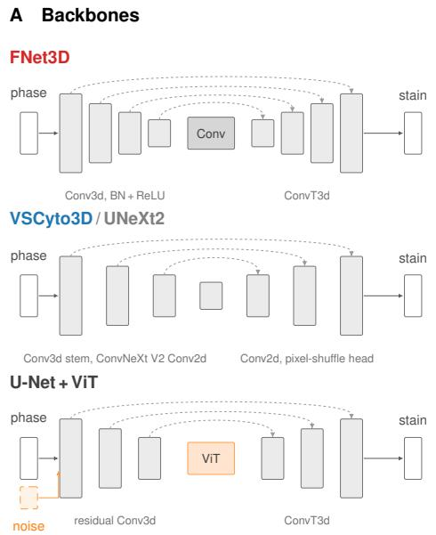

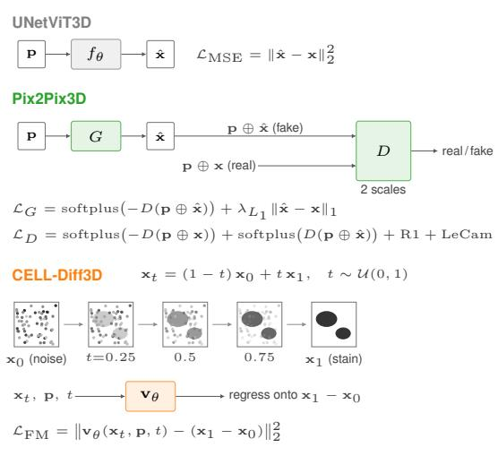  
Figure 8: Architectures and training objectives of the benchmark baselines. (A) Three backbones cover the six trained models and differ mainly in how they handle the axial dimension. FNet3D [4] is a fully 3D U-Net of depth 4 (channels 32 → 512) with BatchNorm, ReLU, nonresidual double convolutions, and a convolutional bottleneck; it halves Z along with Y and X, takes 32×64×64 inputs, and is trained with MSE. VSCyto3D [15] folds the 15-plane input stack into channels at the stem, encodes it with a 2D ConvNeXt V2 (stages 3-3-9-3, channels 96 → 768) whose deepest stage feeds three decoder stages directly, and restores the stack with a pixel-shuffle head; UNeXt2 is the same network without FCMAE pretraining, and both take $1 5 \times 3 \mathrm { { \bar { 8 } 4 } ^ { 2 } }$ inputs and are trained with MAE+MS-SSIM. The third backbone preserves Z with three levels of stride-(1, 2, 2) convolutions (channels 64 → 256) around a vision-transformer bottleneck (patch 4, 8 layers, width 512, 8 heads) and takes $\mathrm { 8 \times 5 1 2 ^ { 2 } }$ inputs. (B) Three objectives on that backbone. UNetViT3D regresses the target with MSE. Pix2Pix3D adds a PatchGAN discriminator D at two scales (2 input channels, base width 64, spectral norm) that scores the phase input concatenated with either the target or the generator output; the generator minimizes the non-saturating loss plus $\lambda _ { L _ { 1 } } { = } 1 0$ times the $L _ { 1 }$ error, and the discriminator loss adds R1 and LeCam regularization. CELL-Diff3D draws $\mathbf { x } _ { 0 } \sim \mathcal { N } ( \mathbf { 0 } , \mathbf { I } )$ and $t \sim \mathcal { U } ( 0 , 1 )$ , forms $\mathbf { x } _ { t }$ on the linear path, and regresses the velocity $\mathbf { v } _ { \theta } ( \mathbf { x } _ { t } , \mathbf { p } , t )$ onto ${ \bf x } _ { 1 } - { \bf x } _ { 0 } ;$ the strip shows one noise draw at increasing t, and sampling integrates the ODE from t=0 to 1. Dashed arrows denote skip connections and shaded blocks bottlenecks. Training all three objectives on one backbone makes App. C.5 a comparison of objectives rather than of capacity; hyperparameters are listed in Tab. 7.

## C.1 Shared training and augmentations

The training, inference, and evaluation framework is built with open-source libraries and PyTorch Lightning. Experiments are tracked with Weights & Biases. Training configurations are available at https: $: / / \mathfrak { g \mathrm { i } }$ thub.com/mehta-lab/VisCy/tree/dynacell-models/applications/ dynacell.

Auxiliary regression ablations. Tab. 7 lists two models beyond the four main baselines. Both are controls rather than benchmark entries: each is matched to one main baseline in everything except the single factor it isolates. UNeXt2 [15] is the VSCyto3D ConvNeXt V2 U-Net trained from a random initialization. It matches VSCyto3D in parameter count (32.1M), schedule (200 epochs, batch 32, learning rate $4 \times 1 0 ^ { - 4 }$ with cosine decay), patch size $( 1 5 \times 3 8 4 \times 3 8 4 )$ , MAE+SSIM loss, and target normalization; the two differ only in that VSCyto3D initializes its encoder from the FCMAE checkpoint. UNeXt2 therefore isolates the contribution of encoder pretraining (App. C.4). UNetViT3D is trained with MSE on the same generator architecture that backs Pix2Pix3D and CELL-Diff3D (77.8M parameters, 20 epochs, batch 4, learning rate $3 \times 1 0 ^ { - 4 }$ with cosine decay). These models hold the generator fixed while comparing reconstruction, adversarial, and flow-matching objectives (App. C.5). UNetViT3D also serves as the regression reference for CELL-Diff3D’s singlepass conditional mean (Tab. 10).

Table 7: Training pipeline comparison for the four main models and two auxiliary regression ablations. All models take 3D phase-contrast volumes as input and predict a single fluorescence channel.
<table><tr><td rowspan="2">Model</td><td colspan="7">Training</td><td colspan="3">Data</td></tr><tr><td>Params</td><td>Pretrained</td><td>Duration</td><td>Batch</td><td>LR</td><td>LR schedule</td><td>∆z</td><td>∆y/x</td><td>Loss</td><td>Tgt. norma</td></tr><tr><td>CELL-Diff3D</td><td>93.4M</td><td>No</td><td>20 ep</td><td>4</td><td> $3 \times 1 0 ^ { - 4 }$ </td><td>Cosine</td><td>8</td><td> $\overline { { { 5 1 2 ^ { 2 } } } }$ </td><td>Flow matching</td><td>min-maxc</td></tr><tr><td>Pix2Pix3D</td><td>77.8M+disc.</td><td>No</td><td>40 ep</td><td>4</td><td> $2 \times 1 0 ^ { - 4 } \left( \mathbf { G } , \mathbf { D } \right)$ </td><td>Warmup cosine</td><td>8</td><td> $5 1 2 ^ { 2 }$ </td><td>Non-sat. GAN+L1d</td><td>min-maxc</td></tr><tr><td>UNetViT3D</td><td>77.8M</td><td>No</td><td>20 ep</td><td>4</td><td> $3 \times 1 0 ^ { - 4 }$ </td><td>Cosine</td><td>8</td><td> $5 1 2 ^ { 2 }$ </td><td>MSE</td><td>med/IQR</td></tr><tr><td>VSCyto3D</td><td>32.1M</td><td>Yesb</td><td>200 ep</td><td>32</td><td> $4 \times 1 0 ^ { - 4 }$ </td><td>Cosine</td><td>15</td><td> $3 8 4 ^ { 2 }$ </td><td>MAE+SSIM</td><td>med/IQR</td></tr><tr><td>UNeXt2</td><td>32.1M</td><td>No</td><td>200 ep</td><td>32</td><td> $4 \times 1 0 ^ { - 4 }$ </td><td>Cosine</td><td>15</td><td> $3 8 4 ^ { 2 }$ </td><td>MAE+SSIM</td><td>med/IQR</td></tr><tr><td>FNet3D</td><td>35.3M</td><td>No</td><td>200k steps</td><td>48</td><td> $1 \times 1 0 ^ { - 3 }$ </td><td>Constant</td><td>32</td><td> $6 4 ^ { 2 }$ </td><td>MSE</td><td>mean/SD</td></tr></table>

<sup>a</sup> med/IQR = (value − median) / IQR; mean/SD = (value − mean) / SD  
<sup>b</sup> Encoder from VSCyto3D FCMAE checkpoint (400 ep on HEK293, A549, iPSC phase); decoder randomly initialized.  
<sup>c</sup> min-max = clip to [p<sub>1</sub>, p<sub>99</sub>], then rescale to [−1, 1].  
<sup>d</sup> Pix2Pix3D checkpoints use the 40-epoch recipe: equal generator and discriminator learning rates, R1 and LeCam regularization, generator EMA, and $\lambda _ { L _ { 1 } } = 1 0 .$

Table 8: Data augmentation summary for the four main models and two auxiliary regression ablations. ✓ indicates the augmentation is applied; − indicates it is not used. Intensity augmentations are applied to the phase input only.
<table><tr><td>Augmentation</td><td>FNet3D</td><td>UNeXt2</td><td>VSCyto3D</td><td>UNetViT3D</td><td>Pix2Pix3D</td><td>CELL-Diff3D</td></tr><tr><td>Weighted random crop (CPU)</td><td>√</td><td>√</td><td>√</td><td>√</td><td>√</td><td>√</td></tr><tr><td>Random flip, Y/X axes  $( p = 0 . 5 )$ </td><td>√</td><td></td><td></td><td></td><td></td><td></td></tr><tr><td>Random 3D affine  $( p = 0 . 8 )$ </td><td>一</td><td>√</td><td>√</td><td>√</td><td>√</td><td>√</td></tr><tr><td>with safe-crop constraint</td><td></td><td>一</td><td></td><td>√</td><td>√</td><td>√</td></tr><tr><td>Gamma contrast adjustment  $( p = 0 . 5 )$ </td><td></td><td>√</td><td>√</td><td>√</td><td>√</td><td>√</td></tr><tr><td>Intensity scaling  $( p = 0 . 5 )$ </td><td></td><td>√</td><td>√</td><td>√</td><td>√</td><td>√</td></tr><tr><td>Gaussian noise  $( p = 0 . 5 )$ </td><td></td><td>√</td><td>√</td><td>√</td><td>√</td><td>√</td></tr><tr><td>Gaussian smoothing  $( p = 0 . 5 )$ </td><td></td><td>√</td><td>√</td><td>√</td><td>√</td><td>√</td></tr></table>

Augmentations are implemented using viscy transforms, a GPU-accelerated extension of MONAI [61] transforms for batched 3D volumes. The pipeline has two stages.

CPU stage (data loading). All models sample foreground-weighted random crops from each field of view, where the sampling probability at each voxel is proportional to the fluorescence target intensity. FNet3D extracts eight small patches of size $3 2 \times 6 4 \times 6 4$ per FOV (matching the patchbased protocol of the original paper [4]). UNeXt2 and VSCyto3D extract four oversized crops of $2 0 \times 6 0 0 \times 6 0 0$ to provide spatial margin for the subsequent affine transformation before centercropping to $1 5 \times 3 8 \bar { 4 } \times 3 8 4$ . UNetViT3D, Pix2Pix3D, and CELL-Diff3D crop directly at the final patch size of $1 3 \times 5 1 2 \times 5 1 2$ , using the affine safe-crop mechanism described below to avoid border artifacts.

GPU stage. For FNet3D, only independent Y- and X-axis random flips (p = 0.5 each) are applied to both source (phase) and target (fluorescence). For all other models, the GPU pipeline applies the following operations in sequence:

1. Random 3D affine $( p = 0 . 8 ) $ : full ±π rotation about the Z-axis, shear ±0.05 in Y/X, and anisotropic scaling $( 0 . 7 \mathrm { - 1 . 3 } \times \mathrm { i n } \mathrm { Z } , 0 . 5 \mathrm { - 1 . 5 } \times \mathrm { i n } \mathrm { Y } / \mathrm { X } )$ , applied jointly to source and target. UNetViT3D, Pix2Pix3D, and CELL-Diff3D additionally enforce a safe-crop constraint that limits the scale factors so the rotated patch always covers the final crop, eliminating zerofilled corners. A center crop to the final patch size follows.

2. Gamma contrast adjustment $( p = 0 . 5 , \gamma \in [ 0 . 8 , 1 . 2 ] )$ : applied to the phase input only.

3. Intensity scaling $( p = 0 . 5 ,$ , multiplicative factor $\in [ 0 . 5 , 1 . 5 ] )$ : applied to the phase input only.

4. Additive Gaussian noise $( p = 0 . 5 , \sigma = 0 . 3 ) \colon$ applied to the phase input only.

5. Gaussian smoothing $( p = 0 . 5 , \sigma \in [ 0 . 2 5 , 0 . 7 5 ]$ isotropically in all three axes): applied to the phase input only.

Operations (2)–(5) are applied only to the phase input, leaving the fluorescence target unchanged.   
All reported Pix2Pix3D results use tiled inference with the EMA generator weights.

FNet3D follows the original publication [4] and uses only random flips, without affine or intensity transformations. The nucleus ablation in App. C.2 tests how this recipe contributes to its reduced OOD performance.

## C.2 FNet3D patch size and augmentation ablation

FNet3D differs from the other baselines in two ways: it trains on a $3 2 \times 6 4 \times 6 4$ patch, whereas the others use $3 8 4 ^ { 2 }$ or $5 1 2 ^ { 2 }$ in Y/X, and it applies only axis flips rather than the full augmentation sequence above. The cross-cell-type comparison therefore combines architecture and training-recipe effects. We test the recipe on the iPSC-trained nucleus model with two additional fits. Version A (+ big patch) increases the patch to $3 2 \times 3 8 4 \times 3 8 4$ , changes numerical precision from 32-bit to bf16 mixed, and retains flip-only augmentation. Version B $( \dot { + } \mathit { V S C y t o 3 D a u g } )$ adds the VSCyto3D augmentation sequence to version A. The versions otherwise share geometry, batch size, crop sampling, model, optimizer, loss, and step budget, so the A→B comparison isolates augmentation. The baseline→A comparison combines patch size and numerical precision.

Both versions preserve in-distribution scores and improve OOD scores (Fig. 9). On the held-out iPSC test set, the three versions have similar scores (Spectral PCC 0.890, 0.892, 0.897; instance Dice 0.886, 0.892, 0.893). Averaged over the three A549 conditions, Spectral PCC increases from 0.020 (baseline) to 0.425 (A) to 0.831 (B). Over the same sequence, instance Dice increases from 0.052 to 0.269 to 0.701, and CELL-DINO KID decreases from 31.8 to 22.5 to 19.4. The baseline-to-A change and the A-to-B augmentation change contribute equally to Spectral PCC (+0.405 versus +0.406). For instance Dice, adding augmentations gives about twice the gain of the initial recipe change (+0.432 versus +0.217); for CELL-DINO KID, the initial change gives about three times the improvement. These results show that the original recipe contributes substantially to the transfer gap, but they do not rule out architectural effects. In the expanded appendix comparison of four main models, two regression ablations, and two FNet3D variants, version B ranks second on Spectral PCC, third on instance Dice, and third on CELL-DINO KID.

The ablation covers only the nucleus target and iPSC training set and is not a strict recipe match. The additional versions retain FNet3D’s 32-plane input volume, compared with 15–20 planes for the other models, and use a batch size of 8. This ablation estimates the importance of the training-recipe differences but does not establish FNet3D’s best possible performance.

## C.3 FNet3D temporal-sampling ablation

At a fixed frame budget, we compare two A549-trained FNet3D nucleus models. One uses only the 5–7 hpi frames, while the other samples frames across the full time course. Their pooled Spectral PCC differs by only 0.0045. However, the narrow-window model performs better within its training window, and its scores then decline 2.5× faster in Spectral PCC and 1.6× faster in instance Dice per 10 h (Fig. 10). Thus, a pooled score can hide a failure to generalize to later timepoints.

A  
Phase (input)  
GT nuclei  
FNet3D  
+ big patch  
+ VSCyto3D aug  
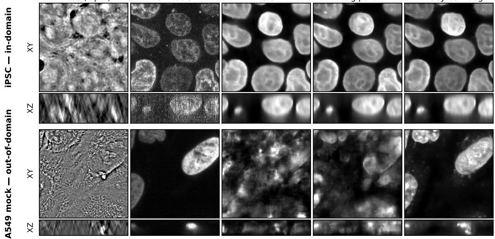

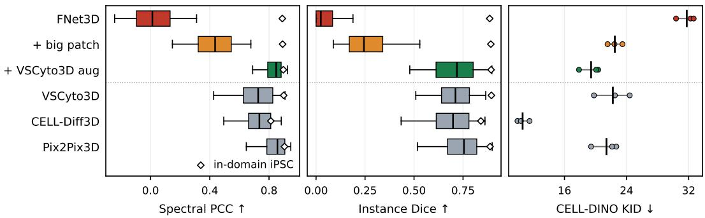  
Figure 9: FNet3D patch-size and augmentation ablation (nucleus, iPSC-trained). (A) An infocus XY plane with the orthogonal XZ slice directly below it at the same width, both shown at the physical aspect ratio, for the in-distribution iPSC test set (top) and OOD A549 Mock test set (bottom). Columns show the phase input, experimental fluorescence, and three FNet3D versions. Panels are clipped independently to the 1st–99.5th percentiles; each field is the case with median AP@0.50 for version B, not the best case. (B) Per-field Spectral PCC and instance Dice distribution pooled over the three A549 conditions (120 fields each, $n = 3 6 0 )$ : boxes show the median and interquartile range, whiskers show the 5th–95th percentiles, and diamonds show the in-distribution iPSC mean. CELL-DINO KID is a corpus-level scalar, so its panel shows the three per-condition values and their mean. Its in-distribution marker is omitted because KID uses a separate reference corpus for each dataset, making iPSC and A549 KID incomparable. Rows have the same order in all panels: the two additional versions above the dotted line and three published iPSC-trained baselines below.

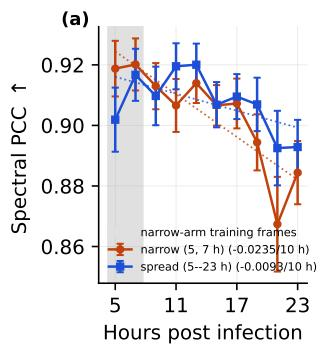

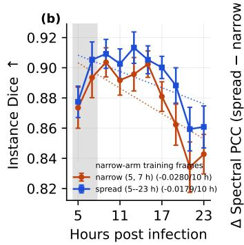

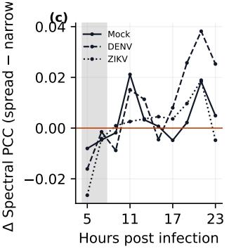  
Figure 10: FNet3D temporal-sampling ablation at a fixed frame budget. A nucleus model trained on the narrow 5–7 hpi window is compared with one trained on frames spread over 5–23 hpi. (a,b) Spectral PCC and instance Dice over the paired A549 timepoints (mean ± 1 SEM across Mock, DENV, and ZIKV FOVs); the shaded region marks the narrow training window and dotted lines are least-squares slopes. (c) Per-condition Spectral-PCC difference between the spread and narrow models. Similar pooled scores mask the narrow model’s steeper late-time decline.

## C.4 Effect of FCMAE pretraining

UNeXt2 is the VSCyto3D architecture trained from scratch, whereas VSCyto3D initializes the same encoder with FCMAE pretraining; all other training choices are matched within each pool. Tab. 9 shows that the effect is modest and organelle dependent. The clearest difference is iPSC membrane instance Dice, which increases from 0.589 to 0.630; results for nucleus, ER, and mitochondria are close or mixed.

Table 9: VSCyto3D encoder-pretraining ablation. Entries compare UNeXt2 (training from scratch) with VSCyto3D (FCMAE initialization) on the same training and test sets. A549 values average Mock, DENV, and ZIKV. Segmentation is instance Dice for nucleus and membrane and semantic Dice for ER and mitochondria; lower CELL-DINO KID is better.
<table><tr><td>Organelle</td><td>Domain</td><td>Spectral PCC</td><td>Dice</td><td>CELL-DINO KID</td></tr><tr><td rowspan="2">Membrane</td><td>iPSC</td><td>0.878 → 0.889</td><td>0.589 → 0.630</td><td>44.98 → 43.62</td></tr><tr><td>A549</td><td>0.874 → 0.877</td><td>0.724 → 0.730</td><td>28.28 → 28.03</td></tr><tr><td rowspan="2">Nucleus</td><td>iPSC</td><td>0.901 → 0.899</td><td>0.888 → 0.895</td><td>24.68 → 24.93</td></tr><tr><td>A549</td><td>0.897 → 0.897</td><td>0.895 → 0.898</td><td>32.17 → 32.47</td></tr><tr><td rowspan="2">ER</td><td>iPSC</td><td>0.882 → 0.883</td><td>0.258 → 0.262</td><td>36.83 → 36.64</td></tr><tr><td>A549</td><td>0.834 → 0.838</td><td>0.156 → 0.147</td><td>27.38 → 28.34</td></tr><tr><td rowspan="2">Mitochondria</td><td>iPSC</td><td>0.894 → 0.893</td><td>0.430 → 0.428</td><td>30.85 → 30.45</td></tr><tr><td>A549</td><td>0.880 → 0.884</td><td>0.368 → 0.368</td><td>30.75 → 30.64</td></tr></table>

## C.5 Comparing objectives with the same generator

UNetViT3D is an auxiliary regression ablation that uses the same generator architecture as Pix2Pix3D and CELL-Diff3D. These controls compare regression, adversarial, and flow-matching objectives, including both single-pass and sampled CELL-Diff3D inference, while keeping the architecture and capacity fixed (Tab. 10).

## C.6 CELL-Diff3D flow-matching baseline

## C.6.1 Training

CELL-Diff3D is trained as a conditional flow-matching model [30, 62]. For each phase volume p and paired fluorescence target x, let $\mathbf { x } _ { 1 } ~ = ~ \mathbf { x }$ , sample noise $\mathbf { x } _ { 0 } \sim \mathcal { N } ( 0 , \mathbf { I } )$ , and sample time $\bar { t } \sim \mathcal { U } ( \bar { 0 } , 1 )$ . Linear flow-matching defines the interpolated state and target velocity as

$$
{ \bf x } _ { t } = ( 1 - t ) { \bf x } _ { 0 } + t { \bf x } _ { 1 } , \qquad { \bf v } _ { t } = { \bf x } _ { 1 } - { \bf x } _ { 0 } .
$$

The model learns a conditional velocity field $\mathbf { v } _ { \theta } ( \mathbf { x } _ { t } , t , \mathbf { p } )$ by minimizing

$$
\begin{array} { r } { \mathcal { L } _ { \mathrm { F M } } = \mathbb { E } _ { \mathbf { p } , \mathbf { x } _ { 1 } , \mathbf { x } _ { 0 } , t } \left[ \left\| \mathbf { v } _ { \theta } ( \mathbf { x } _ { t } , t , \mathbf { p } ) - \mathbf { v } _ { t } \right\| _ { 2 } ^ { 2 } \right] . } \end{array}\tag{8}
$$

At inference, a noise volume is sampled and the learned probability-flow ODE is integrated from $t ~ = ~ 0 ~ \mathrm { t o } ~ t ~ = ~ 1$ to generate a fluorescence sample. Our 3D adaptation uses volumetric phase and fluorescence inputs and shares its backbone with the auxiliary UNetViT3D regression ablation, allowing regression-versus-generative comparisons that are not dominated by backbone differences.

## C.6.2 Iterative prediction with flow-matching

A standard way to process large microscopy fields is to apply a predictor to overlapping windows and stitch the outputs. This approach is less effective for conditional generative models because each window’s prediction is an independent sample from $p ( \mathbf { x } \mid \mathbf { p } )$ , rather than the output of a single-valued function such as a conditional mean. Neighboring windows may therefore represent different samples and produce visible seams when stitched (Fig. 11A, left).

We instead generate tiles sequentially with flow-matching inpainting. Each new prediction is conditioned on the phase input p and the overlap with the previous fluorescence prediction, preserving continuity while filling the unseen region.

Table 10: Same-generator objective ablation. Pix2Pix3D matches or exceeds its regression backbone on pixel and segmentation metrics, whereas sampled CELL-Diff3D has the lowest DINOv3 and CELL-DINO KID in every block. All models use the same UNetViT3D generator. Mean denotes the single-pass conditional-mean estimate at $t = 0$ from the same flow-matching model used for sampling. Dice is instance Dice for nucleus and membrane and semantic Dice for ER and mitochondria. Within each organelle and train–test block, bold marks the best mean and values within one reported standard deviation of it. Pixel, segmentation, and GLCM+ values are mean $\pm \thinspace \mathrm { S D }$ over image pairs; KID values are dataset-level means ± SD over resampled subsets.
<table><tr><td rowspan="2">Organelle (train → test)</td><td colspan="3">Spectral</td><td rowspan="2">Dice ↑</td><td rowspan="2">DINOv3 KID↓</td><td rowspan="2">CELL-DINO KID↓</td><td rowspan="2">GLCM+ cos ↑</td></tr><tr><td>Model</td><td>si-SSIM ↑</td><td>PCC ↑</td></tr><tr><td>Nucleus</td><td></td><td></td><td></td><td></td><td></td><td></td><td></td></tr><tr><td>(iPSC → iPSC)</td><td>UNetViT3D</td><td>0.54 ± 0.16 0.89 ± 0.07</td><td></td><td></td><td>0.86 ± 0.08 2.01 ± 0.04</td><td> $2 3 . 3 4 \pm 0 . 1 7$ </td><td> ${ \bf - 0 . 0 0 \pm 0 . 4 3 }$ </td></tr><tr><td></td><td>Pix2Pix3D CELL-Diff3D</td><td>0.58 ± 0.17</td><td>0.90 ± 0.06</td><td>0.89 ± 0.08</td><td>1.82 ± 0.06</td><td> $2 3 . 9 9 \pm 0 . 2 4$ </td><td> ${ \bf - 0 . 0 1 \pm 0 . 4 5 }$ </td></tr><tr><td></td><td>(mean) CELL-Diff3D</td><td>0.54 ± 0.16 0.87 ± 0.07</td><td></td><td>0.85 ± 0.09</td><td>1.77 ± 0.03</td><td> $2 7 . 7 1 \pm 0 . 2 1$ </td><td> ${ \bf 0 . 0 0 \pm 0 . 4 3 }$ </td></tr><tr><td>Membrane</td><td>(sampled)</td><td>0.47 ± 0.17</td><td>0.81 ± 0.09</td><td>0.84 ± 0.08</td><td>0.08 ± 0.02</td><td> ${ \bf 1 . 7 2 \pm 0 . 0 5 }$ </td><td> ${ \bf 0 . 2 6 \pm 0 . 4 1 }$ </td></tr><tr><td>(iPSC → iPSC)</td><td>UNetViT3D</td><td>0.57 ± 0.12</td><td>0.88 ± 0.14</td><td>0.66 ± 0.10</td><td>2.57 ± 0.05</td><td> $3 4 . 5 2 \pm 0 . 2 4$ </td><td> ${ \bf 0 . 2 2 \pm 0 . 4 6 }$ </td></tr><tr><td></td><td>Pix2Pix3D CELL-Diff3D</td><td>0.60 ± 0.12</td><td>0.88 ± 0.15</td><td></td><td>0.69 ± 0.11 2.62 ± 0.05</td><td> $3 1 . 3 0 \pm 0 . 2 4$ </td><td> ${ \bf 0 . 2 6 \pm 0 . 4 5 }$ </td></tr><tr><td></td><td>(mean)</td><td>0.54 ± 0.12</td><td>0.85 ± 0.14</td><td>0.60 ± 0.10</td><td>2.77 ± 0.04</td><td> $4 1 . 5 0 \pm 0 . 3 0$ </td><td> ${ \bf 0 . 1 8 \pm 0 . 4 5 }$ </td></tr><tr><td></td><td>CELL-Diff3D</td><td></td><td></td><td></td><td></td><td></td><td></td></tr><tr><td>ER (iPSC → iPSC)</td><td>(sampled)</td><td>0.47 ± 0.13</td><td>0.82 ± 0.14</td><td></td><td>0.52 ± 0.17 0.33 ± 0.02</td><td>4.22 ± 0.09</td><td> ${ \bf 0 . 2 8 \pm 0 . 3 5 }$ </td></tr><tr><td></td><td>UNetViT3D</td><td>0.35 ± 0.08</td><td>0.88 ± 0.07</td><td></td><td>0.23 ± 0.05 3.84 ± 0.06</td><td>35.19 ± 0.20</td><td> ${ \bf 0 . 1 6 \pm 0 . 3 1 }$ </td></tr><tr><td></td><td>Pix2Pix3D CELL-Diff3D</td><td>0.38 ± 0.08</td><td>0.90 ± 0.07</td><td></td><td>0.27 ± 0.043.99 ± 0.06</td><td>32.13 ± 0.26</td><td> ${ \bf 0 . 1 6 \pm 0 . 3 4 }$ </td></tr><tr><td></td><td>(mean)</td><td>0.31 ± 0.08</td><td>0.85 ± 0.08</td><td>0.22 ± 0.05</td><td>4.23 ± 0.06</td><td>37.87 ± 0.23</td><td>0.16 ± 0.28</td></tr><tr><td></td><td>CELL-Diff3D</td><td></td><td></td><td></td><td></td><td></td><td></td></tr><tr><td>Mitochondria</td><td>(sampled)</td><td></td><td>0.23 ± 0.09 0.79 ± 0.09</td><td></td><td>0.23 ± 0.02 0.13 ± 0.02</td><td>3.16 ± 0.06</td><td> ${ \bf 0 . 3 6 \pm 0 . 3 5 }$ </td></tr><tr><td>(iPSC → iPSC)</td><td>UNetViT3D</td><td>0.55 ± 0.060.92 ± 0.030.45 ± 0.045.66 ± 0.14</td><td></td><td></td><td></td><td>29.12 ± 0.17</td><td> $0 . 1 5 \pm 0 . 4 2$ </td></tr><tr><td></td><td>Pix2Pix3D</td><td>0.58 ± 0.06 0.92 ± 0.02 0.47 ± 0.04 4.03 ± 0.06 35.40 ± 0.22</td><td></td><td></td><td></td><td></td><td> $0 . 1 1 \pm 0 . 4 5$ </td></tr><tr><td></td><td>CELL-Diff3D</td><td></td><td></td><td></td><td></td><td></td><td></td></tr><tr><td></td><td>(mean)</td><td> $0 . 5 2 \pm { \bf 0 . 0 6 } 0 . 9 0 \pm { \bf 0 . 0 3 } 0 . 4 4 \pm { \bf 0 . 0 4 } 5 . 7 1 \pm 0 . 1 3 2 7 . 6 5 \pm 0 . 1 7$ </td><td></td><td></td><td></td><td></td><td> $0 . 1 7 \pm 0 . 3 8$ </td></tr><tr><td></td><td>CELL-Diff3D</td><td></td><td></td><td></td><td></td><td></td><td></td></tr><tr><td></td><td></td><td></td><td></td><td></td><td></td><td></td><td></td></tr><tr><td>ER</td><td>(sampled)</td><td></td><td></td><td></td><td> $0 . 4 3 \pm 0 . 0 6 0 . 8 5 \pm 0 . 0 3 0 . 3 2 \pm 0 . 0 3 0 . 0 7 \pm 0 . 0 1 3 . 1 3 \pm 0 . 1 3$ </td><td></td><td> ${ \bf 0 . 6 1 \pm 0 . 2 8 }$ </td></tr><tr><td></td><td></td><td></td><td></td><td></td><td></td><td></td><td></td></tr><tr><td>(A549 → A549 Mock)</td><td></td><td></td><td></td><td></td><td></td><td></td><td></td></tr><tr><td></td><td>UNetViT3D</td><td></td><td></td><td></td><td>0.51 ± 0.08 0.83 ± 0.06 0.12 ± 0.04 2.40 ± 0.07</td><td>27.43 ± 0.24</td><td> ${ \bf 0 . 0 9 \pm 0 . 4 6 }$ </td></tr><tr><td></td><td>Pix2Pix3D</td><td>0.53 ± 0.080.83 ± 0.060.12 ± 0.04 2.16 ± 0.06</td><td></td><td></td><td></td><td></td><td></td></tr><tr><td></td><td></td><td></td><td></td><td></td><td></td><td>19.97 ± 0.18</td><td> ${ \bf 0 . 0 7 \pm 0 . 4 7 }$ </td></tr><tr><td></td><td>CELL-Diff3D</td><td></td><td></td><td></td><td></td><td></td><td></td></tr><tr><td></td><td></td><td></td><td></td><td></td><td></td><td></td><td></td></tr><tr><td></td><td>(sampled)</td><td></td><td>0.42 ± 0.08 0.71 ± 0.10</td><td></td><td>0.14 ± 0.03 0.51 ± 0.06</td><td>4.26 ± 0.09</td><td> ${ \bf 0 . 1 8 \pm 0 . 3 9 }$ </td></tr><tr><td>Mitochondria</td><td></td><td></td><td></td><td></td><td></td><td></td><td></td></tr><tr><td></td><td></td><td></td><td></td><td></td><td></td><td></td><td></td></tr><tr><td></td><td></td><td>0.72 ± 0.08 0.90 ± 0.04</td><td></td><td></td><td></td><td></td><td></td></tr><tr><td>(A549 → A549 Mock)</td><td>UNetViT3D</td><td></td><td></td><td></td><td>0.36 ± 0.07 4.84 ± 0.11</td><td>21.86 ± 0.17</td><td> ${ \bf 0 . 1 6 \pm 0 . 4 5 }$ </td></tr><tr><td></td><td></td><td></td><td></td><td></td><td></td><td></td><td></td></tr><tr><td></td><td>Pix2Pix3D</td><td>0.76 ± 0.07</td><td>0.92 ± 0.03</td><td></td><td>0.38 ± 0.08 2.94 ± 0.05</td><td>32.08 ± 0.26</td><td> ${ \bf 0 . 1 4 \pm 0 . 5 1 }$ </td></tr><tr><td></td><td></td><td></td><td></td><td></td><td></td><td></td><td></td></tr><tr><td></td><td></td><td></td><td></td><td></td><td></td><td></td><td></td></tr><tr><td></td><td>CELL-Diff3D</td><td></td><td></td><td></td><td></td><td></td><td></td></tr><tr><td></td><td></td><td></td><td></td><td></td><td></td><td></td><td></td></tr><tr><td></td><td></td><td></td><td></td><td></td><td></td><td></td><td></td></tr><tr><td></td><td></td><td></td><td></td><td></td><td></td><td></td><td></td></tr><tr><td></td><td></td><td></td><td></td><td>0.64 ± 0.08 0.81 ± 0.06 0.25 ± 0.03 0.75 ± 0.05</td><td></td><td>6.72 ± 0.10</td><td> ${ \bf 0 . 3 1 \pm 0 . 4 7 }$ </td></tr><tr><td></td><td></td><td></td><td></td><td></td><td></td><td></td><td></td></tr><tr><td></td><td></td><td></td><td></td><td></td><td></td><td></td><td></td></tr><tr><td></td><td></td><td></td><td></td><td></td><td></td><td></td><td></td></tr><tr><td></td><td>(sampled)</td><td></td><td></td><td></td><td></td></table>

At each step, the local window contains an observed overlap and an unobserved region to be synthesized. Let $\mathbf { x } _ { \mathrm { o b s } }$ denote the partially observed fluorescence volume and let $\mathbf { m } \in \{ \tilde { 0 } , 1 \} ^ { \Omega }$ be a binary mask of the observed voxels. The task is to sample from

$$
p ( \mathbf { x } \mid \mathbf { p } , \mathbf { x } _ { \mathrm { o b s } } , \mathbf { m } ) .
$$

Both diffusion and flow-matching models define a time-dependent transformation from an initial noise distribution $\mathbf { x } _ { 0 } \sim \mathcal { N } ( \mathbf { 0 } , \mathbf { I } )$ to a target sample $\mathbf { x } _ { 1 } \sim p _ { \mathrm { d a t a } } ( \mathbf { x } \mid \mathbf { p } )$ . A broad family of such processes can be written as

$$
{ \bf x } _ { t } = \alpha _ { t } { \bf x } _ { 1 } + \sigma _ { t } { \bf x } _ { 0 } ,\tag{9}
$$

where $\alpha _ { t }$ increases from 0 to 1 and $\sigma _ { t }$ decreases from 1 to 0 as t goes from 0 to 1. For linear flow-matching,

$$
\alpha _ { t } = t , \qquad \sigma _ { t } = 1 - t ,
$$

so that

$$
\mathbf { x } _ { t } = t \mathbf { x } _ { 1 } + \left( 1 - t \right) \mathbf { x } _ { 0 } .
$$

A  
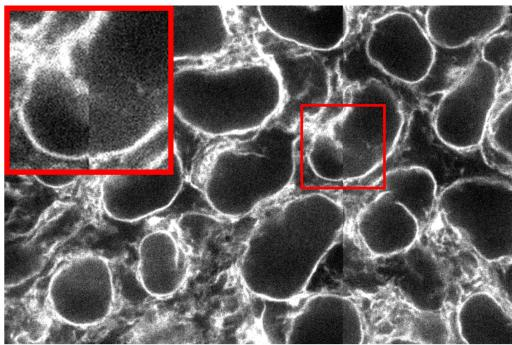  
Sliding window prediction

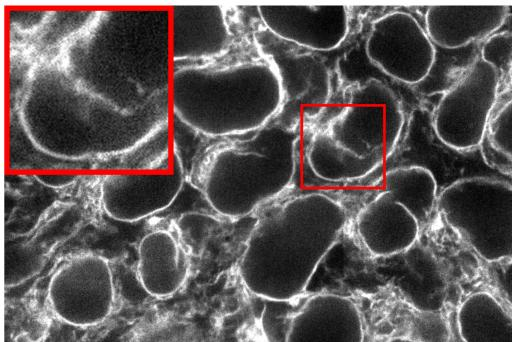  
B  
Iterative prediction

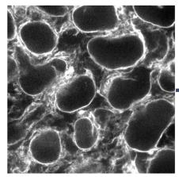  
Generate initial block

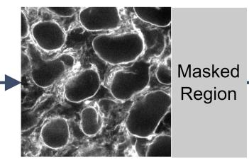  
Reveal context & Mask region

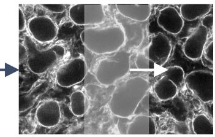  
Inpainting masked region

Figure 11: Iterative flow-matching prediction for large-field virtual staining. (A) Slidingwindow prediction introduces a visible boundary artifact because neighboring tiles are sampled independently from the conditional distribution $p ( \mathbf { x } \mid \mathbf { p } )$ , whereas iterative prediction preserves continuity across the overlap region. (B) Starting from an initial generated block, the window shifts to expose a new masked region while retaining the overlapping context. Flow-matching inpainting fills the masked region conditioned on this context and the phase input.

The associated conditional probability-flow ODE is

$$
\frac { d { \mathbf { x } } _ { t } } { d t } = \mathbf { v } ( \mathbf { x } _ { t } , t , \mathbf { p } ) , \qquad \mathbf { x } _ { t = 0 } = \mathbf { x } _ { 0 } ,
$$

where the velocity field is

$$
\mathbf { v } ( \mathbf { x } , t , \mathbf { p } ) = \mathbb { E } [ { \dot { \mathbf { x } } } _ { t } \mid \mathbf { x } _ { t } = \mathbf { x } , \mathbf { p } ] = { \dot { \alpha } } _ { t } \mathbb { E } [ \mathbf { x } _ { 1 } \mid \mathbf { x } _ { t } = \mathbf { x } , \mathbf { p } ] + { \dot { \sigma } } _ { t } \mathbb { E } [ \mathbf { x } _ { 0 } \mid \mathbf { x } _ { t } = \mathbf { x } , \mathbf { p } ] .\tag{10}
$$

Conditioning on $\mathbf { x } _ { t } = \mathbf { x }$ and p also gives

$$
\mathbf { x } = \mathbb { E } [ \mathbf { x } _ { t } \mid \mathbf { x } _ { t } = \mathbf { x } , \mathbf { p } ] = \alpha _ { t } \mathbb { E } [ \mathbf { x } _ { 1 } \mid \mathbf { x } _ { t } = \mathbf { x } , \mathbf { p } ] + \sigma _ { t } \mathbb { E } [ \mathbf { x } _ { 0 } \mid \mathbf { x } _ { t } = \mathbf { x } , \mathbf { p } ] .\tag{11}
$$

Therefore, solving the linear system

$$
\begin{array} { r } { \left\{ \mathbf { x } \right. \qquad = \alpha _ { t } \mathbb { E } [ \mathbf { x } _ { 1 } \mid \mathbf { x } _ { t } = \mathbf { x } , \mathbf { p } ] + \sigma _ { t } \mathbb { E } [ \mathbf { x } _ { 0 } \mid \mathbf { x } _ { t } = \mathbf { x } , \mathbf { p } ] , } \\ { \mathbf { v } ( \mathbf { x } , t , \mathbf { p } ) } & { = { \dot { \alpha } } _ { t } \mathbb { E } [ \mathbf { x } _ { 1 } \mid \mathbf { x } _ { t } = \mathbf { x } , \mathbf { p } ] + { \dot { \sigma } } _ { t } \mathbb { E } [ \mathbf { x } _ { 0 } \mid \mathbf { x } _ { t } = \mathbf { x } , \mathbf { p } ] , } \end{array}
$$

yields

$$
\left\{ \begin{array} { l l } { \mathbb { E } [ \mathbf { x } _ { 0 } \mid \mathbf { x } _ { t } = \mathbf { x } , \mathbf { p } ] = { \frac { \alpha _ { t } \mathbf { v } \left( \mathbf { x } , t , \mathbf { p } \right) - { \dot { \alpha } } _ { t } \mathbf { x } } { \alpha _ { t } { \dot { \sigma } } _ { t } - \sigma _ { t } { \dot { \alpha } } _ { t } } } , } \\ { \mathbb { E } [ \mathbf { x } _ { 1 } \mid \mathbf { x } _ { t } = \mathbf { x } , \mathbf { p } ] = { \frac { { \dot { \sigma } } _ { t } \mathbf { x } - \sigma _ { t } \mathbf { v } \left( \mathbf { x } , t , \mathbf { p } \right) } { \alpha _ { t } { \dot { \sigma } } _ { t } - \sigma _ { t } { \dot { \alpha } } _ { t } } } . } \end{array} \right.\tag{12}
$$

We now use this identity to construct conditional inpainting dynamics. In the unknown region, we keep the original pretrained velocity field $\mathbf { v } ( \mathbf { x } , t , \mathbf { p } )$ unchanged. In the known region, we enforce the endpoint constraint

$$
\mathbb { E } [ { \mathbf { x } } _ { 1 } \mid { \mathbf { x } } _ { t } = { \mathbf { x } } , { \mathbf { p } } ] = { \mathbf { x } } _ { \mathrm { o b s } } ,
$$

so that the terminal state matches the observed fluorescence context. Let $\mathbf { v } ^ { \star }$ denote the calibrated velocity field in the observed region. Using

$$
\mathbf { v } ^ { \star } ( \mathbf { x } , t , \mathbf { p } ) = { \dot { \alpha } } _ { t } \mathbf { x } _ { \mathrm { o b s } } + { \dot { \sigma } } _ { t } \mathbb { E } [ \mathbf { x } _ { 0 } \mid \mathbf { x } _ { t } = \mathbf { x } , \mathbf { p } ] ,
$$

together with Eq. (12), we obtain

$$
\mathbf { v } ^ { \star } ( \mathbf { x } , t , \mathbf { p } ) = \dot { \alpha } _ { t } \mathbf { x } _ { \mathrm { o b s } } + \dot { \sigma } _ { t } \frac { \alpha _ { t } \mathbf { v } ( \mathbf { x } , t , \mathbf { p } ) - \dot { \alpha } _ { t } \mathbf { x } } { \alpha _ { t } \dot { \sigma } _ { t } - \sigma _ { t } \dot { \alpha } _ { t } } .\tag{13}
$$

For linear flow-matching, where $\alpha _ { t } = t$ and $\sigma _ { t } = 1 - t ,$ we have $\dot { \alpha } _ { t } = 1$ and $\dot { \sigma } _ { t } = - 1$ . Eq. (12) then simplifies to

$$
\left\{ \begin{array} { l l } { \mathbb { E } [ \mathbf { x } _ { 0 } \mid \mathbf { x } _ { t } = \mathbf { x } , \mathbf { p } ] = \mathbf { x } - t \mathbf { v } ( \mathbf { x } , t , \mathbf { p } ) , } \\ { \mathbb { E } [ \mathbf { x } _ { 1 } \mid \mathbf { x } _ { t } = \mathbf { x } , \mathbf { p } ] = \mathbf { x } + ( 1 - t ) \mathbf { v } ( \mathbf { x } , t , \mathbf { p } ) . } \end{array} \right.\tag{14}
$$

Substituting these expressions into Eq. (13) gives

$$
\mathbf { v } ^ { \star } ( \mathbf { x } , t , \mathbf { p } ) = \mathbf { x } _ { \mathrm { o b s } } - \big ( \mathbf { x } - t \mathbf { v } ( \mathbf { x } , t , \mathbf { p } ) \big ) = t \mathbf { v } ( \mathbf { x } , t , \mathbf { p } ) + \mathbf { x } _ { \mathrm { o b s } } - \mathbf { x } .\tag{15}
$$

Finally, we combine the known and unknown regions with a binary mask $\mathbf { m } \in \{ 0 , 1 \} ^ { \Omega }$ and define the calibrated velocity field elementwise as

$$
\mathbf { v } ^ { \star } ( \mathbf { x } , t , \mathbf { p } ) _ { q } = \left\{ \begin{array} { l l } { \mathbf { v } ( \mathbf { x } , t , \mathbf { p } ) _ { q } , } & { \mathrm { i f } \mathbf { m } _ { q } = 0 , } \\ { t \mathbf { v } ( \mathbf { x } , t , \mathbf { p } ) _ { q } + \mathbf { x } _ { \mathrm { o b s } q } - \mathbf { x } _ { q } , } & { \mathrm { i f } \mathbf { m } _ { q } = 1 , } \end{array} \right.\tag{16}
$$

for each voxel $q \in \Omega .$

Starting from $\mathbf { x } _ { 0 } \sim \mathcal { N } ( \mathbf { 0 } , \mathbf { I } )$ , we integrate the conditional ODE

$$
\frac { d { \mathbf { x } } _ { t } } { d t } = \mathbf { v } ^ { \star } ( \mathbf { x } _ { t } , t , \mathbf { p } ) , \qquad \mathbf { x } _ { t = 0 } = \mathbf { x } _ { 0 } ,
$$

from $t = 0 \mathrm { t o } t = 1$ to obtain the final sample $\mathbf { x } _ { 1 }$ . The dynamics follow the original conditional generative flow $p ( \mathbf { x } \mid \mathbf { p } )$ in unobserved regions. In observed regions, they are constrained to reach the prescribed context $\mathbf { x _ { \mathrm { o b s } } }$ $t = 1 ( \mathrm { A l g . } \ \bar { 1 } )$ ). Applied sequentially to overlapping windows, this procedure extends prediction beyond the native input size while maintaining spatial continuity (Fig. 11).

```latex
Algorithm 1 Iterative prediction with flow matching
Require: Phase input p, pretrained conditional velocity field $\mathbf { v } _ { \boldsymbol { \theta } } ( \cdot , \cdot , \mathbf { p } )$ , initial window, stride, over
lap mask rule
Ensure: Large-field fluorescence prediction xˆ
1: Generate the first tile by sampling from $p _ { \theta } ( \mathbf { x } \mid \mathbf { p } )$ in the initial window
2: Place this tile into the output canvas $\hat { \bf x }$
3: for each subsequent window along the traversal path do
4: Extract the local phase crop p<sub>loc</sub>
5: Construct a partial observation $\hat { \mathbf { x } } _ { \mathrm { l o c } }$ from the overlap with previously generated tiles
6: Build a binary mask m indicating observed overlap voxels
7: Sample an initial noise state $\mathbf { x } _ { 0 } \overset { \mathbf { \le } } \sim \mathcal { N } ( \mathbf { 0 } , \mathbf { I } )$
8: Define the calibrated velocity field
$\begin{array} { r } { \mathbf { v } ^ { \star } ( \mathbf { x } , t , \mathbf { p } _ { \mathrm { l o c } } ) _ { q } = \left\{ \begin{array} { l l } { \mathbf { v } _ { \boldsymbol { \theta } } ( \mathbf { x } , t , \mathbf { p } _ { \mathrm { l o c } } ) _ { q } , } & { \mathrm { i f } \mathbf { m } _ { q } = 0 , } \\ { t \mathbf { v } _ { \boldsymbol { \theta } } ( \mathbf { x } , t , \mathbf { p } _ { \mathrm { l o c } } ) _ { q } + \hat { \mathbf { x } } _ { \mathrm { l o c } , q } - \mathbf { x } _ { q } , } & { \mathrm { i f } \mathbf { m } _ { q } = 1 } \end{array} \right. } \end{array}$
9: Solve
$\frac { d { \bf x } _ { t } } { d t } = { \bf v } ^ { \star } ( { \bf x } _ { t } , t , { \bf p } _ { \mathrm { l o c } } ) , \qquad { \bf x } _ { t = 0 } = { \bf x } _ { 0 }$
from $t = 0 \mathrm { t o } t = 1$ to obtain the next tile
10: Write the newly generated non-overlap region into the output canvas $\hat { \bf x }$
11: end for
12: return xˆ
```

Tab. 11 compares the two inference strategies across four organelles on the iPSC test set. Iterative prediction gives small improvements in Spectral PCC and Dice on all four organelles, whereas CELL-DINO KID is better for sliding-window inference. The model is trained on $8 \times 5 1 2 \times 5 1 2$ patches, while the iPSC test volumes are $4 0 \times 5 1 2 \times 5 1 2$ . Because the in-plane field matches training, stitching artifacts are mostly limited to the axial direction in this evaluation. We nevertheless use iterative prediction because it reduces visible seams by conditioning each block on previously generated context (Fig. 11a).

Table 11: Comparison between CELL-Diff3D Iterative and Sliding-Window inference. Spectral PCC, Dice (instance Dice for nucleus and membrane; semantic Dice for ER and mitochondria), and CELL-DINO KID across four organelles on the iPSC held-out test set (100 FOVs).
<table><tr><td>Organelle</td><td>Inference</td><td>Spectral PCC ↑</td><td>Dice ↑</td><td>CELL-DINO KID ↓</td></tr><tr><td rowspan="2">Cell Membrane</td><td>Iterative</td><td> ${ \bf 0 . 8 1 9 \pm 0 . 1 4 }$ </td><td> ${ \bf 0 . 5 1 6 \pm 0 . 1 7 }$ </td><td> $4 . 2 2 0 \pm 0 . 0 9$ </td></tr><tr><td>Sliding-Window</td><td> $0 . 7 7 1 \pm 0 . 1 7$ </td><td> $0 . 4 6 7 \pm 0 . 2 0$ </td><td> ${ \bf 2 . 7 4 7 \pm 0 . 0 7 }$ </td></tr><tr><td rowspan="2">Nucleus</td><td>Iterative</td><td> $\mathbf { 0 . 8 1 2 \pm 0 . 0 9 }$ </td><td> $\mathbf { 0 . 8 4 1 \pm 0 . 0 8 }$ </td><td> $1 . 7 2 0 \pm 0 . 0 5$ </td></tr><tr><td>Sliding-Window</td><td> $0 . 7 9 7 \pm 0 . 0 9$ </td><td> $0 . 8 2 6 \pm 0 . 0 9$ </td><td> $\mathbf { 1 . 0 4 2 \pm 0 . 0 3 }$ </td></tr><tr><td rowspan="2">ER (SEC61B)</td><td>Iterative</td><td> ${ \bf 0 . 7 9 0 \pm 0 . 0 9 }$ </td><td> ${ \bf 0 . 2 3 3 \pm 0 . 0 2 }$ </td><td> $3 . 1 6 4 \pm 0 . 0 6$ </td></tr><tr><td>Sliding-Window</td><td> $0 . 7 6 5 \pm 0 . 1 1$ </td><td> $0 . 2 3 0 \pm 0 . 0 2$ </td><td> ${ \bf 2 . 2 0 4 \pm 0 . 0 5 }$ </td></tr><tr><td rowspan="2">Mito. (TOMM20)</td><td>Iterative</td><td> $\mathbf { 0 . 8 5 0 \pm 0 . 0 3 }$ </td><td> ${ \bf 0 . 3 1 9 \pm 0 . 0 3 }$ </td><td> $3 . 1 2 8 \pm 0 . 1 3$ </td></tr><tr><td>Sliding-Window</td><td> $0 . 8 3 8 \pm 0 . 0 4$ </td><td> $0 . 3 1 4 \pm 0 . 0 3$ </td><td> ${ \bf 1 . 9 7 5 \pm 0 . 0 7 }$ </td></tr></table>

## C.6.3 Mean prediction with flow-matching

CELL-Diff3D can also produce a mean prediction. The most direct approach is Monte Carlo averaging: draw multiple samples

$$
\mathbf { x } ^ { ( 1 ) } , \ldots , \mathbf { x } ^ { ( K ) } \sim p _ { \theta } ( \mathbf { x } \mid \mathbf { p } ) ,
$$

and estimate the conditional mean by

$$
\bar { \mathbf { x } } = \frac { 1 } { K } \sum _ { k = 1 } ^ { K } \mathbf { x } ^ { ( k ) } .
$$

As $K  \infty$ , this converges to $\mathbb { E } [ \mathbf { x } \mid \mathbf { p } ]$ . Each sample, however, requires solving the probability-flow ODE from noise to data, making repeated sampling substantially slower than a single forward pass through a point predictor.

Eq. (12) shows that the posterior conditional mean of the target image can be recovered directly from the learned velocity field. For a general interpolation path,

$$
\mathbb { E } [ { \bf x } _ { 1 } \mid { \bf x } _ { t } = { \bf x } , { \bf p } ] = \frac { \dot { \sigma } _ { t } { \bf x } - \sigma _ { t } { \bf v } ( { \bf x } , t , { \bf p } ) } { \alpha _ { t } \dot { \sigma } _ { t } - \sigma _ { t } \dot { \alpha } _ { t } } .\tag{17}
$$

In particular, at $t = 0$ , where ${ \bf x } _ { t } = { \bf x } _ { 0 }$ , this becomes

$$
\mathbb { E } [ { \bf x } _ { 1 } \mid { \bf x } _ { 0 } = { \bf x } , { \bf p } ] = \frac { \dot { \sigma } _ { 0 } { \bf x } - \sigma _ { 0 } { \bf v } ( { \bf x } , 0 , { \bf p } ) } { \alpha _ { 0 } \dot { \sigma } _ { 0 } - \sigma _ { 0 } \dot { \alpha } _ { 0 } } .\tag{18}
$$

For the linear path used in our flow-matching model,

$$
\alpha _ { t } = t , \qquad \sigma _ { t } = 1 - t ,
$$

so that

$$
\alpha _ { 0 } = 0 , ~ \sigma _ { 0 } = 1 , ~ \dot { \alpha } _ { 0 } = 1 , ~ \dot { \sigma } _ { 0 } = - 1 .
$$

Substituting these into Eq. (18) yields

$$
\mathbb { E } [ \mathbf { x } _ { 1 } \mid \mathbf { x } _ { 0 } = \mathbf { x } , \mathbf { p } ] = \mathbf { x } + \mathbf { v } ( \mathbf { x } , 0 , \mathbf { p } ) .\tag{19}
$$

Because $\mathbf { x } _ { \mathrm { 0 } }$ is independent of $\left( \mathbf { x } _ { 1 } , \mathbf { p } \right)$ , this conditional expectation equals $\mathbb { E } [ { \bf x } _ { 1 } \mathrm { ~ \bf ~ \ / ~ p ~ } ]$ for the population-optimal field. Thus, one velocity-field evaluation at $t ~ = ~ 0$ gives a conditional-mean estimator and a single-pass alternative to Monte Carlo averaging (Alg. 2).

Algorithm 2 Mean prediction with flow matching

Require: Phase input $\mathbf { p } ,$ pretrained velocity field $\mathbf { v } _ { \theta }$ .

$$
\hat { \mathbf { x } } _ { \mathrm { m e a n } }
$$

1: Sample an initial noise state $\mathbf { x } _ { 0 } \sim \mathcal { N } ( \mathbf { 0 } , \mathbf { I } )$

2: Compute

$$
\hat { \mathbf { x } } _ { \mathrm { m e a n } }  \mathbf { x } _ { 0 } + \mathbf { v } _ { \theta } ( \mathbf { x } _ { 0 } , 0 , \mathbf { p } )
$$

3: return $\hat { \mathbf { x } } _ { \mathrm { m e a n } }$

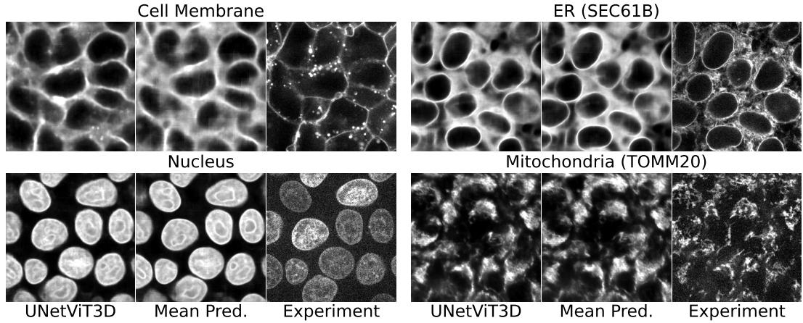  
Figure 12: Visual comparison between UNetViT3D and CELL-Diff3D mean prediction.

The iPSC results in Tab. 10 compare the auxiliary UNetViT3D regression ablation with CELL-Diff3D mean prediction across all four organelles (Fig. 12). Their pixel and Dice scores are similar, with the largest Dice difference for membrane. UNetViT3D is trained directly with MSE, which encourages conditional-mean prediction, whereas CELL-Diff3D obtains the mean indirectly from the t = 0 velocity field. The same CELL-Diff3D model can produce either this single-pass estimate or diverse stochastic samples through ODE integration, without additional training.

## C.6.4 CELL-Diff3D sampling and denoising trajectories

CELL-Diff3D generates a fluorescence volume by integrating the learned flow-matching velocity field as an ordinary differential equation (ODE). This transports a Gaussian-noise sample $\mathbf { x } _ { 0 } \sim$ $\mathcal { N } ( \mathbf { 0 } , \mathbf { I } )$ at $t ~ = ~ 0$ to a predicted image $\mathbf { x } _ { 1 }$ at $t ~ = ~ 1$ . We refer to the intermediate ODE states $\{ \mathbf { x } _ { t } \} _ { t \in [ 0 , 1 ] }$ produced during this integration as the sampling trajectory.

Denoising trajectory. At any intermediate time t, the velocity field also yields the model’s current estimate of the clean target, obtained by extrapolating the state to the endpoint $t = 1$ . Specializing the endpoint estimator of Eq. (14) to the learned velocity gives:

$$
\hat { \mathbf { x } } _ { 1 } ( \mathbf { x } _ { t } , t ) ~ = ~ \mathbb { E } [ \mathbf { x } _ { 1 } \mid \mathbf { x } _ { t } , \mathbf { p } ] ~ = ~ \mathbf { x } _ { t } + ( 1 - t ) \mathbf { v } _ { \theta } ( \mathbf { x } _ { t } , t , \mathbf { p } ) .\tag{20}
$$

We call the sequence $\{ \hat { \mathbf { x } } _ { 1 } ( \mathbf { x } _ { t } , t ) \} _ { t \in [ 0 , 1 ] }$ , evaluated along the sampling trajectory, the denoising trajectory. Unlike the raw state $\mathbf { x } _ { t } ,$ , each $\hat { \mathbf { x } } _ { 1 }$ is a full-resolution estimate of the fluorescence image: at $t = 0$ it reduces to the single-pass mean predictor of Eq. (19), and at t = 1 it coincides with the final sample $\mathbf { x } _ { 1 }$

We save every integration step and evaluate the sampling state $\mathbf { x } _ { t }$ and denoised estimate $\hat { \mathbf { x } } _ { 1 } ( \mathbf { x } _ { t } , t )$ against the experimental target. Fig. 13 shows nucleus trajectories for a representative iPSC FOV over the 100-step ODE. The sampling trajectory begins as noise and resolves into individual nuclei, with PCC and Spectral PCC increasing during integration. The denoising trajectory already recovers coherent nuclei at the first step, where it attains its highest PCC and Spectral PCC in this example. As integration proceeds, $\hat { \bf x } _ { 1 }$ becomes increasingly conditioned on the sampled Gaussian noise and synthesizes sample-specific high-frequency detail. This plausible detail need not match the paired experimental realization, so both pixel metrics decline; Spectral PCC declines more gradually because it downweights noise-dominated high frequencies. The sampling and denoising trajectories converge as t → 1, where $\hat { \bf x } _ { 1 }$ and $\mathbf { x } _ { 1 }$ coincide.

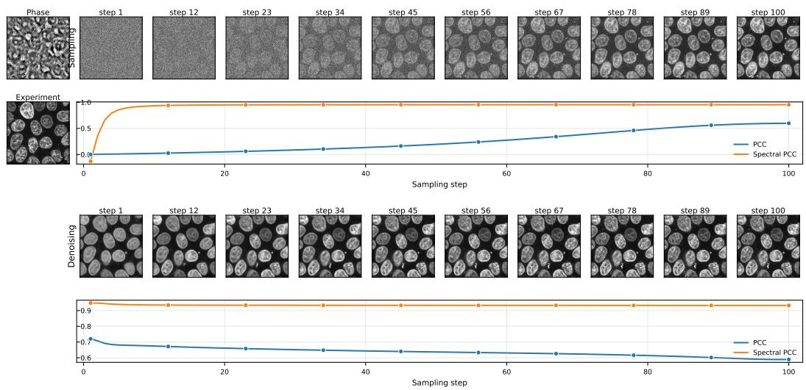  
Figure 13: CELL-Diff3D sampling and denoising trajectories for nucleus virtual staining on an iPSC confocal field of view. Row 1: phase input followed by the sampling trajectory at ten uniformly spaced steps of the 100-step flow-matching ODE. Row 2: experimental target and the evolution of pixel metrics (PCC and Spectral PCC) over the sampling trajectory. Row 3: the denoising trajectory at the same steps. Row 4: pixel metrics over the denoising trajectory.

## C.7 Compute costs of training the models

All reported models and ablations were trained on the Biohub HPC cluster under SLURM, using NVIDIA H100, H200, L40S, A6000, A40, and A100 accelerators. We report accelerator-hours (wall time multiplied by the recorded accelerator count), so multi-GPU runs are not counted as singledevice jobs. As of August 5, 2026, the accessible Weights & Biases project contained 309 training attempts across the iPSC-only, A549-only, and joint pools, including Pix2Pix3D and superseded or restarted runs. These attempts account for 17,506.4 accelerator-hours: 15,122.7 in runs whose logger terminated cleanly, 1,282.9 in crashed runs, 444.8 in failed runs, and 656.0 in seven four-GPU continuations that were still running at the audit snapshot.

Completion audit and lower-bound scope. The W&B state finished records clean logger termination, not necessarily completion of the configured training goal. Cross-checking configured epoch targets and SLURM accounting identifies runs that stopped early, including canceled and timed-out jobs; later reruns are used where available. Separately, 839 prediction and re-prediction SLURM jobs submitted between March 1 and August 5, 2026, account for another 5,584.7 accelerator-hours. The combined tracked project cost is therefore at least 23,091.2 acceleratorhours. This is a lower bound: a legacy W&B workspace is no longer queryable, and the audit omits jobs submitted by other users and evaluation or preprocessing jobs whose names do not identify them as prediction runs.

Inference and evaluation compute. Inference and evaluation use cpdino-ViT-L for nucleus and membrane instances, Allen Institute organelle workflows for ER and mitochondria, GLCM+ for handcrafted 3D features, and DINOv3, DynaCLR, CELL-DINO, and MorphEm for learned embeddings. Their costs are not all logged in W&B; the prediction jobs captured above provide a lower bound, while segmentation and feature extraction are omitted where SLURM job names do not identify them reliably.

## D Extended results

## D.1 Results across cell types and microscopes

Tab. 12 reports iPSC-only, A549-only, and joint training results on the iPSC and A549 test sets for VSCyto3D, Pix2Pix3D, and CELL-Diff3D. Each row combines representative pixel, segmentation, and phenotype metrics from the same final evaluation.

Table 12: Results for three training sets and two test sets. Rows show Spectral PCC ↑, Dice ↑, and CELL-DINO KID ↓ for each organelle. Model columns group versions trained on iPSC, A549, or both; panels separate the iPSC and A549 Mock test sets. Dice is instance Dice for nucleus and membrane and semantic Dice for ER and mitochondria. For each training–test condition, bold entries are within one reported standard deviation of the best of the three models. Colored squares denote pixel, segmentation, and phenotype metrics.
<table><tr><td>(A) iPSC test set</td><td colspan="3">VSCyto3D</td><td colspan="3">Pix2Pix3D</td><td colspan="3">CELL-Diff3D</td></tr><tr><td>Metric</td><td>iPSC→ iPSC</td><td>A549→ iPSC</td><td>Joint→ iPSC</td><td>iPSC→ iPSC</td><td>A549→ iPSC</td><td>Joint→ iPSC</td><td>iPSC→ iPSC</td><td>A549→ iPSC</td><td>Joint→ iPSC</td></tr><tr><td colspan="10">Nucleus</td></tr><tr><td>Spectral PCC (↑)</td><td> ${ \bf 0 . 8 9 9 \pm 0 . 0 6 }$ </td><td> ${ \bf 0 . 5 5 7 \pm 0 . 1 5 }$ </td><td> ${ \bf 0 . 9 0 4 \pm 0 . 0 6 }$ </td><td> ${ \bf 0 . 9 0 4 \pm 0 . 0 6 }$ </td><td> ${ \bf 0 . 5 9 2 \pm 0 . 1 4 }$ </td><td> ${ \bf 0 . 8 9 2 \pm 0 . 0 6 }$ </td><td> $0 . 8 1 2 \pm 0 . 0 9$ </td><td> $0 . 3 7 7 \pm 0 . 1 5$ </td><td> $0 . 8 0 5 \pm 0 . 0 9$ </td></tr><tr><td>Dice (↑)</td><td> ${ \bf 0 . 8 9 5 \pm 0 . 0 7 }$ </td><td> ${ \bf 0 . 6 3 1 \pm 0 . 1 2 }$   $3 0 . 6 2 \pm 0 . 1 9$ </td><td> ${ \bf 0 . 8 9 1 \pm 0 . 0 7 }$   $2 4 . 9 1 \pm 0 . 2 4$ </td><td> ${ \bf 0 . 8 8 8 \pm 0 . 0 8 }$ </td><td> ${ \bf 0 . 6 3 5 \pm 0 . 1 1 }$   $2 9 . 1 4 \pm 0 . 2 3$ </td><td> ${ \bf 0 . 8 8 8 \pm 0 . 0 7 }$   $1 6 . 4 0 \pm 0 . 1 4$ </td><td> ${ \bf 0 . 8 4 1 \pm 0 . 0 8 }$   ${ \bf 1 . 7 2 0 \pm 0 . 0 5 }$ </td><td> $0 . 3 9 4 \pm 0 . 0 9$   ${ \bf 1 2 . 2 8 \pm 0 . 1 1 }$ </td><td> ${ \bf 0 . 8 3 4 \pm 0 . 0 8 }$   ${ \bf 1 . 6 5 2 \pm 0 . 0 5 }$ </td></tr><tr><td colspan="10">CELL-DINO KID (↓)</td></tr><tr><td colspan="10"></td></tr><tr><td>Membrane</td><td></td><td></td><td></td><td></td><td></td><td></td><td></td><td></td><td></td></tr><tr><td>Spectral PCC (↑)</td><td>0.889 ± 0.11  ${ \bf 0 . 6 3 0 \pm 0 . 1 1 }$ </td><td>0.256 ± 0.33  ${ \bf 0 . 3 8 6 \pm 0 . 1 6 }$ </td><td> ${ \bf 0 . 8 9 5 \pm 0 . 1 0 }$   ${ \bf 0 . 7 1 4 \pm 0 . 1 0 }$ </td><td> ${ \bf 0 . 8 8 0 \pm 0 . 1 5 }$   ${ \bf 0 . 6 8 9 \pm 0 . 1 1 }$ </td><td> ${ \bf 0 . 5 3 0 \pm 0 . 1 5 }$  0.262 ± 0.15</td><td> ${ \bf 0 . 8 8 2 \pm 0 . 1 4 }$   ${ \bf 0 . 6 9 4 \pm 0 . 1 0 }$ </td><td> ${ \bf 0 . 8 1 9 \pm 0 . 1 4 }$   $0 . 5 1 6 \pm 0 . 1 7$ </td><td> ${ \bf 0 . 4 8 6 \pm 0 . 2 0 }$  0.258 ± 0.16</td><td>0.829 ± 0.14  $0 . 5 3 8 \pm 0 . 1 7$ </td></tr><tr><td colspan="10">Dice (↑) CELL-DINO KID (↓)</td></tr><tr><td></td><td> $4 3 . 6 2 \pm 0 . 3 0$ </td><td> $3 6 . 8 0 \pm 0 . 2 7$ </td><td> $3 6 . 7 6 \pm 0 . 2 8$ </td><td> $3 1 . 3 0 \pm 0 . 2 4$ </td><td> $3 4 . 9 4 \pm 0 . 2 3$ </td><td> $2 7 . 1 1 \pm 0 . 2 2$ </td><td> ${ \bf 4 . 2 2 0 \pm 0 . 0 9 }$ </td><td> ${ \bf 1 6 . 1 3 \pm 0 . 1 5 }$ </td><td> ${ \bf 3 . 5 8 3 \pm 0 . 0 9 }$ </td></tr><tr><td>ER Spectral PCC (↑)</td><td> ${ \bf 0 . 8 8 3 \pm 0 . 0 8 }$ </td><td> ${ \bf 0 . 4 7 0 \pm 0 . 1 8 }$ </td><td> ${ \bf 0 . 8 8 2 \pm 0 . 0 9 }$ </td><td> ${ \bf 0 . 8 9 5 \pm 0 . 0 7 }$ </td><td> ${ \bf 0 . 5 2 6 \pm 0 . 1 5 }$ </td><td> $\mathbf { 0 . 8 8 4 \pm 0 . 0 7 }$ </td><td> $0 . 7 9 0 \pm 0 . 0 9$ </td><td> ${ \bf 0 . 5 0 7 \pm 0 . 1 5 }$ </td><td> $0 . 7 8 0 \pm 0 . 1 2$ </td></tr><tr><td colspan="10"> Dice (↑)</td></tr><tr><td>CELL-DINO KID (↓)</td><td> ${ \bf 0 . 2 6 2 \pm 0 . 0 4 }$   $3 6 . 6 4 \pm 0 . 2 3$ </td><td> $0 . 0 1 3 \pm 0 . 0 2$   $4 0 . 0 7 \pm 0 . 2 2$ </td><td> ${ \bf 0 . 2 6 1 \pm 0 . 0 4 }$   $3 7 . 0 4 \pm 0 . 2 2$ </td><td> ${ \bf 0 . 2 6 9 \pm 0 . 0 4 }$   $3 2 . 1 3 \pm 0 . 2 6$ </td><td> $0 . 0 2 7 \pm 0 . 0 2$   $3 8 . 8 1 \pm 0 . 2 6$ </td><td> ${ \bf 0 . 2 7 2 \pm 0 . 0 4 }$   $2 6 . 6 3 \pm 0 . 2 6$ </td><td> ${ \bf 0 . 2 3 3 \pm 0 . 0 2 }$   ${ \bf 3 . 1 6 4 \pm 0 . 0 6 }$ </td><td> ${ \bf 0 . 1 0 2 \pm 0 . 0 2 }$   ${ \bf 1 6 . 8 6 \pm 0 . 1 5 }$ </td><td> $0 . 2 2 8 \pm 0 . 0 2$   $\mathbf { 2 . 3 7 5 \pm 0 . 0 6 }$ </td></tr><tr><td></td><td></td><td></td><td></td><td></td><td></td><td></td><td></td><td></td><td></td></tr><tr><td colspan="10">Mitochondria</td></tr><tr><td>Spectral PCC (↑) Dice (↑)</td><td>0.893 ± 0.03</td><td>0.526 ± 0.13  $0 . 0 6 7 \pm 0 . 0 4$ </td><td>0.895 ± 0.03  ${ \bf 0 . 4 3 2 \pm 0 . 0 3 }$ </td><td> ${ \bf 0 . 9 2 4 \pm 0 . 0 2 }$   ${ \bf 0 . 4 7 2 \pm 0 . 0 4 }$ </td><td> ${ \bf 0 . 6 5 1 \pm 0 . 0 8 }$  0.186 ± 0.04</td><td> ${ \bf 0 . 9 2 0 \pm 0 . 0 2 }$   $\mathbf { 0 . 4 5 7 \pm 0 . 0 4 }$ </td><td> $0 . 8 5 0 \pm 0 . 0 3$  0.319 ± 0.03</td><td> $0 . 5 5 2 \pm 0 . 0 8$  0.124 ± 0.02</td><td> $0 . 8 3 8 \pm 0 . 0 4$  0.304 ± 0.03</td></tr><tr><td>CELL-DINO KID (↓)</td><td> $0 . 4 2 8 \pm 0 . 0 3$   $3 0 . 4 5 \pm 0 . 1 9$ </td><td> $3 7 . 7 0 \pm 0 . 2 1$ </td><td> $3 1 . 2 5 \pm 0 . 1 9$ </td><td> $3 5 . 4 0 \pm 0 . 2 2$ </td><td> $3 2 . 5 7 \pm 0 . 1 9$ </td><td> $2 8 . 0 5 \pm 0 . 1 8$ </td><td> ${ \bf 3 . 1 2 8 \pm 0 . 1 3 }$ </td><td> ${ \bf 2 1 . 8 4 \pm 0 . 2 0 }$ </td><td> ${ \bf 6 . 0 3 8 \pm 0 . 1 9 }$ </td></tr><tr><td colspan="10">(B) A549 Mock test set</td></tr><tr><td colspan="10"></td></tr><tr><td>Metric</td><td>A549→ A549</td><td>iPSC→ A549</td><td>Joint→ A549</td><td>A549→ A549</td><td>iPSC→ A549</td><td>Joint→ A549</td><td>A549→ A549</td><td>iPSC→ A549</td><td>Joint→ A549</td></tr><tr><td colspan="10">Nucleus</td></tr><tr><td>Spectral PCC (↑) Dice (↑)</td><td> ${ \bf 0 . 8 9 2 \pm 0 . 0 6 }$ </td><td> $0 . 6 9 9 \pm 0 . 1 3$   ${ \bf 0 . 6 9 4 \pm 0 . 1 0 }$ </td><td> ${ \bf 0 . 9 0 0 \pm 0 . 0 6 }$   ${ \bf 0 . 9 0 9 \pm 0 . 0 5 }$ </td><td> ${ \bf 0 . 9 1 1 \pm 0 . 0 6 }$   ${ \bf 0 . 9 1 8 \pm 0 . 0 5 }$ </td><td> ${ \bf 0 . 8 5 5 \pm 0 . 0 7 }$   ${ \bf 0 . 7 3 1 \pm 0 . 1 2 }$ </td><td> ${ \bf 0 . 9 1 3 \pm 0 . 0 6 }$   ${ \bf 0 . 9 1 7 \pm 0 . 0 5 }$ </td><td> ${ \bf 0 . 8 7 5 \pm 0 . 0 7 }$   $0 . 7 6 3 \pm 0 . 0 9$ </td><td> $0 . 7 2 2 \pm 0 . 1 1$   ${ \bf 0 . 6 6 9 \pm 0 . 1 5 }$ </td><td> ${ \bf 0 . 8 9 1 \pm 0 . 0 6 }$   $0 . 8 4 4 \pm 0 . 0 8$ </td></tr><tr><td colspan="10">CELL-DINO KID (↓)</td></tr><tr><td></td><td> ${ \bf 0 . 9 0 4 \pm 0 . 0 5 }$   $3 0 . 8 8 \pm 0 . 0 9$ </td><td> $1 9 . 8 0 \pm 0 . 0 6$ </td><td> $2 9 . 5 3 \pm 0 . 0 9$ </td><td> $2 6 . 0 4 \pm 0 . 1 1$ </td><td> $1 9 . 4 3 \pm 0 . 0 8$ </td><td> $2 0 . 1 0 \pm 0 . 0 9$ </td><td> ${ \bf 4 . 1 6 3 \pm 0 . 0 3 }$ </td><td> ${ \bf 9 . 9 4 7 \pm 0 . 0 4 }$ </td><td> ${ \bf 4 . 0 3 9 \pm 0 . 0 3 }$ </td></tr><tr><td>Membrane</td><td></td><td></td><td></td><td></td><td></td><td></td><td></td><td></td><td></td></tr><tr><td colspan="10">Spectral PCC (↑)</td></tr><tr><td>Dice (↑)</td><td> ${ \bf 0 . 8 8 3 \pm 0 . 0 4 }$   ${ \bf 0 . 7 1 3 \pm 0 . 1 1 }$ </td><td> ${ \bf 0 . 5 6 7 \pm 0 . 1 1 }$  0.363 ± 0.11</td><td> ${ \bf 0 . 8 8 9 \pm 0 . 0 4 }$  0.698 ± 0.14</td><td> ${ \bf 0 . 8 9 0 \pm 0 . 0 4 }$  0.693 ± 0.13</td><td> ${ \bf 0 . 5 6 6 \pm 0 . 1 0 }$  0.394 ± 0.13</td><td> $\mathbf { 0 . 8 9 1 \pm 0 . 0 4 }$   ${ \bf 0 . 6 9 5 \pm 0 . 1 3 }$ </td><td> $0 . 8 3 3 \pm 0 . 0 5$   ${ \bf 0 . 6 2 9 \pm 0 . 1 3 }$ </td><td> ${ \bf 0 . 6 3 2 \pm 0 . 1 0 }$   $0 . 1 6 6 \pm 0 . 1 1$ </td><td> $0 . 8 2 8 \pm 0 . 0 6$  0.622 ± 0.14</td></tr><tr><td>CELL-DINO KID (↓)</td><td> $2 4 . 9 6 \pm 0 . 0 6$ </td><td> $3 9 . 3 6 \pm 0 . 0 7$ </td><td> $2 5 . 8 3 \pm 0 . 0 6$ </td><td> $1 9 . 9 7 \pm 0 . 0 5$ </td><td> $1 9 . 8 6 \pm 0 . 0 6$ </td><td> $1 8 . 6 4 \pm 0 . 0 5$ </td><td> $\mathbf { 1 . 8 5 3 \pm 0 . 0 2 }$ </td><td> ${ \bf 8 . 8 1 8 \pm 0 . 0 3 }$ </td><td> ${ \bf 2 . 1 4 1 \pm 0 . 0 2 }$ </td></tr><tr><td colspan="10">ER</td></tr><tr><td>Spectral PCC (↑)</td><td> ${ \bf 0 . 8 1 9 \pm 0 . 0 6 }$ </td><td> $\mathbf { 0 . 6 7 5 \pm 0 . 1 1 }$ </td><td> ${ \bf 0 . 8 2 8 \pm 0 . 0 6 }$ </td><td> ${ \bf 0 . 8 2 7 \pm 0 . 0 6 }$   ${ \bf 0 . 1 2 5 \pm 0 . 0 4 }$ </td><td> ${ \bf 0 . 7 2 1 \pm 0 . 0 9 }$  0.098 ± 0.02</td><td> ${ \bf 0 . 8 3 2 \pm 0 . 0 6 }$   ${ \bf 0 . 1 4 1 \pm 0 . 0 5 }$ </td><td> $0 . 7 1 4 \pm 0 . 1 0$   ${ \bf 0 . 1 4 1 \pm 0 . 0 3 }$ </td><td> ${ \bf 0 . 6 9 6 \pm 0 . 1 0 }$   ${ \bf 0 . 1 4 8 \pm 0 . 0 3 }$ </td><td> $0 . 7 3 1 \pm 0 . 0 9$   ${ \bf 0 . 1 4 0 \pm 0 . 0 4 }$ </td></tr><tr><td colspan="10"> Dice (↑)</td></tr><tr><td>■CELL-DINO KID (↓)</td><td> ${ \bf 0 . 1 4 0 \pm 0 . 0 3 }$   $2 8 . 3 3 \pm 0 . 2 2$ </td><td> $0 . 0 9 5 \pm 0 . 0 2$   $2 3 . 8 2 \pm 0 . 2 4$ </td><td> ${ \bf 0 . 1 4 7 \pm 0 . 0 3 }$   $2 8 . 6 1 \pm 0 . 2 3$ </td><td> $1 9 . 9 7 \pm 0 . 1 8$ </td><td> $1 9 . 0 7 \pm 0 . 1 9$ </td><td> $2 2 . 0 4 \pm 0 . 2 2$ </td><td> ${ \bf 4 . 2 5 9 \pm 0 . 0 9 }$ </td><td> ${ \bf 5 . 8 0 3 \pm 0 . 0 8 }$ </td><td> ${ \bf 4 . 7 3 1 \pm 0 . 1 0 }$ </td></tr><tr><td>Mitochondria</td><td></td><td></td><td></td><td></td><td></td><td></td><td></td><td></td><td></td></tr><tr><td colspan="10">Spectral PCC (↑)</td></tr><tr><td>Dice (↑)</td><td> $0 . 8 8 7 \pm 0 . 0 4$   ${ \bf 0 . 3 6 6 \pm 0 . 0 6 }$ </td><td> ${ \bf 0 . 7 9 3 \pm 0 . 0 5 }$   ${ \bf 0 . 2 2 2 \pm 0 . 0 6 }$ </td><td> ${ \bf 0 . 8 9 8 \pm 0 . 0 4 }$   ${ \bf 0 . 3 8 0 \pm 0 . 0 7 }$ </td><td> ${ \bf 0 . 9 1 9 \pm 0 . 0 3 }$  0.380 ± 0.08</td><td>0.247 ± 0.05</td><td> ${ \bf 0 . 3 9 0 \pm 0 . 0 8 }$ </td><td> $0 . 2 4 6 \pm 0 . 0 3$ </td><td> ${ \bf 0 . 2 0 3 \pm 0 . 0 4 }$ </td><td> $0 . 8 4 1 \pm 0 . 0 6$   $0 . 2 6 5 \pm 0 . 0 3$ </td></tr><tr><td> $\equiv \mathrm { C E L L - D I N O \ K I D \left( \downarrow \right) }$ </td><td> $3 0 . 2 4 \pm 0 . 2 3$ </td><td> $3 3 . 8 1 \pm 0 . 2 3$ </td><td>29.51 ± 0.23</td><td> $3 2 . 0 8 \pm 0 . 2 6$ </td><td> $3 3 . 5 9 \pm 0 . 2 5$ </td><td> $2 7 . 1 3 \pm 0 . 2 4$ </td><td> ${ \bf 6 . 7 2 4 \pm 0 . 1 0 }$ </td><td> ${ \bf 1 2 . 0 6 \pm 0 . 1 7 }$ </td><td>5.675 ± 0.11</td></tr><tr><td></td><td></td><td></td><td></td><td></td><td></td><td></td><td></td><td></td><td></td></tr></table>

HEK293T evaluation. Tabs. 13 and 14 evaluate FNet3D and VSCyto3D on HEK293T without using HEK293T for training or checkpoint selection. When both cell types are imaged on Mantis, the mean Spectral PCC decrease from A549 to HEK293T is 0.180. This compares with a decrease of 0.514 from A549 to iPSC, when both cell type and microscope change. These decreases compare absolute scores across test sets, but the Spectral PCC of the raw phase input, a no-model floor, differs by at most 0.07 between the three test sets (Tab. 14). This comparison suggests that both factors contribute to the OOD gap, although the different fluorescence markers prevent a complete separation of their effects. Joint training gives the highest HEK293T Spectral PCC for both organelles.

Table 13: Two-model decomposition of the iPSC–A549 transfer gap. For A549-trained FNet3D and VSCyto3D, the mean Spectral PCC drop is 0.180 from A549 to HEK with the microscope held fixed and 0.514 from A549 to iPSC with cell type and microscope both changed. The 35% value is based on these two models; estimating it across all four main models requires results for the remaining models.
<table><tr><td>Organelle</td><td>Model</td><td>Drop to HEK (cell type)</td><td>Drop to iPSC (cell type + scope)</td></tr><tr><td></td><td>FNet3D</td><td>+0.302</td><td>+0.479</td></tr><tr><td>Cell membrane Cell membrane</td><td>VSCyto3D</td><td>+0.175</td><td>+0.627</td></tr><tr><td>Mitochondria</td><td>FNet3D</td><td>+0.143</td><td>+0.589</td></tr><tr><td>Mitochondria</td><td>VSCyto3D</td><td>+0.099</td><td>+0.360</td></tr></table>

Table 14: HEK293T cell-type ablation with a fixed microscope. Spectral PCC is shown for models used as trained, without HEK data or checkpoint reselection. HEK and A549 share the Mantis microscope; iPSC images were acquired by confocal microscopy. HEK comprises four 64 × 960 × 1184 ZYX volumes per organelle (about 120 cells), reused from S-BIAD1287. Marker changes (KRAS versus CAAX; TOMM70A versus TOMM20) make the HEK gap an upper bound on the cell-type effect. Bold marks training domains.
<table><tr><td>Organelle</td><td>Test set</td><td>FNet3D iPSC</td><td>FNet3D A549</td><td>FNet3D Joint</td><td>VSCyto3D iPSC</td><td>VSCyto3D A549</td><td>VSCyto3D Joint</td><td>Raw phase no model</td></tr><tr><td>Cell membrane</td><td></td><td></td><td></td><td></td><td></td><td></td><td></td><td></td></tr><tr><td>KRAS on HEK, CAAX elsewhere</td><td>iPSC (confocal)</td><td>0.894</td><td>0.399</td><td>0.876</td><td>0.889</td><td>0.256</td><td>0.895</td><td>-0.001</td></tr><tr><td></td><td>A549 (Mantis)</td><td>0.594</td><td>0.878</td><td>0.882</td><td>0.567</td><td>0.883</td><td>0.889</td><td>0.015</td></tr><tr><td>Mitochondria</td><td>HEK (Mantis)</td><td>0.642</td><td>0.576</td><td>0.692</td><td>0.709</td><td>0.708</td><td>0.765</td><td>0.044</td></tr><tr><td>TOMM70A on HEK,</td><td></td><td></td><td></td><td></td><td></td><td></td><td></td><td></td></tr><tr><td>TOMM20 elsewhere</td><td>iPSC (confocal)</td><td>0.910</td><td>0.331</td><td>0.903</td><td>0.893</td><td>0.526</td><td>0.895</td><td>0.139</td></tr><tr><td></td><td>A549 (Mantis)</td><td>0.223</td><td>0.921</td><td>0.922</td><td>0.793</td><td>0.887</td><td>0.898</td><td>0.176</td></tr><tr><td></td><td>HEK (Mantis)</td><td>0.090</td><td>0.777</td><td>0.782</td><td>0.807</td><td>0.787</td><td>0.818</td><td>0.110</td></tr></table>

## D.2 A 2D variant of the benchmark

The 2D variant pairs each 3D model family with a 2D counterpart that keeps its objective: FNet2D, UNeXt2-2D, VSCyto2D, Pix2Pix2D, and CELL-Diff2D for FNet3D, UNeXt2, VS-Cyto3D, Pix2Pix3D, and CELL-Diff3D. VSCyto2D initializes its encoder from the public 2D FC-MAE checkpoint [15]. Each model is trained on the five in-focus planes of every training field of view and predicts the three-plane slab around a focus plane anchored on the ground-truth nuclei, or on the input phase for A549 ER and mitochondria, which have no nuclear channel. Pixel metrics, GLCM+, and ER and mitochondria Dice are computed on that plane, and nucleus and membrane segmentation and the learned feature extractors use the slab; test sets and the five selected metrics are those of the 3D benchmark. Tab. 15 reports the in-distribution values; CELL-Diff2D has the best CELL-DINO KID for every organelle and test set.

Tab. 16 compares the family rankings of the two benchmarks. Over all contexts the median Kendall τ is +0.60, against +0.80 between the three A549 test conditions within either benchmark. Where a second training seed exists (four families; nucleus and membrane, iPSC-trained), the 2D ranking agrees with itself more closely than with the 3D one (median τ = +1.00 versus +0.67), except on si-SSIM and GLCM+ cos, where the two agree equally. Tier-level conclusions carry over: CELL-Diff ranks first on CELL-DINO KID in all 48 contexts in both benchmarks; FNet and CELL-Diff are the two lowest-ranked families on si-SSIM, Spectral PCC, and Dice in both; and FNet remains the OOD failure case, ranking last on Spectral PCC in 16 of 16 OOD contexts in 2D and 14 of 16 in 3D. The best-ranked family carries over only in part: Pix2Pix3D is the best 3D family on si-SSIM in 13 of 16 in-distribution contexts and VSCyto2D the best 2D family in 12 of 16, and Dice shifts the same way, whereas Pix2Pix ranks first on Spectral PCC in both. GLCM+ cos agrees least (τ = +0.30), although its A549 conditions agree only at +0.60 within the 2D benchmark. The 2D variant therefore screens for coarse model quality at a fraction of the cost but does not replace the 3D benchmark for selecting the best model.

Training the five 2D families took 433 accelerator-hours, against 11,893 for the 3D families (final fits on mixed GPU types). The 2D recipes keep the 3D objectives but not their step counts: FNet2D is matched, Pix2Pix2D and CELL-Diff2D take fewer steps, and UNeXt2-2D and VSCyto2D take more. Pix2Pix2D warms up for the same fraction of training as Pix2Pix3D; with the 3D absolute warmup length, five of its twelve fits ended still warming up, and correcting this improved it slightly, left the median agreement unchanged (best family agreeing in 122 rather than 123 of 231 contexts), and raised the 2D seed agreement from +0.67 to +1.00. VSCyto2D, which ranks first in 2D, has no second seed. A549 ER Dice stays below 0.18 for every model in both benchmarks and is left out of the ranking statistics.

Table 15: 2D benchmark: in-distribution metrics of the five 2D families. Pixel metrics, GLCM+ and ER and mitochondria Dice are computed on one focus plane per field of view and timepoint, anchored on the ground-truth nuclei (on the input phase for A549 ER and mitochondria); nucleus and membrane segmentation and the learned feature extractors use the three-plane slab around it. iPSC test: iPSC-trained models; A549 test: A549-trained models on the mock condition. Dice denotes instance Dice for nucleus and membrane and semantic Dice for ER and mitochondria. SPCC denotes Spectral PCC; CD KID denotes CELL-DINO KID. Bold marks the best mean and means within its SD, per organelle, metric and test set.
<table><tr><td rowspan="2">Metric</td><td colspan="5">iPSC test</td><td colspan="5">A549 test</td></tr><tr><td>FNet2D</td><td>UNeXt2-2D</td><td>VSCyto2D</td><td>Pix2Pix2D</td><td>CELL-Diff2D</td><td>FNet2D</td><td>UNeXt2-2D</td><td>VSCyto2D</td><td>Pix2Pix2D</td><td>CELL-Diff2D</td></tr><tr><td>Nucleus</td><td></td><td></td><td></td><td></td><td></td><td></td><td></td><td></td><td></td><td></td></tr><tr><td>■si-SSIM (↑)</td><td>0.32</td><td>0.34</td><td>0.35</td><td>0.35</td><td>0.23</td><td>0.87</td><td>0.88</td><td>0.89</td><td>0.88</td><td>0.81</td></tr><tr><td>SPCC (↑)</td><td>0.80</td><td>0.81</td><td>0.83</td><td>0.82</td><td>0.66</td><td>0.89</td><td>0.88</td><td>0.89</td><td>0.90</td><td>0.83</td></tr><tr><td>■ Dice (↑)</td><td>0.75</td><td>0.82</td><td>0.84</td><td>0.83</td><td>0.74</td><td>0.84</td><td>0.89</td><td>0.90</td><td>0.89</td><td>0.60</td></tr><tr><td>CD KID (↓)</td><td>27.32</td><td>27.95</td><td>27.14</td><td>28.33</td><td>3.69</td><td>22.19</td><td>23.90</td><td>25.28</td><td>24.37</td><td>4.87</td></tr><tr><td>GLCM+ cos (↑)</td><td>0.04</td><td>0.03</td><td>0.02</td><td>0.04</td><td>0.31</td><td>0.51</td><td>0.51</td><td>0.52</td><td>0.51</td><td>0.68</td></tr><tr><td>Membrane</td><td></td><td></td><td></td><td></td><td></td><td></td><td></td><td></td><td></td><td></td></tr><tr><td>si-SSIM (↑)</td><td>0.42</td><td>0.32</td><td>0.34</td><td>0.45</td><td>0.30</td><td>0.45</td><td>0.48</td><td>0.51</td><td>0.48</td><td>0.30</td></tr><tr><td>SPCC (↑)</td><td>0.69</td><td>0.49</td><td>0.54</td><td>0.70</td><td>0.37</td><td>0.73</td><td>0.76</td><td>0.79</td><td>0.78</td><td>0.46</td></tr><tr><td> Dice (↑)</td><td>0.61</td><td>0.26</td><td>0.38</td><td>0.60</td><td>0.23</td><td>0.62</td><td>0.68</td><td>0.69</td><td>0.65</td><td>0.38</td></tr><tr><td> CD KID (↓)</td><td>38.40</td><td>34.35</td><td>37.49</td><td>40.70</td><td>8.95</td><td>24.39</td><td>26.11</td><td>26.98</td><td>18.76</td><td>4.93</td></tr><tr><td>GLCM+ cos (↑)</td><td>0.01</td><td>-0.00</td><td>-0.00</td><td>0.04</td><td>0.13</td><td>0.42</td><td>0.45</td><td>0.49</td><td>0.43</td><td>0.24</td></tr><tr><td>ER</td><td></td><td></td><td></td><td></td><td></td><td></td><td></td><td></td><td></td><td></td></tr><tr><td>■ si-SSIM (↑)</td><td>0.30</td><td>0.29</td><td>0.31</td><td>0.32</td><td>0.21</td><td>0.34</td><td>0.36</td><td>0.39</td><td>0.37</td><td>0.20</td></tr><tr><td>SPCC (↑)</td><td>0.87</td><td>0.85</td><td>0.87</td><td>0.87</td><td>0.72</td><td>0.69</td><td>0.72</td><td>0.76</td><td>0.74</td><td>0.44</td></tr><tr><td> Dice (↑)</td><td>0.28</td><td>0.31</td><td>0.31</td><td>0.30</td><td>0.26</td><td>0.06</td><td>0.09</td><td>0.11</td><td>0.08</td><td>0.14</td></tr><tr><td>CD KID (↓)</td><td>46.07</td><td>46.85</td><td>46.58</td><td>46.68</td><td>6.89</td><td>30.39</td><td>26.84</td><td>26.36</td><td>24.44</td><td>4.55</td></tr><tr><td>GLCM+ cos (↑)</td><td>0.18</td><td>0.18</td><td>0.19</td><td>0.21</td><td>0.32</td><td>0.19</td><td>0.22</td><td>0.23</td><td>0.20</td><td>0.20</td></tr><tr><td>Mitochondria</td><td></td><td></td><td></td><td></td><td></td><td></td><td></td><td></td><td></td><td></td></tr><tr><td>si-SSIM (↑)</td><td>0.45</td><td>0.46</td><td>0.46</td><td>0.48</td><td>0.34</td><td>0.60</td><td>0.60</td><td>0.65</td><td>0.65</td><td>0.45</td></tr><tr><td>SPCC (↑)</td><td>0.82</td><td>0.80</td><td>0.82</td><td>0.83</td><td>0.65</td><td>0.84</td><td>0.80</td><td>0.86</td><td>0.85</td><td>0.61</td></tr><tr><td>Dice (↑)</td><td>0.39</td><td>0.38</td><td>0.39</td><td>0.37</td><td>0.27</td><td>0.35</td><td>0.29</td><td>0.36</td><td>0.34</td><td>0.24</td></tr><tr><td>CD KID (↓)</td><td>36.59</td><td>38.91</td><td>37.60</td><td>39.13</td><td>9.31</td><td>29.15</td><td>24.00</td><td>24.59</td><td>26.26</td><td>6.58</td></tr><tr><td>GLCM+ cos (↑)</td><td>0.19</td><td>0.16</td><td>0.20</td><td>0.16</td><td>0.35</td><td>0.12</td><td>0.13</td><td>0.18</td><td>0.20</td><td>0.20</td></tr></table>

Table 16: Family rankings, 2D benchmark versus 3D benchmark. Median Kendall τ between the five families’ ranks in the two benchmarks, over (organelle, training set, test set) contexts, all and by domain; same best: contexts whose best family agrees. Ceilings, both inside the 2D benchmark: the three A549 test conditions ranked against each other, and a second training seed (four seeded families, nucleus and membrane, iPSC-trained), shown next to the 2D-versus-3D τ on the same families and contexts. A549 ER Dice, below 0.18 for every model, is not ranked.
<table><tr><td rowspan="2">Metric</td><td colspan="4">2D vs 3D, median τ</td><td rowspan="2"></td><td rowspan="2">A549 conditions</td><td colspan="2">Seed contexts, median τ</td></tr><tr><td>All</td><td>In-distribution</td><td>OOD</td><td>Joint Same best</td><td>2D vs 2D 2D seed vs seed</td><td>2D vs 3D</td></tr><tr><td>■ si-SSIM</td><td>+0.80</td><td>+0.70</td><td>+0.60</td><td>+0.80</td><td>23/48</td><td>+0.80</td><td>+0.83</td><td>+0.83</td></tr><tr><td>SPCC</td><td>+0.60</td><td>+0.70</td><td>+0.50</td><td>+0.60</td><td>14/48</td><td>+0.80</td><td>+1.00</td><td>+0.67</td></tr><tr><td>■ Dice</td><td>+0.60</td><td>+0.80</td><td>+0.60</td><td>+0.60</td><td>12/39</td><td>+1.00</td><td>+0.83</td><td>+0.67</td></tr><tr><td>■ CD KID</td><td>+0.60</td><td>+0.80</td><td>+0.60</td><td>+0.50</td><td>48/48</td><td>+1.00</td><td>+1.00</td><td>+0.67</td></tr><tr><td>GLCM+ cos</td><td>+0.30</td><td>+0.20</td><td>+0.50</td><td>+0.40</td><td>25/48</td><td>+0.60</td><td>+0.67</td><td>+0.67</td></tr><tr><td>All five</td><td>+0.60</td><td>+0.60</td><td>+0.60</td><td>+0.60</td><td>122/231</td><td>+0.80</td><td>+1.00</td><td>+0.67</td></tr></table>

## D.3 A lite test split

For faster model iteration, the released code also defines a lite split of the 3D test sets: all 12 A549 FOVs per organelle and condition at 5 of the 10 timepoints, spread over the time course, and a fixed random 50 of the 100 iPSC FOVs per organelle. It holds half of the test volumes and roughly halves single-pass prediction on A549 (0.44× the accelerator-hours). Subsetting the full benchmark’s per-

CELL-Diff3D

VSCyto3D

FOV scores, the lite split keeps at least 89.5% of the pairs of trained models that the full benchmark resolves (paired FOV bootstrap, difference above twice its SD) on si-SSIM, Spectral PCC, Dice, and CELL-DINO KID, and resolves none of them in the opposite order. On GLCM+ cos it keeps at least 71%.

## D.4 Per-organelle prediction overview across training sets

Figs. 14–17 compare virtual-staining predictions for each organelle. Each figure shows twelve FOVs (top six rows: iPSC; bottom six rows: A549 Mock). Columns show the phase input, experimental fluorescence target, and predictions from FNet3D, VSCyto3D, and CELL-Diff3D models trained on iPSC, A549, or both datasets. A single in-focus plane is shown: the maximum-nuclear-area plane for nucleus and cell membrane, and the phase-midband plane for ER and mitochondria.

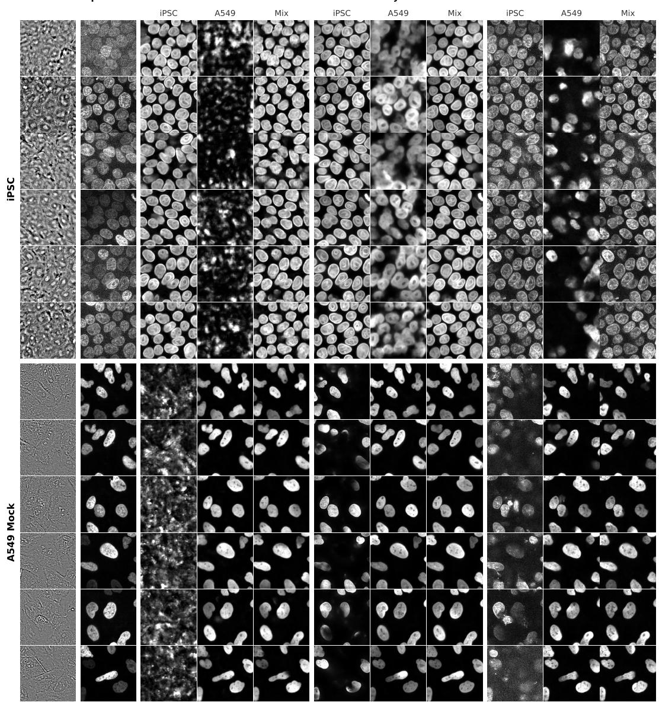  
Figure 14: Nucleus predictions across training sets. Twelve FOVs are shown (top six: iPSC; bottom six: A549 Mock). Columns show the phase input, experimental target, and predictions from FNet3D, VSCyto3D, and CELL-Diff3D models trained on iPSC, A549, or both datasets. The maximum-nuclear-area plane is shown.

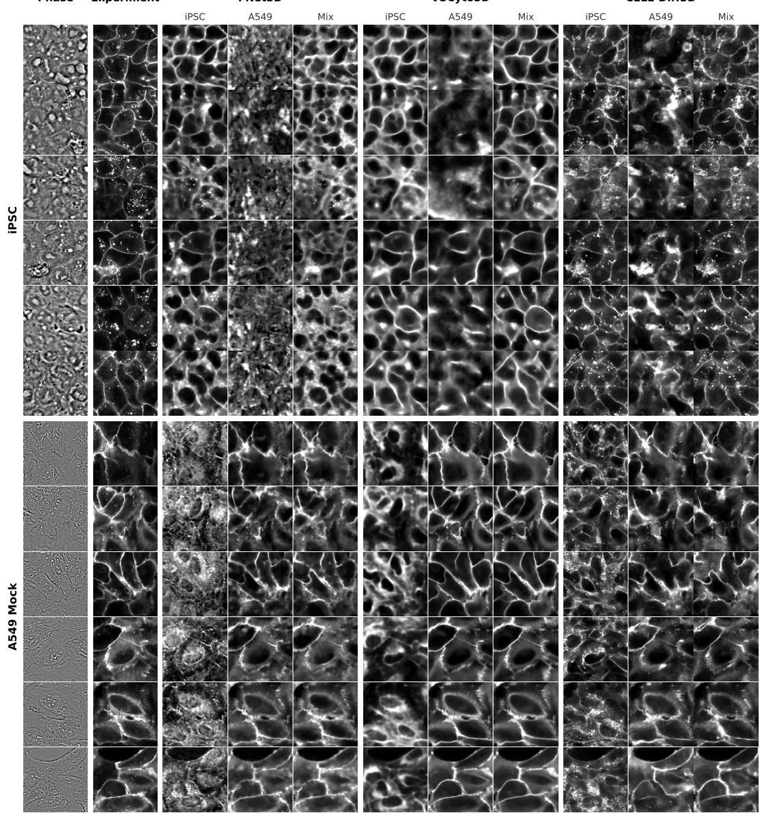  
Figure 15: Cell membrane predictions across training sets. Twelve FOVs are shown (top six: iPSC; bottom six: A549 Mock). Columns show the phase input, experimental target, and predictions from FNet3D, VSCyto3D, and CELL-Diff3D models trained on iPSC, A549, or both datasets. The maximum-nuclear-area plane is shown.

## D.5 Phenotype Precision and Recall across organelles

KID can remain low when paired spatial or instance-level scores are weak, so we also use a phenotype metric that separates fidelity from diversity. Following Kynka¨anniemi et al. [63], we compute ¨ Precision (P) and Recall (R) on DynaCLR single-cell embeddings. Precision is the fraction of predicted cells inside the experimental k-NN manifold, and Recall is the fraction of experimental cells covered by the predicted k-NN manifold, with $k = 5$ . We also report $F _ { 1 } = 2 P \bar { R } / ( P + R )$ . F<sub>1</sub> penalizes models with high Precision but low Recall, or vice versa.

Tabs. 17–20 report per-organelle $P / R / F _ { 1 }$ using the DynaCLR embeddings. They include the four main models and the UNeXt2 and UNetViT3D regression ablations, with all three training sets where available. We report only the model–training-set combinations that were evaluated.

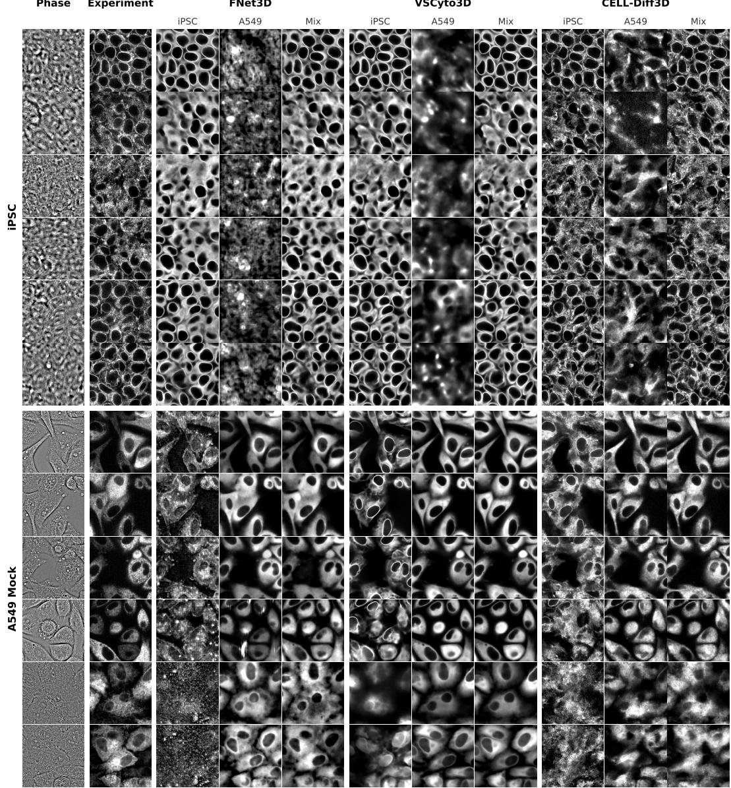  
Figure 16: ER (SEC61B) predictions across training sets. Twelve FOVs are shown (top six: iPSC; bottom six: A549 Mock). Columns show the phase input, experimental target, and predictions from FNet3D, VSCyto3D, and CELL-Diff3D models trained on iPSC, A549, or both datasets. The phasemidband plane is shown.

For jointly trained membrane models, CELL-Diff3D reaches $F _ { 1 } = 0 . 8 7 , 0 . 9 0$ , and 0.88 on A549 Mock, DENV, and ZIKV, respectively, with both high fidelity $( P = 0 . 9 5 \mathrm { - } 0 . 9 8 )$ and diversity $( R =$ 0.78–0.83). The regression and adversarial models reach only $F _ { 1 } = 0 . 0 6 { - 0 . 3 1 }$ under the same conditions, with either fidelity or diversity low. Fewer combinations are available for the other organelles, and the results vary by organelle. We therefore report $P$ and R separately rather than reducing phenotype agreement to one score.

## D.6 Temporal and perturbation-value analyses

We examine how measured phenotypes, model rankings, paired prediction quality, and temporal ordering change over time. These analyses use the paired A549 test set on its 2-hour grid, t =

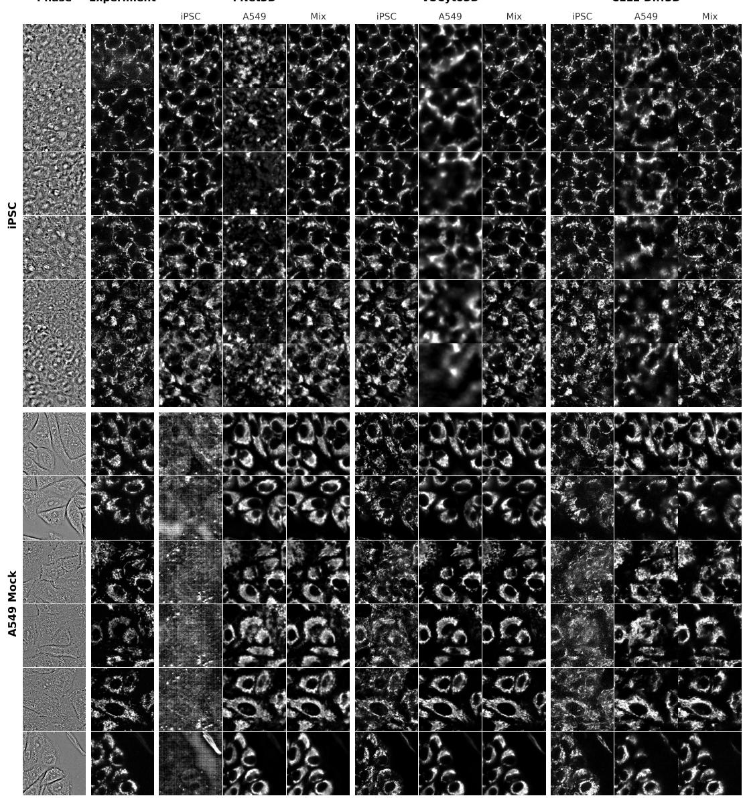  
Figure 17: Mitochondria (TOMM20) predictions across training sets. Twelve FOVs are shown (top six: iPSC; bottom six: A549 Mock). Columns show the phase input, experimental target, and predictions from FNet3D, VSCyto3D, and CELL-Diff3D models trained on iPSC, A549, or both datasets. The phase-midband plane is shown.

1, . . . , 10 spanning 5–23 hpi, with 12 fields per organelle–condition combination. The adjacent frame analysis instead uses the unpaired 10-min movie described below.

Paired prediction quality over time. We measure Spectral PCC against the paired fluorescence on the A549 Mock series. In Mock condition, Spectral PCC varies modestly over time, although the leading model changes for ER. Across five A549-trained models and four organelles, the temporal coefficient of variation ranges from 0.9% to 2.7%, and the change from the first to the last timepoint ranges from −0.044 to +0.017. Pix2Pix3D remains the leading model for nucleus and membrane, and FNet3D remains the leader for mitochondria; for ER, the leader changes from VSCyto3D to Pix2Pix3D (Tab. 21).

Table 17: Precision / Recall $/ F _ { 1 }$ on DynaCLR single-cell embeddings: Cell Membrane. We report P (fidelity, fraction of predicted cells inside the experimental k-NN manifold), R (diversity, fraction of experimental cells covered by the predicted k-NN manifold), and $F _ { 1 } = 2 P R / ( P + \dot { R } )$ on per-cell DynaCLR embeddings $( k = 5 )$ . Results are computed directly from the saved single-cell embeddings.
<table><tr><td rowspan="2">Cell type</td><td rowspan="2">Metric</td><td colspan="3">FNet3D</td><td colspan="3">UNeXt2</td><td colspan="3">VSCyto3D</td><td>UNetViT3D</td><td colspan="3">Pix2Pix3D</td><td colspan="3">CELL-Diff3D</td></tr><tr><td>iPSC</td><td>A549</td><td>Joint</td><td>iPSC</td><td>A549</td><td>Joint</td><td>iPSC</td><td>A549</td><td>Joint</td><td>iPSC</td><td>iPSC</td><td>A549</td><td>Joint</td><td>iPSC</td><td>A549</td><td>Joint</td></tr><tr><td rowspan="3">iPSC</td><td>P↑</td><td>0.26</td><td>0.20</td><td>0.21</td><td>0.27</td><td>0.37</td><td>0.30</td><td>0.30</td><td>0.38</td><td>0.37</td><td>0.26</td><td>0.40</td><td>0.29</td><td>0.53</td><td>0.85</td><td>0.48</td><td>0.90</td></tr><tr><td>R↑</td><td>0.02</td><td>0.05</td><td>0.01</td><td>0.19</td><td>0.13</td><td>0.20</td><td>0.30</td><td>0.11</td><td>0.27</td><td>0.03</td><td>0.01</td><td>0.04</td><td>0.02</td><td>0.69</td><td>0.34</td><td>0.75</td></tr><tr><td>F1 ↑</td><td>0.03</td><td>0.09</td><td>0.02</td><td>0.22</td><td>0.19</td><td>0.24</td><td>0.30</td><td>0.17</td><td>0.31</td><td>0.06</td><td>0.02</td><td>0.07</td><td>0.03</td><td>0.76</td><td>0.40</td><td>0.82</td></tr><tr><td rowspan="3">A549 Mock</td><td>P↑</td><td>0.33</td><td>0.19</td><td>0.22</td><td>0.12</td><td>0.06</td><td>0.07</td><td>0.04</td><td>0.05</td><td>0.04</td><td>0.38</td><td>0.14</td><td>0.11</td><td>0.12</td><td>0.77</td><td>0.97</td><td>0.98</td></tr><tr><td>R↑</td><td>0.14</td><td>0.15</td><td>0.25</td><td>0.16</td><td>0.12</td><td>0.17</td><td>0.10</td><td>0.15</td><td>0.11</td><td>0.22</td><td>0.16</td><td>0.30</td><td>0.29</td><td>0.35</td><td>0.82</td><td>0.78</td></tr><tr><td>F1 ↑</td><td>0.20</td><td>0.17</td><td>0.24</td><td>0.14</td><td>0.08</td><td>0.10</td><td>0.05</td><td>0.07</td><td>0.06</td><td>0.28</td><td>0.15</td><td>0.16</td><td>0.17</td><td>0.48</td><td>0.89</td><td>0.87</td></tr><tr><td rowspan="3">A549 DENV</td><td>P↑</td><td>0.32</td><td>0.53</td><td>0.49</td><td>0.33</td><td>0.21</td><td>0.26</td><td>0.24</td><td>0.21</td><td>0.19</td><td>0.64</td><td>0.67</td><td>0.32</td><td>0.35</td><td>0.65</td><td>0.98</td><td>0.97</td></tr><tr><td>R↑</td><td>0.14</td><td>0.17</td><td>0.23</td><td>0.21</td><td>0.11</td><td>0.10</td><td>0.17</td><td>0.11</td><td>0.09</td><td>0.56</td><td>0.41</td><td>0.12</td><td>0.13</td><td>0.30</td><td>0.82</td><td>0.83</td></tr><tr><td>F1↑</td><td>0.20</td><td>0.26</td><td>0.31</td><td>0.26</td><td>0.14</td><td>0.15</td><td>0.20</td><td>0.15</td><td>0.13</td><td>0.60</td><td>0.51</td><td>0.18</td><td>0.19</td><td>0.41</td><td>0.89</td><td>0.90</td></tr><tr><td rowspan="3">A549 ZIKV</td><td>P↑</td><td>0.35</td><td>0.22</td><td>0.26</td><td>0.23</td><td>0.15</td><td>0.19</td><td>0.11</td><td>0.16</td><td>0.15</td><td>0.39</td><td>0.19</td><td>0.22</td><td>0.22</td><td>0.68</td><td>0.96</td><td>0.95</td></tr><tr><td>R↑</td><td>0.15</td><td>0.16</td><td>0.39</td><td>0.09</td><td>0.07</td><td>0.61</td><td>0.44</td><td>0.07</td><td>0.08</td><td>0.29</td><td>0.21</td><td>0.38</td><td>0.49</td><td>0.33</td><td>0.83</td><td>0.82</td></tr><tr><td>F1↑</td><td>0.21</td><td>0.19</td><td>0.31</td><td>0.13</td><td>0.10</td><td>0.29</td><td>0.17</td><td>0.10</td><td>0.11</td><td>0.33</td><td>0.20</td><td>0.27</td><td>0.31</td><td>0.44</td><td>0.89</td><td>0.88</td></tr></table>

Table 18: Precision / Recall $/ F _ { 1 }$ on DynaCLR single-cell embeddings: Nucleus. We report P (fidelity, fraction of predicted cells inside the experimental k-NN manifold), R (diversity, fraction of experimental cells covered by the predicted k-NN manifold), and $F _ { 1 } = 2 P R / ( P + \dot { R } )$ on percell DynaCLR embeddings $( k \ : = \ : 5 )$ Results are computed directly from the saved single-cell embeddings.
<table><tr><td rowspan="2">Cell type</td><td rowspan="2">Metric</td><td colspan="3">FNet3D</td><td colspan="3">UNeXt2</td><td colspan="3">VSCyto3D</td><td>UNetViT3D</td><td colspan="3">Pix2Pix3D</td><td colspan="3">CELL-Diff3D</td></tr><tr><td>iPSC</td><td>A549</td><td>Joint</td><td>iPSC</td><td>A549</td><td>Joint</td><td>iPSC</td><td>A549</td><td>Joint</td><td>iPSC</td><td>iPSC</td><td>A549</td><td>Joint</td><td>iPSC</td><td>A549</td><td>Joint</td></tr><tr><td rowspan="3">iPSC</td><td>P↑</td><td>0.00</td><td>0.00</td><td>0.00</td><td>0.00</td><td>0.00</td><td>0.00</td><td>0.00</td><td>0.00</td><td>0.00</td><td>0.00</td><td>0.00</td><td>0.01</td><td>0.01</td><td>0.63</td><td>0.18</td><td>0.63</td></tr><tr><td>R↑</td><td>0.01</td><td>0.00</td><td>0.00</td><td>0.45</td><td>0.02</td><td>0.09</td><td>0.03</td><td>0.01</td><td>0.24</td><td>0.01</td><td>0.02</td><td>0.00</td><td>0.04</td><td>0.82</td><td>0.08</td><td>0.83</td></tr><tr><td>F1↑</td><td>0.00</td><td>0.00</td><td>0.00</td><td>0.00</td><td>0.00</td><td>0.00</td><td>0.00</td><td>0.00</td><td>0.00</td><td>0.00</td><td>0.00</td><td>0.00</td><td>0.02</td><td>0.71</td><td>0.11</td><td>0.71</td></tr><tr><td rowspan="4">A549 Mock</td><td>P↑</td><td>0.05</td><td>0.24</td><td>0.30</td><td>0.10</td><td>0.32</td><td>0.30</td><td>0.09</td><td>0.32</td><td>0.32</td><td>0.09</td><td>0.12</td><td>0.38</td><td>0.49</td><td>0.49</td><td>0.89</td><td>0.93</td></tr><tr><td>R↑</td><td>0.06</td><td>0.02</td><td>0.11</td><td>0.22</td><td>0.01</td><td>0.02</td><td>0.24</td><td>0.01</td><td>0.01</td><td>0.17</td><td>0.10</td><td>0.46</td><td>0.18</td><td>0.15</td><td>0.77</td><td>0.83</td></tr><tr><td>F1↑</td><td>0.05</td><td>0.04</td><td>0.16</td><td>0.14</td><td>0.03</td><td>0.03</td><td>0.13</td><td>0.02</td><td>0.02</td><td>0.12</td><td>0.11</td><td>0.41</td><td>0.26</td><td>0.23</td><td>0.83</td><td>0.88</td></tr><tr><td>P↑</td><td>0.03</td><td>0.20</td><td>0.23</td><td>0.09</td><td>0.20</td><td>0.18</td><td>0.09</td><td>0.19</td><td>0.21</td><td>0.05</td><td>0.08</td><td>0.26</td><td>0.40</td><td>0.30</td><td>0.90</td><td>0.90</td></tr><tr><td rowspan="3">A549 DENV</td><td>R↑</td><td>0.12</td><td>0.04</td><td>0.06</td><td>0.21</td><td>0.02</td><td>0.02</td><td>0.10</td><td>0.02</td><td>0.02</td><td>0.13</td><td>0.08</td><td>0.19</td><td>0.13</td><td>0.40</td><td>0.76</td><td>0.84</td></tr><tr><td>F1↑</td><td>0.05</td><td>0.06</td><td>0.10</td><td>0.13</td><td>0.03</td><td>0.03</td><td>0.10</td><td>0.04</td><td>0.04</td><td>0.07</td><td>0.08</td><td>0.22</td><td>0.20</td><td>0.34</td><td>0.82</td><td>0.87</td></tr><tr><td>P↑</td><td>0.06</td><td>0.19</td><td>0.25</td><td>0.12</td><td>0.31</td><td>0.27</td><td>0.10</td><td>0.28</td><td>0.29</td><td>0.09</td><td>0.16</td><td>0.31</td><td>0.41</td><td>0.32</td><td>0.89</td><td>0.91</td></tr><tr><td rowspan="2">A549 ZIKV</td><td>R↑</td><td>0.03</td><td>0.05</td><td>0.06</td><td>0.10</td><td>0.48</td><td>0.16</td><td>0.06</td><td>0.03</td><td>0.28</td><td>0.11</td><td>0.08</td><td>0.10</td><td>0.15</td><td>0.20</td><td>0.80</td><td>0.83</td></tr><tr><td>F1↑</td><td>0.04</td><td>0.08</td><td>0.10</td><td>0.11</td><td>0.38</td><td>0.20</td><td>0.08</td><td>0.06</td><td>0.28</td><td>0.10</td><td>0.11</td><td>0.15</td><td>0.22</td><td>0.25</td><td>0.85</td><td>0.87</td></tr></table>

Fix a feature extractor and let f denote one single-cell embedding. Embeddings are standardized coordinatewise against the pooled real-fluorescence distribution ${ \mathcal { F } } _ { g } ,$ and the perturbation at timepoint t is the difference between the infected and Mock population means in that standardized space:

$$
\tilde { \mathbf { f } } = \frac { \mathbf { f } - \mathrm { m e d } ( \mathcal { F } _ { g } ) } { 1 . 4 8 2 6 \mathrm { M A D } ( \mathcal { F } _ { g } ) } , \qquad \mathbf { d } _ { c , t } = \bar { \tilde { \mathbf { f } } } _ { c , t } - \bar { \tilde { \mathbf { f } } } _ { \mathrm { m o c k } , t } , \qquad c \in \{ \mathrm { D E N V } , \mathrm { Z I K V } \} .\tag{21}
$$

The scale 1.4826 MAD is the median absolute deviation rescaled to estimate the standard deviation of a Gaussian, so no coordinate dominates d through its units. Real and predicted embeddings are standardized with the same real-fluorescence median and scale, which keeps the two shifts in one frame of reference.

Probe-transfer decay (Tab. 22). A linear probe is fitted on frame t to separate Mock from infected cells and evaluated on frame $t ^ { \prime } { } _ { ; }$ , with lag ${ \ell = | t - t ^ { \prime } | }$ and elapsed time 2ℓ hours. Fits are FOV-stratified, so the training and evaluation cells come from disjoint fields and the probe cannot memorize a field. Performance is the area under the ROC curve in its Mann–Whitney form,

$$
\mathrm { A U R O C } = \frac { 1 } { n _ { + } n _ { - } } \sum _ { i = 1 } ^ { n _ { + } } \sum _ { j = 1 } ^ { n _ { - } } \Big [ { \bf 1 } \{ s _ { i } ^ { + } > s _ { j } ^ { - } \} + { \bf \frac { 1 } { 2 } 1 } \{ s _ { i } ^ { + } = s _ { j } ^ { - } \} \Big ] ,\tag{22}
$$

the probability that a randomly drawn infected cell receives a higher score s than a randomly drawn Mock cell, with 0.5 as chance. There are 10 ordered frame pairs at zero lag and $2 ( 1 0 - \ell )$ at lag $\ell .$ We fit a probe for each pair in each of the 24 organelle–virus–feature-space series. The last column reports these counts, from $2 4 \times 1 0 = 2 4 0$ fits at zero lag down to $2 \bar { 4 } \times 2 = 4 8$ at 18 h. Pooled AUROC falls monotonically from 0.644 to 0.523, within 0.023 of chance at the longest lag. The infection signature is therefore specific to the frame it was learned on, and collecting more fields at a single timepoint cannot recover what elapsed time removes.

Table 19: Precision / Recall $/ F _ { 1 }$ on DynaCLR single-cell embeddings: ER (SEC61B). We report P (fidelity, fraction of predicted cells inside the experimental k-NN manifold), R (diversity, fraction of experimental cells covered by the predicted k-NN manifold), and $F _ { 1 } = 2 P R / ( P + \dot { R } )$ on percell DynaCLR embeddings $( k \ : = \ : 5 )$ . Results are computed directly from the saved single-cell embeddings.
<table><tr><td rowspan="2">Cell type</td><td rowspan="2">Metric</td><td colspan="3">FNet3D</td><td colspan="3">UNeXt2</td><td colspan="3">VSCyto3D</td><td colspan="3">UNetViT3D</td><td colspan="3">Pix2Pix3D</td><td colspan="3">CELL-Diff3D</td></tr><tr><td>iPSC</td><td>A549</td><td>Joint</td><td>iPSC</td><td>A549</td><td>Joint</td><td>iPSC</td><td>A549</td><td>Joint</td><td>iPSC</td><td>A549</td><td>Joint</td><td>iPSC</td><td>A549</td><td>Joint</td><td>iPSC</td><td>A549</td><td>Joint</td></tr><tr><td rowspan="3">iPSC</td><td>P↑</td><td>0.00</td><td>0.00</td><td>0.00</td><td>0.00</td><td>0.00</td><td>0.00</td><td>0.00</td><td>0.00</td><td>0.00</td><td>0.00</td><td>0.01</td><td>0.00</td><td>0.00</td><td>0.01</td><td>0.00</td><td>0.86</td><td>0.20</td><td>0.88</td></tr><tr><td>R↑</td><td>0.00</td><td>0.02</td><td>0.00</td><td>0.01</td><td>0.08</td><td>0.00</td><td>0.00</td><td>0.01</td><td>0.00</td><td>0.00</td><td>0.03</td><td>0.00</td><td>0.00</td><td>0.10</td><td>0.00</td><td>0.83</td><td>0.11</td><td>0.86</td></tr><tr><td>F1↑</td><td>0.00</td><td>0.01</td><td></td><td>0.00</td><td>0.00</td><td></td><td>0.00</td><td>0.00</td><td>0.00</td><td>0.00</td><td>0.01</td><td>0.00</td><td>0.00</td><td>0.01</td><td>0.00</td><td>0.85</td><td>0.14</td><td>0.87</td></tr><tr><td rowspan="3">A549 Mock</td><td>P↑</td><td>0.09</td><td>0.01</td><td>0.01</td><td>0.01</td><td>0.00</td><td>0.00</td><td>0.02</td><td>0.00</td><td>0.00</td><td>0.11</td><td>0.02</td><td>0.01</td><td>0.02</td><td>0.00</td><td>0.01</td><td>0.60</td><td>0.75</td><td>0.73</td></tr><tr><td>R↑</td><td>0.04</td><td>0.01</td><td>0.08</td><td>0.03</td><td>0.01</td><td>0.00</td><td>0.34</td><td>0.00</td><td>0.00</td><td>0.28</td><td>0.14</td><td>0.06</td><td>0.19</td><td>0.09</td><td>0.03</td><td>0.30</td><td>0.61</td><td>0.59</td></tr><tr><td>F1↑</td><td>0.06</td><td>0.01</td><td>0.02</td><td>0.02</td><td>0.00</td><td>0.00</td><td>0.04</td><td>0.00</td><td>0.00</td><td>0.16</td><td>0.03</td><td>0.02</td><td>0.04</td><td>0.01</td><td>0.02</td><td>0.40</td><td>0.67</td><td>0.65</td></tr><tr><td rowspan="3">A549 DENV</td><td>P↑</td><td>0.15</td><td>0.01</td><td>0.01</td><td>0.01</td><td>0.00</td><td>0.00</td><td>0.01</td><td>0.00</td><td>0.00</td><td>0.05</td><td>0.02</td><td>0.01</td><td>0.02</td><td>0.00</td><td>0.01</td><td>0.57</td><td>0.82</td><td>0.81</td></tr><tr><td>R↑</td><td>0.11</td><td>0.01</td><td>0.78</td><td>0.24</td><td>0.05</td><td>0.03</td><td>0.15</td><td>0.16</td><td>0.10</td><td>0.04</td><td>0.34</td><td>0.47</td><td>0.35</td><td>0.69</td><td>0.26</td><td>0.33</td><td>0.65</td><td>0.60</td></tr><tr><td>F1↑</td><td>0.13</td><td>0.01</td><td>0.02</td><td>0.02</td><td>0.00</td><td>0.00</td><td>0.01</td><td>0.00</td><td>0.00</td><td>0.05</td><td>0.04</td><td>0.02</td><td>0.04</td><td>0.00</td><td>0.01</td><td>0.42</td><td>0.73</td><td>0.69</td></tr><tr><td rowspan="3">A549 ZIKV</td><td>P↑</td><td>0.13</td><td>0.14</td><td>0.15</td><td>0.18</td><td>0.13</td><td>0.13</td><td>0.17</td><td>0.13</td><td>0.13</td><td>0.20</td><td>0.13</td><td>0.15</td><td>0.12</td><td>0.11</td><td>0.12</td><td>0.59</td><td>0.74</td><td>0.65</td></tr><tr><td>R↑</td><td>0.16</td><td>0.05</td><td>0.14</td><td>0.86</td><td>0.01</td><td>0.01</td><td>0.38</td><td>0.01</td><td>0.00</td><td>0.30</td><td>0.10</td><td>0.02</td><td>0.22</td><td>0.01</td><td>0.04</td><td>0.33</td><td>0.68</td><td>0.67</td></tr><tr><td>F1↑</td><td>0.14</td><td>0.07</td><td>0.14</td><td>0.29</td><td>0.02</td><td>0.02</td><td>0.24</td><td>0.02</td><td>0.01</td><td>0.24</td><td>0.11</td><td>0.03</td><td>0.16</td><td>0.01</td><td>0.06</td><td>0.42</td><td>0.71</td><td>0.66</td></tr></table>

Table 20: Precision / Recall $/ F _ { 1 }$ on DynaCLR single-cell embeddings: Mito. (TOMM20). We report P (fidelity, fraction of predicted cells inside the experimental k-NN manifold), R (diversity, fraction of experimental cells covered by the predicted k-NN manifold), and $F _ { 1 } = 2 P R / ( P + \dot { R } )$ on per-cell DynaCLR embeddings (k = 5). Results are computed directly from the saved single-cell embeddings.
<table><tr><td rowspan="2">Cell type</td><td rowspan="2">Metric</td><td colspan="3">FNet3D</td><td colspan="3">UNeXt2</td><td colspan="3">VSCyto3D</td><td colspan="3">UNetViT3D</td><td colspan="3">Pix2Pix3D</td><td colspan="3">CELL-Diff3D</td></tr><tr><td>iPSC</td><td>A549</td><td>Joint</td><td>iPSC</td><td>A549</td><td>Joint</td><td>iPSC</td><td>A549</td><td>Joint</td><td>iPSC</td><td>A549</td><td>Joint</td><td>iPSC</td><td>A549</td><td>Joint</td><td>iPSC</td><td>A549</td><td>Joint</td></tr><tr><td rowspan="3">iPSC</td><td>P↑</td><td>0.00</td><td>0.00</td><td>0.00</td><td>0.00</td><td>0.00</td><td>0.00</td><td>0.00</td><td>0.00</td><td>0.00</td><td>0.00</td><td>0.00</td><td>0.00</td><td>0.00</td><td>0.00</td><td>0.00</td><td>0.93</td><td>0.04</td><td>0.82</td></tr><tr><td>R↑</td><td>0.00</td><td>0.15</td><td>0.00</td><td>0.01</td><td>0.12</td><td>0.00</td><td>0.00</td><td>0.03</td><td>0.00</td><td>0.00</td><td>0.07</td><td>0.00</td><td>0.00</td><td>0.26</td><td>0.06</td><td>0.87</td><td>0.05</td><td>0.84</td></tr><tr><td>F1↑</td><td>0.00</td><td>0.00</td><td>0.00</td><td>0.00</td><td>0.00</td><td>0.00</td><td>0.00</td><td>0.00</td><td>0.00</td><td>0.00</td><td>0.00</td><td>0.00</td><td>0.00</td><td>0.00</td><td>0.00</td><td>0.89</td><td>0.05</td><td>0.83</td></tr><tr><td rowspan="3">A549 Mock</td><td>P↑</td><td>0.52</td><td>0.01</td><td>0.01</td><td>0.08</td><td>0.00</td><td>0.00</td><td>0.06</td><td>0.00</td><td>0.00</td><td>0.10</td><td>0.01</td><td>0.01</td><td>0.03</td><td>0.00</td><td>0.01</td><td>0.44</td><td>0.67</td><td>0.64</td></tr><tr><td>R↑</td><td>0.07</td><td>0.31</td><td>0.69</td><td>0.17</td><td>0.01</td><td>0.05</td><td>0.02</td><td>0.07</td><td>0.02</td><td>0.37</td><td>0.33</td><td>0.36</td><td>0.66</td><td>0.01</td><td>0.35</td><td>0.23</td><td>0.59</td><td>0.64</td></tr><tr><td>F1↑</td><td>0.13</td><td>0.02</td><td>0.01</td><td>0.11</td><td>0.00</td><td>0.01</td><td>0.02</td><td>0.00</td><td>0.00</td><td>0.16</td><td>0.02</td><td>0.02</td><td>0.06</td><td>0.01</td><td>0.01</td><td>0.30</td><td>0.62</td><td>0.64</td></tr><tr><td rowspan="3">A549 DENV</td><td>P↑</td><td>0.29</td><td>0.00</td><td>0.00</td><td>0.00</td><td>0.00</td><td>0.00</td><td>0.01</td><td>0.00</td><td>0.00</td><td>0.01</td><td>0.01</td><td>0.01</td><td>0.01</td><td>0.00</td><td>0.00</td><td>0.42</td><td>0.57</td><td>0.59</td></tr><tr><td>R↑</td><td>0.07</td><td>0.09</td><td>0.07</td><td>0.00</td><td>0.01</td><td>0.01</td><td>0.00</td><td>0.03</td><td>0.01</td><td>0.26</td><td>0.18</td><td>0.24</td><td>0.01</td><td>0.42</td><td>0.35</td><td>0.23</td><td>0.59</td><td>0.61</td></tr><tr><td>F1↑</td><td>0.11</td><td>0.01</td><td>0.01</td><td>0.00</td><td>0.00</td><td>0.00</td><td>0.00</td><td>0.00</td><td>0.00</td><td>0.02</td><td>0.02</td><td>0.02</td><td>0.01</td><td>0.00</td><td>0.01</td><td>0.30</td><td>0.58</td><td>0.60</td></tr><tr><td rowspan="3">A549 ZIKV</td><td>P↑</td><td>0.17</td><td>0.01</td><td>0.01</td><td>0.05</td><td>0.00</td><td>0.00</td><td>0.03</td><td>0.00</td><td>0.01</td><td>0.11</td><td>0.01</td><td>0.01</td><td>0.03</td><td>0.00</td><td>0.01</td><td>0.47</td><td>0.70</td><td>0.64</td></tr><tr><td>R↑</td><td>0.14</td><td>0.15</td><td>0.08</td><td>0.15</td><td>0.01</td><td>0.02</td><td>0.15</td><td>0.00</td><td>0.02</td><td>0.23</td><td>0.06</td><td>0.05</td><td>0.05</td><td>0.02</td><td>0.06</td><td>0.16</td><td>0.54</td><td>0.59</td></tr><tr><td>F1↑</td><td>0.15</td><td>0.02</td><td>0.01</td><td>0.08</td><td>0.00</td><td>0.01</td><td>0.05</td><td>0.00</td><td>0.01</td><td>0.15</td><td>0.02</td><td>0.02</td><td>0.03</td><td>0.01</td><td>0.02</td><td>0.24</td><td>0.61</td><td>0.61</td></tr></table>

Phenotype progression (Tab. 23). The same probe evaluated at zero lag measures how separable the two conditions are within a frame. From the first to the last timepoint, within-frame AUROC rises in all 24 organelle–virus–feature-space combinations, from 0.559 to 0.743 on average. The shift of Eq. (21) grows over the same window by $g _ { c } = \| \mathbf { d } _ { c , 1 0 } \| _ { 2 } / \| \mathbf { d } _ { c , 1 } \| _ { 2 } - 1$ , which is 26% for DENV and 22% for ZIKV. The classifier and embedding-distance analyses therefore show the same increase in infection-associated phenotype separation.

Frame-dependent ranking (Tab. 24). Within each evaluation setting, we retain FOVs with valid scores at every timepoint for every compared model. The metric value $M _ { i , t }$ of model i at frame t decomposes as

$$
M _ { i , t } = \mu + \alpha _ { i } + \beta _ { t } + \gamma _ { i , t } + \varepsilon _ { i , t } ,\tag{23}
$$

with $\alpha _ { i }$ the model effect, $\beta _ { t }$ the shared frame effect, and $\gamma _ { i , t }$ their interaction. The shared frame effect changes every model equally and cannot change their order; the interaction can. Tab. 24 reports the standard deviation of both terms, split-half agreement of the model means, and the size of the interaction relative to the gap between the top two models. Its final row reports how often the best model at one frame differs from the best model over the full window. The analysis pools all four organelles. Phenotype is measured with FID rather than KID because a single frame supplies too few cells for subset-resampling KID (App. B.3).

Perturbation response (Tab. 25). Let $\mathbf { d } _ { c , t } ^ { g }$ denote the experimental shift of Eq. (21) and $\mathbf { d } _ { c , t } ^ { m }$ the same quantity computed from model m’s predictions. The table reports

$$
\cos \theta = \frac { \langle \mathbf { d } _ { c , t } ^ { m } , \mathbf { d } _ { c , t } ^ { g } \rangle } { \| \mathbf { d } _ { c , t } ^ { m } \| _ { 2 } \| \mathbf { d } _ { c , t } ^ { g } \| _ { 2 } } , \qquad a = \frac { \| \mathbf { d } _ { c , t } ^ { m } \| _ { 2 } } { \| \mathbf { d } _ { c , t } ^ { g } \| _ { 2 } } ,\tag{24}
$$

where cos $\theta$ measures direction agreement and a is the amplitude ratio, with a target of 1. Because each population supplies its own shift, an offset common to a model’s Mock and infected predic tions leaves $\mathbf { d } ^ { m }$ unchanged. The comparison therefore measures whether a model reproduces the infection-associated change rather than whether individual predictions are accurate. Pooled over all four organelles, CELL-Diff3D leads under both viruses and wins 61–74% of 480 matched comparisons against every regression and adversarial baseline (two-sided Wilcoxon signed-rank test, $\dot { p } < 1 0 ^ { - 5 } \dot { ) }$ . These 480 comparisons are the subset of the 720 settings in Fig. 18 with results for all six models, including the UNeXt2 and UNetViT3D ablations. The $\mathrm { \bar { M M D } ^ { 2 } }$ in that figure uses an unbiased RBF-kernel estimator rather than the polynomial-kernel KID of App. B.3, so their absolute values are not comparable.

Table 21: Paired prediction quality over the A549 Mock time course. At each of ten 2-h timepoints from 5 to 23 hpi, Spectral PCC is first averaged over 12 FOVs. Ranges then summarize five A549-trained models across time. CV is the temporal coefficient of variation, and score changes are T10 minus T1. This analysis measures agreement with paired fluorescence, not frame-to-frame consistency.
<table><tr><td>Organelle</td><td>CV range (%)</td><td>T10 - T1 range</td><td>Leader T1 → T10</td></tr><tr><td>Nucleus</td><td>1.0-1.9</td><td> $- 0 . 0 3 9 \ \mathrm { t o \ - } 0 . 0 1 9$ </td><td> $\mathrm { P i x 2 P i x 3 D }  \mathrm { P i x 2 P i x 3 D }$ </td></tr><tr><td>Membrane</td><td>1.0-2.5</td><td> $- 0 . 0 0 4 \mathrm { t o } + 0 . 0 0 6$ </td><td> $\mathrm { P i x 2 P i x 3 D }  \mathrm { P i x 2 P i x 3 D }$ </td></tr><tr><td>ER</td><td>0.9-2.7</td><td> $- 0 . 0 2 9 \mathrm { t o } + 0 . 0 1 7$ </td><td> $\mathrm { V S C y t o 3 D }  \mathrm { P i x } 2 \mathrm { P i x } 3 \mathrm { D }$ </td></tr><tr><td>Mitochondria</td><td>1.2-1.9</td><td>-0.044 to -0.033</td><td>FNet3D → FNet3D</td></tr></table>

Table 22: Probe-transfer decay across the paired 2-h time grid. Each row groups independently fitted, FOV-stratified probes by train–test frame lag. Intervals are standard errors of row means. Pooled AUROC falls monotonically from 0.644 at zero lag to 0.523 at 18 h; the far-lag deficit is 0.091 in all 24 organelle–virus–space series. More fields at one frame cannot remove this elapsedtime effect.
<table><tr><td>train/test frame gap</td><td>elapsed</td><td>AUROC, DENV ↑</td><td>AUROC, ZIKV ↑</td><td>pooled ↑</td><td>probe fits averaged</td></tr><tr><td>same frame</td><td>0 h</td><td> $0 . 6 3 9 \pm 0 . 0 0 9$ </td><td> $0 . 6 4 9 \pm 0 . 0 0 9$ </td><td> ${ \bf 0 . 6 4 4 \pm 0 . 0 0 7 }$ </td><td>240</td></tr><tr><td>± 1</td><td>2 h</td><td> $0 . 6 2 8 \pm 0 . 0 0 6$ </td><td> $0 . 6 3 8 \pm 0 . 0 0 6$ </td><td> $\mathbf { 0 . 6 3 3 \pm 0 . 0 0 4 }$ </td><td>432</td></tr><tr><td>± 2</td><td>4 h</td><td> $0 . 6 0 9 \pm 0 . 0 0 6$ </td><td> $0 . 6 2 9 \pm 0 . 0 0 6$ </td><td> ${ \bf 0 . 6 1 9 \pm 0 . 0 0 4 }$ </td><td>384</td></tr><tr><td>±3</td><td>6 h</td><td> $0 . 5 9 6 \pm 0 . 0 0 6$ </td><td> $0 . 6 0 7 \pm 0 . 0 0 7$ </td><td> $\mathbf { 0 . 6 0 1 } \pm 0 . 0 0 5$ </td><td>336</td></tr><tr><td>±4</td><td>8 h</td><td> $0 . 5 7 9 \pm 0 . 0 0 6$ </td><td> $0 . 5 9 8 \pm 0 . 0 0 7$ </td><td> $\mathbf { 0 . 5 8 8 \pm 0 . 0 0 5 }$ </td><td>288</td></tr><tr><td>± 5</td><td>10 h</td><td> $0 . 5 6 0 \pm 0 . 0 0 6$ </td><td> $0 . 5 9 2 \pm 0 . 0 0 7$ </td><td> ${ \bf 0 . 5 7 6 \pm 0 . 0 0 4 }$ </td><td>240</td></tr><tr><td>± 6</td><td>12 h</td><td> $0 . 5 4 0 \pm 0 . 0 0 6$ </td><td> $0 . 5 6 5 \pm 0 . 0 0 7$ </td><td> $\mathbf { 0 . 5 5 3 \pm 0 . 0 0 5 }$ </td><td>192</td></tr><tr><td>±7</td><td>14 h</td><td> $0 . 5 4 0 \pm 0 . 0 0 7$ </td><td> $0 . 5 5 1 \pm 0 . 0 0 8$ </td><td> ${ \bf 0 . 5 4 6 \pm 0 . 0 0 5 }$ </td><td>144</td></tr><tr><td>± 8</td><td>16 h</td><td> $0 . 5 2 2 \pm 0 . 0 0 9$ </td><td> $0 . 5 2 9 \pm 0 . 0 1 0$ </td><td> ${ \bf 0 . 5 2 6 \pm 0 . 0 0 7 }$ </td><td>96</td></tr><tr><td>±9</td><td>18 h</td><td> $0 . 5 1 9 \pm 0 . 0 1 4$ </td><td> $0 . 5 2 8 \pm 0 . 0 1 5$ </td><td> $\mathbf { 0 . 5 2 3 \pm 0 . 0 1 0 }$ </td><td>48</td></tr></table>

Temporal-order retention (Tab. 26). A FOV-stratified ridge probe regresses the timepoint index on single-cell embeddings. Let $\rho$ denote the Spearman rank correlation between predicted and true timepoints on held-out fields. Retention is

$$
R = \frac { \rho _ { \mathrm { p r e d } } } { \rho _ { \mathrm { r e a l } } } ,\tag{25}
$$

normalized against the real-fluorescence ceiling measured in the same condition. Thus, $R = 1$ means the predictions carry as much temporal ordering as the experimental images, and a temporally flat prediction gives $R = 0$ . After pooling over DINOv3, CELL-DINO, and MorphEm on the common model subset, we find that every model loses temporal signal under infection, by 0.129 to 0.232, with CELL-Diff3D losing the most.

The diagnostic uses one uninfected Mantis A549 field with 125 phase volumes of $4 8 \times 5 1 2 \times 5 1 2$ voxels spanning 20 h 40 min. CELL-Diff3D is the least self-consistent model in all four organelles, while VSCyto3D and Pix2Pix3D differ by less than 0.013 in each organelle (Fig. 19). These results identify output instability in this field but cannot measure agreement with the unobserved fluorescence trajectory.

Table 23: Real-fluorescence infection phenotype from frame 1 to frame 10. Within-frame AU-ROC rises in all 24 organelle–virus–feature-space combinations, from 0.559 to 0.743 on average. Independently, the real mock-to-infected mean-embedding shift grows by 24% (DENV 26%, ZIKV 22%). The increasing underestimation of response amplitude is specific to DENV and is not pooled across viruses here.
<table><tr><td>Organelle</td><td>Virus</td><td>DINOv3↑</td><td>CELL-DINO ↑</td><td>MorphEm ↑</td></tr><tr><td>Membrane</td><td>DENV</td><td>0.49 → 0.54</td><td>0.55 → 0.76</td><td>0.53 → 0.72</td></tr><tr><td>Membrane</td><td>ZIKV</td><td>0.47 → 0.77</td><td>0.55 → 0.92</td><td>0.47 → 0.87</td></tr><tr><td>Nucleus</td><td>DENV</td><td>0.53 → 0.71</td><td>0.54 → 0.66</td><td>0.45 → 0.58</td></tr><tr><td>Nucleus</td><td>ZIKV</td><td>0.51 → 0.67</td><td>0.64 → 0.79</td><td>0.56 → 0.67</td></tr><tr><td>ER</td><td>DENV</td><td>0.56 → 0.70</td><td>0.66 → 0.83</td><td>0.64 → 0.79</td></tr><tr><td>ER</td><td>ZIKV</td><td>0.51 → 0.72</td><td>0.64 → 0.82</td><td>0.51 → 0.76</td></tr><tr><td>Mito</td><td>DENV</td><td>0.54 → 0.76</td><td>0.72 → 0.88</td><td>0.56 → 0.87</td></tr><tr><td>Mito</td><td>ZIKV</td><td>0.50 → 0.60</td><td>0.70 → 0.77</td><td>0.59 → 0.68</td></tr></table>

Table 24: Frame-dependent model ranking. The model–frame interaction is the component that can reorder models; the shared frame effect cancels. Across the full grid, a one-frame winner differs from the window winner in 443/1800 (25%) pixel/segmentation comparisons and 63/720 (9%) phenotype comparisons. Dice is instance Dice for nucleus and membrane and semantic Dice for ER and mitochondria. Phenotype uses FID because per-frame KID coverage is insufficient; this table measures only ranking movement, not which model is best.
<table><tr><td></td><td colspan="4">Pixel</td><td>Seg.</td><td colspan="2">Phenotype (FID)</td></tr><tr><td>Statistic</td><td>Spectral PCC</td><td>PCC</td><td>SSIM</td><td>si-SSIM</td><td>Dice</td><td>CELL- DINO</td><td>DINOv3</td></tr><tr><td>Frame effect SD</td><td>0.012</td><td>0.020</td><td>0.025</td><td>0.019</td><td>0.018</td><td>84.0</td><td>36.8</td></tr><tr><td>Model × frame SD ↓</td><td>0.005</td><td>0.007</td><td>0.017</td><td>0.005</td><td>0.006</td><td>41.2</td><td>17.1</td></tr><tr><td>Split-half r ↑</td><td>+0.27</td><td>+0.44</td><td>+0.42</td><td>+0.49</td><td>+0.33</td><td>+0.45</td><td>+0.19</td></tr><tr><td>Vs. top-two gap ↓</td><td>0.80×</td><td>0.57×</td><td>0.31×</td><td>0.72×</td><td>0.70×</td><td>0.03×</td><td>0.08×</td></tr><tr><td></td><td>113/360</td><td>85/360</td><td>62/360</td><td>75/360</td><td>108/360</td><td>16/360</td><td>47/360</td></tr><tr><td>1-frame ≠ window winner ↓</td><td>(31%)</td><td>(24%)</td><td>(17%)</td><td>(21%)</td><td>(30%)</td><td>(4%)</td><td>(13%)</td></tr></table>

Table 25: Perturbation-response agreement. Cosine similarity compares the direction of the predicted Mock-to-infected mean-embedding shift with that measured in real fluorescence. An amplitude ratio of 1 indicates equal shift magnitudes. CELL-Diff3D leads for both viruses and wins 61– 74% of 480 paired comparisons against each regression or adversarial baseline (two-sided Wilcoxon p < 10<sup>−5</sup>).
<table><tr><td>Model</td><td>cos, DENV ↑</td><td>cos, ZIKV ↑</td><td>amp, DENV →1</td><td>amp, ZIKV →1</td><td>CELL-Diff3D cos win, pooled ↑</td></tr><tr><td>FNet3D</td><td>0.270</td><td>0.298</td><td>0.876</td><td>0.845</td><td>74% (4e-29)</td></tr><tr><td>UNeXt2</td><td>0.314</td><td>0.329</td><td>0.857</td><td>0.889</td><td>67% (5e-14)</td></tr><tr><td>VSCyto3D</td><td>0.295</td><td>0.324</td><td>0.858</td><td>0.878</td><td>69% (4e-17)</td></tr><tr><td>UNetViT3D</td><td>0.274</td><td>0.245</td><td>0.890</td><td>0.939</td><td>66% (9e-13)</td></tr><tr><td>Pix2Pix3D</td><td>0.333</td><td>0.373</td><td>0.901</td><td>0.923</td><td>61% (7e-06)</td></tr><tr><td>CELL-Diff3D</td><td>0.401</td><td>0.420</td><td>0.996</td><td>1.040</td><td></td></tr></table>

Table 26: Temporal-order retention. A FOV-stratified ridge probe predicts timepoint from singlecell embeddings. Retention is the probe’s Spearman ρ on predicted fluorescence divided by its value on real fluorescence. The summary pools DINOv3, CELL-DINO, and MorphEm over the common model subset. In Infected condition, all models’ predictions retain less of the time-dependent change seen in experimental fluorescence: every model loses temporal signal under infection (decrease 0.129–0.232); a temporally flat prediction scores zero.
<table><tr><td>retention</td><td>FNet3D</td><td>VSCyto3D</td><td>CELL-Diff3D</td></tr><tr><td>mock</td><td>0.868</td><td>0.760</td><td>0.849</td></tr><tr><td>infected</td><td>0.739</td><td>0.592</td><td>0.616</td></tr><tr><td>drop (mock — infected)</td><td>+0.129</td><td>+0.167</td><td>+0.232</td></tr></table>

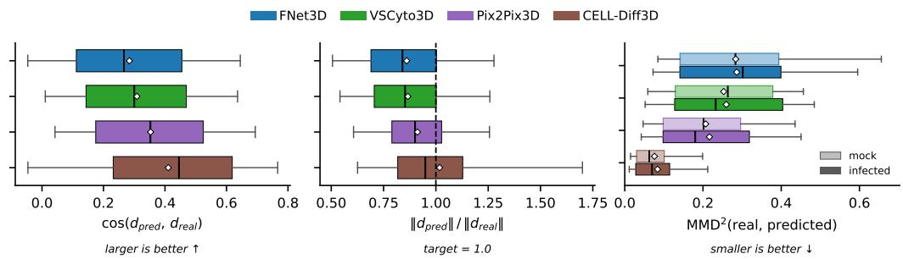  
Figure 18: Agreement with the A549 infection response. For each organelle, training set, virus, feature space, and frame, d is the infected-minus-Mock difference between mean single-cell embeddings. Before computing d, real and predicted embeddings are standardized by the pooled realfluorescence median and robust scale (1.4826 times the median absolute deviation). The left panel reports the cosine between the predicted and real shifts; the middle panel reports their norm ratio, for which 1 is the target. The right panel reports unbiased RBF MMD<sup>2</sup> between predicted and real embeddings within Mock and infected conditions; DENV and ZIKV are pooled only for display. Each box contains 720 settings (4 organelles × 3 training sets × 2 viruses × 3 learned feature spaces × 10 frames). Boxes show the median and interquartile range, whiskers the 5th–95th percentiles, and diamonds the mean. CELL-Diff3D has the greatest mean direction agreement and the lowest distributional distance. Because the marginal distributions overlap, model comparisons use the paired tests in Tab. 25.

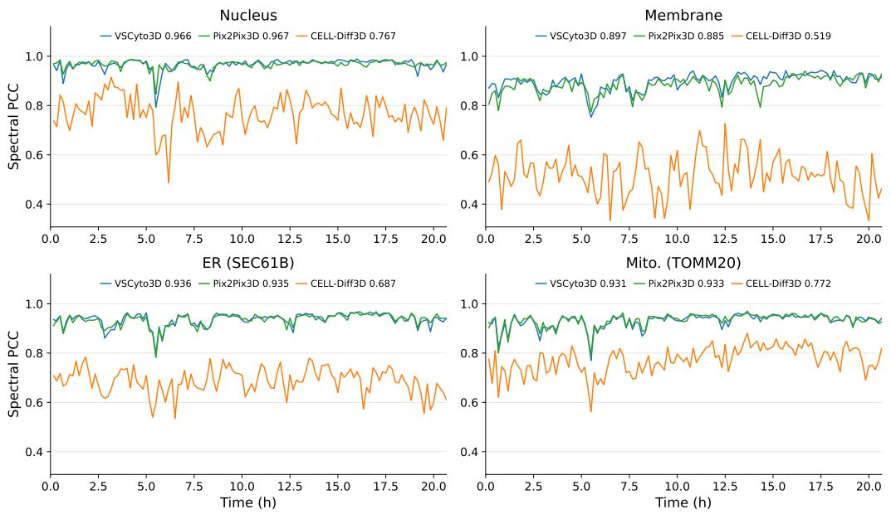  
Figure 19: Reference-free frame-to-frame self-consistency on one dense A549 movie. The same uninfected A549 field was processed by A549-trained models for each of the four organelles. Lines show Spectral PCC between each predicted 3D volume and the preceding prediction for 124 adjacent pairs from 125 frames acquired every 10 min; the number beside each model in the legend is its mean over those pairs. The mean adjacent-frame Spectral PCC of the regression (VSCyto3D) and adversarial (Pix2Pix3D) predictions lies between 0.885 and 0.967 across the four organelles, whereas that of the generative CELL-Diff3D predictions ranges from 0.519 to 0.772. Because the field has no paired fluorescence, this comparison measures prediction self-consistency rather than temporal accuracy.

ER (SEC61B)  
Mitochondria (TOMM20)  
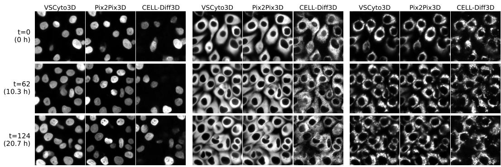  
Figure 20: Representative predictions from the dense unpaired A549 movie. Central XY slices at the beginning, midpoint, and end of the 20 h 40 min movie are shown for nucleus, ER, and mitochondria. Membrane predictions from the same field appear in Fig. 4C. Each image is clipped independently to its 1st–99th percentiles. The field has no paired fluorescence, so the panels show prediction appearance over time rather than accuracy.

## E Detailed limitations and future work

Metrics. All three metric tiers have limitations. Spectral PCC suppresses noise-dominated frequencies and is therefore less sensitive to blur. The segmentation workflows have not been validated against manual annotations of infected cells. The phenotype tier uses 2D projections for DINOv3, DynaCLR, CELL-DINO, and MorphEm, while GLCM+ remains 3D. Because these feature extractors do not always rank models in the same order, our claims apply to the measured feature spaces rather than to phenotype in general. A future infection-classifier evaluation should calibrate conditions jointly because separate scaling produces a same-condition null AUROC of 0.576.

Data and time. The released test movies cover A549 on Mantis and one perturbation family; iPSC and HEK293T are 3D snapshots. Cell type and microscope therefore change together in the main transfer experiment. HEK293T and A549 were both imaged on Mantis, but their fluorescence markers differ. Fully separating cell type, marker, and microscope effects would require imaging the same cell type and markers on both microscopes. The source plates also use different native time intervals and are subsampled to a common 2-hour grid. The one dense 10-min movie is unpaired, so its reference-free diagnostic measures prediction self-consistency rather than temporal accuracy. Densely sampled paired movies are needed to compare recurrent, video-diffusion, or motion-aware objectives. Future releases will also add broader perturbations and paired multi-organelle volumes across cell types.

Baselines. The baseline set contains regression, adversarial, conditional-mean flow-matching, and generative flow-matching controls. Future comparisons should include full-noise diffusion, latentspace samplers, autoregressive predictors, and multi-organelle training. Multi-organelle models may introduce signal from one target channel into another and require a dedicated evaluation of this failure mode.

Scope of DynaCell evaluation scores. DynaCell evaluation scores support conclusions for the measured organelles, cell lines, microscopes, perturbations, and phenotype representations. Clinical use, rare phenotypes, and long-range temporal behavior require dedicated validation data.

## F Datasheet for the A549 and iPSC datasets

This datasheet follows Gebru et al. (Datasheetsfor Datasets, Commun. ACM 2021).

## F.1 Motivation

Why were the datasets assembled? Most existing virtual-staining benchmarks are 2D; none combines volumetric time-lapse data with the same pixel, segmentation, and phenotype scoring tiers as the DynaCell evaluation suite. The suite uses paired label-free and fluorescence 3D microscopy from the A549 and iPSC datasets to compare regression and generative virtual-staining models. The A549 dataset includes matched perturbation conditions and time-lapse imaging. Its released paired cadence supports time-resolved robustness analysis but not dense frame-to-frame temporalconsistency benchmarking.

Who funded this work? Data processing and release were funded by Biohub San Francisco (Biohub SF). Hosting is supported by the AWS Open Data Sponsorship Program.

What tasks do the datasets support? The datasets enable regression and generative virtual staining from label-free input, evaluated with three types of metrics: pixel fidelity, organelle segmentation utility, and single-cell phenotype similarity.

## F.2 Composition

What does each instance represent? A field of view (FOV): a 3D+time volume providing a label-free brightfield channel paired with a fluorescence channel for one of four organelle targets (nucleus, plasma membrane, endoplasmic reticulum, mitochondria).

How many instances are there? The A549 v1 release comprises 262 FOVs across 24 OME-Zarr archives (∼407 GB). A balanced test set contains 144 FOVs: 12 FOVs per organelle and condition across four organelles and three conditions (Mock, ZIKV, and DENV). The remaining curated FOVs form the training set. The supplementary material contains an unpaired 125-frame A549 movie from a separate untreated FOV at its native 10-min cadence. It is not part of the paired benchmark count. The iPSC training set contains 500 FOVs each for nucleus, plasma membrane, and mitochondria and 423 FOVs for ER (1,923 FOVs total). The iPSC held-out evaluation subset contains 100 FOVs per organelle (400 FOVs total). The DynaCell evaluation suite also uses eight HEK293T Mantis volumes from S-BIAD1287 (four membrane and four mitochondria) for an evaluation ablation. They are not part of the A549 or iPSC training and test splits.

What data does each instance consist of? Each FOV carries (a) quantitative phase reconstructed from a brightfield z-stack via waveorder [45]; (b) a fluorescence volume registered to the phase channel; (c) per-FOV metadata covering cell line, condition, plate, well, acquisition timepoint, and quality-control flags. Volumes are stored as RFC-9 zipped OME-Zarr archives (.ozx) following OME-NGFF v0.5. Mantis voxel spacing is 0.174 × 0.1494 × 0.1494 µm (ZYX); A549 test FOVs are 48 × 640 × 960 and contain approximately 17,000 segmented cells across the four organelles. iPSC training FOVs are 44×624×924, iPSC test FOVs are 40×512×512, and HEK293T ablation FOVs are 64 × 960 × 1184 (all ZYX).

Are there labels or targets? Raw fluorescence channels serve as the prediction targets for all four organelles. No manual per-cell annotations are provided. Cellpose v4 cpdino-ViT-L provides 2D nucleus and membrane instances, and Allen Institute workflows provide semantic ER and mitochondria masks.

Is there missing information? Each FOV carries one organelle target; balanced coverage across organelles and conditions is achieved across each dataset, not per FOV. Frames affected by acquisition or registration failures, and frames flagged by manual biological quality control (missing cells or absent target fluorescence), are dropped during curation. Per-frame metrics are averaged over retained FOV–timepoint pairs, so FOVs contribute in proportion to their retained frames; tables state any metric-specific aggregation.

Are there recommended data splits? Yes. The A549 test set (144 FOVs) is the held-out benchmark for the primary A549 results; well positions are disjoint from the training set. The iPSC held-out subset (100 FOVs per organelle) provides an in-distribution evaluation split. Researchers may train on the iPSC training set alone, on the A549 training set, or jointly to compare cross-celltype generalization. For each model, checkpoint selection uses an 80/20 validation split from the training FOVs. Test stores are separate and never used for hyperparameter or checkpoint decisions; the validation split is reproducible per configuration but is not one shared partition across all model families.

## F.3 Collection process

How was the A549 component acquired? A549 cells (ATCC CCL-185) carrying fluorescent markers for H2B (nucleus), a CAAX membrane-targeting motif (plasma membrane), SEC61B (ER), and TOMM20 (mitochondria) [44] were imaged on the Mantis correlative label-free and light-sheet fluorescence microscope [26] at Biohub SF. Mantis acquires co-registered label-free and fluorescence channels simultaneously. Plates were imaged at native cadences of 10, 30, or 120 minutes within an evaluation window of approximately 5–23 hours post-infection (hpi) and subsampled to a shared 2-hour grid aligned to integer hpi (∼10 frames per FOV) before splitting. Zika and Dengue infections were performed under institutional BSL-2 protocols; the digital image release contains no physical or infectious material.

How was the iPSC component acquired? The iPSC component is derived from the Allen Institute WTC-11 hiPSC dataset [25]. WTC-11 cells carry endogenous fluorescent tags for ER (SEC61BmScarlet) and mitochondria (TOMM20-mScarlet); nucleus (Hoechst) and plasma membrane (Cell-Mask) are chemically stained. Imaging was performed on a 3D spinning-disk confocal microscope. We reprocessed the raw transmitted-light data with waveorder to obtain quantitative phase paired with the original fluorescence channel.

Over what time span were data collected? The A549 dataset was collected from March 2025 to March 2026.

## F.4 Preprocessing, cleaning, and labeling

What preprocessing was applied? Brightfield z-stacks are reconstructed to quantitative phase using waveorder [45] (BSD-3-Clause; https://github.com/mehta-lab/waveorder). Oblique light-sheet fluorescence volumes from Mantis are deskewed. Phase and fluorescence channels are registered using a separate calibration field of view containing fluorescent beads [26]. Detected beads form nodes in a graph for each modality. Matching the graphs by spatial similarity yields a per-timepoint affine transformation. The aligned volumes are cropped in the lateral (XY), axial (Z), and temporal (T) dimensions. In XY, only regions with valid overlap between modalities are retained. The axial crop extends one-third of its depth below the phase focus plane and two-thirds above it. Frames affected by acquisition or registration failures are excluded. A final manual inspection of each timepoint flags biological and imaging failures that automated checks miss, including missing cells, absent target fluorescence, residual misregistration, out-of-focus images, and imaging artifacts (Fig. 2A). Temporal subsampling and dataset splits are described in Sec. 3.1.

What is released? We release the registered label-free and fluorescence datasets along with model checkpoints used for benchmark evaluation via AWS Open Data. Each archive groups multiple FOVs for one organelle–condition–split combination. A549 archives carry Phase3D, Brightfield, and a raw fluorescence target for H2B, CAAX, SEC61B, or TOMM20; iPSC archives carry four to five channels (Phase3D, Brightfield, Nuclei, Membrane, and Structure where the target is SEC61B or TOMM20). Preprocessing and evaluation code are released at https://github.com/ mehta-lab/VisCy/tree/dynacell-models/applications/dynacell (BSD-3-Clause).

Was software development assisted by large language models? Yes. LLMs assisted routine code completion and refactoring. The authors specified the scientific methods, reviewed assisted changes, and tested the affected pipelines. LLMs were not used to design imaging experiments, choose biological conditions, or interpret the results.

## F.5 Uses

What tasks have these datasets been used for? The DynaCell evaluation suite uses these datasets to benchmark four regression architectures (FNet3D, UNeXt2, VSCyto3D, and UNetViT3D), the adversarial model Pix2Pix3D, and CELL-Diff3D under both single-pass and sampled inference. Models were trained on iPSC, A549, or their joint set and evaluated with three metric tiers on indistribution and transfer test sets (Sec. 6).

What other tasks could they support? The datasets could support self-supervised and contrastive representation learning on 3D live-cell dynamics, perturbation-biology research using virtually stained predictions, multitask learning across organelle targets, and domain adaptation between microscope platforms.

What tasks should they not be used for? Virtual stains evaluated with the DynaCell evalua tion suite must not be used for clinical or diagnostic decision-making. Virtual stains are model predictions, not direct measurements; their accuracy on cell types, perturbation agents, or imaging platforms not represented in these datasets has not been validated. Perturbation-response scores computed from virtually stained images are research-only model-derived signals, not clinical assays.

## F.6 Distribution

How are the datasets distributed? The datasets are hosted through the AWS Open Data Sponsorship Program at s3://dynacell/v1/ (HTTPS: https://dynacell.s3.us-west-2. amazonaws.com/v1/), accessible without registration. The Registry of Open Data on AWS landing page at https://registry.opendata.aws/dynacell/ provides discovery, access instructions, and citation metadata. A public sample (<4 GB) is available at s3://dynacell/v1/demo/.

Under what license? The A549 dataset is released under CC-BY-4.0 (https: //creativecommons.org/licenses/by/4.0/). The iPSC dataset is redistributed under the upstream Allen Institute Terms of Use (https://www.allencell.org/terms-of-use.html, noncommercial research), which require citation of the source datasets [60, 25]. Code is released under BSD-3-Clause.

Are there restrictions? The CC-BY-4.0 attribution requirement applies to the A549 dataset. The iPSC dataset’s restrictions are inherited from the Allen Institute Terms of Use: use is limited to noncommercial research and requires citation; commercial redistribution requires written permission from the Allen Institute.

Will a DOI or persistent identifier be provided? Not yet. The datasets have a stable URL at https://dynacell.s3.us-west-2.amazonaws.com/v1/README.md; an AWS Open Data registry descriptor is pending review.

## F.7 Maintenance

Who maintains the datasets? The Computational Imaging Group at Biohub SF (Mehta Lab) hosts and maintains the datasets. The named technical contact is Shalin B. Mehta (shalin.mehta@czbiohub.org).

How can errors be reported? Via GitHub Issues at https://github.com/mehta-lab/VisCy or by email to the contact above.

What is the versioning and update policy? Versions follow semantic versioning (vMAJOR.MINOR.PATCH). The A549 test split is frozen for the v1 series to preserve benchmark integrity; new cell lines or microscope platforms will be added as new minor versions without modifying existing FOVs. Biohub commits to long-term maintenance of the AWS Open Data hosting and the GitHub code repository, with no plans for removal.

## F.8 Cell-line provenance and ethics

A549 (human lung adenocarcinoma). A549 is an immortalized cell line derived from human lung carcinoma tissue (Giard et al., 1973), available from ATCC (CCL-185) and used widely in cell biology and virology research. No human-subjects research is involved; no consent is required for established cell lines under CZ Biohub institutional guidelines.

WTC-11 (hiPSC). WTC-11 is an induced pluripotent stem cell line derived from a healthy adult male donor at the Conklin Laboratory (Gladstone Institutes / UCSF) and available from the Coriell Institute (GM25256). The Allen Institute used genome editing to insert endogenous fluorescent tags. The original donor consented to research use of the derived line; the released image data contain no genomic sequence or other donor-identifying information.

Viral infection (A549). Zika and Dengue virus infections were performed under institutional BSL-2 protocols at Biohub SF. The release consists only of digital microscopy volumes; no physical or infectious material is present or derivable from the datasets.

## NeurIPS Paper Checklist

## 1. Claims

Question: Do the main claims made in the abstract and introduction accurately reflect the paper’s contributions and scope?

Answer: [Yes]

Justification: The abstract and Sec. 1 state the four contributions claimed by the paper: the paired 3D time-lapse A549 dataset, the curated iPSC training corpus, the regression and generative baselines trained under a shared protocol, and the three-tier metric panel. The empirical findings (Sec. 6) and documented limitations (Sec. 8) match those claims.

Guidelines:

• The answer [N/A] means that the abstract and introduction do not include the claims made in the paper.

• The abstract and/or introduction should clearly state the claims made, including the contributions made in the paper and important assumptions and limitations. A [No] or [N/A] answer to this question will not be perceived well by the reviewers.

• The claims made should match theoretical and experimental results, and reflect how much the results can be expected to generalize to other settings.

• It is fine to include aspirational goals as motivation as long as it is clear that these goals are not attained by the paper.

## 2. Limitations

Question: Does the paper discuss the limitations of the work performed by the authors?

Answer: [Yes]

Justification: Sec. 8 briefly summarizes the work’s scope and future directions, while App. E details metric assumptions, dataset diversity, baseline coverage, the bounded scope of DynaCell evaluation scores, and temporal-consistency limitations.

Guidelines:

• The answer [N/A] means that the paper has no limitation while the answer [No] means that the paper has limitations, but those are not discussed in the paper.

• The authors are encouraged to create a separate “Limitations” section in their paper.

• The paper should point out any strong assumptions and how robust the results are to violations of these assumptions (e.g., independence assumptions, noiseless settings, model well-specification, asymptotic approximations only holding locally). The authors should reflect on how these assumptions might be violated in practice and what the implications would be.

• The authors should reflect on the scope of the claims made, e.g., if the approach was only tested on a few datasets or with a few runs. In general, empirical results often depend on implicit assumptions, which should be articulated.

• The authors should reflect on the factors that influence the performance of the approach. For example, a facial recognition algorithm may perform poorly when image resolution is low or images are taken in low lighting. Or a speech-to-text system might not be used reliably to provide closed captions for online lectures because it fails to handle technical jargon.

• The authors should discuss the computational efficiency of the proposed algorithms and how they scale with dataset size.

• If applicable, the authors should discuss possible limitations of their approach to address problems of privacy and fairness.

• While the authors might fear that complete honesty about limitations might be used by reviewers as grounds for rejection, a worse outcome might be that reviewers discover limitations that aren’t acknowledged in the paper. The authors should use their best judgment and recognize that individual actions in favor of transparency play an important role in developing norms that preserve the integrity of the community. Reviewers will be specifically instructed to not penalize honesty concerning limitations.

## 3. Theory assumptions and proofs

Question: For each theoretical result, does the paper provide the full set of assumptions and a complete (and correct) proof?

Answer: [N/A]

Justification: The paper presents an evaluation suite with empirical results; it contains no theorems, lemmas, or formal proofs.

Guidelines:

• The answer [N/A] means that the paper does not include theoretical results.

• All the theorems, formulas, and proofs in the paper should be numbered and crossreferenced.

• All assumptions should be clearly stated or referenced in the statement of any theorems.

• The proofs can either appear in the main paper or the supplemental material, but if they appear in the supplemental material, the authors are encouraged to provide a short proof sketch to provide intuition.

• Inversely, any informal proof provided in the core of the paper should be complemented by formal proofs provided in appendix or supplemental material.

• Theorems and Lemmas that the proof relies upon should be properly referenced.

## 4. Experimental result reproducibility

Question: Does the paper fully disclose all the information needed to reproduce the main experimental results of the paper to the extent that it affects the main claims and/or conclusions of the paper (regardless of whether the code and data are provided or not)?

Answer: [Yes]

Justification: The data preprocessing and split protocol are documented in Sec. 3. Baselines, training-pool compositions, and the three-tier evaluation protocol are described in Sec. 5 and Sec. 4. Per-baseline hyperparameters appear in Tab. 7 and the augmentation pipeline in Tab. 8. We additionally release preprocessed OME-Zarr volumes, trained model checkpoints, and evaluation code (App. A.5).

## Guidelines:

• The answer [N/A] means that the paper does not include experiments.

• If the paper includes experiments, a [No] answer to this question will not be perceived well by the reviewers: Making the paper reproducible is important, regardless of whether the code and data are provided or not.

• If the contribution is a dataset and/or model, the authors should describe the steps taken to make their results reproducible or verifiable.

• Depending on the contribution, reproducibility can be accomplished in various ways. For example, if the contribution is a novel architecture, describing the architecture fully might suffice, or if the contribution is a specific model and empirical evaluation, it may be necessary to either make it possible for others to replicate the model with the same dataset, or provide access to the model. In general, releasing code and data is often one good way to accomplish this, but reproducibility can also be provided via detailed instructions for how to replicate the results, access to a hosted model (e.g., in the case of a large language model), releasing of a model checkpoint, or other means that are appropriate to the research performed.

• While NeurIPS does not require releasing code, the conference does require all submissions to provide some reasonable avenue for reproducibility, which may depend on the nature of the contribution. For example

(a) If the contribution is primarily a new algorithm, the paper should make it clear how to reproduce that algorithm.

(b) If the contribution is primarily a new model architecture, the paper should describe the architecture clearly and fully.

(c) If the contribution is a new model (e.g., a large language model), then there should either be a way to access this model for reproducing the results or a way to reproduce the model (e.g., with an open-source dataset or instructions for how to construct the dataset).

(d) We recognize that reproducibility may be tricky in some cases, in which case authors are welcome to describe the particular way they provide for reproducibility. In the case of closed-source models, it may be that access to the model is limited in some way (e.g., to registered users), but it should be possible for other researchers to have some path to reproducing or verifying the results.

## 5. Open access to data and code

Question: Does the paper provide open access to the data and code, with sufficient instructions to faithfully reproduce the main experimental results, as described in supplemental material?

Answer: [Yes]

Justification: App. A.5 summarizes data and code released under permissive terms where feasible (CC-BY-4.0 for the A549 portion, Allen Institute Terms of Use for the iPSC derivative, and BSD-3-Clause for code) and AWS Open Data hosting for long-term maintenance. App. A.6 describes a public data sample under the 4 GB E&D track guideline. Benchmark code is available at https://github.com/mehta-lab/VisCy and will be maintained. The evaluation package will be released through PyPI upon publication.

Guidelines:

• The answer [N/A] means that paper does not include experiments requiring code.

• Please see the NeurIPS code and data submission guidelines (https://neurips. cc/public/guides/CodeSubmissionPolicy) for more details.

• While we encourage the release of code and data, we understand that this might not be possible, so [No] is an acceptable answer. Papers cannot be rejected simply for not including code, unless this is central to the contribution (e.g., for a new open-source benchmark).

• The instructions should contain the exact command and environment needed to run to reproduce the results. See the NeurIPS code and data submission guidelines (https: //neurips.cc/public/guides/CodeSubmissionPolicy) for more details.

• The authors should provide instructions on data access and preparation, including how to access the raw data, preprocessed data, intermediate data, and generated data, etc.

• The authors should provide scripts to reproduce all experimental results for the new proposed method and baselines. If only a subset of experiments are reproducible, they should state which ones are omitted from the script and why.

• At submission time, to preserve anonymity, the authors should release anonymized versions (if applicable).

• Providing as much information as possible in supplemental material (appended to the paper) is recommended, but including URLs to data and code is permitted.

## 6. Experimental setting/details

Question: Does the paper specify all the training and test details (e.g., data splits, hyperparameters, how they were chosen, type of optimizer) necessary to understand the results?

Answer: [Yes]

Justification: Splits and benchmarking axes are specified in Sec. 3; baseline architectures, loss functions, and the iPSC, A549, and joint training sets in Sec. 5; full hyperparameters in Tab. 7; and augmentations in Tab. 8. Each model selects checkpoints on a reproducible 80/20 validation split from its training FOVs, while the separate test stores remain untouched; we do not claim one shared validation partition across model families. Data manifests and all training configurations are released with the benchmark.

Guidelines:

• The answer [N/A] means that the paper does not include experiments.

• The experimental setting should be presented in the core of the paper to a level of detail that is necessary to appreciate the results and make sense of them.

• The full details can be provided either with the code, in appendix, or as supplemental material.

## 7. Experiment statistical significance

Question: Does the paper report error bars suitably and correctly defined or other appropriate information about the statistical significance of the experiments?

Answer: [Yes]

Justification: Per-FOV variability is reported as ± one standard deviation across fields of view on the perturbation-robustness trajectories in Fig. 4B. Benchmark tables report FOV or resampling variability where available. We did not repeat every training run, so these intervals measure variation across test fields or metric resamples, not variation across model initializations.

## Guidelines:

• The answer [N/A] means that the paper does not include experiments.

• The authors should answer [Yes] if the results are accompanied by error bars, confidence intervals, or statistical significance tests, at least for the experiments that support the main claims of the paper.

• The factors of variability that the error bars are capturing should be clearly stated (for example, train/test split, initialization, random drawing of some parameter, or overall run with given experimental conditions).

• The method for calculating the error bars should be explained (closed form formula, call to a library function, bootstrap, etc.)

• The assumptions made should be given (e.g., Normally distributed errors).

• It should be clear whether the error bar is the standard deviation or the standard error of the mean.

• It is OK to report 1-sigma error bars, but one should state it. The authors should preferably report a 2-sigma error bar than state that they have a 96% CI, if the hypothesis of Normality of errors is not verified.

• For asymmetric distributions, the authors should be careful not to show in tables or figures symmetric error bars that would yield results that are out of range (e.g., negative error rates).

• If error bars are reported in tables or plots, the authors should explain in the text how they were calculated and reference the corresponding figures or tables in the text.

## 8. Experiments compute resources

Question: For each experiment, does the paper provide sufficient information on the computer resources (type of compute workers, memory, time of execution) needed to reproduce the experiments?

Answer: [No]

Justification: Tab. 7 reports training budgets and hyperparameters, and App. C.7 reports accelerator types and aggregate accelerator-hours, including failed, crashed, restarted, and running attempts. The paper does not report memory use and execution time for every experiment.

Guidelines:

• The answer [N/A] means that the paper does not include experiments.

• The paper should indicate the type of compute workers CPU or GPU, internal cluster, or cloud provider, including relevant memory and storage.

• The paper should provide the amount of compute required for each of the individual experimental runs as well as estimate the total compute.

• The paper should disclose whether the full research project required more compute than the experiments reported in the paper (e.g., preliminary or failed experiments that didn’t make it into the paper).

## 9. Code of ethics

Question: Does the research conducted in the paper conform, in every respect, with the NeurIPS Code of Ethics https://neurips.cc/public/EthicsGuidelines?

Answer: [Yes]

Justification: The work uses established cell lines under institutional guidelines; viral infection experiments were conducted under BSL-2 protocols; no personal data or human subjects are involved. The A549 data are released under CC-BY-4.0, and the iPSC derivative follows the Allen Institute Terms of Use, with full provenance documentation.

Guidelines:

• The answer [N/A] means that the authors have not reviewed the NeurIPS Code of Ethics.

• If the authors answer [No], they should explain the special circumstances that require a deviation from the Code of Ethics.

• The authors should make sure to preserve anonymity (e.g., if there is a special consideration due to laws or regulations in their jurisdiction).

## 10. Broader impacts

Question: Does the paper discuss both potential positive societal impacts and negative societal impacts of the work performed?

Answer: [Yes]

Justification: App. A.4 discusses positive impacts (reducing phototoxicity, enabling multiplexed live-cell imaging) and restrictions on use (virtual stains must not be used for clinical or diagnostic decisions; perturbation-response scores from virtual stains are research signals only).

Guidelines:

• The answer [N/A] means that there is no societal impact of the work performed.

• If the authors answer [N/A] or [No], they should explain why their work has no societal impact or why the paper does not address societal impact.

• Examples of negative societal impacts include potential malicious or unintended uses (e.g., disinformation, generating fake profiles, surveillance), fairness considerations (e.g., deployment of technologies that could make decisions that unfairly impact specific groups), privacy considerations, and security considerations.

• The conference expects that many papers will be foundational research and not tied to particular applications, let alone deployments. However, if there is a direct path to any negative applications, the authors should point it out. For example, it is legitimate to point out that an improvement in the quality of generative models could be used to generate Deepfakes for disinformation. On the other hand, it is not needed to point out that a generic algorithm for optimizing neural networks could enable people to train models that generate Deepfakes faster.

• The authors should consider possible harms that could arise when the technology is being used as intended and functioning correctly, harms that could arise when the technology is being used as intended but gives incorrect results, and harms following from (intentional or unintentional) misuse of the technology.

• If there are negative societal impacts, the authors could also discuss possible mitigation strategies (e.g., gated release of models, providing defenses in addition to attacks, mechanisms for monitoring misuse, mechanisms to monitor how a system learns from feedback over time, improving the efficiency and accessibility of ML).

## 11. Safeguards

Question: Does the paper describe safeguards that have been put in place for responsible release of data or models that have a high risk for misuse (e.g., pre-trained language models, image generators, or scraped datasets)?

Answer: [N/A]

Justification: The dataset comprises digital microscopy volumes of established cell lines with no identifiable personal information. The release contains no physical or infectious material. The misuse risk is low.

Guidelines:

• The answer [N/A] means that the paper poses no such risks.

• Released models that have a high risk for misuse or dual-use should be released with necessary safeguards to allow for controlled use of the model, for example by requiring that users adhere to usage guidelines or restrictions to access the model or implementing safety filters.

• Datasets that have been scraped from the Internet could pose safety risks. The authors should describe how they avoided releasing unsafe images.

• We recognize that providing effective safeguards is challenging, and many papers do not require this, but we encourage authors to take this into account and make a best faith effort.

## 12. Licenses for existing assets

Question: Are the creators or original owners of assets (e.g., code, data, models), used in the paper, properly credited and are the license and terms of use explicitly mentioned and properly respected?

Answer: [Yes]

Justification: The Allen Institute hiPSC dataset [25] (Allen Institute Terms of Use), waveorder phase-reconstruction library (BSD-3-Clause), and VisCy benchmark code (BSD-3- Clause) are cited with their terms stated in App. A.5 and the supplementary datasheet. Allen Institute organelle-segmentation models used for evaluation remain under their original terms.

## Guidelines:

• The answer [N/A] means that the paper does not use existing assets.

• The authors should cite the original paper that produced the code package or dataset.

• The authors should state which version of the asset is used and, if possible, include a URL.

• The name of the license (e.g., CC-BY 4.0) should be included for each asset.

• For scraped data from a particular source (e.g., website), the copyright and terms of service of that source should be provided.

• If assets are released, the license, copyright information, and terms of use in the package should be provided. For popular datasets, paperswithcode.com/datasets has curated licenses for some datasets. Their licensing guide can help determine the license of a dataset.

• For existing datasets that are re-packaged, both the original license and the license of the derived asset (if it has changed) should be provided.

• If this information is not available online, the authors are encouraged to reach out to the asset’s creators.

## 13. New assets

Question: Are new assets introduced in the paper well documented and is the documentation provided alongside the assets?

Answer: [Yes]

Justification: The A549 and iPSC datasets are documented with a datasheet following Gebru et al. (App. F) and Croissant metadata with responsible-AI fields. Code for the DynaCell evaluation suite is documented in the VisCy repository at https://github.com/ mehta-lab/VisCy.

## Guidelines:

• The answer [N/A] means that the paper does not release new assets.

• Researchers should communicate the details of the dataset/code/model as part of their submissions via structured templates. This includes details about training, license, limitations, etc.

• The paper should discuss whether and how consent was obtained from people whose asset is used.

• At submission time, remember to anonymize your assets (if applicable). You can either create an anonymized URL or include an anonymized zip file.

## 14. Crowdsourcing and research with human subjects

Question: For crowdsourcing experiments and research with human subjects, does the paper include the full text of instructions given to participants and screenshots, if applicable, as well as details about compensation (if any)?

Answer: [N/A]

Justification: No crowdsourcing or research with human subjects was performed. All data derive from established immortalized cell lines imaged in vitro.

Guidelines:

• The answer [N/A] means that the paper does not involve crowdsourcing nor research with human subjects.

• Including this information in the supplemental material is fine, but if the main contribution of the paper involves human subjects, then as much detail as possible should be included in the main paper.

• According to the NeurIPS Code of Ethics, workers involved in data collection, curation, or other labor should be paid at least the minimum wage in the country of the data collector.

## 15. Institutional review board (IRB) approvals or equivalent for research with human subjects

Question: Does the paper describe potential risks incurred by study participants, whether such risks were disclosed to the subjects, and whether Institutional Review Board (IRB) approvals (or an equivalent approval/review based on the requirements of your country or institution) were obtained?

Answer: [N/A]

Justification: The research does not involve human subjects. Cell lines used (A549, WTC-11) are established lines available from public repositories; no human participants were enrolled. Viral infection experiments were conducted under institutional BSL-2 biosafety protocols.

Guidelines:

• The answer [N/A] means that the paper does not involve crowdsourcing nor research with human subjects.

• Depending on the country in which research is conducted, IRB approval (or equivalent) may be required for any human subjects research. If you obtained IRB approval, you should clearly state this in the paper.

• We recognize that the procedures for this may vary significantly between institutions and locations, and we expect authors to adhere to the NeurIPS Code of Ethics and the guidelines for their institution.

• For initial submissions, do not include any information that would break anonymity (if applicable), such as the institution conducting the review.

## 16. Declaration of LLM usage

Question: Does the paper describe the usage of LLMs if it is an important, original, or non-standard component of the core methods in this research? Note that if the LLM is used only for writing, editing, or formatting purposes and does not impact the core methodology, scientific rigor, or originality of the research, declaration is not required.

Answer: [N/A]

Justification: LLMs assisted routine code completion and refactoring. The authors specified the scientific methods, reviewed assisted changes, and tested the affected pipelines. LLMs are not a component of the virtual-staining models or evaluation protocol; their use is also documented in the supplementary datasheet and Croissant metadata.

Guidelines:

• The answer [N/A] means that the core method development in this research does not involve LLMs as any important, original, or non-standard components.

• Please refer to our LLM policy in the NeurIPS handbook for what should or should not be described.