# UNLOCKING THE POTENTIAL OF CONTRASTIVE REGU-LARIZATION FOR DIFFUSION TRANSFORMER TRAINING

Yi Tan1, Beier Zhu2,B, Sirui Chen3, Yunzhe Lin4, Yuan Zhou1, Cheng Chen1, Xingyu Zhu5, Tianrun Chen6, Yanbin Hao4, Hanwang Zhang1 1NTU 2USTC 3Tongji University 4HFUT 5NUS 6Moxin Technology yi.tan@ntu.edu.sg beier.zhu@ustc.edu.cn

## ABSTRACT

Representation regularization has emerged as an effective way to improve diffusion transformer training. Yet one of the most canonical regularizers–InfoNCE-style contrastive learning–remains largely underexplored in this setting. We naturally ask a question: can standard contrastive learning serve as an effective regularizer for diffusion transformers? Surprisingly, we find that naive InfoNCE regularization brings only marginal gains. Our analysis reveals that the objective is easily dominated by a shortcut: near-orthogonal noise components in diffusion inputs provide a bypass for enlarging negative-pair distances while weakening positive-pair alignment, especially at high noise levels. To unlock the benefit of contrastive regularization, we propose Clean Representation-ANchored Contrastive (CRAN) regularization. Specifically, CRAN anchors contrastive dispersion with clean-sample representation distances, transferring clean relational semantic structure to noisy diffusion representations to suppress the noise shortcut. Extensive experiments on ImageNet show that CRAN consistently improves diffusion transformer training across model scales and training budgets, outperforming internal feature-alignment and dispersive regularization baselines while matching external DINO-guided REPA. These results re-establish InfoNCE-based contrastive learning as an effective regularizer for diffusion training, once its noise-driven over-dispersion is properly constrained.

## 1 INTRODUCTION

Transformer-based diffusion and flow (Ho et al., 2020; Song et al., 2020; Albergo & Vanden-Eijnden, 2023; Liu et al., 2023; Lipman et al., 2023) models now dominate generation tasks, from image synthesis (Podell et al., 2023; Saharia et al., 2022; Esser et al., 2024) to video generation (Polyak et al., 2024; Brooks et al., 2024). Recent studies have substantially improved diffusion transformer training through representation-level regularization, including MAE-style auxiliary objectives, external feature alignment, internal self-representation alignment, and feature-dispersion regularization (Zheng et al., 2023; Zhu et al., 2024; Krause et al., 2025; Yu et al., 2024; Jiang et al., 2026; Haghighi et al., 2025; Wang & He, 2025). However, existing methods rely on specialized alignment or dispersion objectives, while the canonical contrastive learning objective, i.e., InfoNCE (He et al., 2020; Chen et al., 2020), remains largely underexplored in diffusion transformer training. This is surprising because InfoNCE has been one of the most successful objectives for representation learning in discriminative vision tasks. We therefore ask a natural question:

Can standard InfoNCE contrastive learning serve as an effective representation regularizer for diffusion transformers?
<table><tr><td>Method</td><td>Regularization</td><td>FID (↓)</td></tr><tr><td>Baseline</td><td>None</td><td>33.0</td></tr><tr><td>SRA</td><td>Positive only</td><td>28.7</td></tr><tr><td>InfoNCE</td><td>Positive + Negative</td><td>28.5</td></tr><tr><td>CRAN (ours)</td><td>Anchored InfoNCE</td><td>26.3</td></tr></table>

Table 1: FID-50K of SiT-B/2 trained on ImageNet 256×256 for 400K iterations. Standard InfoNCE regularization brings only marginal gains over the positive-only representation regularizer SRA (Jiang et al., 2026).

(b)  
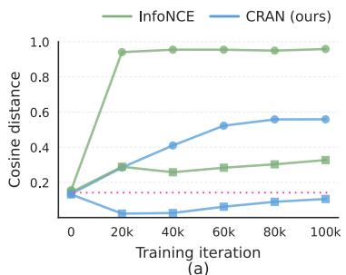

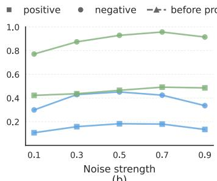

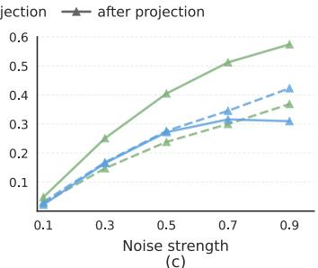  
Figure 1: Diagnostic studies of the noise shortcut. (a) Standard InfoNCE rapidly over-disperses negative pairs and weakens positive-pair alignment, while CRAN alleviates both effects. (b) The over-dispersion and weakened alignment of InfoNCE become more severe at higher noise levels, whereas CRAN remains stable. (c) For a fixed clean image, the contrastive projection head amplifies noise-induced distances, revealing a noise shortcut; CRAN suppresses such amplification.

Evidence from prior work and our empirical study suggests a negative answer. Dispersive Loss (Wang & He, 2025) (see their Table 2) shows that standard contrastive losses can degrade diffusion training with independently noised positive views, and require restricted noise gaps to obtain only limited gains. Consistent with prior evidence, we further test whether InfoNCE can become effective under a stronger self-representation alignment setup. We adopt the SRA framework (Jiang et al., 2026), where a middle SiT representation is aligned to a deeper and less noisy self-representation, and extend this positive-only regularizer into a full InfoNCE objective by adding negative-pair discrimination. However, as in Table 1, InfoNCE brings almost no gain over SRA, reducing FID only from 28.7 to 28.5.

To understand this issue, we argue that vanilla InfoNCE suffers from a noise shortcut. Diffusion inputs contain high-dimensional Gaussian noise, whose random components are known to be nearly orthogonal with high probability (Cai et al., 2013). Therefore, instead of learning semantic differences between images, the contrastive objective may simply exploit the naturally near-orthogonal noise components to enlarge negative-pair distances. This provides an easy way to satisfy the repulsive regularization, but can lead to over-dispersion and weaken positive-pair alignment1.

To verify this argument, we conduct three diagnostic studies under standard InfoNCE regularization. (1) We track the average cosine distance (1 − cos(a, b)) of positive-pairs and negative-pairs during training. As shown in Figure 1 (a), negative-pairs are rapidly pushed toward orthogonality, which we refer to as over-dispersion. However, positive-pair distances are not properly minimized; instead, they first increase and remain larger than their initial value, indicating that positive-pair alignment is weakened rather than strengthened. (2) Figure 1 (b) shows that both positive- and negative-pair distances grow with noise strength, especially the negative-pair ones, suggesting that stronger noise amplifies shortcut-driven over-dispersion and weakened alignment. (3) We further consider a special case of positive-pairs: fixing the clean image while varying only the sampled noise, and measuring feature distances before and after the contrastive projection head. Figure 1 (c) shows that for the same image under different noise realizations, the contrastive projection head amplifies noise-induced feature distances, revealing that it exploits noise variation as a shortcut even for positive pairs.

Motivated by the analyses above, we propose Clean Representation-ANchored contrastive (CRAN) regularization. The key idea is to prevent InfoNCE from over-dispersing noisy representations beyond the discriminative structure present in clean representations. Specifically, CRAN anchors negative-pair dispersion in the contrastive objective using pairwise distances between clean-sample representations. In this way, clean representation geometry guides noisy diffusion representations, clipping unnecessary negative repulsion once the clean anchor is reached and thereby shifting optimization toward positive-pair alignment. As shown in Figure 1, CRAN mitigates the key failure modes of vanilla InfoNCE: it alleviates negative-pair over-dispersion and improves positive-pair alignment, reduces the sensitivity of representation distances to noise strength, and suppresses projection-head amplification of noise-induced distances. Consistently, Table 1 shows that CRAN reduces FID from 28.5 to 26.3 over vanilla InfoNCE, demonstrating that CRAN effectively blocks the noise shortcut and unlocks the potential of InfoNCE for diffusion transformer training.

Table 2: Unified view of representation regularization methods for diffusion training. $P \colon$ positive; N: negative; $\mathbf { x } _ { 0 } ^ { i } / \mathbf { x } _ { t } ^ { i } / \mathbf { x } _ { t - \Delta t } ^ { i } \colon$ clean/noisy/less-noisy query image; $\mathbf { z } _ { t } ^ { i } = g _ { \psi } ( f _ { \theta } ^ { k } ( \mathbf { x } _ { t } ^ { i } ) )$ : k-th block feature of noisy query projected by head $g _ { \psi }$ . sg: stop-gradient; $d ( \cdot , \cdot ) ;$ : distance function; $f _ { \bar { \theta } } { : }$ EMA model; $f ^ { k ^ { \prime } }$ with $k ^ { \prime } > k \colon$ deeper-layer block; h: auxiliary reconstruction head. To ease the notation, we omit the temperature τ in Dispersive Loss (Wang & He, 2025), InfoNCE, and $\mathrm { C R A N } .$ † indicates the use of external knowledge.
<table><tr><td> $\mathbf { T y p e }$ </td><td>Method</td><td>Target / Pair Construction</td><td colspan="2">Regularization Objective</td></tr><tr><td rowspan="4"></td><td> $\mathrm { R E P A } ^ { \dag } \ ( \mathrm { Y u } \ \mathrm { e t } \ \mathrm { a l . , } 2 0 2 4 )$ </td><td>External pretrained representation  $E _ { \mathsf { D I N O } } ( \mathbf { x } _ { 0 } ^ { i } )$ </td><td colspan="2"> $\begin{array} { r l r } { { \bf y } ^ { i } } & { { } = } & { \mathbb { E } _ { i } \left[ d \left( { \bf z } _ { t } ^ { i } , { \bf s } { \bf g } ( { \bf y } ^ { i } ) \right) \right] } \end{array}$ </td></tr><tr><td>LayerSync (Haghighi et al., 2025) Detached deeper-layer representation</td><td> $f _ { \theta } ^ { k ^ { \prime } } ( \mathbf { x } _ { t } ^ { i } )$ </td><td colspan="2"> $\begin{array} { r l r } { { \bf y } ^ { i } } & { = } & { { \mathbb E } _ { i } \left[ d \left( { \bf z } _ { t } ^ { i } , { \bf s g } ( { \bf y } ^ { i } ) \right) \right] } \end{array}$ </td></tr><tr><td>SRA (Jiang et al., 2026)</td><td>Deeper and less noisy EMA representation  $\mathbf { y } ^ { i } = f _ { \bar { \theta } } ^ { k ^ { \prime } } ( \mathbf { x } _ { t - \Delta t } ^ { i } )$ </td><td colspan="2"> $\mathbb { E } _ { i } \ \left[ \lVert \mathbf { z } _ { t } ^ { i } - \mathbf { s g } ( \mathbf { y } ^ { i } ) \rVert _ { 2 } ^ { 2 } \right]$ </td></tr><tr><td>SRA2 (Wang et al., 2026)</td><td>Reconstructing VAE latent of clean image  $\mathbf { y } ^ { i } = \mathbf { x } _ { 0 } ^ { i }$ </td><td colspan="2"> $\mathbb { E } _ { i } \left[ \left\| h ( \mathbf { z } _ { t } ^ { i } ) - \mathrm { s g } ( \mathbf { y } ^ { i } ) \right\| _ { 2 } ^ { 2 } \right]$ </td></tr><tr><td></td><td>N.-only Disp. Loss (Wang &amp; He, 2025)</td><td>In-batch negatives  $\{ \mathbf { y } ^ { j } = \mathbf { z } _ { t } ^ { j } \} _ { j \neq i }$ </td><td colspan="2"> $\log \mathbb { E } _ { i , j } \left[ \exp \left( - \lVert \mathbf { z } _ { t } ^ { i } - \mathbf { y } ^ { j } \rVert _ { 2 } ^ { 2 } \right) \right]$ </td></tr><tr><td rowspan="2"> $P \cdot + N .$ </td><td>InfoNCE</td><td> $\mathbf { y } ^ { i }$  Positive and in-batch negatives</td><td></td><td> $\begin{array} { r l } { \{ \mathbf { y } ^ { j } \} _ { j \neq i } } & { { } \quad - \mathbb { E } _ { i } \left[ \log { \frac { \exp ( - d ( \mathbf { z } _ { t } ^ { i } , \mathbf { y } ^ { i } ) ) } { \sum _ { j } \exp ( - d ( \mathbf { z } _ { t } ^ { i } , \mathbf { y } ^ { j } ) ) } } \right] } \end{array}$ </td></tr><tr><td>CRAN (ours)</td><td>InfoNCE + clean-representation anchor  $\mathbb { E } _ { i , j } [ d ( \mathbf { z } _ { 0 } ^ { i } , \mathbf { z } _ { 0 } ^ { j } ) ]$ </td><td> $\begin{array} { r l } { m = } & { { } - \mathbb { E } _ { i } } \end{array}$ </td><td> $\begin{array} { r } { \left\lfloor \log \frac { \exp ( - d ( \mathbf { z } _ { t } ^ { \ i } , \mathbf { y } ^ { \ i } ) ) } { \sum _ { j } \exp ( - \operatorname* { m i n } ( d ( \mathbf { z } _ { t } ^ { \ i } , \mathbf { y } ^ { j } ) , m ) } \right\rfloor } \end{array}$  _</td></tr></table>

Extensive experiments in Section 4 verify the effectiveness of CRAN, which achieves significant improvements over feature-alignment methods using internal features. Notably, using only internal feature contrastive learning, CRAN matches REPA Yu et al. (2024), which relies on an external strong DINOv2 encoder Oquab et al. (2024), under the same training budget.

## 2 PRELIMINARY

## 2.1 FLOW AND DIFFUSION MODELS

We use the stochastic interpolant formulation (Albergo et al., 2025) as a unified perspective for flow and diffusion models. Let $\mathbf { x } _ { 0 } \sim p _ { \mathsf { d a t a } }$ denote an image latent and $\epsilon \sim \mathcal { N } ( \mathbf { 0 } , I )$ denote Gaussian noise. The interpolated state at timestep t is defined as ${ \bf x } _ { t } = \alpha _ { t } { \bf x } _ { 0 } + \sigma _ { t } \epsilon$ , where $\alpha _ { t } = \alpha ( t )$ and $\sigma _ { t } = \sigma ( t )$ are time-dependent coefficients, with $\alpha ( t )$ decreasing and $\sigma ( t )$ increasing over time. The probability-flow ODE is governed by the velocity field: $\dot { \mathbf x } _ { t } = \mathbf v ( \mathbf x _ { t } , t )$ . In practice, $\mathbf { v } _ { \pmb { \theta } }$ is trained to regress the sample-wise velocity target $\dot { \alpha } _ { t } { \bf x } _ { 0 } + \dot { \sigma } _ { t } \epsilon \dot { \bf { : } }$

$$
\begin{array} { r } { \mathcal { L } _ { \mathtt { g e n } } ( \pmb { \theta } ) = \mathbb { E } _ { \mathbf { x } _ { 0 } , \epsilon , t } \left[ \left\| \mathbf { v } _ { \pmb { \theta } } ( \mathbf { x } _ { t } , t ) - \left( \dot { \alpha } _ { t } \mathbf { x } _ { 0 } + \dot { \sigma } _ { t } \pmb { \epsilon } \right) \right\| _ { 2 } ^ { 2 } \right] . } \end{array}\tag{1}
$$

Here, $\dot { \alpha } _ { t }$ and $\dot { \sigma } _ { t }$ denote time derivatives. Different choices of $\alpha _ { t }$ and $\sigma _ { t }$ recover common flow and diffusion parameterizations. For example, flow model uses $\alpha _ { t } = 1 - t$ and $\sigma _ { t } = t ,$ , giving the target $\epsilon - { \bf x } _ { 0 } ;$ In VE diffusion (Song et al., 2020), $\alpha _ { t } = 1$ and $\sigma _ { t } = \sigma ( t )$ , yielding a pure noise-direction target $\dot { \sigma } _ { t } \epsilon$

## 2.2 EXISTING REPRESENTATION REGULARIZERS FOR DIFFUSION TRAINING

Recent studies show that representation regularization is effective for diffusion training. A unified view of diffusion representation regularization is summarized in Table 2. Based on how representation pairs are constructed and optimized, we categorize existing methods into three families.

Positive-only regularization. Positive-only regularizers improve diffusion training by aligning each noisy intermediate representation with a stronger target feature. Representative methods differ mainly in how this target feature is constructed:

• REPA (Yu et al., 2024) minimizes the cosine distance between intermediate diffusion features and representations from an external pretrained vision encoder, e.g., DINOv2 (Oquab et al., 2024).

• LayerSync (Haghighi et al., 2025) directly minimizes the cosine distance between intermediate diffusion representations and detached deeper representations within the same diffusion transformer.

• SRA (Jiang et al., 2026) also aligns intermediate representations with detached deeper representations, but constructs the target from an EMA teacher network and a less noisy version of the current latent, using an $\ell _ { 2 }$ distance objective.

• SRA2 (Wang et al., 2026) uses intermediate diffusion representations to predict the VAE latent of the clean image.

Negative-only regularization. Negative-only regularizer disperses intermediate diffusion representations across samples without positive pairs. Dispersive Loss (Wang & He, 2025) instantiates this idea by minimizing a log-sum-exp objective over negative pairwise $\ell _ { 2 } ^ { 2 }$ distances.

Positive-negative contrastive regularization. Contrastive learning is one of the most successful objectives for visual representation learning (Chen et al., 2020; He et al., 2020; Radford et al., 2021). It learns discriminative features by aligning positive pairs while repelling negative pairs. Let zi denote the query representation, $\mathbf { y } _ { i }$ its positive target, and $\{ \mathbf { y } _ { j } \} _ { j \neq i }$ the in-batch negatives. Given a distance function $d ( \cdot , \cdot )$ , the InfoNCE-based contrastive objective is

$$
\mathcal { L } _ { \mathrm { C L } } ( \pmb { \theta } , \psi ) = - \mathbb { E } _ { i } \left[ \log \frac { \exp \left( - d ( \mathbf { z } ^ { i } , \mathbf { y } ^ { i } ) / \tau \right) } { \sum _ { j = 1 } ^ { B } \exp \left( - d ( \mathbf { z } ^ { i } , \mathbf { y } ^ { j } ) / \tau \right) } \right] .\tag{2}
$$

However, directly applying this full objective to diffusion training remains challenging. Dispersive Loss (Wang & He, 2025) shows that ${ \mathcal { L } } _ { \mathsf { C L } }$ can degrade generation quality, and only yields limited gains after carefully restricting the noise gap between positive views. We revisit this problem and find that vanilla InfoNCE is dominated by noise-driven dispersion rather than semantic discrimination. Moreover, this shortcut cannot be resolved by simply tuning the temperature $\boldsymbol { \tau } ;$ as shown in Table 7, using a smaller temperature does not recover the expected benefit of InfoNCE.

## 3 METHODOLOGY

Given a noisy query latent $\mathbf { x } _ { t } ^ { i } ,$ , let $\mathbf { z } _ { t } ^ { i } = g _ { \psi } ( f _ { \theta } ^ { k } ( \mathbf { x } _ { t } ^ { i } ) )$ denote the projected intermediate diffusion representation, where $f _ { \theta } ^ { k } ( \cdot )$ produces the k-th block features and $g _ { \psi } ( \cdot )$ is an MLP projection head parameterized by ψ. Let $\mathbf { y } ^ { i }$ denotes the detached positive or negative representations, $e . g .$ , a deeper and less noisy self-representation as in SRA (Jiang et al., 2026):

$$
\mathbf { y } ^ { i } = f _ { \bar { \theta } } ^ { k ^ { \prime } } ( \mathbf { x } _ { t - \Delta t } ^ { i } ) , \mathrm { w h e r e } k ^ { \prime } > k \mathrm { a n d } 0 < t - \Delta t < t .\tag{3}
$$

Here, $\bar { \pmb { \theta } }$ denotes the EMA parameters. For convenience, we define

$$
d _ { t } ^ { i j } = d ( \mathbf { z } _ { t } ^ { i } , \mathbf { y } ^ { j } ) ,
$$

where $d ( \cdot , \cdot )$ denotes a representation distance, such as squared $\ell _ { 2 }$ distance or cosine distance.

## 3.1 FIXED-ANCHOR CONTRASTIVE REGULARIZATION

Evidence from prior work (Wang & He, 2025) and our empirical analysis in Table 1 suggest that standard InfoNCE in Eq. (2) is not directly effective for diffusion training. We attribute this failure to noise-shortcut-induced negative-pair over-dispersion. Since diffusion representations contain high-dimensional noise components that are naturally near-orthogonal, contrastive learning can satisfy its repulsive objective through noise-induced separation rather than semantic discrimination, as shown in Figure 1.

A direct remedy is therefore to stop the contrastive objective from further pushing negative pairs that are already sufficiently separated. To this end, we introduce Anchored Contrastive Learning (ACL) with a fixed distance anchor $m _ { \mathrm { f i x } }$ and clip the negative-pair distances in the InfoNCE denominator:

$$
{ \mathcal { L } } _ { \mathrm { A C L } } ( \theta , \psi , m _ { \mathrm { f i x } } ) = - \mathbb { E } _ { i } \left[ \log \frac { \exp ( - d _ { t } ^ { i i } / \tau ) } { \sum _ { j } \exp \left( - \operatorname* { m i n } ( d _ { t } ^ { i j } , m _ { \mathrm { f i x } } ) / \tau \right) } \right] .\tag{4}
$$

Here, min $( d _ { t } ^ { i j } , m _ { \mathsf { f i x } } )$ limits the maximum separation enforced on negative pairs. Thus, the anchor prevents InfoNCE from blindly pushing negative pairs toward orthogonality. Once a negative pair

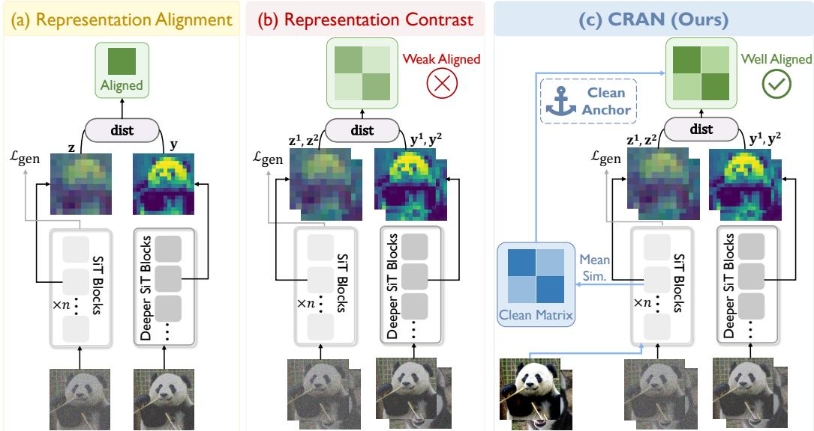  
Figure 2: (a) Prior diffusion representation alignment methods, e.g., SRA (Jiang et al., 2026). (b) Standard contrastive learning leads to severe over-dispersion and weakened alignment, resulting in limited performance gains. (c) CRAN uses clean-representation distances to anchor the maximum contrastive separation, alleviating over-dispersion and improving positive-pair alignment, which yields substantially stronger performance than representation alignment.

reaches the distance bound, it no longer receives additional repulsive gradients, so the loss can be further reduced mainly by improving positive-pair alignment. This both alleviates over-dispersion and strengthens the alignment of matched representations.

Notably, our results in Table 7 show that a fixed anchor already validates this intuition: setting $m _ { \mathrm { f i x } } = 0 . 5$ (cos 60◦) improves FID from 28.5 to 27.0 on SiT-B/2.

## 3.2 CLEAN REPRESENTATION-ANCHORED CONTRASTIVE REGULARIZATION

Although the fixed-anchor variant validates the importance of limiting negative-pair dispersion, it remains suboptimal for two reasons: (1) it requires manually tuning an extra hyperparameter; (2) its fixed threshold cannot adapt to the evolving inter-representation geometry during training. To remove this hand-crafted design, we turn to clean-sample representations. Unlike noisy diffusion representations, clean representations are not dominated by injected Gaussian noise and thus provide a more reliable estimate of semantic representation geometry.

Motivated by this, we propose Clean Representation-ANchored contrastive (CRAN) regularization, as in Figure 2. Instead of using a fixed anchor, CRAN uses the average negative pairwise distance among clean-sample representations as an adaptive anchor $( m _ { \mathsf { c r a n } } )$ for noisy contrastive learning.

$$
\begin{array} { r } { \mathcal { L } _ { \mathtt { C R A N } } ( \pmb { \theta } , \psi ) = \mathcal { L } _ { \mathtt { A C L } } ( \pmb { \theta } , \psi , m _ { \mathtt { c r a n } } ) , \mathrm { ~ w h e r e ~ } m _ { \mathtt { c r a n } } = \mathbb { E } _ { i \neq j } \left[ d ( \mathbf { z } _ { 0 } ^ { i } , \mathbf { z } _ { 0 } ^ { j } ) \right] . } \end{array}\tag{5}
$$

Here, $\mathbf { z } _ { 0 } ^ { i } = g _ { \psi } ( f _ { \theta } ^ { k } ( \mathbf { x } _ { 0 } ^ { i } ) )$ ) denotes the projected representation of the clean input, and $m _ { \mathsf { c r a n } }$ is computed as the empirical mean within the current batch. This allows noisy contrastive learning to adaptively inherit the clean inter-sample geometry. The overall objective is given by:

$$
\mathcal { L } _ { \mathrm { t o t a l } } ( \theta , \psi ) = \mathcal { L } _ { \mathrm { g e n } } ( \theta ) + \lambda \mathcal { L } _ { \mathrm { C R A N } } ( \theta , \psi ) ,\tag{6}
$$

where $\mathcal { L } _ { \mathrm { g e n } }$ is the flow or diffusion loss defined in Eq. (1) and λ controls the strength of regularization.

## 3.3 CLEAN INTER-SAMPLE GEOMETRY ESTIMATION

During training, each batch naturally contains samples at different noise levels. We select samples whose noise levels are below a threshold $t _ { c } = 0 . 1$ and use the average pairwise angle between their representations to determine the adaptive margin $m _ { \mathrm { c r a n } }$ . In this way, $m _ { \mathrm { c r a n } }$ provides an online estimate of the clean inter-sample geometry without requiring an additional clean-sample branch.

Table 3: FID comparison across model scales and training budgets without CFG.
<table><tr><td>Model</td><td>#Params</td><td>Iter.</td><td>FID↓</td></tr><tr><td>SiT-B/2</td><td>130M</td><td>400k</td><td>33.0</td></tr><tr><td>+ SRA</td><td>130M</td><td>400k</td><td>29.1</td></tr><tr><td>+ SRA &amp; Disp.</td><td>130M</td><td>400k</td><td>28.6</td></tr><tr><td>+ DiverseDiT</td><td>&gt;130M</td><td>400k</td><td>28.1</td></tr><tr><td>+ SRA2</td><td>130M</td><td>400k</td><td>28.9</td></tr><tr><td>+ CRAN</td><td>130M</td><td>400k</td><td>26.3</td></tr><tr><td>SiT-L/2</td><td>458M</td><td>400k</td><td>18.8</td></tr><tr><td>+ SRA</td><td>458M</td><td>400k</td><td>14.4</td></tr><tr><td>+ DiverseDiT</td><td>&gt;458M</td><td>400k</td><td>16.1</td></tr><tr><td>+ SRA2</td><td>458M</td><td>400k</td><td>14.3</td></tr><tr><td>+ CRAN</td><td>458M</td><td>400k</td><td>13.3</td></tr><tr><td>SiT-XL/2</td><td>675M</td><td>400k</td><td>17.2</td></tr><tr><td>+ DiverseDiT</td><td>713M</td><td>400k</td><td>12.4</td></tr><tr><td>+ SRA 2</td><td>675M</td><td>400k</td><td>11.7</td></tr><tr><td>+ CRAN</td><td>675M</td><td>400k1</td><td>10.3</td></tr><tr><td>SiT-XL/2</td><td>675M</td><td>7M</td><td>8.3</td></tr><tr><td>SiT-XL/2</td><td>675M</td><td>1M</td><td>12.2</td></tr><tr><td>+ SRA2</td><td>675M</td><td>1M</td><td>8.2</td></tr><tr><td>+ CRAN</td><td>675M</td><td>1M</td><td>7.5</td></tr><tr><td>SiT-XL/2</td><td>675M</td><td>2M</td><td>10.1</td></tr><tr><td>+ SRA2</td><td>675M</td><td>2M</td><td>7.0</td></tr><tr><td>+ CRAN</td><td>675M</td><td>2M</td><td>6.6</td></tr><tr><td>SiT-XL/2</td><td>675M</td><td>4M</td><td>9.0</td></tr><tr><td>+ Disp.</td><td>675M</td><td>4M</td><td>7.7</td></tr><tr><td>+ SRA</td><td>675M</td><td>4M</td><td>7.4</td></tr><tr><td>+ SRA2</td><td>675M</td><td>4M</td><td>6.6</td></tr><tr><td>+ CRAN</td><td>675M</td><td>4M</td><td>6.2</td></tr></table>

Table 4: Comparison with SoTA methods under CFG.
<table><tr><td>Method</td><td>Epochs FID↓ sFID↓</td><td></td><td></td><td>IS↑</td><td></td><td>Pre.↑ Rec.↑</td></tr><tr><td colspan="7">Pixel diffusion</td></tr><tr><td>ADM-U (2021)</td><td>400</td><td>3.94</td><td>6.14</td><td>186.7</td><td>0.82</td><td>0.52</td></tr><tr><td>VDM++ (2023)</td><td>560</td><td>2.40</td><td></td><td>225.3</td><td></td><td></td></tr><tr><td>Simple diffusion (2023)</td><td>800</td><td>2.77</td><td></td><td>211.8</td><td></td><td></td></tr><tr><td>CDM (2022)</td><td>2160</td><td>4.88</td><td></td><td>158.7</td><td></td><td></td></tr><tr><td colspan="7">Latent diffusion, U-Net</td></tr><tr><td>LDM-4 (2022)</td><td>200</td><td>3.60</td><td></td><td>247.7</td><td>0.87</td><td>0.48</td></tr><tr><td colspan="7">Latent diffusion, Transformer + U-Net hybrid</td></tr><tr><td>U-ViT-H/2 (2023)</td><td>240</td><td>2.29</td><td>5.68</td><td>263.9</td><td>0.82</td><td>0.57</td></tr><tr><td>DiffT (2024)</td><td></td><td>1.73</td><td></td><td>276.5</td><td>0.80</td><td>0.62</td></tr><tr><td>MDTv2-XL/2 (2023)</td><td>1080</td><td>1.58</td><td>4.52</td><td>314.7</td><td>0.79</td><td>0.65</td></tr><tr><td colspan="7">Latent diffusion, Transformer</td></tr><tr><td>MaskDiT (2023)</td><td>1600</td><td>2.28</td><td>5.67</td><td>276.6</td><td>0.80</td><td>0.61</td></tr><tr><td>SD-DiT (2024)</td><td>480</td><td>3.23</td><td></td><td></td><td></td><td></td></tr><tr><td>DiT-XL/2 (2023)</td><td>1400</td><td>2.27</td><td>4.60</td><td>278.2</td><td>0.83</td><td>0.57</td></tr><tr><td>+ TRADE (2025)</td><td>740</td><td>1.69</td><td>4.70</td><td>305.7</td><td>0.80</td><td>0.65</td></tr><tr><td>SiT-XL/2 (2024)</td><td>1400</td><td>2.06</td><td>4.50</td><td>270.3</td><td>0.82</td><td>0.59</td></tr><tr><td colspan="7">With external representations</td></tr><tr><td>+ REPA (2024)</td><td>800</td><td>1.42</td><td>4.70</td><td>305.7</td><td>0.80</td><td>0.65</td></tr><tr><td>+ REG (2025)</td><td>800</td><td>1.36</td><td>4.25</td><td>299.4</td><td>0.77</td><td>0.66</td></tr><tr><td colspan="7">Without external representations</td></tr><tr><td>+ LayerSync* (2025)</td><td>800</td><td>1.56</td><td>4.82</td><td>287.0</td><td>0.80</td><td>0.63</td></tr><tr><td>+ SRA (2026)</td><td>800</td><td>1.58</td><td>4.65</td><td>305.7</td><td>0.80</td><td>0.65</td></tr><tr><td>+ SRA2 (2026)</td><td>800</td><td>1.52</td><td>4.63</td><td>316.2</td><td>0.82</td><td>0.62</td></tr><tr><td>+ CRAN</td><td>800</td><td>1.45</td><td>4.68</td><td>306.6</td><td>0.81</td><td>0.63</td></tr></table>

LayerSync includes an additional reverse-process variance head (2021); we remove it for fair comparison.

## 4 EXPERIMENTS

In this section, we conduct extensive experiments to answer the following research questions (RQs):

RQ1: Can CRAN significantly improve the performance of diffusion transformers and surpass current state-of-the-art representation regularization methods?

RQ2: How do CRAN-specific choices (d, λ) affect performance, and can temperature tuning τ in naive InfoNCE or fixed-anchor contrastive regularization match the performance of our CRAN?

RQ3: How does the adaptive anchor $m _ { \mathsf { c r a n } }$ evolve in SiT+CRAN training?

RQ4: What representation properties are improved by CRAN?

Implementation details. We conduct experiments on Scalable Interpolant Transformers (SiT) (Ma et al., 2024), which provide a unified view of diffusion and flow models. Our evaluation covers three model scales: SiT-B/2, SiT-L/2, and SiT-XL/2. For a fair comparison, we follow the REPA (Yu et al., 2024) training configuration. All experiments are carried out on ImageNet (Deng et al., 2009), with images center-cropped and resized to 256 × 256. They are then encoded by the Stable Diffusion VAE with a compression factor of 8, resulting in latents with shape $\mathbb { R } ^ { 3 2 \times 3 2 \times 4 }$ . Training is performed with a batch size of 256 using AdamW, a constant learning rate of $1 \times 1 0 ^ { - 4 }$ , and no weight decay.

Inference and evaluation. For inference, we follow SiT and REPA and use the Euler-Maruyama sampler for the SDE with $w _ { t } = \sigma _ { t }$ , with the default number of function evaluations (NFE) set to 250. For evaluation, we adopt the ADM TensorFlow evaluation protocol (Dhariwal & Nichol, 2021), generating 50K samples to ensure statistical reliability and comparing them against the corresponding reference statistics. We report Fréchet Inception Distance (FID) (Heusel et al., 2017), structural FID (sFID) (Nash et al., 2021), Inception Score (IS) (Salimans et al., 2016), precision, and recall (Kynkäänniemi et al., 2019) to assess generation quality from complementary perspectives. Additional implementation details are provided in the Appendix F.

  
Figure 3: Generated images from SiT-XL/2 + CRAN. More visualizations are provided in Appendix H.

## 4.1 THE EFFECTIVENESS OF CRAN (RQ1)

We first compare the improvements brought by CRAN on SiT across different model scales with those of other representation alignment methods. We use FID as the primary comparison metric and do not use classifier-free guidance. As shown in Table 3, CRAN substantially improves SiT across different model sizes and training budgets. Compared with existing representation alignment methods, including positive regularizers such as SRA (Jiang et al., 2026) and SRA2 (Wang et al., 2026), as well as negative regularizers such as Dispersive Loss (Wang & He, 2025) and DiverseDiT (Yang et al., 2026), CRAN achieves the best performance across different training stages and model sizes. It is worth noting that simply combining SRA with Dispersive Loss yields only marginal improvement and remains notably behind CRAN (28.6 vs. 26.3). Specifically, CRAN achieves 7.5 non-cfg FID using only 1M iterations, which outperforms vanilla SiT-XL/2 trained for 7M iterations. The performance of CRANcontinues to improve with more training iteration, and finally achieves 6.2 FID, which is the best result among methods that do not use external pretrained visual encoders.

Finally, we use SiT-XL/2 as the baseline and compare CRAN with other state-of-the-art methods under classifier-free guidance. As shown in Table 4, CRAN substantially improves the performance of SiT and reaches an FID of 1.45 at 800 epochs, outperforming MaskDiT (Zheng et al., 2023) and SD-DiT (Zhu et al., 2024), which introduce more complex architectures. Compared with representation alignment methods built on the same SiT-XL/2 backbone, CRAN achieves the best FID among methods that rely on features from the diffusion transformer itself, surpassing SRA (Jiang et al., 2026), SRA2 (Wang et al., 2026) and LayerSync (Haghighi et al., 2025).

## 4.2 ABLATION STUDIES (RQ2)

As shown in Table 5, we study the key design choices in CRAN, including the distance metric, the setting of the similarity anchor, and the weight of the CRAN regularization. We first evaluate representation contrastive regularization with different distance metrics. The results show that plain representation contrastive regularization can improve SiT, but the gains remain relatively marginal. Between the $\ell _ { 2 }$ distance and the cosine distance, we choose the cosine distance as our distance metric, as it achieves better performance and is widely used in representation learning to constrain the angular relationships between features (He et al., 2020; Radford et al., 2021; Chen et al., 2020).

Next, we study how different similarity anchor settings affect performance. A fixed threshold can improve performance when properly tuned. However, using the similarity between clean features as the anchor value achieves better results. We attribute this to the fact that the clean representation similarity more faithfully reflects the relationships among images at the representation level, while also allowing the hinge value to adapt dynamically during training.

Table 5: Ablation studies on the design choices of CRAN. We study the distance metric, the setting of the maximum separation, and the weight of the CRAN objective. The best results are in blue.
<table><tr><td>Method</td><td>dis. metric</td><td>Dis. Anchor</td><td>λ</td><td>FID↓</td><td>sFID↓</td><td>IS↑</td><td>Pre.↑</td><td>Rec.↑</td></tr><tr><td>SiT-B/2</td><td></td><td></td><td>-</td><td>33.0</td><td>6.46</td><td>43.7</td><td>0.53</td><td>0.63</td></tr><tr><td>+ CRAN</td><td> $\ell _ { 2 }$ </td><td></td><td>1.0</td><td>31.9</td><td>6.53</td><td>44.8</td><td>0.55</td><td>0.63</td></tr><tr><td>+ CRAN</td><td>COS</td><td></td><td>1.0</td><td>28.3</td><td>5.92</td><td>50.9</td><td>0.57</td><td>0.63</td></tr><tr><td>+ CRAN</td><td>COS</td><td> $\cos 3 0 ^ { \circ }$ </td><td>1.0</td><td>27.9</td><td>5.99</td><td>51.3</td><td>0.57</td><td>0.64</td></tr><tr><td>+ CRAN</td><td>COS</td><td> $\cos 6 0 ^ { \circ }$ </td><td>1.0</td><td>27.0</td><td>6.06</td><td>53.9</td><td>0.58</td><td>0.64</td></tr><tr><td>+ CRAN</td><td>COS</td><td> $\cos 7 0 ^ { \circ }$ </td><td>1.0</td><td>28.6</td><td>5.99</td><td>50.5</td><td>0.57</td><td>0.64</td></tr><tr><td>+ CRAN</td><td>COS</td><td> $m _ { \mathsf { C r a n } }$ </td><td>1.0</td><td>26.3</td><td>6.16</td><td>56.2</td><td>0.58</td><td>0.63</td></tr><tr><td>+ CRAN</td><td>COS</td><td>Mcran</td><td>0.5</td><td>28.6</td><td>6.08</td><td>50.6</td><td>0.57</td><td>0.63</td></tr><tr><td> $+ \mathrm { C R A N }$ </td><td>COS</td><td> $m _ { \mathsf { c r a n } }$ </td><td>1.0</td><td>26.3</td><td>6.16</td><td>56.2</td><td>0.58</td><td>0.63</td></tr><tr><td> $+ \mathrm { C R A N }$ </td><td>COS</td><td> $m _ { \mathsf { c r a n } }$ </td><td>1.5</td><td>26.8</td><td>6.12</td><td>54.3</td><td>0.58</td><td>0.63</td></tr></table>

We then study the effect of the CRAN weight. The results show that too small a weight degrades the performance of CRAN. We therefore use $\lambda = 1 . 0$ as the default weight in our final setting.

Table 6 isolates the two components of the contrastive objective. Removing either the positive or negative component degrades performance. The positive term provides cross-layer and cross-noise alignment, while the anchored negative term preserves useful inter-sample discrimination; their combination yields the strongest overall result. We further compare temperature scaling, fixed anchors, and the adaptive clean anchor in Appendix B (Table 7).

Table 6: Component ablation on SiT-B/2
<table><tr><td>Method</td><td>Pos.</td><td>Neg.</td><td>FID↓</td></tr><tr><td>SiT-B/2</td><td>No</td><td>No</td><td>33.0</td></tr><tr><td>CRAN</td><td>No</td><td>Yes</td><td>31.9</td></tr><tr><td>CRAN</td><td>Yes</td><td>No</td><td>28.7</td></tr><tr><td>CRAN</td><td>Yes</td><td>Yes</td><td>26.3</td></tr></table>

## 4.3 DYNAMICS OF CLEAN REPRESENTATION ANCHOR (RQ3)

We visualize the evolution of the clean representation anchor $m _ { \mathsf { c r a n } }$ during training on SiT-B/2, SiT-L/2, and SiT-XL/2.

As shown in Fig. 4, $m _ { \mathsf { c r a n } }$ follows a consistent pattern across model scales. It increases rapidly in the early training stage, providing stronger discriminative regularization when the diffusion representations are still underdeveloped. After reaching its peak, the anchor gradually decreases and eventually stabilizes as the model becomes more stable. Among the three models, SiT-B/2 maintains the largest clean representation anchor. This may be because its smaller capacity requires a more uniformly distributed representation space, whereas larger models can rely on weaker regularization after convergence.

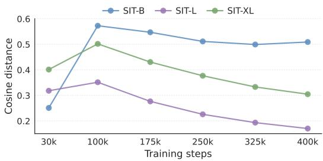  
Figure 4: Evolution of the clean representation anchor during training.

## 4.4 REPRESENTATION ANALYSIS (RQ4)

Spatial representation structure. To examine how CRAN affects diffusion representations, we follow the iREPA (Singh et al., 2025) evaluation paradigm, which emphasizes that spatial-structure metrics are more closely aligned with diffusion generative performance than linear probing accuracy. Specifically, we evaluate the learned representations using three metrics: Local vs. Distant Similarity (LDS) (Huang et al., 1997), which measures the contrast between local and distant patch similarities; Correlation Decay Slope (CDS), which quantifies how quickly patch similarity decreases with spatial distance; and RMS Spatial Contrast (RMSC), which measures the spatial variation of normalized patch features. These metrics allow us to quantitatively compare the representations learned by CRAN against those of competing methods. The detailed computation procedures for these metrics are provided in the Appendix G.

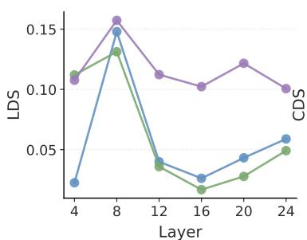  
(a)

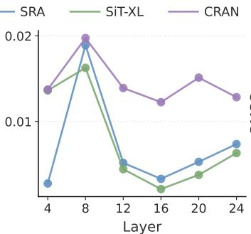  
(b)

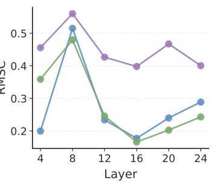  
(c)  
Figure 5: Spatial-structure metric analysis using SiT-XL/2. CRAN outperforms both SiT and SRA at the aligned layer, with even more pronounced improvements observed in deeper layers.

We compare our CRAN with a representative representation-alignment method, i.e., SRA (Jiang et al., 2026) which aligns representation across layers and time steps. As shown in Fig. 5, CRANdemonstrates more significant enhancement in all three spatial-structure metrics at the regularized layer (layer 8). At deeper layers, CRAN brings more pronounced improvements.

## 5 RELATED WORK

Diffusion transformers for image generation. Diffusion (Ho et al., 2020; Song et al., 2020; Rombach et al., 2022; Podell et al., 2023) and flow-based models (Lipman et al., 2023; Liu et al., 2023; Esser et al., 2024) have become dominant paradigms for visual generation. With transformer backbones, diffusion models have scaled more effectively to larger architectures and stronger visual generation performance. DiT (Peebles & Xie, 2023) first demonstrated that vision transformers provide a strong backbone for diffusion modeling, while SiT (Ma et al., 2024) unified diffusion and flow-based training within a scalable stochastic-interpolant transformer framework. Despite these advances, diffusion transformer training remains costly, motivating representation-level regularization for more efficient and effective optimization.

Representation regularization for diffusion models. Representation regularization has shown promise in improving diffusion training. MaskDiT (Zheng et al., 2023) and SD-DiT (Zhu et al., 2024) adopt masked pretraining objectives, while MAEtok (Chen et al., 2025) combines reconstruction and alignment losses in tokenizer training. These approaches often require additional decoders or teacher branches (Jiang et al., 2026). REPA (Yu et al., 2024) and iREPA (Singh et al., 2025) instead align diffusion features with external pretrained representations. Without external encoders, SRA (Jiang et al., 2026) and LayerSync (Haghighi et al., 2025) use deeper internal features as alignment targets, DUPA (Peng et al., 2026) aligns low-frequency conditions across independently noised paths, and LSEP (Yun et al., 2025) promotes linear separability without alignment targets. Dispersive Loss (Wang & He, 2025) and DiverseDiT (Yang et al., 2026) explore negative-only feature dispersion. However, InfoNCE-based contrastive regularization, which jointly aligns positive pairs and disperses negative pairs, remains underexplored in diffusion transformer training despite its success in discriminative representation learning.

## 6 CONCLUSION AND LIMITATION

In this work, we present CRAN, a successful attempt to introduce full InfoNCE-based contrastive learning regularization in diffusion transformers training. We find that vanilla contrastive learning fails because it tends to exploit the noise components in diffusion inputs to enlarge representation distances. As a result, it learns noise-induced dispersion rather than proper inter-sample relationships. To address this issue, CRAN anchors the maximum negative-pair distance in InfoNCE using pairwise distances among clean representations, thereby suppressing the noise-induced dispersion shortcut.

As a result, CRAN unlocks the benefit of contrastive learning for diffusion transformer training and outperforms existing representation-alignment methods.

Limitation and possible remedy. CRAN requires estimating clean representation anchors during training, introducing a overhead from an additional near-clean forward pass. This cost is comparable to methods that require extra feature extraction, such as REPA (Yu et al., 2024), and does not affect inference time. A possible remedy for this overhead is to amortize anchor estimation $m _ { \mathsf { c r a n } }$ with an EMA update when training samples are near the clean endpoint, which we leave for future work.

## REFERENCES

Michael Albergo and Eric Vanden-Eijnden. Building normalizing flows with stochastic interpolants. In ICLR 2023 Conference, 2023.

Michael Albergo, Nicholas M Boffi, and Eric Vanden-Eijnden. Stochastic interpolants: A unifying framework for flows and diffusions. Journal ofMachine Learning Research, 26(209):1–80, 2025.

Fan Bao, Shen Nie, Kaiwen Xue, Yue Cao, Chongxuan Li, Hang Su, and Jun Zhu. All are worth words: A vit backbone for diffusion models. In Proceedings of the IEEE/CVF Conference on Computer Vision and Pattern Recognition, pp. 22669–22679, 2023.

Tim Brooks, Bill Peebles, Connor Holmes, Will DePue, Yufei Guo, Leo Jing, David Schnurr, Joe Taylor, Troy Luhman, Eric Luhman, et al. Video generation models as world simulators. OpenAI Blog, 1(8):1, 2024.

Tony Cai, Jianqing Fan, and Tiefeng Jiang. Distributions of angles in random packing on spheres. Journal ofMachine Learning Research, 14(21):1837–1864, 2013.

Hao Chen, Yujin Han, Fangyi Chen, Xiang Li, Yidong Wang, Jindong Wang, Ze Wang, Zicheng Liu, Difan Zou, and Bhiksha Raj. Masked autoencoders are effective tokenizers for diffusion models. In Forty-second International Conference on Machine Learning, 2025.

Ting Chen, Simon Kornblith, Mohammad Norouzi, and Geoffrey Hinton. A simple framework for contrastive learning of visual representations. In International Conference on Machine Learning, pp. 1597–1607, 2020.

Jia Deng, Wei Dong, Richard Socher, Li-Jia Li, Kai Li, and Li Fei-Fei. Imagenet: A large-scale hierarchical image database. In 2009 IEEE Conference on Computer Vision and Pattern Recognition, pp. 248–255, 2009.

Prafulla Dhariwal and Alexander Nichol. Diffusion models beat gans on image synthesis. In Advances in Neural Information Processing Systems, volume 34, 2021.

Patrick Esser, Sumith Kulal, Andreas Blattmann, Rahim Entezari, Jonas Müller, Harry Saini, Yam Levi, Dominik Lorenz, Axel Sauer, Frederic Boesel, et al. Scaling rectified flow transformers for high-resolution image synthesis. In Forty-first international conference on machine learning, 2024.

Shanghua Gao, Pan Zhou, Ming-Ming Cheng, and Shuicheng Yan. Mdtv2: Masked diffusion transformer is a strong image synthesizer. arXiv preprint arXiv:2303.14389, 2023.

Chuan Guo, Shihao Zou, Xinxin Zuo, Sen Wang, Wei Ji, Xingyu Li, and Li Cheng. Generating diverse and natural 3d human motions from text. In Proceedings ofthe IEEE/CVF Conference on Computer Vision and Pattern Recognition, pp. 5152–5161, 2022.

Yasaman Haghighi, Bastien van Delft, Mariam Hassan, and Alexandre Alahi. Layersync: Selfaligning intermediate layers. arXiv preprint arXiv:2510.12581, 2025.

Ali Hatamizadeh, Jiaming Song, Guilin Liu, Jan Kautz, and Arash Vahdat. Diffit: Diffusion vision transformers for image generation. In European Conference on Computer Vision, pp. 37–55, 2024.

Kaiming He, Haoqi Fan, Yuxin Wu, Saining Xie, and Ross Girshick. Momentum contrast for unsupervised visual representation learning. In Proceedings of the IEEE/CVF Conference on Computer Vision and Pattern Recognition, pp. 9729–9738, 2020.

Martin Heusel, Hubert Ramsauer, Thomas Unterthiner, Bernhard Nessler, and Sepp Hochreiter. Gans trained by a two time-scale update rule converge to a local nash equilibrium. In Advances in Neural Information Processing Systems, volume 30, 2017.

Jonathan Ho and Tim Salimans. Classifier-free diffusion guidance. arXiv preprint arXiv:2207.12598, 2022.

Jonathan Ho, Ajay Jain, and Pieter Abbeel. Denoising diffusion probabilistic models. Advances in neural information processing systems, 33:6840–6851, 2020.

Emiel Hoogeboom, Jonathan Heek, and Tim Salimans. Simple diffusion: End-to-end diffusion for high resolution images. In International Conference on Machine Learning, pp. 13213–13232, 2023.

Jing Huang, S. Ravi Kumar, Mandar Mitra, Wei-Jing Zhu, and Ramin Zabih. Image indexing using color correlograms. In Proceedings ofthe IEEE Computer Society Conference on Computer Vision and Pattern Recognition, pp. 762–768, 1997. doi: 10.1109/CVPR.1997.609412.

Dengyang Jiang, Mengmeng Wang, Liuzhuozheng Li, Lei Zhang, Haoyu Wang, Wei Wei, Guang Dai, Yanning Zhang, and Jingdong Wang. Representation alignment for diffusion transformers without external components. In The Fourteenth International Conference on Learning Representations, 2026.

Diederik P. Kingma and Ruiqi Gao. Understanding diffusion objectives as the elbo with simple data augmentation. In Advances in Neural Information Processing Systems, volume 36, 2023.

Felix Krause, Timy Phan, Ming Gui, Stefan Andreas Baumann, Vincent Tao Hu, and Björn Ommer. Tread: Token routing for efficient architecture-agnostic diffusion training. arXiv preprint arXiv:2501.04765, 2025.

Tuomas Kynkäänniemi, Tero Karras, Samuli Laine, Jaakko Lehtinen, and Timo Aila. Improved precision and recall metric for assessing generative models. In Advances in Neural Information Processing Systems, volume 32, 2019.

Wen Li, Limin Wang, Wei Li, Eirikur Agustsson, and Luc Van Gool. Webvision database: Visual learning and understanding from web data. arXiv preprint arXiv:1708.02862, 2017.

Yaron Lipman, Ricky TQ Chen, Heli Ben-Hamu, Maximilian Nickel, and Matthew Le. Flow matching for generative modeling. In The Eleventh International Conference on Learning Representations, 2023.

Xingchao Liu, Chengyue Gong, et al. Flow straight and fast: Learning to generate and transfer data with rectified flow. In The Eleventh International Conference on Learning Representations, 2023.

Nanye Ma, Mark Goldstein, Michael S Albergo, Nicholas M Boffi, Eric Vanden-Eijnden, and Saining Xie. Sit: Exploring flow and diffusion-based generative models with scalable interpolant transformers. In European Conference on Computer Vision, pp. 23–40. Springer, 2024.

Charlie Nash, Jacob Menick, Sander Dieleman, and Peter Battaglia. Generating images with sparse representations. In International Conference on Machine Learning, pp. 7958–7968, 2021.

Alexander Quinn Nichol and Prafulla Dhariwal. Improved denoising diffusion probabilistic models. In International conference on machine learning, pp. 8162–8171. PMLR, 2021.

Maxime Oquab, Timothée Darcet, Théo Moutakanni, Huy Vo, Marc Szafraniec, Vasil Khalidov, Pierre Fernandez, Daniel Haziza, Francisco Massa, Alaaeldin El-Nouby, et al. Dinov2: Learning robust visual features without supervision. Transactions on Machine Learning Research Journal, 2024.

William Peebles and Saining Xie. Scalable diffusion models with transformers. In Proceedings of the IEEE/CVF international conference on computer vision, pp. 4195–4205, 2023.

Changhao Peng, Yuqi Ye, Shuangjun Du, Wenxu Gao, and Wei Gao. Dual-path condition alignment for diffusion transformers. In International Conference on Learning Representations, 2026.

Dustin Podell, Zion English, Kyle Lacey, Andreas Blattmann, Tim Dockhorn, Jonas Müller, Joe Penna, and Robin Rombach. Sdxl: Improving latent diffusion models for high-resolution image synthesis. arXiv preprint arXiv:2307.01952, 2023.

Adam Polyak, Amit Zohar, Andrew Brown, Andros Tjandra, Animesh Sinha, Ann Lee, Apoorv Vyas, Bowen Shi, Chih-Yao Ma, Ching-Yao Chuang, et al. Movie gen: A cast of media foundation models. arXiv preprint arXiv:2410.13720, 2024.

Alec Radford, Jong Wook Kim, Chris Hallacy, Aditya Ramesh, Gabriel Goh, Sandhini Agarwal, Girish Sastry, Amanda Askell, Pamela Mishkin, Jack Clark, et al. Learning transferable visual models from natural language supervision. In International conference on machine learning, pp. 8748–8763. PmLR, 2021.

Robin Rombach, Andreas Blattmann, Dominik Lorenz, Patrick Esser, and Björn Ommer. Highresolution image synthesis with latent diffusion models. In Proceedings of the IEEE/CVF Conference on Computer Vision and Pattern Recognition, pp. 10684–10695, 2022.

Chitwan Saharia, William Chan, Saurabh Saxena, Lala Li, Jay Whang, Emily L Denton, Kamyar Ghasemipour, Raphael Gontijo Lopes, Burcu Karagol Ayan, Tim Salimans, et al. Photorealistic text-to-image diffusion models with deep language understanding. Advances in neural information processing systems, 35:36479–36494, 2022.

Tim Salimans, Ian Goodfellow, Wojciech Zaremba, Vicki Cheung, Alec Radford, and Xi Chen. Improved techniques for training gans. In Advances in Neural Information Processing Systems, volume 29, 2016.

Jaskirat Singh, Xingjian Leng, Zongze Wu, Liang Zheng, Richard Zhang, Eli Shechtman, and Saining Xie. What matters for representation alignment: Global information or spatial structure? arXiv preprint arXiv:2512.10794, 2025.

Yang Song, Jascha Sohl-Dickstein, Diederik P Kingma, Abhishek Kumar, Stefano Ermon, and Ben Poole. Score-based generative modeling through stochastic differential equations. arXiv preprint arXiv:2011.13456, 2020.

Guy Tevet, Sigal Raab, Brian Gordon, Yonatan Shafir, Daniel Cohen-Or, and Amit H. Bermano. Human motion diffusion model. In International Conference on Learning Representations, 2023.

Mengmeng Wang, Dengyang Jiang, Liuzhuozheng Li, Yucheng Lin, Guojiang Shen, Xiangjie Kong, Yong Liu, Guang Dai, and Jingdong Wang. Sra 2: Variational autoencoder self-representation alignment for efficient diffusion training. arXiv preprint arXiv:2601.17830, 2026.

Runqian Wang and Kaiming He. Diffuse and disperse: Image generation with representation regularization. arXiv preprint arXiv:2506.09027, 2025.

Ge Wu, Shen Zhang, Ruijing Shi, Shanghua Gao, Zhenyuan Chen, Lei Wang, Zhaowei Chen, Hongcheng Gao, Yao Tang, Jian Yang, Ming-Ming Cheng, and Xiang Li. Representation entanglement for generation: Training diffusion transformers is much easier than you think. arXiv preprint arXiv:2507.01467, 2025.

Mengping Yang, Zhiyu Tan, Binglei Li, Xiaomeng Yang, Hesen Chen, and Hao Li. Diversedit: Towards diverse representation learning in diffusion transformers. arXiv preprint arXiv:2603.04239, 2026.

Sihyun Yu, Sangkyung Kwak, Huiwon Jang, Jongheon Jeong, Jonathan Huang, Jinwoo Shin, and Saining Xie. Representation alignment for generation: Training diffusion transformers is easier than you think. arXiv preprint arXiv:2410.06940, 2024.

Junno Yun, Ya¸sar Utku Alçalar, and Mehmet Akçakaya. No alignment needed for generation: Learning linearly separable representations in diffusion models. arXiv preprint arXiv:2509.21565, 2025.

Hongkai Zheng, Weili Nie, Arash Vahdat, and Anima Anandkumar. Fast training of diffusion models with masked transformers. arXiv preprint arXiv:2306.09305, 2023.

Rui Zhu, Yingwei Pan, Yehao Li, Ting Yao, Zhenglong Sun, Tao Mei, and Chang Wen Chen. Sd-dit: Unleashing the power of self-supervised discrimination in diffusion transformer. arXiv preprint arXiv:2403.17004, 2024.

## A SDE SAMPLER

For stochastic sampling, we additionally need the score function $\mathbf { s } ( \mathbf { x } , t ) = \nabla _ { \mathbf { x } } \log p _ { t } ( \mathbf { x } )$ . The reverse-time SDE can be written as

$$
d \mathbf { x } _ { t } = \mathbf { v } ( \mathbf { x } _ { t } , t ) d t - \frac { 1 } { 2 } w _ { t } \mathbf { s } ( \mathbf { x } _ { t } , t ) d t + \sqrt { w _ { t } } d \overline { { \mathbf { W } } } _ { t } ,\tag{7}
$$

where $w _ { t }$ is the diffusion coefficient and $\overline { { \mathbf { W } } } _ { t }$ t is a reverse-time Wiener process (Song et al., 2020; Ma et al., 2024; Wu et al., 2025). Since ϵ is Gaussian, the score satisfies

$$
\mathbf { s } ( \mathbf { x } , t ) = - \sigma _ { t } ^ { - 1 } \mathbb { E } \left[ \boldsymbol { \epsilon } \mid \mathbf { x } _ { t } = \mathbf { x } \right] = \sigma _ { t } ^ { - 1 } \frac { \alpha _ { t } \mathbf { v } ( \mathbf { x } , t ) - \dot { \alpha } _ { t } \mathbf { x } } { \alpha _ { t } \dot { \sigma } _ { t } - \dot { \alpha } _ { t } \sigma _ { t } } .\tag{8}
$$

Following the setup of SiT, we use a linear interpolant to construct the noise path, with $\alpha _ { t } = 1 - t$ and $\sigma _ { t } = t ,$ , where $\bar { t } \in [ 0 , 1 ]$

## B ADDITIONAL ABLATIONS AND DIAGNOSTICS

Directly probing the noise shortcut. We freeze each SiT-B/2 backbone and train a linear probe to reconstruct the injected noise ϵ from intermediate representations. We report the normalized mean squared error $\mathrm { N M S E } = \Vert \hat { \epsilon } - \epsilon \Vert _ { 2 } ^ { 2 } / \Vert \epsilon \Vert _ { 2 } ^ { 2 }$ ; lower NMSE indicates that the input noise is more accurately decoded and therefore more strongly encoded in the representation.

NMSE of linear probes that reconstruct input noise from intermediate representations.
<table><tr><td>Noise level t</td><td>SiT</td><td>InfoNCE</td><td>CRAN</td></tr><tr><td>0.10</td><td>0.8950</td><td>0.8232</td><td>0.8789</td></tr><tr><td>0.40</td><td>0.3638</td><td>0.3150</td><td>0.3417</td></tr><tr><td>0.80</td><td>0.0288</td><td>0.0277</td><td>0.028</td></tr></table>

Noise is linearly decodable from diffusion representations at all three levels. Relative to SiT, InfoNCE consistently lowers NMSE, indicating greater use of the injected noise, whereas CRAN weakens this amplification. These results support the noise-shortcut hypothesis rather than claiming that noise is the only task-irrelevant cue that contrastive learning may exploit.

Weakening the negative term does not improve generation quality. Intuitively, another alternative for alleviating over-dispersion and weakened alignment is to directly adjust the weight of the negativepair term.

As shown in Figure $6 ~ ( \mathrm { a } ) .$ using a smaller τ alleviates over-dispersion and weakened alignment in the contrastive space. However, it does not lead to a significant performance improvement as shown in Table 7. Although using a smaller τ alleviates over-dispersion and weakened alignment, Figure 6(b) shows that, under different values of τ, the representation distance still increases as the noise level grows. In contrast, as shown in Figure 1(b), when using CRAN, the representation distance tends to remain stable, and even decreases with increasing noise when $t > 0 . 5 ,$ . In Figure 6(c), the representation distance induced by noise is still amplified by the contrastive projection head, and the degree of amplification further increases as the noise level grows. These observations suggest that reducing τ does not resolve the underlying representation issue behind over-dispersion and weakened alignment, which explains why simply decreasing τ brings only limited improvement.

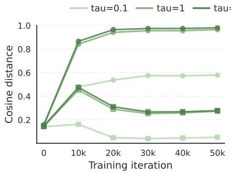  
(a)

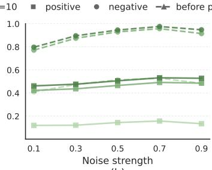  
(b)

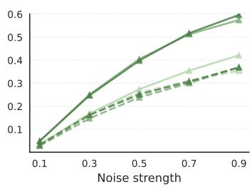  
(c)  
Figure 6: (a) Setting τ = 0.1 alleviates over-dispersion and weakened alignment. (b) Setting $\tau = 0 . 1$ does not change the overall trend that over-dispersion and weakened alignment become more severe as the noise level increases. (c) For a fixed clean image, using a smaller τ cannot prevent the contrastive learning head from exploiting noise to increase the distance between representations.

Table 7: Union of the temperature and anchor ablations. Temperature scaling alone brings only marginal improvements, whereas limiting negative-pair separation with a fixed or adaptive anchor is substantially more effective.
<table><tr><td>Model</td><td>T</td><td>Anchor</td><td>FID↓</td></tr><tr><td>SiT-B/2</td><td>一</td><td></td><td>33.0</td></tr><tr><td>+ Pos. reg.</td><td></td><td></td><td>28.7</td></tr><tr><td>+ InfoNCE</td><td>10.0</td><td></td><td>28.3</td></tr><tr><td>+ InfoNCE</td><td>5.0</td><td></td><td>28.6</td></tr><tr><td>+ InfoNCE</td><td>1.0</td><td></td><td>28.5</td></tr><tr><td>+ InfoNCE</td><td>0.5</td><td>一</td><td>28.9</td></tr><tr><td>+ InfoNCE</td><td>0.1</td><td></td><td>28.3</td></tr><tr><td>+ InfoNCE</td><td>1.0</td><td> $\cos 6 0 ^ { \circ }$ </td><td>27.0</td></tr><tr><td>+ CRAN</td><td>1.0</td><td> $m _ { \mathsf { c r a n } }$ </td><td>26.3</td></tr></table>

The effectiveness of clean image representation distances as the hinge. Next, we study how diffusion representation distances at different noise levels affect the ability of CRAN to correctly learn inter-sample relationships. Specifically, in addition to clean features, we use the inter-sample representation distances at $t = 0 . 5$ and $t = 0 . 9$ as the maximum distance in CRAN optimization. As shown in Table 8, when the noise weight in the samples becomes too large, the corresponding representation distances no longer provide reliable guidance for CRAN training.

Table 8: FID-50K of different feature regularization methods on SiT-B/2 trained on ImageNet 256×256 for 400K iterations.
<table><tr><td>Model</td><td>iter.</td><td>FID↓</td><td>IS↑</td></tr><tr><td>SiT-B/2</td><td>400k</td><td>33.0</td><td>43.7</td></tr><tr><td> $\mathrm { S i T - B } / 2 + \mathrm { C R A N }$ </td><td></td><td></td><td></td></tr><tr><td>t=0.1</td><td>400k</td><td>26.3</td><td>56.1</td></tr><tr><td>t=0.5</td><td>400k</td><td>26.7</td><td>55.6</td></tr><tr><td>t=0.9</td><td>400k</td><td>28.2</td><td>50.8</td></tr></table>

Student–teacher layer pairing. We next vary the student and teacher layers on SiT-B/2. Changing the student layer or moving the teacher to a shallower layer clearly degrades performance, whereas moving the teacher from layer 8 to the deeper layer 10 has only a modest effect.

Table 9: Ablation of the student and teacher layers on SiT-B/2.
<table><tr><td>Student</td><td>Teacher</td><td>FID↓</td><td>sFID↓</td><td>IS↑</td><td>Pre.↑</td><td>Rec.↑</td></tr><tr><td>2</td><td>8</td><td>44.8</td><td>11.5</td><td>33.5</td><td>0.49</td><td>0.62</td></tr><tr><td>3</td><td>8</td><td>42.9</td><td>11.4</td><td>36.0</td><td>0.50</td><td>0.62</td></tr><tr><td>4</td><td>8</td><td>44.2</td><td>11.4</td><td>33.7</td><td>0.50</td><td>0.62</td></tr><tr><td>3</td><td>6</td><td>51.2</td><td>13.4</td><td>30.3</td><td>0.45</td><td>0.61</td></tr><tr><td>3</td><td>10</td><td>42.9</td><td>11.7</td><td>35.4</td><td>0.50</td><td>0.61</td></tr></table>

## C GENERALIZATION BEYOND IMAGENET-256

## C.1 LOW-CATEGORY AND STRUCTURALLY HOMOGENEOUS DATASETS

To test whether CRAN depends on the broad semantic diversity of ImageNet-1K, we evaluate it on FFHQ, a structurally homogeneous single-category face dataset. For a CIFAR-10-scale classconditional setting, the native 32 × 32 resolution of CIFAR-10 is usually studied with U-Net diffusion models and is poorly matched to our focus on diffusion transformers. We therefore construct WebVision-10-50K from WebVision 1.0 (Li et al., 2017): we select ten ImageNet-style classes and sample 5,000 images per class, yielding the same number of classes and training images as CIFAR-10 while retaining a $2 5 6 \times 2 5 6$ setting.

Table 10: Results on datasets with substantially lower semantic diversity than ImageNet-1K. All methods use SiT-B/2 and 100K training steps.
<table><tr><td>Dataset</td><td>Method</td><td>FID↓</td><td>sFID↓</td><td>IS↑</td><td>Pre.↑</td><td>Rec.↑</td></tr><tr><td>FFHQ FFHQ</td><td>SiT REPA</td><td>6.73 6.49</td><td>7.55 7.63</td><td>4.4 4.5</td><td>0.71 0.71</td><td>0.47 0.48</td></tr><tr><td>FFHQ</td><td>CRAN</td><td>5.59</td><td>7.02</td><td>4.6</td><td>0.71</td><td>0.49</td></tr><tr><td>WebVision-10-50K</td><td>SiT</td><td>27.6</td><td>9.84</td><td>15.2</td><td>0.45</td><td>0.47</td></tr><tr><td>WebVision-10-50K</td><td>CRAN</td><td>20.5</td><td>9.45</td><td>15.8</td><td>0.48</td><td>0.47</td></tr></table>

On FFHQ, CRAN reduces FID by 16.9% relative to SiT and provides a larger gain than out-of-domain DINO-based alignment. On WebVision-10-50K, it reduces FID by 25.7% and improves all reported metrics. These results show that the benefit of CRAN does not require a large number of semantic categories.

## C.2 HIGHER-RESOLUTION GENERATION

We train SiT-B/2 from scratch on ImageNet $5 1 2 \times 5 1 2$ . Relative to the $2 5 6 \times 2 5 6$ setting, the latent patch sequence grows from $1 6 \times 1 6 = 2 5 6$ to $3 2 \times 3 2 = 1 { , } 0 2 4$ tokens.

Table 11: ImageNet 512 × 512 results with SiT-B/2.
<table><tr><td>Method</td><td>Steps</td><td>FID↓</td><td>sFID↓</td><td>IS↑</td><td>Pre.↑</td><td>Rec.↑</td></tr><tr><td>SiT</td><td>200K</td><td>56.7</td><td>8.11</td><td>26.8</td><td>0.53</td><td>0.62</td></tr><tr><td>CRAN</td><td>200K</td><td>45.5</td><td>6.98</td><td>32.7</td><td>0.61</td><td>0.62</td></tr><tr><td>SiT</td><td>400K</td><td>43.3</td><td>7.41</td><td>36.8</td><td>0.61</td><td>0.64</td></tr><tr><td>CRAN</td><td>400K</td><td>32.9</td><td>6.57</td><td>47.4</td><td>0.67</td><td>0.63</td></tr></table>

At 400K steps, CRAN reduces FID from 43.3 to 32.9 and increases IS from 36.8 to 47.4, showing that its benefit persists with a fourfold longer token sequence.

## C.3 GENERALIZATION TO ϵ-PREDICTION

Our main experiments use the SiT velocity objective. To test whether the method depends on that formulation, we apply CRAN to DiT-B/2 (Peebles & Xie, 2023) with its original ϵ-prediction objective.

Table 12: Generalization from SiT velocity prediction to DiT ϵ-prediction on ImageNet $2 5 6 \times 2 5 6 .$
<table><tr><td>Method</td><td>Steps</td><td>FID↓</td><td>sFID↓</td><td>IS↑</td><td>Pre.↑</td><td>Rec.↑</td></tr><tr><td>DiT-B/2</td><td>400K</td><td>43.5</td><td>8.71</td><td>32.7</td><td>0.49</td><td>0.63</td></tr><tr><td> $\mathrm { D i T - B } / 2 + \mathrm { C R A N }$ </td><td>400K</td><td>38.6</td><td>8.24</td><td>37.6</td><td>0.51</td><td>0.64</td></tr></table>

The consistent improvement across all five metrics indicates that CRAN is not specific to velocity prediction.

## C.4 HUMAN MOTION GENERATION

We further apply CRAN to the Motion Diffusion Model (MDM) (Tevet et al., 2023) on HumanML3D (Guo et al., 2022), where a domain-matched large-scale pretrained representation encoder is unavailable. For an out-of-domain REPA baseline, we render skeletal motion sequences as RGB skeleton frames and extract DINO representations from those renderings.

Table 13: Text-to-motion generation on HumanML3D.
<table><tr><td>Method</td><td>FID↓</td><td>R-Precision↑</td></tr><tr><td>MDM</td><td> $0 . 5 3 2 0 \pm 0 . 0 4 6 4$ </td><td> $0 . 6 1 0 6 \pm 0 . 0 0 4 4$ </td></tr><tr><td> $\mathrm { M D M + R E P A }$ </td><td> $0 . 5 4 0 0 \pm 0 . 0 3 9 1$ </td><td> $0 . 6 0 6 3 \pm 0 . 0 0 6 1$ </td></tr><tr><td> $\mathbf { M D M } + \mathbf { C R A N }$ </td><td> $\mathbf { 0 . 3 9 1 8 \pm 0 . 0 3 4 7 }$ </td><td> $\mathbf { 0 . 6 6 9 4 \pm 0 . 0 0 7 5 }$ </td></tr></table>

The visual REPA target does not improve MDM in this out-of-domain setting, whereas CRAN substantially improves both distributional quality and text–motion correspondence using only internal diffusion representations.

## D EFFICIENCY, SAMPLING ROBUSTNESS, AND COMPLEMENTARITY

## D.1 COMPUTATIONAL OVERHEAD ACROSS MODEL SCALES

We profile SiT, SRA, REPA, and CRAN under matched hardware, global batch size, precision, software, and data-loading settings. Table 14 reports average per-step time, computation, and peak memory.

Table 14: Training efficiency across backbone scales.
<table><tr><td>Backbone</td><td>Method</td><td>Time/step</td><td>Ratio</td><td>GFLOPs/sample</td><td>Peak memory</td></tr><tr><td>B/2</td><td>SiT</td><td>36.92 ms</td><td>1.000×</td><td>139.2</td><td>6.29 GiB</td></tr><tr><td>B/2</td><td>SRA</td><td>41.19 ms</td><td>1.116×</td><td>173.5</td><td>6.41 GiB</td></tr><tr><td>B/2</td><td>CRAN</td><td>41.32 ms</td><td>1.119×</td><td>173.5</td><td>6.45 GiB</td></tr><tr><td>B/2</td><td>REPA</td><td>52.39 ms</td><td>1.419×</td><td>194.4</td><td>6.92 GiB</td></tr><tr><td>L/2</td><td>SiT</td><td>99.01 ms</td><td>1.000×</td><td>487.4</td><td>18.66 GiB</td></tr><tr><td>L/2</td><td>SRA</td><td>108.56 ms</td><td>1.096×</td><td>601.4</td><td>18.83 GiB</td></tr><tr><td>L/2</td><td>CRAN</td><td>109.50 ms</td><td>1.106×</td><td>601.4</td><td>18.84 GiB</td></tr><tr><td>L/2</td><td>REPA</td><td>115.86 ms</td><td>1.170×</td><td>545.8</td><td>19.29 GiB</td></tr><tr><td>XL/2</td><td>SiT</td><td>140.63 ms</td><td>1.000×</td><td>715.9</td><td>26.10 GiB</td></tr><tr><td>XL/2</td><td>SRA</td><td>155.23 ms</td><td>1.104×</td><td>893.5</td><td>26.30 GiB</td></tr><tr><td>XL/2</td><td>CRAN</td><td>156.11 ms</td><td>1.110×</td><td>893.6</td><td>26.32 GiB</td></tr><tr><td>XL/2</td><td>REPA</td><td>156.59 ms</td><td>1.114×</td><td>774.7</td><td>26.73 GiB</td></tr></table>

The relative per-step overhead of CRAN over SiT remains stable across scales: 11.9% on B/2, 10.6% on L/2, and 11.0% on XL/2. On XL/2, CRAN takes 0.3% less time per step than REPA while using less peak memory.

## D.2 MATCHED WALL-CLOCK BUDGETS

Using the measured per-step times in Table 14, 400K CRAN steps match 448K SiT steps, while 400K REPA steps match 507K CRAN steps. Each adjacent pair in Table 15 therefore has the same wall-clock budget.

Table 15: Generation performance under matched wall-clock budgets on SiT-B/2.
<table><tr><td>Budget</td><td>Method</td><td>Steps</td><td>FID↓</td><td>sFID↓</td><td>IS↑</td><td>Pre.↑</td><td>Rec.↑</td></tr><tr><td>SiT SiT</td><td>SiT CRAN</td><td>448K 400K</td><td>33.7 26.3</td><td>6.59 6.16</td><td>44.4 56.2</td><td>0.54 0.58</td><td>0.64 0.63</td></tr><tr><td>REPA</td><td>REPA</td><td>400K</td><td>24.4</td><td>6.40</td><td>59.9</td><td>0.59</td><td>0.65</td></tr><tr><td>REPA</td><td>CRAN</td><td>507K</td><td>24.5</td><td>6.12</td><td>59.6</td><td>0.59</td><td>0.64</td></tr></table>

Under matched time, CRAN clearly outperforms SiT and remains comparable to REPA.

## D.3 FIXED SAMPLING PROTOCOL

Guidance-interval tuning introduces an additional degree of freedom. We therefore compare all methods at CFG scale 1.35, applying guidance over the full sampling trajectory without interval scheduling. All results use the same 250-step Euler–Maruyama SDE sampler and 50K-sample evaluation protocol.

Table 16: Comparison under a shared CFG scale and sampling protocol.
<table><tr><td>Method</td><td>FID↓</td><td>sFID↓</td><td>IS↑</td><td>Pre.↑</td><td>Rec.↑</td></tr><tr><td>REPA</td><td>1.80</td><td>4.50</td><td>284.0</td><td>0.81</td><td>0.61</td></tr><tr><td>SRA</td><td>1.89</td><td>4.47</td><td>278.7</td><td>0.81</td><td>0.61</td></tr><tr><td>CRAN</td><td>1.83</td><td>4.35</td><td>286.6</td><td>0.83</td><td>0.59</td></tr></table>

Under this fixed protocol, CRAN is comparable to REPA and outperforms SRA overall, with a remaining recall trade-off.

## D.4 CFG AND GUIDANCE-INTERVAL SWEEPS

For completeness, Table 17 reports the expanded sweeps used to select the balanced operating point in the main comparison. The main CRAN result uses CFG scale 1.8 and interval [0, 0.675].

Table 17: CFG-scale and guidance-interval sweeps. The REPA entries are its published sweep; SRA is swept around its official setting.
<table><tr><td>Method</td><td>Interval</td><td>CFG</td><td>FID↓</td><td>sFID↓</td><td>IS↑</td><td>Pre.↑</td><td>Rec.↑</td></tr><tr><td>CRAN</td><td>[0, 0.65]</td><td>1.70</td><td>1.52</td><td>4.76</td><td>277.4</td><td>0.80</td><td>0.62</td></tr><tr><td>CRAN</td><td>[0, 0.65]</td><td>1.80</td><td>1.49</td><td>4.78</td><td>289.6</td><td>0.81</td><td>0.62</td></tr><tr><td>CRAN</td><td>[0,0.65]</td><td>1.90</td><td>1.54</td><td>4.83</td><td>299.5</td><td>0.81</td><td>0.61</td></tr><tr><td>CRAN</td><td>[0,0.675]</td><td>1.70</td><td>1.44</td><td>4.75</td><td>295.5</td><td>0.81</td><td>0.64</td></tr><tr><td>CRAN</td><td>[0, 0.675]</td><td>1.80</td><td>1.45</td><td>4.68</td><td>306.6</td><td>0.81</td><td>0.63</td></tr><tr><td>CRAN</td><td>[0, 0.675]</td><td>1.90</td><td>1.64</td><td>4.71</td><td>323.9</td><td>0.82</td><td>0.61</td></tr><tr><td>CRAN</td><td>[0,0.70]</td><td>1.80</td><td>1.63</td><td>4.56</td><td>316.0</td><td>0.82</td><td>0.61</td></tr><tr><td>REPA</td><td>[0, 0.60]</td><td>2.00</td><td>1.56</td><td>5.11</td><td>290.7</td><td>0.78</td><td>0.66</td></tr><tr><td>REPA</td><td>[0,0.65]</td><td>2.00</td><td>1.44</td><td>4.88</td><td>308.8</td><td>0.79</td><td>0.65</td></tr><tr><td>REPA</td><td>[0, 0.70]</td><td>1.80</td><td>1.42</td><td>4.70</td><td>305.7</td><td>0.80</td><td>0.64</td></tr><tr><td>REPA</td><td>[0, 0.70]</td><td>1.90</td><td>1.45</td><td>4.68</td><td>317.6</td><td>0.80</td><td>0.64</td></tr><tr><td>REPA</td><td>[0,0.70]</td><td>2.00</td><td>1.48</td><td>4.67</td><td>324.0</td><td>0.82</td><td>0.62</td></tr><tr><td>REPA</td><td>[0,0.75]</td><td>2.00</td><td>1.78</td><td>4.50</td><td>346.2</td><td>0.82</td><td>0.62</td></tr><tr><td>REPA</td><td>[0, 0.80]</td><td>2.00</td><td>2.23</td><td>4.40</td><td>360.9</td><td>0.84</td><td>0.60</td></tr><tr><td>SRA</td><td>[0,0.675]</td><td>1.80</td><td>1.57</td><td>4.76</td><td>301.5</td><td>0.79</td><td>0.64</td></tr><tr><td>SRA</td><td>[0, 0.70]</td><td>1.70</td><td>1.57</td><td>4.70</td><td>294.9</td><td>0.79</td><td>0.64</td></tr><tr><td>SRA</td><td>[0,0.70]</td><td>1.80</td><td>1.58</td><td>4.65</td><td>309.4</td><td>0.80</td><td>0.63</td></tr><tr><td>SRA</td><td>[0, 0.70]</td><td>1.90</td><td>1.69</td><td>4.61</td><td>325.9</td><td>0.81</td><td>0.63</td></tr><tr><td>SRA</td><td>[0,0.725]</td><td>1.80</td><td>1.67</td><td>4.56</td><td>320.3</td><td>0.81</td><td>0.63</td></tr></table>

## D.5 COMPLEMENTARITY WITH REPA

REPA aligns each noisy diffusion feature with a corresponding external DINOv2 target learned for discriminative visual understanding. In contrast, the internal teacher used by CRAN is optimized through the generation objective and retains generation-relevant layout, texture, instance detail, and denoising-trajectory information. The optimization signals also differ: REPA provides a sample-wise pull toward a fixed external target, whereas CRAN adds relational gradients determined by other samples and the adaptive clean anchor. These gradients are generally not collinear, making the two objectives complementary rather than redundant.

Table 18: Adding CRAN to REPA on SiT-B/2.
<table><tr><td>Steps</td><td>Method</td><td>FID↓</td><td>sFID↓</td><td>IS↑</td><td>Pre.↑</td><td>Rec.↑</td></tr><tr><td>100K</td><td>REPA</td><td>49.5</td><td>7.00</td><td>27.5</td><td>0.46</td><td>0.59</td></tr><tr><td>100K</td><td>REPA + CRAN</td><td>42.4</td><td>6.64</td><td>32.5</td><td>0.50</td><td>0.60</td></tr><tr><td>200K</td><td>REPA</td><td>33.2</td><td>6.68</td><td>43.7</td><td>0.54</td><td>0.63</td></tr><tr><td>200K</td><td>REPA + CRAN</td><td>28.5</td><td>6.87</td><td>51.4</td><td>0.57</td><td>0.63</td></tr><tr><td>400K</td><td>REPA</td><td>24.4</td><td>6.40</td><td>59.9</td><td>0.59</td><td>0.65</td></tr><tr><td>400K</td><td>REPA + CRAN</td><td>21.0</td><td>6.46</td><td>68.6</td><td>0.60</td><td>0.65</td></tr></table>

Adding CRAN improves FID, IS, and precision at every budget. At 400K steps, it reduces FID from 24.4 to 21.0 while preserving recall.

## E EFFECTIVENESS OF CLEAN INTER-SAMPLE GEOMETRY ESTIMATION

Our default implementation estimates $m _ { \mathsf { c r a n } }$ from the low-noise samples already present in the current batch, thereby avoiding an additional near-clean forward pass. Table 19 shows that this efficient estimate preserves generation quality: its FID of 26.3 is within 0.1 of the full $m _ { \mathsf { c r a n } }$ computation.

Table 19: FID comparison on ImageNet 256 × 256 using SiT-B/2, 400K training steps, and no CFG. The estimated $m _ { \mathsf { c r a n } }$ variant is our default.
<table><tr><td>Model</td><td>#Params</td><td>Iter.</td><td>FID↓</td></tr><tr><td>SiT-B/2</td><td>130M</td><td>400k</td><td>33.0</td></tr><tr><td>+ SRA</td><td>130M</td><td>400k</td><td>29.1</td></tr><tr><td>+ SRA &amp; Disp.</td><td>130M</td><td>400k</td><td>28.6</td></tr><tr><td>+ DiverseDiT</td><td>&gt;130M</td><td>400k</td><td>28.1</td></tr><tr><td>+ SRA2</td><td>130M</td><td>400k</td><td>28.9</td></tr><tr><td>+ CRAN, full  $m _ { \mathsf { c r a n } }$ </td><td>130M</td><td>400k</td><td>26.2</td></tr><tr><td>+ CRAN, estimated  $m _ { \mathsf { c r a n } }$ </td><td>130M</td><td>400k</td><td>26.3</td></tr></table>

We further compare the estimated and full anchors throughout training. Figure 7 reports 1K-step local averages every 2K steps from 30K to 400K. The estimated trajectory closely tracks the full computation: the mean absolute difference in cosine distance is 0.010 over the dense trajectory, and the final values differ by only 0.006.

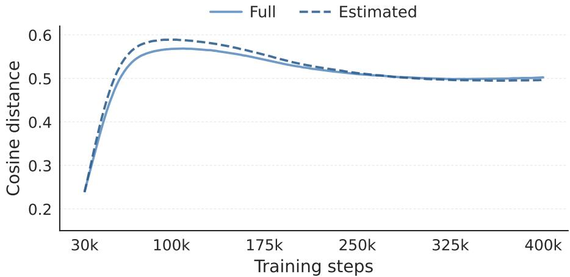  
Figure 7: Dense trajectories of the estimated and full $m _ { \mathsf { c r a n } }$ throughout SiT-B/2 training. Curves show 1K-step local averages sampled every 2K steps.

Finally, we quantify the saved computation using the same optimized CRAN benchmark as Table 14. We change only the source of $m _ { \mathsf { c r a n } }$ and run the full and estimated variants in two paired timing runs under the same concurrent H200 load. The average measured time ratio is 0.956. Applying this ratio to the separately measured 43.20 ms full-geometry time gives 41.32 ms per step, corresponding to a 4.4% speedup.

Table 20: SiT-B/2 training cost of the full and estimated clean inter-sample geometry. The estimated time is obtained by scaling the full-geometry time with the paired measured ratio.
<table><tr><td>Mcran computation</td><td>Time/step</td><td>Relative time</td></tr><tr><td>Full</td><td>43.20 ms</td><td>1.000×</td></tr><tr><td>Estimated</td><td>41.32 ms</td><td>0.956×</td></tr></table>

## F EXPERIMENTAL SETUP

Hyperparameter settings. Our default hyperparameter settings are summarized in Table 21.

Table 21: Hyperparameter settings.
<table><tr><td>Backbone</td><td>SiT-B</td><td>SiT-L</td><td>SiT-XL</td></tr><tr><td colspan="4">Architecture</td></tr><tr><td>Input</td><td> $3 2 \times 3 2 \times 4$ </td><td> $3 2 \times 3 2 \times 4$ </td><td> $3 2 \times 3 2 \times 4$ </td></tr><tr><td>Patch size</td><td>2</td><td>2</td><td>2</td></tr><tr><td>Layers</td><td>12</td><td>24</td><td>28</td></tr><tr><td>Hidden dim.</td><td>768</td><td>1,024</td><td>1,152</td></tr><tr><td>Num. heads</td><td>12</td><td>16</td><td>16</td></tr><tr><td colspan="4">CRAN settings</td></tr><tr><td colspan="4">Contrastive between internal representations</td></tr><tr><td>Contrastive blocks</td><td>8 ↔ 3</td><td>16 ↔ 6</td><td>20 ↔ 8</td></tr><tr><td>Contrastive time interval</td><td>[0, 0.2)</td><td>[0, 0.2)</td><td>[0, 0.2)</td></tr><tr><td>λ</td><td>1.0</td><td>1.0</td><td>1.0</td></tr><tr><td colspan="4">Contrastive between internal representations and DINO representations</td></tr><tr><td colspan="4">Optimization</td></tr><tr><td>Batch size</td><td>256</td><td>256</td><td>256</td></tr><tr><td>Optimizer</td><td>AdamW</td><td>AdamW</td><td>AdamW</td></tr><tr><td>lr</td><td>0.0001</td><td>0.0001</td><td>0.0001</td></tr><tr><td> $( \beta _ { 1 } , \beta _ { 2 } )$ </td><td>(0.9, 0.999)</td><td>(0.9, 0.999)</td><td>(0.9, 0.999)</td></tr><tr><td colspan="4">Interpolants</td></tr><tr><td>αt</td><td>1 − t</td><td>1 − t</td><td>1 − t</td></tr><tr><td>σt</td><td>t</td><td>t</td><td>t</td></tr><tr><td>Wt</td><td>σt</td><td>σt</td><td>σt</td></tr><tr><td>Training objective</td><td>v-prediction</td><td>v-prediction</td><td>v-prediction</td></tr><tr><td>Sampler</td><td>Euler-Maruyama</td><td>Euler-Maruyama</td><td>Euler-Maruyama</td></tr><tr><td>Sampling steps</td><td>250</td><td>250</td><td>250</td></tr><tr><td>Guidance Scale</td><td></td><td></td><td>1.8</td></tr></table>

Computational resources. All training experiments are conducted on 8 NVIDIA H200 GPUs, with a global batch size of 256 and 32 samples per GPU.

## G METRICS

We evaluate image generation quality from complementary perspectives using standard quantitative metrics.

Fréchet Inception Distance (FID) (Heusel et al., 2017) measures the distributional similarity between real and generated images in the feature space of an Inception-v3 network. Lower FID indicates that generated samples are closer to the real data distribution.

Structural FID (sFID) (Nash et al., 2021) extends FID by computing the distance on spatial feature maps, making it more sensitive to structural and spatial coherence.

Inception Score (IS) (Salimans et al., 2016) evaluates both image quality and class-conditional diversity by measuring the discrepancy between confident per-image class predictions and the marginal class distribution over generated samples. Higher IS is better.

Precision and recall (Kynkäänniemi et al., 2019) separate sample fidelity from distribution coverage. Precision reflects how realistic generated samples are relative to real images, while recall measures how well the generated samples cover the target data manifold.

To investigate how CRAN affects learned representations, in addition to linear probing accuracy, we follow iREPA (Singh et al., 2025) and use spatial structure metrics to measure patch-level organization.

Spatial self-similarity metrics. These metrics analyze whether intermediate representations preserve spatial structure. Given patch features $\mathbf { X } = \{ \mathbf { x } _ { t } \mathbf  \bar { \} } _ { t = 1 } ^ { T }$ arranged on an $H \times W$ lattice, we define the cosine self-similarity kernel as $K _ { \mathbf { X } } ( t , t ^ { \prime } ) \stackrel {  } { = } \langle \stackrel { \sim } { \mathbf { x } } _ { t } , \stackrel { \sim } { \mathbf { x } } _ { t ^ { \prime } } \rangle / ( \| \stackrel { \sim } { \mathbf { x } } _ { t } \| _ { 2 } \| \mathbf { x } _ { t ^ { \prime } } \| _ { 2 } )$ . The Manhattan distance between two patch locations is denoted as $d ( t , t ^ { \prime } )$

Local vs. Distant Similarity (LDS) measures the contrast between local and distant patch similarities:

$$
\mathrm { L D S } ( \mathbf { X } ) = \mathbb { E } [ K _ { \mathbf { X } } ( t , t ^ { \prime } ) \mid d ( t , t ^ { \prime } ) < r _ { \mathrm { n e a r } } ] - \mathbb { E } [ K _ { \mathbf { X } } ( t , t ^ { \prime } ) \mid d ( t , t ^ { \prime } ) \ge r _ { \mathrm { f a r } } ] .\tag{9}
$$

A larger LDS indicates that nearby patches are more similar than far-away patches, suggesting stronger spatial organization.

Correlation Decay Slope (CDS) quantifies how fast patch similarity decays with spatial distance. We first compute the spatial correlogram $g _ { \mathbf { X } } ( \delta ) = \mathbb { E } [ K _ { \mathbf { X } } ( t , t ^ { \prime } ) \mid d ( t , t ^ { \prime } ) = \delta ]$ for $\bar { \delta \in \{ 1 , \ldots , \Delta \} }$ After fitting a least-squares line $g _ { \mathbf { X } } ( \delta ) \approx \alpha + \beta \delta$ , CDS is defined as

$$
\mathrm { C D S } ( \mathbf { X } ) = - \hat { \beta } .\tag{10}
$$

Higher CDS corresponds to a sharper decay of similarity over distance and therefore stronger spatial structure.

RMS Spatial Contrast (RMSC) measures the spatial variation of normalized patch features. Let $\hat { \mathbf { x } } _ { t } = \mathbf { x } _ { t } / \| \mathbf { x } _ { t } \| _ { 2 }$ and $\begin{array} { r } { \bar { \mathbf { x } } = \frac { 1 } { T } \sum _ { t = 1 } ^ { T } \hat { \mathbf { x } } _ { t } } \end{array}$ . RMSC is defined as

$$
\mathrm { R M S C } ( { \mathbf { X } } ) = \sqrt { \frac { 1 } { T } \sum _ { t = 1 } ^ { T } \| \hat { { \mathbf { x } } } _ { t } - \bar { { \mathbf { x } } } \| _ { 2 } ^ { 2 } } .\tag{11}
$$

Higher RMSC indicates stronger spatial diversity across patch tokens, while lower RMSC suggests that the representation becomes spatially uniform.

## H UNCURATED SAMPLES

We show uncurated samples generated by SiT-XL with CRAN on ImageNet $2 5 6 \times 2 5 6$ , using classifierfree guidance with $w = 4 . 0$

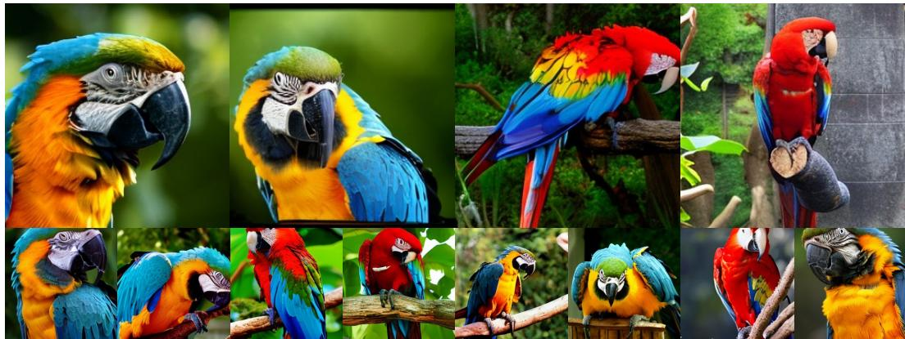  
Figure 8: Generated images from SiT-XL/2 + CRAN conditioned on the class label “macaw” (88).

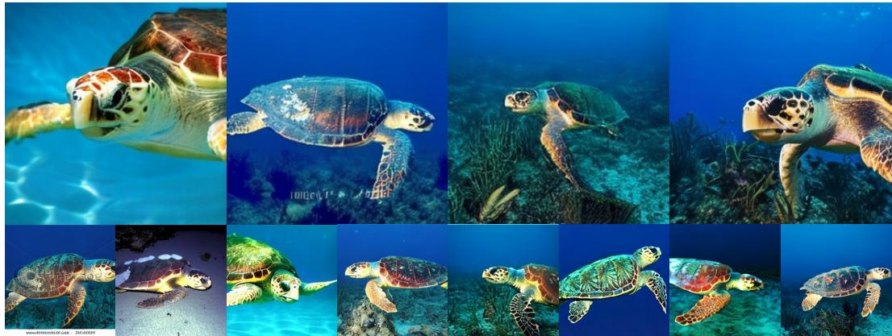  
Figure 9: Generated images from SiT-XL/2 + CRAN conditioned on the class label “loggerhead” (33).

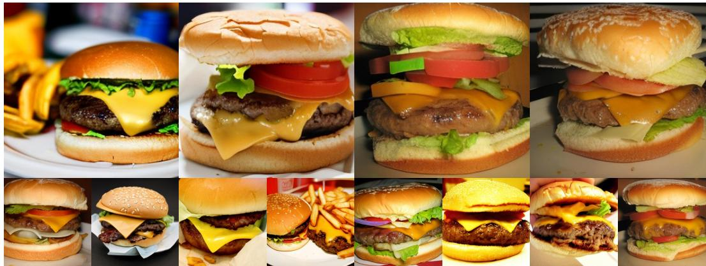  
Figure 10: Generated images from SiT-XL/2 + CRAN conditioned on the class label “cheeseburger” (933).

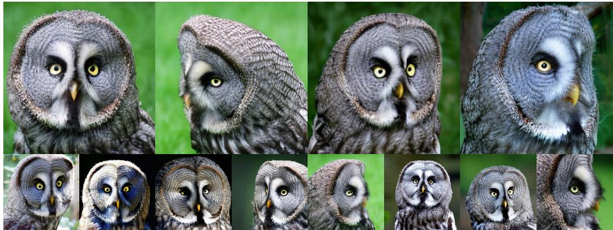  
Figure 11: Generated images from SiT-XL/2 + CRAN conditioned on the class label “great grey owl” (24).

  
Figure 12: Generated images from SiT-XL/2 + CRAN conditioned on the class label “castle” (483).

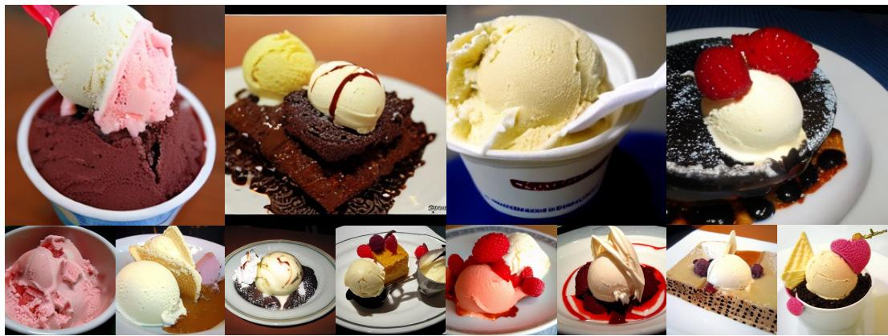  
Figure 13: Generated images from SiT-XL/2 + CRAN conditioned on the class label “ice cream” (928).

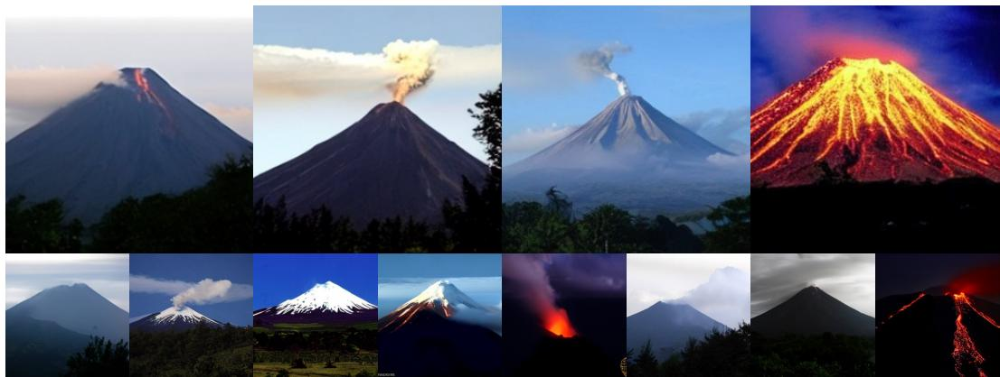  
Figure 14: Generated images from SiT-XL/2 + CRAN conditioned on the class label “volcano” (980).

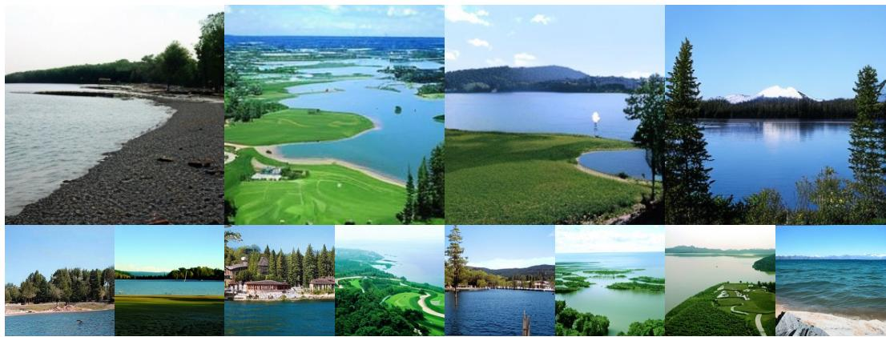  
Figure 15: Generated images from SiT-XL/2 + CRAN conditioned on the class label “lakeside” (975).

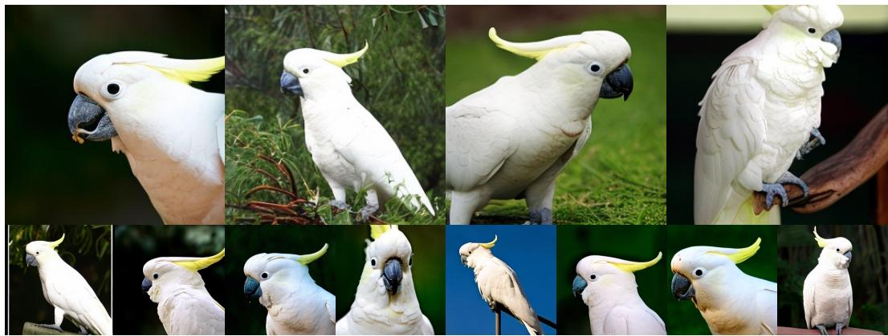  
Figure 16: Generated images from SiT-XL/2 + CRAN conditioned on the class label “sulphur-crested cockatoo” (89).

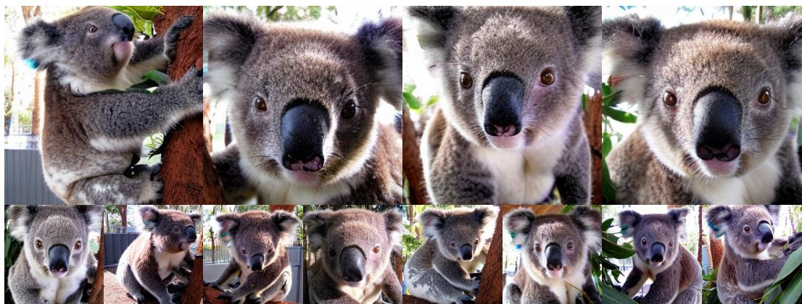  
Figure 17: Generated images from SiT-XL/2 + CRAN conditioned on the class label “koala” (105).

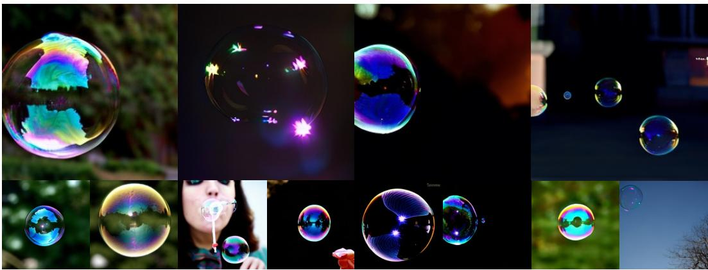  
Figure 18: Generated images from SiT-XL/2 + CRAN conditioned on the class label “bubble” (971).

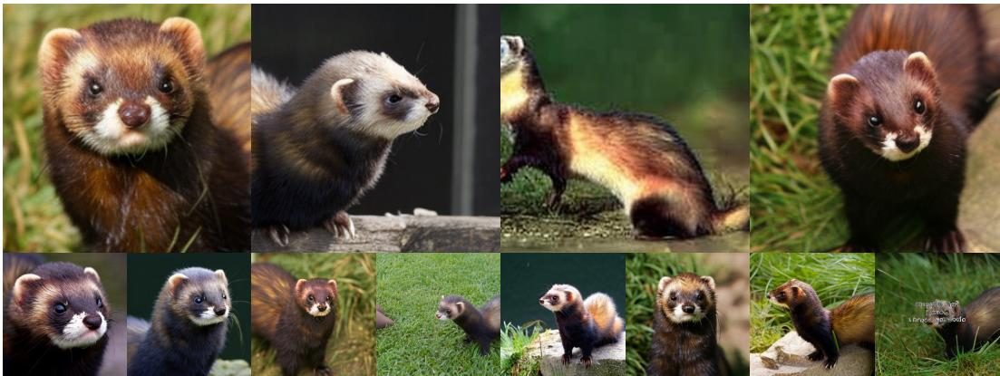  
Figure 19: Generated images from SiT-XL/2 + CRAN conditioned on the class label “polecat” (358).

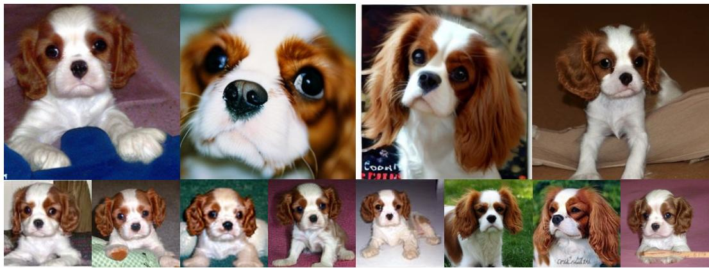  
Figure 20: Generated images from SiT-XL/2 + CRAN conditioned on the class label “Blenheim spaniel” (156).

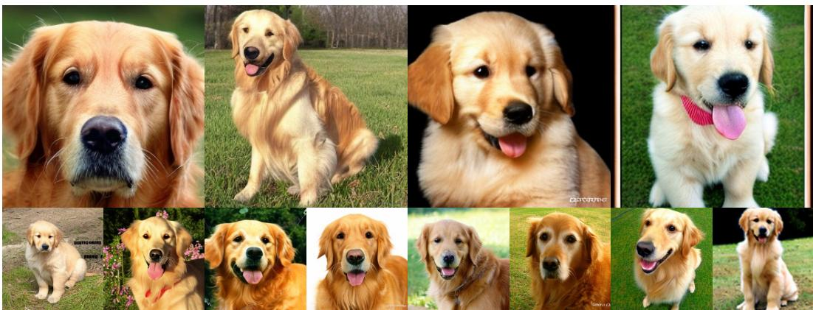  
Figure 21: Generated images from SiT-XL/2 + CRAN conditioned on the class label “golden retriever” (207).

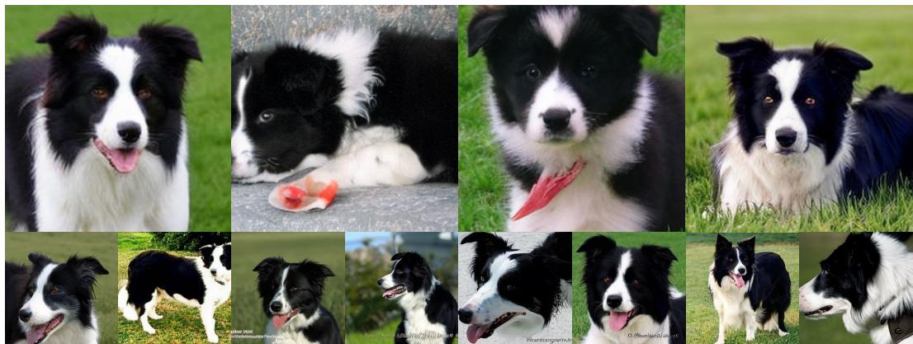  
Figure 22: Generated images from SiT-XL/2 + CRAN conditioned on the class label “Border collie” (232).

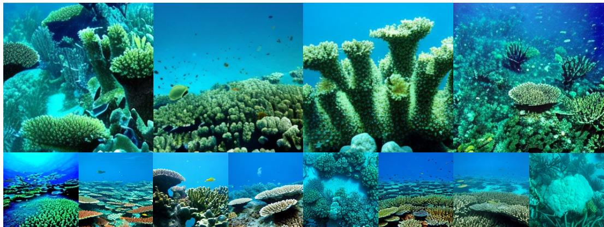  
Figure 23: Generated images from SiT-XL/2 + CRAN conditioned on the class label “coral reef” (973).

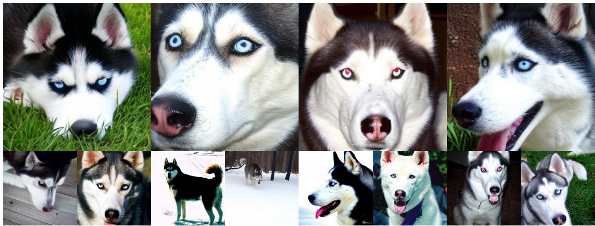  
Figure 24: Generated images from SiT-XL/2 + CRAN conditioned on the class label “Siberian husky” (250).

  
Figure 25: Generated images from SiT-XL/2 + CRAN conditioned on the class label “balloon” (417).

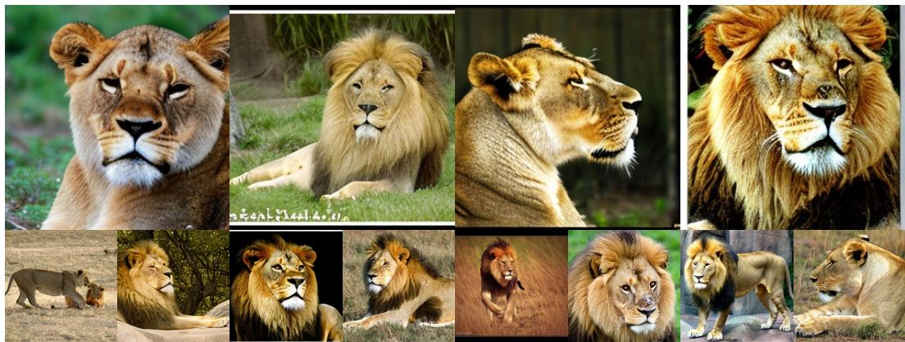  
Figure 26: Generated images from SiT-XL/2 + CRAN conditioned on the class label “lion” (291).

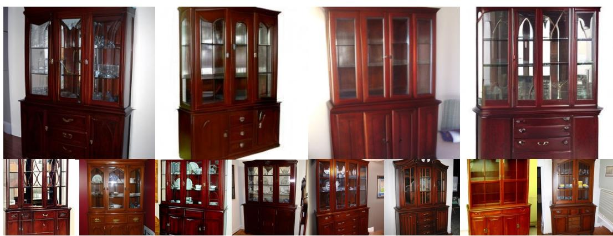  
Figure 27: Generated images from SiT-XL/2 + CRAN conditioned on the class label “china cabinet” (495).