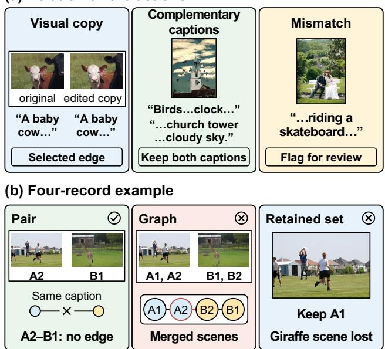
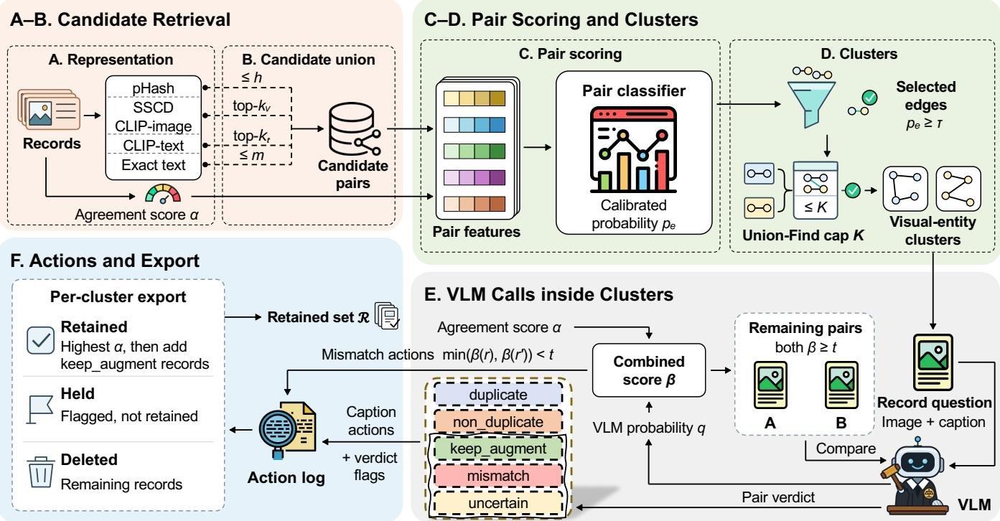
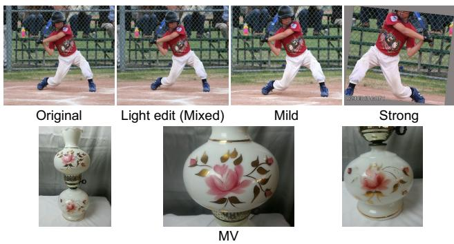
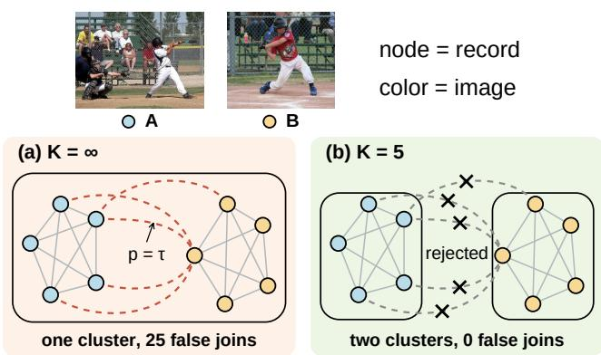
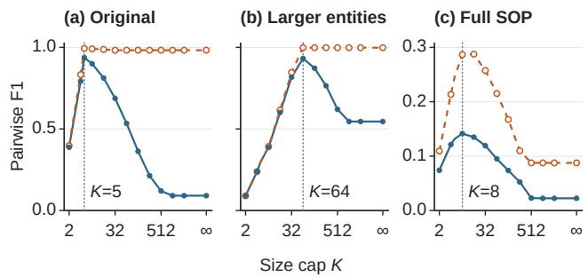
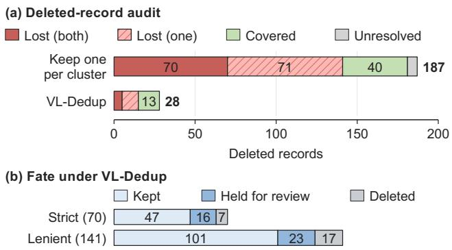

# VL-Dedup: Graded Multimodal Entity Resolution for Image-Text Data Deduplication

Zhenxi Liu   
Zhejiang University   
China

Xingyu Wang University of Science and Technology Liaoning China

Tao Ma Institute of Computing Technology Chinese Academy of Sciences China

Guanze Chen The Chinese University of Hong Kong China

Bingxu Hou Zhejiang University China

Ke Wang   
Zhejiang University   
China   
Dehui Yu   
Zhejiang University   
China

Chengwei Li Institute of Automation Chinese Academy of Sciences China

Gongsheng Yuan   
Zhejiang University   
China   
ygs@zju.cn

## ABSTRACT

Image–text corpora contain copies of one image, captions that describe one image in diferent ways, captions reused for diferent images, and captions that do not match their images. Each case calls for a diferent curation action. Deduplication and multimodal entity resolution (ER) only decide whether records are the same, and they are evaluated on labeled pairs. Yet pair scores do not tell which records end up in the same cluster or which useful captions get deleted. We therefore formulate image–text deduplication as graded multimodal ER, which decides visual identity, caption handling, and mismatches for each pair, and we evaluate it at three levels: pairs, clusters, and the retained set. Our method, VL-Dedup, groups records of the same visual entity into clusters and caps the size of each cluster. Within each cluster, a vision–language model (VLM) and CLIPScore decide which captions to keep and which to flag. We also build VL-DedupBench, with 50,000 COCO and SOP records and 66,788 labeled pairs. On it, a classifier that selects no false edge among the labeled pairs still joins millions of record pairs from diferent entities. Spending VLM calls on the pairs inside clusters, rather than on pairs with uncertain scores, gives better caption decisions from the same model. Even when almost all clusters are correct, keeping one record per cluster loses facts in many deletions, while the deletions of VL-Dedup lose much less information.

## 1 INTRODUCTION

Large image–text corpora support vision–language pretraining and retrieval. Their quality depends in part on how corpus construction handles redundant or contradictory records [3, 16, 39]. Consider the records in Figure 1(a). A corpus contains copies of one image, captions that add diferent facts about one image, captions reused across diferent images, and captions that do not correctly describe their images (mismatched captions). These relations call for diferent actions. Copies ofone visual entity can be deduplicated, captions with complementary facts should be kept, and mismatched captions should be flagged for review. A binary deduplication policy assigns

Figure 1: (a) Three relations in an image–text corpus and the action that each needs. (b) Four test records at the pair, graph, and retained-set levels.

the same action to all of them, so it can join records of diferent entities or discard useful captions.

Two lines of work address parts of this problem. Training data deduplication removes near-duplicate and semantically redundant records [1, 24]. It defines redundancy by surface or embedding similarity, which does not tell whether two records show the same visual entity. It is usually evaluated by removal rates or downstream accuracy. Entity resolution (ER) decides whether records refer to the same real-world entity using textual, visual, or fused evidence [9, 13, 26, 50]. ER returns one identity decision per pair or one cluster per entity, which does not say which captions to keep, and ER matchers are evaluated on labeled pairs.

A curation system makes its decisions in three steps. It decides pairs, it groups records into clusters along the selected pairs, and it exports a retained set of records. The user of the corpus sees only the retained set. ER research has shown that clustering pair decisions changes the result [19, 30]. Correct pair decisions do not ensure correct clusters, and correct clusters do not ensure a retained set that keeps every fact, so each level needs its own evaluation. We therefore formulate image–text deduplication as graded multimodal ER. Each pair receives a visual identity decision, a caption action, and a mismatch action, and we evaluate the decisions on three levels: pairs, clusters, and the retained set.

We present VL-Dedup, a system for graded multimodal ER that separates visual identity from caption and mismatch actions. A pair classifier scores candidate pairs from visual and textual channels and selects edges. VL-Dedup then adds three steps. (1) It groups records along the selected edges into visual-entity clusters and limits each cluster to at most � records, with � chosen on validation data. (2) It combines the answer of a VLM about each record with CLIPScore [20] into one record score, which sets mismatch actions. (3) It asks the VLM for a verdict on the remaining pairs inside each cluster. The verdicts set caption actions and do not change the clusters, so records with complementary captions can share a cluster and still keep both captions. An export policy turns all actions into a retained set. Figure 2 shows the six stages of VL-Dedup. We also build VL-DedupBench, a benchmark of COCO and SOP records on which all three levels can be scored.

Figure 1(b) shows four test records of VL-DedupBench. The letter names the image, and the number names the record. A1 shows people playing frisbee. A2 has the same image, but its caption, about a girafe and a zebra in a grassy field, comes from another image. B1 and B2 show that girafe, and B1 has the same caption as A2. A gradient boosting classifier correctly selects no edge for the labeled pair A2–B1. It also selects the unlabeled pairs A1–A2, whose records share an image, and A2–B2, whose captions difer in one word. The selected edges are correct on every labeled pair, yet the four records share a cluster, and further edges grow this cluster to 33,362 records. If the cluster held only these four records, an export that keeps the record with the highest CLIPScore would keep A1 and delete B1 and B2, so the girafe scene would be lost.

The example shows why VL-Dedup handles each level with its own decision. No selected edge joins A1 and B1, yet they share a cluster through the path A1–A2–B2–B1. One wrong edge, A2–B2, joins the two scenes, and every later edge into either side extends the cluster. Over the whole test partition, most false pairs of this classifier are joined by several such paths, so removing single edges cannot separate them. The size cap limits all paths at once, because no cluster can grow beyond � records. The record score targets records such as A2, which links the two scenes because its cap- tion describes another image. Inside each cluster, the VLM decides which captions add facts, so the export keeps the records with complementary captions instead of one record per cluster.

In summary, we make the following contributions.

• We formulate image–text deduplication as graded multi-modal ER and define three evaluation levels: selected edges on labeled pairs, clusters over all record pairs, and the cov- erage of deleted records by the retained set (Section 3).

• We present VL-Dedup, which separates visual identity from caption and mismatch actions. It calls the VLM only inside clusters, where an export decides what to delete, and its pair verdicts set caption actions without changing the clusters. It flags mismatched captions with a record score that puts CLIPScore and the probability of the VLM on one scale. With the size cap, � records need at most �(� − 1)/2 pair verdicts (Section 4).

• We build VL-DedupBench, with 50,000 COCO and SOP records, 66,788 labeled pairs, three edited versions of the test images, several photos of each test product, and larger entities. We release it with the code of VL-Dedup (Section 5).

• We show that labeled pairs hide graph errors, even when they score clusters. A gradient boosting classifier selects no false edge among the labeled test pairs, and its co- membership F1 on these pairs is 0.9820. Over all record pairs, its clusters join 7,711,852 pairs of diferent entities. These errors spread along paths of edges, so the size cap repairs them better than fixes to single edges. The cap lowers the false joins to 385, and over eight settings it stays within 0.0051 of the best of five clustering algorithms from ER (Section 6.2).

• We show that results on the original records overstate robustness. A classifier with only image features reaches F1 0.9997 on the original records and 0 on Strong, the test images with the strongest edits. The cap repairs the clusters of VL-Dedup on every test surface and on COCO and SOP cor-pora of up to 580,767 records. On the pairs of SOP records with several photos per product (product pairs), VL-Dedup reaches F1 0.2909, against 0.1658 for the strongest baseline (Section 6.2).

• We show that the same VLM judges single records better than pairs, and that correct clusters still lose facts. For captions taken from other images (swapped captions), the probability of the VLM for one record reaches F1 0.9264, and the combined record score reaches 0.9429, against 0.6549 for the pair verdict. Inside clusters, the VLM also finds com- plementary captions with higher precision and recall than on pairs with uncertain scores. In 50 sampled test clusters, keeping one record per cluster loses a fact in 70 to 141 of its 187 deletions. If it deleted 28 records at random, it would lose 10.5 to 21.1, against 5 to 15 for the 28 deletions of VL- Dedup. The ranges span a strict and a lenient count of two AI auditors (Sections 6.3 and 6.4).

Outline. Section 2 reviews related work. Section 3 defines graded multimodal ER and its three evaluation levels. Section 4 describes VL-Dedup, and Section 5 describes VL-DedupBench. Section 6 re- ports our experiments. Section 7 discusses how to apply VL-Dedup and VL-DedupBench, and Section 8 concludes.

## 2 RELATED WORK

In this section, we review the work that VL-Dedup builds on and compares with: data deduplication, captions and image–text consistency, entity resolution, the clustering of pair decisions, and multimodal matching.

Data deduplication. Data management research treats the collec tion and cleaning of training data as a data quality problem [49]. Training corpora contain exact copies, near duplicates, and records that repeat the same meaning. Hashing and n-gram overlap find re- peated surface forms at scale, and removing them reduces verbatim memorization [24]. SemDeDup compares pretrained embeddings to find records with similar meaning [1]. For images, perceptual hashes find near-identical copies [53], and copy detection embeddings also find copies after crops, rotations, and color changes [34]. For image–text data, LAION provides a corpus at web scale [39], and Webster et al. estimate that about 700 million images of its sub- set LAION-2B are duplicates [48]. DataComp and MINT-1T study filtering and deduplication choices for multimodal training data [3, 16]. Data-Juicer packages data processing operators, including image deduplication [6], and SemHash uses compact embeddings for fast semantic deduplication [45]. FairDeDup changes which records SemDeDup keeps so that the pruned image–text data stays balanced across sensitive concepts [40], and EcoDatum combines several quality operators with a deduplication step to select image– text training data [51]. These methods define redundancy by similarity and report how many records they remove or how a model trained on the result performs. They do not decide whether two records show the same visual entity, and they do not keep a record for the facts that its caption adds. VL-Dedup uses such hashes and embeddings to retrieve and score candidate pairs, and our exper- iments compare it with Data-Juicer, SemHash, SemDeDup, and caption MinHash.

Captions and image–text consistency. Other work adds or rewrites captions instead of deleting records. LaCLIP rewrites each caption with a language model and samples the original or a rewritten caption in each training step [10]. VeCLIP and Recap-DataComp-1B write new captions from the images with vision–language models [23, 25], and DreamLIP samples several sentences of one long caption as positive texts for an image [54]. These works train better models when an image has more than one caption or a more detailed caption. Filtering methods score each record instead. LAION keeps the records whose CLIP similarity passes a threshold [39], Data Filtering Networks learn the filtering model [12], T-MARS masks the text inside each image before it scores the image against its caption [29], and CAT filters noisy records before pretraining [37]. Other work checks whether a caption correctly describes its image. SeeTRUE evaluates image– text alignment with human judgments [52], FineMatch detects and corrects mismatches in specific aspects of a caption [21], and LVLM4CEC and ContextGuard-LVLM use large vision–language models to check whether news images and text are consistent [28, 42]. These methods judge one image and its caption at a time. VL-Dedup also scores each record in this way to flag captions that do not correctly describe their images. Whether a caption adds facts, however, depends on the other captions of the same visual entity, so VL-Dedup decides it on the record pairs that share a cluster.

Entity resolution. ER decides whether records refer to the same real-world entity. Classic work treats matching as a decision under uncertainty [13] and splits the pipeline into blocking, similarity computation, and classification [7, 9, 22]. Learned matchers train neural pair models on labeled pairs [31] or fine-tune pretrained lan-guage models on serialized pairs [26]. These matchers are evaluated by F1 on labeled candidate pairs. Recent work uses large language models for matching [11, 32, 33, 47] and for clustering [15].

Clustering pair decisions. Pair decisions become entities only after clustering. Hassanzadeh et al. compare clustering algorithms for duplicate detection, such as Center, Merge-Center, and ${ \mathrm { M C L } } ,$ and show that the algorithm changes the result [19]. Draisbach et al. compare many algorithms that turn pairwise duplicates into entity clusters and find that no single algorithm is best in all settings [8]. Menestrina et al. compare measures that score a predicted partition against the true one, including pairwise F1 over all record pairs [30]. Correlation clustering repairs inconsistent pair decisions, and KwikCluster gives a simple approximation [2]. Size constraints on clusters appear in data clustering [56] and in correlation clustering [36]. VL-Dedup uses such a bound to stop paths of wrong edges, and our experiments compare it with Center, Merge-Center, Kwik-Cluster, MCL, and Louvain [5]. Other work uses transitivity to infer pair answers and to save questions to a crowd or an oracle [14, 46], and noisy answers need extra checks to avoid wrong merges [17]. These answers decide identity, so each answer can change the clus- ters. VL-Dedup asks a VLM only about the record pairs that share a cluster, and its verdicts set caption actions without changing the clusters.

Multimodal matching. Product matchers combine image and text representations to match ofers across shops [35, 50], and an industry pipeline combines compact multimodal projections with human review [43]. These systems decide product identity. Each line of work above thus makes only part of the decisions of graded multimodal ER. Deduplication removes records without deciding visual identity, work on captions handles each record alone, and ER and multimodal matching decide only identity. VL-Dedup gives each pair a visual identity decision, a caption action, and a mismatch action. We know of no benchmark for image–text data that scores clusters over all record pairs together with the coverage of deleted records by the retained set. VL-DedupBench scores both, and the labeled pairs, on the same records.

## 3 PROBLEM DEFINITION

We first define the records, the actions, and the retained set of graded multimodal ER, and then the three levels on which we evaluate them.

A corpus $\mathcal { D } = \{ r _ { 1 } , . . . , r _ { n } \}$ contains image–caption records $r _ { i } = $ $( I _ { i } , c _ { i } )$ . Two records can show the same visual entity with captions that repeat each other, show the same visual entity with captions that add diferent facts, or show diferent entities. A record can also carry a caption that does not correctly describe its image.

Definition 3.1 (Graded multimodal ER). Given a corpus D, graded multimodal ER assigns each pair $e = \{ r _ { i } , r _ { j } \}$ the action tuple $a _ { e } =$ $( a _ { e } ^ { G } , a _ { e } ^ { C } , a _ { e } ^ { M } )$ defined below, groups the records into visual-entity clusters $C _ { : }$ , and writes a retained set $\mathcal { R } \subseteq \mathcal { D }$

• The graph action $a _ { e } ^ { G }$ is select\_edge when the two records show the same visual entity, and none otherwise. The selected edges form the clusters (Section 4.2), and we write �(�) for the cluster of record �.

• The caption action $a _ { e } ^ { C }$ is keep\_augment when both captions of a pair in one cluster state supported facts that the other lacks, and none otherwise.

• The mismatch action $a _ { e } ^ { M }$ is flag\_review when a caption of the pair does not correctly describe its image, and none otherwise.

These definitions give the correct actions, and a system predicts them. A cluster can contain several complementary captions, so cluster membership alone does not decide which records to delete. An export policy turns the actions of each cluster into record actions (keep, delete, or hold for review) and writes the retained set R.

We evaluate these decisions on three levels. The benchmark provides labeled pairs and, for every record, the visual group �(�) of its image (Section 5).

Pair level. The pair level scores each action on labeled pairs. Let $\mathcal { T }$ be the labeled test pairs whose visual relation is known. For a pair $e = \{ r _ { i } , r _ { j } \} \in \mathcal { T }$ , the label and the graph decision are

$$
y _ { e } = 1 \big [ g ( r _ { i } ) = g ( r _ { j } ) \big ] ,\tag{1}
$$

$$
\hat { y } _ { e } = 1 \left[ a _ { e } ^ { G } = \mathsf { s e l e c t \_ e d g e } \right] .\tag{2}
$$

A selected edge is the direct decision on its pair. We report precision, recall, and F1 of $\hat { y } _ { e }$ against $y _ { e }$ over T, as pair classifiers and dedu-plication baselines are usually scored. Co-membership replaces $\hat { y } _ { e }$ with $1 [ C ( r _ { i } ) = C ( r _ { j } ) ]$ , so it checks whether the two records share a cluster. Caption and mismatch actions are scored on the labeled pairs inside clusters, because an export deletes a record only in favor of another record of its cluster. Section 5 gives their labels.

Graph level. The graph level scores the clusters that the selected edges form. Let D be the records of partition $P ,$ without records with a swapped caption, a caption taken from another image. For all pairs of records in $\mathcal { D } _ { P }$ , we count

$$
\begin{array} { r l } & { \mathrm { T P } = \big | \{ \{ r , r ^ { \prime } \} \subseteq \mathcal { D } _ { P } : C ( r ) = C ( r ^ { \prime } ) , ~ g ( r ) = g ( r ^ { \prime } ) \} \big | , } \\ & { \mathrm { F P } = \big | \{ \{ r , r ^ { \prime } \} \subseteq \mathcal { D } _ { P } : C ( r ) = C ( r ^ { \prime } ) , ~ g ( r ) \neq g ( r ^ { \prime } ) \} \big | , } \\ & { \mathrm { F N } = \big | \{ \{ r , r ^ { \prime } \} \subseteq \mathcal { D } _ { P } : C ( r ) \neq C ( r ^ { \prime } ) , ~ g ( r ) = g ( r ^ { \prime } ) \} \big | , } \end{array}\tag{3}
$$

and report pairwise precision, recall, and F1, the standard measure for clusters in ER [30]. We call a pair counted in FP a false join. The clusters come from the graph over the whole corpus, and $\mathcal { D } _ { P }$ only selects the pairs we score. Records with a swapped caption are left out because the right action for them is a mismatch action, not a graph action.

Retained-set level. A deleted record $r \not \in \mathcal { R }$ is covered when the retained records of its cluster, alone or together, state every fact of its caption that its image supports. Otherwise it is lost. We report the covered and lost records of each policy.

Example. In Figure 1(b), the labeled pairs are B1–B2 with $y _ { e } = 1$ and A2–B1 with $y _ { e } = 0$ . The gradient boosting classifier selects B1–B2 and rejects A2–B1, so precision and recall on the labeled pairs are both 1. It also selects A1–A2 and A2–B2, which puts the four records into one cluster. The graph level leaves out A2, whose caption is swapped. Of the three pairs of A1, B1, and B2, B1–B2 is a true positive, and A1–B1 and A1–B2 are false joins, so pairwise precision is 1/3 and recall is 1. At the retained-set level, an export that keeps one record per cluster keeps A1, which has the highest

CLIPScore of the four, and deletes A2, B1, and B2. B1 and B2 are lost, because no retained caption states that a girafe and a zebra are in a grassy field. A2 is covered, because its image supports none of the facts in its caption.

## 4 VL-DEDUP

VL-Dedup separates visual identity from caption and mismatch actions. Figure 2 shows its six stages. Stages A–B retrieve candidate pairs $\mathcal { E } _ { \mathrm { c a n d } }$ (Section 4.1). Stage C scores each pair, and Stage D selects edges and builds visual-entity clusters under a size cap (Section 4.2). Stage E asks a VLM about each clustered record and about the remaining pairs inside each cluster (Section 4.3). Stage F turns the verdicts and the record scores into caption and mismatch actions and exports the retained set (Section 4.4). Section 4.5 analyzes the cost.

## 4.1 Candidate Retrieval

Stage A: representation. Stage A computes four kinds of signals for each record. A perceptual hash of the image finds near-identical copies by a small Hamming distance. A copy detection embedding compares images under crops, rotations, and color changes. Image and caption embeddings in one shared space match records by content rather than by pixels or words, so an image can also find captions that describe it. An image–text agreement score � (�) rates how well the caption of record � matches its own image. A low score marks a possible mismatch.

Stage B: candidate union. For each record, Stage B queries four channels and takes the union ofthe results: images within Hamming distance ℎ, the top-�� image neighbors, the top-�� caption neighbors, and up to � records with the same normalized caption. Each result becomes one undirected candidate pair. Stage B stores the channel and score of each pair, and later stages reuse these values without querying the indexes again. The limit � prevents a common caption from pairing one record with every record that shares it.

## 4.2 Pair Scoring and Clusters

Stage C: pair scoring. Stage C describes each candidate pair with 11 features computed from its two records. They are the image embedding similarity, the caption embedding similarity, the percep- tual hash similarity, the copy detection similarity, exact equality of the raw and of the normalized captions, the minimum, mean, and diference of the two agreement scores, and the minimum and mean of the two cross scores between the image of one record and the caption of the other. The features use only pixels, captions, and values computed from them. They use no file name, source identifier, construction grade, or partition. A pair classifier trained on labeled pairs predicts the relation of each pair. Its visual score $s _ { e }$ is the total probability of the relations whose two records show the same visual entity. An isotonic regression fit on validation pairs maps $s _ { e }$ to a calibrated probability $p _ { e } \in \left[ 0 , 1 \right]$

Stage D: selected edges and clusters. Stage D selects the edges

$$
S = \{ e \in { \mathcal { E } } _ { \mathrm { c a n d } } : p _ { e } \geq \tau \} .\tag{4}
$$

The threshold � has the highest validation recall among the thresh- olds whose validation precision is at least �.

  
Figure 2: Overview of VL-Dedup. Stages A–D build visual-entity clusters of at most � records. Stages E–F set caption and mismatch actions inside the clusters and export the retained set.

Algorithm 1 Stage D: clusters under a size cap   
Require: records D, selected edges S with probabilities $\mathit { p _ { e } } ,$ , size   
cap �   
Ensure: visual-entity clusters C   
1: put each record in its own cluster   
2: for $e = \{ r , r ^ { \prime } \} \in S$ in decreasing order of $\mathit { p } _ { e }$ do   
3: if �(�) ≠ �(�′) and $| C ( r ) | + | C ( r ^ { \prime } ) | \le \bar { K }$ then   
4: merge �(�) and �(�′)   
end if   
6: end for   
7: return the current clusters as C

A wrong edge merges two clusters, and every later edge into either cluster extends the merge. Paths of such edges join records that no selected edge compares. Stage D therefore limits each cluster to at most � records (Algorithm 1). It adds the edges ofS to a union– find structure from the highest $\mathit { p _ { e } }$ to the lowest and skips an edge when the merged cluster would exceed � records. Ties in $\mathit { p _ { e } }$ are broken by the raw score and then by record identifiers.

We choose � from a grid by the pairwise F1 of Equation 3 on the validation partition, and take the smallest � among ties. With $K = \infty ,$ C is the set of connected components of (D, S). The cap changes only which edges join clusters. It does not change $\mathit { p } _ { e }$ or S.

Proposition 4.1. For any � and any order ofS, every cluster ofAlgorithm 1 has at most � records and lies inside one connected component of (D, S). Every false join under the cap is therefore also a false join without the cap, and the number of pairs inside clusters, that $i s ,$ the record pairs that share a cluster, is

$$
\sum _ { c \in C } { \frac { | c | \left( | c | - 1 \right) } { 2 } } \leq { \frac { n ( K - 1 ) } { 2 } } .\tag{5}
$$

Proof. Algorithm 1 merges two clusters only along an edge of S, and only when the merged cluster has at most � records. Each cluster is therefore connected in (D, S) and lies inside one component. Two records that share a cluster under the cap thus share a component without the cap. A cluster � holds $| c | ( | c | - 1 ) / 2 \leq$ $| c | ( K - 1 ) / 2$ pairs, and the sizes |�| sum to �.

## 4.3 VLM Calls inside Clusters

A deduplication export deletes a record only in favor of another record of its cluster. Caption decisions therefore matter for the pairs inside clusters. We write � for the set of all record pairs that share a cluster,

$$
U = \{ \{ r , r ^ { \prime } \} : r \neq r ^ { \prime } , C ( r ) = C ( r ^ { \prime } ) \} .\tag{6}
$$

Record scores. Stage E first asks the VLM about each record in a cluster of at least two records. The VLM receives the image and the caption and answers whether the caption correctly describes the image. Stage E reads the probabilities of the answers yes and no among the 20 most likely first tokens and keeps �(�), the probability of yes divided by the sum of the two. The combined score puts �(�) and the agreement score � (�) on one scale,

$$
\begin{array} { r } { \beta ( r ) = \frac { 1 } { 2 } \big ( F _ { \alpha } ( \alpha ( r ) ) + F _ { q } ( q ( r ) ) \big ) , } \end{array}\tag{7}
$$

where $F _ { \alpha }$ and $F _ { q }$ give the fraction of validation records in clusters whose score is lower, with ties counted as one half. A low $\beta ( r )$ marks a caption that may not correctly describe its image.

Pair verdicts. Pairs whose lower combined score is below the threshold � already receive a mismatch action (Section 4.4), so Stage E sends only the other pairs inside clusters to the VLM. The VLM receives both images and both captions and no label, and returns one pair verdict $z _ { e } { \mathrm { : } }$ duplicate, keep\_augment, non\_ duplicate, mismatch, or uncertain. The first three mean that the images show the same visual entity and the captions repeat each other, that they show the same visual entity and the captions add complementary facts, and that the visual entities difer. A mismatch verdict flags an unsupported caption or conflicting visible facts, and uncertain covers ambiguous cases and parse failures. The VLM answers with one structured object whose fields state whether the images show the same visual entity, whether each caption is sup- ported by its image, whether a blocker prevents deduplication, and whether the captions add information to each other. A verdict that contradicts these fields becomes uncertain.

## 4.4 Actions and Export

Stage F assigns each pair its action tuple. The graph action is select\_edge exactly when $e \in S$ and its two records share a cluster. For a pair in $U ,$ the caption action is keep\_augment exactly when $z _ { e } = { \mathsf { k e e p } }$ \_augment. The mismatch action uses the combined scores,

$$
a _ { e } ^ { M } = \mathsf { f l a g \_ r e v i e w } \Longleftrightarrow \mathsf { m i n } \big ( \beta ( r ) , \beta ( r ^ { \prime } ) \big ) < t ,\tag{8}
$$

where � has the highest F1 on the validation pairs inside clusters that carry a mismatch or same-entity label. Stage E sends a pair to the VLM only when both of its records have a combined score of at least �. If the VLM still returns mismatch, a caption of the pair may hold an error that the scores miss. Stage F gives such a pair a verdict flag, holds it for review, and does not count it as a mismatch action. The verdicts and flags do not change S or C.

The export policy keeps one representative per cluster, the record with the highest agreement score � (�). It then keeps every record that has a keep\_augment action with a retained record, and repeats this step until no record is added. A record that is not kept and lies on a pair with a mismatch action or a verdict flag is held for review. The policy deletes the remaining records. Stage F stores the clusters, the pair actions, and the verdict of each pair sent to the VLM, so each deletion can be traced to the actions behind it.

## 4.5 Cost

Let � be the number of records and � the total embedding dimen- sion. Exact nearest-neighbor search costs $O ( n ^ { 2 } d )$ , and approximate indexes reduce this cost. The embedding and exact-text channels return a fixed number of neighbors per record, so their candidates grow linearly with �. Scoring is linear in $| \mathcal { E } _ { \mathrm { c a n d } } |$ . Sorting the selected edges costs �(|S| log |S|), and union–find over them is near-linear. The size cap also bounds the VLM calls of Stage E. By Proposition $4 . 1 , | U | \le n ( K - 1 ) / 2$ , and Stage E adds at most � calls for the record scores. The total cost is

$$
O \left( n ^ { 2 } d + | { \mathcal { E } } _ { \mathrm { c a n d } } | + | S | \log | S | + n K \right) ,\tag{9}
$$

Table 1: Relation counts of VL-DedupBench over all partitions (Full) and in the test partition (Test).
<table><tr><td>Relation</td><td>Full</td><td>Test</td></tr><tr><td>L0/L1/L3</td><td>52,618</td><td>7,941</td></tr><tr><td>L4</td><td>5,037</td><td>760</td></tr><tr><td>M</td><td>3,599</td><td>543</td></tr><tr><td>L2</td><td>4,481</td><td>634</td></tr><tr><td>HN</td><td>1,053</td><td>159</td></tr><tr><td>All</td><td>66,788</td><td>10,037</td></tr></table>

Table 2: Constructed pair relations and their action references.
<table><tr><td>Grade</td><td>Constructed relation</td><td>Same visual en- Action reference tity</td><td></td></tr><tr><td>L0/L1/L3</td><td>duplicate</td><td>yes</td><td>none</td></tr><tr><td>L4</td><td>keep_augment_ candidate</td><td>yes</td><td>caption labels</td></tr><tr><td>L2</td><td>text_duplicate_only</td><td>no</td><td>none</td></tr><tr><td>HN</td><td>hard_negative</td><td>no</td><td>none</td></tr><tr><td>M</td><td>mismatch</td><td>not scored</td><td>flag_review</td></tr></table>

where the last term counts VLM calls. For a fixed �, the VLM calls grow linearly with �. Without the cap, one cluster of $\cdot \_ n ^ { \prime }$ records alone needs � $^ { \prime } ( n ^ { \prime } - 1 ) / 2$ calls.

## 5 VL-DEDUPBENCH

VL-DedupBench tests visual identity, caption actions, and mismatch actions on the same records. It contains 50,000 records, 36,000 from Common Objects in Context (COCO) [27] and 14,000 from Stanford Online Products (SOP) [41], and 66,788 labeled pairs. COCO records use human captions. SOP provides product photos without captions, so each SOP caption is generated from its image by InternVL3-2B [55]. Each record has a stable identifier, an image, a caption, source metadata, a visual group, and a partition. Because every record has a visual group, the graph level can score all record pairs of a partition, not only the labeled pairs. Table 1 reports the relation counts. We describe the relations, the partitions, and the audit of hard negatives, and then the test surfaces (Section 5.1).

Relations. The records of one COCO image form a visual group, and each SOP product forms its own group. L3 pairs join two records of one COCO image with diferent human captions. L0 and L1 records are copies of another record in their group. Within each COCO group that contains at least three L3 records, we select one pair deterministically as L4 (keep\_augment\_candidate). Selection uses record identifiers rather than caption content. L2 pairs reuse an exact caption across diferent images. Each M record carries a swapped caption, which comes from another image. HN pairs join SOP records of the same superclass but diferent products. Table 2 maps each relation to its references.

Partitions. COCO records share a split key when they use the same source image, and SOP records use their superclass identifier. A deterministic hash of the split key assigns it to training, validation, or test with cut points 0.70 and 0.85. The benchmark has 7,208 split keys, and no visual group, source image, or labeled pair crosses partitions. The record split is 35,820/7,639/6,541, and the pair split is 46,425/10,326/10,037.

  
Figure 3: Edited copies of one test image and three photos of one test product in MV.

Audit of hard negatives. Two AI auditors, GPT-5.6-terra and Claude Opus 4.8, judged all 1,053 HN pairs from the visible im-ages and captions with a fixed five-label guide. The inputs hid classes, grades, predictions, and the other auditor’s answer. The 32 pairs with a disagreement or an uncertain answer went to a human, who kept all 1,053 pairs as non\_duplicate.

## 5.1 Test Surfaces

The records of one COCO group share an image file. To test identity decisions when the image bytes difer, we add three kinds of test surfaces. All models, calibrators, thresholds, and � stay fixed on every surface. Table 3 gives the test populations, and Figure 3 shows examples. The validation partition has 7,079 records, 25,052,581 record pairs, and 8,959 same-entity pairs.

Edited copies. Each edit writes a new image file for the 5,709 test records that occur in labeled pairs. Mild applies a 12% center crop, JPEG quality 70, and a brightness change of up to 8%. Strong applies a 35% crop, a 6 rotation, a horizontal flip on half of the records, a color shift, and a text watermark. Mixed replaces a random 2,901 of the 5,709 images with a light edit (JPEG quality 85 and 0.9 scaling), so a same-entity pair can join an original and an edited image. The 5,709 records come from 1,362 distinct images, and two AI auditors check one edited copy of each image in Mild and in Strong. Neither finds the subject removed in any Mild copy. In Strong, both find it removed in 5 copies, and at least one in 10.

Several photos ofone product (MV).. SOP has several photos of each product, and VL-DedupBench keeps one. MV adds two more photos for each validation and test product and for 1,500 training products, 8,550 records in total. Each added record receives a caption generated in the same way and the visual group of its product. MV adds 2,984 same-product test pairs and 2,984 sampled pairs of diferent products to the labeled pairs. The photos of one product difer in viewpoint and background, so copy detection alone does not match them.

Table 3: Test populations of the graph level. Records exclude swapped captions.
<table><tr><td>Test surface</td><td></td><td>Records Record pairs</td><td>Same-entity</td><td>Labeled</td></tr><tr><td>Original</td><td>5,998</td><td>17,985,003</td><td>8,701</td><td>9,494</td></tr><tr><td>Mixed, Mild, Strong</td><td>5,998</td><td>17,985,003</td><td>8,701</td><td>9,494</td></tr><tr><td>MV</td><td>8,044</td><td>32,348,946</td><td>11,685</td><td>15,462</td></tr><tr><td>Larger entities</td><td>11,498</td><td>66,096,253</td><td>107,201</td><td>9,494</td></tr></table>

Larger entities. COCO groups have at most seven records. We extend 300 groups in each of the validation and test partitions to 10, 20, and 40 records, 100 groups for each size, with edited copies of the group image (12% crop, JPEG quality 70, and a small brightness change) and the existing captions of the group. This adds 5,500 records and 98,500 same-entity pairs to each partition.

Action references. The L4 label marks a pair as a candidate for keep\_augment. To score caption actions, we label caption content directly on 400 test pairs inside clusters, 200 from L3 and 200 from L4. A pair is complementary when the image supports both cap- tions and each caption states a fact that the other lacks. Two AI auditors label every pair, and a human decides the pairs on which they disagree. Mismatch actions are scored on the labeled pairs inside clusters, with M pairs as positives and same-entity pairs as negatives. Retained sets are scored by checking each deleted record against the full retained set of its cluster (Section 6.4).

## 6 EXPERIMENTS

We present the results of VL-Dedup on VL-DedupBench and on two full corpora outside it. Section 6.2 scores visual identity on the labeled pairs and over all record pairs. Section 6.3 scores caption and mismatch actions on the labeled pairs inside clusters. Section 6.4 scores the retained set, and Section 6.5 measures cost and scale. We found the following. (1) Labeled pairs hide graph errors, even when they score clusters. A gradient boosting classifier selects no false edge among the labeled test pairs, and its co-membership F1 on these pairs is 0.9820. Over all record pairs, its clusters join 7,711,852 pairs of diferent entities, and pairwise F1 is 0.0023. (2) Graph errors spread along paths of edges, so a limit on cluster size repairs them better than fixes to single edges. Removing one edge separates only 147 of the 307 false joins of VL-Dedup without the cap. Over eight settings, the cap stays within 0.0051 of the best of five clustering algorithms from ER, while MCL falls up to 0.18 below the best and KwikCluster up to 0.33. (3) Results on the original records overstate robustness. A classifier with only image features reaches F1 0.9997 on the ori inal records and 0 on Stron . A stricter ed e threshold raises F1 on the original records to 0.9984 but lowers it to 0.1774 on product pairs. (4) The same VLM judges single records better than pairs, and pairs inside clusters better than pairs with uncertain scores. For swapped captions, its probability for one record reaches F1 0.9264, against 0.6549 for its pair verdict, and the combined score with CLIPScore reaches 0.9429. Inside clusters, its caption actions gain 13.1 points of precision and 13.6 points of recall. A pair with a verdict flag still holds a wrong caption 1.7 to 4.1 times as often as a pair that the VLM does not flag. (5) Correct clusters still lose facts, and VL-Dedup loses fewer because it chooses which records to delete, not only because it deletes fewer. Keeping one record per cluster loses a fact in 70 to 141 of its 187 deletions. If it deleted 28 records at random, it would lose 10.5 to 21.1 in expectation, against 5 to 15 for the 28 deletions of VL-Dedup.

## 6.1 Setup

Implementation. Stage A uses pHash [53], SSCD copy detection embeddings [34], CLIP image and text embeddings [38], and CLIP-Score as the agreement score [20]. Stage B uses $h = 2 , k _ { v } = 3 0 .$ $k _ { t } ~ = ~ 1 0 ;$ , and $m = 2 0$ , which gives 1,502,683 candidates over the 50,000 records and 1,771,452 over the 58,550 records with MV. Stage C fits logistic regression to the 11 features on the 46,425 training pairs. With $\pi = 0 . 9 9 $ , the calibrated threshold is $\tau = 0 . 6 6 6 7 .$ Validation selects � = 5 for Stage D and � = 0.0596 for the combined score. Stage E uses Qwen2.5-VL-7B [4] at temperature 0, with one output token for the record question and at most 384 output tokens for the pair verdict. All settings come from training and validation data.

Baselines. B2 thresholds the SSCD cosine similarity [34]. B6 fits balanced logistic regression to SSCD cosine, SimCSE cosine [18], and exact equality of normalized captions. Both choose their thresh- olds by pair F1 on validation, and their clusters are the connected components of the selected pairs. Data-Juicer v1.5.3 runs its pHash image deduplicator [6]. SemHash v0.4.1 runs self-deduplication on CLIP image and text embeddings, with threshold 0.9 chosen on validation pairs [45]. SemDeDup [1] groups the CLIP image embeddings with �-means and marks two records of one group as duplicates when their cosine similarity is at least 1 − �. Validation selects 50 �-means clusters and $\varepsilon = 0 . 0 0 5$ . Data-Juicer also runs its MinHash deduplicator on the captions with its default settings. We evaluate the duplicate groups that each system outputs. We also replace the classifier of Stage C with gradient boosting (HGB) on the same 11 features.

## 6.2 From Pairs to Clusters

The graph stage of VL-Dedup has two parts, the pair classifier of Stage C and the size cap of Stage D. We first show that labeled pairs hide the errors that clustering adds, and that the cap repairs them for either classifier. We then compare the clusters with deduplication tools and copy detectors on every test surface. Table 4 gives pairwise F1 on the labeled test pairs and over all test record pairs and, for each relation, the labeled test pairs whose two records share a cluster.

Labeled pairs hide graph errors. HGB selects no false edge among the 9,494 labeled test pairs and misses three. Its clusters put 316 labeled pairs of diferent entities together, and co-membership F1 on the labeled pairs is 0.9820. Over all 17,985,003 test record pairs, its clusters join 7,711,852 pairs of diferent entities, and pairwise F1 is 0.0023 (Table 4). One cluster holds 33,362 records. The clas-sifier of VL-Dedup decides every labeled pair correctly, both as a selected edge and as co-membership, yet its clusters join 307 pairs of diferent entities, in clusters of up to 598 records. Almost none of the falsely joined pairs is labeled, so a benchmark of labeled pairs cannot see these errors.

  
Figure 4: One component of the VL-Dedup graph (a) without the cap and (b) with � = 5.

The size cap. Validation selects $K = 5$ for both classifiers. On the original records, the cap lowers the false joins of HGB from 7,711,852 to 385 and raises its F1 from 0.0023 to 0.9779. For VL-Dedup, the false joins fall from 307 to 106 and F1 rises from 0.9827 to 0.9937. The cap splits the few test entities with more than five records, which costs 5 missed pairs. All 106 remaining false joins of VL-Dedup join photos of two diferent lamp products, the SOP superclass of the test partition, in 40 clusters, and none joins two COCO images. The photos are not copies: their pHash values difer in 20 of 64 bits at the median, and only 4 of the 106 pairs pass the SSCD threshold of B2. On the full SOP corpus of Section 6.5, 97% of the false joins likewise join two products of one superclass. Figure 4 shows one component that the cap splits. Two images with five records each are linked by five selected edges whose calibrated probability equals �. Without the cap, the ten records form one cluster with 25 false joins. With � = 5, the edges inside each image join first, and the cap rejects all five edges between the images.

Figure 5 shows F1 as � changes. On the original records, F1 is highest at � = 5 on both validation and test, and it falls as larger caps let paths of wrong edges grow. Without the cap, F1 is 0.0910 on validation and 0.9827 on test. On the full SOP corpus, validation selects � = 8, and test F1 at � = 8 is 0.0010 below its highest value, at � = 16. Every precision target � up to 0.9997 selects the same � = 2/3, because this calibrated probability already accepts every retrieved same-entity validation pair at precision 0.9998. Only � = 1 gives � = 1, which raises F1 on the original records to 0.9984 but lowers it to 0.9304 on Strong and to 0.1774 on product pairs.

Copies and edited copies. B2 and B6 are copy detectors whose thresholds we choose on validation. Copies and edited copies are the case they are built for, and they stay above 0.997 on the original records and on Mixed, Mild, and Strong. The classifier of VL-Dedup stays within 0.0061 of them. With the cap, VL-Dedup keeps F1 between 0.9937 and 0.9947 on the edited surfaces, against 0.9771 to 0.9859 without the cap. HGB with the cap falls to 0.7256 on Strong, because the edits push many same-entity pairs below its threshold. Data-Juicer falls from 1.0000 on the original records to 0.9800, 0.9054, and 0.5997 as the edits get stronger, because pHash misses 341, 1,504, and 4,975 same-entity pairs. SemDeDup falls from 1.0000 to 0.6672, 0.6910, and 0.1568, because the threshold chosen on validation joins only images whose embeddings are almost identical. SemHash stays below 0.41 on every surface. Caption MinHash reaches 0.0722 on every surface, because it finds only the 328 same-entity test pairs whose captions are nearly identical, and it joins all 634 L2 pairs, whose identical captions describe diferent images.

Table 4: Visual identity on the test surfaces. The left block gives pairwise F1 (Equation 3) over the 9,494 labeled test pairs (Labeled) and over all test record pairs. The right block counts the labeled test pairs of each relation whose two records share a cluster, on the original records and, for the product columns, on MV. ↑ marks pairs that should share a cluster, and ↓ pairs that should not. Bold marks the best F1 in each column.
<table><tr><td rowspan="2">Method</td><td rowspan="2">Modality</td><td rowspan="2">K</td><td colspan="7">Pairwise F1</td><td colspan="6">Labeled test pairs in one cluster</td></tr><tr><td>Labeled</td><td>Original</td><td>Mixed</td><td>Mild</td><td>Strong</td><td>MV</td><td>Products</td><td>L0/L1/L3 ↑</td><td>L4↑</td><td>Same product ↑</td><td>L2↓</td><td>HN↓</td><td>Two products ↓</td></tr><tr><td>Data-Juicer</td><td>Image</td><td></td><td>1.0000</td><td>1.0000</td><td>0.9800</td><td>0.9054</td><td>0.5997</td><td>0.8572</td><td>0.0420</td><td>7,941</td><td>760</td><td>64</td><td>0</td><td>0</td><td>0</td></tr><tr><td>SemDeDup</td><td>Image</td><td>一</td><td>1.0000</td><td>1.0000</td><td>0.6672</td><td>0.6910</td><td>0.1568</td><td>0.8555</td><td>0.0219</td><td>7,941</td><td>760</td><td>33</td><td>0</td><td>0</td><td>0</td></tr><tr><td>B2 SSCD</td><td>Image</td><td>∞</td><td>1.0000</td><td>0.9998</td><td>0.9998</td><td>0.9998</td><td>0.9979</td><td>0.8611</td><td>0.0900</td><td>7,941</td><td>760</td><td>141</td><td>0</td><td>0</td><td>0</td></tr><tr><td>Caption MinHash</td><td>Text</td><td>一</td><td>0.0679</td><td>0.0722</td><td>0.0722</td><td>0.0722</td><td>0.0722</td><td>0.0614</td><td>0.0290</td><td>327</td><td>1</td><td>44</td><td>634</td><td>0</td><td>0</td></tr><tr><td>SemHash</td><td>Image+text</td><td></td><td>0.5164</td><td>0.3753</td><td>0.3494</td><td>0.4100</td><td>0.3599</td><td>0.3360</td><td>0.1495</td><td>2,791</td><td>243</td><td>259</td><td>15</td><td>0</td><td>0</td></tr><tr><td>B6 fusion</td><td>Image+text</td><td>∞</td><td>1.0000</td><td>0.9994</td><td>0.9994</td><td>0.9994</td><td>0.9995</td><td>0.8668</td><td>0.1658</td><td>7,941</td><td>760</td><td>274</td><td>0</td><td>0</td><td>0</td></tr><tr><td>HGB</td><td>Image+text</td><td>∞</td><td>0.9820</td><td>0.0023</td><td>0.0023</td><td>0.0022</td><td>0.0022</td><td>0.0017</td><td>0.0039</td><td>7,939</td><td>759</td><td>576</td><td>310</td><td>6</td><td>157</td></tr><tr><td>HGB</td><td>Image+text</td><td>5</td><td>0.9995</td><td>0.9779</td><td>0.9772</td><td>0.9779</td><td>0.7256</td><td>0.8242</td><td>0.1495</td><td>7,934</td><td>759</td><td>338</td><td>0</td><td>0</td><td>1</td></tr><tr><td>VL-Dedup</td><td>Image+text</td><td>∞</td><td>1.0000</td><td>0.9827</td><td>0.9818</td><td>0.9859</td><td>0.9771</td><td>0.7386</td><td>0.1532</td><td>7,941</td><td>760</td><td>595</td><td>0</td><td>0</td><td>1</td></tr><tr><td>VL-Dedup</td><td>Image+text</td><td>5</td><td>0.9997</td><td>0.9937</td><td>0.9937</td><td>0.9944</td><td>0.9947</td><td>0.8691</td><td>0.2909</td><td>7,936</td><td>760</td><td>572</td><td>0</td><td>0</td><td>0</td></tr></table>

  
Figure 5: Pairwise F1 as the size cap � changes. Dotted lines mark the values of � chosen on validation.

Several photos ofone product. MV is harder for every method, because two photos of one product can difer in viewpoint and background. Over all test records with MV, VL-Dedup with the cap reaches F1 0.8691, which is 0.0022 above B6, 0.0080 above B2, 0.0119 above Data-Juicer, and 0.0136 above SemDeDup. The diference lies in the product pairs, the pairs of SOP records in MV, shown in the Products column of Table 4. There, VL-Dedup reaches F1 0.2909 and finds 572 same-product pairs, against 0.1658 and 274 for B6 and 0.0900 and 141 for B2. On the labeled product pairs, it joins none of the 2,984 pairs of two products. At the thresholds chosen on validation, B2 and B6 join few photos of one product. Data-Juicer finds 64 such pairs and SemDeDup 33. Without the cap, it joins 4,190 pairs of diferent products, in clusters of up to 1,118 records. The cap lowers this to 376 and raises F1 on the product pairs from 0.1532 to 0.2909. Training with the MV photos raises F1 on the product pairs to 0.4690 but misses 191 labeled same-entity pairs on the original records, against 5, so we train without them.

Table 5: Pairwise test F1 of clustering algorithms on the same selected edges. Larger denotes the larger entities. Bold marks the best value in each column.
<table><tr><td></td><td colspan="4">Edges of VL-Dedup</td><td colspan="4">Edges of HGB</td></tr><tr><td>Algorithm</td><td>Orig.</td><td>Strong</td><td>MV</td><td>Larger</td><td>Orig.</td><td>Strong</td><td>MV</td><td>Larger</td></tr><tr><td>No cap (components)</td><td>0.9827</td><td>0.9771</td><td>0.7386</td><td>0.9981</td><td>0.0023</td><td>0.0022</td><td>0.0017</td><td>0.0061</td></tr><tr><td>Center</td><td>0.5818</td><td>0.5382</td><td>0.5116</td><td>0.1328</td><td>0.5989</td><td>0.4862</td><td>0.4984</td><td>0.1388</td></tr><tr><td>Merge-Center</td><td>0.9827</td><td>0.9782</td><td>0.7446</td><td>0.9986</td><td>0.0024</td><td>0.0024</td><td>0.0018</td><td>0.0063</td></tr><tr><td>KwikCluster</td><td>0.9914</td><td>0.9817</td><td>0.8672</td><td>0.9657</td><td>0.7241</td><td>0.4708</td><td>0.5877</td><td>0.5563</td></tr><tr><td>Louvain</td><td>0.9827</td><td>0.9771</td><td>0.7920</td><td>0.9981</td><td>0.3045</td><td>0.2361</td><td>0.1996</td><td>0.7450</td></tr><tr><td>MCL</td><td>0.9953</td><td>0.9879</td><td>0.8741</td><td>0.9996</td><td>0.8063</td><td>0.5463</td><td>0.6409</td><td>0.8689</td></tr><tr><td>Size cap</td><td>0.9937</td><td>0.9947</td><td>0.8691</td><td>0.9981</td><td>0.9779</td><td>0.7256</td><td>0.8242</td><td>0.8835</td></tr></table>

Larger entities. When 300 test groups grow to 10, 20, and 40 records, validation on the extended groups selects � = 64. VL-Dedup then reaches F1 0.9981 on the extended test records, with 407 false joins and no missed pair. Without the cap, F1 stays the same, but the largest cluster grows from 64 to 598 records and the pairs inside clusters grow from 312,229 to 654,615. With � = 5, the cap splits the larger entities and F1 falls to 0.2994. The cap must therefore be chosen on validation data whose entities have the sizes of the corpus.

Other clustering algorithms. Table 5 compares the size cap with clustering algorithms from ER on the same selected edges. Center and Merge-Center [19], KwikCluster [2], MCL [44], and Louvain [5] take their parameters from the validation data of each surface, as the cap does. On the edges of VL-Dedup, MCL is 0.0016 above the cap on the original records, 0.0051 above on MV, and 0.0015 above on the larger entities, and it is 0.0069 below on Strong. On the HGB edges, the cap is best on all four surfaces, and MCL is 0.17 to 0.18 below it on the original records, Strong, and MV. Over the eight settings, the cap is never more than 0.0051 below the best algorithm. MCL falls up to 0.18 below the best, KwikCluster up to 0.33, and Louvain up to 0.67. Only the cap bounds the pairs inside clusters by Equation 5. On the original records, the largest cluster has 22 records under MCL, 128 under Louvain, and 585 under Merge-Center, against 5 under the cap. On the original graph, it takes 0.07 seconds, against 9.8 seconds for MCL and 4.7 seconds for Louvain. Removing one edge can separate 147 of the 307 false joins of VL-Dedup without the cap, and 14% of those of HGB. The other false pairs are joined by several paths, and the size cap limits all of these paths at once.

Table 6: Pairwise test F1 when the classifier of Stage C is retrained without one group of features. Each row selects � and � on validation.
<table><tr><td>Features</td><td>τ</td><td>K</td><td>Original</td><td>Strong</td><td>MV</td></tr><tr><td>All 11</td><td>0.667</td><td>5</td><td>0.9937</td><td>0.9947</td><td>0.8691</td></tr><tr><td>No copy detection</td><td>0.250</td><td>5</td><td>0.9551</td><td>0.8965</td><td>0.8102</td></tr><tr><td>No perceptual hash</td><td>0.286</td><td>5</td><td>0.9605</td><td>0.9627</td><td>0.8593</td></tr><tr><td>No image embedding</td><td>0.500</td><td>5</td><td>0.9908</td><td>0.9928</td><td>0.8634</td></tr><tr><td>No caption</td><td>0.727</td><td>5</td><td>0.9969</td><td>0.9953</td><td>0.8703</td></tr><tr><td>No cross-modal</td><td>0.250</td><td>5</td><td>0.9953</td><td>0.9951</td><td>0.8697</td></tr><tr><td>Image only</td><td>1.000</td><td>8</td><td>0.9997</td><td>0.0000</td><td>0.8539</td></tr><tr><td>Caption only</td><td>0.467</td><td>5</td><td>0.2867</td><td>0.2818</td><td>0.2673</td></tr></table>

Features and retrieval channels. Table 6 removes one group of the 11 features at a time and retrains the classifier with the same pairs, calibration, and selection rules. The caption group holds the caption embedding similarity and the two caption equality features. The cross-modal group holds the three CLIPScore features and the two cross scores. The copy detection similarity matters most. Without it, F1 falls to 0.9551 on the original records and to 0.8965 on Strong. Without the perceptual hash, F1 falls to 0.9605 and 0.9627. The caption features and the cross-modal features can replace each other. Removing either group changes F1 by less than 0.004 on every surface. Removing both leaves only image features, which give F1 0.9997 on the original records but 0 on Strong, where the classifier joins no test pair. Caption features alone reach at most 0.29. In Stage B, the image embedding channel alone retrieves all 8,701 same-entity test pairs on the original records and on Strong. On MV, it retrieves 10,996 of 11,685, and the other three channels add 34.

## 6.3 Caption and Mismatch Actions

The actions apply to the pairs inside the clusters of VL-Dedup, 10,290 of them in the test partition. Table 7 shows test records inside clusters and the actions that VL-Dedup takes on them.

Caption actions inside clusters. On the 400 labeled pairs inside clusters, 269 are complementary. The VLM assigns keep\_augment to 217 pairs, and 163 of them are complementary, so its precision is 0.7512 and its recall is 163/269 = 0.6059. Precision and recall are 0.7207 and 0.6015 on the L3 pairs, and 0.7830 and 0.6103 on the L4 pairs. We repeat the study on 400 pairs that a routing rule sends to the VLM because their calibrated score is uncertain, with the same model, prompt, and reference rule. There, the VLM assigns keep\_augment to 50 pairs, and 31 of them are complementary, for precision 31/50 = 0.6200 and recall 31/66 = 0.4697. Inside clusters, precision is 13.1 points higher and recall is 13.6 points higher.

Swapped captions. Table 8 compares mismatch rules on the labeled test pairs inside clusters. A score rule flags a pair when the lower score of its two records is below a threshold chosen on val- idation. The pair verdict finds 334 of the 372 M pairs (swapped captions) but also flags 314 same-entity pairs, so its F1 is 0.6549. Asked about one record at a time, the same VLM gives a probability � that reaches F1 0.9264. CLIPScore reaches 0.8828. The combined score of VL-Dedup reaches 0.9429. It misses 25 M pairs and flags 17 same-entity pairs, against 48 and 38 for CLIPScore. The gain comes from the form of the decision. A score for each record, with a threshold chosen on validation, separates swapped captions far better than a verdict on each pair. Scores that use the other records of the cluster do not help. CLIPScore minus the median of its cluster reaches 0.8641, and the mean SimCSE similarity of a caption to the other captions of its cluster reaches 0.7589. Adding the verdict flags to the combined score finds 14 more M pairs and adds 306 flags on same-entity pairs. The combined score also removes 1,405 of the 10,290 test pairs from the pair verdicts.

Table 7: Test records inside clusters of VL-Dedup and the actions it takes on them.
<table><tr><td>Reference and captions</td><td>Action of VL-Dedup</td></tr><tr><td>Complementary. &quot;Birds are flying past a steeple with a clock on  $\mathrm { i t } . ^ { \mathfrak { n } } / ^ { \mathfrak { a } } \mathrm { A }$  green and white church tower under a partly cloudy sky.&quot;</td><td>keep_augment: keep both</td></tr><tr><td>Redundant. &quot;a large plane is sitting in the dirt&quot; / &quot;A large plane is parked in a dirt field.&quot;</td><td>duplicate: keep one</td></tr><tr><td>Swapped caption on a photo of a bride and groom: &quot;A man is riding a skateboard down a road.&quot;</td><td> $\beta = 0 . 0 2 0 < t { : }$  flag for review</td></tr><tr><td>Wrong object, confirmed by a human: &quot;a couple zebra drinking water out in the desert&quot; / &quot;Some giraffes and some big elephants by the water.&quot;</td><td>mismatch with  $\beta \geq t { : }$  review</td></tr><tr><td>Lost under keep-one. Deleted: “a long hair cat laying on a keep_augment: keep white bed&quot;. Kept: &quot;A cat sleeping on a bed with a small TV both in a bedroom.&quot;</td><td></td></tr></table>

Table 8: Mismatch detection on the labeled test pairs inside clusters, with 372 M pairs as positives and 8,696 same-entity pairs as negatives. Bold marks the best precision, recall, and F1.
<table><tr><td>Rule</td><td>TP</td><td>FP</td><td>FN</td><td>P</td><td>R</td><td>F1</td></tr><tr><td>CLIPScore α</td><td>324</td><td>38</td><td>48</td><td>0.8950</td><td>0.8710</td><td>0.8828</td></tr><tr><td>VLM probability q</td><td>340</td><td>22</td><td>32</td><td>0.9392</td><td>0.9140</td><td>0.9264</td></tr><tr><td>Combined β</td><td>347</td><td>17</td><td>25</td><td>0.9533</td><td>0.9328</td><td>0.9429</td></tr><tr><td>Pair verdict</td><td>334</td><td>314</td><td>38</td><td>0.5154</td><td>0.8978</td><td>0.6549</td></tr><tr><td>β, then verdict</td><td>361</td><td>323</td><td>11</td><td>0.5278</td><td>0.9704</td><td>0.6837</td></tr></table>

Errors in natural captions. The VLM flags 306 same-entity test pairs above � as mismatched. To see how many of them hold a real error, we audit 59 of these pairs, sampled by grade, and 60 control pairs above � without such a verdict, mixed and blind to the group. Two AI auditors, GPT-6.1-sol and GPT-5.6-terra, label each caption as correct, locally wrong, or wholly wrong. The strict count calls a caption wrong when both auditors flag it, and the lenient count when either does. Under the strict count, 34% of the flagged pairs and 8% of the control pairs hold a wrong caption. Under the lenient count, the shares are 46% and 27%. A human check of the pairs on which the auditors disagree gives 34% and 12%, inside this range. Of the 22 captions that both auditors flag in the flagged group, 17 name a wrong object and 10 a wrong location.

  
Figure 6: Retained-set audit of 50 test clusters. (a) Deleted records by auditor outcome. (b) What the VL-Dedup export does with the records that keep-one loses.

The combined score therefore sets the mismatch action, because it is precise on swapped captions. Verdict flags go to review, because a flagged pair holds a wrong caption 1.7 to 4.1 times as often as a control pair.

## 6.4 Retained Set

We sample 50 test clusters, 10 of 2–4 records and 40 of 5 records, 237 records in total, and compare two export policies. The first policy, keeping one record per cluster (keep-one), keeps the record of each cluster with the highest CLIPScore � and deletes the other 187. The export of VL-Dedup keeps 183 records, holds 26 for review, and deletes 28. For every deleted record, the two AI auditors compare it with the full retained set of its cluster. They see no policy, relation, or score. The strict count calls a deleted record lost when both auditors find a fact of its caption that no retained record states, and the lenient count when either does.

Keep-one loses a fact in 70 to 141 of its 187 deletions (Figure 6). The VL-Dedup export loses a fact in 5 to 15 of its 28 deletions. In the clusters of five records, keep-one loses a fact in 59 to 121 of its 160 deletions, and VL-Dedup in 4 to 11 of its 21. It deletes fewer records because it keeps records with complementary captions and holds flagged records for review. If keep-one deleted only 28 records, chosen at random among its 187 deletions, it would lose a fact in 10.5 to 21.1 of them in expectation, against 5 to 15 for VL-Dedup. Of the 70 to 141 records that keep-one loses, VL-Dedup keeps 47 to 101 and holds 16 to 23 for review.

## 6.5 Cost and Scale

Table 9 reports the measured cost on nested subsets of 10K to 50K records. Stage B grows from 6.2 to 66.7 seconds. Stages C and D take 18.8 and 0.4 seconds at 50K. With � = 5, the 50,000 records have 71,930 pairs inside clusters, below the bound 2� = 100,000 of Equation 5. Without the cap, the clusters of VL-Dedup have 457,215 such pairs, and those of HGB have 556,948,085. The VLM needs 0.437 GPU seconds per pair on one RTX 4090 with 16 parallel requests, so the pair verdicts take about 8.7 GPU hours for all pairs of the capped clusters and would take about 55.5 hours without the cap. The record question takes 0.066 GPU seconds per record, about 0.7 GPU hours for the 38,102 records in clusters. The combined score decides 9,309 of the 71,930 pairs (12.9%) without a pair verdict, which lowers the pair verdicts to about 7.6 GPU hours.

Table 9: Measured cost of Stages B–D (median of three runs) and the pairs inside clusters, |� |, with � = 5 and without a cap.
<table><tr><td>Records</td><td>Candidates</td><td>B (s) C (s)</td><td>D (s)</td><td>|U|, cap</td><td>|U|, no cap</td></tr><tr><td>10K</td><td>289,200</td><td>6.2</td><td>3.4</td><td>0.05 3,063</td><td>7,127</td></tr><tr><td>20K</td><td>595,089</td><td>15.4</td><td>12.9</td><td>0.11 11,970</td><td>33,901</td></tr><tr><td>30K</td><td>900,756</td><td>28.6</td><td>18.1</td><td>0.18 26,356</td><td>100,387</td></tr><tr><td>50K</td><td>1,502,683</td><td>66.7</td><td>18.8</td><td>0.41 71,930</td><td>457,215</td></tr></table>

Table 10: Stages A–D on two corpora outside VL-DedupBench. False joins and pair GPU hours refer to the clusters of VL-Dedup. F1 is over all record pairs ofCOCO and over the record pairs of the SOP test products.
<table><tr><td></td><td>COCO</td><td>SOP</td></tr><tr><td>Records</td><td>580,767</td><td>97,503</td></tr><tr><td>Entities</td><td>116,091</td><td>21,227</td></tr><tr><td>Same-entity pairs</td><td>1,162,473</td><td>266,739</td></tr><tr><td>K</td><td>5</td><td>8</td></tr><tr><td>Stage A (min)</td><td>60</td><td>36</td></tr><tr><td>Stages B-D (min)</td><td>120</td><td>5.1</td></tr><tr><td>False joins, no cap</td><td>460,000</td><td>15,066,652</td></tr><tr><td>False joins, cap</td><td>371</td><td>34,757</td></tr><tr><td>F1 of VL-Dedup</td><td>0.9989</td><td>0.2866</td></tr><tr><td>F1 of B6</td><td>0.9866</td><td>0.1485</td></tr><tr><td>F1 of B2</td><td>0.9970</td><td>0.0657</td></tr><tr><td>Pair GPU hours, cap</td><td>141</td><td>9.2</td></tr><tr><td>Pair GPU hours, no cap</td><td>197</td><td>1,835</td></tr></table>

Full corpora. Table 10 reports Stages A–D on two corpora outside VL-DedupBench, without calling the VLM. Stage A runs on one RTX 4090, and Stages B–D use eight CPU threads. The first holds every caption of the COCO 2017 training and validation sets whose image is not in the benchmark, with about $1 . 7 \times 1 0 ^ { 1 1 }$ record pairs, and the records of one image form one entity. We keep $K = 5 ,$ since these entities, like the COCO entities of VL-DedupBench, have at most seven records. The second holds every SOP photo that is in neither the benchmark nor MV, with up to 12 photos per product. InternVL3-2B writes each caption as in Section 5, which takes 65 minutes, and validation on the bicycle and stapler products selects � = 8. Models, calibrators, and thresholds stay fixed. Without the cap, HGB puts 565,417 COCO records and 51,882 SOP records into one cluster. With the cap, VL-Dedup reaches a higher F1 than B6 and B2 on both corpora. All 371 false joins that remain on COCO come from near-identical images, whose pHash values difer in at most 8 of 64 bits. As on MV, photos of one SOP product difer in viewpoint and background. On the test products, VL-Dedup finds 4,852 same-product pairs, against 2,181 for B6 and

915 for B2. Stage B returns 31.8 candidates per record on COCO and 31.0 on SOP, against 30.1 on the 50,000 benchmark records, so the candidates grow linearly with �, as the cost analysis of VL-Dedup predicts. On both corpora, the pairs inside the capped clusters stay below the bound of Equation 5, and the record questions of Stage E would add about 11 GPU hours on COCO and 0.8 on SOP. Without the cap, the pair verdicts on the clusters of HGB would take about $1 . 9 \times 1 0 ^ { 7 }$ GPU hours on COCO.

## 7 DISCUSSION

Settings for a new corpus. VL-Dedup takes every setting from training and validation data. On the full COCO and SOP corpora, the models, calibrators, and � stay those of VL-DedupBench, and on SOP only the size cap is chosen again. The validation data can be small. On the full SOP corpus, validation on the bicycle and stapler products, 2 of the 12 SOP superclasses, selects a cap close to the best one on test. On the full COCO corpus, the entities have the sizes of the COCO entities of VL-DedupBench, so the cap chosen on the benchmark needs no new validation. The threshold � of the combined score also needs validation data, records with swapped captions. Such records can be made on any corpus by moving captions between images, as the M records of VL-DedupBench are.

Human review. The export holds a record for review instead of deleting it when the record lies on a pair with a mismatch action or a verdict flag. In the 50 sampled test clusters, it holds 26 of237 records, 11%. Besides the mismatch actions, the VLM adds verdict flags to 3.5% of the same-entity test pairs inside clusters, and our audit of natural captions found wrong captions more often in flagged pairs than in control pairs. Stage F stores the clusters, the actions, and the verdicts, so a reviewer sees which action held each record.

Checking a retained set. We check deletions with two AI auditors and report a range. The strict count needs both auditors to agree, and the lenient count needs one. A human then checks only the cases on which they disagree. In our audits of hard negatives and of natural caption errors, these cases were few, and the human counts fell inside the range of the two auditors. We report the lost records of each export policy as such a range. A curator can run this check on a sample of deletions before deleting records from a whole corpus.

Evaluating other systems. VL-DedupBench scores any system that outputs duplicate groups. The graph level needs only the group of each record, so our experiments score Data-Juicer, SemHash, SemDeDup, and caption MinHash from their duplicate groups alone. A system that outputs pair decisions, such as B2 and B6, can also be scored on the labeled pairs, and a system that outputs the records it keeps can be scored at the retained-set level with the audit above. The three levels thus compare systems that difer in what they output.

Other record types. The cap reads only the selected edges and their probabilities. It works with any pair classifier that outputs a probability, and it repairs the clusters of both logistic regression and gradient boosting. ER pipelines on text or product records turn pair decisions into clusters in the same way, so they can bound their clusters and choose the bound on validation data. Equation 5 then also bounds any cost per pair inside clusters, such as a call to a large language model for matching [32, 33]. The retained-set check needs no images either. It compares each deleted record with the retained records of its cluster, so it applies to any corpus in which a deletion keeps another record of the same visual entity.

## 8 CONCLUSION

We present VL-Dedup, a system for graded multimodal ER on image–text corpora. It limits the size of each visual-entity cluster, asks a VLM about the pairs inside clusters, and scores each record to flag swapped captions. Our results show that correct pair decisions do not ensure correct clusters, and correct clusters do not ensure a retained set that keeps every fact, so each level needs its own evaluation. Labeled pairs hide graph errors even when they score clusters, because the errors spread along paths of edges and join records that no edge compares. Results on the original records overstate robustness, so a benchmark also needs edited copies and several photos of one product. The same VLM judges single records better than pairs, and pairs inside clusters better than pairs with uncertain scores. The export of VL-Dedup loses facts in far fewer deletions than keeping one record per cluster, because it chooses which records to delete, not only because it deletes fewer. We plan to train vision–language models on the retained sets of diferent export policies and use the downstream results to improve the ex- port policy. In addition, we plan to extend graded multimodal ER and its three evaluation levels to other curation tasks, such as ER on text records with large language models and the deduplication of interleaved image–text documents.

## REFERENCES

[1] Amro Abbas, Kushal Tirumala, Dániel Simig, Surya Ganguli, and Ari S. Morcos. 2023. SemDeDup: Data-Eficient Learning at Web-Scale through Semantic Dedu lication. arXiv:2303.09540 [cs.LG] htt s://arxiv.or /abs/2303.09540

[2] Nir Ailon, Moses Charikar, and Alantha Newman. 2008. Aggregating Inconsistent Information: Ranking and Clustering. J. ACM 55, 5 (2008), 23:1–23:27. https: //doi.org/10.1145/1411509.1411513

[3] Anas Awadalla, Le Xue, Oscar Lo, Manli Shu, Hannah Lee, Etash Guha, Matt Jordan, Sheng Shen, Mohamed Awadalla, Silvio Savarese, Caiming Xiong, Ran Xu, Yejin Choi, and Ludwig Schmidt. 2024. MINT-1T: Scaling Open-Source Multimodal Data by 10x: A Multimodal Dataset with One Trillion Tokens. In Advances in Neural Information Processing Systems, Vol. 37. Neural Information Processing Systems Foundation, 36805–36828. https://doi.org/10.52202/079017- 1160

[4] Shuai Bai, Keqin Chen, Xuejing Liu, Jialin Wang, Wenbin Ge, Sibo Song, Kai Dang, Peng Wang, Shijie Wang, Jun Tang, et al. 2025. Qwen2.5-VL Technical Report. arXiv:2502.13923 [cs.CV] https://arxiv.org/abs/2502.13923

[5] Vincent D. Blondel, Jean-Loup Guillaume, Renaud Lambiotte, and Etienne Lefebvre. 2008. Fast Unfolding of Communities in Large Networks. Journal of Statistical Mechanics: Theory and Experiment 2008, 10 (2008), P10008. htt s://doi.or /10.1088/1742-5468/2008/10/P10008

[6] Daoyuan Chen, Yilun Huang, Zhijian Ma, Hesen Chen, Xuchen Pan, Ce Ge, Dawei Gao, Yuexiang Xie, Zhaoyang Liu, Jinyang Gao, Yaliang Li, Bolin Ding, and Jingren Zhou. 2024. Data-Juicer: A One-Stop Data Processing System for Large Language Models. In Companion of the 2024 International Conference on Management ofData. ACM, 120–134. https://doi.org/10.1145/3626246.3653385

[7] Peter Christen. 2012. Data Matching: Concepts and Techniques for Record Linkage, Entity Resolution, and Duplicate Detection. Springer Berlin Heidelberg. https: //doi.org/10.1007/978-3-642-31164-2

[8] Uwe Draisbach, Peter Christen, and Felix Naumann. 2020. Transforming Pairwise Duplicates to Entity Clusters for High-quality Duplicate Detection. ACM Journal ofData and Information Quality 12, 1, Article 3 (2020). https://doi.org/10.1145/ 3352591

[9] Ahmed K. Elmagarmid, Panagiotis G. Ipeirotis, and Vassilios S. Verykios. 2007. Duplicate Record Detection: A Survey. IEEE Transactions on Knowledge and Data Engineering 19, 1 (2007), 1–16. https://doi.org/10.1109/TKDE.2007.250581

[10] Lijie Fan, Dilip Krishnan, Phillip Isola, Dina Katabi, and Yonglong Tian. 2023. Improving CLIP Training with Language Rewrites. In Advances in Neural Information Processing Systems, Vol. 36.

[11] Meihao Fan, Xiaoyue Han, Ju Fan, Chengliang Chai, Nan Tang, Guoliang Li, and Xiaoyong Du. 2024. Cost-Efective In-Context Learning for Entity Resolution: A Design Space Exploration. In 2024 IEEE 40th International Conference on Data Engineering (ICDE). IEEE, 3696–3709. https://doi.org/10.1109/ICDE60146.2024. 00284

[12] Alex Fang, Albin Madappally Jose, Amit Jain, Ludwig Schmidt, Alexander Toshev, and Vaishaal Shankar. 2024. Data Filterin Networks. In International Conference on Learning Representations (ICLR).

[13] Ivan P. Fellegi and Alan B. Sunter. 1969. A Theory for Record Linkage. J. Amer. Statist. Assoc. 64, 328 (1969), 1183–1210. https://doi.org/10.1080/01621459.1969. 10501049

[14] Donatella Firmani, Barna Saha, and Divesh Srivastava. 2016. Online Entity Resolution Using an Oracle. Proceedings ofthe VLDB Endowment 9, 5 (2016), 384–395. https://doi.org/10.14778/2876473.2876474

[15] Jiajie Fu, Haitong Tang, Arijit Khan, Sharad Mehrotra, Xiangyu Ke, and Yunjun Gao. 2025. In-Context Clustering-Based Entity Resolution with Large Language Models: A Design Space Exploration. Proceedings ofthe ACM on Management of Data 3, 4 (2025), 1–28. https://doi.org/10.1145/3749170

[16] Samir Yitzhak Gadre, Gabriel Ilharco, Alex Fang, Jonathan Hayase, Georgios Smyrnis, Thao Nguyen, Ryan Marten, Mitchell Wortsman, Dhruba Ghosh, Jieyu Zhan , E al Or ad, Rahim Entezari, Giannis Daras, Sarah Pratt, Vivek Ramanu jan, Yonatan Bitton, Kal ani Marathe, Ste hen Mussmann, Richard Vencu, Mehdi Cherti, Ranjay Krishna, Pang Wei Koh, Olga Saukh, Alexander Ratner, Shuran Song, Hannaneh Hajishirzi, Ali Farhadi, Romain Beaumont, Sewoong Oh, Alex Dimakis, Jenia Jitsev, Yair Carmon, Vaishaal Shankar, and Ludwi Schmidt. 2023. DataCom : In Search ofthe Next Generation ofMultimodal Datasets. In Advances in Neural Information Processing Systems, Vol. 36. Neural Information Processing Systems Foundation, 27092–27112. htt s://doi.org/10.52202/075280-1179

[17] Sainyam Galhotra, Donatella Firmani, Barna Saha, and Divesh Srivastava. 2018. Robust Entity Resolution Using Random Graphs. In Proceedings of the 2018 International Conference on Management of Data. 3–18. https://doi.org/10.1145/ 3183713.3183755

[18] Tianyu Gao, Xingcheng Yao, and Danqi Chen. 2021. SimCSE: Simple Contrastive Learning of Sentence Embeddings. In Proceedings of the 2021 Conference on Empirical Methods in Natural Language Processing. Association for Computational Linguistics, 6894–6910. https://doi.org/10.18653/v1/2021.emnlp-main.552

[19] Oktie Hassanzadeh, Fei Chiang, Hyun Chul Lee, and Renée J. Miller. 2009. Framework for Evaluating Clustering Algorithms in Duplicate Detection. Proceedings ofthe VLDB Endowment 2, 1 (2009), 1282–1293. https://doi.org/10.14778/1687627. 1687771

[20] Jack Hessel, Ari Holtzman, Maxwell Forbes, Ronan Le Bras, and Yejin Choi. 2021. CLIPScore: A Reference-Free Evaluation Metric for Image Captioning. In Proceedings ofthe 2021 Conference on Empirical Methods in Natural Language Processing. Association for Computational Linguistics, 7514–7528. https://doi. org/10.18653/v1/2021.emnlp-main.595

[21] Hang Hua, Jing Shi, Kushal Kafle, Simon Jenni, Daoan Zhang, John Collomosse, Scott Cohen, and Jiebo Luo. 2024. FineMatch: Aspect-Based Fine-Grained Image and Text Mismatch Detection and Correction. In Computer Vision – ECCV 2024. 474–491. htt s://doi.or /10.1007/978-3-031-72673-6\_26

[22] Pradap Konda, Sanjib Das, Paul Suganthan G. C., AnHai Doan, Adel Ardalan, Jefrey R. Ballard, Han Li, Fatemah Panahi, Haojun Zhang, Jef Naughton, Shishir Prasad, Ganesh Krishnan, Rohit Deep, and Vijay Raghavendra. 2016. Magellan: Toward Building Entity Matching Management Systems. Proceedings ofthe VLDB Endowment 9, 12 (2016), 1197–1208. https://doi.org/10.14778/2994509.2994535

[23] Zhengfeng Lai, Haotian Zhang, Bowen Zhang, Wentao Wu, Haoping Bai, Aleksei Timofeev, Xianzhi Du, Zhe Gan, Jiulong Shan, Chen-Nee Chuah, Yinfei Yang, and Meng Cao. 2024. VeCLIP: Improving CLIP Training via Visual-Enriched Captions. In Proceedings ofthe European Conference on Computer Vision (ECCV). https://doi.org/10.1007/978-3-031-72946-1\_7

[24] Katherine Lee, Da hne I olito, Andrew N strom, Chi uan Zhan , Dou las Eck, Chris Callison-Burch, and Nicholas Carlini. 2022. Dedu licatin Trainin Data Makes Language Models Better. In Proceedings ofthe 60th Annual Meeting ofthe Association for Computational Linguistics (Volume 1: Long Papers). Association for Computational Linguistics, 8424–8445. https://doi.org/10.18653/v1/2022.acl-long.577

[25] Xianhang Li, Haoqin Tu, Mude Hui, Zeyu Wang, Bingchen Zhao, Junfei Xiao, Sucheng Ren, Jieru Mei, Qing Liu, Huangjie Zheng, Yuyin Zhou, and Cihang Xie. 2025. What If We Recaption Billions of Web Images with LLaMA-3?. In Proceedings ofthe 42nd International Conference on Machine Learning (PMLR), Vol. 267. 35957–35976.

[26] Yuliang Li, Jinfeng Li, Yoshihiko Suhara, AnHai Doan, and Wang-Chiew Tan. 2020. Deep Entity Matching with Pre-Trained Language Models. Proceedings ofthe VLDB Endowment 14, 1 (2020), 50–60. https://doi.org/10.14778/3421424.3421431

[27] Tsung-Yi Lin, Michael Maire, Serge Belongie, James Hays, Pietro Perona, Deva Ramanan Piotr Dollár and C. Lawrence Zitnick. 2014. Microsoft COCO: Common

Objects in Context. In Computer Vision – ECCV 2014. Springer, 740–755. https: //doi.org/10.1007/978-3-319-10602-1\_48

[28] Sihan Ma, Qiming Wu, Ruotong Jiang, and Frank Burns. 2025. ContextGuard-LVLM: Enhancing News Veracity through Fine-Grained Cross-Modal Contextual Consistency Verification. arXiv:2508.06623 [cs.CV] https://arxiv.org/abs/2508. 06623

[29] Pratyush Maini, Sachin Goyal, Zachary C. Lipton, J. Zico Kolter, and Aditi Raghunathan. 2024. T-MARS: Improving Visual Representations by Circumventing Text Feature Learning. In International Conference on Learning Representations (ICLR).

[30] David Menestrina, Steven Euijong Whang, and Hector Garcia-Molina. 2010. Evaluating Entity Resolution Results. Proceedings ofthe VLDB Endowment 3, 1–2 (2010), 208–219. https://doi.org/10.14778/1920841.1920871

[31] Sidharth Mudgal, Han Li, Theodoros Rekatsinas, AnHai Doan, Youngchoon Park, Ganesh Krishnan, Rohit Deep, Esteban Arcaute, and Vijay Raghavendra. 2018. Deep Learning for Entity Matching: A Design Space Exploration. In Proceedings ofthe 2018 International Conference on Management ofData. ACM, 19–34. https://doi.org/10.1145/3183713.3196926

[32] Avanika Narayan, Ines Chami, Laurel Orr, and Christopher Ré. 2022. Can Foundation Models Wrangle Your Data? Proceedings ofthe VLDB Endowment 16, 4 (2022), 738–746. https://doi.org/10.14778/3574245.3574258

[33] Ralph Peeters, Aaron Steiner, and Christian Bizer. 2025. Entity Matching using Large Language Models. In Proceedings ofthe 28th International Conference on Extending Database Technology (EDBT). OpenProceedings.org, 529–541. https: //doi.or /10.48786/EDBT.2025.42

[34] Ed Pizzi, Sreya Dutta Roy, Sugosh Nagavara Ravindra, Priya Goyal, and Matthijs Douze. 2022. A Self-Supervised Descriptor for Image Copy Detection. In 2022 IEEE/CVF Conference on Computer Vision and Pattern Recognition (CVPR). IEEE, 14512–14522. htt s://doi.or /10.1109/CVPR52688.2022.01413

[35] Jacob Pollack, Hanna Köpcke, and Erhard Rahm. 2024. Intermediate Fusion for Multimodal Product Matching. In Proceedings ofthe 35th GI-Workshop Grundlagen von Datenbanken (CEUR Workshop Proceedings), Uta Störl (Ed.), Vol. 3710. CEUR-WS.org, Herdecke, Germany, 91–97. https://ceur-ws.org/Vol-3710/paper14.pdf

[36] Gregory J. Puleo and Olgica Milenkovic. 2015. Correlation Clustering with Constrained Cluster Sizes and Extended Weights Bounds. SIAM Journal on Optimization 25, 3 (2015), 1857–1872. https://doi.org/10.1137/140994198

[37] Filip Radenovic, Abhimanyu Dubey, Abhishek Kadian, Todor Mihaylov, Simon Vandenhende, Yash Patel, Yi Wen, Vignesh Ramanathan, and Dhruv Mahajan. 2023. Filtering, Distillation, and Hard Negatives for Vision-Language Pre-Training. In Proceedings of the IEEE/CVF Conference on Computer Vision and Pattern Recognition. 6967–6977. https://doi.org/10.1109/CVPR52729.2023.00673

[38] Alec Radford, Jong Wook Kim, Chris Hallacy, Aditya Ramesh, Gabriel Goh, Sandhini Agarwal, Girish Sastry, Amanda Askell, Pamela Mishkin, Jack Clark, Gretchen Krueger, and Ilya Sutskever. 2021. Learning Transferable Visual Models from Natural Language Supervision. In Proceedings of the 38th International Conference on Machine Learning (Proceedings of Machine Learning Research), Vol. 139. PMLR 8748–8763. htt s:// roceedin s.mlr. ress/v139/radford21a.htm

[39] Christoph Schuhmann, Romain Beaumont, Richard Vencu, Cade Gordon, Ross Wightman, Mehdi Cherti, Theo Coombes, Aarush Katta, Clayton Mullis, Mitchell Wortsman, Patrick Schramowski, Srivatsa Kundurthy, Katherine Crowson, Lud wig Schmidt, Robert Kaczmarczyk, and Jenia Jitsev. 2022. LAION-5B: An Open Lar e-Scale Dataset for Trainin Next Generation Ima e-Text Models. In Advances in Neural Information Processing Systems, Vol. 35. Neural Information Pro cessing Systems Foundation, 25278–25294. https://doi.org/10.52202/068431-1833

[40] Eric Slyman, Stefan Lee, Scott Cohen, and Kushal Kafle. 2024. FairDeDup: Detecting and Mitigating Vision-Language Fairness Disparities in Semantic Dataset Deduplication. In 2024 IEEE/CVF Conference on Computer Vision and Pattern Recognition (CVPR). IEEE, 13905–13916. https://doi.org/10.1109/CVPR52733. 2024.01319

[41] Hyun Oh Song, Yu Xiang, Stefanie Jegelka, and Silvio Savarese. 2016. Deep Metric Learning via Lifted Structured Feature Embedding. In 2016 IEEE Conference on Computer Vision and Pattern Recognition (CVPR). IEEE, 4004–4012. https: //doi.or /10.1109/CVPR.2016.434

[42] Sahar Tahmasebi, Eric Müller-Budack, and Ralph Ewerth. 2025. Verifying Cross-Modal Entity Consistency in News Using Vision-Language Models. In Advances in Information Retrieval. Springer Nature Switzerland, 339–354. https://doi.org/ 10.1007/978-3-031-88717-8\_25

[43] Sándor Tóth, Stephen Wilson, Alexia Tsoukara, Enric Moreu, Anton Masalovich, and Lars Roemheld. 2024. End-to-End Multi-Modal Product Matching in Fashion E-Commerce. arXiv:2403.11593 [cs.CV] https://arxiv.org/abs/2403.11593

[44] Stijn van Dongen. 2000. Graph Clustering by Flow Simulation. Ph.D. Dissertation. University of Utrecht.

[45] Thomas van Dongen and Stephan Tulkens. 2026. SemHash: Fast Multimodal Semantic Deduplication & Filtering. Zenodo software, version 0.4.1. https: //doi.org/10.5281/zenodo.18310635

[46] Jiannan Wang, Guoliang Li, Tim Kraska, Michael J. Franklin, and Jianhua Feng. 2013. Leveraging Transitive Relations for Crowdsourced Joins. In Proceedings of the 2013 ACM SIGMOD International Conference on Management ofData. 229–240.

https://doi.org/10.1145/2463676.2465280

[47] Tianshu Wang, Xiaoyang Chen, Hongyu Lin, Xuanang Chen, Xianpei Han, Le Sun, Hao Wang, and Zhenyu Zeng. 2025. Match, Compare, or Select? An Investigation of Large Language Models for Entity Matching. In Proceedings of the 31st International Conference on Computational Linguistics. Association for Computational Linguistics, 96–109. https://aclanthology.org/2025.coling- main.8/

[48] Ryan Webster, Julien Rabin, Loic Simon, and Frederic Jurie. 2023. On the De duplication of LAION-2B. arXiv preprint arXiv:2303.12733 (2023).

[49] Steven Euijong Whang, Yuji Roh, Hwanjun Song, and Jae-Gil Lee. 2023. Data Collection and Quality Challenges in Deep Learning: A Data-Centric AI Perspective. The VLDB Journal 32, 4 (2023), 791–813. https://doi.org/10.1007/s00778- 022-00775-9

[50] Moritz Wilke and Erhard Rahm. 2021. Towards Multi-Modal Entity Resolution for Product Matching. In Proceedings of the 32nd GI-Workshop Grundlagen von Datenbanken (CEUR Workshop Proceedings), Vol. 3075. CEUR-WS.org. https: //ceur-ws.org/Vol-3075/paper10.pdf

[51] Jinda Xu, Yuhao Song, Daming Wang, Weiwei Zhao, Minghua Chen, Kangliang Chen, and Qinya Li. 2025. Quality over Quantity: Boosting Data Efficiency Through Ensembled Multimodal Data Curation. Proceedings of the AAAI Conference on Artificial Intelligence 39, 20 (2025), 21761–21769. https:

//doi.org/10.1609/aaai.v39i20.35481

[52] Michal Yarom, Yonatan Bitton, Soravit Changpinyo, Roee Aharoni, Jonathan Herzig, Oran Lang, Eran Ofek, and Idan Szpektor. 2023. What You See is What You Read? Improving Text-Image Alignment Evaluation. In Advances in Neural Information Processing Systems, Vol. 36. 1601–1619. https://doi.org/10.52202/ 075280-0079

[53] Christoph Zauner. 2010. Implementation and Benchmarking of Perceptual Image Hash Functions. Master’s thesis. University of Applied Sciences Upper Austria. https://www.phash.org/docs/pubs/thesis\_zauner.pdf

[54] Kecheng Zheng, Yifei Zhang, Wei Wu, Fan Lu, Shuailei Ma, Xin Jin, Wei Chen, and Yujun Shen. 2024. Language-Image Pre-training with Long Captions. In Proceedings of the European Conference on Computer Vision (ECCV). https: //doi.org/10.1007/978-3-031-72649-1\_5

[55] Jinguo Zhu, Weiyun Wang, Zhe Chen, Zhaoyang Liu, Shenglong Ye, Lixin Gu, et al. 2025. InternVL3: Exploring Advanced Training and Test-Time Recipes for Open-Source Multimodal Models. arXiv:2504.10479 [cs.CV] https://arxiv.org/ abs/2504.10479

[56] Shunzhi Zhu, Dingding Wang, and Tao Li. 2010. Data Clustering with Size Constraints. Knowledge-Based Systems 23, 8 (2010), 883–889. https://doi.org/10. 1016/j.knos s.2010.06.003