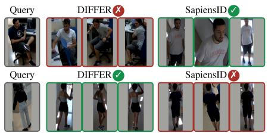
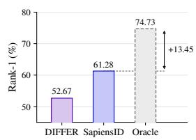
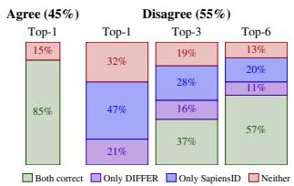
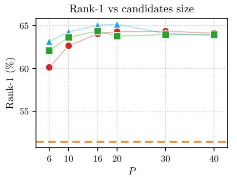
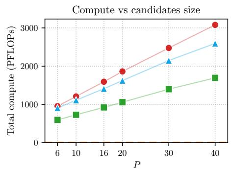
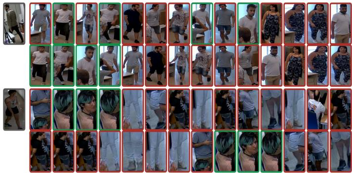
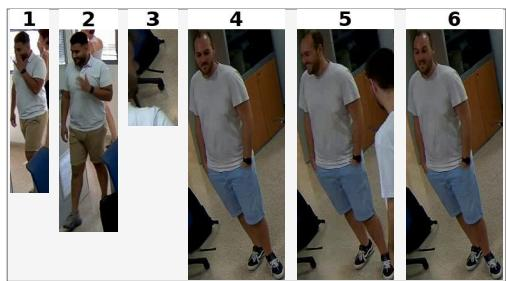

# VLM-as-a-Judge for Person Re-Identification

Bessie Dominguez-Dager1∗ Miguel Cazorla1 Vincent Lepetit2

1Institute for Computing Research, University of Alicante, Alicante, Spain 2LIGM, École Nationale des Ponts et Chaussées, IP Paris, Univ Gustave Eiffel, CNRS, France {bessie.dominguez, miguel.cazorla}@ua.es, vincent.lepetit@enpc.fr

## Abstract

Cloth-changing person re-identification (CC-ReID) is still very challenging, and no method clearly dominates: methods that lead on one benchmark collapse on the others, because they rest on different identity cues. We show that a general-purpose vision-language model (VLM), used zero-shot as a judge for reranking a short candidate list, beats the expert retrieval models it reranks by a wide and consistent margin. On the four scenarios of CHIRLA, a long-term CC-ReID benchmark that no publicly released Re-ID model is trained on, reranking the candidates of two frozen experts raises rank-1 on every scenario, by 12.9 points on average over the best expert and 9.4 over the best naive ensemble of the two, with no component fine-tuned on the target data. Merging both experts’ shortlists matches or beats reranking the stronger expert’s shortlist alone, at lower cost. Introducing a VLM does, however, come at a cost: almost all of the pipeline’s FLOPs are spent on it. We therefore borrow a criterion from ensembling and invoke the VLM judge only where the two experts disagree at rank 1. This threshold-free gate removes 40% of the calls, and a comparable share of total compute, with no significant drop in rank-1, trading 1.8 to 3.8 points of mAP. Judging remains the dominant cost, but on a benchmark where dedicated experts stall, we find a frozen general-purpose model to be the strongest judge of identity. The code is available at https://github.com/bdager/JudgeReID.

## 1 Introduction

Person re-identification (ReID) matches images of the same individual across camera views and locations [1, 2]. Most methods address the short-term setting, where clothing and overall appearance remain unchanged (SC-ReID) [3–9]. However, practical deployments are long-term. Individuals reappear after weeks or months, with considerable changes in clothing, appearance, and environment. This is “cloth-changing ReID” (CC-ReID), where clothing cues are unreliable by construction and methods must rely on identity-intrinsic evidence such as facial structure [10–12], body shape [13–16], or gait [17, 18]. In this setting, accuracy remains far from the saturation reached in SC-ReID, and there is no consistent winner across benchmarks. For example, under the cloth-changing (CC) protocol, SapiensID [12] achieves state-of-the-art mAP on PRCC [19] (72.6%), yet drops to 17.8% on LTCC [20]. In contrast, DIFFER [21] reaches 31.6% on LTCC but only 64.7% on PRCC. Such cross-benchmark reversals suggest that CC-ReID experts exploit different identity cues and thus make complementary errors.

This complementarity can be exploited at inference time, rather than committing to a single model. We study this on SapiensID and DIFFER, the two experts mentioned above. In Fig. 1 we show that for this pair, an oracle selecting the better expert per query exceeds the stronger of the two by 13.5 rank-1 (R-1) points on the multi-camera scenario of CHIRLA [22], a CC-ReID benchmark recorded over seven months. In addition, we observe that agreement between their rank-1 predictions is a strong correctness signal, holding for 85% of those agreements on this scenario. When they disagree, neither prediction is reliable, yet the true identity is often present in the union of their top-k candidates.

  
Figure 1: State-of-the-art CC-ReID experts make different mistakes: We consider here DIFFER and SapiensID on CHIRLA [22], a challenging multi-camera scenario. Left: two queries on which the experts disagree, with their top-3 candidates; green marks correct identities, red incorrect ones. Each model succeeds where the other fails. Middle: an oracle selecting the better model per query gains 13.5 rank-1 points over the best expert (dashed). Right: queries split by top-1 agreement and by which model is correct. Agreement is a reliable correctness signal, and in the disagreement column only 13% of queries have no correct candidate in either top-6 list. In this paper, we introduce and evaluate different approaches to rerank the union of both shortlists with a VLM judge, on every query or, to save compute, only where the two disagree.

We therefore build a training-free ensemble in which a vision-language model (VLM) arbitrates between two heterogeneous CC-ReID experts, and show that this frozen, general-purpose model is a better judge of identity than either expert it reranks. Both models retrieve from the gallery independently. Almost all of the pipeline’s compute is spent on the judge, so we invoke it only where the two experts disagree at rank 1, which the agreement signal above justifies. Gating this way removes 40% of the reranker calls and a comparable share of the total FLOPs, with no significant drop in R-1, trading 1.8 to 3.8 points of mAP. Rather than arbitrating only between the two rank-1 predictions, the judge chooses from the union of both experts’ top-k candidates.

VLMs are generalists: their web-scale multimodal pretraining yields fine-grained visual understanding that transfers to biometric recognition [23]. They are ill-suited as retrieval engines, since exhaustively scanning a large gallery is infeasible and their standalone accuracy trails task-specific models. As judges over short candidate lists, however, VLMs make strong comparative decisions [24], echoing the LLM-as-a-judge paradigm in the visual domain [25]. Standard ensembling falls short here: score fusion [26, 27] assumes that the two similarity scores are directly comparable, which independently trained embedding spaces do not provide, and rank aggregation such as reciprocal rank fusion (RRF) [28] averages the disagreement rather than resolving it.

The contributions of this work are as follows:

• A zero-shot VLM judge that outperforms both experts and every naive ensemble of the two by a wide and consistent margin on all four CHIRLA scenarios, with no component trained or fine-tuned on the evaluated data.

• A threshold-free disagreement gate that skips the reranker on the queries where the experts agree, saving their compute with no significant drop in R-1 at the price of 1.8 to 3.8 points of mAP.

• An empirical study of how the candidate pool should be presented to the judge, covering pool size, pool ordering, and how the prompt binds each image to its role.

• Evidence on pool composition: merging both experts’ shortlists matches or beats reranking a single expert’s own shortlist at lower cost, even though deduplication often leaves the merged pool smaller.

## 2 Related Work

Clothing-Change Re-ID. CC-ReID methods remove clothing information from the identity representation at training time. One line uses language as a clothing-invariant supervisory signal, through cloth-agnostic CLIP alignment [29] or prompt learning over clothing and identity semantics [30, 31].

A related line factors identity from clothing in feature space, with DIFFER [21] disentangling identity features from semantic cues over a frozen vision-language backbone and DRDnet [32] modeling the relations between the resulting factors. Others synthesize clothing or pose variation at the feature [33–35] or image level [36–38], or ground identity in cues that survive a change of clothes, such as gait [18], implicit 3D shape [13, 14] and skeleton dynamics [39]. Unsupervised variants pursue the same invariance without identity labels [40–42] but remain far behind, with ICSM [42] reaching 13.5% mAP on LTCC under the clothing-change protocol against 31.6% for DIFFER [21].

SapiensID [12] takes a different route. Rather than modeling body structure explicitly, it unifies face and body recognition in one model, with identity supervision on WebBody, a web-scale corpu spanning diverse poses, scales and capture conditions. It transfers to CC-ReID off the shelf and, unlike the shape and gait methods above, exploits facial cues when visible. We build on DIFFER and SapiensID as our two experts.

VLMs in person Re-ID. VLMs have already been used to some extent for ReID in two ways that differ in where the model intervenes. In the first one, language is a training-time signal only. The methods above, DIFFER [21] among them, use text to shape a clothing-invariant embedding, as do pseudo-prompt optimization [7], caption-guided inversion [43], language-guided feature enhancement [44–46] and diffusion-based augmentation [47] outside the clothing-change setting. Retrieval then stays nearest-neighbor search over frozen features, and no language model sees a query at test time. VLM-ReID [48] runs the model at test time, but only to emit an identity token used as the retrieval feature, so language still shapes the embedding rather than the ranking.

In the second way, the VLM is introduced in the retrieval loop. Text-to-image retrieval aligns freeform descriptions with gallery images [49, 50], with VLMs supplying transferable captions [51], instruction-conditioned queries [8], interactive refinement [52] and dialogue-based retrieval [53, 54]. Closest to us, Duan et al. [23] evaluate six off-the-shelf VLMs directly as ReID matchers under angle, illumination and clothing variation, and find that the prompt template moves the result. They score the VLM as a standalone matcher, while we invoke it as an arbiter over a short candidate list that two experts have already produced, and only where those experts disagree.

Re-Ranking and model complementarity. Re-ranking refines a ranked list using gallery structure. k-reciprocal encoding [55] remains the standard training-free baseline, revisited through adaptive graph-based neighbor search [56], while learned alternatives attend jointly over query and gallery [57]. Pose2ID [58] instead centralizes neighbor features as a training-free post-processing stage, validated only where clothing stays constant. All of these refine the neighborhood structure of a single feature space, which is what clothing change destabilizes, and none recovers a match that the embedding misses entirely. Re-ranking is therefore orthogonal to our question rather than an alternative to it: it could be applied on top of either expert or on the union of both, and we leave that combination to future work. The methods we measure against are instead those that combine rankings from different models.

Combining heterogeneous rankers is much less explored in ReID. Score- and rank-level fusion such as RRF [28] treats models symmetrically and aggregates them on every query, whether or not they agree. Our correctness cross-tabulation shows that this spends effort where there is little to gain. On agreement queries the second model adds little, while disagreement queries carry nearly all of the oracle gap. Disagreement-gated arbitration turns that asymmetry into an invocation policy.

## 3 Method

## 3.1 Overview

In our training-free arbitration ensemble, M frozen ReID experts retrieve independently, and a frozen, general-purpose VLM judges the candidates they jointly propose. Throughout, we use $M = 2$ . We first select pretrained experts that present complementary error profiles. They succeed and fail under different conditions, such as whether the face is visible or whether pose changes between query and gallery. All models are benchmarked off the shelf on datasets other than the ones they were trained on, so no component is fine-tuned on the target data. Given a query $q ,$ each model $m \in \{ 1 , \ldots , M \}$ independently ranks the gallery $\mathcal { G } = \{ g _ { 1 } , \ldots , g _ { N } \}$ by similarity to $q .$ . When all models predict the same identity for their top-ranked match, we return the ranking of a designated default model $m ^ { \star }$ unchanged. When they disagree, we merge their top-k matches into a candidate pool and ask the

VLM to reorder it. The final ranking places the $k _ { H }$ top-ranked candidates from the reordered pool at the head, followed by the tail of the model that contributed the majority of that head. We detail individual steps in the following subsections.

## 3.2 Selective reranking

Disagreement gating. Reranking every query with a VLM is expensive, and on queries the models already resolve it rarely changes the outcome while risking the demotion of a correct rank 1, as previously shown in Fig. 1. We therefore invoke the VLM reranker only where the models disagree. We assume an enrolled gallery whose identity labels are known at inference time, while the query identity is unknown. Let ${ \hat { y } } _ { m } ( q )$ denote the enrolled identity label of the rank-1 gallery match returned by model m for query $q ,$ , and define the disagreement indicator

$$
\delta ( q ) = \mathbf { 1 } \big [ \big | \{ \hat { y } _ { m } ( q ) : m = 1 , \dots , M \} \big | > 1 \big ] ,\tag{1}
$$

which fires whenever the models do not all agree on the identity of their rank-1 match. Let $\mathcal { Q } _ { \delta } =$ $\{ q \in \mathcal { Q } : \delta ( q ) = 1 \}$ denote the gated subset of the query set $\mathcal { Q }$ . The reranker is applied to $\mathcal { Q } _ { \delta }$ and to no other query; for $q \notin \mathcal { Q } _ { \delta }$ we return the ranking of the default model $m ^ { \star }$ unchanged.

Candidate pool. Given a gated query, we pool the top-k gallery items retrieved by each model:

$$
\mathcal { C } ( { \boldsymbol q } ) = \bigcup _ { m = 1 } ^ { M } \left\{ \pi _ { m } ^ { ( r ) } ( { \boldsymbol q } ) \right\} _ { r = 1 } ^ { k } , k \leq | \mathcal { C } ( { \boldsymbol q } ) | \leq P ,\tag{2}
$$

where $\pi _ { m } ( q )$ is model m’s ranking of the gallery, $\pi _ { m } ^ { ( r ) } ( q )$ its item at rank r and $P = M k$ . Each candidate carries the tag $\sigma ( c ) \subseteq { \overline { { \{ 1 , \ldots , { \bar { M } } \} } } }$ recording which models retrieved it; a candidate retrieved by several models carries all of them. The pool is presented to the reranker under an ordering $\rho ,$ which we treat as a design choice rather than a fixed component. The reranker’s sensitivity to $\rho$ is itself a property worth measuring, and we report it in Table 5. Merging rather than extending a single model’s list to Mk items is what allows the pool to contain the correct match when one model ranks it highly and the other does not retrieve it at all.

Prompt construction. We prompt the reranker to order $\mathcal { C } ( q )$ , from which the head of the final ranking is assembled. Reranking requires the VLM to compare one query against several candidates in a single multi-image prompt. In this setting, VLMs are susceptible to image position and recency effects [59, 60]. The VLM’s answer is influenced by an image’s position in the sequence and not only by its content. Thus, image identity becomes unreliable, with descriptions of one image applied to another. We therefore build the prompt so that each image declares what it is, instead of leaving the model to infer it from where the image appears. To do so, before any image is shown, the prompt gives all the instructions, including an anchor sentence stating each image’s role as query or candidate, and which images are not the query. Then, each image carries a label written into the image itself rather than only in the surrounding text, following evidence that marks placed on an image are more reliably grounded than textual references to image order [61]. The pool is presented in the order $\rho$ mentioned above. Section 4.3 evaluates the contribution of each prompt-construction choice.

## 3.3 Final ranking

The reranker orders the pool $\mathcal { C } ( q )$ but leaves the remaining $N - | { \mathcal { C } } ( q ) |$ gallery images unranked, so a full ranking is assembled from the reranked head and one model’s ranking. We select that model per query rather than fixing it in advance.

Tail selection. Of the ordering returned by the reranker we retain the first $k _ { H }$ elements as the head $H ( q ) = ( h _ { 1 } , \dots , h _ { k _ { H } } )$ and discard the rest. Writing

$$
c _ { m } ( q ) = | \{ i \leq k _ { H } ~ : ~ m \in \sigma ( h _ { i } ) ~ \} |\tag{3}
$$

for the number of head elements retrieved by model $m ,$ , the majority contributor $\hat { m } ( q ) \ =$ arg $\operatorname* { m a x } _ { m } c _ { m } ( q )$ supplies the tail, with ties resolved in favor of $m ^ { \star }$ . The assembled ranking $R ( q )$ is constructed from $\hat { \pi } = \pi _ { \hat { m } ( q ) } ( q )$ by replacing the first $k _ { H }$ elements with $H ( q )$ and resolving duplicates as described below. For ungated queries no pool exists and $R ( q )$ is the full ranking of $m ^ { \star }$

Duplicate resolution. An image $h _ { i } \in H ( q )$ contributed by another model may sit at some position $p > k _ { H }$ in πˆ, in which case it would appear twice in $R ( q )$ . Symmetrically, images that πˆ originally placed in its own top-kH may have been displaced out of $H ( q )$ by the reranker. Let $\mathcal { D } ( q )$ be the sequence of displaced images $\{ \hat { \pi } ^ { ( r ) } \} _ { r = 1 } ^ { k _ { H } } \backslash H ( q )$ in order of original rank, and $\mathcal { V } ( q )$ the vacated tail positions $\{ p > k _ { H } : \hat { \pi } ^ { ( p ) } \in H ( q ) \}$ in ascending order. Since πˆ is a permutation of ${ \mathcal { G } } ,$ every element of $H ( q )$ occupies exactly one position in it, and $| \mathcal { D } ( q ) | = | \mathcal { V } ( q ) |$ . Pairing them in order, the j-th vacated position receives the j-th displaced image,

$$
R ^ { ( r ) } ( q ) = \left\{ \begin{array} { l l } { h _ { r } } & { \mathrm { i f } r \leq k _ { H } , } \\ { \mathcal { D } ( q ) _ { j } } & { \mathrm { i f } r = \mathcal { V } ( q ) _ { j } } \\ { \hat { \pi } ^ { ( r ) } } & { \mathrm { o t h e r w i s e } , } \end{array} \right.\tag{4}
$$

so $R ( q )$ contains every gallery image exactly once and has length $N .$

## 4 Experiments

Dataset and metrics. We evaluate our approach on CHIRLA [22], a long-term Re-ID benchmark recorded over seven months in an indoor office with seven cameras and 22 identities, where participants changed clothing between sessions. We select it for several reasons. It is an evaluation-only benchmark, with no publicly released Re-ID model trained on it, so neither expert has seen its identities, cameras, or outfits. Its crops are high enough in resolution to preserve facial evidence. It is far from saturated, so the disagreement regime our gate targets is well populated. Its four scenarios separate clothing change from viewpoint change. Reappearance (Reapp.) and multi-camera (MC) stay within a session, while long-term (LT) and multi-camera long-term (MC-LT) span different days. We follow the benchmark protocol and compute metrics per subset before averaging. We adopt the closed-set setting and report R-1 and mAP. When comparing two methods, we call a difference significant when an exact paired sign-flip test over identities gives $p < 0 . 0 5$ , and give 95% confidence intervals (CI) from a paired bootstrap over identities; Section A.5 describes both, and Table 9 reports them for every comparison in this section. Table 7 gives the query and gallery sizes per scenario.

Implementation details. All weights are frozen and nothing is trained or fine-tuned on CHIRLA. The prompt configuration, $m ^ { \star }$ and $k _ { H }$ were selected on the designated validation subset and then fixed for all evaluation subsets; $\rho$ was fixed arbitrarily, without consulting any performance number. Section 4.3 and Section 4.4 therefore measure the effect of these choices on test. The two experts are DIFFER [21] and SapiensID [12], using their released checkpoints, pre-trained on Celeb-ReID-light [62] and WebBody12M [12] respectively. We set $m ^ { \star } = \bar { \mathrm { S a p i e n s I D } _ { \star } } \rho$ to the (DIFFER, SapiensID) block order, and $k _ { H } = k$ . The judge is Qwen3.6-27B [63], a dense VLM served with vLLM [64] behind an OpenAI-compatible API on two NVIDIA L40S $\mathrm { G P U s } ,$ decoding greedily $( T = 0 )$ with reasoning mode disabled. Outputs that are not a valid permutation of the pool are re-prompted at most twice, after which we fall back to $m ^ { \star }$ . Section A.7 gives the prompt templates and Fig. 4 an example pool. Section 4.4 repeats the pipeline with Qwen3.6-35B-A3B [65], a mixture-of-experts model.

## 4.1 Main results

Table 1 extends the oracle and error analysis of Fig. 1 to all four scenarios. On average, the experts disagree at R-1 on 60.4% of queries. Where they agree, the shared prediction is correct 74.9% of the time, above either expert’s overall R-1, so suppressing the judge there should cost little. Agreement also fixes both experts to the same answer, so the entire oracle gap, 51.4 to 65.5 R-1 on average, lies on the gated queries. There, a merged $P = 1 6$ pool holds the correct identity 90.8% of the time. Hence the two choices the pipeline makes: invoke the judge only where the experts disagree, and give it the merged union, since it holds the correct identity for the large majority of gated queries.

Table 1: Gate analysis. Gated: the experts’ R-1 identities differ, so the judge is invoked. Correct: agreeing queries whose shared R-1 is right. Oracle: the better expert $m ^ { \star }$ against a per-query oracle. Pool recall: gated queries whose GT identity is in the merged $\bar { P } { = } 1 6$ pool; the judge’s R-1 ceiling.
<table><tr><td>Scenario</td><td>Gated (% all)</td><td>Correct (% agree)</td><td>Oracle (or.)  $\mathrm { R } { \cdot } 1 ~ m ^ { \star }  \mathrm { o r } .$ </td><td>Pool recall (% gated)</td></tr><tr><td>LT</td><td>74.6</td><td>64.2</td><td> $3 5 . 5  5 0 . 1$ </td><td>83.9</td></tr><tr><td>MC-LT</td><td>65.2</td><td>70.9</td><td> $4 3 . 4  6 1 . 8$ </td><td>94.0</td></tr><tr><td>MC</td><td>54.9</td><td>85.5</td><td> $6 1 . 3  7 4 . 7$ </td><td>90.2</td></tr><tr><td>Reapp.</td><td>47.0</td><td>79.1</td><td> $6 5 . 5  7 5 . 5$ </td><td>95.2</td></tr><tr><td> $\operatorname { A v g } .$ </td><td>60.4</td><td>74.9</td><td> $5 1 . 4  6 5 . 5$ </td><td>90.8</td></tr></table>

Arbitration beats aggregation. The VLM here is not only refining one model’s ranked list. It decides which of two models’ proposals to accept, acting as an arbitration ensemble method. In

Table 2: Main results on CHIRLA. Our pipeline against the two experts and standard ensembling. Per column, the best and second-best results, in bold and underlined, respectively. $\Delta$ is the Avg. R-1 difference relative to SapiensID (ref.) with its 95% confidence interval (CI) from a paired bootstrap over identities; ∗ marks $p < 0 . 0 5$ under an exact sign-flip test (Section A.5).
<table><tr><td rowspan="2">Method</td><td colspan="2">LT</td><td colspan="2">MC-LT</td><td colspan="2">MC</td><td colspan="2">Reapp.</td><td colspan="2">Avg.</td><td rowspan="2">∆R-1 [95% CI]</td></tr><tr><td>R-1</td><td>mAP</td><td>R-1</td><td>mAP</td><td>R-1</td><td>mAP</td><td>R-1</td><td>mAP</td><td>R-1</td><td>mAP</td></tr><tr><td>DIFFER [21]</td><td>30.89</td><td>31.20</td><td>42.56</td><td>48.51</td><td>52.67</td><td>53.79</td><td>54.15</td><td>55.45</td><td>45.07</td><td>47.24</td><td> $- 6 . 4 \left[ - 1 2 . 6 , + 0 . 2 \right]$ </td></tr><tr><td>SapiensID [12]</td><td>35.50</td><td>35.01</td><td>43.44</td><td>46.63</td><td>61.28</td><td>57.94</td><td>65.50</td><td>61.22</td><td>51.43</td><td>50.20</td><td>ref.</td></tr><tr><td>Voting (Borda) [66]</td><td>38.63</td><td>36.17</td><td>45.81</td><td>50.27</td><td>60.33</td><td>59.27</td><td>62.84</td><td>61.00</td><td>51.90</td><td>51.68</td><td> $+ 0 . 5 \left[ - 3 . 2 , + 4 . 3 \right]$ </td></tr><tr><td>RRF [28]</td><td>39.60</td><td>37.41</td><td>49.49</td><td>52.14</td><td>61.06</td><td>60.47</td><td>63.20</td><td>62.31</td><td>53.34</td><td>53.08</td><td> $+ 1 . 9 \left[ - 1 . 8 , + 5 . 8 \right]$ </td></tr><tr><td>Score Fusion [27]</td><td>40.95</td><td>38.31</td><td>48.60</td><td>51.78</td><td>64.47</td><td>61.75</td><td>65.93</td><td>63.90</td><td>54.99</td><td>53.94</td><td> $+ 3 . 6 \left[ + 0 . 3 , + 7 . 0 \right]$ </td></tr><tr><td>Union + VLM (gated) P=6</td><td>44.97</td><td>39.59</td><td>56.35</td><td>54.43</td><td>73.25</td><td>64.87</td><td>73.72</td><td>65.28</td><td>62.07</td><td>56.04</td><td>+10.6* [+7.0, +14.4]</td></tr><tr><td>Union + VLM (gated) P=16</td><td>46.92</td><td>42.91</td><td>56.99</td><td>57.49</td><td>76.10</td><td>69.16</td><td>77.41</td><td>69.11</td><td>64.35</td><td>59.67</td><td> $+ 1 2 . 9 ^ { * } \ [ + 9 . 3 , + 1 6 . 8 ]$ </td></tr></table>

  
Figure 2: Accuracy against compute as $P$ grows. R-1 is averaged over the four scenarios and compute is the total FLOPs to run all four benchmarks once. All three pipelines sit above the SapiensID embedding-only baseline (dashed). The gated pipeline traces the same accuracy range at a fraction of the cost, since it calls the judge only where the experts disagree.

Table 2, we compare against standard ensembling over the experts’ full rankings, so those baselines see the whole gallery where our judge sees P candidates; Section A.3 gives the three formulations. The best of them reaches 55.0 average R-1, 3.6 points above the better expert, a gain that is not significant. The gated pipeline at $P = 1 6$ reaches 64.4, 12.9 points above SapiensID and 9.4 above score fusion, both significant. Even treating each person as the unit of analysis, the 12.9-point gain has a 95% CI of [9.3, 16.8]. The margin holds scenario by scenario rather than only on the average, at least 11.4 R-1 over the better expert and 6.0 over the best ensemble on that scenario, with the same pattern on mAP, and it is significant in every scenario against both SapiensID and score fusion. We attribute this to how the baselines combine the experts. All three commit in advance to a fixed rule for combining the two lists, and score fusion must also combine scores that were never calibrated against each other, which min–max normalising does not make commensurable. The judge instead looks at the crops and can decide differently on every query.

## 4.2 What the union and the gate contribute

The second expert pays for itself twice. Dropping it and reranking SapiensID’s own top- $. P$ is the natural alternative, plotted as SapiensID + VLM in Fig. 2. At matched $P ^ { \ j }$ and with the gate removed, the union costs less at every budget, 905 PFLOPs against 954, 1409 against 1592, and 2594 against 3079. At $P = 6$ it is ahead by 3.0 R-1 and 3.9 mAP; the mAP gain is significant and the R-1 gain borderline $( p = 0 . 0 5 4 )$ . At ${ \dot { P } } = 1 6$ and $P = 4 0$ the two are indistinguishable. Pool size does not explain the gain, since deduplication leaves the merged pool smaller than the budget, on average 5.1 candidates against a full 6.0 at $P = 6 ,$ , so the judge does at least as well while seeing fewer crops, and that is also what makes it cheaper. The advantage is only resolved at $P = 6 ,$ , likely because a single expert’s longer shortlist already contains most of what the merge would add. The second expert also supplies the disagreement signal, without which there is nothing to gate on, and gating is what brings the union down to 594 PFLOPs at $P = 6$

The gate trades mAP for compute. Against the same pipeline without $\mathbf { i t } ,$ gating has no significant effect on R-1 at any of the three budgets $( P = 6 \colon - 1 . 1$ $P = 1 6 \colon - 0 . 7$ and $\bar { P } = 4 0 \colon \mathrm { + \bar { 0 } . 1 ) }$ . In exchange the judge is skipped on the 40% of queries where the experts agree, removing 35% of the compute, which is the whole operating point, since the embedding stage is under 0.5% of every pipeline’s total. Those two figures differ because the skipped queries are the cheaper ones: agreeing shortlists overlap more, so deduplication cuts deeper, leaving 4.5 candidates against 5.5 on the queries the judge does see. The cost in mAP is larger, grows with the budget, and is significant at every budget: 1.8, 3.3 and 3.8 points $( p \leq 2 \times \bar { 1 0 } ^ { - 4 }$ , see Table 9). On the queries the gate skips, the pipeline returns SapiensID’s ranking unchanged, so nothing below rank 1 is reordered there, and the deeper the judge reorders elsewhere the more that untouched remainder costs. A gate defined on rank-1 labels protects R-1 and leaves the rest of the list alone.

Table 3: Prompt binding (Reapp. scenario). Images placed before or after the instructions, Anchor: anchor sentence, Label: role in the image pixels.
<table><tr><td>Img. before</td><td>Img. after</td><td>Anchor</td><td>Label</td><td>R-1</td><td>mAP</td></tr><tr><td>√</td><td></td><td></td><td></td><td>65.98</td><td>60.59</td></tr><tr><td>√</td><td></td><td>√</td><td></td><td>70.75</td><td>62.76</td></tr><tr><td></td><td>√</td><td></td><td></td><td>64.46</td><td>60.46</td></tr><tr><td></td><td>√</td><td>√</td><td></td><td>72.99</td><td>63.73</td></tr><tr><td></td><td>√</td><td>√</td><td>√</td><td>73.72</td><td>65.28</td></tr></table>

Table 4: Ablation of tail selection at $P = 6$ on Union + VLM (gated). All values are mAP (%) since R-1 is agnostic to the tail selection.
<table><tr><td>Tail</td><td>LT</td><td>MC-LT</td><td>MC</td><td>Reapp.</td></tr><tr><td>DIFFER</td><td>38.32</td><td>54.23</td><td>63.09</td><td>63.61</td></tr><tr><td>SapiensID</td><td>38.51</td><td>52.95</td><td>63.05</td><td>64.39</td></tr><tr><td>Majority</td><td>39.59</td><td>54.43</td><td>64.87</td><td>65.28</td></tr></table>

Accuracy saturates before cost does. R-1 rises significantly from $P = 6$ to $P = 1 6$ and then flattens while cost keeps growing, and mAP keeps improving significantly to the largest budget tested. Enlarging $P$ adds candidates below the current head, which lifts mAP mechanically but moves R-1 only when an added candidate displaces a wrong rank 1. How the judge reorders the pool explains why R-1 stops rising. At $P = 6$ , restricted to queries whose ground truth is in the pool, the judge promotes it for 38.9 to 62.3% of queries and demotes it for 10.8 to 22.2%, and within that subset R-1 rises from 26.1% to 75.0% on MC. From $P = 1 6$ to $P = 4 0$ the demoted fraction grows in every scenario, by 1.9 to 10.1 points, while the promoted fraction falls by 0.7 to 5.4, so longer lists are reordered more aggressively without being reordered better. Reliability degrades on the same axis, with corrected outputs growing from 0.2% of queries at $P \leq 1 0$ to 32.0% at $P = 4 0$ on LT under SapiensID + VLM (Table 10).

## 4.3 Presenting the pool to the judge

Query binding dominates. Table 3 isolates the three choices that bind an image to its role, on Reappearance at $P = 6 .$ All five variants carry the same task description, so the differences come from binding alone. The anchor sentence adds 4.8 to 8.5 R-1 depending on image position; with the images before the instructions, all but one of the identities whose R-1 changed improved. Burning the role into the image adds a further 1.6 mAP, but its R-1 gain is not significant. Image position has no significant effect, with or without the anchor sentence. With the images after the instructions, the two interventions together add 9.3 R-1 and 4.8 mAP. This matches what the position and recency bias literature predicts [59–61], that the model needs to be told which of the $\bar { P } + 1$ images is the query rather than to be told the task earlier.

Task wording does not. Removing one semantic component at a time costs between 0.2 and 1.7 R-1 and under 0.9 mAP, whether it is the attribute enumeration, the clothing prohibition and its escape hatch, or the step-by-step directive (Table 11), and none of these drops is significant. Every one of those variants still beats every variant lacking the anchor sentence by at least 6.1 R-1. The gains therefore come from binding the query rather than from engineering the task description, which is the more transferable finding.

Sensitivity to the pool ordering. Table 5 varies $\rho ,$ keeping $\mathcal { C } ( q )$ fixed and swapping the order of the per-expert top-k blocks. The two orders agree on the rank-1 identity for 69.2 to 82.1% of gated queries and on the full pool for 31.2 to 41.1%, far above chance but with a large residual, consistent with concurrent work on order sensitivity in VLMs [60]. Aggregate accuracy is steadier, moving by −0.3 to +2.1 R-1 depending on the scenario, and the two orders are not significantly different in aggregate. The order we use throughout was fixed in advance and is nominally the weaker of the two by 0.7 R-1, so our reported results do not benefit from it.

Table 5: Sensitivity to ρ at $P = 6 .$ , with two orderings of $\mathcal { C } ( q )$ . ∆ is the second order minus the first. Agreement is the fraction of gated queries on which the two orders return the same identity sequence, at rank 1, over the retained head $( k _ { H } = 3 )$ , and over the whole pool, whereas R-1 and mAP are over the full query set. In parentheses, chance agreement under random permutations of the same pool.
<table><tr><td rowspan="2">Scenario</td><td colspan="2">(DIFFER, SapiensID)</td><td colspan="2">(SapiensID, DIFFER)</td><td colspan="2"> $\Delta$ </td><td colspan="3">Agreement % (chance)</td></tr><tr><td>R-1</td><td>mAP</td><td>R-1</td><td>mAP</td><td>R-1</td><td>mAP</td><td>@1</td><td> $@ k _ { H }$ </td><td> $@ P$ </td></tr><tr><td>LT</td><td>44.97</td><td>39.59</td><td>45.94</td><td>39.88</td><td>+0.98</td><td>+0.29</td><td>69.6 (31.2)</td><td>42.9 (4.9)</td><td>31.2 (2.3)</td></tr><tr><td>MC-LT</td><td>56.35</td><td>54.43</td><td>58.50</td><td>55.11</td><td>+2.15</td><td>+0.68</td><td>69.2 (33.6)</td><td>49.7 (6.1)</td><td>39.7 (3.6)</td></tr><tr><td>MC</td><td>73.25</td><td>64.87</td><td>73.21</td><td>64.93</td><td>-0.04</td><td>+0.06</td><td>79.4 (33.2)</td><td>51.5 (5.6)</td><td>39.2 (3.0)</td></tr><tr><td>Reapp.</td><td>73.72</td><td>65.28</td><td>73.43</td><td>65.01</td><td>-0.30</td><td>-0.27</td><td>82.1 (34.2)</td><td>55.4 (5.9)</td><td>41.1 (2.9)</td></tr></table>

Table 6: Results for two VLMs at $P = 6 ,$ , gated pipeline. Format reports how often the response was not valid, with Corr. meaning repaired by the correction prompt, and Unrec. still invalid after the maximum of attempts, computed over the four Re-ID scenarios.
<table><tr><td rowspan="2">Method</td><td colspan="2">LT</td><td colspan="2">MC-LT</td><td colspan="2">MC</td><td colspan="2">Reapp.</td><td colspan="2">Format (%)</td></tr><tr><td>R-1↑</td><td>mAP↑</td><td>R-1 ↑</td><td>mAP↑</td><td>R-1↑</td><td>mAP↑</td><td>R-1↑</td><td>mAP↑</td><td>Corr. ↓</td><td>Unrec. ↓</td></tr><tr><td>Qwen3.6-35B-A3B</td><td>43.96</td><td>38.70</td><td>55.58</td><td>53.52</td><td>70.92</td><td>63.80</td><td>72.13</td><td>64.33</td><td>6.79</td><td>1.76</td></tr><tr><td>Qwen3.6-27B</td><td>44.97</td><td>39.59</td><td>56.35</td><td>54.43</td><td>73.25</td><td>64.87</td><td>73.72</td><td>65.28</td><td>0.23</td><td>0.12</td></tr></table>

## 4.4 Ablations and analysis

Tail rule. Table 4 compares fixing the tail to one expert against the per-query majority vote of Eq. (3). We report mAP only, since the tail rule applies only to gated queries, below the head the judge supplies, so it cannot move R-1, and ungated queries keep SapiensID’s ranking under every rule. The majority vote wins in every scenario, by a small margin that is significant on the average, 1.2 and 1.3 mAP over the DIFFER and SapiensID tails. Table 12 gives the breakdown over the ways of crediting a candidate that both models retrieved, which differ by at most 0.3 mAP.

A second VLM. Table 6 repeats the gated pipeline at P = 6 with Qwen3.6-35B-A3B. It scores below Qwen3.6-27B in every scenario, significantly so on average (1.4 R-1 and 1.0 mAP) but not in each scenario on its own, and shows the same pattern of gains. It is also worse at following the output format, with higher correction and invalid-output rates.

Qualitative results. Fig. 3 shows two gated queries. The first is a recovery, where the judge promotes an identity that neither expert ranked first. The second is a failure, where the judge misjudges the gender of the candidates, treating long hair as an intrinsic female characteristic, and pushes the correct candidates down, from ranks 2 to 4 into positions 9 to 11.

## 5 Conclusions

We combine two frozen CC-ReID experts with complementary errors by having a general-purpose VLM rerank the union of their shortlists. On CHIRLA, a benchmark recorded over seven months, the VLM judges identity better than either expert it reranks, at 64.4 average R-1 and ahead of every naive ensemble of the two. Merging the two shortlists costs less than reranking a single expert’s list at the same budget and is not significantly worse at any budget, with a significant mAP gain at the smallest one. The prompt matters as well, and its largest single gain comes from telling the judge which image is the query. The judge dominates the pipeline’s cost, so we invoke it only where the experts disagree; elsewhere their agreement is a reliable enough prediction. That removes 40% of the calls with no significant loss in R-1, at a cost of 1.8 to 3.8 mAP. None of this requires training on the target data, calibrating one expert’s scores against the other’s, or a threshold to tune.

Limitations. Our evaluation rests on CHIRLA’s 22 identities. How often the two experts disagree will therefore differ on other data, and with it how much the gate saves. What the gate needs, though, is only that agreement predicts correctness. Even gated, reranking stays the dominant cost, and the saving is paid for in mAP. The judge is also order-sensitive, and its errors are not neutral: it sometimes groups candidates by coarse attributes such as apparent gender. Nothing here is trained, however, so stronger experts or a stronger judge can be swapped in directly, on CHIRLA or on other CC-ReID benchmarks.

  
Figure 3: Qualitative results on two gated queries. Query in gray, green marks a correct identity and red an incorrect one. For each query the upper row is the merged pool from DIFFER and SapiensID in the order shown to the judge, and the lower row is the order the judge returns. Above, the judge lifts four correct candidates to the head. Below, it demotes the three correct candidates.

## Acknowledgments and Disclosure of Funding

We thank Christian Henning for many insightful discussions, valuable ideas, and continuous support during the development of this work.

Bessie Dominguez-Dager is supported by the FPU predoctoral grant FPU23/02247 from the Spanish Ministry of Science, Innovation and Universities. This work was carried out during a research stay at the Imagine group of the Laboratoire d’Informatique Gaspard-Monge (LIGM), École nationale des ponts et chaussées (France), funded by the FPU mobility grant FPUES23/00198 from the same ministry. This work is also part of the project I+D+i PID2022-138453OB-I00, funded by MCIN/AEI/10.13039/501100011033/ and by “ERDF, A way of making Europe”.

The authors declare no competing interests.

## References

[1] M. Ye, J. Shen, G. Lin, T. Xiang, L. Shao, and S. C. H. Hoi, “Deep learning for person re-identification: A survey and outlook,” IEEE Transactions on Pattern Analysis and Machine Intelligence, vol. 44, no. 6, pp. 2872–2893, 2022.

[2] H. Lee, J. Park, J. Oh, and C. Eom, “Domain generalization for person re-identification: A survey towards domain-agnostic person matching,” Neurocomputing, vol. 649, p. 130763, 2025.

[3] H. Luo, Y. Gu, X. Liao, S. Lai, and W. Jiang, “Bag of tricks and a strong baseline for deep person re-identification,” in 2019 IEEE/CVF Conference on Computer Vision and Pattern Recognition Workshops (CVPRW), pp. 1487–1495, 2019.

[4] S. He, H. Luo, P. Wang, F. Wang, H. Li, and W. Jiang, “Transreid: Transformer-based object reidentification,” in 2021 IEEE/CVF International Conference on Computer Vision (ICCV), pp. 14993–15002, 2021.

[5] K. Zhu, H. Guo, T. Yan, Y. Zhu, J. Wang, and M. Tang, “Pass: Part-aware self-supervised pre-training for person re-identification,” in Computer Vision – ECCV 2022 (S. Avidan, G. Brostow, M. Cissé, G. M. Farinella, and T. Hassner, eds.), (Cham), pp. 198–214, Springer Nature Switzerland, 2022.

[6] W. Chen, X. Xu, J. Jia, H. Luo, Y. Wang, F. Wang, R. Jin, and X. Sun, “Beyond appearance: A semantic controllable self-supervised learning framework for human-centric visual tasks,” in 2023 IEEE/CVF Conference on Computer Vision and Pattern Recognition (CVPR), pp. 15050–15061, 2023.

[7] S. Li, L. Sun, and Q. Li, “Clip-reid: exploiting vision-language model for image re-identification without concrete text labels,” in Proceedings ofthe Thirty-Seventh AAAI Conference on Artificial Intelligence and Thirty-Fifth Conference on Innovative Applications ofArtificial Intelligence and Thirteenth Symposium on Educational Advances in Artificial Intelligence, AAAI’23/IAAI’23/EAAI’23, AAAI Press, 2023.

[8] W. He, Y. Deng, S. Tang, Q. Chen, Q. Xie, Y. Wang, L. Bai, F. Zhu, R. Zhao, W. Ouyang, D. Qi, and Y. Yan, “Instruct-reid: A multi-purpose person re-identification task with instructions,” in 2024 IEEE/CVF Conference on Computer Vision and Pattern Recognition (CVPR), pp. 17521–17531, 2024.

[9] V. Somers, A. Alahi, and C. D. Vleeschouwer, “Keypoint promptable re-identification,” in Computer Vision – ECCV 2024 (A. Leonardis, E. Ricci, S. Roth, O. Russakovsky, T. Sattler, and G. Varol, eds.), (Cham), pp. 216–233, Springer Nature Switzerland, 2025.

[10] D. Arkushin, B. Cohen, S. Peleg, and O. Fried, “Geff: Improving any clothes-changing person reid model using gallery enrichment with face features,” in 2024 IEEE/CVF Winter Conference on Applications of Computer Vision Workshops (WACVW), pp. 143–153, 2024.

[11] Z. Wu, J. Ding, and Q. Zhang, “FaceCC: facial feature combination network for cloth-changing person re-identification,” Journal ofElectronic Imaging, vol. 33, no. 1, p. 013045, 2024.

[12] M. Kim, D. Ye, Y. Su, F. Liu, and X. Liu, “Sapiensid: Foundation for human recognition,” in 2025 IEEE/CVF Conference on Computer Vision and Pattern Recognition (CVPR), pp. 13937–13947, 2025.

[13] H. Zhu, P. Budhwant, Z. Zheng, and R. Nevatia, “Seas: Shape-aligned supervision for person reidentification,” in 2024 IEEE/CVF Conference on Computer Vision and Pattern Recognition (CVPR), pp. 164–174, 2024.

[14] F. Liu, M. Kim, Z. Ren, and X. Liu, “Distilling clip with dual guidance for learning discriminative human body shape representation,” in 2024 IEEE/CVF Conference on Computer Vision and Pattern Recognition (CVPR), pp. 256–266, 2024.

[15] J. Chen, X. Jiang, F. Wang, J. Zhang, F. Zheng, X. Sun, and W.-S. Zheng, “Learning 3d shape feature for texture-insensitive person re-identification,” in 2021 IEEE/CVF Conference on Computer Vision and Pattern Recognition (CVPR), pp. 8142–8151, 2021.

[16] P. Hong, T. Wu, A. Wu, X. Han, and W.-S. Zheng, “Fine-grained shape-appearance mutual learning for cloth-changing person re-identification,” in 2021 IEEE/CVF Conference on Computer Vision and Pattern Recognition (CVPR), pp. 10508–10517, 2021.

[17] X. Jin, T. He, K. Zheng, Z. Yin, X. Shen, Z. Huang, R. Feng, J. Huang, Z. Chen, and X.-S. Hua, “Clothchanging person re-identification from a single image with gait prediction and regularization,” in 2022 IEEE/CVF Conference on Computer Vision and Pattern Recognition (CVPR), pp. 14258–14267, 2022.

[18] W. Li, S. Hou, C. Zhang, C. Cao, X. Liu, Y. Huang, and Y. Zhao, “An in-depth exploration of person re-identification and gait recognition in cloth-changing conditions,” in 2023 IEEE/CVF Conference on Computer Vision and Pattern Recognition (CVPR), pp. 13824–13833, 2023.

[19] Q. Yang, A. Wu, and W.-S. Zheng, “ Person Re-Identification by Contour Sketch Under Moderate Clothing Change ,” IEEE Transactions on Pattern Analysis & Machine Intelligence, vol. 43, pp. 2029–2046, June 2021.

[20] X. Qian, W. Wang, L. Zhang, F. Zhu, Y. Fu, T. Xiang, Y.-G. Jiang, and X. Xue, “Long-term cloth-changing person re-identification,” in Computer Vision – ACCV 2020 (H. Ishikawa, C.-L. Liu, T. Pajdla, and J. Shi, eds.), (Cham), pp. 71–88, Springer International Publishing, 2021.

[21] X. Liang and Y. S. Rawat, “Differ: Disentangling identity features via semantic cues for clothes-changing person re-id,” in 2025 IEEE/CVF Conference on Computer Vision and Pattern Recognition (CVPR), pp. 13980–13989, 2025.

[22] B. Dominguez-Dager, F. Escalona, F. Gomez-Donoso, and M. Cazorla, “Chirla: Comprehensive highresolution identification and re-identification for large-scale analysis,” Scientific Data, vol. 13, no. 109, 2026.

[23] M. Duan, H. Li, and M. Ye, “Mllms meet person re-identification,” in Proceedings of the 33rd ACM International Conference on Multimedia, MM ’25, (New York, NY, USA), p. 12247–12256, Association for Computing Machinery, 2025.

[24] D. Chen, R. Chen, S. Zhang, Y. Wang, Y. Liu, H. Zhou, Q. Zhang, Y. Wan, P. Zhou, and L. Sun, “Mllm-asa-judge: assessing multimodal llm-as-a-judge with vision-language benchmark,” in Proceedings of the 41st International Conference on Machine Learning, ICML’24, JMLR.org, 2024.

[25] L. Zheng, W.-L. Chiang, Y. Sheng, S. Zhuang, Z. Wu, Y. Zhuang, Z. Lin, Z. Li, D. Li, E. P. Xing, H. Zhang, J. E. Gonzalez, and I. Stoica, “Judging llm-as-a-judge with mt-bench and chatbot arena,” in Proceedings of the 37th International Conference on Neural Information Processing Systems, NIPS ’23, (Red Hook, NY, USA), Curran Associates Inc., 2023.

[26] J. Kittler, M. Hatef, R. Duin, and J. Matas, “On combining classifiers,” IEEE Transactions on Pattern Analysis and Machine Intelligence, vol. 20, no. 3, pp. 226–239, 1998.

[27] A. Jain, K. Nandakumar, and A. Ross, “Score normalization in multimodal biometric systems,” Pattern Recognition, vol. 38, no. 12, pp. 2270–2285, 2005.

[28] G. V. Cormack, C. L. A. Clarke, and S. Buettcher, “Reciprocal rank fusion outperforms condorcet and individual rank learning methods,” in Proceedings ofthe 32nd International ACM SIGIR Conference on Research and Development in Information Retrieval, SIGIR ’09, (New York, NY, USA), p. 758–759, Association for Computing Machinery, 2009.

[29] S. Li, J. Leng, G. Li, J. Gan, X. Gao, et al., “Clip-driven cloth-agnostic feature learning for cloth-changing person re-identification,” arXiv preprint arXiv:2406.09198, 2024.

[30] K. Osamura, H. Uchida, S. Nie, and N. Abe, “Multi-masked prompt learning for clothing-change person re-identification,” in 2024 IEEE International Joint Conference on Biometrics (IJCB), pp. 1–8, 2024.

[31] S. Wei, Z. Gao, C. Ma, Y. Zhao, W. Guan, and S. Chen, “Multiple information prompt learning for cloth-changing person re-identification,” IEEE Transactions on Image Processing, vol. 34, pp. 801–815, 2025.

[32] S. Huang, H. Ling, Z. Li, X. Li, and Z. Lv, “Dual-stream relation-modeling disentanglement for clothchanging person re-identification,” in Proceedings of the AAAI Conference on Artificial Intelligence, 2026.

[33] K. Han, S. Gong, Y. Huang, L. Wang, and T. Tan, “Clothing-change feature augmentation for person re-identification,” in Proceedings of the IEEE/CVF conference on computer vision and pattern recognition, pp. 22066–22075, 2023.

[34] J. Zhang, X. Li, S. Wu, Y. Xu, and Y. Wang, “Prior-free augmentation for cloth-changing person reidentification,” in Proceedings of the 33rd ACM International Conference on Multimedia, MM ’25, (New York, NY, USA), p. 10612–10621, Association for Computing Machinery, 2025.

[35] L. Jiang, C. Zhang, L. Wu, Z. Li, Z. Wang, and C. Wei, “Joint feature augmentation and posture label for cloth-changing person re-identification: L. jiang et al.,” Multimedia Systems, vol. 31, no. 2, p. 103, 2025.

[36] F. Liu, M. Ye, and B. Du, “Cloth-aware augmentation for cloth-generalized person re-identification,” in Proceedings ofthe 32nd ACM International Conference on Multimedia, MM ’24, (New York, NY, USA), p. 4053–4062, Association for Computing Machinery, 2024.

[37] V. D. Nguyen and S. K. Shah, “Ccpa: Long-term person re-identification via contrastive clothing and pose augmentation,” arXiv preprint arXiv:2402.14454, 2024.

[38] V. D. Nguyen, P. Mantini, and S. K. Shah, “Contrastive clothing and pose generation for cloth-changing person re-identification,” in 2024 IEEE/CVF Conference on Computer Vision and Pattern Recognition Workshops (CVPRW), pp. 7541–7549, 2024.

[39] A. Joseph and S. Peleg, “Clothes-changing person re-identification based on skeleton dynamics,” arXiv preprint arXiv:2503.10759, 2025.

[40] Z. Pang, L. Zhao, and C. Wang, “Clothing-invariant contrastive learning for unsupervised person reidentification,” Neural Networks, vol. 178, p. 106477, 2024.

[41] Z. Pang, L. Zhao, Y. Liu, G. Sharma, and C. Wang, “Joint augmentation and part learning for unsupervised clothing change person re-identification,” IEEE Transactions on Information Forensics and Security, vol. 20, pp. 2944–2956, 2025.

[42] Z. Pang, J. Wang, L. Zhao, and C. Wang, “Identity-clothing similarity modeling for unsupervised clothing change person re-identification,” in 2025 IEEE/CVF Conference on Computer Vision and Pattern Recognition (CVPR), pp. 19251–19260, 2025.

[43] Q. Han, X. He, Z. Liu, S. Liu, Y. Zhang, and J. Xiang, “Clip-scgi: synthesized caption-guided inversion for person re-identification,” arXiv preprint arXiv:2410.09382, 2024.

[44] Z. Yang, D. Wu, C. Wu, Z. Lin, J. Gu, and W. Wang, “A pedestrian is worth one prompt: Towards language guidance person re- identification,” in 2024 IEEE/CVF Conference on Computer Vision and Pattern Recognition (CVPR), pp. 17343–17353, 2024.

[45] C. Wang, X. Gao, M. Wu, S.-K. Lam, S. He, and P. Tiwari, “Looking clearer with text: A hierarchical context blending network for occluded person re-identification,” IEEE Transactions on Information Forensics and Security, vol. 20, pp. 4296–4307, 2025.

[46] Y. Wang, Y. Lv, P. Zhang, and H. Lu, “Idea: Inverted text with cooperative deformable aggregation for multi-modal object re-identification,” in 2025 IEEE/CVF Conference on Computer Vision and Pattern Recognition (CVPR), pp. 29701–29710, 2025.

[47] K. Niu, H. Yu, X. Qian, T. Fu, B. Li, and X. Xue, “Synthesizing efficient data with diffusion models for person re-identification pre-training,” Mach. Learn., vol. 114, Feb. 2025.

[48] Q. Wang, B. Li, and X. Xue, “When large vision-language models meet person re-identification,” in ICASSP 2026-2026 IEEE International Conference on Acoustics, Speech and Signal Processing (ICASSP), pp. 10497–10501, IEEE, 2026.

[49] D. Jiang and M. Ye, “Cross-modal implicit relation reasoning and aligning for text-to-image person retrieval,” in 2023 IEEE/CVF Conference on Computer Vision and Pattern Recognition (CVPR), pp. 2787– 2797, 2023.

[50] Z. Shao, X. Zhang, C. Ding, J. Wang, and J. Wang, “Unified pre-training with pseudo texts for text-toimage person re-identification,” in 2023 IEEE/CVF International Conference on Computer Vision (ICCV), pp. 11140–11150, 2023.

[51] W. Tan, C. Ding, J. Jiang, F. Wang, Y. Zhan, and D. Tao, “Harnessing the power of mllms for transferable text-to-image person reid,” in 2024 IEEE/CVF Conference on Computer Vision and Pattern Recognition (CVPR), pp. 17127–17137, 2024.

[52] Y. Qin, C. Chen, Z. Fu, D. Peng, X. Peng, and P. Hu, “Human-centered interactive learning via mllms for text-to-image person re-identification,” in 2025 IEEE/CVF Conference on Computer Vision and Pattern Recognition (CVPR), pp. 14390–14399, 2025.

[53] Y. Bai, Y. Ji, M. Cao, J. Wang, and M. Ye, “Chat-based person retrieval via dialogue-refined crossmodal alignment,” in 2025 IEEE/CVF Conference on Computer Vision and Pattern Recognition (CVPR), pp. 3952–3962, 2025.

[54] H. Zou, R. Zhang, J. Ding, X. Zhou, J. Zou, and M. Cai, “Tackling alignment ambiguity in person retrieval through conversational attribute mining,” in Proceedings ofthe IEEE/CVF Conference on Computer Vision and Pattern Recognition (CVPR), pp. 9689–9698, June 2026.

[55] Z. Zhong, L. Zheng, D. Cao, and S. Li, “Re-ranking person re-identification with k-reciprocal encoding,” in 2017 IEEE Conference on Computer Vision and Pattern Recognition (CVPR), pp. 3652–3661, 2017.

[56] J. Yang, H. Li, B. Du, and M. Ye, “Cheb-gr: Rethinking k-nearest neighbor search in re-ranking for person re-identification,” in 2025 IEEE/CVF Conference on Computer Vision and Pattern Recognition (CVPR), pp. 19261–19270, 2025.

[57] F. Tan, J. Yuan, and V. Ordonez, “Instance-level image retrieval using reranking transformers,” in 2021 IEEE/CVF International Conference on Computer Vision (ICCV), pp. 12085–12095, 2021.

[58] C. Yuan, G. Zhang, C. Ma, T. Zhang, and G. Niu, “From poses to identity: Training-free person reidentification via feature centralization,” in 2025 IEEE/CVF Conference on Computer Vision and Pattern Recognition (CVPR), pp. 24409–24418, 2025.

[59] X. Tian, S. Zou, Z. Yang, and J. Zhang, “Identifying and mitigating position bias of multi-image visionlanguage models,” in 2025 IEEE/CVF Conference on Computer Vision and Pattern Recognition (CVPR), pp. 10599–10609, 2025.

[60] A. Paruchuri, S. Koyejo, and E. Adeli, “Same evidence, different answer: Auditing order sensitivity in multimodal large language models,” arXiv preprint arXiv:2606.26079, 2026.

[61] J. Yang, H. Zhang, F. Li, X. Zou, C. Li, and J. Gao, “Set-of-mark prompting unleashes extraordinary visual grounding in gpt-4v,” arXiv preprint arXiv:2310.11441, 2023.

[62] Y. Huang, Q. Wu, J. Xu, and Y. Zhong, “Celebrities-reid: A benchmark for clothes variation in long-term person re-identification,” in 2019 International Joint Conference on Neural Networks (IJCNN), pp. 1–8, 2019.

[63] Qwen Team, “Qwen3.6-27B: Flagship-level coding in a 27b dense model,” April 2026.

[64] W. Kwon, Z. Li, S. Zhuang, Y. Sheng, L. Zheng, C. H. Yu, J. Gonzalez, H. Zhang, and I. Stoica, “Efficient memory management for large language model serving with pagedattention,” in Proceedings ofthe 29th Symposium on Operating Systems Principles, SOSP ’23, (New York, NY, USA), p. 611–626, Association for Computing Machinery, 2023.

[65] Qwen Team, “Qwen3.6-35B-A3B: Agentic coding power, now open to all,” April 2026.

[66] J. A. Aslam and M. Montague, “Models for metasearch,” in Proceedings ofthe 24th Annual International ACM SIGIR Conference on Research and Development in Information Retrieval, SIGIR ’01, (New York, NY, USA), p. 276–284, Association for Computing Machinery, 2001.

[67] J. Kaplan, S. McCandlish, T. Henighan, T. B. Brown, B. Chess, R. Child, S. Gray, A. Radford, J. Wu, and D. Amodei, “Scaling laws for neural language models,” arXiv preprint arXiv:2001.08361, 2020.

## A Technical Appendices and Supplementary Material

A.1 Dataset statistics . 14   
A.2 FLOPs calculation 14   
A.3 Ensemble baselines 15   
A.4 Full results over all pool budgets 15   
A.5 Uncertainty estimates 15   
A.6 Output-contract failures 16   
A.7 Prompt templates 16   
A.8 Tail-rule ablation 18

## A.1 Dataset statistics

Table 7 sizes the four CHIRLA scenarios and reports how many train\_k/test\_k subset pairs each one evaluates, since metrics are averaged over pairs rather than pooled over queries, and the pairs are uneven. Subset 0 is the designated validation subset used for inference-time configuration selection and is excluded from every reported metric.

Table 7: CHIRLA statistics. Subsets counts the train\_k/test\_k pairs the protocol evaluates, excluding subset 0. Sizes are summed over the pairs; identity and camera counts are unions over them. Closed counts the queries whose identity is not a distractor and appears in the corresponding gallery, and the gap to all is what the closed-set protocol discards.
<table><tr><td rowspan="2">Scenario</td><td rowspan="2">Subsets</td><td colspan="3">Query</td><td colspan="2">Gallery</td><td rowspan="2">Cams.</td></tr><tr><td>All</td><td>Closed</td><td>IDs</td><td>Imgs.</td><td>IDs</td></tr><tr><td>LT</td><td>6</td><td>4903</td><td>3692</td><td>10</td><td>368</td><td>13</td><td>6</td></tr><tr><td>MC-LT</td><td>9</td><td>2207</td><td>1134</td><td>11</td><td>252</td><td>19</td><td>7</td></tr><tr><td>MC</td><td>9</td><td>4454</td><td>4311</td><td>19</td><td>305</td><td>19</td><td>7</td></tr><tr><td>Reapp.</td><td>9</td><td>1251</td><td>1251</td><td>21</td><td>258</td><td>21</td><td>4</td></tr></table>

## A.2 FLOPs calculation

We account for compute as

$$
\mathrm { F L O P s } \approx \mathrm { F L O P s } _ { \mathrm { e m b e d } } + 2 N _ { \mathrm { a c t } } D ,\tag{5}
$$

the standard forward-pass count of one multiply-add per parameter per token [67], summing the experts’ forward passes over queries and gallery with the judge’s cost over the D prompt and completion tokens it processes. $N _ { \mathrm { a c t } }$ is the judge’s active parameter count (27B for the dense model used throughout the compute analysis). Per-image forward costs for the experts are measured on CHIRLA crops.

Two terms are omitted. The first is attention’s context-dependent cost, given in the same reference as $2 n _ { \mathrm { l a y e r } } n _ { \mathrm { c t x } } d _ { \mathrm { a t t n } }$ per token; for the served configuration (64 layers, $d _ { \mathrm { a t t n } } = 6 1 4 4 )$ at our measured token counts this is 2.2% of the parameter term at $P = 6 .$ , rising to 7.9% at $P = 4 0$ . The second is the vision tower that converts crops into image tokens; those tokens are counted once they reach the language model, but the encoder pass producing them is not. Both omissions scale with context and with the number of images, so at a fixed P they inflate every pipeline near-equally and leav e the ratios between them intact, and across P they understate how fast cost grows. Under Eq. (5) cost is linear in $P ,$ since D is; the growth the omitted attention term would add is what makes the true cost superlinear.

Table 8: CHIRLA Results over P. VLM: Qwen3.6-27B. In bold best result per column and methods grouped. PFLOPs is the total forward compute to run all four benchmarks once, summed over scenarios: backbone passes over the closed-set queries and gallery, plus $2 N _ { \mathrm { a c t } } D$ for the D tokens the VLM processes $( N _ { \mathrm { a c t } } { = } 2 7 \mathrm { B }$ active parameters).
<table><tr><td rowspan="2">Method</td><td colspan="2">LT</td><td colspan="2">MC-LT</td><td colspan="2">MC</td><td colspan="2">Reapp.</td><td colspan="2">Avg.</td><td rowspan="2">PFLOPs</td></tr><tr><td>R-1</td><td>mAP</td><td>R-1</td><td>mAP</td><td>R-1</td><td>mAP</td><td>R-1</td><td>mAP</td><td>R-1</td><td>mAP</td></tr><tr><td>DIFFER [21]</td><td>30.89</td><td>31.20</td><td>42.56</td><td>48.51</td><td>52.67</td><td>53.79</td><td>54.15</td><td>55.45</td><td>45.07</td><td>47.24</td><td>1.9</td></tr><tr><td>SapiensID [12]</td><td>35.50</td><td>35.01</td><td>43.44</td><td>46.63</td><td>61.28</td><td>57.94</td><td>65.50</td><td>61.22</td><td>51.43</td><td>50.20</td><td>0.6</td></tr><tr><td>Voting (Borda) [66]</td><td>38.63</td><td>36.17</td><td>45.81</td><td>50.27</td><td>60.33</td><td>59.27</td><td>62.84</td><td>61.00</td><td>51.90</td><td>51.68</td><td>2.4</td></tr><tr><td>RRF[28]</td><td>39.60</td><td>37.41</td><td>49.49</td><td>52.14</td><td>61.06</td><td>60.47</td><td>63.20</td><td>62.31</td><td>53.34</td><td>53.08</td><td>2.4</td></tr><tr><td>Score Fusion [27]</td><td>40.95</td><td>38.31</td><td>48.60</td><td>51.78</td><td>64.47</td><td>61.75</td><td>65.93</td><td>63.90</td><td>54.99</td><td>53.94</td><td>2.4</td></tr><tr><td>SapiensID + VLM P=6</td><td>42.85</td><td>37.60</td><td>53.43</td><td>51.22</td><td>71.60</td><td>62.54</td><td>72.59</td><td>64.30</td><td>60.11</td><td>53.91</td><td>954</td></tr><tr><td>SapiensID + VLM P=10</td><td>44.63</td><td>39.77</td><td>56.92</td><td>55.22</td><td>74.60</td><td>66.99</td><td>74.41</td><td>66.72</td><td>62.64</td><td>57.18</td><td>1207</td></tr><tr><td>SapiensID + VLM P=16</td><td>44.88</td><td>41.82</td><td>57.36</td><td>59.53</td><td>77.63</td><td>71.94</td><td>76.25</td><td>71.66</td><td>64.03</td><td>61.24</td><td>1592</td></tr><tr><td>SapiensID + VLM P=20</td><td>44.76</td><td>42.71</td><td>57.79</td><td>62.02</td><td>78.21</td><td>73.60</td><td>76.38</td><td>74.07</td><td>64.28</td><td>63.10</td><td>1861</td></tr><tr><td>SapiensID + VLM P=30</td><td>44.28</td><td>44.28</td><td>58.79</td><td>63.88</td><td>78.31</td><td>75.98</td><td>75.97</td><td>77.00</td><td>64.34</td><td>65.29</td><td>2475</td></tr><tr><td>SapiensID + VLM P=40</td><td>44.98</td><td>45.77</td><td>56.29</td><td>63.21</td><td>77.82</td><td>78.96</td><td>77.29</td><td>78.57</td><td>64.09</td><td>66.63</td><td>3079</td></tr><tr><td>Union + VLM (gated) P=6</td><td>44.97</td><td>39.59</td><td>56.35</td><td>54.43</td><td>73.25</td><td>64.87</td><td>73.72</td><td>65.28</td><td>62.07</td><td>56.04</td><td>594</td></tr><tr><td>Union + VLM (gated) P=10</td><td>45.95</td><td>41.02</td><td>59.04</td><td>56.66</td><td>74.35</td><td>66.60</td><td>75.13</td><td>66.04</td><td>63.62</td><td>57.58</td><td>728</td></tr><tr><td>Union + VLM (gated) P=16</td><td>46.92</td><td>42.91</td><td>56.99</td><td>57.49</td><td>76.10</td><td>69.16</td><td>77.41</td><td>69.11</td><td>64.35</td><td>59.67</td><td>921</td></tr><tr><td>Union + VLM (gated) P=20</td><td>47.01</td><td>43.51</td><td>56.02</td><td>57.53</td><td>75.46</td><td>69.84</td><td>76.60</td><td>69.16</td><td>63.77</td><td>60.01</td><td>1057</td></tr><tr><td>Union + VLM (gated) P=30</td><td>46.30</td><td>44.09</td><td>55.73</td><td>59.21</td><td>77.30</td><td>71.88</td><td>76.40</td><td>70.15</td><td>63.93</td><td>61.33</td><td>1397</td></tr><tr><td>Union + VLM (gated) P=40</td><td>46.05</td><td>44.75</td><td>55.47</td><td>59.24</td><td>77.68</td><td>73.14</td><td>76.53</td><td>71.49</td><td>63.93</td><td>62.15</td><td>1694</td></tr><tr><td>Union + VLM (all) P=6</td><td>45.76</td><td>40.43</td><td>58.25</td><td>57.08</td><td>73.59</td><td>66.49</td><td>74.89</td><td>67.20</td><td>63.12</td><td>57.80</td><td>905</td></tr><tr><td>Union + VLM (all) P=10</td><td>46.40</td><td>42.44</td><td>57.81</td><td>59.03</td><td>75.83</td><td>69.97</td><td>77.00</td><td>69.77</td><td>64.26</td><td>60.30</td><td>1110</td></tr><tr><td>Union + VLM (all) P=16</td><td>46.25</td><td>44.00</td><td>56.60</td><td>60.61</td><td>78.67</td><td>74.03</td><td>78.62</td><td>73.30</td><td>65.03</td><td>62.99</td><td>1409</td></tr><tr><td>Union + VLM (all) P=20</td><td>46.93</td><td>45.18</td><td>57.16</td><td>61.43</td><td>78.65</td><td>75.31</td><td>77.85</td><td>73.80</td><td>65.15</td><td>63.93</td><td>1622</td></tr><tr><td>Union + VLM (all) P=30</td><td>44.98</td><td>45.64</td><td>55.55</td><td>61.91</td><td>79.15</td><td>77.45</td><td>76.58</td><td>75.23</td><td>64.07</td><td>65.06</td><td>2147</td></tr><tr><td>Union + VLM (all) P=40</td><td>44.69</td><td>45.89</td><td>54.76</td><td>62.75</td><td>78.93</td><td>78.20</td><td>77.00</td><td>77.00</td><td>63.84</td><td>65.96</td><td>2594</td></tr></table>

## A.3 Ensemble baselines

The three aggregation baselines of Table 2 combine the two experts’ full rankings of the gallery, not a shortlist. Voting is a Borda count [66]: each expert awards a gallery item N − rank points and the totals are summed. Score Fusion min–max normalises each expert’s similarities to [0, 1] and averages them [27]. RRF [28] sums 1/(k + rank) across experts with k = 60. All three are computed from the raw embeddings rather than the saved top-K rankings, so no truncation is involved.

## A.4 Full results over all pool budgets

Table 8 extends our evaluation to $P \in \{ 6 , 1 0 , 1 6 , 2 0 , 3 0 , 4 0 \}$ , includes SapiensID + VLM and Union + VLM(all) results, and FLOPs calculations.

## A.5 Uncertainty estimates

The pipeline is deterministic, with only variability involved in the set of queries evaluated. These are video frames from tracklets of CHIRLA’s 22 identities, and frames and tracklets of one person are strongly correlated. For this reason, we resample identities rather than queries. Each of 10,000 bootstrap replicates draws identities with replacement, shares that draw across all subsets and scenarios, and recomputes each metric as reported; replicates that leave a subset empty are redrawn, and comparisons are paired on the same draw. Since a bootstrap over so few clusters can give intervals that are too narrow, we also report an exact sign-flip test over identities and call a difference significant only when it gives $p < 0 . 0 5$ . Paired intervals are much narrower than single-method ones, a median half-width of 1.5 against 5.0 points on Avg. R-1, because per-identity difficulty cancels in the difference. Table 9 lists every comparison made in Section 4.

Table 9: Paired uncertainty for every comparison in Section 4. ∆ is the first method minus the second, in points; for Binding and Removal rows it is the change from adding or removing the named prompt component. Values are on the Avg. column, except the prompt ablations, which were run on Reapp. only. Intervals are 95% from the identity-level paired bootstrap. p is the exact sign-flip test over identities and k the number of identities whose share of ∆ is non-zero, so the smallest attainable p is 2/2k. p < 0.05 in bold, uncorrected for multiple comparisons.
<table><tr><td rowspan="2">Comparison</td><td colspan="3">R-1</td><td colspan="3">mAP</td></tr><tr><td>∆ [95% CI]</td><td>p</td><td>k</td><td>∆ [95% CI]</td><td>p</td><td>k</td></tr><tr><td>Against SapiensID</td><td></td><td></td><td></td><td></td><td></td><td></td></tr><tr><td>Union + VLM (gated) P=16 vs. SapiensID</td><td>+12.9 [+9.3, +16.8]</td><td>&lt;0.001</td><td>18</td><td>+9.5 [+7.1, +11.7]</td><td>&lt;0.001</td><td>20</td></tr><tr><td>Union + VLM (gated) P=6 vs. SapiensID</td><td>+10.6 [+7.0, +14.4]</td><td>&lt;0.001</td><td>19</td><td>+5.8 [+3.4, +8.1]</td><td>&lt;0.001</td><td>20</td></tr><tr><td>Score Fusion vs. SapiensID</td><td>+3.6 [+0.3, +7.0]</td><td>0.084</td><td>19</td><td>+3.7 [+1.5, +5.9]</td><td>0.012</td><td>21</td></tr><tr><td>RRF vs. SapiensID</td><td>+1.9 [−1.8, +5.8]</td><td>0.426</td><td>19</td><td>+2.9 [+0.3, +5.3]</td><td>0.078</td><td>21</td></tr><tr><td>Voting (Borda) vs. SapiensID</td><td>+0.5 [−3.2, +4.3]</td><td>0.823</td><td>19</td><td>+1.5 [−1.1, +4.0]</td><td>0.362</td><td>21</td></tr><tr><td>DIFFER vs. SapiensID</td><td>−6.4 [−12.6, +0.2]</td><td>0.105</td><td>20</td><td>−3.0 [−8.0, +1.7]</td><td>0.310</td><td>21</td></tr><tr><td>Against Score Fusion</td><td></td><td></td><td></td><td></td><td></td><td></td></tr><tr><td>Union + VLM (gated) P=16 vs. Score Fusion</td><td>+9.4 [+7.6, +10.7]</td><td>&lt;0.001</td><td>19</td><td>+5.7 [+4.4, +6.7]</td><td>&lt;0.001</td><td>21</td></tr><tr><td>Union + VLM (gated) P=6 vs. Score Fusion</td><td>+7.1 [+5.5, +8.1]</td><td>&lt;0.001</td><td>20</td><td>+2.1 [+0.9, +3.1]</td><td>0.004</td><td>21</td></tr><tr><td>Pool, gate, and budget</td><td></td><td></td><td></td><td></td><td></td><td></td></tr><tr><td>Pool, union vs. SapiensID only, (all) P=6</td><td>+3.0 [+0.5, +5.1]</td><td>0.054</td><td>20</td><td>+3.9 [+1.4, +6.0]</td><td>0.006</td><td>21</td></tr><tr><td>Pool, union vs. SapiensID only, (all) P=16</td><td>+1.0 [−0.6, +2.6]</td><td>0.264</td><td>17</td><td>+1.8 [−0.6, +4.0]</td><td>0.264</td><td>20</td></tr><tr><td>Pool, union vs. SapiensID only, (all) P=40</td><td>−0.2[−1.3, +0.8]</td><td>0.621</td><td>19</td><td>−0.7 [−1.7, +0.5]</td><td>0.212</td><td>20</td></tr><tr><td>Gate, (gated) VS. (all) P=6</td><td>−1.1 [−1.8, −0.2]</td><td>0.161</td><td>17</td><td>−1.8 [−2.1, −1.4]</td><td>&lt;0.001</td><td>21</td></tr><tr><td>Gate, (gated) VS. (all) P=16</td><td>−0.7 [−1.8, +0.6]</td><td>0.186</td><td>18</td><td>−3.3 [−4.0, −2.4]</td><td>&lt;0.001</td><td>20</td></tr><tr><td>Gate, (gated) VS. (all) P=40</td><td>+0.1 [−1.2, +1.6]</td><td>0.905</td><td>20</td><td>-3.8 [−4.6, −2.7]</td><td>&lt; 0.001</td><td>21</td></tr><tr><td>Budget, (gated) P=16 VS. P=6</td><td>+2.3 [+1.5, +3.1]</td><td>&lt;0.001</td><td>19</td><td>+3.6 [+3.1, +4.2]</td><td>&lt;0.001</td><td>20</td></tr><tr><td>Budget, (gated) P=40 VS. P=16</td><td>−0.4 [−1.8, +0.8]</td><td>0.550</td><td>16</td><td>+2.5 [+1.5, +3.4]</td><td>&lt;0.001</td><td>20</td></tr><tr><td>Tail rule, pool order, and judge</td><td></td><td></td><td></td><td></td><td></td><td></td></tr><tr><td>Tail, majority vs. DIFFER</td><td>identical by construction</td><td></td><td></td><td>+1.2 [+0.6, +1.9]</td><td>0.003</td><td>20</td></tr><tr><td>Tail, majority vs. SapiensID</td><td>identical by construction</td><td></td><td></td><td>+1.3 [+0.6, +1.9]</td><td>0.002</td><td>19</td></tr><tr><td>Order, ρ (SapiensID, DIFFER) vs. (DIFFER, SapiensID)</td><td>+0.7[−0.0, +1.6]</td><td>0.121</td><td>17</td><td>+0.2 [−0.2, +0.6]</td><td>0.436</td><td>20</td></tr><tr><td>Judge, Qwen3.6-27B vs. Qwen3.6-35B-A3B</td><td>+1.4 [+0.4, +2.5]</td><td>0.013</td><td>18</td><td>+1.0[+0.5, +1.5]</td><td>0.002</td><td>20</td></tr><tr><td>Prompt ablations (Reapp.)</td><td></td><td></td><td></td><td></td><td></td><td></td></tr><tr><td>Binding, +anchor (images before)</td><td>+4.8 [+3.9, +5.7]</td><td>&lt;0.001</td><td>16</td><td>+2.2 [+1.7, +2.6]</td><td>&lt;0.001</td><td>20</td></tr><tr><td>Binding, +anchor (images after)</td><td>+8.5 [+3.5, +13.3]</td><td>&lt;0.001</td><td>17</td><td>+3.3 [+1.5, +5.0]</td><td>&lt;0.001</td><td>20</td></tr><tr><td>Binding, +label</td><td>+0.7[−1.1, +2.6]</td><td>0.633</td><td>15</td><td>+1.6 [+1.0, +2.0]</td><td>&lt;0.001</td><td>17</td></tr><tr><td>Binding, +anchor +label (images after) Position, after vs. before (no anchor)</td><td>+9.3 [+5.0, +12.7]</td><td>&lt;0.001</td><td>16</td><td>+4.8 [+2.8, +6.8]</td><td>&lt; 0.001</td><td>20</td></tr><tr><td>Position, after vs. before (anchor)</td><td>−1.5 [−4.5, +1.6]</td><td>0.510</td><td>17</td><td>−0.1 [−1.3, +1.0]</td><td>0.877</td><td>20</td></tr><tr><td></td><td>+2.2[−0.6, +4.8]</td><td>0.323</td><td>15</td><td>+1.0 [−0.1, +1.9]</td><td>0.109</td><td>18</td></tr><tr><td>Removal, attribute list (system)</td><td>−1.2[−3.4, +0.2]</td><td>0.217</td><td>13</td><td>−0.8 [−1.8, +0.1]</td><td>0.222</td><td>17</td></tr><tr><td>Removal, attribute list (user)</td><td>-1.0 [−3.3, +0.9]</td><td>0.522</td><td>17</td><td>−0.7 [−1.7, +0.3]</td><td>0.532</td><td>19</td></tr><tr><td>Removal, clothing prohibition and escape hatch</td><td>−0.6 [−1.6, +0.6]</td><td>0.728 0.116</td><td>13 13</td><td>−0.5 [−1.2, +0.2]</td><td>0.942</td><td>15</td></tr><tr><td>Removal, escape hatch only Removal, step-by-step directive</td><td>-1.7[−3.5, −0.1] −0.2[−1.3, +1.4]</td><td>0.869</td><td>11</td><td>−0.8 [−1.7, +0.0] −0.4 [−1.0, +0.5]</td><td>0.215 0.743</td><td>18 15</td></tr><tr><td></td><td></td><td></td><td></td><td></td><td></td><td></td></tr></table>

## A.6 Output-contract failures

Table 10 breaks the reliability trend of Section 4.2 down by scenario, pipeline and pool budget. A response is corrected when the first attempt was not a valid permutation of 1..P and the correction prompt repaired it, and unrecovered when it was still invalid after both attempts, in which case the output is discarded and the ranking of m⋆ is kept. From P = 16 the rate grows steeply in every row, the one exception being MC-LT under Union + VLM (gated), which falls at P = 40. Below P = 16 every rate is under 1% and the small non-monotonicities there are within noise. Unrecovered failures stay at most 2.6% throughout, so the correction step absorbs nearly all of the growth, at the price of a second and sometimes third call on up to a third of queries.

## A.7 Prompt templates

The reranker is driven by three templates. Placeholders in braces are filled at call time: {N} is the pool size P, and the sentence about banners, shown filled in below, is present only when burned-in labels are used. The example line is a fixed rotation of 1..P by two positions, identical for every query, so that it demonstrates the output format without suggesting an ordering. The anchor sentence ablated in Table 3 is the second sentence of the user message, “The Query is the FIRST image; the last image is Candidate {N}, not the Query.” The third sentence, which announces the burned-in banners, is the separate Label intervention. The banner is a 32 px white strip prepended above the crop, with the label centred in bold (see Fig. 4).

Table 10: Output-contract failures as a function of P. Each cell is corrected / unrecovered, as a percentage of the queries sent to the judge. Judge: Qwen3.6-27B. See Section A.6.
<table><tr><td>Scenario</td><td>P=6</td><td>P=10</td><td>P=16</td><td>P=20</td><td>P=30</td><td>P=40</td></tr><tr><td>SapiensID + VLM</td><td></td><td></td><td></td><td></td><td></td><td></td></tr><tr><td>LT</td><td>0.2 / 0.1</td><td>0.2 / 0.1</td><td>5.3 / 1.5</td><td>8.9 / 1.6</td><td>20.9 / 1.7</td><td>32.0 / 2.6</td></tr><tr><td>MC-LT</td><td>0.2 / 0.2</td><td>0.1 / 0.0</td><td>3.4 / 0.1</td><td>4.3 / 0.0</td><td>7.1 / 0.1</td><td>9.6 / 0.4</td></tr><tr><td>MC</td><td>0.1 / 0.1</td><td>0.1 / 0.1</td><td>4.6 / 0.0</td><td>7.2 / 0.0</td><td>7.5 / 0.4</td><td>22.7 / 1.4</td></tr><tr><td>Reapp.</td><td>0.1 / 0.4</td><td>0.4 / 0.0</td><td>3.7 / 0.0</td><td>6.8 / 0.0</td><td>16.2 / 0.3</td><td>18.9 / 0.5</td></tr><tr><td>Union + VLM (gated)</td><td></td><td></td><td></td><td></td><td></td><td></td></tr><tr><td>LT</td><td>0.1 / 0.1</td><td>0.5 / 0.6</td><td>2.5 / 0.1</td><td>5.2 / 0.2</td><td>14.3 / 0.2</td><td>22.2 / 0.5</td></tr><tr><td>MC-LT</td><td>0.7 / 0.3</td><td>0.3 / 0.1</td><td>1.8 / 0.5</td><td>3.3 / 0.3</td><td>6.0 / 0.4</td><td>4.7 / 0.1</td></tr><tr><td>MC</td><td>0.2 / 0.0</td><td>0.6 / 0.4</td><td>1.9 / 0.2</td><td>4.5 / 0.3</td><td>12.0 / 0.2</td><td>16.3 / 0.7</td></tr><tr><td>Reapp.</td><td>0.1 / 0.1</td><td>0.3 / 0.9</td><td>2.1 / 0.3</td><td>5.4 / 0.0</td><td>8.8 / 0.4</td><td>14.2 / 0.3</td></tr></table>

Prompt Template: System Message   
You are an expert in person re-identification across long-term,   
person-occluded, cloth-changing, multi-camera surveillance scenarios. The   
user will show you a Query person crop and several numbered Candidate crops   
retrieved by a Re-ID system.   
Analyze each person using features that remain stable across clothing changes:   
body shape, build, skin tone, gender, and apparent age. Do not rely on   
clothing color or type as primary evidence. Nevertheless, if you are unsure,   
then you can pay attention to the fashion style as help.   
Find similarities among the candidates and group them by high probability of   
being the same person.   
Reason step by step for each candidate before giving your final answer.

Below you will see a Query person followed by the numbered Candidates   
retrieved by a cloth-changing Re-ID system. The Query is the FIRST image;   
the last image is Candidate {N}, not the Query. Each image has its label   
printed in a white banner at the top: “Query” for the Query person, and its   
number (1–{N}) for each candidate.   
Reason step by step about each candidate’s similarity to the Query, focusing   
on body shape, build, skin tone, gender, and age –- features that remain   
stable across clothing changes.   
Then output a final line with ALL candidates re-ordered from most to least   
likely to be the same person as the Query, as a comma-separated list of   
numbers.   
Example for {N} candidates: RANKING: 3, 4, ..., {N}, 1, 2

Appended to the same conversation when the response does not end in a valid permutation of 1..P, for at most two attempts:

Your previous response could not be parsed. Reason: {REASON} Please end your answer with a line in exactly this format: RANKING: followed by all {N} candidate numbers as a comma-separated permutation of 1..{N}. Example for {N} candidates: RANKING: 3, 4, ..., {N}, 1, 2

  
(a) Query

  
(b) Candidates 1..P  
Figure 4: A query and its $P = 6$ pool. The images are sent as $P + 1$ separate entries after the instructions, in the order $\rho .$ Each crop carries its role in a white banner burned into the pixels, Query or the candidate number, which is the Label intervention of Table 3. Without it the role survives only in the surrounding text, and the judge has to infer which crop is which from position alone.

Table 11: Semantic removals from the full prompt, CHIRLA (Reappearance), $P = 6$ . Each row removes one component from the full prompt, the last row of Table 3, which is repeated here for reference. ∆ is measured against it. No removal is significant under the sign-flip test (Table 9).
<table><tr><td>Removed component</td><td>R-1</td><td>∆</td><td>mAP</td><td>∆</td></tr><tr><td>None, full prompt</td><td>73.72</td><td></td><td>65.28</td><td></td></tr><tr><td>Attribute list, system message</td><td>72.47</td><td>-1.25</td><td>64.46</td><td>-0.82</td></tr><tr><td>Attribute list, user message</td><td>72.74</td><td>-0.98</td><td>64.57</td><td>-0.71</td></tr><tr><td>Clothing prohibition and escape hatch</td><td>73.12</td><td>-0.60</td><td>64.82</td><td>-0.46</td></tr><tr><td>Escape hatch only</td><td>72.05</td><td>-1.68</td><td>64.44</td><td>-0.84</td></tr><tr><td>Step-by-step directive</td><td>73.56</td><td>-0.16</td><td>64.90</td><td>-0.38</td></tr></table>

The prompt variants ablated in Table 11 are obtained by removing individual components of these templates: the stable-attribute enumeration in either message, the clothing prohibition and its “if unsure” escape hatch, and the step-by-step reasoning directive. The anchor sentence and the bannerlabel note are ablated separately, in Table 3.

## A.8 Tail-rule ablation

Table 12 extends the tail-rule ablation of Section 4.4 with every way of counting model influence. The first two rows fix the tail to one model. The rest use the per-query majority vote and differ only in who is credited for a candidate both models retrieved, since the merge keeps a single copy and by position it is always attributed to the first-listed model. “credit own-rank” credits the model that ranked the candidate higher, and “credit all” is the rule Eq. (3) states, where every retriever counts, which is the only setting in which $c _ { m }$ can tie; “tie” names the model that wins such a tie. We report mAP only, since the head comes from the judge and the tail starts below it, so no tail rule can move R-1. Every majority variant beats both fixed tails in all four scenarios, and the six differ from each other by at most 0.3 mAP.

Table 12: Tail rule ablation. mAP (%) at $P = 6$ with head size $k _ { H } = k = 3 .$ , per-subset averages, SapiensID as the agreement source. Judge: Qwen3.6-27B. See Section A.8 for the rules.
<table><tr><td>Tail rule</td><td>LT</td><td>MC-LT</td><td>MC</td><td>Reapp.</td></tr><tr><td>Fixed tail: DIFFER</td><td>38.32</td><td>54.23</td><td>63.09</td><td>63.61</td></tr><tr><td>Fixed tail: SapiensID</td><td>38.51</td><td>52.95</td><td>63.05</td><td>64.39</td></tr><tr><td>Majority tail</td><td></td><td></td><td></td><td></td></tr><tr><td>credit DIFFER</td><td>39.49</td><td>54.64</td><td>64.77</td><td>64.99</td></tr><tr><td>credit SapiensID</td><td>39.59</td><td>54.35</td><td>64.69</td><td>65.27</td></tr><tr><td>credit own-rank (tie DIFFER)</td><td>39.52</td><td>54.62</td><td>64.81</td><td>65.11</td></tr><tr><td>credit own-rank (tie SapiensID)</td><td>39.58</td><td>54.47</td><td>64.79</td><td>65.18</td></tr><tr><td>credit all (tie DIFFER)</td><td>39.56</td><td>54.61</td><td>64.78</td><td>65.04</td></tr><tr><td>credit all (tie SapiensID)</td><td>39.59</td><td>54.43</td><td>64.87</td><td>65.28</td></tr></table>