# VerdictAD: Few-Shot Anomaly Detection via Decision-Guided Refinement

Shangquan Sun1 Wenjun Luo1 Yuanzhi Wang1 Ruiqi Li1

Ruoyu Chen2 Jiachen Liu3 Shijian Lu1

1Nanyang Technological University 2Michigan State University 3University of Michigan

## Abstract

Detecting defects in real-world industrial inspection often requires learning from only a few normal images per category. Recent few-shot anomaly detection methods have achieved strong performance by measuring feature differences between query images and normal references. However, visual differences do not always indicate genuine defects, as normal appearance variations can also produce high anomaly scores. Conversely, structural or logical anomalies may not produce strong localfeature differences, making them difficult to detect. To address this limitation, we introduce VerdictAD, a training-free framework that refines existing anomaly detectors through visual decisions. Rather than replacing existing detectors, VerdictAD adopts a typed decision model to assess the query image and its local regions against a few normal references. By directly producing structured decision probabilities without text generation, the model provides complementary evidence for refining anomaly responses at different spatial scales. Building on this capability, we introduce two modules: Global Verdict Refinement (GVR) uses image-level decisions to refine the overall anomaly score, while Local Verdict Refinement (LVR) aggregates regional decisions to refine the anomaly map. Combined with a simple DINOv2-based detector, VerdictAD achieves competitive performance in one-shot andfew-shot anomaly detection. More importantly, as a plug-and-play framework, it consistently improves existing anomaly detectors across MVTec AD, VisA, and MVTec LOCO AD, achieving strong results across one-shot and few-shot settings. Our code and experimental logs are publicly available at https:// github.com/sgstq0811/VerdictAD-Jev-AD.

## 1. Introduction

Visual anomaly detection (AD) has long been a challenging task in computer vision, particularly in industrial inspection. In real-world industry, even minor defects, such as scratches, contamination, or missing components, can affect product quality and cause failures in subsequent manufacturing processes. Therefore, automated systems capable of accurately detecting such defects are essential for reliable and cost-effective industrial production.

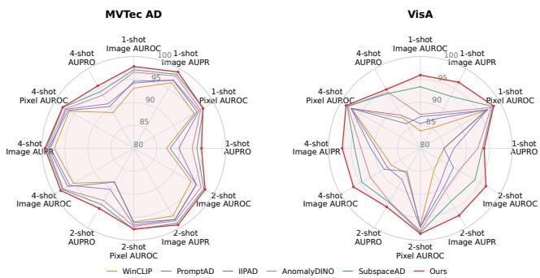

(a) Few-shot performance  
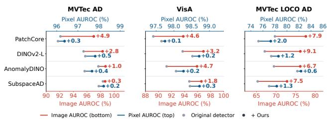  
(b) Improvements across detectors  
Figure 1. Performance improvements with VerdictAD. (a) Anomaly detection and localization performance under the 1-, 2-, and 4-shot settings on MVTec AD and VisA. (b) Image-level and pixel-level AUROC before and after applying VerdictAD to differ ent anomaly detectors.

A major challenge in industrial anomaly detection is the limited availability of training data. Full-shot methods typically require hundreds of defect-free images per category to model normal appearances, which can be difficult to obtain in practice. In contrast, zero-shot methods leverage vision-language models (VLMs) and textual prompts to detect anomalies without normal training samples. However, they often struggle with subtle, non-semantic defects, such as tiny cracks, that are difficult to describe through language alone. In this work, we focus on the more practical yet challenging few-shot setting. Under this setting, only a handful of normal images are available for each target category to characterize its normal appearance.

Existing few-shot industrial anomaly detection methods mainly include reconstruction-based, memory-bank-based, and vision-language model (VLM)-based approaches. Despite their different designs, these methods typically produce image-level anomaly scores and pixel-level anomaly maps to identify and localize defects. However, visual differences do not always indicate genuine defects, as normal appearance variations can also produce high anomaly scores. As shown in Fig. 2, a normal juice bottle may be flagged as anomalous because its liquid color differs from the references, while variations in screw orientation and background textures can also trigger false responses. Conversely, logical anomalies may produce misleading anomaly responses. In the breakfast box example, missing dried fruits cause a logical anomaly, but the baseline incorrectly highlights the entire tray rather than the actual defective region. These examples show that anomaly responses based on visual differences do not always accurately reflect genuine defects.

This motivates us to verify anomaly responses rather than solely improving visual representations. Recent typed decision models [11, 60] provide probabilities over predefined answers without generating free-form text. Such decisions offer complementary information to the visual differences measured by existing anomaly detectors. We therefore explore their use in refining image-level anomaly scores and pixel-level anomaly maps. To this end, we propose VerdictAD, a training-free framework for decisionguided anomaly refinement. We first build a simple anomaly detector using frozen DINOv2-L features [48] to obtain image-level anomaly scores and pixel-level anomaly maps. We then introduce two complementary refinement modules. Global Verdict Refinement (GVR) combines reference-free and reference-conditioned decisions to refine image-level anomaly scores. Local Verdict Refinement (LVR) evaluates image regions through cropped views and boxed full-image views, producing a verification map to reweight the original anomaly map. By suppressing misleading responses more strongly than defect-related ones, LVR improves the relative prominence of genuine defects without generating new anomaly evidence. Together, these modules achieve state-of-the-art performance across multiple few-shot anomaly detection benchmarks. Moreover, the underlying detector can be replaced with existing anomaly detection methods, allowing VerdictAD to refine their predictions without modifying their architectures or requiring additional training. Our main contributions are threefold:

1. We propose VerdictAD, a training-free framework that leverages typed visual decisions to refine anomaly detection and localization.

2. We introduce GVR and LVR to refine image-level anomaly scores and pixel-level anomaly maps through global and local visual decisions.

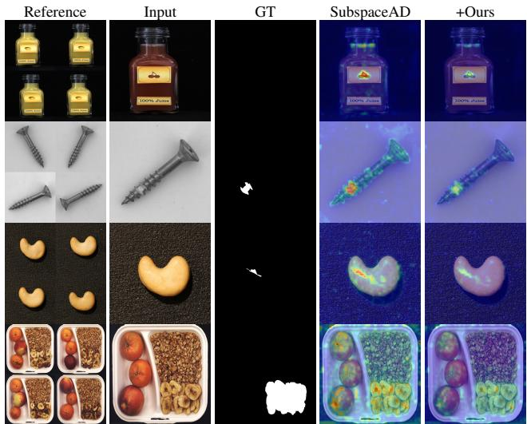  
Figure 2. Examples of visual differences that produce mislead ing anomaly responses. (a) Juice bottle: Different liquid colors lead to false anomaly responses on the bottle logo. (b) Screw: Variations in screw orientation cause widespread false responses. (c) Cashew: Textured backgrounds are incorrectly identified as anomalous regions. (d) Breakfast box: Missing dried fruits cause a logical anomaly, but the baseline incorrectly highlights the entire tray. VerdictAD uses visual decisions to suppress misleading responses while preserving useful anomaly evidence.

3. Extensive experiments on MVTec AD, VisA, and MVTec LOCO AD demonstrate state-of-the-art performance across multiple few-shot settings.

4. We demonstrate the generality of VerdictAD by consistently improving existing anomaly detectors without additional training.

## 2. Related Work

## 2.1. Industrial Visual Anomaly Detection

Industrial anomaly detection identifies deviations from normal appearance, typically without annotated defects [10, 49]. Early reconstruction approaches use autoencoders to expose defects through reconstruction errors [5, 68], while reverse distillation [18] and contrastive reconstruction [25] operate in learned feature spaces. Recent reconstructionbased methods employ Transformer architectures [26, 66, 70], diffusion models [21, 29, 69], and state-space models [28], while prototype-guided reconstruction further improves unified anomaly detection [44]. Alternatively, flowbased methods estimate feature distributions [24, 67]. Feature matching [15, 52] and statistical modeling [17] have also been adopted for anomaly detection, with subsequent work addressing noisy references, speed, and discriminative scoring [2, 4, 35, 43, 74]. These approaches are commonly evaluated on industrial benchmarks with varied defects and acquisition conditions [6, 31, 61].

## 2.2. Few-shot and Training-free Anomaly Detection

Few-shot detection seeks to characterize normality from only a handful of examples. Early adaptations of nearestneighbor matching and feature distributions include optimized PatchCore, GraphCore, and personalized anomaly models [37, 53, 63]. Strong visual representations from self-supervised transformers and masked image modeling [9, 30, 48, 55] have enabled increasingly simple detectors. AnomalyDINO [16] uses patch-level DINOv2 features, FastRecon [20] reconstructs normal features, and SubspaceAD [39] fits a normal feature subspace. Recent variants investigate prototype [42] and structural feature [34] refinement, object-centric logical anomalies [23], multi-scale features [1], geometric priors [64], multiview consistency [47], and deployment robustness [54]. Related work also seeks transferable detection across categories and domains [56]. Unlike methods that modify normal feature representations, our approach uses visual decisions to refine the anomaly scores and maps.

## 2.3. Vision-Language Anomaly Detection

Vision-language representations such as CLIP [51] support anomaly detection through text-image similarity. Win-CLIP [33] introduces window-level prompting, while PromptAD [41], instance-induced prompting [45], and multimodal prompt learning [38] adapt the prompt space to few-shot normal references. Zero-shot approaches leverage prompt learning [8, 62, 73], vision-language adaptation [12, 19, 65], and mutual scoring across unlabeled images [40]. Recent work also adapts vision foundation models for zero-shot anomaly detection [22]. Recent work further introduces image-level-supervised reasoning [36], knowledge-grounded reasoning [71], and agentic visionlanguage models [3]. However, these approaches typically use language-aligned representations or reasoning to construct an anomaly detector. In contrast, VerdictAD uses a frozen typed decision model to produce direct anomaly judgments that refine image-level scores and pixel-level maps from existing detectors, without additional training or changes to their architectures.

## 2.4. Typed Decision Models

Typed decision models have recently emerged as an alternative to generative language models for structured decisionmaking, building on earlier work in verification and LLMas-a-Judge [14, 72]. Unlike conventional LLMs that produce free-form text, Jev [60] directly answers typed questions with probabilities over predefined options. Recent open models, including NeoHorse-Jev [57, 59] and JevRL [58], further explore decision modeling and learning. Recent open-source decision models built upon multimodal backbones have further extended typed decision-making to visual inputs [11, 13, 50]. Recent studies have further explored their applications in alignment assessment [27], adversarial robustness evaluation [32], and reinforcement learning [46]. Despite these advances, typed decision models remain largely unexplored for industrial anomaly detection. Unlike methods that directly predict anomalies, VerdictAD leverages typed decisions as complementary evidence to refine image-level scores and pixel-level anomaly maps from existing detectors.

## 3. Method

## 3.1. Preliminaries

Few-shot Anomaly Detection. Given a query image $\mathbf { X \in }$ $\mathbb { R } ^ { H \times W \times 3 }$ and k normal reference images $\mathbf { \mathcal { R } } = \{ \mathbf { R } _ { j } \} _ { j = 1 } ^ { k } ,$ where $k \in \{ 1 , 2 , 4 \}$ , a base anomaly detector D produces an image-level anomaly score s and a pixel-level anomaly map $\mathbf { M } \in \mathbb { R } _ { \geq 0 } ^ { H \times W }$

$$
( s , \mathbf { M } ) = { \mathcal { D } } ( \mathbf { X } ; { \mathcal { R } } ) .\tag{1}
$$

The score s is typically obtained by pooling the anomaly map, such as max pooling in PatchCore [53] and top-1% averaging in AnomalyDINO [16]. Despite these differences, VerdictAD serves as a plug-and-play refinement framework that operates on both outputs without modifying the underlying detector. Our refinement framework operates on both outputs without modifying the base detector.

Typed Decision Models. Unlike conventional generative language models, typed decision models such as Jev [11, 60] produce probabilities over predefined answers without text generation. A model J takes a set of images I and a question schema Q as input. Among the supported Choice, Score, and Noul modes, we use Noul to obtain binary anomaly decisions. Specifically, we adopt the frozen Clef-Flash model [13] to obtain decision logits without autoregressive text generation.

## 3.2. Overall Pipeline

As illustrated in Fig. 3, VerdictAD consists of a base anomaly detector and two decision-guided refinement modules, GVR and LVR.

Base Anomaly Detector. We construct a simple anomaly detector using a pretrained DINOv2-L encoder [48]. Given a query image and k normal reference images, we extract patch features from an intermediate transformer layer of the frozen encoder. For each query patch, we compute its nearest-neighbor distance to the reference patch features to construct an anomaly map M. The image-level anomaly score s is obtained by max pooling over M.

Decision-Guided Refinement. Given the initial anomaly score and map, GVR uses a frozen typed decision model to evaluate the query image with and without normal references, producing a decision probability to refine the imagelevel score. LVR further evaluates local regions through two complementary views: cropped regions that emphasize local details and boxed full-image views that preserve global context. The resulting regional decisions are aggregated into a verification map to reweight the initial anomaly map. Since both modules operate on the detector outputs, the base detector can be replaced with existing anomaly detection methods without additional training.

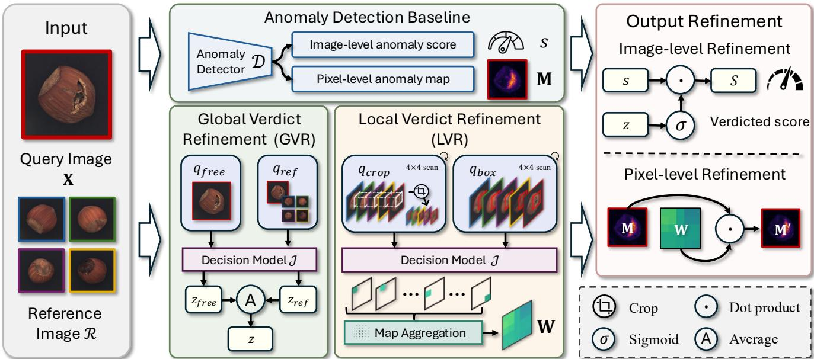  
Figure 3. Overview of VerdictAD. A base detector D produces an anomaly map M and a score s from the query X and the references R. The frozen decision model $\mathcal { I }$ answers a reference-free and a reference-conditioned question on the whole image, giving the image logit z that gates s into S. It also answers one question per window $b _ { i }$ , either on a crop pair or on the full image with a red box, giving window logits $z _ { i }$ that form the verification map W and reweight M into M′.

## 3.3. Global Verdict Refinement

GVR combines reference-free and reference-conditioned decisions to refine the image-level anomaly score:

$$
z _ { \mathrm { f r e e } } = \mathcal { I } ( \{ { \mathbf { X } } \} , q _ { \mathrm { f r e e } } ) ,\tag{2}
$$

$$
z _ { \mathrm { r e f } } = \mathcal { I } \big ( \{ \mathbf { X } , \mathrm { T i l e } ( \mathcal { R } ) \} , q _ { \mathrm { r e f } } \big ) ,\tag{3}
$$

$$
\begin{array} { r } { z = \frac { 1 } { 2 } ( z _ { \mathrm { f r e e } } + z _ { \mathrm { r e f } } ) , } \end{array}\tag{4}
$$

where $\mathrm { T i l e } ( \cdot )$ arranges the normal references into a single grid, and $q _ { \mathrm { f r e e } }$ and $q _ { \mathrm { r e f } }$ denote the corresponding binary decision questions. The reference-free logit $z _ { \mathrm { f r e e } }$ captures general defect evidence, while the reference-conditioned logit $z _ { \mathrm { r e f } }$ assesses anomalies relative to the normal references. We use their averaged logit z to refine the detector score:

$$
S = s \cdot \sigma ( z ) ^ { \alpha } ,\tag{5}
$$

where $\sigma ( \cdot )$ denotes the sigmoid function and α controls the strength of image-level refinement. The decision probability acts as a multiplicative gate, suppressing anomaly scores that receive weak support from the decision model. This allows normal appearance variations to be downweighted while preserving stronger responses to genuine defects. When $\alpha = 0$ , the original detector score is recovered For zero-shot detectors without references $( \mathcal { R } = \mathcal { O } )$ , we use $z = z _ { \mathrm { f r e e } } ,$

## 3.4. Local Verdict Refinement

While GVR refines image-level anomaly scores, LVR evaluates anomaly responses at the regional level. We place N overlapping square windows with a predefined window size and stride over the query image. Each window is represented by $b _ { i } \ = \ ( x _ { i } ^ { 0 } , \bar { y } _ { i } ^ { 0 } , x _ { i } ^ { 1 } , y _ { i } ^ { 1 } ) \ \in \ [ 0 , 1 ] ^ { 4 }$ , where $i \ =$ $1 , \ldots , N$ , and $\Omega ( b _ { i } )$ denotes its pixel region. We denote the corresponding image crop by $\mathbf { X } [ b _ { i } ]$ . Each window is evaluated using two complementary views.

Crop Decision. We compare the query crop $\mathbf { X } [ b _ { i } ]$ ] with the corresponding reference crops $\mathbf { \mathcal { R } } [ b _ { i } ] = \{ \mathbf { R } _ { j } [ b _ { i } ] \} _ { j = 1 } ^ { k } \mathrm { : }$

$$
z _ { i } ^ { \mathrm { c } } = \mathcal { I } \big ( \{ \mathbf { X } [ b _ { i } ] , \mathrm { T i l e } ( \mathcal { R } [ b _ { i } ] ) \} , q _ { \mathrm { c r o p } } \big ) ,\tag{6}
$$

where $q _ { \mathrm { c r o p } }$ is the binary question for crop-based anomaly assessment. Cropping emphasizes local details, making it suitable for defects such as scratches, cracks, and holes.

Box Decision. We draw a red box around $b _ { i }$ on the full query image, denoted by $\mathrm { B o x } ( \mathbf { X } , b _ { i } )$ , and compare it with the full references:

$$
z _ { i } ^ { \mathrm { b } } = \mathcal { I } \big ( \{ \mathrm { B o x } ( \mathbf { X } , b _ { i } ) , \mathrm { T i l e } ( \mathcal { R } ) \} , q _ { \mathrm { b o x } } \big ) ,\tag{7}
$$

where $q _ { \mathrm { b o x } }$ is the corresponding binary decision question. Unlike cropping, boxing preserves global context, making it suitable for logical anomalies involving missing, extra, or misplaced components. We use red boxes throughout our experiments, with the effect of box color examined in supplementary materials.

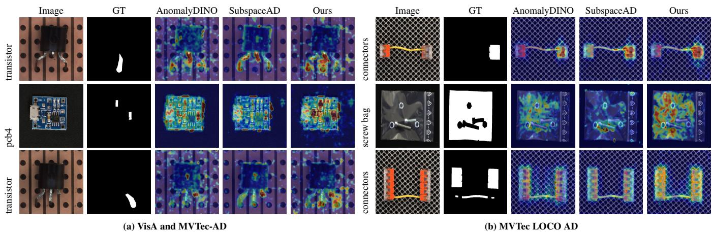  
Figure 4. Qualitative comparison of anomaly localization results on VisA, MVTec-AD, and MVTec LOCO AD. Each example shows the input image, ground truth (GT), and anomaly-map overlays from AnomalyDINO, SubspaceAD, and VerdictAD. Compared with the baseline detectors, VerdictAD generally produces more focused responses and suppresses distracting activations on irrelevant regions, while preserving the responses around true defects. The LOCO examples further illustrate that VerdictAD can improve localization qualit for both structural and logical anomalies when the original anomaly map already contains useful evidence.

Verification Map Aggregation. We combine the crop and box decisions into a set of 2N regional logits:

$$
z _ { i } = \left\{ \begin{array} { l l } { z _ { i } ^ { \mathrm { c } } , } & { 1 \leq i \leq N , } \\ { z _ { i - N } ^ { \mathrm { b } } , } & { N < i \leq 2 N , } \end{array} \right. b _ { i + N } = b _ { i } ( 1 \leq i \leq N ) .\tag{8}
$$

The crop and box decisions for each window share the same spatial coordinates. We construct a verification map by averaging the transformed decision probabilities of all windows covering each pixel u:

$$
\mathbf { W } ( u ) = \frac { \sum _ { i = 1 } ^ { 2 N } \mathbb { I } [ u \in \Omega ( b _ { i } ) ] \sigma ( z _ { i } ) ^ { \gamma } } { \sum _ { i = 1 } ^ { 2 N } \mathbb { I } [ u \in \Omega ( b _ { i } ) ] } ,\tag{9}
$$

where I[·] is the indicator function and $\gamma$ controls the strength of pixel-level refinement. The original anomaly map is then reweighted by the verification map:

$$
\mathbf { M } ^ { \prime } ( u ) = \mathbf { M } ( u ) \cdot \mathbf { W } ( u ) .\tag{10}
$$

Since $\mathbf { W } ( u ) ~ \in ~ ( 0 , 1 )$ , LVR suppresses responses in regions judged less likely to contain defects while retaining relatively stronger responses in anomalous regions. When $\gamma = 0$ , the original anomaly map is recovered. As the refinement is multiplicative, $\mathbf { M } ^ { \prime } ( u ) = 0$ wherever $\mathbf { M } ( u ) = 0$ meaning that LVR can only reweight existing anomaly evidence rather than introduce new responses.

## 4. Experiments

## 4.1. Experimental Settings

Datasets. We evaluate VerdictAD on three benchmarks: MVTec AD [6], VisA [74], and MVTec LOCO AD [7]. MVTec AD contains 15 object and texture categories, while VisA consists of 12 industrial object categories. MVTec LOCO AD contains five categories with both structural and logical anomalies, making it suitable for evaluating defects beyond local appearance differences. All three datasets provide normal training images and test images with imagelevel and pixel-level anomaly annotations. Following the few-shot protocol, we randomly select $k \in \{ 1 , 2 , 4 \}$ normal images per category as references.

Evaluation Metrics. Image-level performance is measured by AUROC and Average Precision (AUPR), while pixellevel performance is evaluated using pixel-wise AUROC and Area Under the Per-Region Overlap curve (AUPRO). All metrics are reported as percentages. For MVTec LOCO AD, we report standard AUPRO rather than the datasetspecific sPRO metric.

Implementation Details. We use 9B-parameter Clef-Flash as the frozen decision model ${ \mathcal { I } } .$ . Our default detector extracts patch features from the 18th transformer layer of DINOv2-L. All decision questions are binary, with positive answers indicating a defect, contamination, or incorrect arrangement. Image-level inputs are resized to $8 9 6 \times 8 9 6 ,$ while regional inputs are resized to 448×448. For GVR, we set α = 0.5 for image-level refinement. For LVR, we use N = 16 overlapping windows on a 4 × 4 grid, with a normalized side length of 0.4 and stride of 0.2. Both cropped and boxed views are used, with $\gamma = 0 . 2 5$ for pixel-level refinement. We use the same normal references as the cor-

Table 1. Few-shot anomaly detection and localization on MVTec AD and VisA (%). Values with subscripts report mean and standard deviation. Bold and underlined means indicate the best and second-best results within each shot and metric; the final four rows in each shot are excluded from ranking. ∆ denotes the difference from the corresponding baseline in percentage points.
<table><tr><td colspan="3"></td><td colspan="4">MVTec AD</td><td colspan="4">VisA</td></tr><tr><td colspan="3">Setup Method</td><td colspan="2">Image-level</td><td colspan="2">Pixel-level</td><td colspan="2">Image-level</td><td colspan="2">Pixel-level</td></tr><tr><td colspan="2"></td><td>AUROC</td><td>AUPR</td><td>AUROC</td><td>AUPRO</td><td></td><td>AUROC</td><td>AUPR</td><td>AUROC</td><td>AUPRO</td></tr><tr><td rowspan="12"></td><td>SPADE [15]</td><td>81.0</td><td>90.6</td><td>91.2</td><td>83.9</td><td>79.5</td><td></td><td>82.0</td><td>95.6</td><td>84.1</td></tr><tr><td>PatchCore [52]</td><td>83.4</td><td>92.2</td><td>92.0</td><td>79.7</td><td>79.9</td><td>82.8</td><td></td><td>95.4</td><td>80.5</td></tr><tr><td>WinCLIP [33]</td><td>93.1</td><td>96.5</td><td>95.2</td><td>87.1</td><td>83.8</td><td></td><td>85.1</td><td>96.4</td><td>85.1</td></tr><tr><td>PromptAD [41]</td><td>94.6</td><td>97.1</td><td>95.9</td><td>87.9</td><td>86.9</td><td></td><td>88.4</td><td>96.7</td><td>85.1</td></tr><tr><td>IIPAD [45]</td><td>94.2</td><td>97.2</td><td>96.4</td><td>89.8</td><td>85.4</td><td>87.5</td><td></td><td>96.9</td><td>87.3</td></tr><tr><td>DINOv2-L [48]</td><td> $9 4 . 3 \ \pm 0 . 3$ </td><td> $9 7 . 1 \ \pm 0 . 1$ </td><td> $9 6 . 6 \_ = 0 . 0$ </td><td> $9 3 . 5 \ \pm 0 . 2$ </td><td> $9 2 . 0 \ _ { \pm 0 . 4 }$ </td><td> $9 2 . 1 \ \pm 0 . 3$ </td><td></td><td>97.7 ±0.1</td><td>93.0 ±0.2</td></tr><tr><td>1-shot AnomalyDINO [16]</td><td>96.6</td><td>98.2</td><td>96.8</td><td>92.7</td><td>87.4</td><td>89.0</td><td></td><td>97.8</td><td>92.5</td></tr><tr><td>SubspaceAD [39]</td><td> $\underline { { 9 7 . 1 } } \ \pm \mathrm { 0 . 9 }$ </td><td></td><td> $9 8 . 6 \_ = 0 . 4$ </td><td> ${ \bf 9 7 . 5 \pm 0 . 1 }$ </td><td> $\underline { { 9 3 . 7 } } \ \pm \mathbf { 0 . 2 }$ </td><td> $9 3 . 4 \pm 0 . 7 $ </td><td> $\underline { { 9 3 . 1 } } \ \pm \mathrm { 0 . 8 }$ </td><td> $\underline { { 9 8 . 2 } } \ \pm 0 . 1$ </td><td> ${ \bf 9 3 . 5 \mu _ { \pm 0 . 2 } }$ </td></tr><tr><td>DINOv2-L + Ours</td><td> ${ \bf 9 7 . 5 \pm 0 . 2 }$ </td><td> $\mathbf { 9 9 . 0 _ { \pm 0 . 1 } }$ </td><td> $9 7 . 4 \pm 0 . 0$ </td><td></td><td> $\mathbf { 9 4 . 7 \bot } _ { \pm 0 . 1 }$ </td><td> $\mathbf { 9 5 . 7 \bot } 0 . 4$ </td><td> ${ \bf 9 6 . 3 \scriptstyle \pm 0 . 3 }$ </td><td> ${ \bf 9 8 . 3 \scriptstyle \pm 0 . 1 }$ </td><td> ${ \bf 9 3 . 5 \pm 0 . 3 }$ </td></tr><tr><td>AnomalyDINO + Ours 98.1 ±0.2 Δ</td><td>+1.5</td><td> $9 9 . 3 \ \pm 0 . 1 $  +1.1</td><td> $9 7 . 4 \pm 0 . 1$  +0.6</td><td>+0.9</td><td> $9 3 . 6 \_ = 0 . 1$ </td><td> $9 5 . 2 \ \pm 0 . 1$  +7.8</td><td> $9 5 . 9 \pm 0 . 2$  +6.9</td><td>98.0 ±0.0 +0.2</td><td>94.1 ±0.1</td></tr><tr><td>SubspaceAD + Ours Δ</td><td> $9 8 . 0 ~ \pm 0 . 4$  +0.9</td><td> $9 9 . 3 \ \pm \mathrm { 0 . 2 }$  +0.7</td><td> $9 7 . 9 \ \pm 0 . 1$  +0.4</td><td> $9 5 . 2 \pm 0 . 2$  +1.5</td><td>+2.5</td><td> $9 5 . 9 \pm 0 . 3$ </td><td> $9 6 . 4 \pm 0 . 3 $ </td><td> $9 8 . 7 \pm 0 . 0 $ </td><td>+1.6 95.9 ±0.1</td></tr><tr><td>SPADE [15]</td><td>82.9</td><td>91.7</td><td>92.0</td><td>85.7</td><td></td><td></td><td>+3.3</td><td>+0.5</td><td>+2.4</td></tr><tr><td rowspan="11"></td><td>PatchCore [52]</td><td>86.3</td><td>93.8</td><td>93.3</td><td>82.3</td><td>80.7 81.6</td><td>82.3 84.8</td><td></td><td>96.2 96.1</td><td>85.7 82.6</td></tr><tr><td>WinCLIP [33]</td><td>94.4</td><td>97.0</td><td>96.0</td><td>88.4</td><td>84.6</td><td></td><td>85.8</td><td>96.8</td><td>86.2</td></tr><tr><td>PromptAD [41]</td><td>95.7</td><td>97.9</td><td>96.2</td><td>88.5</td><td>88.3</td><td>90.0</td><td></td><td>97.1</td><td>85.8</td></tr><tr><td>IIPAD [45]</td><td>95.7</td><td>97.9</td><td>96.7</td><td>90.3</td><td>86.7</td><td>88.6</td><td></td><td>97.2</td><td></td></tr><tr><td>DINOv2-L [48]</td><td></td><td></td><td></td><td>94.3 ±0.1</td><td></td><td></td><td></td><td></td><td>87.9</td></tr><tr><td>2-shot AnomalyDINO [16]</td><td> $9 5 . 4 \pm 0 . 5$ </td><td> $9 7 . 5 \ \pm 0 . 3$ </td><td> $9 7 . 0 \ \pm 0 . 1$ </td><td></td><td> $9 2 . 5 \ \pm 0 . 8$ </td><td> $9 2 . 5 \ \pm 0 . 7$ </td><td></td><td>98.1 ±0.0</td><td>93.6 ±0.3</td></tr><tr><td></td><td>96.9</td><td>98.2</td><td>97.0</td><td>93.1</td><td>89.7</td><td></td><td>90.7</td><td>98.0</td><td>93.4</td></tr><tr><td>SubspaceAD [39]</td><td>97.6 ±0.6</td><td> $9 8 . 8 \pm 0 . 4$ </td><td> $\mathbf { 9 7 . 7 \bot } _ { \pm 0 . 1 }$ </td><td> $9 4 . 1 \ \pm 0 . 1$ </td><td></td><td> $\underline { { 9 3 . 7 } } \pm \mathrm { 0 . 5 }$ </td><td> $\underline { { 9 3 . 3 } } ~ \pm 0 . 8$ </td><td> $\underline { { 9 8 . 3 } } \ \pm 0 . 0$ </td><td>93.6 ±0.1</td></tr><tr><td>DINOv2-L + Ours</td><td> ${ \bf 9 8 . 2 _ { \pm 0 . 2 } }$ </td><td> ${ \bf 9 9 . 3 _ { \pm 0 . 0 } }$ </td><td> $9 7 . 6 \_ = 0 . 0$ </td><td> ${ \bf 9 5 . 1 _ { \pm 0 . 0 } }$ </td><td></td><td> ${ \bf 9 6 . 5 \scriptstyle \pm 0 . 3 }$ </td><td> ${ \bf 9 6 . 9 _ { \pm 0 . 3 } }$ </td><td> ${ \bf 9 8 . 5 \pm 0 . 0 }$ </td><td> $\mathbf { 9 4 . 2 \_ } _ { \pm 0 . 4 }$ </td></tr><tr><td>AnomalyDINO + Ours Δ</td><td> $9 8 . 6 \_ = 0 . 2$  +1.7</td><td> $9 9 . 5 \ \pm 0 . 0$  +1.3</td><td> $9 7 . 6 \ \pm 0 . 1$  +0.6</td><td> $9 4 . 0 \ \pm 0 . 2 $  +0.9</td><td>+6.2</td><td> $9 5 . 9 \pm 0 . 4$ </td><td> $9 6 . 4 \ \pm 0 . 4$  +5.7</td><td>98.2 ±0.0 +0.2</td><td>94.8 ±0.2 +1.4</td></tr><tr><td>SubspaceAD + Ours Δ</td><td>98.6 ±0.2 +1.0</td><td>99.5 ±0.1 +0.7</td><td> $9 8 . 0 \ \pm \mathrm { 0 . 0 }$  +0.3</td><td> $9 5 . 4 \pm 0 . 1$  +1.3</td><td> $9 6 . 4 \pm 0 . 3$  +2.7</td><td>96.8 ±0.3 +3.5</td><td></td><td>98.7 ±0.0 +0.4</td><td>96.2 ±0.0 +2.6</td></tr><tr><td rowspan="11"></td><td>SPADE [15]</td><td>84.8</td><td>92.5</td><td>92.7</td><td>87.0</td><td></td><td>81.7</td><td>83.4</td><td>96.6</td><td>87.3</td></tr><tr><td>PatchCore [52]</td><td>88.8</td><td>94.5</td><td>94.3</td><td>84.3</td><td></td><td>85.3</td><td>87.5</td><td>96.8</td><td>84.9</td></tr><tr><td>WinCLIP [33]</td><td>95.2</td><td>97.3</td><td>96.2</td><td>89.0</td><td>87.3</td><td></td><td>88.8</td><td>97.2</td><td>87.6</td></tr><tr><td>PromptAD [41]</td><td>96.6</td><td>98.5</td><td>96.5</td><td>90.5</td><td>89.1</td><td></td><td></td><td>97.4</td><td></td></tr><tr><td>IIPAD [45]</td><td>96.1</td><td>98.1</td><td>97.0</td><td>91.2</td><td>88.3</td><td>90.8 89.6</td><td></td><td>97.4</td><td>86.2 88.3</td></tr><tr><td>DINOv2-L [48]</td><td> $9 7 . 2 \ \pm 0 . 5$ </td><td></td><td></td><td></td><td></td><td></td><td></td><td> $9 8 . 3 \ \pm 0 . 0$ </td><td>93.8 ±0.3</td></tr><tr><td>4-shot AnomalyDINO [16]</td><td>97.7</td><td> $\begin{array} { l } { 9 8 . 4 \ \pm \mathrm { 0 . 3 } } \\ { 9 8 . 7 } \end{array}$ </td><td> $\begin{array} { l } { 9 7 . 4 \ \pm \mathrm { 0 . 0 } } \\ { 9 7 . 2 } \end{array}$ </td><td> $\frac { 9 5 . 2 } { 9 3 . 4 } \ \pm 0 . 1$ </td><td></td><td> $\begin{array} { l } { 9 3 . 6 \ \pm \mathrm { 0 . 5 } } \\ { 9 2 . 6 } \end{array}$ </td><td> $\begin{array} { c } { 9 3 . 3 } \\ { 9 2 . 9 } \end{array} \pm 0 . 6$ </td><td>98.2</td><td>94.1</td></tr><tr><td>SubspaceAD [39]</td><td> $9 7 . 9 \pm 0 . 4 $ </td><td> $9 9 . 0 \pm 0 . 2 $ </td><td> $9 7 . 8 \ \pm 0 . 1$ </td><td></td><td> $9 4 . 3 \ \pm 0 . 0$ </td><td> $\underline { { 9 4 . 7 } } \pm 0 . 2$ </td><td> $9 4 . 3 \ \pm 0 . 5$ </td><td> $9 8 . 4 \pm 0 . 0$ </td><td> $9 3 . 8 \ \pm 0 . 2$ </td></tr><tr><td>DINOv2-L + Ours</td><td> $\mathbf { 9 8 . 7 \bot 0 . 3 }$ </td><td> ${ \bf 9 9 . 5 \mu _ { \pm 0 . 1 } }$ </td><td> $\mathbf { 9 7 . 9 \Pi _ { \pm 0 . 0 } }$ </td><td></td><td> $\mathbf { 9 5 . 7 \Pi _ { \pm 0 . 0 } }$ </td><td> ${ \bf 9 6 . 9 _ { \pm 0 . 1 } }$ </td><td> ${ \bf 9 7 . 2 _ { \pm 0 . 1 } }$ </td><td> $\mathbf { 9 8 . 7 \Omega _ { \pm 0 . 0 } }$ </td><td> ${ \bf 9 4 . 4 _ { \pm 0 . 3 } }$ </td></tr><tr><td>AnomalyDINO + Ours</td><td> $9 8 . 9 \pm 0 . 2 $ </td><td> $9 9 . 6 \ \pm 0 . 1 $ </td><td> $9 7 . 7 \ \pm 0 . 1$ </td><td></td><td> $9 4 . 2 \ \pm 0 . 1$ </td><td> $9 6 . 3 \ \pm 0 . 1$ </td><td> $9 6 . 7 \ \pm 0 . 1$ </td><td> $9 8 . 3 \ \pm 0 . 0$ </td><td> $9 5 . 2 \pm 0 . 2$ </td></tr><tr><td> $\Delta$  SubspaceAD + Ours Δ</td><td>+1.2  $9 8 . 8 \ \pm 0 . 1$  +0.9</td><td>+0.9  $9 9 . 6 \_ = 0 . 0$  +0.6</td><td>+0.5  $9 8 . 1 \ \pm 0 . 0$  +0.3</td><td>+0.8  $9 5 . 6 \_ { \pm 0 . 1 }$  +1.3</td><td></td><td>+3.7  $9 6 . 5 \ \pm 0 . 1$ </td><td>+3.8  $9 6 . 8 \ \pm 0 . 1$ </td><td>+0.1 98.8 ±0.0</td><td>+1.1  $9 6 . 3 \ \pm 0 . 1$ </td></tr></table>

responding base detector. For reference-conditioned decisions, the references are arranged into $\phantom { - } 4 2 \times 2$ mosaic, with cyclic repetition when $k < 4 .$ Each few-shot setting is evaluated using 3 random seeds for reference selection.  
DINO [16], and SubspaceAD [39]. To evaluate plugand-play generality, we apply GVR and LVR to Patch-Core, AnomalyDINO, and SubspaceAD without modifying their architectures. For zero-shot evaluation, we consider AnomalyCLIP [73] and AdaCLIP [8].

Baselines. We compare VerdictAD with representative fewshot AD methods, including SPADE [15], PatchCore [52], WinCLIP [33], PromptAD [41], IIPAD [45], Anomaly-

Table 2. Four-shot anomaly detection and localization on MVTec LOCO AD (%). Results are reported as mean and standard deviation over three seeds. Best and second-best results are bold and underlined.
<table><tr><td rowspan="2">Method</td><td colspan="2">Image-level</td><td colspan="2">Pixel-level</td></tr><tr><td>AUROC</td><td>AUPR</td><td>AUROC</td><td>AUPRO</td></tr><tr><td>PatchCore [52]</td><td> $6 7 . 4 { \scriptstyle \pm 3 . 3 }$ </td><td> $7 7 . 6 _ { \pm 2 . 5 }$ </td><td> $7 4 . 9 _ { \pm 0 . 0 }$ </td><td> $6 6 . 7 _ { \pm 0 . 5 }$ </td></tr><tr><td> $\mathrm { P a t c h C o r e + O u r s }$ </td><td> $7 8 . 0 _ { \pm 2 . 4 }$ </td><td> $8 6 . 5 { \scriptstyle \pm 1 . 5 }$ </td><td> $7 9 . 9 { \scriptstyle \pm 0 . 3 }$ </td><td> $6 8 . 7 _ { \pm 0 . 4 }$ </td></tr><tr><td>DINOv2-L [48]</td><td> $6 8 . 7 _ { \pm 0 . 8 }$ </td><td> $8 0 . 3 { \scriptstyle \pm 0 . 8 }$ </td><td> $7 7 . 1 _ { \pm 0 . 1 }$ </td><td> $6 2 . 8 { \scriptstyle \pm 0 . 3 }$ </td></tr><tr><td>DINOv2-L + Ours</td><td> $7 7 . 5 { \scriptstyle \pm 0 . 1 }$ </td><td> $8 6 . 3 _ { \pm 0 . 1 }$ </td><td> $8 0 . 0 { \scriptstyle \pm 0 . 1 }$ </td><td> $6 5 . 4 _ { \pm 0 . 2 }$ </td></tr><tr><td>AnomalyDINO [16]</td><td> $6 7 . 4 { \scriptstyle \pm 2 . 0 }$ </td><td> $7 7 . 7 _ { \pm 1 . 2 }$ </td><td> $8 1 . 5 { \scriptstyle \pm 0 . 2 }$ </td><td> $5 9 . 5 { \scriptstyle \pm 0 . 8 }$ </td></tr><tr><td> $\mathrm { A n o m a l y D I N O + O u r s }$ </td><td> $7 4 . 9 { \scriptstyle \pm 1 . 7 }$ </td><td> $8 3 . 3 { \scriptstyle \pm 0 . 7 }$  </td><td> $8 2 . 7 _ { \pm 0 . 3 }$ </td><td> $6 1 . 1 _ { \pm 1 . 0 }$ </td></tr><tr><td>SubspaceAD [39]</td><td> $6 7 . 5 { \scriptstyle \pm 1 . 7 }$ </td><td> $7 9 . 5 { \scriptstyle \pm 1 . 2 }$ </td><td> $7 6 . 6 { \scriptstyle \pm 0 . 3 }$ </td><td> $6 9 . 5 { \scriptstyle \pm 0 . 2 }$ </td></tr><tr><td> $\mathrm { S u b s p a c e A D + O u r s }$ </td><td> $7 5 . 3 { \scriptstyle \pm 2 . 0 }$ </td><td> $8 4 . 7 _ { \pm 1 . 2 }$ </td><td> $7 9 . 3 _ { \pm 0 . 1 }$ </td><td> $7 1 . 3 { \scriptstyle \pm 0 . 6 }$ </td></tr></table>

## 4.2. Comparison with State-of-the-Art Methods

Few-shot Anomaly Detection. Tab. 1 compares VerdictAD with existing methods on MVTec AD and VisA under the $1 \mathrm { - } , 2 \mathrm { - }$ , and 4-shot settings. Despite using a simple DINOv2- L detector, VerdictAD achieves competitive or state-of-theart performance across different few-shot settings, particularly in image-level detection. Using SubspaceAD as the base detector further improves localization, achieving consistently strong pixel-level results.

Logical Anomaly Detection. Tab. 2 presents the 4-shot results on MVTec LOCO AD. Our refinement substantially improves image-level detection and pixel-level localization, particularly when combined with SubspaceAD. Different base detectors perform best on different metrics, suggesting that their underlying anomaly representations remain important even after refinement.

Qualitative Comparison. Fig. 4 compares the anomaly maps produced by AnomalyDINO, SubspaceAD, and VerdictAD against the ground-truth annotations. Compared with existing detectors, VerdictAD suppresses irrelevant responses and produces anomaly maps that better highlight the actual defective regions.

## 4.3. Generalization Across Anomaly Detectors

Plug-and-Play Refinement. We apply VerdictAD to Patch-Core, DINOv2-L, AnomalyDINO, and SubspaceAD without modifying their architectures. Across all evaluated datasets and few-shot settings, all four detectors consistently improve in both image-level AUROC and pixel-level AUROC. These improvements are observed across different reference selections, rather than being limited to a single run. The examples in Fig. 2 further illustrate how the same refinement suppresses misleading responses caused by appearance variations.

Table 3. Zero-shot image-level AUROC and AUPR (%) on three datasets. Ours uses reference-free global decisions with a gating exponent of 0.25. Best and second-best results are bold and underlined.
<table><tr><td></td><td colspan="2">MVTec AD</td><td colspan="2">VisA</td><td colspan="2">LOCO AD</td></tr><tr><td>Method</td><td>AUROC</td><td>AUPR</td><td>AUROC</td><td>AUPR</td><td>AUROC</td><td>AUPR</td></tr><tr><td>AnomalyCLIP</td><td>91.55</td><td>96.36</td><td>81.97</td><td>85.34</td><td>61.02</td><td>74.75</td></tr><tr><td>AnomalyCLIP + Ours</td><td>92.97</td><td>97.19</td><td>90.70</td><td>92.82</td><td>65.10</td><td>79.14</td></tr><tr><td>AdaCLIP</td><td>90.08</td><td>95.74</td><td>86.31</td><td>88.68</td><td>60.38</td><td>73.39</td></tr><tr><td> $\mathrm { A d a C L I P + O u r s }$ </td><td>92.39</td><td>97.09</td><td>92.08</td><td>93.71</td><td>64.80</td><td>78.51</td></tr></table>

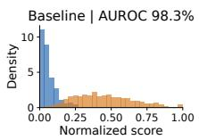

Normal Anomalous  
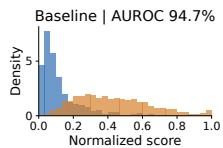

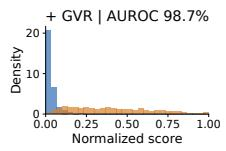  
(a) MVTec AD

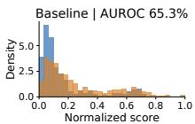

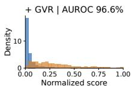  
(b) VisA

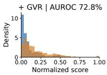  
(c) MVTec LOCO AD  
Figure 5. Image-level anomaly-score distributions of SubspaceAD before (top) and after (bottom) GVR under the 4-shot setting. Scores are normalized within each class for visualization.

Table 4. Ablation of global decisions. Image AUROC (%).
<table><tr><td>Configuration</td><td>MVTec AD</td><td>VisA LOCO AD</td><td></td></tr><tr><td>Reference-free decision</td><td>91.8</td><td>89.8</td><td>63.3</td></tr><tr><td>Reference-conditioned decision</td><td>93.9</td><td>86.3</td><td>69.5</td></tr><tr><td>Combined global decisions</td><td>96.3</td><td>91.7</td><td>73.8</td></tr><tr><td>DINOv2-L detector</td><td>95.5</td><td>93.7</td><td>67.1</td></tr><tr><td> $\mathrm { D I N O v 2 – L } + \mathrm { G V R }$ </td><td>98.3</td><td>96.9</td><td>76.2</td></tr></table>

Image-Score Distributions and Ranking. Fig. 5 and 6 examine how GVR changes the distribution of image-level anomaly scores. The refined scores provide better separation between normal and anomalous samples, particularly on MVTec LOCO AD and VisA. Pairwise analysis further shows that GVR corrects many initially misordered normal–anomalous pairs while introducing relatively few new errors.

Zero-Shot Transfer. We further apply reference-free GVR to AnomalyCLIP and AdaCLIP without normal references or local refinement. As shown in Tab. 3, both detectors achieve higher image-level AUROC across all three benchmarks, with particularly large improvements on VisA. Since only image-level scores are refined, pixel-level predictions remain unchanged.

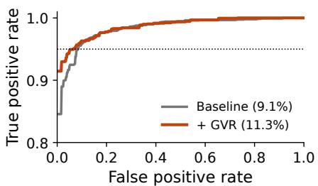  
(a) MVTec AD

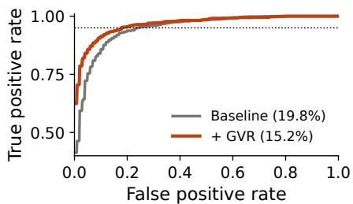  
(b) VisA

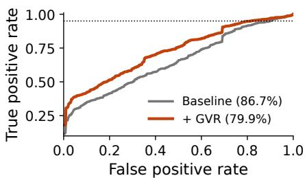  
(c) LOCO AD

Figure 6. Image-level ROC curves for SubspaceAD before and after GVR on three industrial anomaly detection benchmarks (4-shot, single-seed analysis). The ranking-correction statistics are discussed in the text; no separate ranking plot is included here.  
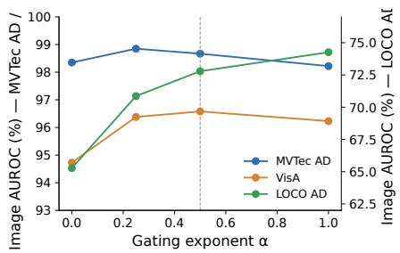  
(a) Global gating exponent

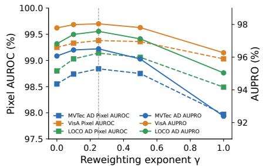  
(b) Local reweighting exponent

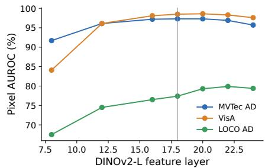  
(c) DINOv2-L feature layer  
Figure 7. Sensitivity analyses of VerdictAD. (a) Effect of the global gating exponent α, with separate vertical scales for MVTec AD/VisA and LOCO AD. (b) Effect of the local reweighting exponent γ on Pixel AUROC and AUPRO, evaluated on an independent synthetic validation set. (c) Effect of the DINOv2-L feature layer on pixel-level detection performance.

Table 5. Window-view ablation on MVTec LOCO AD, with the 4-shot SubspaceAD detector (single seed). Metrics are pixel AU-ROC / AUPRO (%).
<table><tr><td>Windows</td><td>Logical</td><td>Structural</td><td>All</td></tr><tr><td>No LVR</td><td>75.98 / 60.77</td><td>94.22 / 89.20</td><td>77.05 / 69.34</td></tr><tr><td>Crop only</td><td>77.77 / 63.51</td><td>95.06 / 90.76</td><td>78.31 / 70.60</td></tr><tr><td>Box only</td><td>79.90 / 64.43</td><td>94.98 / 90.23</td><td>80.48 / 71.46</td></tr><tr><td>Crop + Box</td><td>79.31 / 64.70</td><td>95.21 / 90.67</td><td>79.87 / 71.60</td></tr></table>

## 4.4. Ablation Study

Global Verdict Refinement. Tab. 4 compares referencefree, reference-conditioned, and combined decisions using the DINOv2-L detector. Averaging the two logits consistently outperforms either decision alone. Combining these decisions with the feature-based detector further improves image-level detection, indicating that typed decisions provide complementary information rather than replacing visual anomaly evidence.

Local Verdict Refinement. Tab. 5 compares crop-based, box-based, and combined regional decisions using SubspaceAD. Box-based decisions are particularly effective for logical anomalies, where identifying a defect often requires understanding the surrounding context. Combining both views achieves the best overall AUPRO, while the improvements on structural anomalies are more modest. The refined maps also show higher defect-to-background response ratios, indicating that background responses are suppressed more strongly than defect-related ones.

Hyperparameter Sensitivity. Fig. 7 examines the imagegating exponent, window exponent, window type, and DINOv2-L feature layer. The selected exponents are supported by synthetic validation experiments, while the remaining analyses examine sensitivity to different configurations. Test-set analyses are used for sensitivity assessment rather than hyperparameter selection.

## 5. Conclusion

In this paper, we presented VerdictAD, a training-free framework that uses typed visual decisions to refine the outputs of existing anomaly detectors. Rather than learning new anomaly representations, VerdictAD focuses on verifying whether the detected visual differences correspond to genuine defects. We introduced Global Verdict Refinement (GVR) to improve image-level anomaly discrimination through reference-free and reference-conditioned decisions, and Local Verdict Refinement (LVR) to suppress misleading pixel-level responses using regional verification. Experiments on MVTec AD, VisA, and MVTec LOCO AD demonstrate strong performance across different few-shot settings and consistent improvements over multiple detection backbones, particularly for logical anomalies. While our approach cannot recover anomaly evidence entirely absent from the original detector, it provides a simple and effective way to improve existing anomaly predictions without additional training.

## LLM Usage Statement

ChatGPT assisted with manuscript editing, language refinement, LaTeX formatting, and table and visualization preparation. The authors verified all research decisions, results, and scientific claims and take full responsibility for the paper.

## References

[1] Mohammed Ahmed Mohammed Eltoum Mohammed Ali, Ehtesham Iqbal, Samee Ullah Khan, and Yusra Abdulrahman. Radiocore: Few-shot industrial anomaly segmentation with multi-scale radio vit features. In Proceedings of the IEEE/CVF Conference on Computer Vision and Pattern Recognition, pages 7288–7297, 2026. 3

[2] Kilian Batzner, Lars Heckler, and Rebecca Konig. Efficien-¨ tad: Accurate visual anomaly detection at millisecond-level latencies. In 2024 IEEE/CVF Winter Conference on Applications ofComputer Vision, pages 127–137, 2024. 2

[3] Asma Belhadi, Youcef Djenouri, and Ahmed Nabil Belbachir. Vla-ad: Agentic vision-language foundation models for context-aware anomaly detection. In Proceedings of the IEEE/CVF Conference on Computer Vision and Pattern Recognition, pages 4322–4331, 2026. 3

[4] Liron Bergman, Niv Cohen, and Yedid Hoshen. Deep nearest neighbor anomaly detection. arXiv preprint arXiv:2002.10445, 2020. 2

[5] Paul Bergmann, Sindy Lowe, Michael Fauser, David Sattleg-¨ ger, and Carsten Steger. Improving unsupervised defect segmentation by applying structural similarity to autoencoders. arXiv preprint arXiv:1807.02011, 2018. 2

[6] Paul Bergmann, Michael Fauser, David Sattlegger, and Carsten Steger. Mvtec ad—a comprehensive real-world dataset for unsupervised anomaly detection. In 2019 IEEE/CVF Conference on Computer Vision and Pattern Recognition, pages 9584–9592, 2019. 2, 5

[7] Paul Bergmann, Kilian Batzner, Michael Fauser, David Sattlegger, and Carsten Steger. Beyond dents and scratches: Logical constraints in unsupervised anomaly detection and localization. International Journal of Computer Vision, 130 (4):947–969, 2022. 5

[8] Yunkang Cao, Jiangning Zhang, Luca Frittoli, Yuqi Cheng, Weiming Shen, and Giacomo Boracchi. Adaclip: Adapting clip with hybrid learnable prompts for zero-shot anomaly detection. In European conference on computer vision, pages 55–72. Springer, 2024. 3, 6

[9] Mathilde Caron, Hugo Touvron, Ishan Misra, Herve J ´ egou,´ Julien Mairal, Piotr Bojanowski, and Armand Joulin. Emerg-

ing properties in self-supervised vision transformers. In 2021 IEEE/CVF international conference on computer vision, pages 9630–9640, 2021. 3

[10] Varun Chandola, Arindam Banerjee, and Vipin Kumar. Anomaly detection: A survey. ACM computing surveys (CSUR), 41(3):1–58, 2009. 2

[11] M Chen, A Reneau, and K Flansburg. Introducing clef: Our open-source decision models, and new rl fine-tuning plat form. cloudflare blog, 1 october 2026, 2026. 2, 3

[12] Xuhai Chen, Yue Han, and Jiangning Zhang. A zero-/fewshot anomaly classification and segmentation method for cvpr 2023 (vand) workshop challenge tracks 1 &2. 1st Place on Zero-shot AD and 4th Place on Few-shot AD, 2305 (17382):3, 2023. 3

[13] Cloudflare. Cloudflare/clef-flash. Hugging Face Model Card, 2026. Accessed: 2026-10-30. 3

[14] Karl Cobbe, Vineet Kosaraju, Mohammad Bavarian, Mark Chen, Heewoo Jun, Lukasz Kaiser, Matthias Plappert, Jerry Tworek, Jacob Hilton, Reiichiro Nakano, et al. Training verifiers to solve math word problems. arXiv preprint arXiv:2110.14168, 2021. 3

[15] Niv Cohen and Yedid Hoshen. Sub-image anomaly detec tion with deep pyramid correspondences. arXiv preprint arXiv:2005.02357, 2020. 2, 6

[16] Simon Damm, Mike Laszkiewicz, Johannes Lederer, and Asja Fischer. Anomalydino: Boosting patch-based few-shot anomaly detection with dinov2. In 2025 IEEE/CVF Winter Conference on Applications of Computer Vision, pages 1319–1329, 2025. 3, 6, 7

[17] Thomas Defard, Aleksandr Setkov, Angelique Loesch, and Romaric Audigier. Padim: a patch distribution modeling framework for anomaly detection and localization. In International conference on pattern recognition, pages 475–489. Springer, 2021. 2

[18] Hanqiu Deng and Xingyu Li. Anomaly detection via reverse distillation from one-class embedding. In 2022 IEEE/CVF conference on computer vision and pattern recognition, pages 9727–9736, 2022. 2

[19] Hanqiu Deng, Zhaoxiang Zhang, Jinan Bao, and Xingyu Li. Anovl: Adapting vision-language models for unified zeroshot anomaly localization. arXiv preprint arXiv:2308.15939, 2(5):3, 2023. 3

[20] Zheng Fang, Xiaoyang Wang, Haocheng Li, Jiejie Liu, Qiugui Hu, and Jimin Xiao. Fastrecon: Few-shot industrial anomaly detection via fast feature reconstruction. In 2023 IEEE/CVF International Conference on Computer Vision, pages 17435–17444, 2023. 3

[21] Matic Fucka, Vitjan Zavrtanik, and Danijel Sko ˇ caj.ˇ Transfusion–a transparency-based diffusion model for anomaly detection. In European conference on computer vi sion, pages 91–108. Springer, 2024. 2

[22] Matic Fucka, Vitjan Zavrtanik, and Danijel Sko ˇ caj.ˇ Anomalyvfm–transforming vision foundation models into zero-shot anomaly detectors. arXiv preprint arXiv:2601.20524, 2026. 3

[23] Matic Fucka, Vitjan Zavrtanik, and Danijel Sko ˇ caj.ˇ Objectcore–efficient few-shot logical anomaly detection us-

ing object representations. In 2026 IEEE/CVF Winter Conference on Applications of Computer Vision, pages 3857– 3867, 2026. 3

[24] Denis Gudovskiy, Shun Ishizaka, and Kazuki Kozuka. Cflow-ad: Real-time unsupervised anomaly detection with localization via conditional normalizing flows. In 2022 IEEE/CVF winter conference on applications of computer vision, pages 1819–1828, 2022. 2

[25] Jia Guo, Shuai Lu, Lize Jia, Weihang Zhang, and Huiqi Li. Recontrast: Domain-specific anomaly detection via contrastive reconstruction. Advances in Neural Information Processing Systems, 36:10721–10740, 2023. 2

[26] Jia Guo, Shuai Lu, Weihang Zhang, Fang Chen, Huiqi Li, and Hongen Liao. Dinomaly: The less is more philosophy in multi-class unsupervised anomaly detection. In 2025 IEEE/CVF Conference on Computer Vision and Pattern Recognition, pages 20405–20415, 2025. 2

[27] Ruoqi Guo, Yi Liu, Gelei Deng, Yuekang Li, Lida Zhao, Yutao Wu, Simin Chen, Ying Zhang, and Leo Yu Zhang. Just ask jev: Reinforcement learning for calibrated decisions as a zero-shot detector of ai alignment failures. arXiv preprint arXiv:2609.29429, 2026. 3

[28] Haoyang He, Yuhu Bai, Jiangning Zhang, Qingdong He, Hongxu Chen, Zhenye Gan, Chengjie Wang, Xiangtai Li, Guanzhong Tian, and Lei Xie. Mambaad: Exploring state space models for multi-class unsupervised anomaly detection. Advances in Neural Information Processing Systems, 37:71162–71187, 2024. 2

[29] Haoyang He, Jiangning Zhang, Hongxu Chen, Xuhai Chen, Zhishan Li, Xu Chen, Yabiao Wang, Chengjie Wang, and Lei Xie. A diffusion-based framework for multi-class anomaly detection. In Proceedings of the AAAI conference on artificial intelligence, pages 8472–8480, 2024. 2

[30] Kaiming He, Xinlei Chen, Saining Xie, Yanghao Li, Piotr Dollar, and Ross Girshick. Masked autoencoders are scalable´ vision learners. In 2022 IEEE/CVF conference on computer vision and pattern recognition, pages 15979–15988, 2022. 3

[31] Lars Heckler-Kram, Jan-Hendrik Neudeck, Ulla Scheler, Rebecca Konig, and Carsten Steger. The mvtec ad 2 dataset:¨ Advanced scenarios for unsupervised anomaly detection. International Journal of Computer Vision, 134(4):175, 2026. 2

[32] Jianyi Hu, Hangtao Zhang, Yi Liu, Yeqi Zeng, Li Zeng, Xianlong Wang, Rui Wang, and Leo Yu Zhang. Jevadvbench: A benchmark and black-box attacks for reinforcement learning for calibrated decisions models. arXiv preprint arXiv:2609.31142, 2026. 3

[33] Jongheon Jeong, Yang Zou, Taewan Kim, Dongqing Zhang, Avinash Ravichandran, and Onkar Dabeer. Winclip: Zero-/few-shot anomaly classification and segmentation. In 2023 IEEE/CVF Conference on Computer Vision and Pattern Recognition, pages 19606–19616, 2023. 3, 6

[34] Le Jiang, Yan Huang, Zhen Xu, Yong Xu, Hau-San Wong, and Si Wu. Defect cue-preserved structural feature refinement for few-shot anomaly detection. In Proceedings of the IEEE/CVF Conference on Computer Vision and Pattern Recognition, pages 35607–35616, 2026. 3

[35] Xi Jiang, Jianlin Liu, Jinbao Wang, Qiang Nie, Kai Wu, Yong Liu, Chengjie Wang, and Feng Zheng. Softpatch: Un supervised anomaly detection with noisy data. Advances in Neural Information Processing Systems, 35:15433–15445, 2022. 2

[36] Yizhou Jin, Yuezhu Feng, Jinjin Zhang, Peng Wang, Qingjie Liu, and Yunhong Wang. Reasoning-driven anomaly detection and localization with image-level supervision. arXiv preprint arXiv:2603.27179, 2026. 3

[37] Sangkyung Kwak, Jongheon Jeong, Hankook Lee, Woohyuck Kim, Dongho Seo, Woojin Yun, Wonjin Lee, and Jinwoo Shin. Few-shot anomaly detection via personalization. IEEE Access, 12:11035–11051, 2024. 3

[38] Yujin Lee, Sewon Kim, Daeun Moon, Seoyoon Jang, and Hyunsoo Yoon. Bidirectional multimodal prompt learning with scale-aware training for few-shot multi-class anomaly detection. In Proceedings of the IEEE/CVF Conference on Computer Vision and Pattern Recognition, pages 35577– 35586, 2026. 3

[39] Camile Lendering, Erkut Akdag, and Egor Bondarau. Subspacead: Training-free few-shot anomaly detection via subspace modeling. In Proceedings of the IEEE/CVF Conference on Computer Vision and Pattern Recognition, pages 28557–28566, 2026. 3, 6, 7

[40] Xurui Li, Ziming Huang, Feng Xue, and Yu Zhou. Musc: Zero-shot industrial anomaly classification and segmentation with mutual scoring of the unlabeled images. In International Conference on Learning Representations, pages 2172–2197, 2024. 3

[41] Xiaofan Li, Zhizhong Zhang, Xin Tan, Chengwei Chen, Yanyun Qu, Yuan Xie, and Lizhuang Ma. Promptad: Learning prompts with only normal samples for few-shot anomaly detection. In 2024 IEEE/CVF Conference on Computer Vision and Pattern Recognition, pages 16848–16858, 2024. 3, 6

[42] Yufei Li, Long Tian, Yuyang Dai, Wenchao Chen, Liang Bao, and Xiyang Liu. Fastref: Fast prototype refinement for few-shot industrial anomaly detection. In Proceedings of the IEEE/CVF Conference on Computer Vision and Pattern Recognition, pages 43040–43049, 2026. 3

[43] Zhikang Liu, Yiming Zhou, Yuansheng Xu, and Zilei Wang. Simplenet: A simple network for image anomaly detection and localization. In Proceedings of the IEEE/CVF Conference on Computer Vision and Pattern Recognition, pages 20402–20411, 2023. 2

[44] Wei Luo, Haiming Yao, Yunkang Cao, Qiyu Chen, Ang Gao, Weiming Shen, and Wenyong Yu. Inp-former++: Advancing universal anomaly detection via intrinsic normal prototypes and residual learning. arXiv preprint arXiv:2506.03660, 2025. 2

[45] Wenxi Lv, Qinliang Su, and Wenchao Xu. One-for-all fewshot anomaly detection via instance-induced prompt learn ing. In International Conference on Learning Representations, pages 63657–63677, 2025. 3, 6

[46] Yi Ma, Tianpei Yang, Yaodong Yang, Weixun Wang, and Hongyao Tang. Can jev be your q or policy in reinforcement learning? arXiv preprint arXiv:2610.11692, 2026. 3

[47] Xiaofei Nan, Wenyang Li, Yuzhuo Wang, Yongsheng Du, Chengxiang Ji, and Xiaokang Wang. Cross-view learning for few-shot multiview industrial anomaly detection. IEEE Transactions on Industrial Informatics, 2026. 3

[48] Maxime Oquab, Timothee Darcet, Th´ eo Moutakanni, Huy´ Vo, Marc Szafraniec, Vasil Khalidov, Pierre Fernandez, Daniel Haziza, Francisco Massa, Alaaeldin El-Nouby, et al. Dinov2: Learning robust visual features without supervision. arXiv preprint arXiv:2304.07193, 2023. 2, 3, 6, 7

[49] Guansong Pang, Chunhua Shen, Longbing Cao, and Anton Van Den Hengel. Deep learning for anomaly detection: A review. ACM computing surveys (CSUR), 54(2):1–38, 2021. 2

[50] Qwen Team. Qwen3.5: Towards native multimodal agents. Qwen Blog, 2026. Published: 2026-02-15. 3

[51] Alec Radford, Jong Wook Kim, Chris Hallacy, Aditya Ramesh, Gabriel Goh, Sandhini Agarwal, Girish Sastry, Amanda Askell, Pamela Mishkin, Jack Clark, et al. Learning transferable visual models from natural language supervision. In International conference on machine learning, pages 8748–8763. PmLR, 2021. 3

[52] Karsten Roth, Latha Pemula, Joaquin Zepeda, Bernhard Scholkopf, Thomas Brox, and Peter Gehler. Towards total re-¨ call in industrial anomaly detection. In 2022 IEEE/CVF Conference on Computer Vision and Pattern Recognition, pages 14298–14308, 2022. 2, 6, 7

[53] Joao Santos, Triet Tran, and Oliver Rippel. Optimizing˜ patchcore for few/many-shot anomaly detection. arXiv preprint arXiv:2307.10792, 2023. 3

[54] Tushar Shinde. Subtledc: Drift-guided coreset selection for robust few-shot industrial anomaly detection under fixed post-training quantization. In Proceedings of the IEEE/CVF Conference on Computer Vision and Pattern Recognition, pages 1376–1384, 2026. 3

[55] Oriane Simeoni, Huy V Vo, Maximilian Seitzer, Federico´ Baldassarre, Maxime Oquab, Cijo Jose, Vasil Khalidov, Marc Szafraniec, Seungeun Yi, Michael Ramamonjisoa,¨ et al. Dinov3. arXiv preprint arXiv:2508.10104, 2025. 3

[56] Luc PJ Strater, Mohammadreza Salehi, Efstratios Gavves,¨ Cees GM Snoek, and Yuki M Asano. Generalad: Anomaly detection across domains by attending to distorted features. In European conference on computer vision, pages 448–465. Springer, 2024. 3

[57] NeoHorse Team, Guoliang Cao, Guohao Dai, Tianyu Guo, Kai Han, Hailin Hu, Zihan Jiang, Xiang Kuang, Boxun Li, Yulong Li, et al. Neohorse-1: Towards recursive selfimprovement via agentic post-training with routing harness. arXiv preprint arXiv:2609.08183, 2026. 3

[58] Guobao Tegong. JevRL: Calibrated typed decisions from language models via reward learning. JevRL Technical Report, 2026. One-seed synthetic pilot. 3

[59] TokenRhythm. NeoHorse-Jev. GitHub Repository, 2026. Accessed: 2026-10-30. 3

[60] TypeSafe AI. Introduction. TypeSafe Documentation, 2026. Accessed: 2026-10-30. 2, 3

[61] Chengjie Wang, Wenbing Zhu, Bin-Bin Gao, Zhenye Gan, Jiangning Zhang, Zhihao Gu, Shuguang Qian, Mingang

Chen, and Lizhuang Ma. Real-iad: A real-world multi-view dataset for benchmarking versatile industrial anomaly detection. In 2024 IEEE/CVF conference on computer vision and pattern recognition, pages 22883–22892, 2024. 2

[62] Kaiwen Wang, Hao Liu, Jiuzhen Liang, Yachao Li, Fan Wu, Yang Cheng, and Zhikai Wang. Code-clip: Contrastive decoupling for zero-shot industrial anomaly detection. Information Sciences, page 123682, 2026. 3

[63] Guoyang Xie, Jinbao Wang, Jiaqi Liu, Feng Zheng, and Yaochu Jin. Pushing the limits of fewshot anomaly de tection in industry vision: Graphcore. arXiv preprint arXiv:2301.12082, 2023. 3

[64] He-Yang Xu and Xiu-Shen Wei. Anomalies prefer curves: A training-free hyperbolic geometric prior for few-shot visual anomaly detection. In Proceedings of the IEEE/CVF Con ference on Computer Vision and Pattern Recognition, pages 1461–1468, 2026. 3

[65] Xiaohao Xu, Yunkang Cao, Huaxin Zhang, Nong Sang, and Xiaonan Huang. Customizing visual-language foundation models for multi-modal anomaly detection and reasoning. arXiv preprint arXiv:2403.11083, 2024. 3

[66] Zhiyuan You, Lei Cui, Yujun Shen, Kai Yang, Xin Lu, Yu Zheng, and Xinyi Le. A unified model for multi-class anomaly detection. Advances in Neural Information Processing Systems, 35:4571–4584, 2022. 2

[67] Jiawei Yu, Ye Zheng, Xiang Wang, Wei Li, Yushuang Wu, Rui Zhao, and Liwei Wu. Fastflow: Unsupervised anomaly detection and localization via 2d normalizing flows. arXiv preprint arXiv:2111.07677, 2021. 2

[68] Vitjan Zavrtanik, Matej Kristan, and Danijel Skocaj. Dræm– ˇ a discriminatively trained reconstruction embedding for surface anomaly detection. In 2021 IEEE/CVF International Conference on Computer Vision, pages 8310–8319, 2021. 2

[69] Hui Zhang, Zheng Wang, Dan Zeng, Zuxuan Wu, and Yu-Gang Jiang. Diffusionad: Norm-guided one-step denoising diffusion for anomaly detection. IEEE transactions on pattern analysis and machine intelligence, 47(8):7140–7152, 2025. 2

[70] Jiangning Zhang, Xuhai Chen, Yabiao Wang, Chengjie Wang, Yong Liu, Xiangtai Li, Ming-Hsuan Yang, and Dacheng Tao. Exploring plain vit reconstruction for multiclass unsupervised anomaly detection. arXiv preprint arXiv:2312.07495, 2023. 2

[71] Kai Zhang, Zekai Zhang, Xihe Sun, Anpeng Wang, Jingmeng Nie, Qinghui Chen, Han Hao, Jianyuan Guo, and Jinglin Zhang. Adseeker: A knowledge-grounded reasoning framework for industry anomaly detection and reasoning. In Proceedings of the IEEE/CVF Conference on Computer Vi sion and Pattern Recognition, pages 21379–21388, 2026. 3

[72] Lianmin Zheng, Wei-Lin Chiang, Ying Sheng, Siyuan Zhuang, Zhanghao Wu, Yonghao Zhuang, Zi Lin, Zhuohan Li, Dacheng Li, Eric Xing, et al. Judging llm-as-a-judge with mt-bench and chatbot arena. Advances in neural information processing systems, 36:46595–46623, 2023. 3

[73] Qihang Zhou, Guansong Pang, Yu Tian, Shibo He, and Jiming Chen. Anomalyclip: Object-agnostic prompt learning for zero-shot anomaly detection. In International Conference on Learning Representations, pages 49705–49737, 2024. 3, 6

[74] Yang Zou, Jongheon Jeong, Latha Pemula, Dongqing Zhang, and Onkar Dabeer. Spot-the-difference self-supervised pretraining for anomaly detection and segmentation. In European conference on computer vision, pages 392–408. Springer, 2022. 2, 5