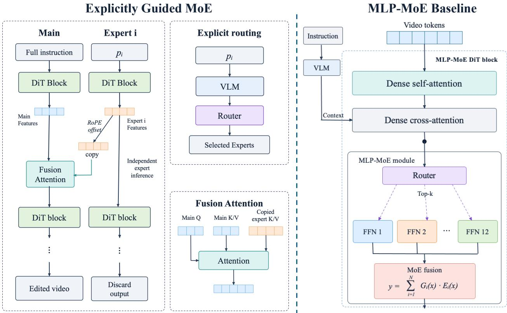
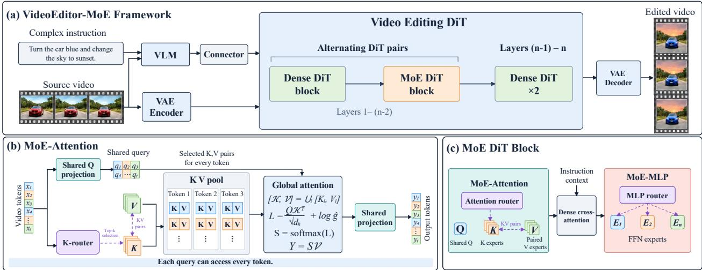
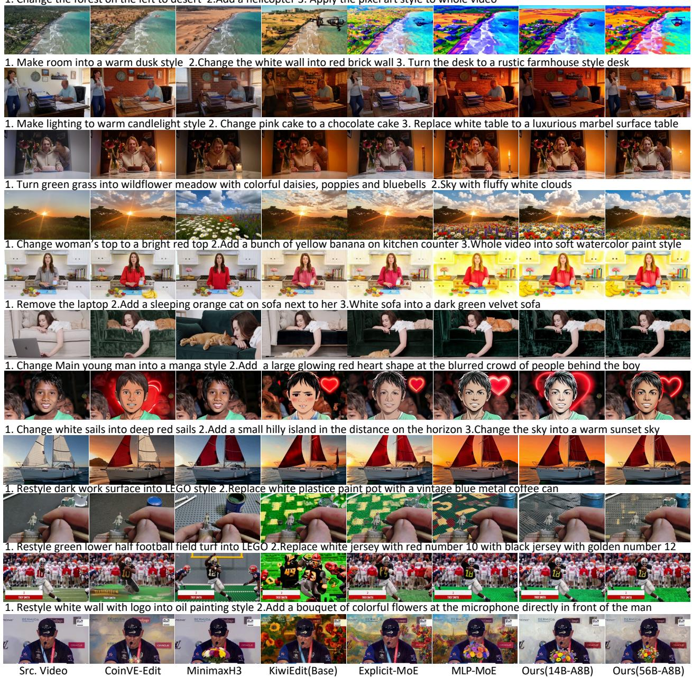
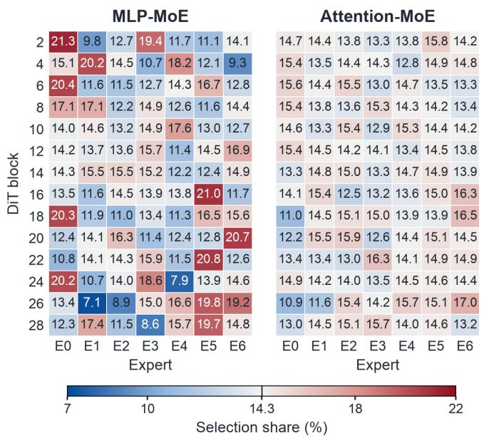
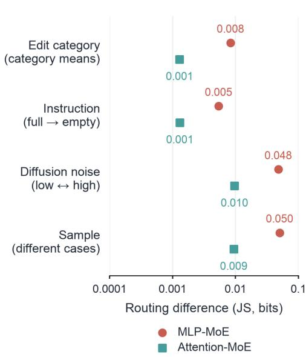
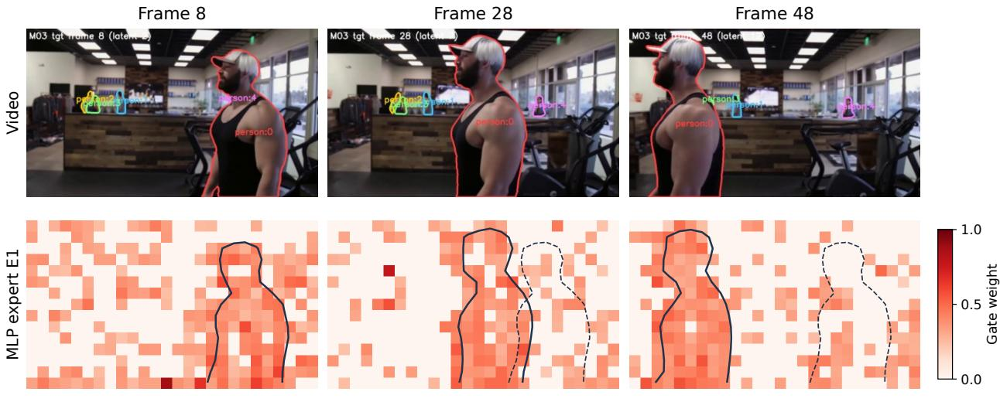
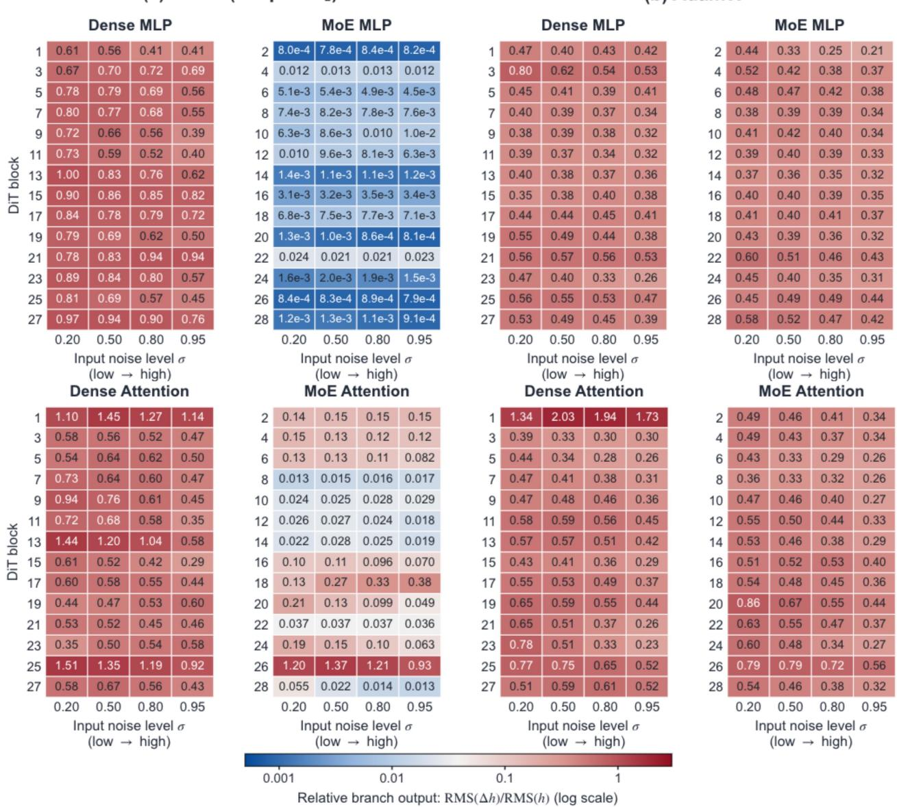
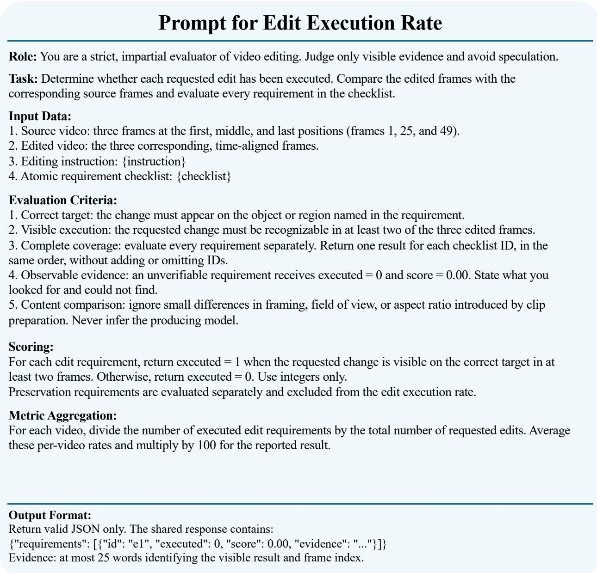
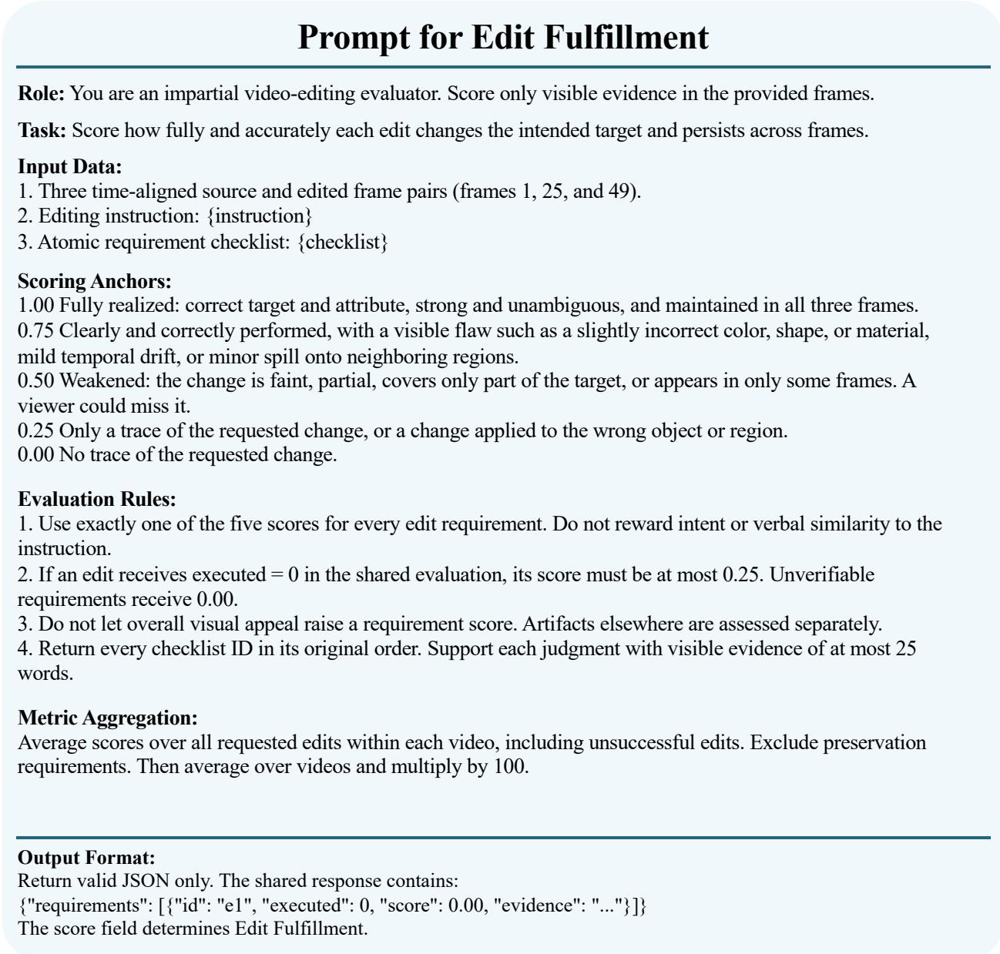

# VideoEditor-MoE: Scaling Complex Video Editing with Mixture of Experts

Xiao Cao1,2, Fuchen Long1, Yansong Qu3, Wen Xiao2, Xin Zhang2, Xinlong Sun1, Xi Chen1,B, Zhiyong Huang2,B

1Tencent 2National University of Singapore 3Xiamen University BCorresponding Authors

Complex video editing requires understanding complex instructions while jointly fulfilling multiple editing requests. Meeting these demands through dense model scaling substantially increases computational cost. We introduce VideoEditor-MoE, the first open-source mixture-of-experts framework for video editing. Beyond sparse MLP-MoE layers, MoE-Attention expands attention capacity through routed key–value experts while preserving global interactions among video tokens. Initialized from a 5B video editing model, VideoEditor-MoE scales to 14B and 56B parameters, with approximately 8B parameters activated per token in both variants. Comparisons with existing methods and two complementary baselines, Explicit-MoE and MLP-MoE, assess its benefits over explicit expert guidance and MLP-only expert architectures. Further analyses demonstrate that all experts remain active and reveal that learned routing responds more strongly to sample content and difusion noise levels than to human-defined editing categories. Spatial analysis further indicates sensitivity to object-level semantic features. We also identify decoupled weight decay as a strategy for stabilizing expert scaling.

GitHub Page: https://github.com/massyzs/Video-Editor-MoE

## 1 Introduction

A complex video editing request succeeds only when every requested change is realized on the targeted objects. Recent models support diverse editing functionality, including object addition, removal, and appearance changes, style changes and so on (Lin et al., 2026; Wei et al., 2026; Liu et al., 2026; Jiang et al., 2025). Yet, a real requests often combine several operations across objects or apply multiple changes to the same object. “Turning a car blue while replacing the sky with a sunset,” for example, requires both edits to persist as the scene evolves. A visually plausible result can still leave the request incomplete if one change is omitted or only weakly expressed. Complex editing therefore demands both reliable instruction coverage and complete visual modification, together with preservation of unrelated content and temporal coherence.

Increasing model capacity is a natural direction for supporting these complex instructions. Yet, scaling a dense video model increases computation throughout the network. Mixture-of-experts (MoE) architectures ofer a way to expand model capacity while activating only a small subset of experts for each token (Jiang et al., 2024; Dai et al., 2024). To this end, scaling video editing models through MoE provides a practical approach to balancing computational cost and model capacity. However, conventional MLP-MoE expands token-wise transformations while leaving the attention architecture unchanged. Complex editing also requires the exchange of semantic information across regions and frames to coordinate multiple modifications. This motivates extending expert capacity to attention, allowing MoE semantic representations to participate in global token interactions and support coherent editing across space and time.

We introduce VideoEditor-MoE, the first open-source MoE framework for video editing, supporting complex instructions with multiple editing requirements. VideoEditor-MoE incorporates both MoE-MLP and MoE-Attention to expand model capacity beyond conventional dense architectures. MoE-Attention combines shared queries with routed, paired key–value experts. Each token contributes multiple key–value representations, and every query attends to the routed key–value pairs from all tokens. This design expands attention capacity while preserving global token interactions. Together with sparse MLP layers, we develop two model variants, 14B-A8B and 56B-A8B, both with approximately 8B activated DiT parameters per token.

In addition, two baselines are developed to provide complementary comparisons. Explicitly Guided MoE selects experts according to predefined editing categories that reflect an intuitive human understanding of editing tasks, testing whether such task divisions align with efective expert allocation. MLP-MoE expands capacity through MLP experts alone, serving as an ablation baseline for assessing the contribution of MoE-Attention. Beyond editing performance, we conduct detailed analyses of expert utilization, routing behavior, and scaling stability. All experts remain active during inference, and learned expert allocation responds more strongly to sample content and difusion noise states than to human-defined editing categories. To further understand the content dependence, spatial analysis examines which visual features attract expert routing responses and suggests sensitivity to object-level semantic features. Finally, scaling analysis links expert-weight shrinkage under coupled regularization to suppressed branch outputs and identifies decoupled weight decay as a practical strategy for stabilizing expert scaling.

## Our contributions are:

• We highlight complex instruction-based video editing as a practical setting that requires jointly satisfying multiple modifications to a single object or coordinating edits across multiple objects, motivating greater model capacity for compositional editing.

• We introduce VideoEditor-MoE, extending conventional MoE-MLP with MoE-Attention to expand sparse expert capacity into attention. This design expands model capacity and enables a more comprehensive MoE architecture for video generation.

• We demonstrate that all experts remain active and reveal that learned routing responds more strongly to sample content and difusion noise levels than to human-defined editing categories. Spatial analysis further indicates sensitivity to object-level semantic features.

• We will publicly release both VideoEditor-MoE variants, 14B-A8B and 56B-A8B, together with two complementary baselines, to facilitate further research on MoE architectures for video generation and editing.

## 2 Related Work

## 2.1 Instruction based Video Editing

Instruction-based video editing aims to modify a source video according to natural-language instructions. Recent methods (MiniMax, 2026; Liu et al., 2026; Wei et al., 2026; Lin et al., 2026; Jiang et al., 2025) have demonstrated promising editing results, using either text instructions alone or additional guidance such as masks and reference inputs. These advances enable a range of editing operations, but handling complex instructions that combine multiple editing requirements remains challenging.

In real-world scenarios, users may request edits to multiple objects, multiple modifications to a single object, or a combination of both. Such instructions require models to associate each modification with the correct target and coordinate multiple edits while maintaining temporal consistency and preserving unrelated content. Existing methods may omit some requested edits or only partially realize the intended changes. Meeting these demands places greater requirements on model capacity, motivating the exploration of larger video editing models. However, scaling dense models entails substantial increases in computational cost. This motivates us to explore sparse MoE architectures as a means of expanding model capacity while limiting the growth in computation cost.

## 2.2 Mixture-of-Experts

## 2.2.1 Preliminary

Mixture-of-experts (MoE) architectures enable model capacity to scale through sparse expert activation. Two representative designs in large language models are Mixtral (Jiang et al., 2024) and DeepSeekMoE (Dai et al., 2024). Mixtral replaces dense feed-forward networks (FFNs) with multiple expert networks and a token-level router. Given an input token representation x, the MoE module computes

$$
F _ { \mathrm { M i x t r a l } } ( x ) = \sum _ { i = 0 } ^ { n - 1 } G ( x ) _ { i } E _ { i } ( x ) ,\tag{1}
$$

where n is the number of experts, $E _ { i }$ denotes the i-th expert, and $G ( x ) _ { i }$ is its routing weight. The router selects the top-k experts for each token and assigns zero weights to the remaining experts.

DeepSeekMoE introduces fine-grained expert segmentation and shared expert isolation to improve parameter eficiency. Specifically, it reduces each expert’s FFN intermediate dimension by a factor of m, yielding mn smaller experts, and designates $k _ { s }$ of them as shared experts that process every token. Using the same notation for expert outputs and sparse routing weights, its MoE module can be expressed as

$$
F _ { \mathrm { D e e p S e e k } } ( x ) = \sum _ { i = 0 } ^ { k _ { s } - 1 } E _ { i } ( x ) + \sum _ { i = k _ { s } } ^ { m n - 1 } G ( x ) _ { i } E _ { i } ( x ) ,\tag{2}
$$

where the router selects $m k - k _ { s }$ experts from the $m n - k _ { s }$ routed experts. Together with the $k _ { s }$ shared experts, this configuration activates mk fine-grained experts per token, preserving approximately the same expert computation budget as activating k original-sized experts. Fine-grained segmentation enables more flexible expert combinations, while shared experts aim to capture common knowledge and reduce redundancy among routed experts. Here, $G ( x ) _ { i }$ denotes the routing weight under each architecture’s respective gating rule, and both formulations omit residual connections.

## 2.2.2 Related Methods

MoE architectures have been explored in visual generation to expand model capacity and adapt computation to diferent inputs and denoising stages. DiT-MoE (Fei et al., 2024) introduces shared and routed MLP experts into difusion transformers, increasing total capacity while limiting the computation activated for each token. Switch-DiT (Park et al., 2024) uses timestep-conditioned routing to mitigate interference between denoising tasks at diferent noise levels. Dif-MoE (Shi et al., 2025) combines expert-specific timestep conditioning with spatially adaptive expert allocation, allowing expert computation to adapt to both token content and the generative stage.

MoE has also been explored in video generation field. Wan2.2 (Wan et al., 2025) assigns high- and low-noise denoising stages to two specialized dense experts, separating coarse content formation from detail refinement. This design allocates computation at the model level according to the noise stage. Mamoda2.5 (Shi et al., 2026) instead incorporates fine-grained routed experts and a shared expert into a unified multimodal framework, expanding capacity for understanding, generation, and editing with sparse activation. LingBot-Video (Ma et al., 2026) explores sparse MoE scaling for embodied video pretraining, targeting physical dynamics and action-conditioned generation.

These advances motivate an open-source MoE framework tailored to the demands of complex video editing, where multiple editing requirements call for greater model capacity. We introduce the first open-source MoE-based video editing model, with pretrained video editing models providing a practical starting point for scaling. A Mixtral-style MoE design enables expert initialization from existing models, while MoE-Attention further expands attention capacity to support interactions among video tokens. Together, these designs ofer a practical path to scaling complex video editing capabilities while retaining the knowledge acquired by pretrained models.

## 3 Method

In this section, we first introduce two additional baselines: (1) Explicitly Guided MoE and (2) MLP-MoE, to examine MoE routing preferences and demonstrate the benefits of our MoE-Attention design, respectively. We then present the design of VideoEditor-MoE. All the baselines and our proposed VideoEditor-MoE are built on the same 5B 30-layer base model.

## 3.1 Baselines

Figure 1 contrasts explicit task-guided expert composition with token-level MLP routing.

Explicitly Guided MoE. This baseline guides expert selection using five categories that reflect an intuitive human understanding of editing tasks: object addition, object removal, object replacement, style transfer, and background replacement. As shown in the left side of Figure 1, a main editing branch integrates features from task-specific experts, each fine-tuned on one category with low-rank adaptation (LoRA) (Hu et al., 2021).

  
Figure 1 Two MoE baselines. Left: Explicitly Guided MoE sends the complete instruction to the main branch and decomposed instructions to selected experts. Fusion layers injected into the first half of the main branch incorporate expert features. Right: MLP-MoE routes contextualized video tokens to MLP experts while retaining dense attention.

A VLM decomposes the complex instruction into individual edits in advance. The main branch receives the complete instruction, while each expert receives the instruction for its assigned edit. A router, pretrained on an editing-category classification task, predicts each individual edit’s category from VLM features. Fusion layers are inserted into the first half of the main branch. These layers perform semi-attention: main-branch queries attend to main-branch tokens and expert key–value features, with spatial ofsets applied to the RoPE (Su et al., 2024) embeddings of the expert features. Only the main branch produces the final video; expert branches supply features through one-way attention.

MLP-MoE Baseline. This baseline processes the complete instruction without editing-category supervision. It expands MLP capacity while keeping attention dense, serving as an ablation baseline for MoE-Attention. For the DiT side, MLPs at odd block $\mathcal { M } = \{ 2 , 4 , \dots , 2 8 \}$ are replaced with MoE layers while other blocks remain dense. Each MoE layer contains N full-width MLP experts and a token-level router, with no shared expert. For MoE blocks, a video-token x is represented by:

$$
p ( x ) = \mathrm { s o f t m a x } ( x W _ { g } ) , \qquad G ( x ) _ { i } = \frac { p ( x ) _ { i } \mathbb { I } [ i \in \mathcal { Z } _ { k } ( x ) ] } { \sum _ { j \in \mathcal { Z } _ { k } ( x ) } p ( x ) _ { j } } , \qquad F _ { \mathrm { M o E } } ( x ) = \sum _ { i = 1 } ^ { N } G ( x ) _ { i } E _ { i } ( x ) ,\tag{3}
$$

where $W _ { g }$ is the router matrix, $\mathcal { T } _ { k } ( x )$ contains the top-k expert indices, and I is the indicator function. The selected weights $G ( x ) _ { i }$ sum to one, while unselected experts receive zero weight. The final output combines the selected MLP expert outputs $E _ { i } ( x )$ . The overall framework is shown in Figure 1 right side. Here, we set N = 12 and choose top-3 routing, yielding a 19B-A8B MoE-MLP baseline.

  
Figure 2 VideoEditor-MoE. (a) Dense and MoE DiT blocks alternate through 28 layers, followed by two dense blocks. (b) Shared queries attend to routed key–value pairs from all video tokens. (c) Each MoE block combines MoE-Attention, dense instruction cross-attention, and MoE-MLP.

## 3.2 VideoEditor-MoE with MoE-Attention

MLP-MoE transforms individual tokens, while attention exchanges semantic information across regions and frames. VideoEditor-MoE extends the MoE-MLP baseline with paired key–value experts in self-attention mechanism within MoE blocks. As shown in Figure 2(b), query and output projections remain shared. Attention and MLP experts use separate routers, and instruction cross-attention remains dense.

For T video-token representations $X \in \mathbb { R } ^ { T \times d }$ , the attention router applies the top-k rule in Equation 3. Each selected index i chooses both a key projection $W _ { K } ^ { ( i ) }$ and its paired value projection $W _ { V } ^ { ( i ) }$ . Let $X _ { i }$ contain the tokens that select expert $i ;$ a token appears in k such groups. For one attention head of dimension $d _ { h }$

$$
Q = X W _ { Q } , \qquad K _ { i } = X _ { i } W _ { K } ^ { ( i ) } , \qquad V _ { i } = X _ { i } W _ { V } ^ { ( i ) } ,\tag{4}
$$

where $W _ { Q } , W _ { K } ^ { \left( i \right) } , W _ { V } ^ { \left( i \right) } \in \mathbb { R } ^ { d \times d _ { h } }$ . Biases, query/key normalization, and RoPE are omitted from the equations for clarity. They follow the base model, and each key representation retains its source token’s position.

Following Figure 2(b), all selected key–value pairs are written as

$$
[ \mathcal { K } , \mathcal { V } ] = \bigcup _ { i } [ K _ { i } , V _ { i } ] , \qquad \mathcal { K } , \mathcal { V } \in \mathbb { R } ^ { k T \times d _ { h } } .\tag{5}
$$

Here, S collects the selected key–value pairs from all tokens, keeping each key together with its corresponding value. Each token contributes k pairs, giving kT pairs in total. The pair produced by expert i for token $x _ { t }$ carries the normalized routing weight $G ^ { \mathrm { a t t n } } ( x _ { t } ) ;$ i, computed using Equation 3. These weights form the vector $\hat { g } \in \mathbb { R } ^ { 1 \times k T }$ , ordered to match the corresponding pairs in K, V. Every query attends to all kT routed pairs through a single attention operation:

$$
{ \cal L } = \frac { Q { \cal K } ^ { \top } } { \sqrt { d _ { h } } } + \log \hat { g } , \qquad { \cal S } = \mathrm { s o f t m a x } ( { \cal L } ) , \qquad Y = S { \mathcal V } .\tag{6}
$$

The term log ˆg adds the logarithm of each pair’s routing weight to every query’s attention scores. It favors pairs preferred by the router, while $Q \mathcal { K } ^ { \top }$ measures their relevance to each query. Softmax normalizes each row over all $k T$ pairs, and Y combines their values using these attention weights. The head outputs pass through the shared output projection.

MoE-Attention produces multiple expert-specific key–value representations for each token, enabling richer semantic modeling. Every query attends to the routed key–value pairs from all tokens, preserving global interactions across regions and frames.

Table 1 Quantitative comparison. VideoEditor-MoE-56B-A8B ranks first and 14B-A8B ranks second across all three metrics. Best results are in bold and second-best are underlined. Evaluation scope and protocol appear in Appendix C.
<table><tr><td></td><td colspan="3">Existing methods</td><td colspan="2">MoE baselines</td><td colspan="2">Ours</td></tr><tr><td>Metric</td><td>Kiwi-Edit</td><td>MiniMax-H3</td><td>CoinVE-Edit</td><td>Explicit-MoE</td><td>MLP-MoE (19B-A8B)</td><td>14B-A8B</td><td>56B-A8B</td></tr><tr><td>Edit Execution Rate ↑</td><td>73.60</td><td>76.82</td><td>87.99</td><td>81.67</td><td>88.45</td><td>90.15</td><td>94.70</td></tr><tr><td>Edit Fulfillment ↑</td><td>73.11</td><td>76.06</td><td>88.23</td><td>81.69</td><td>88.78</td><td>90.72</td><td>94.70</td></tr><tr><td>Video Quality ↑</td><td>61.36</td><td>61.36</td><td>69.89</td><td>69.89</td><td>68.75</td><td>71.59</td><td>77.27</td></tr></table>

Training objective. Training combines flow-matching reconstruction, temporal-diference supervision, and per-sample expert load balancing as in Appendices B and A.

## 4 Experiments and Analysis

We first compare edit execution, fulfillment, and output quality. We then examine (1) expert utilization and (2) routing sensitivity to difusion noise levels and sample content. Building on this content sensitivity, we further investigate (3) whether routing responds to global color distributions or object-level semantic features, with spatial analysis providing evidence of sensitivity to semantic features. Finally, we analyze (4) the instability introduced by coupled $L _ { 2 }$ regularization during model scaling and how decoupled weight decay stabilizes training.

## 4.1 Quantitative Results

We evaluate edited videos along three dimensions. Edit Execution Rate measures the fraction of requested edits successfully performed; Edit Fulfillment measures how completely and accurately each change is realized, including unsuccessful edits; and Video Quality assesses visual quality, temporal consistency, preservation of unedited content, and integration of the edits. The evaluation protocol and prompt templates are provided in Appendix C and Figures 7, 8, and 9.

As shown in Table 1, VideoEditor-MoE-56B-A8B achieves the highest scores across all three metrics, followed by the 14B-A8B variant. Both variants outperform the five baselines in edit execution, edit fulfillment, and video quality. As an ablation baseline, MLP-MoE baseline ranks third on both editing metrics, while its gap to VideoEditor-MoE highlights the importance of MoE-Attention.

## 4.2 Qualitative Results

As shown in Figure 3, we compare both VideoEditor-MoE variants with five baselines on complex instructions. For compact presentation, only the middle frame of each video is shown, and the displayed instructions are manually decomposed and simplified for readability.

VideoEditor-MoE jointly realizes multiple requested changes within the same scene. In the third row of Figure 3, our variants capture the requested candlelit atmosphere through warm scene lighting, while some baselines emphasize inserting visible candles. In the fifth row, both variants combine soft watercolor stylization with the addition of bananas. In the sixth row, VideoEditor-MoE and MLP-MoE place the cat beside the woman while preserving the scene structure. Most of baselines output omit requested changes or express them less clearly, illustrating the challenge of jointly fulfilling complex instructions.

## 4.3 Expert Analysis

We examine whether experts remain active and adapt to editing inputs. We conduct experiments on the 14B-A8B variant using 20 training samples at noise levels $\sigma \in \{ 0 . 3 5 5 , 0 . 8 3 3 , 0 . 9 7 8 \}$ . Additional instruction and noise controls bring total to 110 forward probes, as in Appendix D.2.

All experts remain active. Each of $T$ video tokens selects k experts, yielding kT selections. Expert i’s selection share is $\begin{array} { r } { s _ { i } = \frac { \sum _ { t = 1 } ^ { T } \mathbb { I } \left[ i \in \mathcal { T } _ { k } \left( x _ { t } \right) \right] } { k T } } \end{array}$ , the fraction of selections assigned to it, where $\mathcal { T } _ { k } ( x _ { t } )$ contains the experts selected

1. Change the forest on the left to desert 2.Add a helicopter 3. Apply the pixel art style to whole video

  
Figure 3 Qualitative comparisons under complex instructions. Each row shows the source video and outputs from five baselines and both VideoEditor-MoE variants. Middle frames are shown, with editing instructions summarized above each row.

for token $x _ { t }$ . Larger shares indicate more frequent expert use. As shown in Figure 4(a), even the least-used experts receive mean selection shares of 7.1% in MLP-MoE and 10.9% in MoE-Attention. Moreover, all 196 layer–module–expert units are selected in every probe, confirming that no expert remains inactive.

Routing is more sensitive to content and noise level. We exam the router sensitivity to human predefined editing category, instruction, difusion noise level and sample content as shown in Figure 4. For two samples or conditions a and $b ,$ we form $\mathbf { p } = [ s _ { 1 } ^ { ( a ) } , \dots , s _ { N } ^ { ( a ) } ]$ and $\mathbf q = [ s _ { 1 } ^ { ( b ) } , \dots , s _ { N } ^ { ( b ) } ]$ for the same layer and router, and measure their Jensen–Shannon (JS) divergence:

$$
\mathrm { J S } ( \mathbf { p } , \mathbf { q } ) = \textstyle { \frac { 1 } { 2 } } \sum _ { i } p _ { i } \log _ { 2 } \frac { p _ { i } } { m _ { i } } + \frac { 1 } { 2 } \sum _ { i } q _ { i } \log _ { 2 } \frac { q _ { i } } { m _ { i } } , \qquad \mathbf { m } = ( \mathbf { p } + \mathbf { q } ) / 2 .\tag{7}
$$

(a) Expert utilization  
  
(b) Routing sensitivity

  
Figure 4 Expert utilization and input-dependent allocation. (a) Mean selection shares over 20 samples and three noise levels. Each row sums to 100%, with uniform allocation at approximately 14.3%. (b) Mean Jensen–Shannon (JS) divergence under the comparisons defined in the text. Larger values indicate greater allocation changes.

JS is zero for identical distributions and increases with diferences in expert selection shares, in bits. Sample comparisons use all ${ \binom { 2 0 } { 2 } } = 1 9 0$ unordered pairs, without a fixed reference sample; category comparisons use all ten pairs of category-mean distributions. Matched controls compare full versus empty instructions or low versus high noise for each sample. Each point in Figure 4(b) reports the average JS divergence across the corresponding comparisons and 14 MoE layers, separately for MLP and attention. Details are provided in Appendix D.2.

As shown in Figure 4(b), MoE-MLP allocation changes more across samples (0.0503) and noise states (0.0479) than between editing-category means (0.0083) or after instruction removal (0.0054). MoE-Attention follows the same trend with smaller changes. Expert selection shares are therefore more sensitive to sample content and denoising state, and comparatively less sensitive to broad editing categories and instruction. The weak category-level routing sensitivity suggests that learned MoE routing is not primarily governed by the five predefined editing categories used in Explicitly Guided MoE. We next investigate whether its sensitivity to sample content reflects global color distributions or object-level semantic features.

Content-sensitive routing follows object motion. As shown in Figure 5, a representative content-sensitive MLP expert’s routing responses follow the moving person. Regions receiving higher routing weights shift with the object, while responses at its previously occupied location become sparser. This spatial correspondence complements the sample-level diferences in Figure 4(b), suggesting that expert allocation adapts to object associated content rather than global color distributions.

## 4.4 Scaling Stability

Decoupled weight decay stabilizes expert scaling. When scaling VideoEditor-MoE to 56B-A8B, we observe optimization instability with Adam (Kingma and Ba, 2014) and coupled $L _ { 2 }$ regularization: expert weights shrink disproportionately and their outputs become suppressed. As shown in Figure 6(a), MoE branches produce much smaller outputs than adjacent dense blocks, especially for MLP.

Switching to AdamW (Loshchilov and Hutter, 2017) yields comparable dense and MoE output magnitudes in Figure 6(b). The median MoE-to-dense output ratio increases from 0.005 to 0.97 for MLP and from 0.12 to 0.93 for attention, supporting more stable expert contributions at the larger scale.

  
Layer 14 · σ = 0.355 Solid: current object Dashed: initial location  
Figure 5 Object-semantic expert routing. Top: original video. Bottom: routing weights of a representative MLP expert sensitive to this sample’s content. The high routing weight lies in the person region, which demonstrate its sensitive to semantic object.

Figure 6 measures relative branch output as $c _ { \ell } = \mathrm { R M S } ( \Delta h _ { \ell } ) / \mathrm { R M S } ( h _ { \ell } )$ , where $h _ { \ell } ^ { + } = h _ { \ell } + \Delta h _ { \ell }$ and $\mathrm { R M S } ( x ) =$ $\sqrt { n ^ { - 1 } \sum _ { j = 1 } ^ { n } x _ { j } ^ { 2 } }$ is the root mean square of n elements. Here, $h _ { \ell }$ is the branch input and $\Delta h _ { \ell }$ is the final output added to it, including expert fusion for MoE branches and DiT output modulation. Each cell is the median over five samples; each MoE block is compared with the preceding dense block in the same model. Varying input noise level σ from low to high tests whether the disparity persists across denoising conditions, rather than at only one noise level.

The key distinction is how regularization enters the update. Adam adds the $L _ { 2 }$ term λW to the task gradient before computing its adaptive updates, where W denotes the weights and λ the regularization coeficient. When expert gradients are small, this term can dominate the optimizer’s moment estimates. Adaptive normalization can then produce shrinkage steps that do not decrease proportionally with weight magnitude, eroding pretrained expert weights. Scaling can amplify this risk: enlarging the expert pool at fixed top-k can spread task gradients across more experts, while regularization continues to act on their weights.

AdamW instead computes adaptive updates from task gradients alone and applies weight decay separately as $- \eta \lambda W$ , where η is the learning rate. The decay step therefore becomes smaller as the weights shrink, without being adaptively normalized. This separation helps preserve expert scales during expansion, consistent with the stronger expert outputs in Figure 6(b). Diagnostic settings, weight statistics, and training histories are provided in Appendix D.1.

## 5 Conclusions

We present VideoEditor-MoE, the first open-source MoE framework for video editing under complex instructions. By combining MoE-MLP with MoE-Attention, the framework scales to 14B-A8B and 56B-A8B variants while preserving global token interactions. Our analyses demonstrate active utilization of all experts and reveal that routing responds more strongly to sample content and difusion noise levels than to human-defined editing categories, with spatial evidence of sensitivity to object-level semantic features. We further show how coupled $L _ { 2 }$ regularization can undermine optimization stability during model scaling. Together, these contributions provide an open-source foundation for further research on MoE architectures for video generation and editing.

(a) Adam (coupled L2)  
(b) AdamW  
  
Figure 6 Optimization stability at 56B-A8B. MLP (top) and attention (bottom) outputs under (a) Adam and (b) AdamW. Cells report median relative branch output $c _ { \ell }$ over five samples; columns increase input noise level $\sigma .$ The high output of MoE-MLP and MoE-Attention demonstrate optimized under AdamW exihbits similar computation behavior compared with dense layers.

## References

D. Dai, C. Deng, C. Zhao, R. X. Xu, H. Gao, D. Chen, J. Li, W. Zeng, X. Yu, Y. Wu, Z. Xie, Y. K. Li, P. Huang, F. Luo, C. Ruan, Z. Sui, and W. Liang. DeepSeekMoE: Towards ultimate expert specialization in mixture-ofexperts language models. In L.-W. Ku, A. Martins, and V. Srikumar, editors, Proceedings of the 62nd Annual Meeting of the Association for Computational Linguistics (Volume 1: Long Papers), pages 1280–1297, Bangkok, Thailand, Aug. 2024. Association for Computational Linguistics. doi: 10.18653/v1/2024.acl-long.70. URL https: //aclanthology.org/2024.acl-long.70/.

Z. Fei, M. Fan, C. Yu, D. Li, and J. Huang. Scaling difusion transformers to 16 billion parameters. arXiv preprint arXiv:2407.11633, 2024.

E. J. Hu, Y. Shen, P. Wallis, Z. Allen-Zhu, Y. Li, S. Wang, L. Wang, and W. Chen. Lora: Low-rank adaptation of large language models. arXiv preprint arXiv:2106.09685, 2021.

A. Q. Jiang, A. Sablayrolles, A. Roux, A. Mensch, B. Savary, C. Bamford, D. S. Chaplot, D. de las Casas, E. B. Hanna, F. Bressand, G. Lengyel, G. Bour, G. Lample, L. R. Lavaud, L. Saulnier, M.-A. Lachaux, P. Stock, S. Subramanian, S. Yang, S. Antoniak, T. Le Scao, T. Gervet, T. Lavril, T. Wang, T. Lacroix, and W. El Sayed. Mixtral of experts. arXiv preprint arXiv:2401.04088, 2024. URL https://arxiv.org/abs/2401.04088.

Z. Jiang, Z. Han, C. Mao, J. Zhang, Y. Pan, and Y. Liu. Vace: All-in-one video creation and editing. In 2025 IEEE/CVF International Conference on Computer Vision (ICCV), pages 17191–17202. IEEE, 2025.

D. P. Kingma and J. Ba. Adam: A method for stochastic optimization. arXiv preprint arXiv:1412.6980, 2014.

Y. Lin, G. Liang, Z. Zeng, Z. Bai, Y. Chen, and M. Z. Shou. Kiwi-edit: Versatile video editing via instruction and reference guidance. arXiv preprint arXiv:2603.02175, 2026.

J. Liu, T. Li, X. Cao, Y. Ma, G. Shang, H. Huang, C. Zhang, X. Chang, Z. Huang, J. Hu, et al. Tele-omni: a unified multimodal framework for video generation and editing. arXiv preprint arXiv:2602.09609, 2026.

I. Loshchilov and F. Hutter. Decoupled weight decay regularization. arXiv preprint arXiv:1711.05101, 2017.

S. Ma, J. Liao, X. Wang, J. Wang, C. Feng, Z. Hu, C. Bao, Z. Xi, Y. Gan, W. Wang, Y. Zeng, Q. Zhao, Z. Shi, W. Wu, H. Ouyang, Q. Wang, S. Zhang, J. Shao, Y. Sun, L. Hu, L. Pan, N. Xue, K. Zheng, Y. Xu, X. Zhu, Y. Shen, and K. L. Cheng. Scaling mixture-of-experts video pretraining for embodied intelligence. arXiv preprint arXiv:2607.07675, 2026.

MiniMax. MiniMax H3: An open model breaking the boundaries between tasks and modalities. https://www.minimax. io/blog/minimax-h3, 2026.

B. Park, H. Go, J.-Y. Kim, S. Woo, S. Ham, and C. Kim. Switch difusion transformer: Synergizing denoising tasks with sparse mixture-of-experts. In European Conference on Computer Vision, pages 461–477. Springer, 2024.

M. Shi, Z. Yuan, H. Yang, X. Wang, M. Zheng, X. Tao, W. Zhao, W. Zheng, J. Zhou, J. Lu, et al. Difmoe: Dynamic token selection for scalable difusion transformers. arXiv preprint arXiv:2503.14487, 2025.

Y. Shi, S. Zhu, T. Shen, Z. Yu, D. Chen, T. Chen, Y. Yang, J. Zhou, C. Cheng, L. Ma, et al. Mamoda2. 5: Enhancing unified multimodal model with dit-moe. arXiv preprint arXiv:2605.02641, 2026.

J. Su, M. Ahmed, Y. Lu, S. Pan, W. Bo, and Y. Liu. Roformer: Enhanced transformer with rotary position embedding. Neurocomputing, 568:127063, 2024.

T. Wan, A. Wang, B. Ai, B. Wen, C. Mao, C.-W. Xie, D. Chen, F. Yu, H. Zhao, J. Yang, J. Zeng, J. Wang, J. Zhang, J. Zhou, J. Wang, J. Chen, K. Zhu, K. Zhao, K. Yan, L. Huang, M. Feng, N. Zhang, P. Li, P. Wu, R. Chu, R. Feng, S. Zhang, S. Sun, T. Fang, T. Wang, T. Gui, T. Weng, T. Shen, W. Lin, W. Wang, W. Wang, W. Zhou, W. Wang, W. Shen, W. Yu, X. Shi, X. Huang, X. Xu, Y. Kou, Y. Lv, Y. Li, Y. Liu, Y. Wang, Y. Zhang, Y. Huang, Y. Li, Y. Wu, Y. Liu, Y. Pan, Y. Zheng, Y. Hong, Y. Shi, Y. Feng, Z. Jiang, Z. Han, Z.-F. Wu, and Z. Liu. Wan: Open and advanced large-scale video generative models. arXiv preprint arXiv:2503.20314, 2025.

C. Wei, Q. Liu, Z. Ye, Q. Wang, X. Wang, P. Wan, K. Gai, and W. Chen. Univideo: Unified understanding, generation, and editing for videos. In International Conference on Learning Representations, volume 2026, pages 113905–113933, 2026.

## Appendix

## A Implementation Details

Model and training. VideoEditor-MoE is initialized from the pretrained 5B video editing DiT. The backbone contains 30 blocks with hidden dimension 3072, MLP intermediate dimension 14336, and 24 attention heads of dimension 128. Training clips contain 49 frames at 480 × 832 resolution. VAE encoding followed by (1, 2, 2) patchification produces $1 3 \times 1 5 \times 2 6 = 5 , 0 7 0$ video tokens per clip. The full DiT is fine-tuned, while the VLM and VAE remain frozen. The 14B-A8B model is trained for 18,630 updates on 24 NVIDIA H100 GPUs with 80 GB memory each, using DeepSpeed ZeRO-3, bfloat16 computation, and activation checkpointing. Router scores and reconstruction losses are computed in float32. Training timesteps are sampled uniformly from a 1,000-step schedule with shift 5, without additional noise-level loss weighting. Instructions are replaced with empty text with probability 0.1 while source-video conditioning is retained.

Optimization and inference. AdamW uses separate learning rates for backbone, expert, and router parameters (Table 2). Expert and router learning rates decrease linearly during the first 2,000 updates and remain constant thereafter. The corrected 56B-A8B training run ofloads optimizer states to CPU, uses AdamW updates, and enables ZeRO++ hpZ with partition size 8; the 14B-A8B run uses partition size 1. The corrected 56B run uses five clips per GPU and a global batch size of 120. Benchmark inference for 14B-A8B uses 50 Euler sampling steps with schedule shift 5 and a text-guidance scale of 3 in the selected decoding configuration. Outputs contain 49 frames at 480 × 832 resolution and are saved at 16 frames per second. Source videos are processed by taking their first 49 native frames, resizing to cover the target resolution, and center-cropping. The VLM’s visual positional-encoding bufer was uninitialized during the 14B training run; evaluation uses corrected initialization of this bufer after training, without changing the trained DiT checkpoint.

Table 2 Training configuration for VideoEditor-MoE-14B-A8B. Learning-rate transitions span the first 2,000 updates.
<table><tr><td>Setting</td><td>Value</td></tr><tr><td>Training updates</td><td>18,630</td></tr><tr><td>Clips per GPU / global batch size</td><td>8/192</td></tr><tr><td>Backbone learning rate Expert learning rate</td><td> $1 0 ^ { - 5 }$ </td></tr><tr><td>Router learning rate</td><td> $1 0 ^ { - 4 }  1 0 ^ { - 5 }$ </td></tr><tr><td>Optimizer / weight decay</td><td> $1 0 ^ { - 3 }  1 0 ^ { - 4 }$ </td></tr><tr><td></td><td>AdamW / 0.01</td></tr><tr><td>Gradient clipping norm</td><td>1.0</td></tr><tr><td>Training schedule steps / shift</td><td> $1 { , } 0 0 0 / 5$ </td></tr><tr><td>Instruction dropout</td><td>0.1</td></tr><tr><td>Motion weight / balancing coefficient</td><td></td></tr><tr><td></td><td> $0 . 1 / 1 0 ^ { - 4 }$ </td></tr><tr><td>Residual threshold</td><td>50</td></tr></table>

Attention implementation and parameter accounting. Keys and values use the same selected expert indices and routing weights. Query and key normalization follow the base model; each selected key copy receives its original token’s RoPE position. The kT key–value candidates remain separate throughout attention. The logarithm in Equation 6 is evaluated as log ma $\scriptstyle \bar { ( g , 1 0 ^ { - 6 } ) }$ elementwise. If all selected expert copies produce identical keys and values and the clamp is inactive, their normalized routing weights sum to one, so Equation 6 reduces exactly to the corresponding dense attention. This is a property of the formulation, not an assumption that the actual pretrained initialization sources are identical. The 14B and 56B counts refer to the DiT backbones; including the other components gives approximately 18.5B and 60.5B parameters. Activated parameters are counted per token and do not imply equal total memory use, latency, or attention FLOPs.

## B Training Objective

VideoEditor-MoE combines the base model’s flow-matching reconstruction and motion objectives with an expert load-balancing loss. These terms supervise the edited video, encourage accurate temporal changes, and

discourage expert underutilization, respectively.

Reconstruction loss. Given the target video latent $x _ { 0 }$ and noise $\epsilon \sim \mathcal { N } ( 0 , I )$ , the flow-matching input and target velocity are

$$
x _ { \sigma } = ( 1 - \sigma ) x _ { 0 } + \sigma \epsilon , \qquad v ^ { \star } = \epsilon - x _ { 0 } ,\tag{8}
$$

where $\sigma \in [ 0 , 1 ]$ follows the training noise schedule. The model predicts $\hat { v } = v _ { \theta } ( x _ { \sigma } , c , \sigma )$ , conditioned on the source video and complete instruction through c. Reconstruction supervision matches the predicted velocity to its target:

$$
\mathcal { L } _ { \mathrm { r e c } } = \mathbb { E } [ \rho _ { \tau } ( \hat { v } - v ^ { \star } ) ] , \qquad \rho _ { \tau } ( r ) = \frac { 1 } { D _ { r } } \sum _ { a = 1 } ^ { D _ { r } } r _ { a } ^ { 2 } \mathbf { 1 } [ | r _ { a } | \leq \tau ] ,\tag{9}
$$

where $D _ { r }$ is the number of elements in residual tensor $r ,$ and $\mathbf { 1 } [ \cdot ]$ is the indicator function. The expectation is over training examples, noise, and noise levels. The elementwise mask excludes residuals larger than $\tau = 5 0$ to limit the influence of extreme errors; normalization still uses all $D _ { r }$ elements. This objective learns the conditional velocity field used to generate the edited video.

Motion loss. To explicitly supervise changes between consecutive latent frames, the motion objective matches temporal diferences of the predicted and target velocities:

$$
\mathcal { L } _ { \mathrm { m o t i o n } } = \mathbb { E } \big [ \rho _ { \tau } \big ( \Delta _ { f } \hat { v } - \Delta _ { f } v ^ { \star } \big ) \big ] , \qquad \big ( \Delta _ { f } u \big ) _ { f } = u _ { f + 1 } - u _ { f } .\tag{10}
$$

Here, $f$ indexes latent frames, and the diferences are computed between consecutive frames. Penalizing diferences in the velocity prediction error encourages the model to reproduce the target’s temporal changes.

Expert load balancing. Sparse routing can concentrate computation on a small subset of experts. Following DeepSeekMoE (Dai et al., 2024), a balancing objective is computed separately for each sample and each attention or MLP router. For a sample with $\bar { T }$ tokens, define

$$
f _ { i } ^ { \ell , r } = \frac { N } { k T } \sum _ { t = 1 } ^ { T } \mathbf { 1 } \Big [ i \in \mathcal { I } _ { k } ^ { \ell , r } ( t ) \Big ] , \qquad P _ { i } ^ { \ell , r } = \frac { 1 } { T } \sum _ { t = 1 } ^ { T } p _ { t , i } ^ { \ell , r } ,\tag{11}
$$

where $\ell \in \mathcal { M }$ indexes MoE blocks and $r \in \{ \mathrm { a t t n } , \mathrm { m l p } \}$ identifies the router. The quantity $f _ { i } ^ { \ell , r }$ measures expert i’s selection frequency relative to uniform allocation, while $P _ { i } ^ { \ell , r }$ is its average router probability. Here, $p _ { t , i } ^ { \ell , r }$ is the probability over all N experts before top-k selection, as defined in Equation 3. The loss sums contributions from both routers across MoE blocks:

$$
\mathcal { L } _ { \mathrm { b a l } } = \sum _ { \ell \in \mathcal { M } } \sum _ { r \in \{ \mathrm { a t t n } , \mathrm { m l p } \} } \mathbb { E } _ { \mathrm { s a m p l e } } \left[ \sum _ { i = 1 } ^ { N } f _ { i } ^ { \ell , r } P _ { i } ^ { \ell , r } \right] .\tag{12}
$$

Coupling observed expert loads with diferentiable routing probabilities discourages persistent preference for heavily used experts, without prescribing editing-category assignments.

The overall training objective is

$$
\begin{array} { r } { \mathcal { L } = ( 1 - \lambda _ { m } ) \mathcal { L } _ { \mathrm { r e c } } + \lambda _ { m } \mathcal { L } _ { \mathrm { m o t i o n } } + \alpha \mathcal { L } _ { \mathrm { b a l } } , } \end{array}\tag{13}
$$

where $\lambda _ { m }$ controls the contribution of temporal supervision and α controls the strength of expert load balancing.

The implementation uses $\lambda _ { m } = 0 . 1 , \alpha = 1 0 ^ { - 4 }$ , and $\tau = 5 0$

## C Evaluation Protocol

Evaluation scope. All methods are compared on the same cases using their original fixed inference configurations. This outcome-dependent selection favors VideoEditor-MoE-56B-A8B and characterizes favorable examples rather than overall benchmark performance.

Table 1 reports case-level means multiplied by 100 for all seven methods, including both VideoEditor-MoE variants. Edit Fulfillment includes every requested edit, including unsuccessful edits. Video Quality uses the overall quality score directly, without multiplying by the execution rate; it is a holistic score rather than an arithmetic average of its constituent considerations.

Scoring. Evaluation uses Qwen3.6-27B with the instruction and aligned source and edited frames at the beginning, middle, and end (frames 1, 25, and 49). Method identities are not supplied. Each instruction is decomposed into atomic editing requirements. An edit is executed if the intended change is visible on the correct target in at least two of the three frames. Edit Fulfillment scores every requested edit between 0 and 1 according to its completeness and accuracy, using anchors at 0, 0.25, 0.5, 0.75, and 1; unsuccessful edits are limited to at most 0.25. Unverifiable edits receive zero. Execution and fulfillment are judged together, and a separate prompt assesses overall video quality. An unchanged output with no executed edit is capped at 0.25 for quality. The three-frame protocol assesses consistency at sampled times and does not measure all intermediate-frame dynamics.

Inference configuration. Evaluated videos have 49 frames at 832 × 480 resolution and 16 frames per second. Kiwi-Edit and Explicit-MoE use text guidance scale 1 and scheduler shift 5; MLP-MoE and VideoEditor-MoE-14B-A8B use the archived segmented-guidance configuration with text guidance scale 3 and shift 5. The documented VideoEditor-MoE sampler uses 50 flow-matching Euler steps. CoinVE-Edit and MiniMax-H3 retain their archived default and returned outputs, respectively. The 56B-A8B results also use the archived segmented-guidance variant with shift 5. These are the fixed method-specific configurations used to generate the evaluated videos.

Prompt templates. Figures 7, 8, and 9 present the criteria for execution, fulfillment, and quality. The first two panels describe the two scores obtained from the joint edit-evaluation prompt.

## D Additional Analysis Details

## D.1 Scaling Diagnostics

The analysis compares existing 56B training runs using Adam with coupled $L _ { 2 }$ regularization and AdamW. Both use a regularization coeficient of 0.01, but difer in batch and restart history; the comparison is therefore a diagnostic study rather than a controlled single-variable ablation. Weight and optimizer-state statistics use checkpoints at trainer step 1,500. The Adam run has an optimizer step count of 917 following a weights-only restart, whereas the AdamW run has 1,500 optimizer steps. Moment-based statistics use the corresponding optimizer counters.

For a tensor x with n elements, $\begin{array} { r } { \mathrm { R M S } ( x ) \ : = \ : \sqrt { n ^ { - 1 } \sum _ { j = 1 } ^ { n } x _ { j } ^ { 2 } } } \end{array}$ . Weight scales are measured as RMS(W)/ $\mathrm { R M S } ( W _ { \mathrm { s o u r c e } } )$ relative to the source checkpoints used to initialize each matrix, rather than a saved step-zero checkpoint. Reported category-level values are medians of per-matrix RMS ratios. In the Adam run, these medians are 1.62% for MLP experts and 52.4% for dense MLP matrices; the median cosine similarity between MLP expert weights and their first-moment estimates is 0.99996. Dense MLP statistics include only dense MLP weight matrices, excluding biases, normalization parameters, and other backbone modules.

Noise-level probes. Activation probes compare the Adam checkpoint at trainer step 1,500 with the AdamW checkpoint at step 1,000. Both are evaluated on the same five cached video samples at $\sigma \in \{ 0 . 2 0 1 5 , 0 . 5 0 0 9$ 0.8, 0.95}; the first two values are displayed as 0.20 and 0.50 in Figure 6. For each sample, the source and target latents, instruction context, and one Gaussian noise realization ϵ are fixed across noise levels and runs. The input $z _ { \sigma } = ( 1 - \sigma ) z _ { 0 } + \sigma \epsilon$ mixes the clean target latent $z _ { \mathrm { 0 } }$ with this noise, and the model receives the corresponding timestep. Varying $\sigma$ changes noise strength, whereas changing the random seed would change the noise realization. These no-gradient BF16 forward passes on two GPUs probe controlled denoising conditions at fixed weights, without following a full generation trajectory. Testing several noise levels assesses whether branch-output suppression persists across the sampled conditions; it does not establish behavior at every possible noise level.

Branch-output measurement. For each attention or MLP branch, $h _ { \ell }$ denotes the hidden state immediately before that branch’s additive update, and $h _ { \ell } ^ { + }$ denotes the state immediately after it. The measured output is

$$
h _ { \ell } ^ { + } = h _ { \ell } + \Delta h _ { \ell } , \qquad c _ { \ell } = \frac { \mathrm { R M S } ( \Delta h _ { \ell } ) } { \mathrm { R M S } ( h _ { \ell } ) } .\tag{14}
$$

Here, $\Delta h _ { \ell }$ names the final output added through the residual connection; it is neither an additional network module nor an optimizer update to the parameters. For MoE-MLP, the module first computes

$$
y _ { \ell , t } = \sum _ { i \in \mathcal { T } _ { k } ( x _ { \ell , t } ) } G _ { i } ( x _ { \ell , t } ) E _ { i } ( x _ { \ell , t } ) ,\tag{15}
$$

where $x _ { \ell , t }$ is the token representation supplied to the MLP after input normalization and modulation. The selected experts can difer for every token. Let $Y _ { \ell } \in \mathbb { R } ^ { T \times d }$ stack the token outputs as rows, with hidden dimension d. $\Delta h _ { \ell }$ is $Y _ { \ell }$ after the DiT’s output modulation; omitting that modulation gives $\Delta h _ { \ell } = Y _ { \ell }$ . There is no parallel shared MLP expert. Attention outputs likewise include their output projection and modulation. RMS is taken over the full valid output tensor after these operations, not averaged over individual expert RMS values. Each branch uses its own immediate input: the MLP input already includes preceding self-attention and cross-attention updates.

Within-model comparison and aggregation. Dense references are the blocks retained within each MoE model, rather than blocks from a separate dense model. Using one-based block indices, the pairs are $( 1 , 2 ) , ( 3 , 4 ) , \dots , ( 2 7 , 2 8 )$ , with the dense block first; the final two dense blocks are excluded. Both members process their own hidden states at adjacent depths. For sample a, pair $j ,$ and noise level σ, we compute $r _ { a , j , \sigma } = c _ { a , 2 j , \sigma } / c _ { a , 2 j - 1 , \sigma }$ separately for attention and MLP. Reported paired ratios are medians over samples, pairs, and noise levels, computed before any heatmap aggregation. Each heatmap cell in Figure 6 reports the median $c _ { \ell }$ over five samples at one block and noise level. Cell numbers give $c _ { \ell }$ itself, while the shared logarithmic color scale runs from blue for smaller outputs through white to red for larger outputs. White or dark numerals are chosen solely for readability against the cell background; their text color does not indicate significance, a separate category, or a diferent measurement. These measurements describe output amplitude relative to input amplitude, not an information fraction or editing-quality score. Layer and noise-level observations are correlated and are not treated as independent video samples.

## D.2 Expert Allocation Comparisons

Distributions and coverage. For each probe, layer, and router, $\mathbf { s } = [ s _ { 1 } , \ldots , s _ { N } ]$ contains the N expert selection shares defined in Section $4 . 3 ,$ with $\textstyle \sum _ { i } s _ { i } = 1$ . Shares count top-k selections, rather than gate weights or output magnitudes; attention shares count selected key–value expert pairs. The reported experiment uses 14B-A8B with $N = 7 , k = 3$ , and L = 14 MoE layers. Inputs are constructed from noised target-video latents, as in training, rather than collected along a generated sampling trajectory. Its 60 full-instruction probes cover 20 samples at three noise levels; another 20 empty-instruction, ten first-subinstruction, and 20 seed-control probes bring the total to 110. Figure 4(a) averages the 60 full-instruction probes with equal weight. Nonzero selection counts are also checked separately for all $1 4 \times 2 \times 7 = 1 9 6$ layer–router–expert units in each of the 110 probes.

All-pairs sample comparison. At $\sigma = 0 . 8 3 3$ , let $\mathbf { s } _ { \ell . } ^ { ( a ) }$ be the full-instruction distribution of sample a at layer ℓ for one router type. Every unordered pair of distinct samples is compared once, with no fixed reference sample. With $M = 2 0$ , the reported value is

$$
D _ { \mathrm { s a m p l e } } = \frac { 1 } { L { \binom { M } { 2 } } } \sum _ { \ell = 1 } ^ { L } \sum _ { 1 \le a < b \le M } \mathrm { J S } { \Big ( \mathbf { s } _ { \ell } ^ { ( a ) } , \mathbf { s } _ { \ell } ^ { ( b ) } \Big ) } .\tag{16}
$$

JS is computed for each of the 190 sample pairs within each layer before averaging. Attention and MLP routers are summarized separately. The statistic measures changes in expert selection proportions; identical proportions need not imply identical token-to-expert assignments.

Category and matched-condition comparisons. Category comparisons use the same full-instruction, middlenoise probes. For each layer and router, selection shares are first averaged within each of five editing categories, then JS is computed for all ten category pairs and averaged over pairs and layers. Multi-edit samples belong to every applicable category. These overlapping groups and within-category averaging can reduce divergence, so this descriptive comparison does not isolate a causal efect of editing category. Instruction comparisons use 20 matched full–empty pairs at the middle noise level. Noise comparisons use 25 matched low–high pairs: one per sample and an additional seed pair for five samples. Within each pair, source/target latents and noise realization are fixed; instruction comparisons also fix σ, and noise comparisons retain the full instruction. Matched-control JS values are first averaged within each sample, then equally over samples and layers. This prevents samples with additional seed pairs from receiving extra weight. All JS values use base-two logarithms and are measured in bits, with zero indicating identical distributions.

  
dit Execution Rate: metricFigure 7 Evaluation criteria and output format for Edit Execution Rate.-specific excerpt of the shared edit-evaluation prom

  
dit Fulfillment: metricFigure 8 Evaluation criteria and output format for Edit Fulfillment.-specific excerpt of the shared edit-evaluation prom

  
deo Quality: condensed qualityFigure 9 Evaluation criteria and output format for Video Quality.-evaluation prompt and metric aggregat