# VizDAGuide: Misleading Chart Question Answering in Compact Vision Language Models via DAG-Structured Supervision

Haiyang Zhang<sup>1</sup>\*, Sicheng Song<sup>1</sup>\*<sup>†</sup>, Zixin Chen<sup>2</sup>, Jie Gu<sup>1</sup>, Huiya Ou<sup>1</sup>, Chenhui Li<sup>1</sup>, Changbo Wang<sup>1</sup>

<sup>1</sup>East China Normal University

<sup>2</sup>The Hong Kong University of Science and Technology {Oceanz, jiegu, 10245501484}@stu.ecnu.edu.cn scsong@dase.ecnu.edu.cn, zchendf@connect.ust.hk chli@cs.ecnu.edu.cn, cbwang@cs.ecnu.edu.cn

## Abstract

Misleading charts can lead vision-language models to conclusions that conflict with underlying data. Existing work focuses on inference-time strategies, while training-time supervision remains less explored. We present VizDAGuide, a DAG-structured supervision method for misleading-chart question answering. The method represents intermediate reasoning states and their dependencies as a directed acyclic graph, assigns supervision weights according to their roles, and serializes the graph into a unified training target for openended and multiple-choice QA with singlepass inference. Experiments on two benchmarks across Qwen3-VL and InternVL3.5 models show improvements over a content- and weight-matched Linear CoT-SFT baseline on both answer formats. Process-level evaluation shows gains in grounding and operation execution, while ablations indicate that dependency structure and weighted supervision are most effective when combined. These results support DAG-structured weighted supervision for misleading-chart question answering.

## 1 Introduction

Charts support data analysis and communication by encoding numerical information through visual marks. However, misleading designs can create a mismatch between visual appearance and the underlying data. Figure 1 illustrates this problem: although the bars visually suggest an increasing trend, the reversed axis indicates that the underlying values decrease. A model that follows the apparent visual pattern can therefore reach the opposite conclusion from one that grounds the values and accounts for the misleading encoding. More generally, inverted axes, inconsistent scales, and other misleading designs can distort the inference suggested by a chart. For multimodal language models, answering questions about such charts requires both extracting relevant information and determining whether the visual encoding supports the intended inference. Recent benchmarks show that misleading charts remain challenging for multimodal models in chart question answering (Chen et al., 2025b; Ortiz-Barajas et al., 2026; Mahbub et al., 2025).

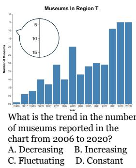  
Figure 1: An example multiple-choice question (MCQ) illustrating misleading-chart reasoning. The reversed axis makes the chart visually suggest an increasing trend despite decreasing underlying values.

Existing datasets present this problem through different answer formats, including open-ended questions and multiple-choice questions. These formats determine how a model expresses its answer, but they do not define all the abilities needed to obtain it. For example, computing a difference and selecting the option that describes that difference both require identifying the relevant entities, reading their values, and applying the correct operation. When the chart is misleading, both tasks also require recognizing the visual risk and selecting an appropriate correction. This motivates a shared representation of misleading chart reasoning beneath the downstream answer format.

Intermediate supervision provides a way to expose these abilities during training. Prior work transfers chart reasoning through synthesized rationales (Carbune et al., 2024), while ChartR decomposes questions to assess the correctness of intermediate steps (Chen et al., 2026). Building on this perspective, we organize misleading chart reasoning around question scoping, evidence grounding, visual-risk diagnosis, correction selection, operation execution, decision formation, and answer generation, and supervise how these abilities contribute to answers across both question formats.

A further challenge concerns the relationships among these abilities. Their dependencies involve branching and convergence rather than only a sequence of adjacent steps. Question scope determines both which evidence to select and which operation to perform. The operation then combines the selected evidence with the requirements of the question. Visual-risk diagnosis provides a separate basis for deciding whether correction is needed and which visual inference should be rejected. For example, comparing two series on a dual-axis chart requires combining the question scope with values read from the corresponding axes; comparing their screen heights alone is insufficient. A textual rationale can describe this process, but its sentence order need not make these dependencies explicit. This issue is relevant for compact multimodal models, whose reasoning performance can be sensitive to the structure and complexity of supervision. Prior work shows that smaller models may struggle to learn from long or undifferentiated reasoning traces, motivating more explicit and selective reasoning supervision (Li et al., 2025; Zhang et al., 2024; Chen et al., 2025a).

We propose VizDAGuide, a weighted DAGstructured supervision method for misleading chart question answering. Each node represents an intermediate reasoning state associated with an ability, and typed relations specify how these states depend on one another. We serialize the graph into text and use it as the training target for a multimodal language model. The same structured representation is applied across both open-ended and multiple-choice chart question answering. The graph therefore provides an explicit supervision structure while remaining compatible with autoregressive generation. We evaluate both final-answer accuracy and intermediate reasoning performance, and use controlled comparisons to assess the effect of graph-structured supervision. Our contributions are summarized as follows:

• We formulate misleading chart question answering as a set of intermediate abilities and construct a unified supervision scheme for both open-ended and multiple-choice chart question answering.

• We propose VizDAGuide, a weighted DAGstructured supervision method that models dependencies among intermediate reasoning states and enables structured reasoning to be learned through autoregressive training. We further validate its effectiveness across model scales and VLM families.

• We introduce a process-level evaluation scheme for misleading chart question answering that complements answer-level accuracy by assessing the quality of intermediate reasoning states, enabling a more comprehensive evaluation of model reasoning behavior.

## 2 Related Work

## 2.1 Chart Question Answering

Chart question answering requires models to locate chart elements, retrieve values, and perform numerical or logical reasoning. Early benchmarks use synthetic charts and template-based questions (Kafle et al., 2018; Methani et al., 2020), while later work extends chart QA to human-written questions, structured chart representations, and chart-specific reasoning objectives (Masry et al., 2022; Singh and Shekhar, 2020; Liu et al., 2023a; Carbune et al., 2024; Liu et al., 2023b; Zhang et al., 2024). Our work considers the additional challenge posed by visual encodings that can bias the interpretation of chart data (Bharti et al., 2025).

## 2.2 Misleading Chart Question Answering

Misleading charts can cause models to rely on visual cues that conflict with the underlying data. Misleading ChartQA evaluates this problem with multiple-choice questions across chart and misleader types (Chen et al., 2025b). ChartAttack studies the generation and impact of misleading charts and introduces AttackViz for evaluating the errors induced by different misleaders (Ortiz-Barajas et al., 2026). Other work explores inference-time mitigation, including chart-to-table conversion and chart reconstruction (Tonglet et al., 2026a,b; Zhang et al., 2026b). These studies provide benchmarks and mitigation strategies for misleading chart reasoning, while our work focuses on structuring the reasoning supervision used during training (Zhang et al., 2026a).

## 2.3 Structured Reasoning Supervision

Chain-of-thought represents reasoning as a sequence of intermediate steps (Wei et al., 2022), leaving dependencies among these steps implicit. Graph-based methods organize intermediate states with branching and aggregation, but mainly structure reasoning at inference time (Besta et al., 2024). UniCoTT further studies structured chainof-thought distillation by transferring chain-, tree-, and graph-structured reasoning from large language models to smaller models with structural learning objectives (Zhuang et al., 2025). For chart question answering, ChartR decomposes chart questions into sequential subquestions and shows that final-answer accuracy alone cannot reveal errors in intermediate reasoning (Chen et al., 2026). Our work instead defines explicit dependencies among chart reasoning abilities and uses them as structured supervision for misleading chart question answering across answer formats.

## 3 Method

## 3.1 Problem Formulation and Overview

We consider misleading chart question answering with a chart image I, a question $q ,$ and an answer a. For multiple-choice QA, we denote the candidate set as $C ;$ for open-ended $\mathrm { Q A } , C = \varnothing$ . Both formats are thus represented by

$$
x = ( I , q , C ) .\tag{1}
$$

Rather than supervising only the final answer, our method associates each instance with intermediate reasoning states and their dependencies. Given a shared ability set A, we denote the instantiated reasoning states for x as

$$
S ( x ) = \{ s _ { k } \mid A _ { k } \in { \mathcal { A } } \} .\tag{2}
$$

As shown in Figure 2, we first instantiate these abilities from the training data, organize their dependencies as a DAG, and serialize the graph as an autoregressive training target. The resulting supervision is shared across open-ended and multiplechoice QA, while the final answer follows the format of each dataset.

## 3.2 Shared Reasoning Abilities

We define the ability set to satisfy three requirements: it should cover the reasoning process from question interpretation to answer generation, distinguish different reasoning steps, and apply to both answer formats. The decomposition follows the functional demands of the task. Chart QA requires interpreting the question, grounding relevant chart evidence, and executing numerical or logical operations (Masry et al., 2022). Misleading charts additionally require identifying visual cues that can distort the required inference and, when necessary, selecting an appropriate correction (Chen et al., 2025b). We further separate decision formation from answer generation, allowing the same reasoning state to support both open-ended and multiplechoice outputs. This results in seven shared abilities,

$$
\begin{array} { r } { \mathcal { A } = \{ A _ { \mathrm { s c o p e } } , A _ { \mathrm { e v i d e n c e } } , A _ { \mathrm { r i s k } } , A _ { \mathrm { c o r r e c t i o n } } , } \\ { A _ { \mathrm { o p e r a t i o n } } , A _ { \mathrm { d e c i s i o n } } , A _ { \mathrm { a n s w e r } } \} . \quad } \end{array}\tag{3}
$$

Question Scoping identifies task requirements, Evidence Grounding grounds relevant evidence, Visual-Risk Diagnosis detects misleading cues, Correction Selection determines the required correction, Operation Execution performs the required operation, Decision Formation derives the conclusion, and Answer Generation produces the final answer. For each ability $A _ { k }$ , its instantiated state is written as $s _ { k } = \left( A _ { k } , c _ { k } \right)$ , where $c _ { k }$ denotes the supervision content for the current instance. The decomposition serves as a task-oriented supervision schema rather than an exhaustive taxonomy of chart reasoning.

These abilities capture distinct reasoning functions, but their dependencies are not strictly linear. For example, evidence grounding is conditioned on the question scope, while operation execution may depend on both the selected evidence and a correction for misleading visual cues. Correction is also conditional: it is required only when the visual encoding can affect the inference needed by the question. A fixed reasoning chain does not make these dependencies explicit.

We therefore represent the instantiated reasoning states as a directed acyclic graph

$$
G _ { x } = ( V _ { x } , E _ { x } ) ,\tag{4}
$$

where $V _ { x } \subseteq S ( x )$ contains the reasoning states used for instance x, and $E _ { x }$ specifies their directed dependencies. An edge $( s _ { i } , s _ { j } ) \in E _ { x }$ indicates that the content of $s _ { i }$ provides supervision required for constructing or interpreting $s _ { j }$ . The graph remains acyclic because dependencies follow the progression from question interpretation and evidence grounding to decision and answer generation.

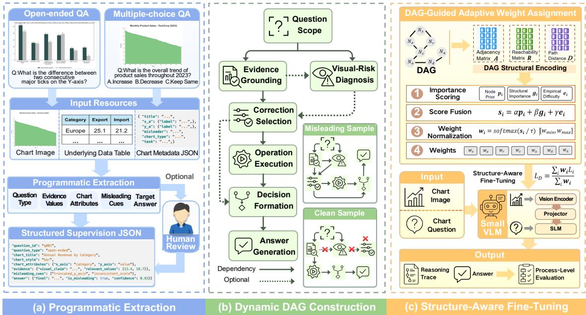  
Figure 2: Overview of VizDAGuide.

The graph structure is instance-dependent. For a clean chart, reasoning may proceed from grounded evidence to the required operation without activating a correction state. For a misleading chart, visual-risk diagnosis can activate a correction path that constrains the subsequent operation or decision. We also annotate dependencies that should not support a downstream state when a misleading visual cue would otherwise provide a shortcut. Figure 2(b) illustrates these structures.

## 3.3 Structured Target Construction

We construct the structured supervision target from the resources provided by each dataset. Depending on availability, these resources include the chart image, underlying data table, chart metadata, the question and answer, and annotations of misleading cues. A programmatic extraction stage maps these resources to the fields required by the shared ability schema, including question type, relevant evidence, chart attributes, misleading cues, and the target answer. The extracted fields are checked for consistency before being used to instantiate the reasoning states.

For each instance, the resulting node contents and dependencies form a target graph $G _ { x }$ . We serialize each DAG into a textual target for autoregressive training.

$$
y _ { x } = \mathrm { S e r i a l i z e } ( G _ { x } , a ) ,\tag{5}
$$

where $a$ is the dataset answer. The serialization

contains node and relation spans that preserve both reasoning content and dependency structure.

## 3.4 VizDAGuide: Weighted DAG Supervision

We assign different supervision weights to reasoning states according to their roles in the DAG. For each target graph, we derive its adjacency matrix A, reachability matrix R, and path-distance matrix D, from which the structural importance of each node is estimated. The score of node i combines its ability prior $p _ { i } .$ , structural importance $g _ { i } ,$ and empirical difficulty $e _ { i } { \mathrm { : } }$ :

$$
z _ { i } = \alpha p _ { i } + \beta g _ { i } + \gamma e _ { i } .\tag{6}
$$

We normalize the scores and map them to a bounded weight range:

$$
\begin{array} { r l } & { \tilde { w } _ { i } = \frac { \exp ( z _ { i } / \tau ) } { \sum _ { j } \exp ( z _ { j } / \tau ) } , } \\ & { w _ { i } = w _ { \mathrm { m i n } } + ( w _ { \mathrm { m a x } } - w _ { \mathrm { m i n } } ) \tilde { w } _ { i } . } \end{array}\tag{7}
$$

where $\tau$ controls the weight distribution. The node weights are assigned to their corresponding token spans, with separate weights used for relation and answer spans.

Given target tokens $y _ { 1 : T }$ , we optimize

$$
\mathcal { L } _ { \mathrm { { D A G } } } = \frac { \sum _ { t = 1 } ^ { T } w _ { t } \mathcal { L } _ { \mathrm { { C E } } } ( y _ { t } , \hat { y } _ { t } ) } { \sum _ { t = 1 } ^ { T } w _ { t } } ,\tag{8}
$$

where $w _ { t }$ is the weight of the span containing token t.

Training and inference. Given input x, the model autoregressively predicts the structured target $y _ { x }$ and is optimized with $\mathcal { L } _ { \mathrm { D A G } }$ . At inference time, only x is provided, and the trained model generates the reasoning trace and final answer in a single pass.

## 4 Experiments

## 4.1 Experimental Setup

Datasets. We evaluate on both open-ended and multiple-choice misleading chart QA. For openended QA (OEQ), we use the AttackViz/PlotQA data (Ortiz-Barajas et al., 2026), with 4,000 training instances and the full official test split of 6,042 questions. Among them, 5,961 have valid reference answers and are used for answer-level evaluation. For multiple-choice QA (MCQ), we use the benchmark introduced by Chen et al. (2025b). Its 3,055 questions are split by chart group and misleader type into 2,138 training and 917 test instances; 880 test questions have scorable answers. We ensure no train–test overlap in question IDs, chart images, or underlying tables.

Models and training. Our main experiments use Qwen3-VL-4B-Instruct and Qwen3-VL-8B-Instruct, fine-tuned with LoRA.We additionally evaluate InternVL3.5-4B-Instruct as an answerlevel cross-backbone validation.

Baselines. We compare against the base model and answer-only supervised fine-tuning. For intermediate reasoning supervision, we fine-tune a Linear CoT-SFT baseline following prior work (Ho et al., 2023). It preserves the same intermediate content and applies the same weights to corresponding spans, while removing node identifiers and explicit dependency relations, providing a contentand weight-matched control for DAG structure. We further compare unweighted and weighted DAG variants to isolate the effect of supervision weighting within the same structure. For MCQ, we also compare with the VLM SFT setting reported in ChartCynics (Zhang et al., 2026b). As its resources are not released, we use the reported result on the 305-sample test set as a reference.

Evaluation metrics. For open-ended QA, we report strict final-answer accuracy (FAA) and relaxed accuracy with a 5% relative tolerance for numerical answers (RA). For multiple-choice QA, we report answer accuracy and misleading-choice rate (MCR). For intermediate reasoning performance, we evaluate Grounding, Operation Type, Correction, and Process Accuracy. We report Clean False Correction (Clean FC) for clean charts; for MCQ, we report Sufficiency, which measures whether the available evidence supports the final decision.

External-model process evaluation. External models are not required to follow our DAG serialization. Instead, we use a unified structured protocol that elicits evidence, operation, visual correction, decision, and final answer in a model-agnostic format. These outputs are then evaluated with the same process-level criteria used for our models. Additional training details, metric definitions, and external-model evaluation protocols are provided in the Appendix.

## 4.2 Main Results

(1) Intermediate reasoning supervision. Table 1 compares supervision strategies on open-ended and multiple-choice QA. Answer-only supervision yields a small FAA gain, whereas Linear CoT-SFT substantially improves both FAA and RA. This indicates that intermediate reasoning supervision, rather than answer supervision alone, accounts for much of the improvement.

(2) Contribution of DAG structure and weighted supervision. With matched intermediate content and span weights, DAG-structured supervision outperforms Linear CoT-SFT across both tasks, model scales, and backbones. For the 4B model, weighted supervision also outperforms the unweighted DAG, showing complementary gains from dependency structure and weighting. The same trend holds for InternVL3.5-4B. On MCQ, the Qwen3-VL results are numerically higher than the 68.52% SFT result reported by ChartCynics (Zhang et al., 2026b).

(3) Accuracy and misleading-choice rate. MCR shows a different pattern from answer accuracy. For the 4B model, answer-only supervision has the lowest MCR (4.77%) but only 72.05% accuracy, with 23.18% of predictions falling into other wrong options. Linear CoT-SFT and the DAG variant have similar MCR values, while the latter achieves higher accuracy (74.55% vs. 71.93%). The 8B model shows the same pattern, with higher accuracy despite a higher MCR for the DAG variant. Thus, MCR reflects selection of the annotated misleading option rather than overall question accuracy.

Table 1: Comparison of supervision variants across VLM backbones.
<table><tr><td rowspan="2">Setting</td><td colspan="2">Open-ended QA</td><td colspan="2">MCQ</td></tr><tr><td>FAA↑</td><td>RA↑</td><td>Acc. ↑ MCR↓</td><td></td></tr><tr><td colspan="5">Qwen3-VL-4B</td></tr><tr><td>Base</td><td>34.98</td><td>45.03</td><td>62.73</td><td>17.61 4.77</td></tr><tr><td>+ Answer-only-SFT + Linear CoT-SFT</td><td>36.02 56.25</td><td>47.07 68.28</td><td>72.05 71.93</td><td>15.45</td></tr><tr><td>+ U-DAG + VizDAGuide (ours)</td><td>55.31 57.54</td><td>67.89 69.97</td><td>70.68 74.55</td><td>15.91 15.34</td></tr><tr><td colspan="5">Qwen3-VL-8B Base</td></tr><tr><td>+ Linear CoT-SFT</td><td>41.94 57.10</td><td>52.56 69.47</td><td>54.09 71.93</td><td>29.09 15.68</td></tr><tr><td>+ VizDAGuide (ours) ChartCynics SFT</td><td>59.54</td><td>71.88</td><td>74.20 68.52</td><td>16.93</td></tr><tr><td colspan="5">InternVL3.5-4B</td></tr><tr><td>Base</td><td>40.92</td><td>50.18</td><td>52.61</td><td>28.18</td></tr><tr><td>+ Linear CoT-SFT</td><td>52.83</td><td>64.55</td><td>70.80</td><td>14.20</td></tr><tr><td>+ VizDAGuide (ours)</td><td>53.97</td><td>65.64</td><td>72.95</td><td>15.80</td></tr><tr><td></td><td></td><td></td><td></td><td></td></tr></table>

## 4.3 Process-level Analysis

(1) Grounding and operation. Table 2 shows that the main process-level changes occur in Grounding and Operation. On open-ended QA, DAGstructured supervision improves both metrics over Linear CoT-SFT at both model scales. The gains are larger on MCQ, where Operation rises from 33.75% to 54.55% for 4B and from 29.66% to 53.64% for 8B. Grounding also improves at both scales, suggesting gains in evidence selection and operation execution.

(2) Correction behavior. Correction remains high across supervision settings. For the 4B model on open-ended QA, Correction changes from 88.64% to 84.90%, while Clean FC drops from 11.10% to 1.81%. Despite the lower Correction score, FAA and RA still improve over Linear CoT-SFT, indicating fewer unnecessary corrections on clean charts without loss in answer-level performance. For the 8B model, Correction increases from 83.69% to 89.92% and Clean FC decreases from 8.90% to 2.90%, improving both correction accuracy and false-correction control.

(3) Process accuracy across tasks. Process Accuracy changes across the two answer formats. On OEQ, it increases from 48.99% to 50.53% for 4B, while on MCQ it rises from 19.09% to 41.59% for 4B and from 15.68% to 38.64% for 8B. Correction and Sufficiency remain high, with smaller changes than Grounding and Operation. The MCQ gains are associated with improved grounding and operation execution, while correction varies with chart condition and model scale.

Table 2: Process-level results on open-ended and multiple-choice QA. Gnd., Op., Corr., Pac., FC, and Suff. denote Grounding, Operation, Correction, Process Accuracy, Clean FC, and Sufficiency.
<table><tr><td colspan="5">Open-ended QA</td></tr><tr><td>Supervision</td><td>Gnd.↑ Op.↑</td><td>Corr.↑</td><td></td><td>Pac.↑ FC↓</td></tr><tr><td colspan="5">Qwen3-VL-4B</td></tr><tr><td>Linear CoT-SFT</td><td>57.49</td><td>68.21 88.64</td><td>48.99</td><td>11.10</td></tr><tr><td>U-DAG VizDAGuide (Ours)</td><td>57.57</td><td>67.99</td><td>86.66 49.72</td><td>2.67</td></tr><tr><td></td><td>59.44</td><td>70.07</td><td>84.90 50.53</td><td>1.81</td></tr><tr><td colspan="5">Qwen3-VL-8B</td></tr><tr><td>Linear CoT-SFT VizDAGuide (Ours)</td><td>59.54 69.45 61.38 71.97</td><td>83.69 89.92</td><td>48.97 54.08</td><td>8.90 2.90</td></tr><tr><td colspan="5">Multiple-choice QA</td></tr><tr><td>Supervision</td><td>Gnd.↑ Op.↑</td><td>Corr.↑</td><td>Suff.↑</td><td>Pac.↑</td></tr><tr><td colspan="5">Qwen3-VL-4B</td></tr><tr><td>Linear CoT-SFT</td><td>70.45</td><td>33.75 91.36</td><td>94.66 94.09</td><td>19.09</td></tr><tr><td>U-DAG</td><td>66.82</td><td>38.64</td><td>82.16</td><td>20.23</td></tr><tr><td>VizDAGuide (Ours)</td><td>78.64</td><td>54.55 95.45</td><td>96.70</td><td>41.59</td></tr><tr><td colspan="5">Qwen3-VL-8B</td></tr><tr><td>Linear CoT-SFT VizDAGuide (Ours)</td><td>69.55 76.82</td><td>29.66 53.64</td><td>89.43 94.77 92.05 97.16</td><td>15.68 38.64</td></tr></table>

Process–answer relation. Table 3 shows different patterns of answer failure across tasks. For OEQ, Operation is the main bottleneck at both model scales, with the highest correlation with answer correctness and a 100% answer error rate when it alone fails. Grounding and Correction failures are more recoverable, indicating the importance of operation execution after evidence grounding.

On MCQ, Sufficiency and Grounding show the strongest associations with answer correctness, while isolated Operation failures are less damaging. Table 4 shows a similar pattern across misleader types: OEQ is dominated by Operation, whereas MCQ is associated with Sufficiency and Correction. This suggests that OEQ relies more on operation execution, while MCQ relies more on evidence sufficiency for the final decision.

## 4.4 Fine-grained Analysis

We further compare VizDAGuide with the Qwen-VL-4B base model across question types, chart types, and misleading conditions in Figure 3

Question type. On open-ended QA, all five question types improve over Base. The largest gains appear in compound and data-retrieval questions (35.92% and 28.77%), while min–max remains the hardest category. This suggests gains in both evidence retrieval and multi-step reasoning.

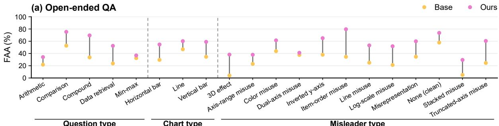

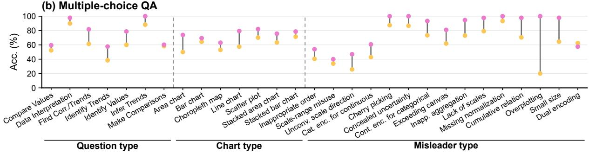  
Figure 3: Fine-grained comparison between the Base model and VizDAGuide across question types, chart types, and misleading conditions.

Table 3: Process–answer relation. Corr. measures process–answer correctness correlation; Answer Error is the final-answer error rate when only the corresponding process is incorrect.
<table><tr><td colspan="2"></td><td colspan="2">Corr.</td><td colspan="2">Answer Error</td></tr><tr><td>Task</td><td>Process</td><td>4B</td><td>8B</td><td>4B</td><td>8B</td></tr><tr><td>OEQ</td><td>Grounding Operation Correction</td><td>0.447 0.757 0.105</td><td>0.439 0.756 0.085</td><td>9.94 100.00 18.44</td><td>8.68 100.00 18.88</td></tr><tr><td>MCQ</td><td>Grounding Operation Correction Sufficiency</td><td>0.294 0.174 0.123 0.316</td><td>0.212 0.129 0.067 0.290</td><td>57.14 20.66 62.50 100.00</td><td>48.57 22.13 36.36 100.00</td></tr></table>

MCQ shows a different pattern. Find Correlations/Trends gains the most, followed by Identify Values, while Make Comparisons changes less. Find Correlations/Trends shows the clearest gain, which remains supported after Holm correction. Thus, the improvements are spread across more question types in open-ended QA than in MCQ.

Chart type. On open-ended QA, all three chart types improve over Base. Horizontal and vertical bars gain about 25 percentage points, while line charts gain 13.41%; all three gains remain supported after Holm correction.

MCQ gains span area, line, bar, choropleth, scatter, and stacked charts. Area and line charts show the largest gains and remain supported after correction. Overall, the improvements extend across multiple chart representations rather than concentrating on one chart type.

Table 4: Top-5 misleader types ranked by average process–answer correlation across 4B and 8B. Process denotes the highest-correlated process.
<table><tr><td>Task</td><td>Misleader Type</td><td>Process</td><td>4B</td><td>8B</td></tr><tr><td rowspan="3">OEQ</td><td>Stacked misuse</td><td>Operation Operation</td><td>0.963 0.937</td><td>0.960</td></tr><tr><td>Axis-range misuse Dual-axis misuse</td><td>Operation</td><td>0.930</td><td>0.946 0.910</td></tr><tr><td>3D effect Log-scale misuse</td><td>Operation Operation</td><td>0.919 0.898</td><td>0.909 0.904</td></tr><tr><td>MCQ</td><td>Small size Inappropriate aggregation Continuous encoding Exceeding canvas Scale range</td><td>Sufficiency Sufficiency Correction Sufficiency Sufficiency</td><td>1.000 0.697 0.807 0.461 0.389</td><td>1.000 0.697 0.477 0.608 0.316</td></tr></table>

Misleader type. On open-ended QA, most misleading conditions improve over Base. The largest gains appear in item-order, truncated-axis, 3Deffect, and log-scale misuse. Stacked misuse rises from 4.98% to 29.49% but remains difficult. Clean-chart accuracy also increases from 57.81% to 73.67%, showing that the gains are not limited to misleading cases.

MCQ shows a more varied pattern across misleader types. Gains appear in unconventional scale directions, inappropriate aggregation, cumulative relationships, and several encoding-related conditions. Dual encoding shows a numerical drop from 62.50% to 57.50%, but the difference is not supported after Holm correction, indicating no reliable degradation for this category.

<table><tr><td colspan="7">(a) Open-ended QA</td></tr><tr><td>Model</td><td>RA↑</td><td>Gnd. ↑</td><td>Op. ↑</td><td>Corr. ↑</td><td>Pac. ↑</td><td>FC↓</td></tr><tr><td>GPT-5.5</td><td>64.42</td><td>59.34</td><td>55.36</td><td>63.16</td><td>36.54</td><td>4.62</td></tr><tr><td>Gemini 3 Flash</td><td>64.28</td><td>59.45</td><td>55.86</td><td>61.48</td><td>37.12</td><td>3.76</td></tr><tr><td>Kimi-K3</td><td>63.83</td><td>57.78</td><td>55.18</td><td>55.98</td><td>34.57</td><td>1.57</td></tr><tr><td>Claude Opus 4.8</td><td>63.11</td><td>48.47</td><td>31.71</td><td>52.58</td><td>15.50</td><td>1.62</td></tr><tr><td>Gemini 2.5 Pro</td><td>61.63</td><td>50.71</td><td>51.69</td><td>58.18</td><td>29.11</td><td>6.14</td></tr><tr><td>04-mini</td><td>61.08</td><td>44.66</td><td>44.37</td><td>36.60</td><td>21.89</td><td>0.33</td></tr><tr><td>Gemini 2.5 Flash</td><td>59.52</td><td>52.58</td><td>51.03</td><td>30.25</td><td>18.27</td><td>1.00</td></tr><tr><td>GPT-4.1</td><td>58.87</td><td>48.01</td><td>45.40</td><td>37.06</td><td>23.27</td><td>0.29</td></tr><tr><td>Claude Sonnet 4.5</td><td>58.06</td><td>51.65</td><td>46.40</td><td>52.58</td><td>26.94</td><td>2.81</td></tr><tr><td>Claude Haiku 4.5</td><td>54.45</td><td>38.90</td><td>31.91</td><td>41.67</td><td>15.94</td><td>1.33</td></tr><tr><td>GPT-40</td><td>53.75</td><td>38.77</td><td>39.17</td><td>36.74</td><td>19.23</td><td>0.71</td></tr><tr><td>Qwen3-VL-4B + ours</td><td>69.97</td><td>59.44</td><td>70.07</td><td>84.90</td><td>50.53</td><td>1.81</td></tr><tr><td>Qwen3-VL-8B + ours</td><td>71.88</td><td>61.38</td><td>71.97</td><td>89.92</td><td>54.08</td><td>2.90</td></tr></table>

<table><tr><td colspan="7">(b) Multiple-choice QA</td></tr><tr><td>Model</td><td>Acc. ↑</td><td>Gnd. ↑</td><td>Op. ↑</td><td>Corr. ↑</td><td>Suff. ↑</td><td>Pac. ↑</td></tr><tr><td>GPT-5.5</td><td>80.00</td><td>50.57</td><td>73.07</td><td>47.84</td><td>93.52</td><td>24.89</td></tr><tr><td>Kimi-K3</td><td>77.39</td><td>50.68</td><td>67.16</td><td>43.18</td><td>91.70</td><td>18.41</td></tr><tr><td>Claude Opus 4.8</td><td>76.48</td><td>53.64</td><td>65.00</td><td>47.39</td><td>91.14</td><td>17.61</td></tr><tr><td>Gemini 2.5 Pro</td><td>75.68</td><td>48.18</td><td>62.73</td><td>41.93</td><td>87.05</td><td>18.30</td></tr><tr><td>Gemini 3 Flash</td><td>75.45</td><td>51.93</td><td>66.36</td><td>42.50</td><td>87.39</td><td>20.23</td></tr><tr><td>Claude Sonnet 4.5</td><td>74.66</td><td>52.16</td><td>62.27</td><td>33.86</td><td>92.05</td><td>18.86</td></tr><tr><td>Gemini 2.5 Flash</td><td>68.18</td><td>39.66</td><td>56.25</td><td>26.02</td><td>84.77</td><td>10.11</td></tr><tr><td>Claude Haiku 4.5</td><td>66.02</td><td>52.39</td><td>51.48</td><td>28.18</td><td>85.45</td><td>8.07</td></tr><tr><td>o4-mini</td><td>65.00</td><td>21.82</td><td>40.68</td><td>9.66</td><td>84.20</td><td>2.84</td></tr><tr><td>GPT-4.1</td><td>64.32</td><td>31.82</td><td>60.34</td><td>16.14</td><td>84.09</td><td>10.00</td></tr><tr><td>GPT-40</td><td>62.95</td><td>27.95</td><td>58.30</td><td>18.30</td><td>84.20</td><td>10.68</td></tr><tr><td>Qwen3-VL-4B + ours</td><td>74.55</td><td>78.64</td><td>54.55</td><td>95.45</td><td>96.70</td><td>41.59</td></tr><tr><td>Qwen3-VL-8B + ours</td><td>74.20</td><td>76.82</td><td>53.64</td><td>92.05</td><td>97.16</td><td>38.64</td></tr></table>

Table 5: Reference comparison with general-purpose models on open-ended and multiple-choice misleading chart QA. External models use a unified JSON evaluation protocol, whereas our models use their native structured-output setting; the results are intended for contextual comparison rather than strict ranking.

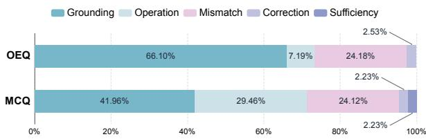  
Figure 4: Distribution of the earliest identified error stage in VizDAGuide predictions on open-ended and multiple-choice QA.

## 4.5 Error Analysis

We locate the earliest failed reasoning stage among incorrect predictions. As shown in Figure 4, openended QA is dominated by grounding failures (66.10%), while operation errors are relatively rare (7.19%), indicating that many failures occur before the required computation is executed. MCQ shows a different pattern: grounding remains the largest source of error (41.96%), but operation failures rise to 29.46%, suggesting that errors more often extend into operation execution after evidence has been identified. Final-answer mismatches account for about one quarter of errors in both settings, whereas correction-related failures are uncommon. Thus, the main bottleneck lies in grounding for open-ended QA, but is shared between grounding and operation in MCQ.

## 4.6 Comparison with External Models

Table 5 contextualizes our trained models against general-purpose models evaluated on the same underlying test sets. We re-evaluate these models using our evaluation pipeline and report both answerand process-level metrics. On open-ended QA, the 4B and 8B models trained via VizDAGuide are competitive with the general-purpose models at the answer level and show stronger performance on several process metrics, with the 8B model achieving the highest RA and strong process-level results. On MCQ, the trained models remain below the strongest general-purpose models in answer accuracy, but the gap is relatively small despite their smaller model scale.

## 5 Conclusion

We present VizDAGuide, a weighted DAGstructured supervision method that models dependencies among intermediate reasoning abilities for misleading chart QA. Across Qwen3-VL and InternVL3.5 models, the method outperforms the content- and weight-matched Linear CoT-SFT baseline at the answer level. Process-level evaluation on Qwen3-VL shows gains in grounding, operation execution, and process accuracy, while ablations show complementary contributions from dependency structure and weighted supervision.

Error analysis identifies grounding as the main bottleneck on OEQ, while MCQ failures involve both grounding and operation execution. These findings highlight evidence grounding and operation execution as directions for further improvement.

## Limitations

Dependence on structured training resources. Constructing VizDAGuide supervision relies on resources provided by the training benchmarks, such as underlying chart data, metadata, and misleading annotations when available. These resources are used only to construct training targets and are not required at inference time. Applying the method to datasets without such resources may therefore require additional extraction or annotation procedures.

Supervision construction quality. VizDAGuide derives its reasoning graphs and supervision signals from structured chart information during training. Errors or ambiguities in these intermediate resources can propagate into the constructed DAG targets and their supervision weights. Future work could incorporate uncertainty-aware construction or verification mechanisms to make DAG supervision more robust to imperfect training resources.

## References

Maciej Besta, Nils Blach, Ales Kubicek, Robert Gerstenberger, Lukas Gianinazzi, Joanna Gajda, Tomasz Lehmann, Michał Podstawski, Hubert Niewiadomski, Piotr Nyczyk, and Torsten Hoefler. 2024. Graph of Thoughts: Solving Elaborate Problems with Large Language Models. Proceedings ofthe AAAI Conference on Artificial Intelligence, 38(16):17682–17690.

Shubham Bharti, Shiyun Cheng, Jihyun Rho, Jianrui Zhang, Mu Cai, Yong Jae Lee, Martina Rau, and Xiaojin Zhu. 2025. Chartom: A visual theory-of-mind benchmark for llms on misleading charts. Preprint, arXiv:2408.14419.

Victor Carbune, Hassan Mansoor, Fangyu Liu, Rahul Aralikatte, Gilles Baechler, Jindong Chen, and Abhanshu Sharma. 2024. Chart-based reasoning: Transferring capabilities from LLMs to VLMs. In Findings ofthe Associationfor Computational Linguistics: NAACL 2024, pages 989–1004, Mexico City, Mexico. Association for Computational Linguistics.

Xiaojun Chen, Sixiao Luo, Ziqi Liu, Min Yang, Qin Zhang, and Liang-Jie Zhang. 2026. Chartr: Evaluating reasoning accuracy and robustness in chart question answering. In Proceedings of the IEEE/CVF Conference on Computer Vision and Pattern Recognition (CVPR), pages 41193–41202.

Xiaoshu Chen, Sihang Zhou, Ke Liang, Xiaoyu Sun, and Xinwang Liu. 2025a. Skip-thinking: Chunk-wise chain-of-thought distillation enable smaller language models to reason better and faster. In Proceedings of the 2025 Conference on Empirical Methods in Natural Language Processing, pages 12142–12157,

Suzhou, China. Association for Computational Linguistics.

Zixin Chen, Sicheng Song, KaShun Shum, Yanna Lin, Rui Sheng, Weiqi Wang, and Huamin Qu. 2025b. Unmasking deceptive visuals: Benchmarking multimodal large language models on misleading chart question answering. In Proceedings of the 2025 Conference on Empirical Methods in Natural Language Processing, pages 13756–13789, Suzhou, China. Association for Computational Linguistics.

Namgyu Ho, Laura Schmid, and Se-Young Yun. 2023. Large language models are reasoning teachers. In Proceedings of the 61st Annual Meeting of the Associationfor Computational Linguistics (Volume 1: Long Papers), pages 14852–14882, Toronto, Canada. Association for Computational Linguistics.

Kushal Kafle, Brian Price, Scott Cohen, and Christopher Kanan. 2018. Dvqa: Understanding data visualizations via question answering. In Proceedings of the IEEE Conference on Computer Vision and Pattern Recognition (CVPR).

Yuetai Li, Xiang Yue, Zhangchen Xu, Fengqing Jiang, Luyao Niu, Bill Yuchen Lin, Bhaskar Ramasubramanian, and Radha Poovendran. 2025. Small models struggle to learn from strong reasoners. In Findings of the Association for Computational Linguistics: ACL 2025, pages 25366–25394, Vienna, Austria. Association for Computational Linguistics.

Fangyu Liu, Julian Eisenschlos, Francesco Piccinno, Syrine Krichene, Chenxi Pang, Kenton Lee, Mandar Joshi, Wenhu Chen, Nigel Collier, and Yasemin Altun. 2023a. DePlot: One-shot visual language reasoning by plot-to-table translation. In Findings of the Associationfor Computational Linguistics: ACL 2023, pages 10381–10399, Toronto, Canada. Association for Computational Linguistics.

Fangyu Liu, Francesco Piccinno, Syrine Krichene, Chenxi Pang, Kenton Lee, Mandar Joshi, Yasemin Altun, Nigel Collier, and Julian Eisenschlos. 2023b. MatCha: Enhancing visual language pretraining with math reasoning and chart derendering. In Proceedings of the 61st Annual Meeting of the Association for Computational Linguistics (Volume 1: Long Papers), pages 12756–12770, Toronto, Canada. Association for Computational Linguistics.

Ridwan Mahbub, Mohammed Saidul Islam, Md Tahmid Rahman Laskar, Mizanur Rahman, Mir Tafseer Nayeem, and Enamul Hoque. 2025. The perils of chart deception: How misleading visualizations affect vision-language models. In IEEE VIS 2025 (Short Paper) [ Best Paper Award].

Ahmed Masry, Do Xuan Long, Jia Qing Tan, Shafiq Joty, and Enamul Hoque. 2022. ChartQA: A benchmark for question answering about charts with visual and logical reasoning. In Findings of the Association for Computational Linguistics: ACL 2022, pages 2263– 2279, Dublin, Ireland. Association for Computational Linguistics.

Nitesh Methani, Pritha Ganguly, Mitesh M. Khapra, and Pratyush Kumar. 2020. Plotqa: Reasoning over scientific plots. In Proceedings ofthe IEEE/CVF Winter Conference on Applications of Computer Vision (WACV).

Jesus-German Ortiz-Barajas, Jonathan Tonglet, Vivek Gupta, and Iryna Gurevych. 2026. Chartattack: Testing the vulnerability of llms to malicious prompting in chart generation. Preprint, arXiv:2601.12983.

Hrituraj Singh and Sumit Shekhar. 2020. STL-CQA: Structure-based transformers with localization and encoding for chart question answering. In Proceedings ofthe 2020 Conference on Empirical Methods in Natural Language Processing (EMNLP), pages 3275–3284, Online. Association for Computational Linguistics.

Jonathan Tonglet, Tinne Tuytelaars, Marie-Francine Moens, and Iryna Gurevych. 2026a. Protecting multimodal large language models against misleading visualizations. In Proceedings of the 64th Annual Meeting of the Association for Computational Linguistics (Volume 1: Long Papers), pages 8329–8349, San Diego, California, United States. Association for Computational Linguistics.

Jonathan Tonglet, Jan Zimny, Tinne Tuytelaars, and Iryna Gurevych. 2026b. Is this chart lying to me? automating the detection of misleading visualizations. In Proceedings of the 64th Annual Meeting of the Associationfor Computational Linguistics (Volume 1: Long Papers), pages 8823–8844, San Diego, California, United States. Association for Computational Linguistics.

Jason Wei, Xuezhi Wang, Dale Schuurmans, Maarten Bosma, brian ichter, Fei Xia, Ed Chi, Quoc V Le, and Denny Zhou. 2022. Chain-of-thought prompting elicits reasoning in large language models. In Advances in Neural Information Processing Systems, volume 35, pages 24824–24837. Curran Associates, Inc.

Liang Zhang, Anwen Hu, Haiyang Xu, Ming Yan, Yichen Xu, Qin Jin, Ji Zhang, and Fei Huang. 2024. TinyChart: Efficient chart understanding with program-of-thoughts learning and visual token merging. In Proceedings ofthe 2024 Conference on Empirical Methods in Natural Language Processing, pages 1882–1898, Miami, Florida, USA. Association for Computational Linguistics.

Xiaotian Zhang, Huayuan Ye, Haiyang Zhang, Chenhui Li, Changbo Wang, and Sicheng Song. 2026a. Vizanchor: Decoding manipulation intent from tampering visualizations via dual-anchor reasoning. Preprint, arXiv:2608.24535.

Yanjie Zhang, Yafei Li, Rui Sheng, Zixin Chen, Yanna Lin, Huamin Qu, Lei Chen, and Yushi Sun. 2026b. Navigating the mirage: A dual-path agentic framework for robust misleading chart question answering.

In Proceedings ofthe 34th ACM International Conference on Multimedia, MM ’26, New York, NY, USA. Association for Computing Machinery.

Xianwei Zhuang, Zhihong Zhu, Zhichang Wang, Xuxin Cheng, and Yuexian Zou. 2025. UnicoTT: A unified framework for structural chain-of-thought distillation. In The Thirteenth International Conference on Learning Representations.

## A Dataset and Evaluation Coverage

Open-ended QA. For open-ended QA (OEQ), we use the AttackViz/PlotQA data, with 4,000 training instances and the full official test split of 6,042 questions. Among them, 5,961 have valid reference answers and are used for answer-level evaluation. The remaining 81 contain incomplete or ambiguous reference annotations in the original data and therefore do not support deterministic answer-level scoring under our evaluation protocol. The eligibility criterion is determined solely from the reference annotations and is fixed across all models. Strict final-answer accuracy (FAA) and relaxed accuracy (RA) are computed on the same 5,961 questions.

Multiple-choice QA. For multiple-choice QA (MCQ), we use the benchmark introduced by (Chen et al., 2025b). Its 3,055 questions are split by chart group and misleader type into 2,138 training and 917 test instances. Among the test questions, 880 have scorable answers and are used for answerlevel evaluation. The remaining 37 contain incomplete or ambiguous reference annotations in the original data and therefore do not support deterministic answer-level scoring under our evaluation protocol. Answer accuracy and misleading-choice rate (MCR) are computed on the same fixed set of 880 questions. The MCQ test set contains misleading charts only, so Clean False Correction (Clean FC) is not applicable.

Scoring coverage. Answer eligibility is determined from the reference annotations and is independent of model predictions. An empty, truncated, or unparseable response on an answer-eligible question is counted as incorrect rather than removed from the denominator. For process-level evaluation, each metric is computed only when the reference annotations contain the information required by that metric and the metric is applicable to the instance. The resulting applicability mask is fixed and shared across all models.

Train–test separation. For both tasks, the predefined train–test partitions are used throughout our experiments. We ensure no train–test overlap in question IDs, chart images, or underlying tables.

Training and inference resources. We construct the structured supervision targets from the resources provided by each training benchmark. Depending on availability, these resources include the chart image, underlying data table, chart metadata, question and answer, and annotations of misleading cues. Test-set annotations are used only for offline evaluation. At inference time, the model receives the chart image and question, together with the candidate options for MCQ. No underlying data tables, chart metadata, misleading annotations, or evaluation references are provided as inference-time inputs.

## B DAG Construction and Serialization

Node contents. Our supervision schema defines seven reasoning-state types corresponding to the shared abilities introduced in Section 3.2: N1 for Question Scoping, N2 for Evidence Grounding, N3 for Visual-Risk Diagnosis, N4 for Correction Selection, N5 for Operation Execution, N6 for Decision Formation, and N7 for Answer Generation. An instance activates the states applicable to its reasoning process. Question Scoping identifies the entities and relation required by the question, while Evidence Grounding records the relevant chart information. Operation Execution specifies how the grounded evidence is used, and Decision Formation expresses the resulting task-level conclusion. Answer Generation then renders this conclusion in the format required by the dataset, as a free-form answer for OEQ or a candidate selection for MCQ.

Dependency construction. We construct directed relations according to the functional dependencies among the reasoning states. Question scope guides evidence selection and specifies the required operation. Grounded evidence supplies the information used by the operation. When a misleading visual cue affects the required inference, Visual-Risk Diagnosis activates a Correction Selection state, which constrains the subsequent operation or decision. Operation Execution supports Decision Formation, which in turn supports Answer Generation. These dependencies follow the progression from question interpretation and evidence grounding to decision and answer generation, forming an acyclic graph.

Conditional correction. The graph structure is instance-dependent. For clean instances, reasoning can proceed from question scope and grounded evidence to the required operation without activating a correction state. For misleading instances, Visual-Risk Diagnosis activates a correction path that specifies which visual inference should not be used and how the subsequent reasoning should instead rely on the grounded chart information. We additionally record blocked-relation annotations for misleading visual cues that could otherwise provide an invalid shortcut to a downstream state. These annotations are represented separately from the active dependency edges and are not treated as valid evidence dependencies.

Textual representation. We serialize the instantiated node contents together with their parent references and typed dependency relations. Node identifiers distinguish reasoning states, parent references expose their active dependencies, and relation spans encode the corresponding graph structure. The following schematic example illustrates a count question involving a logarithmic axis. The values are illustrative and are not taken from a test instance.

N1 Question Scoping: count values above   
5000   
N2 Evidence Grounding <- N1: A=10400;   
B=9000; C=1000   
N3 Visual-Risk Diagnosis: logarithmic   
y-axis; visual distance is not linear   
in value   
N4 Correction Selection <- N3: read the   
numerical values rather than comparing   
linear visual distances   
N5 Operation Execution <- N1,N2,N4:   
count(value > 5000) = 2   
N6 Decision Formation <- N5: two values   
exceed the threshold   
N7 Answer Generation <- N6: 2   
Edges: N1->N2[selects\_evidence];   
N1->N5[specifies\_operation];   
N2->N5[feeds\_evidence];   
N3->N4[triggers\_correction];   
N4->N5[constrains\_operation];   
N5->N6[derives\_decision];   
N6->N7[generates\_answer]   
Blocked relation:   
linear\_visual\_distance -> N5, blocked   
by N4

Matched Linear CoT control. We construct the Linear CoT baseline from the same intermediate reasoning contents. The corresponding fields are presented as Question Scoping, Evidence Grounding, Visual-Risk Diagnosis, Correction Selection, Operation Execution, Decision Formation, and Answer Generation. We remove node identifiers, parent references, explicit dependency relations, and blocked-relation notation while preserving the semantic content of the intermediate states. Corresponding semantic spans receive the same supervision weights as in the DAG target. This construction is used for both OEQ and MCQ, providing a content- and weight-matched control for evaluating the contribution of explicit dependency representation.

Role of the graph. The DAG serves as a trainingtime supervision representation rather than an external inference-time execution module. Its serialized node and relation spans form the autoregressive prediction target and receive the structured supervision described in Section 3.4. At inference time, the model receives only the task input and generates the intermediate reasoning states and final answer in a single autoregressive pass; no external graph executor or additional correction pass is used.

## C Training Details

## C.1 DAG-Guided Adaptive Weight Assignment

Structural encoding. For each instantiated target graph $G _ { x } = ( V _ { x } , E _ { x } )$ , we derive its adjacency matrix A, reachability matrix R, and directed pathdistance matrix D from the active dependency relations. The adjacency matrix records direct dependencies between reasoning states, whereas the reachability and path-distance matrices capture transitive structural relations within the DAG. Blocked relations represent rejected dependencies and are therefore excluded from the active graph structure used to construct these matrices.

Structural importance. The graph representation is used to estimate the structural importance of each reasoning state. We denote the structural importance of node i as $g _ { i }$ . It reflects the role of the node in the instance-specific dependency structure based on the adjacency, reachability, and path-distance information derived from the DAG.

Node importance score. Following Section 3.4, the score of node i combines its ability prior $p _ { i }$ structural importance $g _ { i }$ , and empirical difficulty $\textstyle e _ { i } \colon$

$$
z _ { i } = \alpha p _ { i } + \beta g _ { i } + \gamma e _ { i } .\tag{9}
$$

The three terms respectively capture the reasoning role associated with the node, its structural role in

<table><tr><td>Parameter</td><td>Value</td></tr><tr><td>α/β/γ</td><td>0.25/0.35/0.40</td></tr><tr><td>T</td><td>0.8</td></tr><tr><td>Wmin/wmax</td><td>0.5/2.0</td></tr></table>

Table 6: Hyperparameters used for DAG-guided weight assignment.

the instantiated DAG, and the difficulty associated with the corresponding reasoning state.

Weight normalization. We normalize the node scores using a temperature-controlled softmax:

$$
\tilde { w } _ { i } = \frac { \exp ( z _ { i } / \tau ) } { \sum _ { j } \exp ( z _ { j } / \tau ) } ,\tag{10}
$$

where $\tau$ controls the concentration of the resulting weight distribution. The normalized score is then mapped to a bounded supervision range:

$$
w _ { i } = w _ { \mathrm { m i n } } + ( w _ { \mathrm { m a x } } - w _ { \mathrm { m i n } } ) \tilde { w } _ { i } .\tag{11}
$$

Table 6 summarizes the fixed hyperparameters used for weight assignment across all experiments. This transformation preserves the relative importance induced by the fused node scores while bounding the contribution of individual reasoning states.

Token-level application. Each node weight is assigned to the target-token span corresponding to that reasoning state. Relation and answer spans use their designated span weights, consistent with the training objective in Section 3.4. Given target tokens $y _ { 1 : T }$ , the weighted autoregressive objective is

$$
\mathcal { L } _ { \mathrm { { D A G } } } = \frac { \sum _ { t = 1 } ^ { T } w _ { t } \mathcal { L } _ { \mathrm { { C E } } } ( y _ { t } , \hat { y } _ { t } ) } { \sum _ { t = 1 } ^ { T } w _ { t } } ,\tag{12}
$$

where $w _ { t }$ denotes the supervision weight assigned to the span containing token t. The structural matrices are used only to construct the supervision weights and are not provided as additional model inputs.

## C.2 Optimization and Fine-Tuning Settings

We fine-tune Qwen3-VL-4B-Instruct using LoRA. Table 7 summarizes the task-specific optimization settings used for open-ended and multiple-choice QA. Gradient checkpointing is enabled during finetuning. Qwen3-VL-8B-Instruct and InternVL3.5- 4B-Instruct use the same task-specific training configuration. All experiments were conducted on four NVIDIA RTX 3090 GPUs with 24 GB of memory each. The total computational budget, including preliminary experiments, was approximately 1,500 GPU-hours. We implement our experiments using PyTorch 2.6.0, Hugging Face Transformers 4.57.6, and PEFT 0.17.1.

<table><tr><td>Setting</td><td>Open-ended</td><td>MCQ</td></tr><tr><td>LoRA rank / scaling</td><td>32 / 64</td><td>32 / 64</td></tr><tr><td>LoRA dropout</td><td>0.05</td><td>0.05</td></tr><tr><td>Learning rate</td><td> $5 \times 1 0 ^ { - 5 }$ </td><td> $3 \times 1 0 ^ { - 5 }$ </td></tr><tr><td>Schedule</td><td>Constant</td><td>Cosine</td></tr><tr><td>Warmup ratio</td><td>0</td><td>0.03</td></tr><tr><td>Weight decay</td><td>0</td><td>0.01</td></tr><tr><td>Global batch size</td><td>16</td><td>16</td></tr><tr><td>Epochs</td><td>2</td><td>2</td></tr><tr><td>Gradient clipping</td><td>1.0</td><td>1.0</td></tr></table>

Table 7: Training settings for open-ended and multiplechoice QA. The same task-specific configuration is used across model backbones.

Weighted supervision. We apply token-level cross-entropy to assistant target tokens while masking input and padding positions. For VizDAGuide, reasoning spans receive the supervision weights described in Section C.1. The Linear CoT baseline applies the same weights to the corresponding semantic spans, whereas the unweighted DAG assigns unit weights to its target spans. For weighted supervision, the loss is normalized by the sum of the active token weights, following the objective in Section 3.4.

## D Evaluation Metrics and Protocol

## D.1 Metric Definitions

Our evaluation criteria are aligned with the seven reasoning states defined in Section 3.2. Each state is associated with a corresponding semantic check, while Answer Generation is evaluated using the task-specific answer-level metric. The main paper reports a subset of these criteria for compactness.

Question Scoping. Question Scoping evaluates whether the generated reasoning correctly identifies the task requirements of the question, including the relevant entities, comparison or relation, and the quantity or property to be determined. The check focuses on the semantic scope of the question rather than the exact wording of the generated field.

Evidence Grounding. Evidence Grounding evaluates whether the generated reasoning identifies the evidence required to answer the question. For numerical evidence, predicted entities are aligned with the corresponding reference entities, and their required values are evaluated with a 5% relative tolerance. Conflicting values for the same entity fail the check. For qualitative MCQ instances, Grounding checks whether the generated observation captures the reference chart condition required to interpret the question.

Visual-Risk Diagnosis. Visual-Risk Diagnosis evaluates whether the model correctly identifies the visual condition relevant to the required inference. For misleading charts, the predicted diagnosis must identify the misleading cue that can affect the question. For clean charts, the model should not introduce a misleading condition that requires correction. The metric evaluates the semantic diagnosis rather than exact surface-form matching.

Correction Selection. Correction Selection evaluates whether the model selects an appropriate response to the diagnosed visual risk. For misleading instances, the predicted correction must be consistent with the reference correction required for the question. For clean instances, the model should determine that no correction is needed.

Operation Execution. Operation Execution evaluates whether the generated reasoning identifies and applies the operation required by the question. For open-ended QA, the evaluation considers the operation type, the evidence used by the operation, and the resulting computation. When numerical execution is applicable, the computed result is checked against the reference with a 5% relative tolerance. For MCQ, the metric evaluates agreement with the reference operation or reasoning category.

Decision Formation. Decision Formation evaluates whether the model derives the correct tasklevel conclusion from the preceding reasoning states before rendering the final answer. For numerical questions, this corresponds to the derived numerical conclusion. For qualitative or multiplechoice questions, it corresponds to the semantic conclusion supported by the grounded evidence and operation.

Answer Generation. Answer Generation is evaluated using the task-specific answer-level metrics. For open-ended QA, Strict Final-Answer Accuracy (FAA) uses normalized text matching for textual answers. For numerical answers, a prediction is considered correct when its absolute error is within

$$
\operatorname* { m a x } \left( 0 . 0 0 1 , 1 0 ^ { - 5 } \operatorname* { m a x } ( \lvert a \rvert , 1 ) \right) ,\tag{13}
$$

where a denotes the reference answer. Relaxed Accuracy (RA) follows the same procedure but uses a numerical tolerance of

$$
\operatorname* { m a x } \left( 0 . 0 0 1 , 0 . 0 5 | a | \right) .\tag{14}
$$

For MCQ, Accuracy measures whether the predicted option matches the reference answer, while Misleading-Choice Rate (MCR) measures how often the model selects the annotated misleading option. All answer-level metrics are computed on the fixed answer-eligible sets described in Section A.

Clean False Correction. For clean charts, Clean False Correction (Clean FC) measures the proportion of instances for which the model incorrectly determines that a correction is required. It complements Correction Selection by measuring unnecessary intervention on instances where the visual encoding does not require correction. Clean FC is not applicable to the MCQ benchmark, whose test set contains only misleading charts.

Sufficiency. For MCQ, Sufficiency evaluates whether the evidence identified by the model is sufficient to support its final decision. It complements Decision Formation by measuring whether the conclusion is supported by the available evidence rather than final-option correctness alone.

Process Accuracy. Process Accuracy measures whether all applicable process-level checks defined above are jointly correct for the same instance. An instance is counted as correct only when every applicable process check is correct; if any applicable check fails, the instance is counted as incorrect. Answer Generation is evaluated separately using the answer-level metrics described above.

Process–answer relation. For each process metric, we measure its association with final-answer correctness using the Phi coefficient (ϕ), which is equivalent to the Pearson correlation coefficient for two binary variables. For each instance, process correctness and final-answer correctness are encoded as binary indicators. The correlation is computed separately for Grounding, Operation, Correction, and Sufficiency using only instances for which the corresponding process metric is applicable; instances marked as NA are excluded. A positive ϕ indicates that process correctness is associated with answer correctness, whereas a value near zero indicates a weak association. If either binary variable is constant over the applicable instances, ϕ is undefined and reported as NA.

## D.2 External-Model Evaluation Protocol

External models are evaluated using a unified structured-output protocol. Each request contains the chart image and question, together with the candidate answer options for MCQ. Reference answers, underlying data tables, misleader labels, and process annotations are not provided to the model.

The requested output contains fields corresponding to evidence, operation, visual correction, decision, and final answer. This model-agnostic representation provides the information required by our process-level metrics without requiring external models to reproduce the VizDAGuide serialization, node identifiers, or internal correction tokens.

For correction evaluation, external models select from a supplied set of correction descriptions expressed in natural language, including a nocorrection option. This is necessary because the external models are not trained with the correction representation used by VizDAGuide. The supplied choices expose the semantics of the candidate corrections rather than our internal operator notation, allowing Correction to be evaluated under a common output interface.

We use deterministic decoding where supported and preserve the raw model responses for evaluation. If a final answer can be reliably recovered from an otherwise malformed structured response, it remains eligible for answer-level scoring. Missing applicable process fields are counted as incorrect for the corresponding process metric rather than removed from its denominator.

Our trained models generate their native structured outputs, whereas external models follow the unified evaluation protocol described above. Format-specific parsers map both output formats to the common fields required by the evaluation criteria. Because the prompting and output representations are not identical, comparisons with external models are intended to provide performance context rather than a strictly protocol-matched model ranking.

## D.3 External Evaluation Protocol Example

We illustrate the external evaluation protocol using the reversed-axis MCQ shown in Figure 1. External models receive the chart image, question, and answer options without reference answers, underlying tables, misleader labels, or process annotations.

Example input.

What is the trend in the number of museums reported in the chart from 2006 to 2020? A. Decreasing B. Increasing C. Fluctuating D. Constant

Protocol instructions (abbreviated). The following instructions summarize the actual evaluation prompt.

Answer using only the supplied chart image, question, and answer options. Return a JSON object containing observations, calculation, visual check, decision, and final answer.

Record the evidence required by the question without inventing unreadable precision. Reference the recorded observations using v0, v1, etc. in the calculation.

Select a correction from the supplied natural-language descriptions, including a no-correction option. Do not use training-specific operators, DAG nodes, or dependency edges.

For MCQ, the decision and final answer must specify the same option letter.

## Illustrative JSON response.

```json
{
"observations": [
{
"series": "Museums",
"category": "2006",
"value": 55
},
{
"series": "Museums",
"category": "2020",
"value": 5
}
],
"calculation": {
"type": "trend",
"expression": "v1 < v0",
"result": true,
"explanation": "The value decreases."
},
"visual_check": {
"needed": true,
"choice": "C01",
"reason": "Reversed vertical axis."
},
"decision": "A",
"final_answer": "A"
}
```

The instructions above are abbreviated from the actual evaluation prompt. The JSON response illustrates the required output format and is not an actual model prediction. In this example, C01 denotes the reversed-axis correction. Correction descriptions are shuffled deterministically by sample ID, so their identifiers do not have fixed meanings across instances.

For open-ended QA, the decision and final answer contain a numerical or textual response rather than a candidate option.

## E Statistical Analysis

## E.1 Paired Model Comparisons

To assess the main comparisons in Table 1, we align predictions by sample ID and use the same reference annotations and eligibility masks for the compared systems. The analysis covers 5,961 answereligible open-ended questions from 4,113 chart groups and 880 answer-eligible MCQ questions from 836 chart groups. Differences are reported in percentage points as VizDAGuide minus the corresponding comparator.

We estimate nominal 95% percentile confidence intervals using 10,000 paired chart-group bootstrap replicates with seed 7. Questions associated with the same chart are resampled together. Statistical significance is assessed using 10,000 two-sided chart-group sign-flip permutations. For B = 10,000 permutations, the permutation p-value is estimated as

$$
p = \frac { k + 1 } { B + 1 } ,\tag{15}
$$

where k is the number of permuted differences at least as extreme as the observed difference. We additionally compute two-sided exact McNemar tests on paired answer outcomes. We report the chart-group permutation results because multiple questions associated with the same chart may share visual information.

Results. On open-ended QA, VizDAGuide improves both FAA and RA over the matched Linear CoT baseline for Qwen3-VL-4B, Qwen3-VL-8B, and InternVL3.5-4B, with all confidence intervals excluding zero. On MCQ, the Qwen3- VL-4B improvement over Linear CoT reaches the unadjusted 0.05 threshold, and its improvement over U-DAG also passes this threshold. The corresponding Qwen3-VL-8B and InternVL3.5-4B differences over Linear CoT are positive but do not pass the unadjusted 0.05 threshold. All reported comparisons against the Base models pass the unadjusted threshold. The Linear CoT and U-DAG comparisons directly evaluate the supervision variants, whereas comparisons with Base characterize the overall gain of the trained system.

<table><tr><td>Model</td><td>Comparator</td><td>Metric</td><td>∆ [95% CI]</td><td>p</td></tr><tr><td colspan="5">Open-ended QA</td></tr><tr><td>Qwen3-VL-4B</td><td>Linear CoT</td><td>FAA</td><td>+1.29 [0.45, 2.12]</td><td>0.0020</td></tr><tr><td>Qwen3-VL-4B</td><td>Linear CoT</td><td>RA</td><td>+1.69 [0.82, 2.55]</td><td>0.0001</td></tr><tr><td>Qwen3-VL-8B</td><td>Linear CoT</td><td>FAA</td><td>+2.43 [1.63, 3.23]</td><td>0.0001</td></tr><tr><td>Qwen3-VL-8B</td><td>Linear CoT</td><td>RA</td><td>+2.42 [1.57, 3.25]</td><td>0.0001</td></tr><tr><td>InternVL3.5-4B</td><td>Linear CoT</td><td>FAA</td><td>+1.14 [0.33, 1.92]</td><td>0.0070</td></tr><tr><td>InternVL3.5-4B</td><td>Linear CoT</td><td>RA</td><td>+1.09 [0.25, 1.88]</td><td>0.0092</td></tr><tr><td>Qwen3-VL-4B</td><td>Base</td><td>FAA</td><td>+22.56 [21.32, 23.84] +24.95 [23.65, 26.27]</td><td>0.0001 0.0001</td></tr><tr><td>Qwen3-VL-4B</td><td>Base</td><td>RA</td><td></td><td></td></tr><tr><td>Qwen3-VL-8B</td><td>Base</td><td>FAA</td><td>+17.60 [16.40, 18.80]</td><td>0.0001</td></tr><tr><td>Qwen3-VL-8B</td><td>Base</td><td>RA</td><td>+19.33 [18.05, 20.59]</td><td>0.0001</td></tr><tr><td>InternVL3.5-4B</td><td>Base</td><td>FAA</td><td>+13.05 [11.81, 14.27]</td><td>0.0001</td></tr><tr><td>InternVL3.5-4B</td><td>Base</td><td>RA</td><td>+15.47 [14.17, 16.73]</td><td>0.0001</td></tr><tr><td colspan="5">Multiple-choice QA</td></tr><tr><td>Qwen3-VL-4B</td><td>Linear CoT</td><td>Acc.</td><td>+2.61 [0.23, 5.07]</td><td>0.0471</td></tr><tr><td>Qwen3-VL-4B</td><td>U-DAG</td><td>Acc.</td><td>+3.86 [1.81, 5.98]</td><td>0.0005</td></tr><tr><td>Qwen3-VL-8B</td><td>Linear CoT</td><td>Acc.</td><td>+2.27 [-0.11, 4.68]</td><td>0.0679</td></tr><tr><td>InternVL3.5-4B</td><td>Linear CoT</td><td>Acc.</td><td>+2.16 [-0.23, 4.55]</td><td>0.0975</td></tr><tr><td>Qwen3-VL-4B</td><td>Base</td><td>Acc.</td><td>+11.82 [8.39, 15.25]</td><td>0.0001</td></tr><tr><td>Qwen3-VL-8B</td><td>Base</td><td>Acc.</td><td>+20.11 [16.17, 24.22]</td><td>0.0001</td></tr><tr><td>InternVL3.5-4B</td><td>Base</td><td>Acc.</td><td>+20.34 [16.53, 24.04]</td><td>0.0001</td></tr></table>

Table 8: Paired significance analysis for the main comparisons in Table 1. Differences are reported as VizDAGuide minus the corresponding comparator in percentage points. Confidence intervals use paired chart-group bootstrap, and p-values use two-sided chart-group permutation tests. The reported p-values are not adjusted for multiple comparisons. A value of 0.0001 is the minimum attainable permutation estimate rounded to four decimal places.

## E.2 Fine-grained Comparisons and Holm Correction

For the fine-grained Qwen3-VL-4B comparison between VizDAGuide and Base in Section 4.4, predictions are paired by sample ID. We use two-sided exact McNemar tests for category-level answer correctness and apply Holm correction separately within each dataset.

Within each dataset, the correction jointly covers all question-type, chart-type, and misleader-type comparisons shown in Figure 3. This gives 20 comparisons for open-ended QA and 29 comparisons for MCQ.

For ordered raw p-values $p _ { ( 1 ) } \leq \dots \leq p _ { ( m ) }$ , the Holm-adjusted values are computed as

$$
p _ { ( k ) } ^ { \mathrm { H o l m } } = \operatorname* { m i n } \left( 1 , \operatorname* { m a x } _ { j \leq k } \left[ ( m - j + 1 ) p _ { ( j ) } \right] \right) .\tag{16}
$$

We use an adjusted significance threshold of 0.05.

Results. For open-ended QA, the improvements over Base remain significant after Holm correction for all five question types and all three chart types. Among the 12 misleading-condition categories, 11 remain significant after correction, while Dual-axis Misuse does not pass the corrected threshold.

For MCQ, the improvement for Find Correlations/Trends remains significant after Holm correction. Among chart types, Area Chart and Line Chart remain significant. Among misleading conditions, Unconventional Scale Direction and Inappropriate Aggregation remain significant. The remaining category-level differences do not pass the Holm-adjusted threshold.

## E.3 Process–Answer Association

We use the Phi coefficient (ϕ) to measure the association between binary process correctness and final-answer correctness. For two binary variables, the Phi coefficient is equivalent to the Pearson correlation coefficient:

$$
\phi = \frac { n _ { 1 1 } n _ { 0 0 } - n _ { 1 0 } n _ { 0 1 } } { \sqrt { { \left( n _ { 1 1 } + n _ { 1 0 } \right) } { \left( n _ { 0 1 } + n _ { 0 0 } \right) } { \left( n _ { 1 1 } + n _ { 0 1 } \right) } { \left( n _ { 1 0 } + n _ { 0 0 } \right) } } } ,
$$

where $n _ { u v }$ denotes the number of instances with process correctness u and answer correctness v.

For each instance, process correctness and finalanswer correctness are encoded as binary indicators. The coefficient is computed separately for each applicable process metric, including Grounding, Operation, Correction, and Sufficiency where applicable. Only instances for which the corresponding process reference is available are included; instances marked as NA are excluded. If either binary variable has zero variance, ϕ is undefined and is reported as NA.

A positive ϕ indicates that process correctness is associated with answer correctness, whereas a value near zero indicates a weak association. The coefficient measures statistical association rather than causal contribution to final-answer accuracy.

## E.4 Single-stage Bottleneck Analysis

To examine the relation between individual process failures and final-answer errors, we identify isolated failures for each component-level process metric. An isolated failure is an instance in which the corresponding process check is incorrect while all other applicable component-level process checks are correct.

For each process component, we report the finalanswer error rate among these isolated failures. This quantity corresponds to the Answer Error measure reported in the main-text process–answer analysis. We additionally retain the number of applicable instances when interpreting these conditional error rates.

Process Accuracy is not included as a separate conditioning variable because it is an aggregate of the component-level process checks rather than an independent reasoning component.

## F Qualitative Analysis

We present qualitative comparisons between VizDAGuide and Linear CoT across different misleading chart conditions. These examples illustrate how the two methods differ in evidence grounding, visual correction, and operation execution.

Nonlinear scale. As shown in Figure 5, both methods recognize the nonlinear axis. However, Linear CoT fails to obtain the correct ratio, while VizDAGuide grounds the numerical values and produces the correct answer. This example highlights the importance of carrying grounded evidence into the required operation.

Distorted pie slices. As shown in Figure 6, both methods identify Apple’s market share as 60% and Others’ as 10%. However, Linear CoT selects an incorrect ratio despite identifying the relevant values. VizDAGuide uses the grounded values to obtain the correct ratio of 6:1, illustrating better consistency between evidence and operation.

Truncated axis. As shown in Figure 7, both methods recognize the truncated axis and identify the ticket sales as 6,000 and 12,000. However,

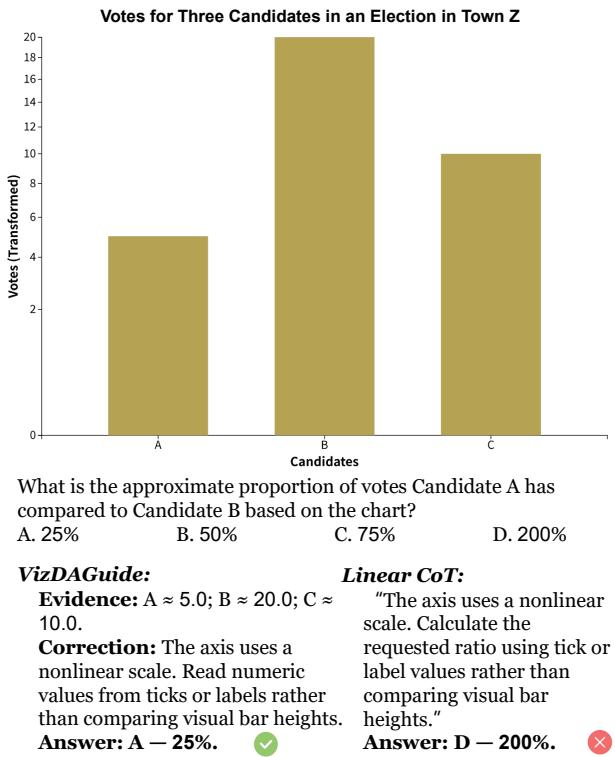  
Figure 5: Qualitative comparison on a chart with a nonlinear scale. Both methods identify the misleading scale, but VizDAGuide correctly computes the vote ratio (25%), whereas Linear CoT returns an incorrect answer (200%).

Linear CoT returns an incorrect proportion despite stating the relevant values. VizDAGuide produces the correct ratio of 50%, illustrating better consistency between Evidence Grounding and the final answer.

Evidence and operation consistency. Figures 5– 8 illustrate cases involving numerical ratios under misleading visual encodings. In these examples, Linear CoT identifies the relevant values or correction strategy but produces an incorrect ratio. VizDAGuide instead derives the correct answers from the grounded numerical evidence. These cases illustrate differences in how evidence is carried through Operation Execution.

Visual encoding and misleading titles. Figures 9– 12 present examples involving redundant visual encoding and misleading chart titles. VizDAGuide identifies the required categories or trends from the chart data, while Linear CoT either selects an incorrect option or treats the available information as insufficient. In particular, the trend examples show that chart titles should not override the numerical patterns represented by the plotted marks.

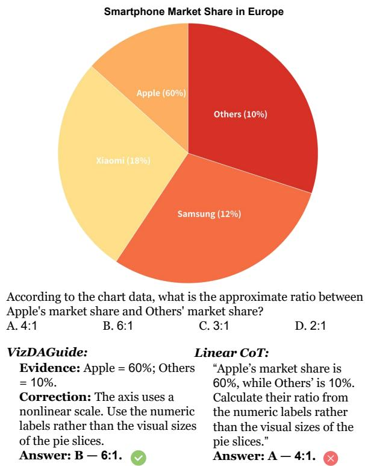  
Figure 6: Qualitative comparison on a pie chart with misleading slice proportions. Both methods identify the labeled market shares, but VizDAGuide returns the correct ratio (6:1), whereas Linear CoT selects an incorrect answer (4:1).

Numerical grounding in open-ended QA. Figures 13– 16 illustrate open-ended questions involving inverted axes, 3D effects, and logarithmic scales. VizDAGuide obtains the correct answers by reading the relevant numerical values and applying the required comparison or operation. Linear CoT exhibits errors in value extraction or numerical interpretation despite recognizing some of the misleading visual conditions. These examples complement the process-level analysis by illustrating the role of Evidence Grounding and Operation Execution in final-answer correctness.

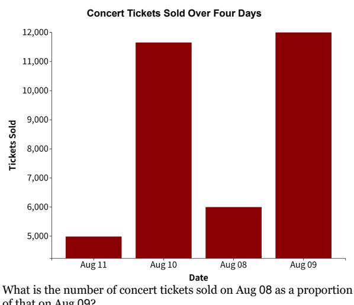  
What is the number of concert tickets sold on Aug 08 as a proportion of that on Aug 09? A. 25% B. 50% C. 75% D. 90%

VizDAGuide: L Evidence: Aug 08 ≈ 6,000 tickets; Aug 09 ≈ 12,000 tickets. Correction: The axis is truncated. Compare numeric axis values rather than treating visible bar heights as full magnitudes. Answer: B — 50%. 0

“Ticket sales are read as 6,000 on Aug 08 and 12,000 on Aug 09. Calculate the requested ratio from numeric axis values rather than visible bar heights on the truncated axis.” Answer: A — 25%. X

Figure 7: Qualitative comparison on a bar chart with a truncated axis. Both methods identify the truncated scale and the relevant values, but VizDAGuide returns the correct ratio (50%), whereas Linear CoT selects an incorrect answer (25%).  
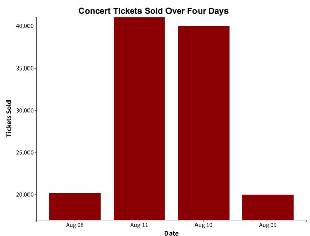  
What is the number of concert tickets sold on Aug 09 as a proportion of that on Aug 10? A. 20% B. 50% C. 60% D. 200%

VizDAGuide: L Evidence: Aug 09 ≈ 19,950 tickets; Aug 10 ≈ 40,000 tickets. Correction: The axis is truncated Compare numeric axis values rather than treating visible bar heights as full magnitudes. Answer: B — 50%.

“Ticket sales are read as 19,940 on Aug 09 and 40,000 on Aug 10. Calculate the ratio from numeric axis values rather than visible bar heights on the truncated axis.” Answer: A — 20%. X

Figure 8: Qualitative comparison on a truncated-axis chart. VizDAGuide computes the correct ticket-sales ratio (50%) from the numerical values, whereas Linear CoT selects an incorrect answer (20%).

What is the trend of population in city A from 2010 to 2015? A. Generally increasing B. Generally decreasing C. Generally constant D. Cannot be inferred / Inadequate Information

VizDAGuide: L Evidence: A = 10%; B = 40%; C = 10%; D = 25%; Others = 15%. Correction: The chart uses a redundant encoding. Use the primary numeric values to identify the largest share. Answer: B — Brand B.

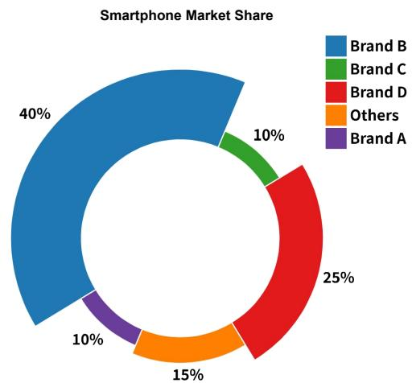  
Based on the chart, which brand actually holds the largest share of the smartphone market? A. Brand A B. Brand B C. Brand C D. Others

iiearCo1:   
“The visible information is considered insufficient to identify the largest share. Check whether the visible encodings support the   
conclusion.   
Answer: D — Others.

Figure 9: Qualitative comparison on a chart with redundant visual encoding. VizDAGuide identifies Brand B as having the largest market share (40%), whereas Linear CoT incorrectly selects Others.  
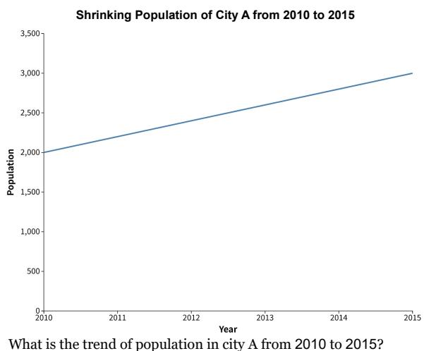

VizDAGuide: L Evidence: From 2010 to 2015: 2,000 → 2,200 → 2,400 → 2,600 → 2,800 → 3,000. Correction: Verify the annotation against the plotted marks and axis values. Do not treat annotation text as ground truth. Answer: A — Generally increasing.

“Population is read as 2,003 in 2010 and 3,010 in 2015. Check the mapping between years and values rather than treating display order as value rank.” Answer: B — Generally decreasing. X

Figure 10: Qualitative comparison on a chart with a misleading title. Despite the title suggesting a population decline, the plotted values increase. VizDAGuide identifies the correct trend, whereas Linear CoT predicts a decrease.  
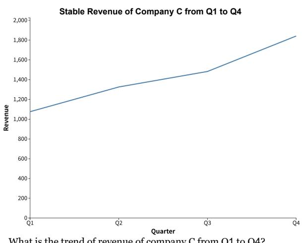  
What is the trend of revenue of company C from Q1 to Q4? A. Generally increasing B. Cannot be inferred / Inadequate Information C. Generally decreasing D. Generally constant

VizDAGuide: Evidence: Q1 ≈ 1,078; Q2 ≈ 1,325; Q3 ≈ 1,482; Q4 ≈ 1,842. Correction: Verify the annotation against the plotted marks and axis values. Judge the trend from the data rather than annotation text. Answer: A — Generally increasing.

Linear CoT: “The visible information is considered insufficient to   
infer the revenue trend. Do not treat unscaled geometry as exact values.” Answer: B — Cannot be inferred / Inadequate Information. X

Figure 11: Qualitative comparison on a revenue chart with a misleading title. VizDAGuide identifies the increasing trend from the plotted values, whereas Linear CoT incorrectly concludes that the available information is insufficient.

Across all countries, what is the minimum amount spent on the passenger transport items of international tourists in 1995 ?

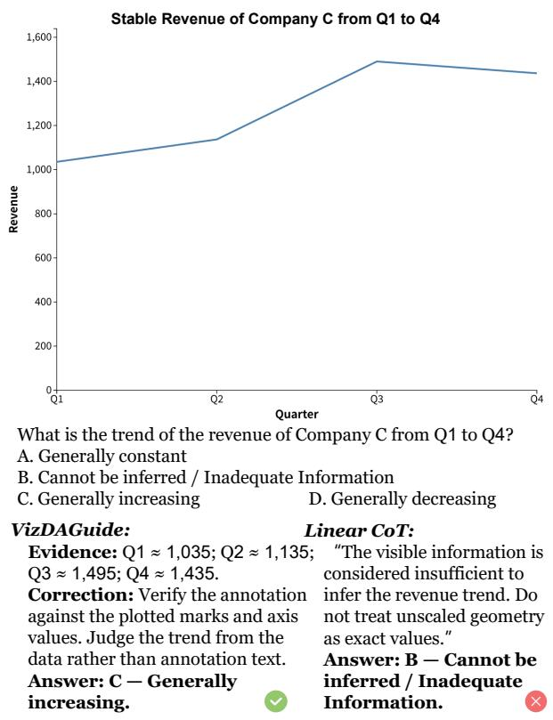  
Figure 12: Qualitative comparison of overall trend interpretation. VizDAGuide identifies a generally increasing trend despite a decrease in the final interval, whereas Linear CoT selects the insufficient-information option.

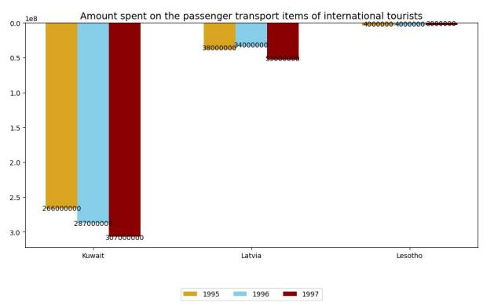

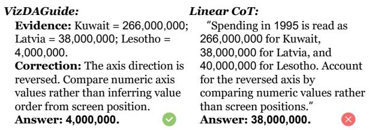  
Figure 13: Open-ended QA comparison on a chart with an inverted axis. VizDAGuide identifies the correct minimum value (4,000,000), whereas Linear CoT returns 38,000,000.

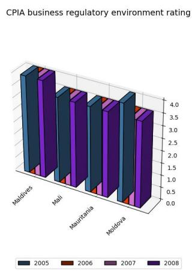  
Across all countries, what is the minimum CPIA rating in 2007 ?

VizDAGuide: Evidence: Maldives = 4; Mali = 3.5; Mauritania = 3.5; Moldova = 3.5. Correction: Ignore the 3D depth and front-face geometry. Use axis or label values rather than projected depth or area to identify the minimum. Answer: 3.5. 0

“CPIA ratings in 2007 are read as 4 for Maldives and 3 for Mali, Mauritania, and Moldova. Ignore 3D depth and front-face geometry, use axis or label values, and take the minimum of these readings as 3.” Answer: 3. X

Figure 14: Open-ended QA comparison on a 3D bar chart. VizDAGuide identifies the correct minimum CPIA rating (3.5), whereas Linear CoT returns 3 after incorrectly reading the chart values.  
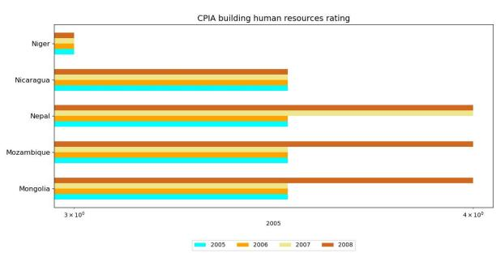  
What is the difference between the CPIA rating in 2008 in Mongolia and that in Niger ?

VizDAGuide: Evidence: CPIA ratings in 2008: Mongolia = 4; Niger = 3. Correction: The axis uses a logarithmic scale. Read numeric values before subtracting rather than treating visual distance as a linear difference. Answer: 1.

Linear CoT: “CPIA ratings in 2008 are read as 4 for Mongolia and 2 for Niger. Use numeric values rather than visual distances on the logarithmic axis, then calculate the difference as 4 − 2 = 2.” Answer: 2. X

Figure 15: Open-ended QA comparison on a logarithmic-axis chart. VizDAGuide grounds the relevant values and computes the correct difference (1), whereas Linear CoT returns 2.

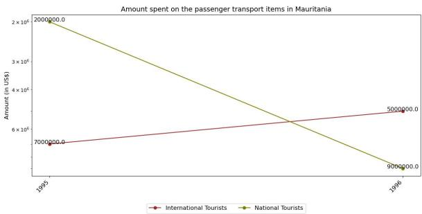  
Does the amount spent on transport items of national tourists monotonically increase over the years ?

VizDAGuide: Evidence: National tourist spending: 1995 = 2,000,000; 1996 = 9,000,000. Correction: The axis direction is reversed. Compare numeric axis values rather than inferring value order from screen position. Answer: Yes.

“National tourist spending is read as 2,000,000 in 1995 and 900,000 in 1996. Compare numeric values rather than screen positions on the reversed axis. These readings do not indicate a monotonic increase.” Answer: No. X

Figure 16: Open-ended QA comparison on an invertedaxis line chart. VizDAGuide correctly identifies the increasing numerical trend, whereas Linear CoT predicts the opposite trend.