# Visibility-Aware Reference Generation for Benchmarking Visual 3D Reconstruction in Vegetation-Rich Environments

Zhipeng Zhong, Matthew Coombes, and Cunjia Liu

Abstract—Reliable evaluation of visual 3D reconstruction and depth estimation in vegetation-rich outdoor environments is limited by the scarcity of geometric ground-truth data and the cost of complete scanner surveys. We present a LiDARbased reference-generation pipeline for evaluating the zero-shot performance of feed-forward visual-geometry models alongside conventional structure-from-motion (SfM) methods. The pipeline reuses camera images, LiDAR scans, and reference poses from existing multi-sensor localization datasets to generate per-view depth maps and visible reference point clouds. To address visibility errors in accumulated LiDAR scans, we introduce the Large-Depth-Gap Visibility Score (LDGVS) for point-wise visibility filtering and automatic scale selection in Hidden Point Removal (HPR). Experiments on TartanAirV2 and TartanGround show that, compared with Poisson surface reconstruction, which is an approach suited to completed scan surveys, the combined HPR and LDGVS filtering retains approximately three times the point density at comparable absolute relative error. We also apply the pipeline to the BotanicGarden dataset to systematically compare depth estimation and 3D reconstruction methods. Feedforward methods produce dense depth predictions efficiently, but their 3D reconstructions can contain duplicated structures. Conventional SfM generally produces more coherent geometry, but its reconstructions remain sparse and more prone to failure in challenging vegetated scenes. The benchmark toolkit and datasets will be released.

Index Terms—3D reconstruction, depth estimation, visibility analysis, vegetation-rich environments

## I. INTRODUCTION

Visual depth estimation and 3D reconstruction are essential capabilities for agricultural and other field robots, providing dense geometric information from lightweight, low-cost cameras. Many studies [1]–[4] have sought to improve visual geometric methods in vegetation-rich outdoor environments, including forests, orchards, crop fields, and botanical gardens. However, agricultural applications continue to rely predominantly on conventional geometry-based SLAM [5], [6] or SfM [7], [8], while the feed-forward methods [8]–[10] have been less widely adopted. This pattern contrasts with generalpurpose 3D-reconstruction and depth-estimation benchmarks [11]–[15], where feed-forward models are increasingly prominent [16]–[22]. This motivates us to evaluate their zero-shot performance in vegetation-rich outdoor environments.

However, benchmarking in these environments remains challenging because publicly available datasets with suitable ground-truth (GT) geometry are scarce and acquiring such data is time-consuming and labor-intensive. A standard approach is to use high-accuracy terrestrial laser scanners to capture complete and dense scans of the environment [14], [15]. This process, however, requires professional surveying expertise and substantial manual effort for data acquisition, scan registration, and outlier removal. These requirements make complete surveys particularly costly in extensive and structurally complex vegetation-rich outdoor environments. A few studies have used laser scanners [8], [23], [24] to obtain GT geometry in such environments, but the resulting datasets are often limited in scale and not fully publicly available.

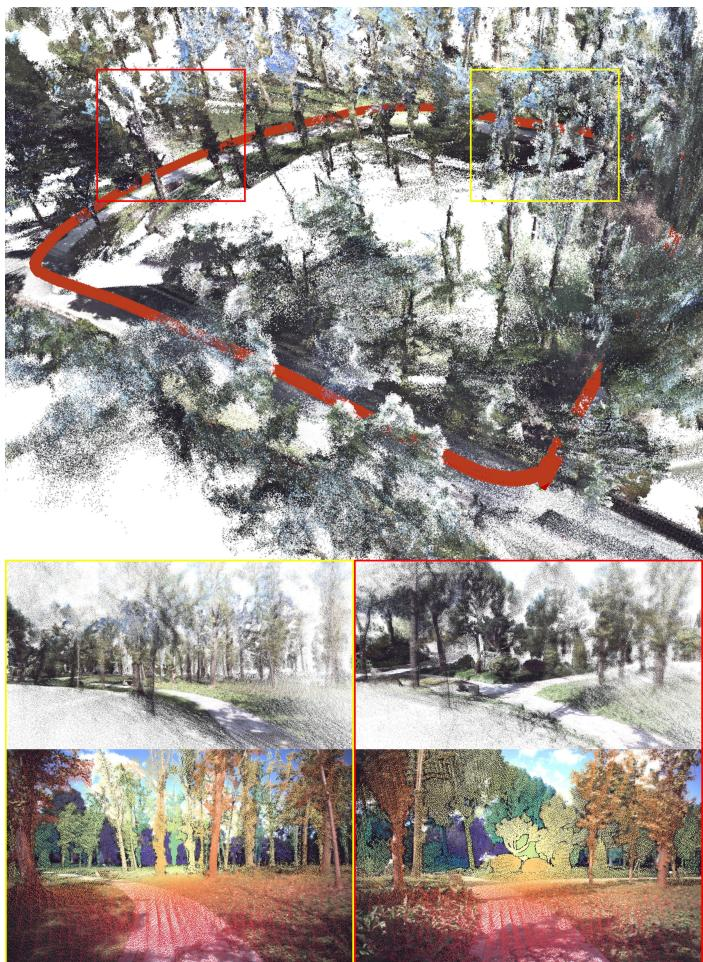  
Fig. 1. Visualization of the reference data generated by the proposed pipeline in BotanicGarden. Top: the accumulated scene-level reference point cloud and the camera trajectory shown in red. The colored boxes indicate the two individual-view examples below. Bottom: for each example, the upper row shows the corresponding visibility-filtered point cloud in the camera frame, and the lower row shows the projected sparse reference depth image.

To address this gap, we investigate repurposing mobile LiDAR measurements from existing multi-sensor localization datasets as geometric references. Mobile LiDAR enables data collection over large areas, and a growing number of datasets provide camera images, LiDAR scans, and reference trajectories in agricultural and other vegetation-rich outdoor environments, as summarized in Table I. Although these datasets contain large-scale observations of complex scenes, they were developed primarily for localization and mapping rather than for benchmarking visual depth estimation or 3D reconstruction. Consequently, they do not directly provide cameraaligned reference depth or visibility-filtered 3D geometry. Previous studies have demonstrated the use of LiDAR-derived references for depth estimation and 3D reconstruction in urban and road environments [11], [25]–[29], but extending this approach to vegetation-rich environments remains challenging. The difficulty arises because mobile LiDAR measurements are sparse and nonuniform and may be affected by motion distortion. Accumulating multiple scans improves point density but can introduce visibility errors caused by incomplete observations, occlusions, and camera–LiDAR parallax.

TABLE I  
MULTI-SENSOR LOCALIZATION DATASETS IN VEGETATION-RICH OUTDOOR ENVIRONMENTS.
<table><tr><td>Dataset</td><td>GT Trajectory</td><td>Data Scale</td></tr><tr><td>SFU-Mountain [31]</td><td>Manually aligned locations</td><td>&gt;8 h, 150 GB</td></tr><tr><td>RELLIS-3D [32]</td><td>VoxNet poses</td><td>5 seq., 13.6k scans</td></tr><tr><td>Wild-Places [33]</td><td>Wildcat SLAM poses</td><td>8 seq., 63k submaps</td></tr><tr><td>TreeScope [34]</td><td>Faster-LIO poses</td><td>6 sites, &gt;1.8k labels</td></tr><tr><td>CitrusFarm [35]</td><td>GPS-RTK</td><td>7 seq., 1.7 h, 1.3 TB</td></tr><tr><td>ARD-VO [36]</td><td>GPS-RTK</td><td>11 sessions, &gt;1 TB</td></tr><tr><td>MAgro [37]</td><td>GPS-RTK</td><td>Multi-season sequences</td></tr><tr><td>BLT [38]</td><td>RTK-GNSS</td><td>11 sessions, 600 GB</td></tr><tr><td>TAIL [39]</td><td>RTK-GNSS</td><td>14 sequences</td></tr><tr><td>AgriGS-SLAM [40]</td><td>VIO-GNSS-RTK poses</td><td>2 orchards</td></tr><tr><td>HortiMulti [41]</td><td>Surveyed GT and AprilTags</td><td>20 seq., ~11 km</td></tr><tr><td>BotanicGarden [30]</td><td>registration in scanner map</td><td>33 seq., 17.1 km</td></tr></table>

These limitations raise a central question: how can mobile LiDAR data be converted into reliable camera-view geometric references for benchmarking visual depth estimation and 3D reconstruction in vegetation-rich environments? We therefore develop a reference-generation pipeline and apply it to the representative BotanicGarden [30] dataset, where the generated references are used to compare feed-forward visual-geometry models with conventional SfM methods. Our contributions are summarized as follows:

1) We propose a pipeline that converts camera, LiDAR, and reference-pose data from existing localization datasets into per-view depth and visible point-cloud references.

2) We introduce the Large-Depth-Gap Visibility Score (LDGVS) for point-cloud visibility filtering and automatic Hidden Point Removal (HPR) scale selection, providing greater reference density than Poisson surface reconstruction at comparable absolute relative error.

3) With the proposed pipeline, we construct a BotanicGarden benchmark comparing feed-forward visualgeometry models with conventional SfM methods in geometric quality, metric scale, cross-frame consistency, robustness, and efficiency.

## II. RELATED WORK

A. Agricultural Datasets for 3D Reconstruction and Depth Estimation

Many studies have investigated 3D reconstruction using agricultural data. Some studies use RGB-D cameras to obtain GT data in apple orchards [42], a walnut-tree scene [43]. some studies evaluate performance through comparisons with SOTA methods [9], [10], whereas others rely solely on visualization [5]. Several studies evaluate their results using manual measurements [6], [44]. Laser scanners are more commonly used to provide more accurate and denser GT data for tree reconstruction [8], [23], [24]. To our knowledge, no work has used LiDAR data as GT for 3D reconstruction or depth estimation in this type of environment. Several LiDARbased depth-estimation benchmarks exist for urban and road environments [11], [25]. And some localization datasets [26], [27] has been used for 3D reconstruction evaluation [28], [29]. Although many studies have explored this topic, the availability of datasets for large-scale 3D reconstruction and depth estimation in agricultural environment remains limited.

To filt this gap, we propose a LiDAR-based geometric reference-generation pipeline for data collected directly by lightweight mobile robot platforms. This eliminates the need for dense, exhaustive scanning, thereby enabling the costeffective creation of large-scale 3D reconstruction and depth estimation datasets.

## B. Point-Cloud Visibility Analysis for Dataset Consturction

For fair comparison, we only can compare the point cloud that can be seen in image data. Therefore the key problem of datasets for 3D reconstruction and depth estimation using point cloud data is to get correct visible the point-cloud. Specifically, ETH3D and ScanNet++ datasets [14], [45] use Poisson surface reconstruction on laser-scan point clouds [46] to render depth rather than directly using projected point clouds. More loosely, splatting-based methods [47], [48] render a primitive projection. These approach can work well when dense and complete geometry is available, but sparse LiDAR scans in vegetation-rich scenes often contain missing areas and large depth discontinuities. In such cases, surface reconstruction may fail to represent the scene. Another approach relies on consistency [11] or depth differences [49] between estimated depth and projected point-cloud depth. These methods can work well in urban and road environments, but depth estimates are often inaccurate in vegetation-rich environments. Consequently, these methods may also filter out too many visible points. Hidden Point Removal (HPR) [50] analyzes visibility on the point cloud without first reconstructing a surface. However, we found that HPR cannot be applied directly to environments with large depth variations. [51] proposed visibility score can be computed directly in image space. However, this work only evaluate their method on two manual label points of city scene, can not generalize well in our experiments.

Instead, in this work, we propose a modular point-cloud visibility-analysis framework that introduces a large-depth-gap visible score and uses it to adaptively select the HPR radius, enabling robust removal of occluded LiDAR points in sparse, unevenly sampled scenes with large depth variations.

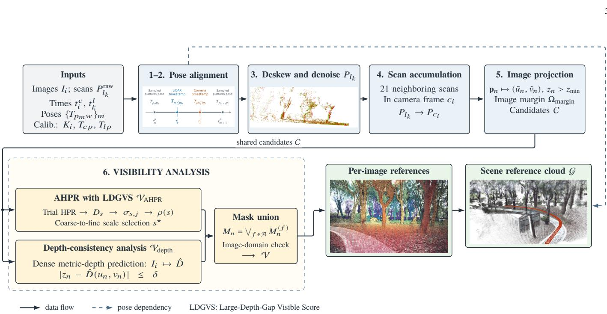  
Fig. 2. Overview of the LiDAR-based reference-generation pipeline. In the “Deskew and denoise” step, the retained point cloud is shown in green and the raw point cloud in red.

## C. 3D Reconstruction and Depth Estimation in Vegetationrich and Agricultural Scenes

Recent reviews [1]–[4] indicates that most research on agricultural applications still based on traditional SfM or SLAM. For examples, some studies integrate existing vSLAM frameworks with semantic-segmentation networks for semantic 3D reconstruction of orchards [5]–[7]. SfM is the most widely used method for 3D reconstruction in plant phenotyping. [52], [53]. There is also work on applying the improved SFM to agricultural scenarios, such as detector-free [8] and deep learning matcher [54], [55].

On the other hand, due to the emergence of visual selfsupervised large models [56] these emerging feed forward methods show a very strong generalization across different scenes and benchmarks [17]–[19], [21], [57]. However, These methods have not yet been fully benchmarked in agricultural scenarios against traditional SfM methods.

Therefore, we construct a comprehensive 3D-reconstruction and depth estimation benchmark to evaluate the performance of SfM and feed forward methods in large-scale vegetationrich and agricultural environments. We also integrate recent state-of-the-art learning-based feature and matching models [58]–[60] into an SfM pipeline and compare their performance within this benchmark.

## III. PIPELINE FOR GENERATING 3D RECONSTRUCTION AND DEPTH ESTIMATION REFERENCE DATA

We demonstrate how LiDAR data can be used to generate reference data for 3D reconstruction and depth estimation. Figure 2 shows the complete workflow and its principal mathematical quantities.

We assume a static scene observed by timestamped camera frames $\{ ( I _ { i } , t _ { i } ^ { c } ) \}$ and LiDAR scans $\{ ( P _ { l _ { k } } ^ { \mathrm { r a w } } , t _ { k } ^ { l } ) \} _ { k }$ , with camera intrinsics $K _ { i }$ , nominal sensor extrinsics $T _ { c p }$ and $T _ { l p }$ , and a platform-pose trajectory $\{ T _ { p _ { m } p _ { 0 } } \} _ { m }$ that is either provided by the dataset or estimated using multi-sensor SLAM. From these inputs, the pipeline computes time-aligned camera and LiDAR poses and generates visibility-filtered reference point clouds, per-image sparse reference depth maps, and a scenelevel reference point cloud, as illustrated in Fig. 1. Throughout this section, the indices $i , k , m , n ,$ , and j denote camera frames, LiDAR scans, platform-pose samples, 3D points, and occupied image pixels, respectively.

1) Platform Pose Trajectory $\{ T _ { p _ { m } p _ { 0 } } \} _ { m } .$ We assume GT poses $T _ { p _ { m } w }$ has been given, as shown in Table I. The GT poses can get from GPS, survey device, or multi-sensor fusion SLAM. We then express every $T _ { p _ { m } w }$ in the p coordinate frame to obtain the reference poses $\ddot { T } _ { p _ { m } p _ { 0 } } = T _ { p _ { m } w } ( T _ { p _ { 0 } w } ) ^ { - 1 }$

2) LiDAR Pose $T _ { l _ { k } p _ { 0 } }$ and Camera Pose $T _ { c _ { i } c _ { 0 } } .$ To achieve perfect sensor synchronization, we use screw linear interpolation (ScLERP) to obtain a platform pose $T _ { p ( t ^ { \prime } ) p _ { 0 } }$ at each sensor query time t′. $T _ { c p }$ and $T _ { l p }$ map platform-frame coordinates into the camera and LiDAR frames, respectively. Given neighboring trajectory samples $T _ { p _ { m } p _ { 0 } }$ and $T _ { p _ { m + 1 } p _ { 0 } }$ at times $t _ { m } ^ { p } \leq t ^ { \prime } \leq t _ { m + 1 } ^ { p }$

$$
T _ { p ( t ^ { \prime } ) p _ { 0 } } = T _ { p _ { m } p _ { 0 } } \exp \left( \alpha \log \left( T _ { p _ { m } p _ { 0 } } ^ { - 1 } T _ { p _ { m + 1 } p _ { 0 } } \right) \right) ,\tag{1}
$$

where $\alpha = ( t ^ { \prime } - t _ { m } ^ { p } ) / ( t _ { m + 1 } ^ { p } - t _ { m } ^ { p } )$ , log(·) : SE(3) → se(3), and $\exp ( \cdot ) : \mathfrak { s e } ( 3 ) \to \mathrm { S E } ( 3 ) .$

We evaluate this interpolation at LiDAR time $t _ { k } ^ { l }$ and camera time $t _ { i } ^ { c }$ and apply the extrinsics $T _ { l p }$ and $T _ { c p }$ to obtain the timealigned poses $T _ { l _ { k } p _ { 0 } } = T _ { l p } T _ { p ( t _ { k } ^ { l } ) p _ { 0 } }$ and $T _ { c _ { i } p _ { 0 } } = T _ { c p } T _ { p ( t _ { i } ^ { c } ) p _ { 0 } } ,$ respectively. We then rebase every camera pose to c0 using $\begin{array} { r c l } { T _ { c _ { i } c _ { 0 } } } & { = } & { T _ { c _ { i } p _ { 0 } } \left( T _ { c _ { 0 } p _ { 0 } } \right) ^ { - 1 } } \end{array}$ , where $\begin{array} { c c l } { T _ { c _ { 0 } p _ { 0 } } } & { = } & { T _ { c p } T _ { p ( t _ { 0 } ^ { c } ) p _ { 0 } } } \end{array}$ is evaluated at the first camera timestamp.

3) Point-Cloud Deskewing and Denoising $P _ { l _ { k } } .$ : A scanning LiDAR acquires each scan while the platform is moving, so its points are expressed at slightly different sensor poses. Online SLAM systems commonly remove this distortion using IMU-based motion prediction [61] or a velocity model [62]. In our offline benchmark pipeline, we instead use the GT trajectory from the preceding step.

Let the raw scan $P _ { l _ { k } } ^ { \mathrm { r a w } }$ have a nominal time $t _ { k } ^ { l }$ , and let its nth point $\mathbf { p } _ { k , n }$ be acquired at time $t _ { k , n } ^ { l }$ . Define the continuoustime LiDAR pose as $T _ { l ( t ) p _ { 0 } } = T _ { l p } T _ { p ( t ) p _ { 0 } } ^ { ' }$ . We transform every point to the LiDAR frame at the nominal scan time to obtain the deskewed scan

$$
\hat { P } _ { l _ { k } } = \left\{ T _ { l _ { k } p _ { 0 } } \left( T _ { l ( t _ { k , n } ^ { l } ) p _ { 0 } } \right) ^ { - 1 } \mathbf { p } _ { k , n } ~ \Big | ~ n = 1 , \ldots , N _ { k } \right\} .\tag{2}
$$

As reported by [14], LiDAR scans can contain outliers caused by weak returns and multipath reflections. We remove possible noisy samples using a range filter and standard statistical outlier removal. In the following steps, $P _ { l _ { k } }$ denotes this deskewed and denoised LiDAR scan.

4) Accumulated Point Cloud $\bar { P } _ { c _ { i } }$ in Camera Coordinates: Using the time-aligned poses $T _ { l _ { k } p _ { 0 } }$ , each LiDAR scan $P _ { l _ { k } }$ is transformed into camera frame $c _ { i }$ as $P _ { c _ { i } } ^ { ( k ) } =$ $T _ { c _ { i } p _ { 0 } } \left( T _ { l _ { k } p _ { 0 } } \right) ^ { - 1 } P _ { l _ { k } }$ . As a single scan is typically too sparse for point-cloud evaluation, we follow the approach in [11] but accumulate 21 neighboring LiDAR point clouds $P _ { l _ { k } }$ in the current camera coordinate frame $c _ { i } .$ , and denote the accumulated point cloud by $\begin{array} { r } { \bar { P } _ { c _ { i } } = \bigcup _ { k } P _ { c _ { i } } ^ { ( k ) } } \end{array}$

5) Point-Cloud-to-Image Projection: We convert the accumulated 3D points cloud $\hat { P } _ { c _ { i } }$ into a sparse depth image. For the current image $I _ { i } ,$ let $\bar { P } _ { c _ { i } } = \{ \mathbf { p } _ { n } \} _ { n = 1 } ^ { N } .$ , where $\mathbf { p } _ { n } =$ $( x _ { n } , y _ { n } , z _ { n } ) ^ { \mathsf { T } }$ . For each finite point with $z _ { n } > z _ { \mathrm { m i n } }$ , we compute the continuous image coordinates $\tilde { u } _ { n } = f _ { x } x _ { n } / z _ { n } + c _ { x }$ and $\tilde { v } _ { n } ~ = ~ f _ { y } y _ { n } / z _ { n } + c _ { y }$ . We then assign the point to its nearest pixel center, $( u _ { n } , v _ { n } ) \ = \ \mathrm { r o u n d } ( \tilde { u } _ { n } , \tilde { v } _ { n } )$ , with footprint $\mathcal { F } _ { n } ^ { \mathrm { r o u n d } } ~ = ~ \{ ( u _ { n } , v _ { n } ) \}$ . When multiple points project to the same pixel, we retain the nearest camera-frame $z -$ depth: $\begin{array} { r } { D _ { \mathcal { F } } ( u , v ) \ : = \ : \operatorname* { m i n } _ { n : ( u , v ) \in \mathcal { F } _ { n } } \ : z _ { n } } \end{array}$ . Here ${ \mathcal { F } } _ { n }$ denotes the selected projection footprint; for normal situation it is the singleton round-projection footprint $\mathcal { F } _ { n } ^ { \mathrm { r o u n d } }$ . When greater image coverage is required because the projected point cloud is too sparse for reliable depth evaluation, We follow [48] and project each point onto a circular footprint $\mathcal { F } _ { n } ^ { \mathrm { c i r c } }$ , which covers a circular pixel region rather than a single pixel. This provides an alternative to round projection and produces a much denser reference depth map, but it can also introduce artifacts.

6) Visible-Point Index Set V: As discussed in Section II-B, identifying visible points is essential for fair evaluation of 3D reconstruction and depth estimation. We propose a framework to obtain the visible-point index set V using modules that produce $\mathcal { V } _ { \mathrm { A H P R } }$ and $\mathcal { V } _ { \mathrm { d e p t h } }$ . Finally, we project the selected points and apply the depth test to generate the corresponding sparse reference depth image. Further details are provided in Section IV.

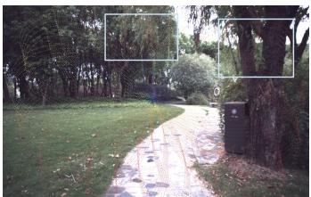  
(a) Livox, single scan

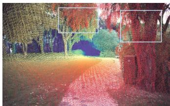  
(b) Livox, 10-scan accumulation

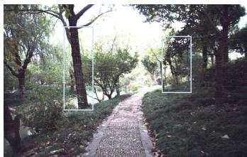

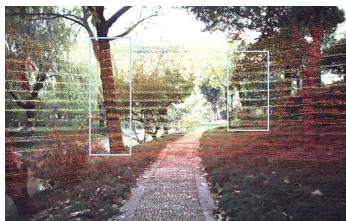  
(c) VLP-16, single scan  
(d) VLP-16, 10-scan accumulation  
Fig. 3. Examples of the visibility problem in single-scan and accumulated LiDAR point clouds. Background points are projected onto foreground tree regions, producing incorrect occlusion relationships.

## IV. POINT-CLOUD VISIBILITY ANALYSIS

Using the entire accumulated point cloud for comparison is unfair because a camera can reconstruct only the part of the scene that is visible from the current view. Ideally, after projection and the depth test, each image pixel should correspond to the nearest visible surface. However, sensor parallax, point-cloud accumulation, and sparse or incomplete LiDAR sampling can still produce incorrect occlusion relationships [11], [49]. The visibility problem is shown in Fig. 3.

For all visibility filters, we first define a shared candidate point set:

$$
{ \mathcal { C } } = \{ n \mid z _ { n } > z _ { \operatorname* { m i n } } , ~ \mathbf { p } _ { n } { \mathrm { ~ i s ~ f i n i t e , ~ } } ( { \tilde { u } } _ { n } , { \tilde { v } } _ { n } ) \in \Omega _ { \operatorname* { m a r g i n } } \} ,\tag{3}
$$

where ${ \bf p } _ { n } = ( x _ { n } , y _ { n } , z _ { n } ) ^ { \top }$ denotes point n in the target camera frame, C is the index set of candidate points used by all visibility filters, $z _ { \mathrm { m i n } }$ removes points too close to or behind the camera, and $\Omega _ { \mathrm { m a r g i n } }$ is the enlarged image domain. The enlarged domain retains a more complete point cloud during visibility analysis.

We treat occluded-point removal as a modular visibilityanalysis problem. Let $\mathcal { A } = \{ f _ { 1 } , \ldots , f _ { N _ { \mathrm { A } } } \}$ denote the selected visibility analysis modules, each producing a binary point mask $\dot { M } _ { n } ^ { ( f ) } \~ \in ~ \{ 0 , 1 \}$ over the shared candidate set C. To favor recall and retain a larger visible point cloud, we combine these masks by union $\begin{array} { r } { M _ { n } ^ { \mathbf { \bar { \alpha } } } = \bigvee _ { f \in \mathcal { A } } \dot { M } _ { n } ^ { ( f ) } } \end{array}$ , where $n \in { \mathcal { C } }$ and $M _ { n } ^ { ( f ) } = 1$ indicates that module f considers point n visible. The final visible set is

$$
\mathcal { V } = \{ n \in \mathcal { C } \mid M _ { n } = 1 , \ ( u _ { n } , v _ { n } ) \in \Omega _ { \mathrm { i m a g e } } \} .\tag{4}
$$

For image $I _ { i } ,$ , the resulting visibility-filtered cloud is $\bar { P } _ { c _ { i } } ^ { \mathrm { v i s } } =$ $\{ \mathbf { p } _ { n } \in \hat { P } _ { c _ { i } } \mid n \in \mathcal { V } \}$ . Its sparse reference depth map $D _ { i }$ is generated using the projection mode and depth test defined in pipeline step 5.

A direct combination of existing techniques, such as Poisson surface reconstruction and SGM-based depth-consistency filtering, can produce reliable projected depths where the reconstructed geometry is accurate. However, these methods cannot always faithfully reconstruct complex forest and agricultural environments. Errors and missing structures in the reconstruction can therefore cause valid projected depth samples to be incorrectly rejected, as demonstrated by the experimental results in Section V-A. To address this problem, we organize occluded-point removal into three complementary visibility-analysis modules: (i) the Large-Depth-Gap Visible Score, which evaluates local projected-depth discontinuities; (ii) Automatic Hidden Point Removal (AHPR), which uses this score to select the HPR scale; and (iii) Depth-Consistency Visibility Analysis, which checks projected points against a dense depth estimate.

## A. Large-Depth-Gap Visible Score

Visible score [51] is a good indicates for a projected depth whether it is visible. Motivated by [51], we therefore revisit the local distributions of neighboring depths. we observe that local neighborhoods containing incorrect depth samples exhibit a large depth gap, as shown in Fig. 4. By this insight, we propose the Large-Depth-Gap Visible Score.

We use a local projected-neighborhood score to identify whether a depth sample belongs to the frontmost visible surface or to a farther surface behind a depth discontinuity. The input to this score is a sparse depth image D, generated by projecting the candidate points indexed by C in Eq. (3) and then applying the depth test defined in pipeline step 5. For an occupied pixel j, let $d _ { j } = D ( u _ { j } , v _ { j } )$ and let ${ \mathcal { N } } _ { j }$ be its local set of occupied neighboring pixels, obtained from the nearest occupied image locations inside a square window. Let $m _ { j } = | { \mathcal { N } } _ { j } |$ , and sort the neighbor depths as

$$
d _ { j , ( 1 ) } \leq d _ { j , ( 2 ) } \leq \dots \leq d _ { j , ( m _ { j } ) } .\tag{5}
$$

Large adjacent z-depth gaps create boundaries between local depth areas:

$$
\begin{array} { r l } & { B _ { j } = \left\{ \ell \mid d _ { j , ( \ell + 1 ) } - d _ { j , ( \ell ) } \geq \Delta _ { z } \right\} , } \\ & { b _ { j , \ell } = \frac { d _ { j , ( \ell ) } + d _ { j , ( \ell + 1 ) } } 2 , } \end{array}\tag{6}
$$

where $\Delta _ { z }$ is the configured large-gap threshold. The local depth-area index of a depth value d is

$$
A _ { j } ( d ) = \sum _ { \ell \in B _ { j } } \mathbf { 1 } [ b _ { j , \ell } < d ] .\tag{7}
$$

The local depth-area index starts from 0, with larger indices indicating surfaces behind more detected depth gaps. For pixel j, we count the fraction of local neighbors that lie in nearer depth areas:

$$
r _ { j } = \frac { 1 } { m _ { j } } \sum _ { q \in { \cal { N } } _ { j } } { \bf 1 } [ A _ { j } ( d _ { q } ) < A _ { j } ( d _ { j } ) ] .\tag{8}
$$

The large-depth-gap visible score is

$$
\sigma _ { j } = 1 - r _ { j } , \qquad \sigma _ { j } \in [ 0 , 1 ] .\tag{9}
$$

Thus, a sample in the nearest local depth area receives a score of 1, while a sample behind a strong local depth discontinuity receives a lower score proportional to how many

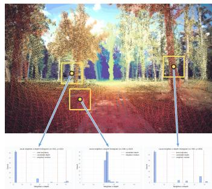

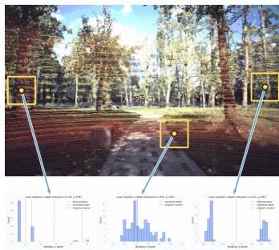  
(a) Livox LiDAR  
(b) VLP-16 LiDAR  
Fig. 4. Examples of local depth histograms constructed from the 75 nearest projected LiDAR samples. Correct projections, such as the middle example, produce no distinct depth gap, whereas incorrect projections, such as the left and right examples, produce a clear gap.

nearer samples occupy the same projected neighborhood. And binary visible mask can be obtained with

$$
M _ { j } = { \bf 1 } [ \sigma _ { j } \ge \tau ] ,\tag{10}
$$

where τ denotes the visibility-score threshold.

## B. Automatic Hidden Point Removal (AHPR)

Hidden point removal (HPR) estimates point visibility directly from a point set without first reconstructing a surface [50]. HPR requires a radius parameter R, which is computed from the extent of the candidate set C defined in Eq. (3) and a user-specified scale factor s:

$$
R ( s ) = \operatorname* { m a x } ( s r _ { 0 } , 1 ) .\tag{11}
$$

Here $\begin{array} { r l r } { r _ { 0 } } & { { } = } & { \operatorname* { m a x } _ { n \in { \mathcal C } } \| { \bf p } _ { n } \| _ { 2 } } \end{array}$ is the maximum distance of the candidate points from the camera center. Although this computation adapts the radius to the overall extent of the point cloud, the HPR output remains sensitive to the chosen scale s. A single fixed scale cannot consistently accommodate the large variations in geometry and viewing distance encountered in vegetation-rich and agricultural scenes. As shown in Fig. 5, a scale that is too small may reject valid visible points, whereas a scale that is too large may retain occluded background points. Consequently, selecting s manually would require scene-dependent tuning and is unsuitable for scenes with varying point-cloud densities and viewing distances.

To enable robust application of HPR in such environments, we propose Automatic Hidden Point Removal (AHPR), which uses the large-depth-gap visible score in Eq. (9) as feedback to select an appropriate scale s. Let $\mathcal { H } _ { R } ( \mathcal { C } ) \subseteq \mathcal { C }$ denote the point indices classified as visible by HPR with radius R. For a trial scale $s ,$ the visible index set is $\mathcal { V } _ { s } ^ { \mathrm { d i r } } = \mathcal { H } _ { R ( s ) } ( \mathcal { C } )$

For each trial scale s, we project the points indexed by Vdirs to get resulting trial depth image, $D _ { s }$ . And we denote $\mathcal { O } _ { s } =$ $\{ j : ( u _ { j } , v _ { j } ) \in \Omega _ { \mathrm { i m a g e } } , \ D _ { s } ( u _ { j } , v _ { j } ) > 0 \}$ is its set of occupied pixel indices. Evaluating the score and binary pixel mask in Eqs. (9) and (10) on $D _ { s }$ gives $\sigma _ { s , j }$ and $M _ { s , j } ,$ , respectively, with the score threshold τ held fixed across all trials. We define the fraction of occupied pixels classified as having low visibility as

$$
\rho ( s ) = 1 - \frac { 1 } { | \mathcal { O } _ { s } | } \sum _ { j \in \mathcal { O } _ { s } } M _ { s , j } .\tag{12}
$$

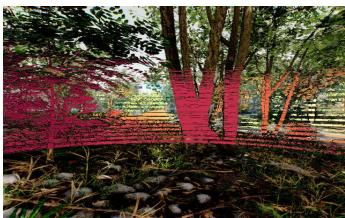  
(a) Radius scale s = 500

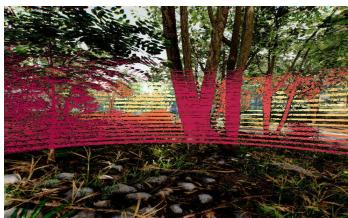  
(b) Radius scale s = 5000

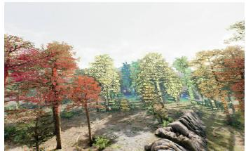

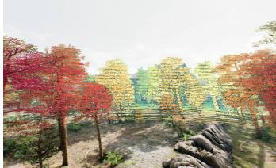  
(c) Radius scale s = 500  
(d) Radius scale s = 5000  
Fig. 5. Effect of the HPR radius scale in close-range (top row) and farrange (bottom row) scenes. Results are shown for s = 500 (left column) and $s = 5 0 0 0$ (right column). A scale that gives an acceptable visibility estimate at close range can retain many incorrect depth samples at long range, motivating automatic radius scale selection.

Rather than minimizing this fraction, we specify a target $\rho ^ { \star }$ to avoid favoring an overly sparse, conservative HPR output and to control the accuracy–coverage trade-off. To reduce the search cost, we first evaluate the coarse logarithmic grid

$$
\begin{array} { r l } & { { \mathscr S } _ { c } = \displaystyle \mathrm { g e o m s p a c e } ( s _ { \mathrm { m i n } } , s _ { \mathrm { m a x } } , n _ { c } ) , } \\ & { \hat { s } _ { c } = \displaystyle \mathrm { a r g } \operatorname* { m i n } _ { s \in { \mathscr S } _ { c } } \left. \rho ( s ) - \rho ^ { \star } \right. , } \\ & { { \mathscr S } _ { f } = \displaystyle \mathrm { g e o m s p a c e } ( s _ { L } , s _ { U } , n _ { f } ) , } \\ & { \quad { \mathscr S } = { \mathscr S } _ { c } \cup { \mathscr S } _ { f } , } \end{array}\tag{13}
$$

where $s _ { \mathrm { m i n } }$ and $s _ { \mathrm { m a x } }$ define the coarse search range, $n _ { c }$ is the number of coarse candidates, $s _ { L }$ and $s _ { U }$ bound the refinement interval around $\hat { s } _ { c } ,$ and $n _ { f }$ is the number of fine candidates. The selected radius scale is then

$$
s ^ { \star } = \arg \operatorname* { m i n } _ { s \in { \mathcal { S } } } \left| \rho ( s ) - \rho ^ { \star } \right| ,\tag{14}
$$

with ties broken in favor of the trial with the larger $| \mathcal { O } _ { s } |$

The HPR output at the selected scale is restricted to the image domain:

$$
\mathcal { V } _ { \mathrm { A H P R } } = \{ n \in \mathcal { V } _ { s ^ { \star } } ^ { \mathrm { d i r } } \ | \ ( u _ { n } , v _ { n } ) \in \Omega _ { \mathrm { i m a g e } } \} .\tag{15}
$$

additionally, the selected points can also be filtered according to the visibile scores computed from $D _ { s ^ { \star } }$

$$
\begin{array} { r l } & { \mathcal { V } _ { \mathrm { A H P R , f l t e r e d } } = \big \{ n \in \mathcal { V } _ { \mathrm { A H P R } } \mid \sigma _ { s ^ { \star } , \pi ( n ) } \mathrm { ~ i s ~ f i n i t e ~ a n d ~ } } \\ & { ~ \quad \quad \quad \sigma _ { s ^ { \star } , \pi ( n ) } \geq \tau \big \} , } \end{array}\tag{16}
$$

where $\pi ( n )$ is the occupied-pixel index associated with location $( u _ { n } , v _ { n } )$ . The point mask supplied by this module is $M _ { n } ^ { \mathrm { ( A H P R ) } } = \mathbf { 1 } [ n \in \mathcal { V } _ { \mathrm { A H P R } } ]$

## C. Depth-Consistency Visibility Analysis

Depth-based visibility methods can use depth maps obtained from Poisson surface reconstruction, SGM, or a metric-depth estimator. Our depth-consistency module uses a dense metricdepth estimator as an external visibility reference. Let C denote the candidate index set defined in Eq. (3). For the target image, the estimator predicts a metric depth map $\hat { D }$ at image resolution. A candidate point is considered visible when its camera-frame z-depth agrees with $\hat { D }$ at the corresponding projected pixel. We first restrict the candidate indices to ${ \mathcal { C } } _ { \mathrm { i m a g e } } = \{ n \in { \mathcal { C } } \mid ( u _ { n } , v _ { n } ) \in \Omega _ { \mathrm { i m a g e } } \}$ , and then define

$$
M _ { n } ^ { \mathrm { d e p t h } } = \mathbf { 1 } \Big [ | z _ { n } - \hat { D } ( u _ { n } , v _ { n } ) | \leq \delta \Big ] , \qquad n \in \mathcal { C } _ { \mathrm { i m a g e } } ,\tag{17}
$$

where $( u _ { n } , v _ { n } )$ is the projected pixel of point n. In our experiments, the depth-consistency tolerance is $\delta = 0 . 0 3 \mathrm { m }$ This test removes points that are substantially behind the surface predicted by the metric-depth estimator while retaining points whose depth agrees with the predicted visible surface.

The visible set produced by the depth-consistency module is

$$
\mathcal { V } _ { \mathrm { d e p t h } } = \{ n \in \mathcal { C } _ { \mathrm { i m a g e } } \ | \ M _ { n } ^ { \mathrm { d e p t h } } = 1 \} .\tag{18}
$$

## V. EXPERIMENTS

We organize the our experiment into two primary branches. The first evaluates the accuracy of the generated visible-depth references simulated datasets. The second is to benchmarks 3D reconstruction and depth estimation using the generated references in a real SLAM dataset.

a) Metrics: For point-cloud comparison, we report accuracy (Acc), the accuracy inlier ratio (Acc τ), completeness (Comp), the completeness inlier ratio (Comp τ), Chamfer distance (CD), F1 score, and reconstruction density. For depth comparison, we report absolute depth error (Abs), the absolute-error inlier ratio (Abs τ, threshold 0.03), absolute relative depth error (AbsRel), the relative-error inlier ratio (Rel τ, threshold 1.03), and valid-depth density. We also report runtime for efficiency comparison, which denotes the processing time in seconds per image; Metric definition details are provided in Supplementary Section S.III.

## A. Visible-Depth Accuracy Experiment

Before benchmarking the downstream tasks, we first evaluate the quality of the visible-depth references generated by our pipeline and compare them with existing projection and visibility methods. To our knowledge, no real-world dataset provides both LiDAR measurements and ground-truth depth. We therefore use the simulated TartanAirV2 and TartanGround datasets [63], [64], which provide LiDAR measurements and ground-truth depth. Because the simulated LiDAR is aligned with the left camera, we project it into the right camera to reproduce camera–LiDAR parallax and evaluate all methods against the right-view ground-truth depth. As a best-case reference for direct LiDAR projection, we additionally project a single LiDAR scan into the aligned left camera, where no camera–LiDAR parallax is introduced.

The methods are abbreviated in the tables as follows: circle projection (CP), Poisson surface reconstruction (PSR), semiglobal matching (SGM), learning-based depth (LD) using DA2, DA3, and MoGe-2, Large-Depth-Gap Visible Score

TABLE II  
EVALUATION OF VISIBLE DEPTH ON TARTANAIRV2 DATA EASY AND TARTANGROUND DATA OMNI. THE BEST VALUE PER METRIC IS SHOWN IN BOLD AND THE SECOND-BEST DISTINCT VALUE IS UNDERLINED.
<table><tr><td>Method</td><td>AbsRel ↓</td><td>Rel τ ↑</td><td>Abs↓</td><td>Abs τ ↑</td><td>Density ↑</td></tr><tr><td>Single scan (left view)</td><td>0.1138</td><td>0.7782</td><td>3.7065</td><td>0.4652</td><td>0.0232</td></tr><tr><td>Single scan (right view)</td><td>0.4024</td><td>0.7448</td><td>4.2277</td><td>0.4030</td><td>0.0216</td></tr><tr><td>Cumulation (baseline)</td><td>0.4016</td><td>0.6384</td><td>5.4760</td><td>0.3098</td><td>0.2524</td></tr><tr><td>Cumulation+CP</td><td>0.3214</td><td>0.6393</td><td>5.5628</td><td>0.3176</td><td>0.3171</td></tr><tr><td>PSR</td><td>0.1386</td><td>0.7336</td><td>3.2805</td><td>0.4297</td><td>0.0582</td></tr><tr><td>SGM</td><td>0.3093</td><td>0.5919</td><td>3.6819</td><td>0.2426</td><td>0.0065</td></tr><tr><td>LD</td><td>0.1894</td><td>0.6220</td><td>2.6413</td><td>0.2799</td><td>0.0239</td></tr><tr><td>Visibility estimation (0.7)</td><td>0.2319</td><td>0.6499</td><td>5.0139</td><td>0.3318</td><td>0.1828</td></tr><tr><td>LDGVSF(0.7)</td><td>0.1819</td><td>0.6918</td><td>4.3071</td><td>0.3477</td><td>0.1944</td></tr><tr><td>AHPR(5%)</td><td>0.1545</td><td>0.6852</td><td>4.4641</td><td>0.3460</td><td>0.1846</td></tr><tr><td>AHPR(5%)+LDGVSF(0.7)</td><td>0.1399</td><td>0.6955</td><td>4.2493</td><td>0.3601</td><td>0.1664</td></tr><tr><td>AHPR(5%)+LDGVSF(0.7)+LD</td><td>0.1438</td><td>0.6909</td><td>4.2247</td><td>0.3560</td><td>0.1705</td></tr></table>

Filtering (LDGVSF), and Automatic Hidden Point Removal (AHPR). Visibility estimation (0.7) applies a visibility-score threshold of 0.7. LDGVSF(0.7) retains samples with a finite Large-Depth-Gap Visible Score of at least 0.7. AHPR(5%) selects the HPR radius scale using a target low-visibility ratio of 5%; AHPR(10%) uses a target ratio of 10%.

AHPR(5%)+LDGVSF(0.7) denotes sequential filtering: AHPR first selects the visible point-index set using the 5% target low-visibility ratio, after which LDGVSF retains only indices whose selected-scale visibility score is finite and at least 0.7. AHPR(5%)+LDGVSF(0.7)+LD denotes the union of this filtered set and the point indices accepted by LD-based depth consistency.

The parameter ablation supporting the selection of AHPR(5%)+LDGVSF(0.7) for reference-depth generation is presented in Supplementary Section S.IV.

Table II shows a clear accuracy–density trade-off. Circle projection (CP) improves both reconstruction performance and density compared with direct cumulation, achieving the highest coverage among the evaluated methods. However, its accuracy gains are limited, and a substantial performance gap remains relative to the other methods. Therefore, when direct cumulation already provides sufficient projected LiDAR density, circle projection is unattractive because the additional coverage can include unreliable samples without a commensurate improvement in accuracy.

PSR provides the strongest overall accuracy profile, achieving the best AbsRel, Rel τ , and Abs τ and the second-best Abs, but it retains only sparse support. In contrast, AHPR(5%)+LDGVSF(0.7) and AHPR(5%)+LDGVSF(0.7)+LD preserve substantially denser coverage while remaining competitive in accuracy. Adding LDGVSF(0.7) to AHPR(5%) improves all four accuracy measures at the cost of a moderate reduction in density. The additional LD component recovers some coverage and further improves absolute error, while slightly weakening the other accuracy measures. These variants therefore offer a more useful balance between accuracy and spatial coverage than the more conservative depth-consistency methods.

The qualitative results in Figure 6 support the quantitative trade-off. Direct cumulation in (c) retains incorrect depths within objects, including the tree trunks. Circle projection in (d) increases coverage but also propagates unreliable depths near discontinuities and into distant regions, reinforcing its limited value when the baseline cumulation is already sufficiently dense. The depth-consistency methods in (e)–(g), namely PSR, SGM, and LD, retain sparse support; in this example, much of that support lies on low-error object interiors, although SGM remains less accurate in aggregate. Visibility estimation in (h) leaves some incorrect depths on trunks and foliage while removing valid boundary samples. By comparison, LDGVSF and the AHPR-based variants in (i)– (l) preserve substantially denser projections while maintaining correct depths over most object interiors, providing a better balance between geometric reliability and spatial coverage.

Additional qualitative comparisons on BotanicGarden and selected depth-error maps are provided in Supplementary Sections S.V and S.VI, respectively.

## B. Benchmark Experiments

a) Datasets: We apply our reference-generation pipeline, configured as AHPR (5%)+LDGVSF(0.7)+LD, to the BotanicGarden dataset [30] to construct references for the 3D reconstruction and depth benchmarks. The pipeline supports complete-sequence reference generation, but memory and runtime constraints limit the reconstruction benchmark to 200 synchronized stereo frames (400 images), a scale broadly comparable to established 3D-reconstruction benchmarks such as ETH3D [14].

b) Common experiment settings: For the 3D reconstruction comparison, we apply a cross-frame reprojectionconsistency filter to VGGT, VGGT-Ω, DA3, MapAnything, and MASt3R-SfM. For the depth-estimation comparison, this filter is applied, where enabled, only to the accumulated 3D visualizations; the quantitative depth metrics and 2D depth maps are obtained before this filtering. To assess estimation accuracy in high-confidence regions and within a limited distance range, we include confidence-P50 mask and range ≤ 10 m variants in the benchmark tables. The confidence-P50 mask retains high-confidence predictions by thresholding the model-provided confidence scores at their 50th percentile. A range ≤ 10 m label denotes retaining predictions for which $0 < \widehat { d } \leq 1 0 \mathrm { m }$

More details of preprocessing and common settings are provided in Supplementary Section S.I-A.

c) Evaluation protocol: For both depth and reconstruction evaluations, we compare only pixels with valid reference depth and a valid prediction. This restricts the comparison to the part of the scene visible in the camera images and avoids directly comparing unrestricted global point clouds. Because full-sequence inference with the multi-view methods exceeds GPU memory, we divide each sequence into chunks of 16 frames with an 8-frame stride, yielding a 50% temporal overlap. Following [28], adjacent chunks are registered using a robust confidence-weighted Sim(3) transformation estimated from pixel-corresponding back-projected points in their shared frames, as detailed in Supplementary Section S.II-B. After registration, the newer prediction is retained for each duplicated frame before evaluation and scene fusion.

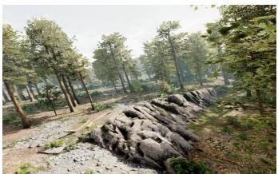  
(a) Right-view RGB image

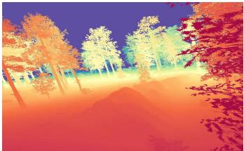  
(b) Ground-truth depth (0–100 m)

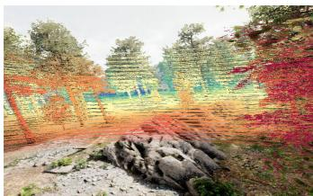  
(c) Cumulation (baseline)

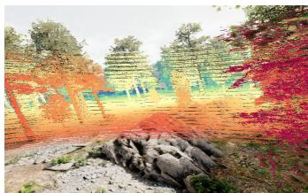  
(d) Cumulation+CP

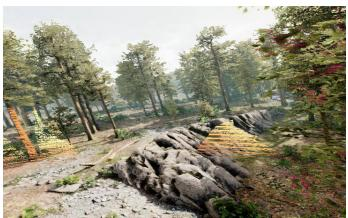  
(e) PSR

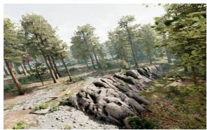  
(f) SGM

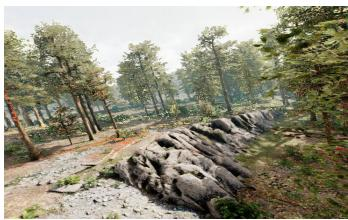  
(g) LD

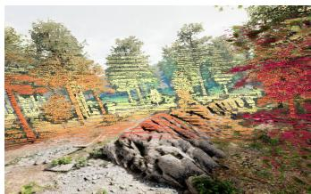  
(h) Visibility estimation (0.7)

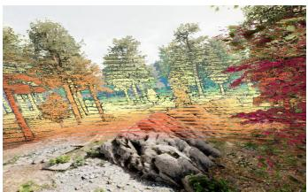  
(i) LDGVSF(0.7)

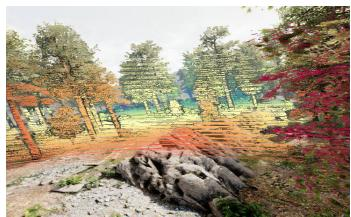  
(j) AHPR(5%)

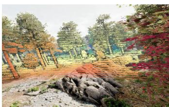  
(k) AHPR(5%)+LDGVSF(0.7)

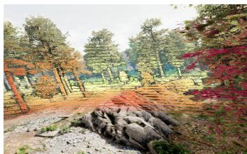  
(l) AHPR(5%)+LDGVSF(0.7)+LD  
Fig. 6. Qualitative comparison of visible-depth projections for a TartanAirV2 forest scene. Panels (a) and (b) show the right-view RGB image and ground-truth depth, respectively; panels (c)–(l) show the projections generated by the selected comparison and proposed methods.

d) Runtime platform: The reference-generation pipeline was run on a workstation with an NVIDIA GeForce RTX 4070 Ti GPU, a 12-core AMD Ryzen 9 7900X processor, and 32 GB of RAM. Each benchmark method was run on an HPC node using one NVIDIA L40S GPU, a 64-core AMD EPYC 9354 processor, and 384 GB of RAM.

1) 3D Reconstruction Comparison: Our traditional geometry-based comparison focuses on incremental SfM, which shares the core geometric operations of feature-based visual SLAM while targeting offline scene reconstruction and remains widely used in agricultural applications. Its modular correspondence stage also allows different feature matchers to be evaluated within a common reconstruction framework. We benchmark SOTA feed-forward methods because they are increasingly prominent on general reconstruction benchmarks, yet their zero-shot robustness, metric fidelity, and multi-view consistency in vegetation-rich and agricultural environments remain insufficiently characterized. Specifically, the benchmark methods are listed in Table III.

All SfM variants use calibrated intrinsics. For the calibratedstereo configurations, we enforce a rigid stereo model and provide strong position in the first two frames to anchor the reconstruction to the reference coordinate frame.

For reconstruction-to-reference alignment, followed [28], we fit a confidence-weighted Sim(3) transformation to sameframe, same-pixel 3D correspondences. Each weighted update uses the Umeyama similarity solution [65]. The complete procedure is defined in Supplementary Section S.II-C.

Table III compares the selected feed-forward and SfM configurations. Among the aligned feed-forward methods, VGGT-Ω provides the best completeness, Chamfer distance, and runtime. Its confidence-P50 variant gives the lowest retainedpoint accuracy error and the highest threshold accuracy and F1 score in this group. Confidence masking improves retainedpoint accuracy for all four feed-forward models, but reduces density and completeness.

For aligned conventional SfM, RoMa-v2(S) achieves the strongest geometric accuracy, completeness, Chamfer distance, and F1 score, but succeeds on only seven of the ten sequences. Among conventional SfM configurations evaluated on all ten sequences, SIFT(S) gives the lowest accuracy error, whereas LoFTR(K) gives the lowest completeness error and Chamfer distance. SIFT(K) has the lowest runtime but produces much sparser geometry. MASt3R(K) retains substantially denser support than conventional SfM; its confidence mask improves accuracy while reducing density and completeness.

For unaligned calibrated-stereo reconstruction, RoMa-v2(S) again gives the strongest geometric results with partial sequence coverage. Among the configurations evaluated on all ten sequences, SIFT(S) has the lowest accuracy error, whereas LoFTR(S) provides the best completeness, Chamfer distance, and F1 score. Applying scene-level alignment improves threshold accuracy and F1 for every calibrated-stereo method, although not every distance metric improves.

Fig. 7 shows complementary reconstruction failure modes. The feed-forward methods recover dense, continuous ground,

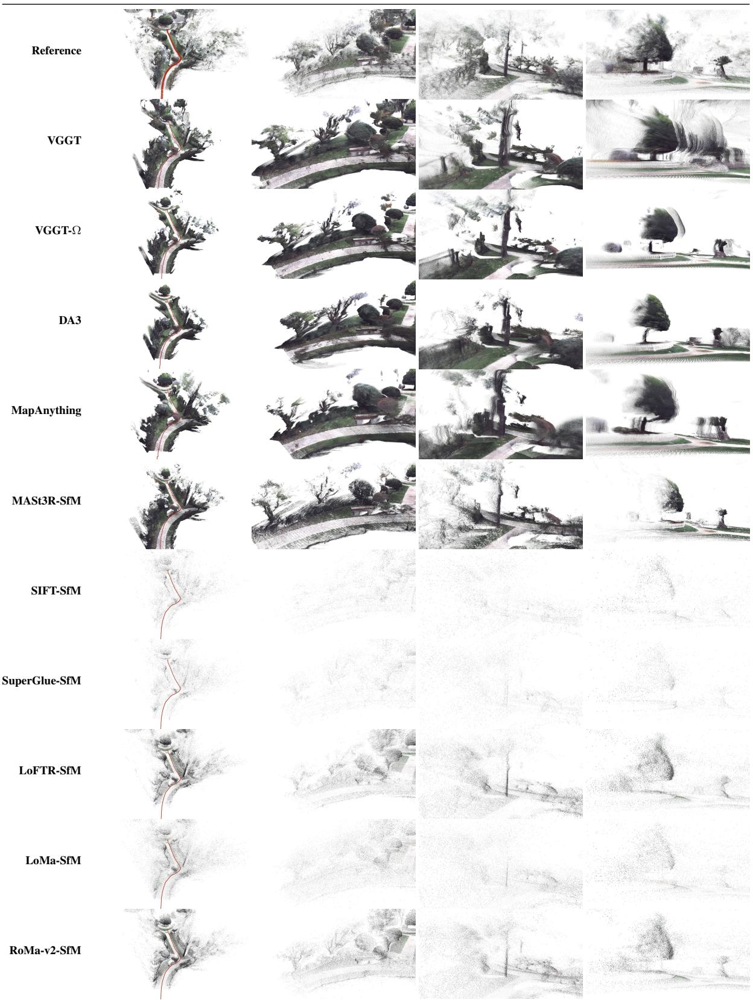  
Fig. 7. Qualitative 3D reconstruction comparison on BotanicGarden\_1006-03. Columns show four fixed viewpoints of the same scene. The first row is the reference point cloud, followed by the feed-forward and SfM reconstruction methods. All methods use monocular input. VGGT, VGGT-Ω, DA3, MapAnything, and MASt3R-SfM are shown with confidence-P50 masking. All predictions are shown after alignment to the reference coordinate frame.

## TABLE III

QUANTITATIVE COMPARISON OF SELECTED 3D RECONSTRUCTION METHODS. WITHIN EACH METHOD BLOCK, THE BEST VALUE PER COLUMN, EXCEPT DENSITY, IS IN BOLD AND THE SECOND-BEST DISTINCT VALUE IS UNDERLINED; THE ALIGN COLUMN INDICATES WHETHER SCENE-LEVEL POINT-CLOUD ALIGNMENT IS APPLIED BEFORE EVALUATION. IN METHOD LABELS, K DENOTES THE CALIBRATED-INTRINSICS-ONLY CONFIGURATION, AND S DENOTES THE CALIBRATED-STEREO CONFIGURATION. ALL METHODS IN THE SFM BLOCK USE CALIBRATED INTRINSICS. THE FILTER COLUMN IDENTIFIES CONFIDENCE-P50 MASKING (P50); A DASH INDICATES THAT THIS OPERATION IS NOT APPLIED. THE SEQ. COLUMN REPORTS THE NUMBER OF SUCCESSFULLY EVALUATED SEQUENCES.
<table><tr><td>Method</td><td>Filter</td><td>Align</td><td>Seq.</td><td>Acc ↓</td><td>Acc τ ↑</td><td>Comp V</td><td>Comp τ ↑</td><td>CD ↓</td><td>F1 ↑</td><td>Density ↑</td><td>Runtime ↓</td></tr><tr><td colspan="10">Feed-forward dense reconstruction</td></tr><tr><td>VGGT [17]</td><td></td><td>√</td><td>10/10</td><td>0.3136</td><td>0.2719</td><td>0.6837</td><td>0.4106</td><td>0.9973</td><td>0.3236</td><td>1.0000</td><td>0.0508</td></tr><tr><td>VGGT [17]</td><td>P50</td><td>√</td><td>10/10</td><td>0.1059</td><td>0.4587</td><td>1.4361</td><td>0.2845</td><td>1.5421</td><td>0.3486</td><td>0.5018</td><td>0.0503</td></tr><tr><td>VGGT-Ω [18]</td><td></td><td>V</td><td>10/10</td><td>0.2753</td><td>0.3442</td><td>0.2171</td><td>0.4848</td><td>0.4924</td><td>0.4015</td><td>1.0000</td><td>0.0287</td></tr><tr><td>VGGT-Ω [18]</td><td>P50</td><td>√</td><td>10/10</td><td>0.0639</td><td>0.6100</td><td>1.0890</td><td>0.3325</td><td>1.1529</td><td>0.4282</td><td>0.5000</td><td>0.0284</td></tr><tr><td>DA3 [19]</td><td></td><td>√</td><td>10/10</td><td>0.3311</td><td>0.2462</td><td>0.3967</td><td>0.3998</td><td>0.7278</td><td>0.3036</td><td>1.0000</td><td>0.0539</td></tr><tr><td>DA3 [19]</td><td>P50</td><td>√</td><td>10/10</td><td>0.0768</td><td>0.4976</td><td>1.4571</td><td>0.2752</td><td>1.5339</td><td>0.3521</td><td>0.5000</td><td>0.0579</td></tr><tr><td>MapAnything [21]</td><td></td><td>√</td><td>10/10</td><td>0.3441</td><td>0.2641</td><td>0.3965</td><td>0.3207</td><td>0.7406</td><td>0.2886</td><td>0.6854</td><td>0.1449</td></tr><tr><td>MapAnything [21]</td><td>P50</td><td>√</td><td>10/10</td><td>0.1669</td><td>0.4585</td><td>0.7268</td><td>0.3069</td><td>0.8937</td><td>0.3660</td><td>0.4394</td><td>0.1548</td></tr><tr><td colspan="10">Structure-from-Motion (SfM)</td><td></td></tr><tr><td>MASt3R(K) [55]</td><td></td><td>√</td><td>10/10</td><td>0.3333</td><td>0.2411</td><td>0.3157</td><td>0.1756</td><td>0.6490</td><td>0.2022</td><td>0.2184</td><td>8.2317</td></tr><tr><td>MASt3R(K) [55]</td><td>P50</td><td>√</td><td>10/10</td><td>0.1387</td><td>0.4091</td><td>1.5183</td><td>0.1356</td><td>1.6570</td><td>0.2018</td><td>0.1092</td><td>8.1735</td></tr><tr><td>SIFT(K) [66]</td><td></td><td>√</td><td>10/10</td><td>0.1976</td><td>0.4619</td><td>0.3567</td><td>0.0381</td><td>0.5543</td><td>0.0704</td><td>0.0020</td><td>2.0012</td></tr><tr><td>SIFT(S) [66]</td><td></td><td>X</td><td>10/10</td><td>0.2123</td><td>0.3664</td><td>0.3730</td><td>0.0223</td><td>0.5852</td><td>0.0418</td><td>0.0020</td><td>2.2833</td></tr><tr><td>SIFT(S) [66]</td><td></td><td>√</td><td>10/10</td><td>0.1853</td><td>0.4786</td><td>0.3565</td><td>0.0396</td><td>0.5418</td><td>0.0731</td><td>0.0020</td><td>2.2833</td></tr><tr><td>LoMa(K) [60]</td><td></td><td>√</td><td>7/10</td><td>0.2430</td><td>0.3785</td><td>0.2061</td><td>0.0628</td><td>0.4491</td><td>0.1075</td><td>0.0062</td><td>6.6940</td></tr><tr><td>LoMa(S) [60]</td><td></td><td>×</td><td>5/10</td><td>0.2794</td><td>0.3148</td><td>0.2083</td><td>0.0412</td><td>0.4877</td><td>0.0720</td><td>0.0062</td><td>6.6476</td></tr><tr><td>LoMa(S) [60]</td><td></td><td>√</td><td>5/10</td><td>0.2722</td><td>0.3587</td><td>0.2092</td><td>0.0560</td><td>0.4813</td><td>0.0966</td><td>0.0062</td><td>6.6476</td></tr><tr><td>SuperGlue(K) [67]</td><td></td><td>√</td><td>10/10</td><td>0.2887</td><td>0.3578</td><td>0.3571</td><td>0.0244</td><td>0.6458</td><td>0.0456</td><td>0.0019</td><td>2.1066</td></tr><tr><td>SuperGlue(S) [67]</td><td></td><td>X</td><td>10/10</td><td>0.2862</td><td>0.2927</td><td>0.3281</td><td>0.0142</td><td>0.6143</td><td>0.0271</td><td>0.0019</td><td>2.1841</td></tr><tr><td>SuperGlue(S) [67]</td><td></td><td>√</td><td>10/10</td><td>0.2862</td><td>0.3646</td><td>0.3431</td><td>0.0247</td><td>0.6293</td><td>0.0461</td><td>0.0019</td><td>2.1841</td></tr><tr><td>LoFTR(K) [58]</td><td></td><td>√</td><td>10/10</td><td>0.1887</td><td>0.4550</td><td>0.1993</td><td>0.1327</td><td>0.3880</td><td>0.2052</td><td>0.0091</td><td>9.3589</td></tr><tr><td>LoFTR(S) [58]</td><td></td><td>X</td><td>10/10</td><td>0.2330</td><td>0.3641</td><td>0.2699</td><td>0.0960</td><td>0.5030</td><td>0.1506</td><td>0.0090</td><td>11.1824</td></tr><tr><td>LoFTR(S) [58]</td><td></td><td>√</td><td>10/10</td><td>0.2116</td><td>0.4633</td><td>0.2590</td><td>0.1322</td><td>0.4706</td><td>0.2052</td><td>0.0090</td><td>11.1824</td></tr><tr><td>RoMa-v2(K) [59]</td><td></td><td>√</td><td>6/10</td><td>0.1025</td><td>0.5536</td><td>0.1631</td><td>0.1599</td><td>0.2656</td><td>0.2476</td><td>0.0086</td><td>15.5071</td></tr><tr><td>RoMa-v2(S) [59]</td><td></td><td>X</td><td>7/10</td><td>0.1167</td><td>0.4113</td><td>0.1860</td><td>0.0897</td><td>0.3028</td><td>0.1466</td><td>0.0087</td><td>16.9150</td></tr><tr><td>RoMa-v2(S) [59]</td><td></td><td>√</td><td>7/10</td><td>0.0901</td><td>0.6011</td><td>0.1487</td><td>0.1851</td><td>0.2388</td><td>0.2826</td><td>0.0087</td><td>16.9150</td></tr></table>

paths, and vegetation, but Views 3 and 4 contain repeated trunks, crowns, hedges, and path boundaries. These repetitions arise because independently predicted depth and pose are not fully consistent across frames, so observations of the same surface do not coincide when fused. Although the applicable cross-frame consistency filter removes points without sufficient reprojection support, a locally coherent repeated surface can still satisfy the test. Conventional SfM instead reconstructs only points supported by multi-view feature tracks and triangulation. Stable correspondences are difficult to establish in vegetation with repetitive appearance and viewpoint changes, resulting in sparse geometry; mismatches and unstable triangulation also produce isolated points and diffuse clusters. Its geometrically verified landmarks nevertheless form a more coherent scene with fewer duplicated structures. MASt3R-SfM lies between the two families: its predicted point maps provide denser geometry than conventional triangulation, but their remaining multi-frame inconsistencies produce repeated or rippled surfaces.

2) Dense-Depth Estimation Comparison: monocular, stereo, and multi-view depth-estimation benchmark comparison are listed in Table IV. Their outputs are standardized as camera-z depth under the common protocol in Supplementary Section S.I-A. Following [68], [69], we apply per-frame affine depth alignment before evaluation, as detailed in Supplementary Section S.II-D. For the direct comparison of reliable depth, we use the 10-m near-range outputs of DA2, MoGe-2, SGM, FoundationStereo, and the confidence-P50-masked outputs of VGGT, VGGT-Ω, and MapAnything.

In fig. 8, we show both Full Depth and Filtered Depth, with the latter retaining predictions after method-specific filtering. An individual depth map cannot fully reveal whether a depthestimation method produces geometrically consistent reconstructions across a sequence. Motivated by MonoRec [70], we therefore back-project the retained depth maps, accumulate the resulting point clouds across the sequence using the reference camera poses, and visualize the accumulated geometry from two fixed viewpoints as 3D View 1 and 3D View 2. These views provide a qualitative assessment of cross-frame depth consistency.

QUANTITATIVE COMPARISON OF DEPTH-ESTIMATION METHODS. WITHIN EACH METHOD BLOCK, THE BEST VALUE PER COLUMN, EXCEPT DENSITY, IS IN BOLD AND THE SECOND-BEST DISTINCT VALUE IS UNDERLINED; THE ALIGN COLUMN INDICATES WHETHER PER-FRAME AFFINE DEPTH ALIGNMENT IS APPLIED BEFORE EVALUATION. IN METHOD LABELS, K DENOTES CAMERA INTRINSICS AND P DENOTES CAMERA POSES; THE FILTER COLUMN IDENTIFIES CONFIDENCE-P50 MASKING (P50) OR THE RANGE RESTRICTION (≤ 10 M); A DASH INDICATES THAT NEITHER OPERATION IS APPLIED.
<table><tr><td>Method</td><td>Filter</td><td>Align</td><td>Abs ↓</td><td>Abs τ ↑</td><td></td><td></td><td>AbsRel ↓ Rel τ ↑ Density ↑</td><td>Runtime ↓</td></tr><tr><td colspan="7">Monocular depth estimation</td><td></td><td></td></tr><tr><td>DA2 (Relative) [69]</td><td></td><td>√</td><td>3.9086</td><td>0.0090</td><td>0.4332</td><td>0.0392</td><td>0.9410</td><td>0.0160</td></tr><tr><td>DA2 (Metric) [69]</td><td></td><td>×</td><td>11.3001</td><td>0.0001</td><td>2.0257</td><td>0.0041</td><td>1.0000</td><td>0.0157</td></tr><tr><td>DA2 (Metric) [69]</td><td>≤ 10m</td><td>×</td><td>5.2689</td><td>0.0000</td><td>1.9307</td><td>0.0002</td><td>0.2693</td><td>0.0158</td></tr><tr><td>DA2 (Metric) [69]</td><td></td><td>√</td><td>2.3071</td><td>0.0234</td><td>0.2497</td><td>0.0940</td><td>1.0000</td><td>0.0157</td></tr><tr><td>DA2 (Metric) [69]</td><td>≤ 10 m</td><td>√</td><td>0.2159</td><td>0.1360</td><td>0.0761</td><td>0.3486</td><td>0.2693</td><td>0.0158</td></tr><tr><td>MoGe-2 (Metric) [22]</td><td></td><td>×</td><td>2.7932</td><td>0.0062</td><td>0.4363</td><td>0.0448</td><td>0.9433</td><td>0.0601</td></tr><tr><td>MoGe-2 (Metric) [22]</td><td>≤ 10 m</td><td>×</td><td>1.5176</td><td>0.0065</td><td>0.4053</td><td>0.0366</td><td>0.6511</td><td>0.0598</td></tr><tr><td>MoGe-2 (Metric) [22]</td><td></td><td>√</td><td>1.7959</td><td>0.0319</td><td>0.1916</td><td>0.1237</td><td>0.9433</td><td>0.0601</td></tr><tr><td>MoGe-2 (Metric) [22]</td><td>≤ 10 m</td><td>√</td><td>0.4708</td><td>0.0919</td><td>0.1025</td><td>0.2965</td><td>0.6511</td><td>0.0598</td></tr><tr><td colspan="7">Stereo depth estimation</td><td></td><td></td></tr><tr><td>SGM (AD-Census) [71]</td><td></td><td>×</td><td>3.7364</td><td>0.0107</td><td>0.4545</td><td>0.0430</td><td>0.5134</td><td>2.9049</td></tr><tr><td>SGM (AD-Census) [71]</td><td>≤ 10m</td><td>×</td><td>1.7241</td><td>0.0141</td><td>0.2763</td><td>0.0523</td><td>0.3505</td><td>2.8592</td></tr><tr><td>FoundationStereo [57]</td><td></td><td>×</td><td>39.5402</td><td>0.0082</td><td>5.3271</td><td>0.0327</td><td>0.9971</td><td>0.0806</td></tr><tr><td>FoundationStereo [57]</td><td>≤ 10 m</td><td>×</td><td>1.1077</td><td>0.0095</td><td>0.1943</td><td>0.0346</td><td>0.7674</td><td>0.0812</td></tr><tr><td>FoundationStereo [57]</td><td></td><td>√</td><td>3.8991</td><td>0.0123</td><td>0.4309</td><td>0.0500</td><td>0.9971</td><td>0.0806</td></tr><tr><td>FoundationStereo [57]</td><td>≤ 10 m</td><td>√</td><td>0.8330</td><td>0.0740</td><td>0.1465</td><td>0.2388</td><td>0.7674</td><td>0.0812</td></tr><tr><td colspan="7">Multi-view feed-forward models</td><td></td><td></td></tr><tr><td>VGGT [17]</td><td></td><td></td><td>1.7566</td><td>0.0506</td><td>0.1669</td><td>0.1976</td><td>1.0000</td><td>0.0508</td></tr><tr><td>VGGT [17]</td><td>P50</td><td>V</td><td>0.2767</td><td>0.1642</td><td>0.0516</td><td>0.5072</td><td>0.5018</td><td>0.0503</td></tr><tr><td>VGGT-Ω [18]</td><td></td><td>√</td><td>1.5662</td><td>0.0465</td><td>0.1697</td><td>0.1719</td><td>1.0000</td><td>0.0287</td></tr><tr><td>VGGT-Ω [18]</td><td>P50</td><td>V</td><td>0.2170</td><td>0.2001</td><td>0.0443</td><td>0.5855</td><td>0.5000</td><td>0.0284</td></tr><tr><td>DA3 (Mono) [19]</td><td></td><td>√</td><td>2.2931</td><td>0.0325</td><td>0.2302</td><td>0.1233</td><td>1.0000</td><td>0.0117</td></tr><tr><td>DA3 (Metric+K) [19]</td><td></td><td>×</td><td>2.8016</td><td>0.0115</td><td>0.4206</td><td>0.0649</td><td>1.0000</td><td>0.0116</td></tr><tr><td>DA3 (Metric+K) [19]</td><td>≤ 10 m</td><td>×</td><td>1.1033</td><td>0.0153</td><td>0.2825</td><td>0.0668</td><td>0.6570</td><td>0.0117</td></tr><tr><td>DA3 (Metric+K) [19]</td><td></td><td>√</td><td>2.4133</td><td>0.0280</td><td>0.2459</td><td>0.1060</td><td>1.0000</td><td>0.0116</td></tr><tr><td>DA3 (Metric+K) [19]</td><td>≤ 10m</td><td>√</td><td>0.5366</td><td>0.0745</td><td>0.1194</td><td>0.2407</td><td>0.6570</td><td>0.0117</td></tr><tr><td>MapAnything [21]</td><td></td><td>√</td><td>1.8411</td><td>0.0446</td><td>0.1852</td><td>0.1580</td><td>0.6854</td><td>0.1449</td></tr><tr><td>MapAnything [21]</td><td>P50</td><td>L</td><td>0.5410</td><td>0.1150</td><td>0.0755</td><td>0.3689</td><td>0.4394</td><td>0.1548</td></tr><tr><td>MapAnything (K+P) [21]</td><td></td><td>×</td><td>1.6287</td><td>0.0629</td><td>0.2166</td><td>0.2364</td><td>0.6771</td><td>0.1468</td></tr><tr><td>MapAnything (K+P) [21]</td><td>P50</td><td>×</td><td>0.4941</td><td>0.0869</td><td>0.0814</td><td>0.3010</td><td>0.4406</td><td>0.1547</td></tr><tr><td>MapAnything (K+P) [21]</td><td></td><td>√</td><td>1.8260</td><td>0.0404</td><td>0.1899</td><td>0.1441</td><td>0.6771</td><td>0.1468</td></tr><tr><td>MapAnything (K+P) [21]</td><td>P50</td><td>√</td><td>0.4548</td><td>0.1247</td><td>0.0696</td><td>0.3956</td><td>0.4406</td><td>0.1547</td></tr></table>

Most methods recover a reasonable relative-depth ordering in the image plane, while SGM remains sparse and noisy. Their accumulated geometry is considerably less consistent. Repeated tree trunks and ghost surfaces appear when the estimated depth of the same object varies across viewpoints or camera-to-object distances, causing its observations to occupy different 3D locations. These artifacts persist despite per-frame depth alignment and, where enabled, cross-frame consistency filtering. Similar artifacts remain in the multiview methods that process 16-frame inputs, indicating that multi-frame context alone does not resolve the problem. DA2 and MapAnything produce the clearest second 3D view: DA2 retains a more restricted reconstruction, whereas MapAnything preserves more scene content and shows the strongest crossframe depth consistency in this example.

In Table IV, confidence-filtered VGGT-Ω provides the strongest overall depth accuracy, combining the best relative accuracy and inlier ratios with a competitive absolute error. Near-distance DA2 achieves a slightly better absolute error, but performs less strongly in relative accuracy and the inlier measures. Confidence-filtered VGGT is also competitive, whereas the remaining selected configurations provide a less balanced combination of these accuracy measures.

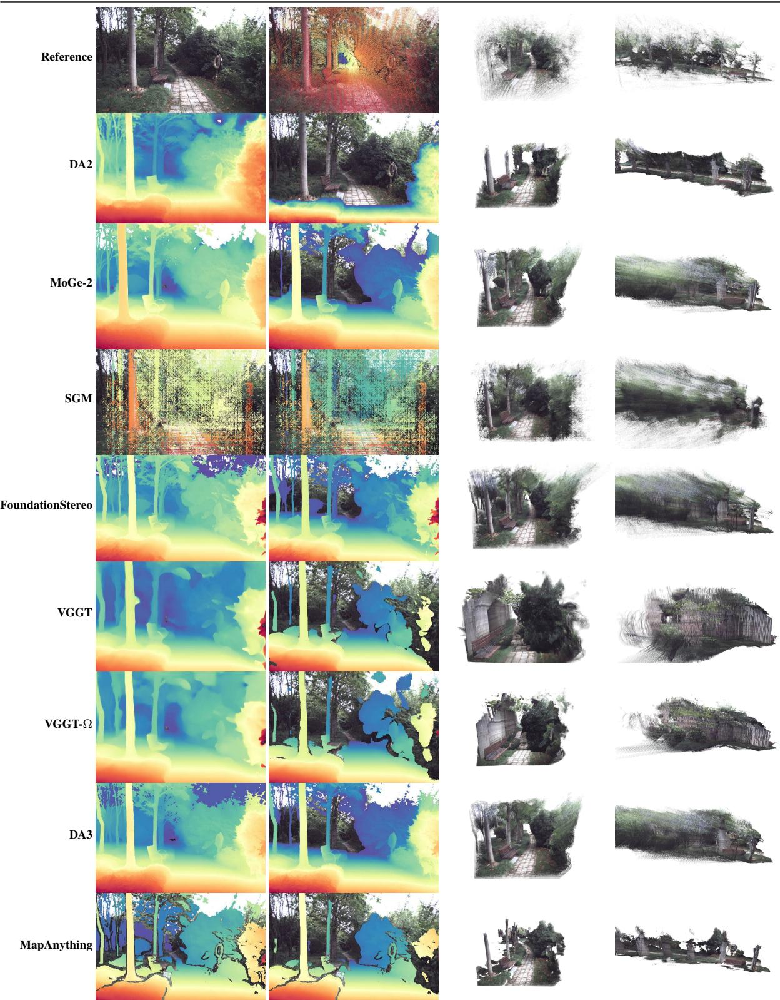  
Fig. 8. Qualitative dense-depth comparison on BotanicGarden\_1006-01. Full Depth shows the complete valid prediction for assessing relative-depth discrimination, whereas Filtered Depth shows the subset retained by method-specific confidence or range filtering. 3D View 1 and 3D View 2 show two fixed views of the point clouds, back-projecting the retained depth maps, and accumulating them across the sequence using the camera poses associated with each configuration. The first row contains, from left to right, the undistorted input image, reference depth, and two views of the reference point cloud; the remaining rows show the monocular, stereo, and multi-view depth-estimation methods.

For the efficiency comparison, DA3 is the fastest , followed by DA2, whereas VGGT-Ω combines a comparatively short runtime with the strongest aligned accuracy. It therefore offers the best overall balance between aligned depth quality, coverage, and efficiency among the selected outputs.

The Align × rows evaluate native metric-depth estimation without affine correction. Pose-conditioned, confidencefiltered MapAnything performs best in this setting, indicating that its predicted depth is already close to the reference metric geometry. DA3 provide the strongest alternatives among the near-distance configurations, whereas DA2 improves most substantially after alignment and therefore depends more strongly on correcting its native scale and offset.

Overall, VGGT-Ω gives the strongest aligned accuracy– efficiency balance, MapAnything provides the best native metric-depth prediction, DA3 is the fastest.

## VI. CONCLUSION

We presented a LiDAR-based pipeline that converts camera, LiDAR, and reference-pose data from existing multi-sensor localization datasets into per-view depth maps and visible point-cloud references for benchmarking visual depth estimation and 3D reconstruction in vegetation-rich outdoor environments. To address visibility errors in the accumulated LiDAR measurements and enable their reuse as geometric references, we introduced the Large-Depth-Gap Visibility Score (LDGVS) for point-wise filtering and automatic scale selection in Hidden Point Removal (HPR). The resulting pipeline reduces reliance on dedicated laser-scanner surveys. Experiments on TartanAirV2 and TartanGround show that the combined HPR and LDGVS filtering retains approximately three times the reference density of Poisson surface reconstruction at comparable absolute relative error.

We instantiated the pipeline on BotanicGarden to compare the zero-shot performance of representative feed-forward visual-geometry models with conventional SfM in an underevaluated vegetation-rich outdoor setting. Feed-forward models generate dense geometry efficiently but can exhibit duplicated structures and cross-frame inconsistencies, whereas conventional SfM produces more coherent geometry but remains sparse and prone to failure. These findings demonstrate the need for domain-specific evaluation and the value of the benchmark in exposing trade-offs in density, consistency, robustness, and efficiency beyond geometric accuracy alone.

## REFERENCES

[1] J. Li, X. Qi, S. H. Nabaei, M. Liu, D. Chen, Q. Sun, X. Zhang, X. Yin, and Z. Li, “A survey on 3d reconstruction techniques in plant phenotyping: From classical methods to neural radiance fields (nerf), 3d gaussian splatting (3dgs), and beyond,” Plant Phenomics, vol. 7, no. 4, p. 100137, 2025.

[2] J. Chang, J. J. Walsh, E. Mangina, J. Ruan, and S. Negrao, “Ai-driven 3d˜ point cloud analysis in plant phenotyping: A systematic review,” Smart Agricultural Technology, vol. 13, p. 101869, 2026.

[3] Z. Li, X. Xu, T. Xu, Y. Gao, and X. Rao, “Process, challenges and solutions of fruit 3d reconstruction: A review,” Computers and Electronics in Agriculture, vol. 239, p. 111068, 2025.

[4] H. Wang, J. Zhao, S. Zhang, M. Yao, L. Xue, and D. Li, “Image-based, 3d reconstruction for smart farming applications: A review,” Computers and Electronics in Agriculture, vol. 248, p. 111828, 2026.

[5] P. Wang, W. Luo, J. Liu, Y. Zhou, X. Li, S. Zhao, G. Zhang, and Y. Zhao, “Real-time semantic slam-based 3d reconstruction robot for greenhouse vegetables,” Computers and Electronics in Agriculture, vol. 237, p. 110582, 2025.

[6] Y. Zheng, A. Liu, A. Huang, D.-H. Kim, Y. Shen, and K.-H. Lee, “Realtime multi-rgbd slam framework for 3d reconstruction and phenotyping in large-scale apple orchards,” Computers and Electronics in Agriculture, vol. 240, p. 111170, 2026.

[7] J. Xiong, J. Liang, Y. Zhuang, D. Hong, Z. Zheng, S. Liao, W. Hu, and Z. Yang, “Real-time localization and 3d semantic map reconstruction for unstructured citrus orchards,” Computers and Electronics in Agriculture, vol. 213, p. 108217, 2023.

[8] T. Yang, S. Zhou, J. Ye, A. Xu, and X. Wu, “A method for 3d reconstruction of trees via sfm guidance and depth estimation,” Computers and Electronics in Agriculture, vol. 247, p. 111674, 2026.

[9] H. Wan, X. Zeng, Z. Fan, Q. Chen, K. Zhang, and H. Zhang, “Etpatchnet: A low-memory, efficient model for multi-view stereo with a case study on the 3d reconstruction of fruit tree branches,” Computers and Electronics in Agriculture, vol. 237, p. 110459, 2025.

[10] X. Zeng, H. Wan, Z. Fan, X. Yu, and H. Guo, “Mt-mvsnet: A lightweight and highly accurate convolutional neural network based on mobile transformer for 3d reconstruction of orchard fruit tree branches,” Expert Systems with Applications, vol. 268, p. 126220, 2025.

[11] J. Uhrig, N. Schneider, L. Schneider, U. Franke, T. Brox, and A. Geiger, “Sparsity invariant cnns,” in International Conference on 3D Vision (3DV), 2017.

[12] H. Aanæs, R. R. Jensen, G. Vogiatzis, E. Tola, and A. B. Dahl, “Large-scale data for multiple-view stereopsis,” International Journal of Computer Vision, pp. 1–16, 2016.

[13] A. Knapitsch, J. Park, Q.-Y. Zhou, and V. Koltun, “Tanks and temples: Benchmarking large-scale scene reconstruction,” ACM Transactions on Graphics, vol. 36, no. 4, 2017.

[14] T. Schops, J. L. Sch¨ onberger, S. Galliani, T. Sattler, K. Schindler,¨ M. Pollefeys, and A. Geiger, “A multi-view stereo benchmark with highresolution images and multi-camera videos,” in Conference on Computer Vision and Pattern Recognition (CVPR), 2017.

[15] Y. Tao, M. Angel Mu ´ noz-Ba ˜ n˜on, L. Zhang, J. Wang, L. F. T. Fu, and´ M. Fallon, “The oxford spires dataset: Benchmarking large-scale lidarvisual localisation, reconstruction and radiance field methods,” 2025.

[16] S. Wang, V. Leroy, Y. Cabon, B. Chidlovskii, and J. Revaud, “Dust3r: Geometric 3d vision made easy,” 2024.

[17] J. Wang, M. Chen, N. Karaev, A. Vedaldi, C. Rupprecht, and D. Novotny, “Vggt: Visual geometry grounded transformer,” 2025.

[18] J. Wang, M. Chen, S. Zhang, N. Karaev, J. Schonberger, P. Labatut,¨ P. Bojanowski, D. Novotny, A. Vedaldi, and C. Rupprecht, “Vggt-ω,” 2026.

[19] H. Lin, S. Chen, J. Liew, D. Y. Chen, Z. Li, G. Shi, J. Feng, and B. Kang, “Depth anything 3: Recovering the visual space from any views,” 2025.

[20] V. Leroy, Y. Cabon, and J. Revaud, “Grounding image matching in 3d with mast3r,” 2024.

[21] N. Keetha, N. Muller, J. Sch ¨ onberger, L. Porzi, Y. Zhang, T. Fischer,¨ A. Knapitsch, D. Zauss, E. Weber, N. Antunes, J. Luiten, M. Lopez-Antequera, S. R. Bulo, C. Richardt, D. Ramanan, S. Scherer, and\` P. Kontschieder, “Mapanything: Universal feed-forward metric 3d reconstruction,” 2026.

[22] R. Wang, S. Xu, Y. Dong, Y. Deng, J. Xiang, Z. Lv, G. Sun, X. Tong, and J. Yang, “Moge-2: Accurate monocular geometry with metric scale and sharp details,” 2025.

[23] H. Hristova, A. Murtiyoso, D. Kukenbrink, M. Marty, M. Abegg,¨ C. Fischer, V. C. Griess, and N. Rehush, “Viewing the forest in 3-d: How spherical stereo videos enable low-cost reconstruction of forest plots,” IEEE Journal of Selected Topics in Applied Earth Observations and Remote Sensing, vol. 17, pp. 17 612–17 625, 2024.

[24] A. Fakhri, H. Latifi, K. M. Samani, and F. E. Fassnacht, “Car3dmic: A novel method for evaluating uav-derived 3d forest models by tree features,” ISPRS Journal of Photogrammetry and Remote Sensing, vol. 208, pp. 279–295, 2024.

[25] M. Gehrig, W. Aarents, D. Gehrig, and D. Scaramuzza, “Dsec: A stereo event camera dataset for driving scenarios,” 2021.

[26] P. Sun, H. Kretzschmar, X. Dotiwalla, A. Chouard, V. Patnaik, P. Tsui, J. Guo, Y. Zhou, Y. Chai, B. Caine, V. Vasudevan, W. Han, J. Ngiam, H. Zhao, A. Timofeev, S. Ettinger, M. Krivokon, A. Gao, A. Joshi, Y. Zhang, J. Shlens, Z. Chen, and D. Anguelov, “Scalability in perception for autonomous driving: Waymo open dataset,” in Proceedings of the IEEE/CVF Conference on Computer Vision and Pattern Recognition (CVPR), June 2020.

[27] H. Caesar, V. Bankiti, A. H. Lang, S. Vora, V. E. Liong, Q. Xu, A. Krishnan, Y. Pan, G. Baldan, and O. Beijbom, “nuscenes: A multimodal dataset for autonomous driving,” 2020.

[28] K. Deng, Z. Ti, J. Xu, J. Yang, and J. Xie, “Vggt-long: Chunk it, loop it, align it – pushing vggt’s limits on kilometer-scale long rgb sequences,” 2026.

[29] S. Yuan, R. Tang, Y. Ji, F. Ge, H. Wang, Y. Wang, X. Zeng, J. Xu, X. Liu, Y. Wang, and Z. Zhang, “Surroundnexo: Ego-centric metric bridging for spatially consistent geometry in autonomous driving,” 2026.

[30] Y. Liu, Y. Fu, M. Qin, Y. Xu, B. Xu, F. Chen, B. Goossens, P. Z. Sun, H. Yu, C. Liu, L. Chen, W. Tao, and H. Zhao, “Botanicgarden: A high-quality dataset for robot navigation in unstructured natural environments,” IEEE Robotics and Automation Letters, vol. 9, no. 3, pp. 2798–2805, 2024.

[31] J. Bruce, J. Wawerla, and R. Vaughan, “The SFU mountain dataset: Semi-structured woodland trails under changing environmental conditions,” in IEEE Int. Conf. on Robotics and Automation 2015, Workshop on Visual Place Recognition in Changing Environments, 2015.

[32] P. Jiang, P. Osteen, M. Wigness, and S. Saripalli, “Rellis-3d dataset: Data, benchmarks and analysis,” in 2021 IEEE International Conference on Robotics and Automation (ICRA), 2021, pp. 1110–1116.

[33] J. Knights, K. Vidanapathirana, M. Ramezani, S. Sridharan, C. Fookes, and P. Moghadam, “Wild-places: A large-scale dataset for lidar place recognition in unstructured natural environments,” 2023.

[34] D. Cheng, F. C. Ojeda, A. Prabhu, X. Liu, A. Zhu, P. C. Green, R. Ehsani, P. Chaudhari, and V. Kumar, “Treescope: An agricultural robotics dataset for lidar-based mapping of trees in forests and orchards,” 2023.

[35] H. Teng, Y. Wang, X. Song, and K. Karydis, “Multimodal dataset for localization, mapping and crop monitoring in citrus tree farms,” in Advances in Visual Computing, G. Bebis, G. Ghiasi, Y. Fang, A. Sharf, Y. Dong, C. Weaver, Z. Leo, J. J. LaViola Jr., and L. Kohli, Eds. Cham: Springer Nature Switzerland, 2023, pp. 571–582.

[36] F. Crocetti, E. Bellocchio, A. Dionigi, S. Felicioni, G. Costante, M. L. Fravolini, and P. Valigi, “Ard-vo: Agricultural robot data set of vineyards and olive groves,” Journal of Field Robotics, vol. 40, no. 6, pp. 1678– 1696, 2023.

[37] M. M. Tanco, G. T. Barnech, F. Andrade, J. Baliosian, M. LLofriu, J. D. Martino, and G. Tejera, “Magro dataset: A dataset for simultaneous localization and mapping in agricultural environments,” The International Journal of Robotics Research, vol. 43, no. 5, pp. 591–601, 2024.

[38] R. Polvara, S. Molina, I. Hroob, A. Papadimitriou, K. Tsiolis, D. Giakoumis, S. Likothanassis, D. Tzovaras, G. Cielniak, and M. Hanheide, “Bacchus long-term (blt) data set: Acquisition of the agricultural multimodal blt data set with automated robot deployment,” Journal of Field Robotics, vol. 41, no. 7, pp. 2280–2298, 2024.

[39] C. Yao, Y. Ge, G. Shi, Z. Wang, N. Yang, Z. Zhu, H. Wei, Y. Zhao, J. Wu, and Z. Jia, “Tail: A terrain-aware multi-modal slam dataset for robot locomotion in deformable granular environments,” IEEE Robotics and Automation Letters, vol. 9, no. 7, pp. 6696–6703, 2024.

[40] M. Usuelli, D. Rapado-Rincon, G. Kootstra, and M. Matteucci, “Agrigsslam: Orchard mapping across seasons via multi-view gaussian splatting slam,” IEEE Robotics and Automation Letters, vol. 11, no. 6, pp. 7102– 7109, 2026.

[41] S. Xu, Z. Zhong, T. Barros, M. Coombes, C. Premebida, H. Wu, and C. Liu, “Hortimulti: A multi-sensor dataset for localisation and mapping in horticultural polytunnels,” 2026.

[42] R. Sapkota, Z. Meng, M. Churuvija, X. Du, Z. Ma, and M. Karkee, “3d reconstruction and information fusion between dormant and canopy seasons in commercial orchards using deep learning and fast gicp,” 2025.

[43] W. Zhu, R. Ma, J. An, W. Li, X. Bai, and D. Xu, “Three-dimensional reconstruction and parameters extraction of walnut (juglans regia l.) branches based on neural radiation fields,” European Journal of Agronomy, vol. 169, p. 127693, 2025.

[44] R. Sapkota, Z. Meng, M. Churuvija, X. Du, Z. Ma, and M. Karkee, “3d reconstruction and information fusion between dormant and canopy seasons in commercial orchards using deep learning and fast gicp,” 2025.

[45] C. Yeshwanth, Y.-C. Liu, M. Nießner, and A. Dai, “Scannet++: A highfidelity dataset of 3d indoor scenes,” in Proceedings of the IEEE/CVF International Conference on Computer Vision, 2023, pp. 12–22.

[46] M. Kazhdan, M. Bolitho, and H. Hoppe, “Poisson surface reconstruction,” in Proceedings of the Fourth Eurographics Symposium on Geometry Processing, ser. SGP ’06. Goslar, DEU: Eurographics Association, 2006, p. 61–70.

[47] J. P. Richa, J.-E. Deschaud, F. Goulette, and N. Dalmasso, “Adasplats: Adaptive splatting of point clouds for accurate 3d modeling and realtime high-fidelity lidar simulation,” Remote Sensing, vol. 14, no. 24, 2022.

[48] S. de Moreau, M. Corsia, H. Bouchiba, Y. Almehio, A. Bursuc, H. El-Idrissi, and F. Moutarde, “Doc-depth: A novel approach for dense depth ground truth generation,” 2025.

[49] Y. Zhao, L. Bai, Z. Zhang, and X. Huang, “A surface geometry model for lidar depth completion,” IEEE Robotics and Automation Letters, vol. 6, no. 3, p. 4457–4464, July 2021.

[50] S. Katz, A. Tal, and R. Basri, “Direct visibility of point sets,” ACM Trans. Graph., vol. 26, no. 3, p. 24–es, Jul. 2007.

[51] P. Biasutti, A. Bugeau, J.-F. Aujol, and M. Bredif, “Visibility estimation´ in point clouds with variable density,” in International Conference on Computer Vision Theory and Applications (VISAPP), 2019.

[52] K. Yok-In, P. Buayai, D. Moeurn, and X. Mao, “3d reconstruction and segmentation of grape bunches for robotic berry thinning,” Computers and Electronics in Agriculture, vol. 250, p. 111898, 2026.

[53] Y. Xu, X. Gu, Z. Cheng, Y. Du, P. Li, C. Wei, T. Zhao, Z. Zhang, and J. Liu, “Monitoring vertical spad distribution of winter wheat using uav cross-circle oblique photography,” Computers and Electronics in Agriculture, vol. 245, p. 111567, 2026.

[54] J. Ma, X. Hu, L. Shi, Y. Zhang, Y. Jiang, H. Zhang, and S. Duan, “Plant3r: Fusing 3d feature learning with gaussian splatting to enhance wheat plant 3d reconstruction precision,” Plant Phenomics, vol. 8, no. 2, p. 100200, 2026.

[55] B. Duisterhof, L. Zust, P. Weinzaepfel, V. Leroy, Y. Cabon, and J. Revaud, “Mast3r-sfm: a fully-integrated solution for unconstrained structure-from-motion,” 2024.

[56] O. Simeoni, H. V. Vo, M. Seitzer, F. Baldassarre, M. Oquab, C. Jose,´ V. Khalidov, M. Szafraniec, S. Yi, M. Ramamonjisoa, F. Massa, D. Haziza, L. Wehrstedt, J. Wang, T. Darcet, T. Moutakanni, L. Sentana, C. Roberts, A. Vedaldi, J. Tolan, J. Brandt, C. Couprie, J. Mairal, H. Jegou, P. Labatut, and P. Bojanowski, “Dinov3,” 2025.´

[57] B. Wen, M. Trepte, J. Aribido, J. Kautz, O. Gallo, and S. Birchfield, “Foundationstereo: Zero-shot stereo matching,” CVPR, 2025.

[58] J. Sun, Z. Shen, Y. Wang, H. Bao, and X. Zhou, “Loftr: Detector-free local feature matching with transformers,” 2021.

[59] J. Edstedt, D. Nordstrom, Y. Zhang, G. B¨ okman, J. Astermark, V. Lars-¨ son, A. Heyden, F. Kahl, M. Wadenback, and M. Felsberg, “Roma v2:¨ Harder better faster denser feature matching,” 2025.

[60] D. Nordstrom, J. Edstedt, G. B¨ okman, J. Astermark, A. Heyden,¨ V. Larsson, M. Wadenback, M. Felsberg, and F. Kahl, “Loma: Local¨ feature matching revisited,” 2026.

[61] W. Xu and F. Zhang, “Fast-lio: A fast, robust lidar-inertial odometry package by tightly-coupled iterated kalman filter,” 2021.

[62] I. Vizzo, T. Guadagnino, B. Mersch, L. Wiesmann, J. Behley, and C. Stachniss, “KISS-ICP: In Defense of Point-to-Point ICP – Simple, Accurate, and Robust Registration If Done the Right Way,” IEEE Robotics and Automation Letters (RA-L), vol. 8, no. 2, pp. 1029–1036, 2023.

[63] W. Wang, D. Zhu, X. Wang, Y. Hu, Y. Qiu, C. Wang, Y. Hu, A. Kapoor, and S. Scherer, “Tartanair: A dataset to push the limits of visual slam,” 2020.

[64] M. Patel, F. Yang, Y. Qiu, C. Cadena, S. Scherer, M. Hutter, and W. Wang, “Tartanground: A large-scale dataset for ground robot perception and navigation,” 2025.

[65] S. Umeyama, “Least-squares estimation of transformation parameters between two point patterns,” IEEE Transactions on Pattern Analysis and Machine Intelligence, vol. 13, no. 4, pp. 376–380, 1991.

[66] J. L. Schonberger and J.-M. Frahm, “Structure-from-motion revisited,”¨ in Conference on Computer Vision and Pattern Recognition (CVPR), 2016.

[67] P.-E. Sarlin, D. DeTone, T. Malisiewicz, and A. Rabinovich, “Superglue: Learning feature matching with graph neural networks,” in Proceedings of the IEEE/CVF Conference on Computer Vision and Pattern Recognition (CVPR), June 2020.

[68] R. Ranftl, K. Lasinger, D. Hafner, K. Schindler, and V. Koltun, “Towards robust monocular depth estimation: Mixing datasets for zero-shot crossdataset transfer,” 2020.

[69] L. Yang, B. Kang, Z. Huang, Z. Zhao, X. Xu, J. Feng, and H. Zhao, “Depth anything v2,” arXiv:2406.09414, 2024.

[70] F. Wimbauer, N. Yang, L. von Stumberg, N. Zeller, and D. Cremers, “Monorec: Semi-supervised dense reconstruction in dynamic environments from a single moving camera,” in 2021 IEEE/CVF Conference on Computer Vision and Pattern Recognition (CVPR), 2021, pp. 6108– 6118.

[71] H. Hirschmuller, “Stereo processing by semiglobal matching and mutual information,” IEEE Transactions on Pattern Analysis and Machine Intelligence, vol. 30, no. 2, pp. 328–341, 2008.

## SUPPLEMENTARY MATERIAL

## S.I BENCHMARK INPUT AND DEPTH PROTOCOL

## A. Common Experiment Settings

All methods operate on undistorted images. Each image is uniformly rescaled and center-cropped to the target input resolution of the corresponding method. For stereo methods, each synchronized left–right image pair is counted as one stereo frame, and dense predictions are evaluated only in the left-camera view.

For the depth and reconstruction benchmarks, each evaluated view is represented by camera-z depth and its associated camera pose. DA2 (Metric), MoGe-2, VGGT, VGGT-Ω, and DA3 use their native depth predictions. For DA2 (Relative), we obtain a relative depth proxy by taking the reciprocal of its predicted inverse depth. Disparities from SGM and FoundationStereo are converted to camera-z depth using the calibrated horizontal focal length and stereo baseline. For MapAnything, camera-z depth is taken from the z-coordinate of its predicted camera-frame point map. For SfM methods, reconstructed 3D points are projected into the left image. Camera parameters estimated by each method are used unless calibrated intrinsics are provided as input.

## S.II POST-PROCESSING AND ALIGNMENT PROTOCOLS

## A. Weighted Umeyama Similarity Alignment

Adjacent-chunk registration, reconstruction-to-reference alignment, and pose-trajectory alignment share the same least-squares Sim(3) core. Let $\left( \widehat { \mathbf { x } } _ { k } , \mathbf { x } _ { k } \right)$ be a source–target 3D correspondence with a non-negative base weight $q _ { k }$ . If the total base weight is non-positive, the implementation replaces all base weights by one. Normalizing $\omega _ { k } = \left. q _ { k } \right/ \sum _ { j } q _ { j }$ , we estimate

$$
( s , { \bf R } , { \bf t } ) = \underset { s > 0 , { \bf R } \in \mathrm { S O } ( 3 ) } { \arg \operatorname* { m i n } } \sum _ { k } \omega _ { k } \left. { \bf x } _ { k } - ( s { \bf R } \widehat { \bf x } _ { k } + { \bf t } ) \right. _ { 2 } ^ { 2 } .\tag{19}
$$

For at least three retained pairs, define

$$
\widehat { \pmb { \mu } } = \sum _ { k } \omega _ { k } \widehat { \mathbf { x } } _ { k } ,
$$

$$
\pmb { \mu } = \sum _ { k } \omega _ { k } \mathbf { x } _ { k } ,\tag{20}
$$

$$
\mathbf { H } = \sum _ { k } \omega _ { k } ( \mathbf { x } _ { k } - \pmb { \mu } ) ( \widehat { \mathbf { x } } _ { k } - \widehat { \pmb { \mu } } ) ^ { \sf T } = \mathbf { U } \boldsymbol { \Sigma } \mathbf { V } ^ { \sf T } ,\tag{21}
$$

$$
\widehat { \sigma } ^ { 2 } = \sum _ { k } \omega _ { k } \| \widehat { \mathbf x } _ { k } - \widehat { \pmb \mu } \| _ { 2 } ^ { 2 } .\tag{22}
$$

The reflection-corrected weighted extension of the Umeyama solution [65] is

$$
\mathbf { D } = \operatorname { d i a g } \left( 1 , 1 , \operatorname { s i g n } \operatorname* { d e t } ( \mathbf { U } \mathbf { V } ^ { \mathsf { T } } ) \right) ,\tag{23}
$$

$$
\mathbf { R } = \mathbf { U } \mathbf { D } \mathbf { V } ^ { \top } ,\tag{24}
$$

$$
s = \frac { \mathrm { t r } ( \Sigma \mathbf { D } ) } { { \widehat { \sigma } } ^ { 2 } } ,\tag{25}
$$

$$
\mathbf { t } = \mu - s \mathbf { R } \widehat { \mu } .\tag{26}
$$

If the weighted source variance ${ \widehat { \sigma } } ^ { 2 }$ is numerically zero, the implementation uses the degenerate fallback $s \ = \ 1$ and estimates only the centroid translation (with the SVD-derived rotation retained).

For adjacent-chunk registration, and in our adaptation of that procedure for reconstruction-to-reference alignment, we follow the robust fitting strategy of [28]. The base weights encode prediction confidence, and the Sim(3) transform minimizes

$$
\sum _ { k } q _ { k } \rho _ { \delta } { \left( { \boldsymbol { r } _ { k } } \right) } , \qquad r _ { k } = \left\| \mathbf { x } _ { k } - \left( s \mathbf { R } \widehat { \mathbf { x } } _ { k } + \mathbf { t } \right) \right\| _ { 2 } ,\tag{27}
$$

where

$$
\rho _ { \delta } ( r ) = \left\{ { \begin{array} { l l } { { \frac { 1 } { 2 } } r ^ { 2 } , } & { r \leq \delta , } \\ { \delta ( r - { \frac { 1 } { 2 } } \delta ) , } & { r > \delta . } \end{array} } \right.\tag{28}
$$

Starting from the base-weighted solution above, the iteratively reweighted least squares (IRLS) update at iteration ℓ + 1 uses

$$
w _ { k } ^ { ( \ell + 1 ) } = q _ { k } \left\{ { 1 , \begin{array} { r } { r _ { k } ^ { ( \ell ) } \le \delta , } \\ { \delta / r _ { k } ^ { ( \ell ) } , } \end{array} } \right.\tag{29}
$$

and resolves the weighted Umeyama problem with the normalized $w _ { k } ^ { ( \ell + 1 ) }$ . We use at most five robust updates, with $\delta$ expressed in the target coordinate units.

## B. Adjacent-Chunk Alignment

For the sequential chunk-alignment protocol, the first chunk defines the accumulated coordinate frame. Each subsequent chunk is registered to the preceding, already-aligned chunk using jointly valid, same-pixel 3D points from their shared frames. We retain all jointly valid candidate correspondences and assign each pair an equal base weight, $q _ { k } = 1$ . The robust solver in Supplementary Section S.II-A is then applied with $\delta \ = \ 0 . 1$ in the accumulated target-frame coordinate units. Predictions duplicated in an overlap are replaced by the newer copy before fusion.

## C. Scene-Level Point-Cloud Alignment

Let $\widehat { \mathbf { T } } _ { f }$ and $\mathbf { T } _ { f }$ be the predicted and reference camera-toworld poses. Each trajectory is first expressed relative to its own first finite, invertible pose:

$$
\begin{array} { r } { \bar { \hat { \mathbf { T } } } _ { f } = \widehat { \mathbf { T } } _ { 0 } ^ { - 1 } \widehat { \mathbf { T } } _ { f } , \quad \quad \bar { \mathbf { T } } _ { f } = \mathbf { T } _ { 0 } ^ { - 1 } \mathbf { T } _ { f } . } \end{array}\tag{30}
$$

For homogeneous pixel u˜ in frame $f ,$ let $\widehat { \mathbf { X } } _ { f , \mathbf { u } }$ be its predicted camera-frame 3D point, including any previously accumulated similarity scale. The corresponding predicted and reference points in their canonical scene frames are

$$
\widehat { \mathbf { x } } _ { f , \mathbf { u } } = \bar { \hat { \mathbf { R } } } _ { f } \widehat { \mathbf { X } } _ { f , \mathbf { u } } + \bar { \hat { \mathbf { t } } } _ { f } ,\tag{31}
$$

$$
\mathbf { x } _ { f , \mathbf { u } } = \bar { \mathbf { R } } _ { f } \left( d _ { f , \mathbf { u } } \mathbf { K } _ { f } ^ { - 1 } \tilde { \mathbf { u } } \right) + \bar { \mathbf { t } } _ { f } .\tag{32}
$$

Because the predicted and reference point maps share the same frame and pixel indices, each predicted point is paired directly with the reference point at the corresponding pixel in the same frame. We retain only pairs for which both the prediction and reference depth masks are valid.

Let $c _ { k }$ be the prediction confidence, with $c _ { k } \ = \ 1$ when confidence is unavailable, and let $m _ { c } = \mathrm { m e d i a n } _ { k } c _ { k }$ . We retain $c _ { k } > 0 . 1 m _ { c }$ when $m _ { c } > 0$ (and $c _ { k } > 0$ otherwise). Because reference confidence is one, the base weight is

$$
q _ { k } = { \sqrt { c _ { k } } } .\tag{33}
$$

We adapt the robust procedure in Supplementary ${ \mathrm { S e c } } -$ tion S.II-A with $\delta = 0 . 1 0$ m because the reference is metric. The fitted transform is applied to reconstructed points and canonically rebased camera-to-world poses:

$$
\widehat { \mathbf { x } } _ { k } ^ { \prime } = s \mathbf { R } \widehat { \mathbf { x } } _ { k } + \mathbf { t } , \qquad \widehat { \mathbf { R } } _ { f } ^ { \prime } = \mathbf { R } \widehat { \mathbf { R } } _ { f } , \qquad \widehat { \mathbf { t } } _ { f } ^ { \prime } = s \mathbf { R } \bar { \mathbf { t } } _ { f } + \mathbf { t } .\tag{34}
$$

The aligned reconstruction is stored separately, so the canonically rebased but otherwise unaligned result remains available.

## D. Per-Frame Affine Depth Alignment

For the common valid-pixel set $\mathcal { V } _ { f }$ , scale and shift are estimated independently for each frame by weighted least squares:

$$
( a _ { f } , b _ { f } ) = \underset { a , b } { \arg \operatorname* { m i n } } \sum _ { i \in \mathcal { V } _ { f } } w _ { f , i } \left( a \hat { d } _ { f , i } + b - d _ { f , i } \right) ^ { 2 } .\tag{35}
$$

Inverse-reference-depth weighting is used with power one and $\epsilon = 0 . 1$ m:

$$
\tilde { w } _ { f , i } = \frac { 1 } { \operatorname* { m a x } ( d _ { f , i } , \epsilon ) } , \qquad w _ { f , i } = \frac { \tilde { w } _ { f , i } } { | \mathscr { V } _ { f } | ^ { - 1 } \sum _ { j \in \mathscr { V } _ { f } } \tilde { w } _ { f , j } } .\tag{36}
$$

The fit is defined only when $| \nu _ { f } | \geq 1 0$ . We constrain $a _ { f } \geq$ $1 0 ^ { - 6 }$ to ensure a finite log-scale error. The corrected depth is

$$
d _ { f , i } ^ { \prime } = a _ { f } \hat { d } _ { f , i } + b _ { f } .\tag{37}
$$

## S.III METRIC DEFINITIONS

This section defines the reconstruction, depth-estimation, and runtime metrics used in the experiments. The definitions follow the benchmark evaluation protocol. Let $\nVdash [ \cdot ]$ denote the indicator function, ∥·∥2 the Euclidean norm, and $\mathrm { c l i p } ( x , - 1 , 1 )$ the truncation of x to [−1, 1]. Invalid or non-finite samples are excluded through the task-specific validity masks described below.

## A. Point-Cloud Reconstruction Metrics

Let $\mathbf { \mathcal { P } } ~ = ~ \{ \mathbf { p } _ { i } \} _ { i = 1 } ^ { N _ { P } }$ be the reconstructed point cloud and $\mathcal { G } = \{ \mathbf { g } _ { j } \} _ { j = 1 } ^ { N _ { G } }$ the reference point cloud. Accuracy and completeness, together with their inlier ratios, are

$$
\mathrm { A c c } = \frac { 1 } { N _ { P } } \sum _ { i = 1 } ^ { N _ { P } } d ( \mathbf { p } _ { i } , \mathcal { G } ) ,\tag{38}
$$

$$
\operatorname { A c c } _ { \tau } = \frac { 1 } { N _ { P } } \sum _ { i = 1 } ^ { N _ { P } } { \mathcal { H } } [ d ( \mathbf { p } _ { i } , { \mathcal { G } } ) \leq \tau ] ,\tag{39}
$$

$$
\mathrm { C o m p } = \frac { 1 } { N _ { G } } \sum _ { j = 1 } ^ { N _ { G } } d ( \mathbf { g } _ { j } , \mathcal { P } ) ,\tag{40}
$$

$$
\mathrm { C o m p } _ { \tau } = \frac { 1 } { N _ { G } } \sum _ { j = 1 } ^ { N _ { G } } \mathcal { H } [ d ( \mathbf { g } _ { j } , \mathcal { P } ) \leq \tau ] .\tag{41}
$$

Here, $\begin{array} { r } { d ( \mathbf { x } , S ) = \operatorname* { m i n } _ { \mathbf { y } \in S } \| \mathbf { x } - \mathbf { y } \| _ { 2 } } \end{array}$ is the point-to-set nearestneighbor distance, and $\tau = 0 . 0 3$ in the reported experiments. The Chamfer distance is computed as:

$$
\mathrm { C D } = \mathrm { A c c } + \mathrm { C o m p } .\tag{42}
$$

The F1 score is the harmonic mean of the two inlier ratios,

$$
\mathrm { F 1 } = \frac { 2 \mathrm { A c c } _ { \tau } \mathrm { C o m p } _ { \tau } } { \mathrm { A c c } _ { \tau } + \mathrm { C o m p } _ { \tau } } .\tag{43}
$$

Reconstruction density is evaluated from the valid predicted-depth mask $m _ { i } ^ { \mathrm { p r e d } }$ before the additional cross-frame reprojection-consistency filter:

$$
\mathrm { D e n s i t y } = \frac { 1 } { H W } \sum _ { i = 1 } ^ { H W } { / k } [ m _ { i } ^ { \mathrm { p r e d } } ] .\tag{44}
$$

## B. Depth-Estimation Metrics

Let $d _ { i } > 0$ and $\hat { d } _ { i }$ denote the reference and predicted depths at pixel i, respectively, and let $\nu$ contain the $N _ { V }$ pixels for which both depth masks are valid. Define

$$
e _ { i } = | \hat { d } _ { i } - d _ { i } | , \qquad r _ { i } = \operatorname* { m a x } \left( \frac { d _ { i } } { \hat { d } _ { i } } , \frac { \hat { d } _ { i } } { d _ { i } } \right) .\tag{45}
$$

The absolute and relative depth metrics are

$$
{ \mathrm { A b s } } = { \frac { 1 } { N _ { V } } } \sum _ { i \in \nu } e _ { i } ,\tag{46}
$$

$$
\mathrm { A b s } _ { \tau } = \frac { 1 } { N _ { V } } \sum _ { i \in \mathcal { V } } \mathcal { H } [ e _ { i } \leq \tau _ { \mathrm { a b s } } ] ,\tag{47}
$$

$$
\mathrm { A b s R e l } = \frac { 1 } { N _ { V } } \sum _ { i \in \mathcal { V } } \frac { e _ { i } } { d _ { i } } ,\tag{48}
$$

$$
\mathrm { R e l } _ { \tau } = \frac { 1 } { N _ { V } } \sum _ { i \in \mathcal { V } } \mathcal { H } [ r _ { i } < \tau _ { \mathrm { r e l } } ] .\tag{49}
$$

Here, $\tau _ { \mathrm { a b s } } = 0 . 0 3$ m and $\tau _ { \mathrm { r e l } } = 1 . 0 3$ in the reported experiments. Valid-depth density is computed using Eq. (44).

## C. Runtime Metric

Runtime is measured at the level of unique timed inference calls. If call $j$ takes $D _ { j }$ seconds for $B _ { j }$ input images, its normalized per-image runtime is

$$
t _ { j } = \frac { D _ { j } } { B _ { j } } .\tag{50}
$$

For the $N$ recorded calls in a sequence, the benchmark uppertrims

$$
q = \mathrm { m i n } ( \left\lfloor 0 . 0 5 N \right\rfloor , N - 1 )\tag{51}
$$

calls with the largest $t _ { j }$ . This fixed rule reduces the influence of initialization or transient system-load spikes while always retaining at least one call. The reported sequence-level runtime is the 95th percentile of the remaining call-level values,

$$
\mathrm { R u n t i m e } _ { 9 5 } = \mathrm { P } _ { 9 5 } \left( \{ t _ { j } | j \in \mathscr { R } \} \right) ,\tag{52}
$$

where $\mathcal { R }$ is the retained-call index set. The comparison tables use

TABLE V  
ABLATION STUDY OF LDGVSF THRESHOLDS AND AHPR TARGET LOW-VISIBILITY RATIOS ON TARTANAIRV2 DATA EASY AND TARTANGROUND DATA OMNI. THE PERCENTAGE IN AHPR DENOTES THE TARGET LOW-VISIBILITY RATIO $\rho ^ { \star }$ . WITHIN EACH ABLATION BLOCK, THE BEST VALUE PER METRIC IS SHOWN IN BOLD AND THE SECOND-BEST DISTINCT VALUE IS UNDERLINED.
<table><tr><td colspan="5">Method AbsRel ↓ Rel τ ↑ Abs↓ Abs τ ↑ Density ↑</td></tr><tr><td>Cumulation (baseline)</td><td>0.4016</td><td>0.6384</td><td>5.4760</td><td>0.3098</td><td>0.2524</td></tr><tr><td colspan="6">LDGVSF threshold ablation</td></tr><tr><td>LDGVSF(0.5)</td><td>0.2268</td><td>0.6837</td><td>4.4518</td><td>0.3368</td><td>0.2148</td></tr><tr><td>LDGVSF(0.7)</td><td>0.1819</td><td>0.6918</td><td>4.3071</td><td>0.3477</td><td>0.1944</td></tr><tr><td>LDGVSF(0.9)</td><td>0.1478</td><td>0.6915</td><td>4.2159</td><td>0.3569</td><td>0.1684</td></tr><tr><td colspan="6">AHPR target low-visibility ratio and LDGVSF threshold ablation</td></tr><tr><td>AHPR(1%)</td><td>0.1303</td><td>0.7003</td><td>4.2484</td><td>0.4047</td><td>0.1095</td></tr><tr><td>AHPR(1%)+LDGVSF(0.7)</td><td>0.1280</td><td>0.7026</td><td>4.1538</td><td>0.4092</td><td>0.1056</td></tr><tr><td>AHPR(1%)+LDGVSF(0.9)</td><td>0.1269</td><td>0.7010</td><td>4.1329</td><td>0.4118</td><td>0.1008</td></tr><tr><td>AHPR(3%)</td><td>0.1370</td><td>0.6892</td><td>4.4156</td><td>0.3683</td><td>0.1487</td></tr><tr><td>AHPR(3%)+LDGVSF(0.7)</td><td>0.1311</td><td>0.6945</td><td>4.2572</td><td>0.3769</td><td>0.1392</td></tr><tr><td>AHPR(3%)+LDGVSF(0.9)</td><td>0.1292</td><td>0.6929</td><td>4.2166</td><td>0.3809</td><td>0.1296</td></tr><tr><td>AHPR(5%)</td><td>0.1545</td><td>0.6852</td><td>4.4641</td><td>0.3460</td><td>0.1846</td></tr><tr><td>AHPR(5%)+LDGVSF(0.7)</td><td>0.1399</td><td>0.6955</td><td>4.2493</td><td>0.3601</td><td>0.1664</td></tr><tr><td>AHPR(5%)+LDGVSF(0.9)</td><td>0.1358</td><td>0.6936</td><td>4.2069</td><td>0.3656</td><td>0.1512</td></tr><tr><td>AHPR(10%)</td><td>0.2279</td><td>0.6652</td><td>4.6888</td><td>0.3226</td><td>0.2219</td></tr><tr><td>AHPR(10%)+LDGVSF(0.7)</td><td>0.1593</td><td>0.6926</td><td>4.2641</td><td>0.3498</td><td>0.1862</td></tr><tr><td>AHPR(10%)+LDGVSF(0.9)</td><td>0.1440</td><td>0.6913</td><td>4.1993</td><td>0.3579</td><td>0.1645</td></tr></table>

## S.IV VISIBLE-DEPTH REFERENCE ABLATION STUDY

We evaluate the effects of the LDGVSF threshold and the AHPR target low-visibility ratio on the accuracy and density of the generated visible-depth references.

Table V and Figure 9 show a consistent accuracy–density trade-off. Increasing the AHPR target low-visibility ratio retains more projected points but generally reduces accuracy. At a fixed AHPR setting, applying LDGVSF removes lowvisibility-score points and generally improves the error metrics at the cost of lower reference-depth density. Raising the LDGVSF threshold from 0.7 to 0.9 filters more points, while the additional changes in accuracy are modest and mixed. The visualization shows the corresponding coverage trend: the 1% configurations are sparse, the 10% configurations are denser, and the 5% configurations provide intermediate coverage; a threshold of 0.7 also retains more support than 0.9.

Several parameter combinations therefore provide a reasonable balance between accuracy and density. We choose AHPR(5%)+LDGVSF(0.7) to generate the reference depth for our pipeline because it retains relatively dense reference-depth coverage while limiting the retention of erroneous depth values in the generated references.

## S.V EXTENDED VISIBILITY COMPARISON ON BOTANICGARDEN

Figure 10 extends the qualitative comparison to the challenging real-world BotanicGarden data acquired with a Livox LiDAR. Compared with the simulated example, PSR in (d) retains a denser visible-point projection in this scene, but it still discards many points relative to the cumulation baseline in (b). In contrast, AHPR(5%)+LDGVSF(0.7) in (j) preserves substantially more visible-point support than PSR and maintains coverage close to the baseline while filtering likely occluded points.

## S.VI QUALITATIVE DEPTH-ERROR ANALYSIS

Figure 11 illustrates the sources of depth error. Even the aligned left-view single scan in (b) has residual errors at object boundaries: sparse LiDAR samples and discrete ground-truth pixels can fall on different surfaces near a depth discontinuity. The right-view cumulation baseline in (c) also retains incorrect depths within objects because of camera–LiDAR parallax and accumulated occluded points. PSR in (e) retains low-error interiors but removes much of the difficult boundary support, whereas AHPR(5%)+LDGVSF(0.7) in (k) preserves denser support with residual errors mainly at edges. Since accuracy is evaluated on each method’s retained pixels, these additional boundary samples help explain the accuracy–coverage tradeoff.

## S.VII REFERENCE POINT-CLOUD AND DEPTH VISUALIZATIONS

To show more examples for the generated reference, fig. 12 presents additional reference outputs for all ten BotanicGarden benchmark subsequences.

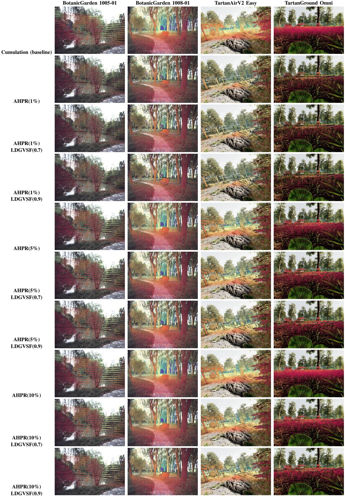  
Fig. 9. Qualitative comparison of the unfiltered cumulation baseline and AHPR results with and without LDGVSF-based filtering of low-visibility-score points.

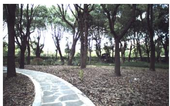  
(a) Right-view RGB image

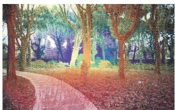  
(b) Cumulation (baseline)

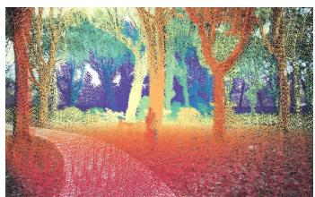  
(c) Cumulation+CP

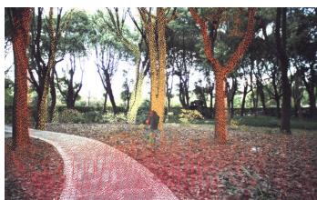  
(d) PSR

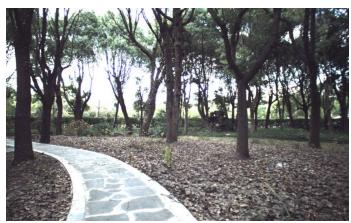  
(e) SGM

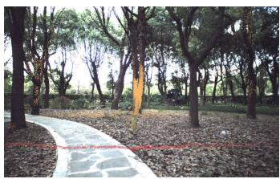  
(f) LD

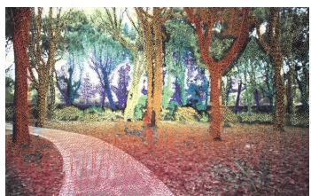  
(g) Visibility estimation (0.7)

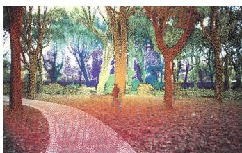  
(h) LDGVSF(0.7)

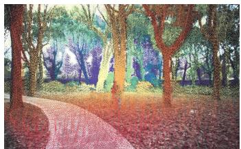  
(i) AHPR(5%)

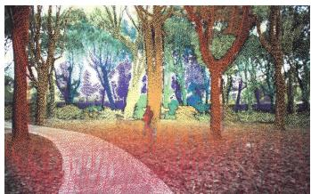  
(j) AHPR(5%)+LDGVSF(0.7)

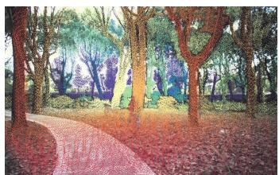  
(k) AHPR(5%)+LDGVSF(0.7)+LD  
Fig. 10. Qualitative comparison of visible-depth projections generated from Livox LiDAR data for BotanicGarden sequence 1018-13. Panel (a) shows the right-view RGB image; panels (b)–(k) show the projections generated by the selected comparison and proposed methods.

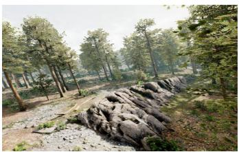  
(a) Right-view RGB image

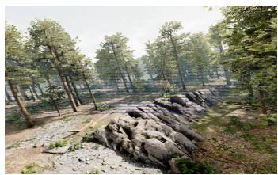  
(b) Single scan (left view)

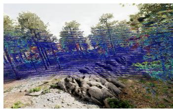  
(c) Cumulation (right view, baseline)

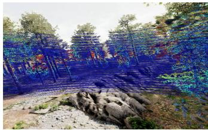  
(d) Cumulation+CS

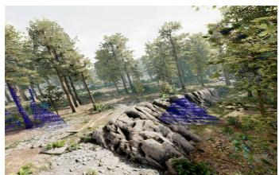  
(e) PSR

  
(f) SGM

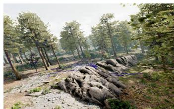  
(g) LD

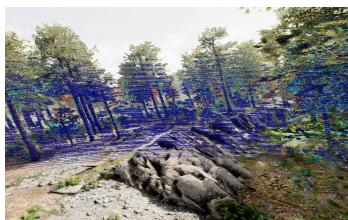  
(h) Visibility estimation (0.7)

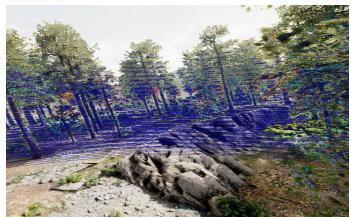  
(i) LDGVSF(0.7)

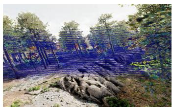  
(j) AHPR(10%)

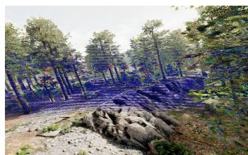  
(k) AHPR(5%)+LDGVSF(0.7)

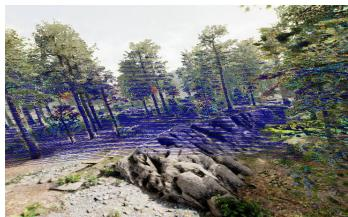  
(l) AHPR(5%)+LDGVSF(0.7)+LD  
Fig. 11. Reference image and per-pixel depth-error maps for the TartanAirV2 forest scene. Panel (a) shows the right-view RGB image, and panel (b) shows the aligned left-view single-scan error. Panels (c)–(l) show the right-view errors for the ten projections in Fig. 6(c)–(l), in the same order. Errors are displayed with a jet color map (blue: low error; red: high error).

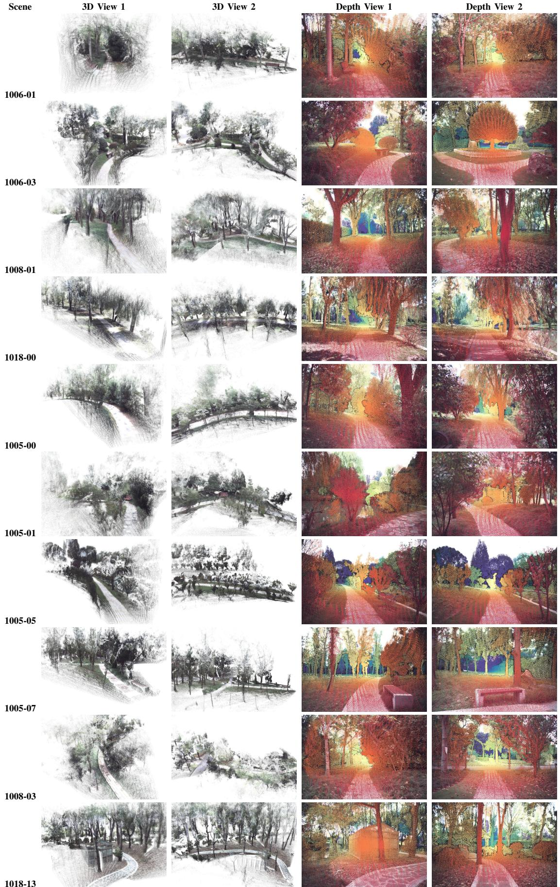  
Fig. 12. Reference outputs for the ten BotanicGarden benchmark sequences. Columns 1–2 show two 3D views of the colorized reference point clouds; columns 3–4 show two colorized reference depth.