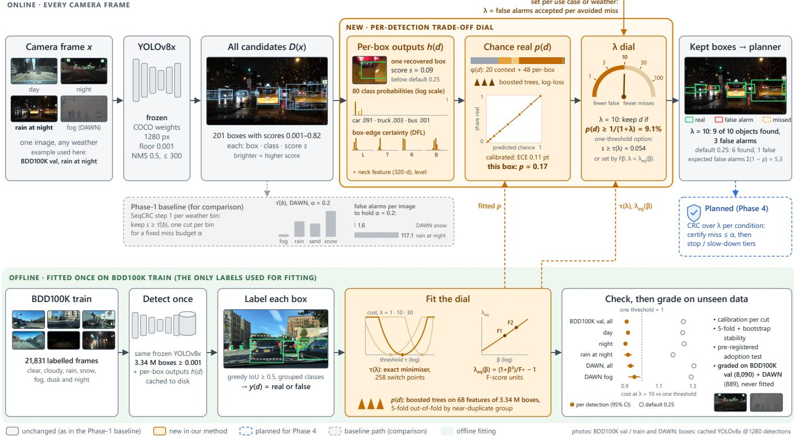
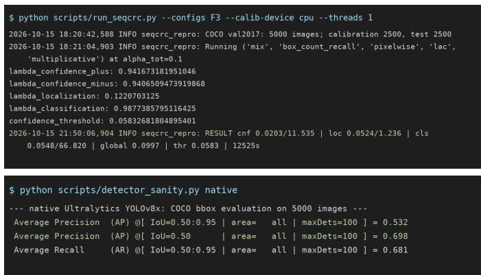

# Weather Adaptive Autonomous Driving

Nicholas Taylor

Alexander Picon´

Sudip Dhakal

Dept. of Computing and

Dept. of Computing and

Dept. of Computing and

Software Engineering

Software Engineering

Software Engineering

Florida Gulf Coast University

Florida Gulf Coast University

Florida Gulf Coast University

Fort Myers, FL, USA

Fort Myers, FL, USA

ngtaylor7853@eagle.fgcu.edu

Fort Myers, FL, USA

aspicon5797@eagle.fgcu.edu

sdhakal@fgcu.edu

Abstract—Camera object detectors lose recall in rain, fog, snow and sand, and the confidence threshold at which a detector is deployed decides how many objects it misses and how many false alarms it raises. We study how a frozen detector should make this decision in adverse weather. We first reproduce SeqCRC, a conformal object detector whose first step calibrates the confidence threshold by conformal risk control (CRC), and use that step, calibrated separately in each weather condition, as our baseline. With YOLOv8x it keeps the held-out miss fraction within a 20% budget in every DAWN weather bin, where a single global threshold fails in fog, but the false alarms it needs are an output rather than a choice: from 1.6 to 117 per image across DAWN and BDD100K conditions. We then propose a calibrated trade-off dial. One setting, λ, the number of false alarms accepted to avoid one missed object, selects the expectedcost-optimal decision rule: either one score threshold, or a perdetection rule that keeps a box when its calibrated probability of being a real object, estimated by gradient-boosted trees from the detector’s own per-box outputs, is at least 1/(1 + λ). F-score preferences map onto the same dial, and CRC applied to λ itself is planned to restore a per-condition miss guarantee. The dial is fitted once on BDD100K train and graded only on BDD100K val and DAWN.

Index Terms—autonomous driving, adverse weather, object detection, conformal risk control, calibration

## I. INTRODUCTION

Autonomous vehicles must detect objects reliably when rain, fog, snow, sand, glare, and low light alter the camera image. A detector can lose recall under these conditions even when its architecture and confidence scores remain unchanged. Lowering a fixed confidence threshold may recover detections, but it can also produce an unacceptable number of false alarms. The two errors do not cost the same: a false alarm may cost an unnecessary slowdown, whereas a missed pedestrian or vehicle can cost a collision, and a miss leaves no trace at run time.

Most adverse-weather detection research retrains the detector and reports AP or mAP, which integrate over score thresholds and leave the deployed operating point unstated [1]– [4]. Conformal methods bound what a detector misses at its operating point [5], [6], but they assume that calibration and test images are exchangeable, which persistent weather breaks, and outside medicine [7] they do not report the false positives that a recall guarantee costs.

This work asks whether a frozen camera detector can be wrapped with a decision rule that adapts this trade-off while providing a finite-sample miss-rate control. We first use a perweather conformal risk control (CRC) threshold, the first step of SeqCRC [6] calibrated separately in each weather condition, as a baseline. It meets its miss budget in every weather bin, but its price ranges from 1.6 to 117 false alarms per image, and nothing lets a user choose that price. We therefore propose a calibrated per-detection trade-off dial, in which the price is the input. So far, this work makes the following contributions:

• Reproduction. We reproduce SeqCRC with its official code on COCO with YOLOv8x and trace its main discrepancy, localization sets smaller than reported, most likely to how the official YOLO wrapper rescales boxes when images are batched (Section IV).

• Baseline and its price. Calibrated per weather bin, the CRC threshold holds a 20% miss budget in every DAWN weather bin, where one global threshold fails in fog, and restores the budget in every BDD100K night bin, at 1.6 to 117 false alarms per image (Section III-A).

• A calibrated trade-off dial. A single setting λ, the false alarms accepted per avoided miss, selects the expectedcost-optimal rule: one threshold, or a per-detection cut on a calibrated probability estimated from the frozen YOLOv8x’s own per-box outputs. $F _ { \beta }$ weights and a CRC miss budget map onto the same dial (Sections III-B– III-E).

• An evaluation plan on BDD100K val and DAWN, which are never used for fitting, with baselines, ablations and a compute budget (Section III-F).

Section II reviews related work and states the research gap. Section III describes the baseline, the proposed dial, its architecture, algorithms and design choices, and the experiment plan. Section IV gives the experimental setup and the reproduction of the baseline, and Appendix A lists the reproduction issues and their fixes.

## II. RELATED WORK

Our project asks whether a confidence threshold chosen per weather condition can recover the recall that a fixed camera detector loses in adverse weather, with a finite-sample bound on the expected fraction of missed objects and a stated falsepositive cost. Four lines of work bear on this question: methods and benchmarks that make detection robust to weather, studies of how detectors’ confidences and operating thresholds behave under shift, distribution-free guarantees for detection, and risk control under shift or within groups. Table I lists the method, input, data, headline result and main limitation of each paper we discuss.

## A. Weather-Robust Detection and How It Is Measured

Most adverse-weather detection research changes the detector or its input [1]–[4]. Sakaridis et al. [1] render homogeneous fog onto clear Cityscapes images with the Koschmieder model, creating Foggy Cityscapes. Domain-adaptive detectors use such synthetic fog without target labels: DA Faster R-CNN [2] aligns image- and instance-level features adversarially, while Li et al. [3] add hardness weighting and a triplet loss for synthetic rain. Image-adaptive YOLO [4] instead predicts differentiable defogging, colour, tone, and sharpening filters jointly with YOLOv3. These methods improve detection on their target benchmarks, but their results depend on retraining and are usually reported as AP or mAP rather than at a specified deployment threshold. Real adverse-weather test sets also remain relatively small: Foggy Driving has 101 real images [1], and DAWN [8] contains real traffic images in fog, rain, snow and sand. The paper that introduces DAWN also proposes a visibility-enhancement front end, a multi-scale CNN detector and a GM-PHD tracker, compared with 21 vehicle detectors; DAWN’s four subsets define our weather conditions.

The common limitation is that these methods retrain the network for a particular shift [1]–[4]. Because AP and mAP integrate over score thresholds, they do not directly state the miss rate or false-positive cost at a deployed operating point. Each method therefore yields a detector that still needs an operating point, which makes this line complementary to ours.

## B. Confidence, Calibration and Operating Thresholds

A second line studies whether detector scores can be trusted and where to cut them. Oksuz et al. [9] argue that a deployed detector must be judged at its operating threshold and build a self-aware detector whose class-wise thresholds are tuned on in-distribution validation data. Trained on nuImages and tested on BDD45K, their Faster R-CNN variant errs mostly by missing objects at the selected operating point. Kuzucu et al. [10] show that common protocols score calibration and accuracy on different detection sets, and evaluate both on the thresholded detections a system would deploy. On Foggy Cityscapes, isotonic regression improves localizationaware calibration, yet fog still degrades localization performance. Read together, the two studies show that shift hurts a detector at its operating point, mainly through misses [9], and that recalibration can repair confidence while accuracy still falls [10]. Yet both tune class-wise thresholds once on validation data from the training distribution and carry them to shifted test data, so neither guarantees a miss rate in the shifted condition.

## C. Distribution-Free Guarantees for Detection

Conformal risk control (CRC) [5] chooses the least conservative value of a scalar parameter whose corrected calibration risk is at most a budget α; for exchangeable data and a bounded loss that is non-increasing in the parameter and within budget at its most permissive value, the expected test loss is then at most α. Conformal methods for detection differ mainly in which quantity they calibrate, and that choice decides whether objects the detector never finds are covered. Andeol´ et al. [11] calibrate box margins for railway-signal detection at a fixed objectness threshold of 0.3, with image-wise recall losses that need far smaller margins than a Hausdorff-coverage baseline, and state that they do not consider false positives. Timans et al. [12] first build conformal class sets and then box intervals; their intervals approach the target coverage on COCO but only for objects detected above a fixed score. AR-CP [13] is the one conformal method we found aimed at adverse driving conditions: it builds class prediction sets for agents detected on the ROAD dataset and replaces large sets by their common parent class for an augmented-reality display, with coverage reported over all conditions together. SeqCRC [6] calibrates the confidence threshold itself and then the box and class sets, so that undetected objects enter the guaranteed quantity, but it does not bound a false-positive quantity. Outside driving, Hulsman et al. [7] apply singleparameter CRC to the score threshold of a frozen 3-D lungnodule detector with a per-scan false-negative-rate loss and report the corresponding false-positive price, which varies substantially across annotation-consensus subsets.

Across this line, a guarantee counts missed objects only when the confidence threshold itself is calibrated with a recalltype loss [6], [7], or when boxes at a fixed threshold are enlarged until they cover them, which fails on images without any detection: the railway budget is unattainable for two of its three pretrained detectors [11]. Coverage of matched detections [12], [13] ignores missed objects altogether. All of these studies assume that calibration and test images are exchangeable, splitting the pool at most by object class [12]. The closest to per-condition calibration is the separate calibration of each annotation-consensus subset in [7], but these subsets are nested label definitions, not deployment conditions. That study is also the only one to report false positives at its guaranteed recall; SeqCRC reports only how many boxes it keeps.

## D. Risk Control Under Shift and Within Groups

Weather persists for minutes and may be rare in a calibration mix, so the test condition is not a random draw from the pool. Under arbitrary shift, the CRC bound loosens by the loss bound B times the summed total-variation distance between calibration and test distributions [5]. Non-exchangeable CRC [14] down-weights calibration points believed to be far from the test point and improves control under synthetic changepoints, but the total-variation penalty in its bound is unknown in practice, so the weights are heuristics. Blot et al. [15] keep exchangeability but recast CRC as an optimization over a class of functions of the input, which yields risk control within each group when the class is spanned by group indicators; with a learned embedding they meet a segmentation recall target at higher precision than marginal CRC. The two routes differ in what they need: weighting leaves an unknown total-variation term in its bound, whereas group conditioning needs only a group label for each image, which DAWN’s weather subsets supply. Neither has been applied to the confidence threshold of an object detector under weather.

TABLE I  
RELATED WORK AT A GLANCE (ONE ROW PER PAPER; AP AND MAP AS DEFINED IN EACH PAPER).
<table><tr><td>Paper</td><td>Method</td><td>Sensor / input</td><td>Dataset</td><td>Key result</td><td>Limitation</td></tr><tr><td colspan="6">Weather-robust detection and benchmarks</td></tr><tr><td>Sakaridis [1], IJCV&#x27;18</td><td>Physics-based synthetic fog; fog fine-tuning</td><td>RGB camera</td><td>Foggy Cityscapes; Foggy Driving (101 real)</td><td>Car AP 30.5→35.3 on 33 finely annotated real images</td><td>Homogeneous daytime fog; tiny real test set</td></tr><tr><td>Hassaballah [8], T-ITS&#x27;21</td><td>Visibility enhancement + multi-scale CNN + GM-PHD tracker; introduces DAWN</td><td>RGB camera</td><td>DAWN (fog, rain, snow, sand), KITTI, COCO</td><td>Reported to outperform 21 compared vehicle detectors</td><td>Small real-image set (1,027 released images); no official splits</td></tr><tr><td>Chen [2], CVPR’18</td><td>Adversarial image + instance alignment (DA Faster R-CNN)</td><td>RGB camera</td><td>Cityscapes→Foggy Cityscapes; SIM10k; KITTI</td><td>Foggy mAP@0.5 18.8→27.6</td><td>Retrains per shift; synthetic fog; AP/mAP only, no operating point</td></tr><tr><td>Li [3], WACV&#x27;23</td><td>Hardness-weighted GRL + rainy-domain triplet loss (DA-Detect)</td><td>RGB camera</td><td>Cityscapes→Foggy Cityscapes; KITTI</td><td>Foggy mAP@0.5 23.41→42.34 (oracle 45.6)</td><td>Synthetic fog only; 3.5-pt hyperparameter swing; no operating point</td></tr><tr><td>Liu [4], AAAI&#x27;22</td><td>CNN-predicted differentiable filters before YOLOv3</td><td>RGB camera</td><td>VOC-Foggy/Dark; RTTS; ExDark</td><td>RTTS mAP 28.82→37.08 (30.80 for same-data YOLOv3)</td><td>Retrains detector; mAP only</td></tr><tr><td colspan="6">Confidence calibration and operating thresholds</td></tr><tr><td>Oksuz [9], CVPR&#x27;23</td><td>Self-aware detector: image rejection, calibration, LRP-optimal thresholds</td><td>RGB camera</td><td>nuImages→BDD45K, BDD45K-C</td><td>BDD45K (F-RCNN, IoU 0.1): 1—recall 58.1%, 1—precision 13.2%</td><td>Val-tuned thresholds, no guarantee; weather pooled</td></tr><tr><td>Kuzucu [10], ECCV&#x27;24</td><td>Calibration and accuracy on the thresholded set; Platt/isotonic baselines</td><td>RGB camera</td><td>COCO, Cityscapes, LVIS; corrupted, Foggy</td><td>Foggy Cityscapes LaECE0 18.5→10.0 (isotonic)</td><td>In-distribution thresholds reused under shift; no guarantee</td></tr><tr><td colspan="6">Distribution-free guarantees for detection</td></tr><tr><td>Angelopoulos [5], ICLR&#x27;24</td><td>CRC: scalar parameter bounding expected monotone loss</td><td>Any model&#x27;s scores</td><td>Polyps, COCO, ImageNet, NQ</td><td>COCO mean FNR 0.0996 at α=0.1 (1,000 splits)</td><td>Marginal only; shift needs weights or TV slack</td></tr><tr><td>Andéol [11], COPA&#x27;23</td><td>Conformal box margins; image-wise recall CRC</td><td>RGB cab-view camera</td><td>Railway signals, 3,414 images</td><td>DiffusionDet stretch 1.56 (pixel CRC) vs. 9.83 (Hausdorff CP), risk 0.09</td><td>Fixed 0.3 threshold; ignores false positives</td></tr><tr><td>Timans [12], ECCV’24</td><td>Two-step CP: class sets, then box intervals</td><td>Detector outputs</td><td>COCO, Cityscapes,</td><td>COCO box coverage 0.88 (target 0.9) vs. 0.21 deep ensemble</td><td>Detected objects only; misses uncovered</td></tr><tr><td>Doula [13],</td><td>Conformal class sets for</td><td>(RGB) RGB camera</td><td>BDD100K ROAD; user study</td><td>APS set size 6.16→1.00 at</td><td>Classes of detected agents only;</td></tr><tr><td>CVPRW&#x27;24</td><td>detected agents; taxonomy parent for AR display</td><td>video</td><td>(ROAD, Seeing Through Fog, Gated2Gated)</td><td>coverage 0.90 (α=0.1)</td><td>coverage pooled over conditions</td></tr><tr><td>Andéol [6], arXiv&#x27;25</td><td>Sequential CRC: confidence threshold, then box/class sets</td><td>Detector outputs (RGB)</td><td>COCO val (2,500 cal./2,500 test)</td><td>YOLOv8x box-count-recall risk 0.019 (αcnf=0.02), 11.7 boxes/img</td><td>False positives not bounded; i.i.d. COCO only</td></tr><tr><td>Hulsman [7], COPA&#x27;25</td><td>CRC on a frozen detector&#x27;s score threshold; per-scan miss-rate loss</td><td>3-D thoracic CT</td><td>LIDC-IDRI, four reader-consensus subsets</td><td>≥3 readers: 91.35% sensitivity at 2.25 FP/scan (α=0.1)</td><td>Exchangeability assumed; 118 FP/scan on low-consensus set</td></tr><tr><td colspan="6">Risk control under shift and within groups</td></tr><tr><td>Farinhas [14],</td><td>Weighted CRC with</td><td>Any model&#x27;s</td><td>Synthetic time series; ELEC2; NQ</td><td>FNR 0.246→0.196 at α=0.2 (changepoints)</td><td>TV penalty unknown; no detection</td></tr><tr><td>ICLR&#x27;24 Blot [15],</td><td>total-variation penalty CRC conditional on a function</td><td>scores Any model&#x27;s</td><td>Polyp and fire</td><td>Polyp recall 0.906 (target 0.9);</td><td>Assumes exchangeability; no</td></tr><tr><td>AISTATS’25</td><td>class (incl. group indicators)</td><td>scores (images)</td><td>segmentation; simulated regression</td><td>precision 0.395→0.457</td><td>detection or weather shift</td></tr></table>

## E. Research Gap

Prior work leaves three gaps. First, weather-robust detectors [1]–[4] improve AP or mAP but leave the operating point and its miss rate unstated, and threshold-selection studies [9], [10] tune class-wise thresholds on in-distribution data without a guarantee. Second, conformal detection methods [6], [11]– [13] calibrate under an exchangeability assumption, at most split by object class, and, except in medicine [7], do not report how many false positives a recall guarantee costs; the one study in adverse driving conditions covers only the classes of objects already detected [13]. Third, group-conditional risk control has been developed [15], but to our knowledge it has not been used to calibrate a frozen camera detector’s confidence threshold per weather condition.

Our work addresses all three. We keep a COCO-pretrained YOLOv8 detector fixed. As a baseline, we apply CRC separately in each weather condition of DAWN with an IoU- and class-matched per-image miss loss, compare these thresholds with one pooled threshold, report the false positives per image at every budget, and flag budgets that no threshold can certify because some objects are never detected. We then make the false-positive price an input rather than an output: one setting λ, the number of false alarms accepted per avoided miss, selects the expected-cost-optimal rule, either one threshold or a per-detection cut on a calibrated probability that each box is real, and conformal risk control applied to λ itself (planned) restores a per-condition miss guarantee. Unlike perception-side methods, our approach needs no retraining and can wrap any of them; unlike prior conformal detection, its guarantee is stated per weather condition and comes with its false-positive price.

## III. METHODOLOGY

## A. Baseline: per-weather conformal threshold (Phase 1)

Our baseline is the first step of SeqCRC [6]: conformal risk control (CRC) [5] on the confidence threshold of a frozen detector, with an image-level loss $L _ { i } ( \tau )$ , the fraction of ground-truth objects in calibration image i with no matched detection scoring at least τ . Calibrated separately in each weather bin b with n calibration images and mean calibration loss $\begin{array} { r } { \hat { R } ( \tau ; b ) = \frac { 1 } { n } \sum _ { i = 1 } ^ { n } L _ { i } ( \tau ) } \end{array}$ , the threshold is

$$
\begin{array} { r } { \hat { \tau } ( b ) \ = \ \operatorname* { m a x } \Big \{ \tau \ : \ \frac { n } { n + 1 } \hat { R } ( \tau ; b ) + \frac { 1 } { n + 1 } \le \alpha \Big \} , } \end{array}\tag{1}
$$

which bounds the expected miss fraction of an exchangeable test image from the same bin by α. In Phase 1 we reproduced SeqCRC with its official code on COCO, where the global test risk stayed within its budget in every configuration we ran (see Section IV for our Phase 1 report), and ran it on DAWN [16]. Our harness implements Eq. (1) per weather bin on YOLOv8x [17]. With $\alpha \ = \ 0 . 2$ on DAWN, the per-bin threshold keeps the held-out miss fraction at 0.188–0.194 in every bin, at 1.6–6.2 false positives per image (FPPI), while one global threshold misses 0.251 in fog (above α in 98% of 200 splits). On BDD100K [18], a threshold calibrated on clear days misses 0.28–0.36 at night; per-bin thresholds restore the budget at 43–117 FPPI.

a) Limitation (the gap): The baseline fixes the miss budget and lets the false alarms be whatever results: at night it buys $\alpha = 0 . 2$ with up to 117 false alarms per image, and there is no way to ask for a different balance. It applies one score cut to every box, it needs the weather bin at run time (our camera-only weather estimators did not isolate fog), and its guarantee assumes exchangeable data within each bin.

## B. Proposed method: a calibrated trade-off dial

Core idea. Instead of one confidence threshold per weather bin, every detection receives a calibrated probability $p ( d )$ that it is a real object, computed from the frozen detector’s own outputs, and is kept if and only if $p ( d ) \geq 1 / ( 1 + \lambda )$ . The single user-facing parameter $\lambda ,$ the number of false alarms accepted to avoid one missed object, sets the trade-off for the use case. An F-score weight $\beta$ (and, in Phase 4, a CRC miss budget α) maps onto the same dial.

Table II lists what changes relative to the baseline. The detector, data, matching rule and evaluation protocol stay the same; only the decision of which boxes to keep is replaced.

## C. Architecture

Figure 1 shows the full pipeline. Online, YOLOv8x runs once per camera frame and returns candidate boxes $D ( x )$ with class and score s. We also keep the detector’s perbox outputs $h ( d )$ at the anchor each box came from: the 80 class probabilities, the four distribution-focal-loss (DFL) distributions over the box sides [19], the neck feature vector, and the pyramid level. A feature builder forms $\varphi ( d )$ : 20 context features (score, class, size and position, rank, overlap with stronger boxes, crowding) plus 48 per-box features (six class probabilities, strongest other class, top-two margin, sum and entropy of the probabilities, DFL entropy per side and mean, level, and 32 principal components of the neck feature). A gradient-boosted model maps $\varphi ( d )$ to $p ( d )$ , and the dial keeps or drops each box. Offline, the same frozen detector is run once over BDD100K train, boxes are labelled by matching, and the dial is fitted, checked and then graded on data never used for fitting.

TABLE II  
WHAT OUR METHOD KEEPS, REPLACES AND ADDS RELATIVE TO THE PHASE-1 BASELINE.
<table><tr><td></td><td>Baseline (SeqCRC step 1 per weather bin)</td><td>Ours (trade-off dial)</td></tr><tr><td>Detector</td><td>YOLOv8x, frozen COCO weights, 1280 px, score floor 0.001</td><td>unchanged</td></tr><tr><td>Decision rule</td><td>one score threshold per weather bin,  $s \geq \hat { \tau } ( \bar { b } )$ </td><td>per detection,  $\begin{array} { r } { \dot { p } ( d ) \geq 1 / ( 1 + \lambda ) ; } \end{array}$  simple option: one threshold  $s \geq \tau ( \lambda )$ </td></tr><tr><td>Trade-off</td><td>fixed miss budget α; false alarms unpriced</td><td>explicit input λ (or β); α planned as a floor via CRC over λ</td></tr><tr><td>Run-time inputs</td><td>score and the weather bin</td><td>score, box context and the detector&#x27;s per-box outputs (no weather label)</td></tr><tr><td>Fitting</td><td>calibration half of each bin</td><td>once, on 21,831 labelled BDD100K train frames</td></tr><tr><td>Added</td><td></td><td>per-box feature tap; calibrated model;  $\beta  \lambda$  map; label-free estimate of</td></tr></table>

## D. Algorithm

a) Cost: For a keep rule k over the detections of image x, let $M _ { k } ( x )$ be the number of ground-truth objects left without a kept matched box and $F _ { k } ( x )$ the number of kept boxes that match no object. The dial setting $\lambda > 0$ defines the cost

$$
C _ { \lambda } ( k ) = \sum _ { x } \left[ \lambda M _ { k } ( x ) + F _ { k } ( x ) \right] .\tag{2}
$$

b) Option A: one threshold: $k ( d ) = \mathbf { 1 } [ s ( d ) \geq \tau ( \lambda ) ]$ with

$$
\tau ( \lambda ) = \arg \operatorname* { m i n } _ { \tau } \sum _ { x \in \mathcal { D } _ { \mathrm { t r a i n } } } \left[ \lambda M _ { \tau } ( x ) + F _ { \tau } ( x ) \right] .\tag{3}
$$

Greedy non-maximum suppression and greedy matching are both score-ordered, so filtering one detector run at τ equals running the detector at τ. Equation (3) is therefore solved exactly from cumulative counts: the minimisers for all λ are the corners of the lower convex hull of (real kept, false kept), stored as 258 switch points.

c) Option B: per detection: Keeping a box with probability p of being real costs an expected $1 - p$ false alarms; dropping it costs an expected $\lambda p$ in misses. The cost-optimal rule is therefore [20]

$$
\ker d \iff 1 - p ( d ) \leq \lambda p ( d ) \iff p ( d ) \geq { \frac { 1 } { 1 + \lambda } } ,\tag{4}
$$

  
Fig. 1. Architecture, following one BDD100K val frame (rain at night) through the online path. New components are orange, unchanged ones grey; the dashed grey lane is the Phase-1 baseline, kept for comparison, and the dashed blue box is planned for Phase 4. Fitting (green band) uses only BDD100K train; grading uses BDD100K val and DAWN.

which is optimal when p is calibrated. Because the kept set grows with λ, the miss count is non-increasing in λ. We estimate $p ( d ) = \sigma { \bigl ( } g ( \varphi ( d ) ) { \bigr ) }$ with gradient-boosted trees [21]– [23]. They are trained on all train detections by minimising the log-loss $\begin{array} { r } { \ell = - \sum _ { d } \left[ y _ { d } \log { p _ { d } } + ( 1 - y _ { d } ) \log ( 1 - p _ { d } ) \right] } \end{array}$ where $y _ { d } ~ \in ~ \{ 0 , 1 \}$ comes from greedy IoU-0.5 matching with grouped classes (vehicle, two-wheeler, person). We check calibration with the expected calibration error [24] and with the share of real boxes among detections near each cut $1 / ( 1 + \lambda )$

d) F-score units: With calibrated probabilities, the $F _ { \beta ^ { - } }$ optimal cut is $F _ { \beta } ^ { * } / ( 1 + \beta ^ { 2 } )$ , where $F _ { \beta } ^ { * }$ is the best achievable $F _ { \beta }$ [25], [26]. Setting this cut equal to $1 / ( 1 + \lambda )$ gives the equivalent dial setting

$$
\lambda _ { \mathrm { e q } } ( \beta ) = \frac { 1 + \beta ^ { 2 } } { F _ { \beta } ^ { * } } - 1 ,\tag{5}
$$

with $F _ { \beta } ^ { * }$ measured on train for each option. For example, $F _ { 1 }$ corresponds to $\lambda \approx 1 . 8$ and $F _ { 2 }$ to $\lambda \approx 6 . 2$ with the perdetection option.

e) Planned: a miss budget on top of the dial (CRC over λ): Because the image-level miss fraction $L _ { i } ( \lambda )$ is nonincreasing in λ, the baseline’s rule (1) applies to λ itself. Per condition c with $n _ { c }$ calibration images,

$$
\begin{array} { r } { \hat { \lambda } _ { c } = \operatorname* { i n f } \Big \{ \lambda : \frac { n _ { c } } { n _ { c } + 1 } \hat { R } _ { c } ( \lambda ) + \frac { 1 } { n _ { c } + 1 } \le \alpha \Big \} , } \end{array}\tag{6}
$$

and deploying $\operatorname* { m a x } ( \lambda _ { \mathrm { u s e r } } , \hat { \lambda } _ { c } )$ keeps the CRC guarantee $\mathbb { E } [ L _ { \mathrm { t e s t } } ] \le \alpha$ under exchangeability within the condition, while never being less cautious than the user asked. The fit is infeasible when α is below the miss fraction at the score floor (11–18% of objects are never detected).

## E. Design choices

Table III gives each design choice, the reason for it, and the alternatives we tried or considered. Most of the alternatives were run in the harness, several under pre-registered criteria.

## F. Experiment plan (Phase 4)

a) Data and splits: The dial is fitted on 21,831 BDD100K train frames (3.34 M detections), with 5-fold outof-fold estimates grouped by near-duplicate group. It is graded on BDD100K val (8,090 frames in seven weather-by-time bins) and on DAWN (889 frames with clean labels: fog 256, rain 187, sand 243, snow 203). Neither set is used for any choice. For CRC over λ we use 200 random calibration/test halves per condition, keeping near-duplicate groups together, as in the baseline runs.

b) Metrics: The main metric is the cost $C _ { \lambda }$ relative to one threshold, with 95% image-bootstrap intervals [27]. We also report recall, precision and false alarms per image at $\lambda \in \{ 1 , 3 , 1 0 , 3 0 , 1 0 0 \} ; F _ { \beta } \mathrm { ~ a t ~ } \beta \in \{ 0 . 5 , 1 , 2 \}$ against no tuning and the best in-sample constant; and calibration (expected calibration error, share real near each cut). For CRC over λ we report the held-out miss fraction against α (share of splits above), its price in false alarms per image, and the smallest certifiable α.

TABLE III  
DESIGN CHOICES, THE REASONS FOR THEM, AND THE ALTERNATIVES CONSIDERED (WITH THE EVIDENCE).
<table><tr><td>Choice</td><td>Why</td><td>Alternatives considered</td></tr><tr><td>Keep the detector frozen; decide after it</td><td>calibration stays valid; one detector run serves every setting; no retraining per condition</td><td>domain adaptation (DA-Detect: 20.41 vs 21.44 AP@50 on real DAWN fog in Phase 1); fine-tuning (invalidates every calibration)</td></tr><tr><td>Trade-off as λ, false alarms per avoided miss</td><td>use case sets the balance; the optimal rule is explicit  $( \operatorname { E q } . 4 ) ; \beta$  and α map onto it</td><td>fixed α only (baseline, false alarms unpriced); maximise  $F _ { 1 }$  (one fixed balance); FPPI cap</td></tr><tr><td>Decide per detection</td><td>87–91% of a per-image oracle&#x27;s advantage on BDD100K is chance; the learnable signal is in individual boxes</td><td>per-image thresholds from pixels, from the confidence profile, or from YOLOv8x image features (all failed pre-registered tests); box-combination</td></tr><tr><td>One threshold kept as the simple option</td><td>one auditable number per λ; per-weather thresholds give no gain (0.98–1.03× the cost)</td><td>rules; summed-confidence maps per-weather thresholds (the baseline&#x27;s form)</td></tr><tr><td>Gradient-boosted trees on detector outputs</td><td>tabular inputs; trains in minutes on CPU; calibrated without post-hoc scaling (expected calibration error</td><td>recalibrating the score alone (this is Option A); a neural head; retraining YOLOv8x&#x27;s head</td></tr><tr><td>YOLOv8x&#x27;s own per-box</td><td>0.11 points on BDD100K val) pre-registered gain: cost 0.972× (0.969–0.975) of the context-only model on BDD100K, not worse on</td><td>context features only (model 1); a separate CNN on</td></tr><tr><td>outputs as features One model for every  $\beta$ </td><td>DAWN (0.995) theory: only the cut moves with β; dedicated</td><td>box crops (more compute) one cost-weighted model per  $\beta$ </td></tr><tr><td>Fit on BDD100K train;</td><td>β-weighted models tie (0.997–1.001×) nothing is chosen on graded data; DAWN tests</td><td>calibrating on halves of the test pool (the baseline</td></tr><tr><td>grade on BDD100K val and DAWN</td><td>transfer to real fog, rain, sand and snow</td><td>protocol)</td></tr><tr><td>Grouped classes in matching</td><td>car/truck confusions are not safety misses</td><td>class-aware matching (run 1)</td></tr></table>

Algorithm 1 Fitting the dial (offline, BDD100K train only) Algorithm 2 Applying the dial (online, every camera frame)   
Require: labelled train frames $\mathcal { D } _ { \mathrm { t r a i n } } ;$ frozen detector $\overline { { f } }$ Require: frame x; setting λ (or $\beta ) ;$ option $\mathbf { \epsilon } \in \{ \mathbf { A } , \mathbf { B } \}$   
1: for all $x \in \mathcal { D } _ { \operatorname { t r a i n } }$ do 1: if β is given then   
2: $( D ( x ) , h ) \ \gets \ f ( x )$ {floor 0.001, NMS 0.5, ≤ 300 2: $\lambda  \lambda _ { \mathrm { e q } } ( \beta )$ {F-score map}   
boxes; keep per-box outputs} 3: end if   
3: $y ( d )  \mathrm { g r e e d y }$ IoU $\geq 0 . 5$ match of $d \in D ( x )$ to labels 4: if a budget α is certified for condition c then   
{grouped classes} $\begin{array} { r l } { 5 \colon } & { { } \lambda  \operatorname* { m a x } ( \lambda , \hat { \lambda } _ { c } ) } \end{array}$ {planned: CRC over λ}   
4: end for 6: end if   
5: Option A: sort scores; keep ends of equal-score blocks; 7: $( D , h )  f ( x )$ {one detector pass}   
cumulative real and false counts 8: for all $d \in D$ do   
6: τ (·) ← corners of the lower convex hull {all λ at 9: if option A then   
once} 10: keep d iff $s ( d ) \geq \tau ( \lambda )$   
7: Option B: $\varphi ( d ) \ \gets$ [context(d, D(x)), per-box(h(d))] 11: else   
{PCA fitted on train} 12: $p ( d ) \gets \sigma ( g ( \varphi ( d ) ) ) \colon$ ; keep d iff $p ( d ) \geq 1 / ( 1 + \lambda )$   
8: g ← gradient boosting on $\{ ( \varphi ( d ) , y ( d ) ) \}$ {log-loss} {cost-optimal cut}   
9: p ← 5-fold out-of-fold probabilities, folds by near- 13: end if   
duplicate group 14: end for   
10: for all β do 15: $\begin{array} { r } { \widehat { \mathrm { F A } } \gets \sum _ { d \mathrm { k e p t } } ( 1 - p ( d ) ) } \end{array}$ {expected false alarms, no labels   
11: $\lambda _ { \mathrm { e q } } ( \beta )  ( 1 + \beta ^ { 2 } ) / F _ { \beta } ^ { \ast } - 1$ {F-score map, $F _ { \beta } ^ { * }$ on train} needed}   
12: end for 16:   
13: check calibration near every cut 1/(1 + λ) and fold 17: return kept detections, $\widehat { \mathrm { F A } }$   
stability; adopt only if the pre-registered criteria hold   
14:   
15: return τ (·), g (with PCA), $\lambda _ { \mathrm { e q } } ( \cdot )$

c) Baselines: (i) No tuning (τ = 0.25, the Ultralytics default). (ii) One global CRC threshold. (iii) The per-weather CRC threshold, Eq. (1) (Phase-1 baseline). (iv) Option A, the one-threshold dial. (v) The context-only per-detection model. As reference bounds that no deployable rule can reach, we also report the best constant threshold chosen in-sample per condition and the per-frame hindsight best.

d) Ablations: (a) Retraining without each feature group: class probabilities, neck components, DFL entropy, level, context. (b) Per-condition recalibration, which targets the understated probabilities in DAWN fog (17% real at the 9.1% cut). (c) Training-set size: 25, 50 and 100% of frames. (d) Detector size and input resolution: YOLOv8x at 640 versus 1280, and YOLOv8s. (e) CRC over λ versus CRC over τ at equal α. Already completed: model 1 versus model 2, per-weather thresholds, and dedicated β models.

e) Compute: Measured on our laptop GPU (RTX 3050 Ti, 4 GB):

• YOLOv8x at 1280 px takes 0.15–0.17 s per frame;

• extracting per-box outputs for all 30.9k frames takes about 85 minutes;

• fitting the per-detection model takes about 11 minutes on the CPU;

• the CRC splits take minutes on the CPU.

We will use an NRP A100 for the new detector passes in ablation (d) and for the repeated fits in (a)–(c). At an estimated ≥ 10× the laptop’s throughput, these take a few GPU-hours in total. The laptop remains a fallback for every step.

## IV. EXPERIMENTAL SETUP AND BASELINE REPRODUCTION

Before building the dial we reproduced its baseline, SeqCRC [6], on its own benchmark: a COCO-pretrained YOLOv8x [17] calibrated on MS-COCO [28], with the authors’ official code (cods, https://github.com/leoandeol/cods, commit 269ff11). SeqCRC trains nothing: its “training” is the calibration of three scalars on 2,500 images, and evaluation is on the other 2,500. Our repository, with the run scripts, logs, result files and a patch to cods, is https://github.com/ Nicholas55555/seqcrc-baseline.

## A. Setup

a) Hardware: A local laptop instead of a hosted GPU: an NVIDIA GeForce RTX 3050 Ti Laptop GPU (4 GB, driver 566.07, CUDA 12.7), an AMD Ryzen 7 4800H (8 cores), 32 GB RAM and Windows 11. Detection ran on the GPU (a one-off 390 s pass); calibration ran on the CPU. The weather experiments of Section III use the same laptop (Section III-F).

b) Software: Python 3.11.15 (uv), PyTorch 2.14.1 and torchvision 0.29.1 (CUDA 12.6 wheels), Ultralytics 8.4.177, NumPy 2.4.6, numba 0.68.0, pycocotools 2.0.11 and scikitlearn 1.9.1; cods 0.4 at commit 269ff11 plus our patch. The repository pins every version in requirements.txt.

c) Data: The full COCO val2017 set (5,000 images, SHA-256-checked): the first 2,500 images calibrate and the last 2,500 test, which is the official code’s unshuffled 50/50 split. A 300/300 subset (first 300 for calibration, next 300 for test) served for fast checks.

d) Protocol: As in the paper (its Sec. V-A): the official $\mathtt { y o l o v 8 x . p t }$ at Ultralytics’ default 640 px (the paper states neither), NMS IoU 0.5, confidence floor 10−3, total budget $\alpha _ { \mathrm { t o t } } = 0 . 1$ split as $( \alpha _ { \mathrm { c n f } } , \alpha _ { \mathrm { l o c } } , \alpha _ { \mathrm { c l s } } ) = ( 0 . 0 2 , 0 . 0 5 , 0 . 0 5 )$ , and mix-matching weight 0.25. The paper’s appendix (Table VII) reports 92 YOLOv8x configurations at this budget. We ran four of them in full (F1–F4), chosen to cover both confidence losses, the Hausdorff, LAC and Mix matchings, pixel-wise and box-wise localization losses, additive and multiplicative boxes, and APS and LAC class sets.

Table IV compares our runs with the paper. On the full 2,500/2,500 split the confidence and classification steps reproduce closely: the box-count-recall step keeps 11.53 boxes per image in F1 and F3 (paper 11.71) and the box-count-threshold step 18.02 in F2 and F4 (paper 18.86), and the class sets hold 40.6, 0.75, 66.8 and 38.3 classes in F1–F4 (paper 41.7, 0.72, 67.6 and 40.8). Test risks sit at or near their budgets, as in the paper: global risks are 0.085, 0.083, 0.0997 and 0.088 against the 0.1 budget (paper 0.082, 0.086, 0.098 and 0.078), and a few single-split task risks are slightly above theirs (at most 0.055 against 0.05), as is the paper’s own F3 classification risk (0.053). Localization is the exception: our stretches are smaller in every configuration (F1: 1.30 against 3.87; F3: 1.24 against 4.54; F4: 2.56 against 6.12), which Section IV-C traces to the batch size.

## B. Reproduction Results

## C. Discrepancies

a) Localization sets: Our localization sets are much smaller than reported for YOLOv8x, while the class sets and box-count-recall confidence sets are close. The likely cause is in the official YOLO wrapper (cods/od/models/yolo.py): it rescales the raw head output by the ratio of original to letterboxed image size and never removes the letterbox padding. With batch size 1 (our runs) Ultralytics pads each image only to a multiple of 32, so the error is small; with a batch of differently sized images it pads every image to 640 × 640 and the boxes land far from the objects. Table V shows the effect directly: the same wrapper scores 45.1 AP at batch 1 but 10.7 AP (AP75 1.4) at batch 8. Re-running F3 on the 300/300 subset with batch 8 raises the stretch from 1.24 to 4.70, close to the paper’s 4.54, while the confidence and class sets barely move (11.11 vs. 11.46 boxes, 66.1 vs. 65.7 classes). The paper’s best YOLOv8x stretches (3.87–5.45, its Table III) are also 3–4 times those of DETR-101 (1.04–1.55), whose wrapper rescales normalized boxes and is unaffected. The paper does not state its batch size, but the official tutorial notebook calls build\_predictions with batch\_size=12, so its YOLOv8x localization numbers were most likely produced with a batch size above 1. This rests on one configuration on 300/300 images; a full-size batch-8 run did not finish in time.

b) The detector itself: Through Ultralytics we measure 53.2 AP against the published 53.9 (Table ${ \mathrm { V } } ;$ we use predict() with per-image letterboxing and pycocotools, not val()). The boxes SeqCRC actually receives score 45.1: class-agnostic NMS at IoU 0.5 (the paper’s IoU; the cods NMS is class-agnostic) costs 1.6 AP, and the wrapper’s box rescaling (padding not removed, separate x and y scales, no clipping) costs the remaining 6.5. Its scores and classes are the same maximum sigmoid score and argmax that Ultralytics uses. We kept the official wrapper because the paper’s numbers come from it.

TABLE IV  
SEQCRC WITH YOLOV8X ON COCO VAL2017, $\alpha _ { \mathrm { T O T } } = 0 .$ 1: SET SIZE AND TEST RISK PER TASK (CONFIDENCE: BOXES PER IMAGE, BUDGET 0.02; LOCALIZATION: BOX STRETCH, BUDGET 0.05; CLASSIFICATION: CLASSES PER SET, BUDGET 0.05) AND GLOBAL RISK (BUDGET 0.1). PAPER: ITS APPENDIX TABLE VII. FULL: THE SAME 2,500/2,500 SPLIT AS THE PAPER’S CODE. 300/300: FIRST 300 IMAGES FOR CALIBRATION, NEXT 300 FOR TEST.
<table><tr><td rowspan="2"></td><td rowspan="2">Matching / conf. loss / loc. loss-set / class set</td><td rowspan="2">Source</td><td colspan="2">Confidence</td><td colspan="2">Localization</td><td colspan="2">Classification</td><td rowspan="2">Global</td></tr><tr><td>size</td><td>risk</td><td>size</td><td>risk</td><td>size</td><td>risk</td></tr><tr><td rowspan="4"></td><td rowspan="4">F1 Hausdorff / bc-recall / pixel-add / APS</td><td>Paper</td><td>11.71</td><td>0.019</td><td>3.87</td><td>0.049</td><td>41.73</td><td>0.043</td><td>0.082</td></tr><tr><td>Ours, full</td><td>11.53</td><td>0.020</td><td>1.30</td><td>0.053</td><td>40.64</td><td>0.042</td><td>0.085</td></tr><tr><td>Ours, 300/300</td><td>11.11</td><td>0.025</td><td>1.30</td><td>0.040</td><td>42.67</td><td>0.033</td><td>0.066</td></tr><tr><td>Paper</td><td>18.86</td><td>0.012</td><td>20.64</td><td>0.047</td><td>0.72</td><td>0.049</td><td>0.086</td></tr><tr><td rowspan="3"></td><td rowspan="3">F2 LAC / bc-thresh / pixel-add / LAC</td><td>Ours, full</td><td>18.02</td><td>0.015</td><td>17.69</td><td>0.047</td><td>0.75</td><td>0.046</td><td>0.083</td></tr><tr><td>Ours, 300/300</td><td>14.29</td><td>0.047</td><td>13.56</td><td>0.046</td><td>1.02</td><td>0.045</td><td>0.080</td></tr><tr><td>Paper</td><td>11.71</td><td>0.019</td><td>4.54</td><td>0.049</td><td>67.58</td><td>0.053</td><td>0.098</td></tr><tr><td rowspan="3">F3</td><td rowspan="3">Mix / bc-recall / pixel-mult / LAC</td><td>Ours, full</td><td>11.53</td><td>0.020</td><td>1.24</td><td>0.052</td><td>66.82</td><td>0.055</td><td>0.100</td></tr><tr><td>Ours, 300/300</td><td>11.11</td><td>0.025</td><td>1.24</td><td>0.038</td><td>66.06</td><td>0.061</td><td>0.093</td></tr><tr><td>Paper</td><td>18.86</td><td>0.012</td><td>6.12</td><td>0.043</td><td>40.75</td><td>0.042</td><td>0.078</td></tr><tr><td rowspan="2"></td><td rowspan="2">F4 Mix / bc-thresh / box-add / APS</td><td>Ours, full</td><td>18.02</td><td>0.015</td><td>2.56</td><td>0.053</td><td>38.28</td><td>0.043</td><td>0.088</td></tr><tr><td>Ours, 300/300</td><td>14.29</td><td>0.047</td><td>2.21</td><td>0.055</td><td>40.66</td><td>0.038</td><td>0.085</td></tr></table>

TABLE V

DETECTOR CHECK: COCO BOX AP OF YOLOV8X ON ALL 5,000 VAL2017 IMAGES (PYCOCOTOOLS).
<table><tr><td>Boxes scored</td><td>AP</td><td>AP50</td><td>AP75</td></tr><tr><td>Ultralytics model table (paper&#x27;s detector)</td><td>53.9</td><td>一</td><td></td></tr><tr><td>Ours: Ultralytics predict, NMS IoU 0.7 per class</td><td>53.2</td><td>69.8</td><td>58.0</td></tr><tr><td>Ours: Ultralytics predict, class-agnostic NMS 0.5</td><td>51.6</td><td>68.8</td><td>55.6</td></tr><tr><td>Ours: cods wrapper, batch 1 (SeqCRC input)</td><td>45.1</td><td>65.9</td><td>48.2</td></tr><tr><td>Ours: cods wrapper, batch 8</td><td>10.7</td><td>32.1</td><td>1.4</td></tr></table>

c) One split: The paper reports a single calibration/test draw, as we do. The guarantee holds in expectation over draws, so single-split risks may sit slightly above or below the budget; on 300 test images the fluctuations are larger (e.g., box-countthreshold risk 0.047 against 0.02).

d) Software drift: We ran the code at commit $2 6 9 \pounds \pounds 1 1$ (May 22, 2026; library code last changed Oct. 22, 2025) with Ultralytics 8.4.177; the paper’s runs used earlier versions, which it does not state. Our two speed patches changed no output: the mask selection is exact, and the float64 running sum moved calibration risks by about $2 \times 1 0 ^ { - 9 }$ , leaving every output of a 300/300 check identical (Appendix A).

## APPENDIX A

## REPRODUCTION ISSUES AND FIXES

These are the problems we met while reproducing SeqCRC (Section IV) and how we solved them. The patch, scripts and logs are in our repository.

1) Hard-coded path and logging. The official evaluation script, cods/od/evaluate.py, reads COCO from /datasets/shared\_datasets/coco/ and requires Weights & Biases. Fix: our scripts/run\_ seqcrc.py repeats its run\_experiment step for step with a --coco argument and JSON-lines output, and adds the paper’s $\bar { 1 0 } ^ { - 3 }$ confidence floor, which evaluate.py never applies (the tutorial notebook uses $4 \times 1 0 ^ { - 2 } )$

2) Calibration crashes at the current commit with a TypeError (“expected Tensor . . . but got list”). Lint commit e70d773 (Oct. 20, 2025) turned x = list([...],) into $\begin{array} { r } { \mathrm { ~  ~ \cal ~ x ~ } = { } ( \mathrm { ~  ~ \cal ~ \xi ~ } ( \mathrm { ~  ~ \cdot ~ } \cdot \mathrm { ~  ~ \cdot ~ } ) , } \end{array}$ ) in build\_predictions, wrapping every per-image list in a 1-tuple; the tutorial notebook only works from older cached predictions. Fix: unwrap the tuples when ODPredictions is built (no upstream edit).

3) 4 GB GPU and device mismatch. Unfiltered YOLOv8x outputs (hundreds of boxes per image, each with a 91- way class vector) do not fit, and ground truth and boxes ended up on different devices. Fix: apply the paper’s $1 0 ^ { - 3 }$ floor right after NMS (the same box set), keep boxes on the CPU, then move all predictions to one device; this leaves 50.8 boxes per test image on average (median 30, maximum 741).

4) Calibration too slow for a laptop. A 50/50-image smoke test was still calibrating after about 12 min on the GPU and was stopped. Profiling with py-spy pointed to (a) a Python loop over every box for every candidate threshold and (b) a full re-summation of all n per-image losses after each single update, $O ( n ^ { 2 } )$ overall (100 images: 294 s; 300: 1,151 s; extrapolated to 2,500: about 8 h per configuration). Fix (patches/ cods-reproduction.patch): boolean-mask indexing, which selects the same rows in the same order, and a running sum of the losses. Unit tests show identical selections and sums (within $1 0 ^ { - 6 } )$ , and a 300/300 run with and without the running sum gives the same step-1 thresholds to every printed digit. Calibration then runs on the CPU, one thread per process. The four full runs ran in parallel, with diagnostic runs alongside, so their wall-clock times (143–253 min) were measured under CPU contention.

  
Fig. 2. Evidence: excerpts of the saved logs (lines selected and wrapped, text unchanged; the first line names the command). Top: a full-size SeqCRC run, F3 (logs/10\_full\_F3.log). Bottom: COCO evaluation of YOLOv8x through Ultralytics (logs/11\_detector\_sanity\_native.log).

5) Smaller snags. With 10 calibration images cods reports “No good lambda found”, correctly: SeqCRC needs $\alpha _ { \mathrm { l o c } } \ge \alpha _ { \mathrm { c n f } } + 1 / ( n + 1 )$ , so smoke tests use $n \geq 1 0 0 .$ . On Windows, python was the Microsoft Store stub and console output failed on cp1252; we used a uv-managed CPython and PYTHONIOENCODING=utf-8.

Fig. 2 shows excerpts of the saved logs for one full-size SeqCRC run and for the detector check.

## REFERENCES

[1] C. Sakaridis, D. Dai, and L. Van Gool, “Semantic foggy scene understanding with synthetic data,” Int. J. Comput. Vis., vol. 126, no. 9, pp. 973–992, 2018.

[2] Y. Chen, W. Li, C. Sakaridis, D. Dai, and L. Van Gool, “Domain adaptive Faster R-CNN for object detection in the wild,” in Proc. IEEE/CVF Conf. Comput. Vis. Pattern Recognit. (CVPR), 2018, pp. 3339–3348.

[3] J. Li, R. Xu, J. Ma, Q. Zou, J. Ma, and H. Yu, “Domain adaptive object detection for autonomous driving under foggy weather,” in Proc. IEEE/CVF Winter Conf. Appl. Comput. Vis. (WACV), 2023, pp. 612–622.

[4] W. Liu, G. Ren, R. Yu, S. Guo, J. Zhu, and L. Zhang, “Image-adaptive YOLO for object detection in adverse weather conditions,” in Proc. AAAI Conf. Artif. Intell. (AAAI), 2022, pp. 1792–1800.

[5] A. N. Angelopoulos, S. Bates, A. Fisch, L. Lei, and T. Schuster, “Conformal risk control,” in Proc. Int. Conf. Learn. Represent. (ICLR), 2024, pp. 55 198–55 218.

[6] L. Andeol, L. Mossina, A. Mazoyer, and S. Gerchinovitz, “Conformal´ object detection by sequential risk control,” arXiv:2505.24038, 2025, arXiv preprint.

[7] R. Hulsman, V. Comte, L. Bertolini, T. Wiesenthal, A. Puertas Gallardo, and M. Ceresa, “Conformal risk control for pulmonary nodule detection,” in Proc. Symp. Conformal Probabilistic Predict. Appl., ser. Proc. Mach. Learn. Res., vol. 266, Sep. 2025, pp. 445–463.

[8] M. Hassaballah, M. A. Kenk, K. Muhammad, and S. Minaee, “Vehicle detection and tracking in adverse weather using a deep learning framework,” IEEE Trans. Intell. Transp. Syst., vol. 22, no. 7, pp. 4230–4242, 2021.

[9] K. Oksuz, T. Joy, and P. K. Dokania, “Towards building self-aware object detectors via reliable uncertainty quantification and calibration,” in Proc. IEEE/CVF Conf. Comput. Vis. Pattern Recognit. (CVPR), 2023, pp. 9263–9274.

[10] S. Kuzucu, K. Oksuz, J. Sadeghi, and P. K. Dokania, “On calibration of object detectors: Pitfalls, evaluation and baselines,” in Proc. Eur. Conf. Comput. Vis. (ECCV), ser. Lect. Notes Comput. Sci., vol. 15079, 2024, pp. 185–204.

[11] L. Andeol, T. Fel, F. de Grancey, and L. Mossina, “Confident object´ detection via conformal prediction and conformal risk control: an application to railway signaling,” in Proc. Symp. Conformal Probabilistic Predict. Appl., ser. Proc. Mach. Learn. Res., vol. 204, Sep. 2023, pp. 36–55.

[12] A. Timans, C.-N. Straehle, K. Sakmann, and E. Nalisnick, “Adaptive bounding box uncertainties via two-step conformal prediction,” in Proc. Eur. Conf. Comput. Vis. (ECCV), ser. Lect. Notes Comput. Sci., vol. 15146, 2024, pp. 363–398.

[13] A. Doula, M. Muhlh¨ auser, and A. Sanchez Guinea, “AR-CP:¨ Uncertainty-aware perception in adverse conditions with conformal prediction and augmented reality for assisted driving,” in Proc. IEEE/CVF Conf. Comput. Vis. Pattern Recognit. Workshops (CVPRW), 2024, pp. 216–226.

[14] A. Farinhas, C. Zerva, D. Ulmer, and A. F. T. Martins, “Nonexchangeable conformal risk control,” in Proc. Int. Conf. Learn. Represent. (ICLR), 2024.

[15] V. Blot, A. N. Angelopoulos, M. I. Jordan, and N. J.-B. Brunel, “Automatically adaptive conformal risk control,” in Proc. Int. Conf. Artif. Intell. Statist. (AISTATS), ser. Proc. Mach. Learn. Res., vol. 258, 2025, pp. 19–27.

[16] M. A. Kenk and M. Hassaballah, “DAWN: Vehicle detection in adverse weather nature dataset,” arXiv preprint arXiv:2008.05402, 2020.

[17] G. Jocher, A. Chaurasia, and J. Qiu, “Ultralytics YOLOv8,” https: //github.com/ultralytics/ultralytics, 2023.

[18] F. Yu, H. Chen, X. Wang, W. Xian, Y. Chen, F. Liu, V. Madhavan, and T. Darrell, “BDD100K: A diverse driving dataset for heterogeneous multitask learning,” in Proc. IEEE/CVF Conf. Comput. Vis. Pattern Recognit. (CVPR), 2020, pp. 2633–2642.

[19] X. Li, W. Wang, L. Wu, S. Chen, X. Hu, J. Li, J. Tang, and J. Yang, “Generalized focal loss: Learning qualified and distributed bounding boxes for dense object detection,” in Proc. Adv. Neural Inf. Process. Syst. (NeurIPS), vol. 33, 2020, pp. 21 002–21 012.

[20] C. Elkan, “The foundations of cost-sensitive learning,” in Proc. Int. Joint Conf. Artif. Intell. (IJCAI), 2001, pp. 973–978.

[21] J. H. Friedman, “Greedy function approximation: A gradient boosting machine,” Ann. Statist., vol. 29, no. 5, pp. 1189–1232, 2001.

[22] G. Ke, Q. Meng, T. Finley, T. Wang, W. Chen, W. Ma, Q. Ye, and T.- Y. Liu, “LightGBM: A highly efficient gradient boosting decision tree,” in Proc. Adv. Neural Inf. Process. Syst. (NeurIPS), vol. 30, 2017, pp. 3146–3154.

[23] F. Pedregosa, G. Varoquaux, A. Gramfort, V. Michel, B. Thirion, O. Grisel, M. Blondel, P. Prettenhofer, R. Weiss, V. Dubourg, J. Vanderplas, A. Passos, D. Cournapeau, M. Brucher, M. Perrot, and E. Duches-´ nay, “Scikit-learn: Machine learning in Python,” J. Mach. Learn. Res., vol. 12, pp. 2825–2830, 2011.

[24] C. Guo, G. Pleiss, Y. Sun, and K. Q. Weinberger, “On calibration of modern neural networks,” in Proc. Int. Conf. Mach. Learn. (ICML), ser. Proc. Mach. Learn. Res., vol. 70, 2017, pp. 1321–1330.

[25] M.-J. Zhao, N. Edakunni, A. Pocock, and G. Brown, “Beyond Fano’s inequality: Bounds on the optimal F-score, BER, and cost-sensitive risk and their implications,” J. Mach. Learn. Res., vol. 14, pp. 1033–1090, 2013.

[26] Z. C. Lipton, C. Elkan, and B. Narayanaswamy, “Optimal thresholding of classifiers to maximize F1 measure,” in Proc. Eur. Conf. Mach. Learn. Knowl. Discov. Databases (ECML PKDD), ser. Lect. Notes Comput. Sci., vol. 8725. Springer, 2014, pp. 225–239.

[27] B. Efron and R. J. Tibshirani, An Introduction to the Bootstrap. Chapman & Hall/CRC, 1993.

[28] T.-Y. Lin, M. Maire, S. Belongie, J. Hays, P. Perona, D. Ramanan, P. Dollar, and C. L. Zitnick, “Microsoft COCO: Common objects in´ context,” in Proc. Eur. Conf. Comput. Vis. (ECCV), ser. Lect. Notes Comput. Sci., vol. 8693, 2014, pp. 740–755.