# What Remains in Sight? Autoregressive Video Decoding as Representation-Guided Context Rewriting

Lixuan He lixuanhe@stanford.edu Stanford University

Jihyeon Je jihyeonj@stanford.edu Stanford University

Yang You† yangyou@stanford.edu Stanford University

Leonidas Guibas† guibas@stanford.edu Stanford University

## Abstract

Long-horizon video generation is increasingly moving toward autoregressive rollout, where each newly generated segment becomes part of the evidence used for future prediction. Recent causal decoders, long-context training, and KV-cache mechanisms have extended feasible duration, but most inference pipelines still decide the visible past implicitly through recent windows, compressed caches, or external memory. This raises a direct question: can the choice of which past frames or segments to show to the decoder be treated as an explicit test-time decision? We answer this question with RECR, a training-free method that formulates autoregressive video decoding as representation-guided context rewriting. At each step, RECR builds a selected visible context from the generated history by using internal decoder representations to favor context units that match the global rollout state, avoid redundancy with the recent continuation, preserve temporal boundary coverage, and widen the range of spatial layouts in view. The selected units are then mapped onto a compact causal axis before decoding the next block. Across long-horizon text-to-video benchmarks, RECR consistently improves multiple autoregressive backbones under matched visible-token budgets. Empirical analyses such as representation-space diagnostics and transitioncount prompt switching further show that improving what remains visible is an effective path toward more stable long-video decoding. Our code is available at https://github.com/lixuan27/ReCR.

## 1 Introduction

Long-horizon video generation is moving from short, self-contained clips toward continuous and controllable synthesis over much longer durations. Autoregressive video models are especially suited to this setting because they generate new content by repeatedly conditioning on previously generated content. Recent progress has improved this direction through self-rollout training, causal distillation, next-frame prediction, long-context supervision, semi-autoregressive block generation, and horizon-extension strategies [26, 11, 40, 10, 68, 70, 80, 8, 73, 71, 28, 84, 7, 35]. These methods show that causal video generation can scale beyond the short-clip setting, while also making a key failure mode more visible: as generation proceeds, the model repeatedly reads its own past, so any imbalance in the visible context can propagate into identity drift, scene inconsistency, motion decay, or delayed response to new directives.

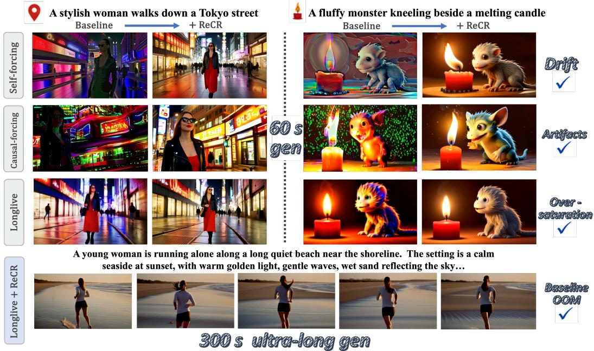  
Figure 1: Qualitative overview of ReCR across backbones. ReCR is applied as a training-free context rewriting module on top of different autoregressive video backbones. On 60-second rollouts, ReCR reduces common long-horizon failures such as scene drift, visual artifacts, and oversaturation. On 300-second ultra-long rollouts, ReCR further extends backbones with stable visual continuity.

A large part of recent work has addressed this difficulty by improving how long histories are stored, compressed, or accelerated. Memory-based methods introduce explicit history encoders, statespace memory, entity-level memory banks, or recurrent attention to preserve long-range consistency [73, 85, 83, 14, 79]. System-oriented methods reduce the cost of long histories through KV-cache compaction, quantization, token pruning, cache reuse, sparse attention, and block-level attention caching [36, 5, 65, 16, 56, 46, 57, 9, 49, 1]. These advances are essential for efficient long video synthesis, but they mainly ask how to make a long context cheaper or more stable. They leave a more direct inference-time question underexplored: under a fixed visible context budget, how should the decoder choose which parts of the generated past to read for the next prediction?

This question is important because the useful past in a long video is unlikely to be uniformly determined by recency. A recent window is often necessary for local temporal continuity, yet it may overemphasize the immediate continuation and underuse earlier evidence that stabilizes identity, layout, or object state. Conversely, retaining the full context can be expensive and can introduce redundant or stale evidence. Recent studies on history encoding, unstable-token pruning, reward feedback, adaptive sampling, prompt switching, and controllable autoregressive generation all suggest that long-horizon failures often depend on which trajectory evidence is reused during inference [70, 76, 18, 57, 66, 13, 60, 51, 55, 74, 61]. We therefore treat context choice itself as the object of study. The central problem is to directly construct a useful visible context from the generated history at every rollout step, rather than relying only on chronological recency, full-history retention, or cache-level compression.

We propose RECR, a training-free decoding strategy for representation-guided context rewriting. At each rollout step, ReCR uses internal decoder representations to score candidate context units, selects a sparse visible context under a fixed budget, refines it with at most one spatial-range exchange, and presents the selected units on a compact causal axis before decoding the next block. This design is complementary to long-context training and KV-cache methods: those approaches mainly improve the model, the memory system, or the efficiency of retaining history, while ReCR changes the composition of the context that the decoder actually reads. Across standard long-video benchmarks, drift diagnostics, representation-space analysis, and transition-count prompt switching, ReCR improves long-horizon stability and motion evolution under matched visible-token budgets. Our contributions are threefold:

• We formulate long-horizon autoregressive video decoding as a context selection problem, where the key inference-time decision is to directly choose a sparse visible context from the generated history under a fixed budget.

• We propose RECR, a training-free context rewriting method that uses internal representations to select useful context units, balance global compatibility with recent-context redundancy, and present the selected units on a compact causal axis.

• We provide a mechanistic evaluation of visible context construction, including dynamic context composition, representation-space diagnostics, and transition-count prompt switching, showing that ReCR improves evidence allocation beyond contiguous recent context.

## 2 Related Work

## 2.1 Video diffusion models and foundation-scale generation

Modern video generation was first driven by full-sequence diffusion and transformer-based formulations, which use bidirectional spatiotemporal denoising to produce visually strong short clips [50, 23, 22, 17, 2, 48, 54, 75, 33, 69]. This line then scaled toward foundation-scale text-to-video systems, unified generation and editing frameworks, stronger video VAEs, larger curated datasets, and broader evaluation [34, 38, 82, 52, 59, 32, 31, 47, 4, 81]. These advances improve visual fidelity, prompt following, motion realism, and controllability, but long-duration generation remains challeng ing because full-sequence denoising scales poorly and typically assumes a fixed offline clip. Building on this progress, ReCR asks which generated context should remain visible for the next prediction.

## 2.2 Causal and autoregressive long-video decoding

A second line of work reframes video generation as causal rollout, enabling streaming synthesis, interactive prompting, and minute-scale extension through diffusion distillation, next-frame or nextchunk prediction, self-rollout training, and long-context supervision [3, 72, 21, 15, 26, 67, 42, 64, 25, 11, 30, 58, 8, 40, 10, 68, 80, 28, 84, 7, 87, 41, 19, 45]. These methods make long video generation more compatible with KV caching and online control, and several recent works explicitly target horizon extension, prompt switching, multi-shot consistency, or stronger training-inference alignment [70, 71, 35, 66, 44, 86]. ReCR complements them by keeping the decoder fixed and directly selecting the visible context under the same budget.

## 2.3 Memory, cache efficiency, and test-time inference for long videos

Long-horizon generation has also been studied through memory management, cache compression, sparse attention, and test-time optimization. Memory-based methods introduce state-space memory, recurrent memory, and spatial retrieval to improve long-range consistency [73, 29, 85, 83, 14, 78, 24, 77, 63, 6]. System-oriented methods reduce the cost of retaining history with KV-cache compaction, quantization, token pruning, attention caching, sparse attention, and redundancy-eliminated streaming [79, 36, 5, 65, 16, 56, 46, 57, 9, 49, 1, 53, 37, 43]. In parallel, test-time training, test-time search, reward feedback, trajectory correction, and adaptive sampling show that inference computation can be used to improve generated trajectories without changing the base model [12, 39, 20, 62, 76, 18, 60, 55, 27, 74, 51, 61]. ReCR does not compress cache, train longer contexts, or search over output candidates, but directly constructs the visible context.

## 3 Method

We study autoregressive video decoding from the viewpoint of representation-guided context rewriting. At rollout step t, the model has produced a generated history $\bar { H _ { t } }$ . Standard decoding exposes mainly a contiguous recent context $W _ { t }$ . This choice leaves open a question: which context units from $H _ { t }$ should remain visible when the decoder predicts the next block? ReCR answers this question by constructing a selected visible context $C _ { t }$ at each step. The selected units are scored with internal unit representations, chosen under a fixed context budget, and placed on a compact causal axis through a temporal reindexing map $\pi _ { t }$ . The method changes the context presented to the decoder while keeping the backbone parameters fixed.

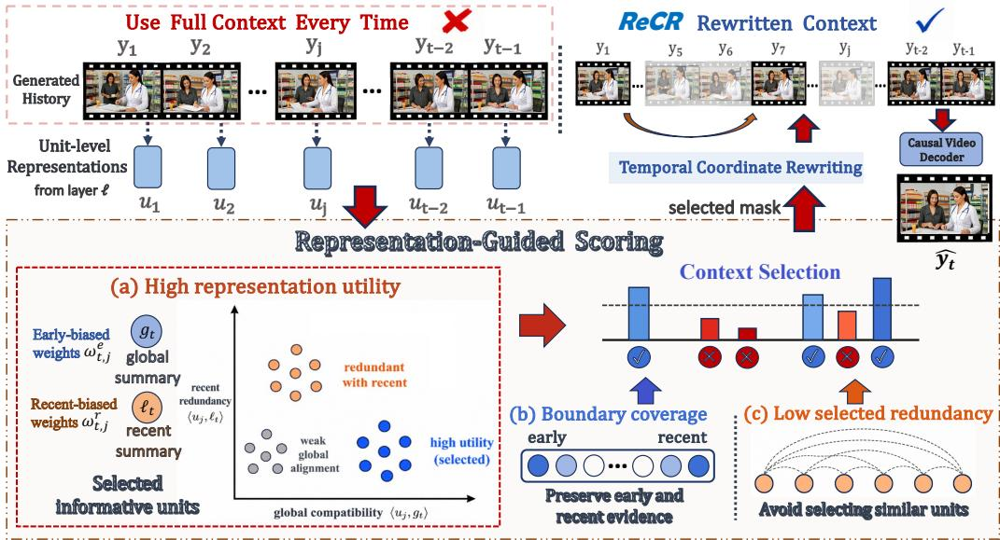  
Figure 2: Overview of the ReCR framework. Instead of exposing the full generated history or a fixed recent window, ReCR scores context units with unit-level representations and selects a compact visible context. The selection objective favors high representation utility, preserves boundary coverage over early and recent context, and discourages redundant selected units. At most one spatial-range exchange, not drawn here, then refines the selection (Sec. 3.2). The selected context is then temporally reindexed onto a compact causal axis before being passed to the causal video decoder.

## 3.1 Autoregressive Decoding as Context Rewriting

Setup. Let a video be decomposed into latent frames $y _ { 1 } , y _ { 2 } , \ldots , y _ { T }$ , which we call context units. The decoder generates them in consecutive blocks of L units, with $L = 3$ for all backbones in this paper, so rollout steps are the block starts $t \in { \mathcal { T } } = \left\{ 1 , L + 1 , 2 L + 1 , . . . \right\}$ . Let c be the text condition and let θ be the parameters of a causal video decoder. Before predicting the block $y _ { t : t + L - 1 }$ , the generated history is $H _ { t } = \{ y _ { 1 } , y _ { 2 } , \dots , y _ { t - 1 } \}$ . A standard autoregressive decoder conditions on a contiguous recent context $W _ { t } = \{ y _ { j } \ | \ a _ { t } \leq j < t \}$ , where $a _ { t }$ is a start index. This form assumes that recency is the main proxy for usefulness. In long-horizon rollout, this assumption can be incomplete: the useful evidence for the next prediction may include early context units, recent context units, and intermediate context units. Their roles are therefore treated as an empirical and algorithmic question rather than as a fixed prior.

ReCR replaces the fixed context rule with a step-dependent selected visible context $C _ { t } \subseteq H _ { t }$ . The decoder predicts with

$$
p _ { \theta } ( y _ { 1 : T } \mid c ) = \prod _ { t \in { T } } { p _ { \theta } ( y _ { t : t + L - 1 } \mid c , C _ { t } , \pi _ { t } ) } ,
$$

where $\pi _ { t }$ is a temporal reindexing map that presents the selected context units on a compact causal axis.

Objective. Let B be the context budget, counted in history units and excluding the $L$ units of the current block, and define the feasible set $\Omega _ { t } = \{ C \subseteq H _ { t } \mid | { \dot { C } } | = \operatorname* { m i n } ( B , t - 1 ) { \big \} }$ . The ideal choice is $C _ { t } ^ { \star } = \arg \operatorname* { m a x } _ { C \in \Omega _ { t } } J _ { t } ( C )$ , where $J _ { t } ( C )$ measures the usefulness of C for predicting the current block. Since $J _ { t }$ is not observed at inference time, ReCR builds a surrogate from the decoder’s own representations. The surrogate should capture three desiderata. First, selected units should agree with the global state summarized from $H _ { t }$ . Second, they should add information beyond the immediate recent continuation. Third, the selected set should keep enough temporal boundary coverage so that early and recent evidence are not both lost during sparse selection.

## 3.2 Representation-Guided Context Selection

Unit representation. ReCR first assigns each context unit a reusable representation. Fix a decoder layer ℓ. For unit $y _ { j }$ , let $Z _ { i } ^ { ( \ell ) } = \{ z _ { i , m } ^ { ( \ell ) } \in \mathbb { R } ^ { d } \ | \ 1 \le m \le n _ { j } \}$ be the output tokens of that layer for $y _ { j }$ in the clean context pass, which re-encodes a finished block at noise level zero to write it to the decoder cache. The unit representation is

$$
u _ { j } ^ { ( \ell ) } = \mathrm { N o r m } \left( \frac { 1 } { n _ { j } } \sum _ { m = 1 } ^ { n _ { j } } z _ { j , m } ^ { ( \ell ) } \right) , \qquad \mathrm { N o r m } ( v ) = \frac { v } { \| v \| _ { 2 } } .
$$

We write $u _ { j }$ when the layer is clear. Each $u _ { j }$ is computed once at commit time and reused at later steps, so ReCR adds no decoder forward pass.

Global and recent summaries. To obtain coarse views of $H _ { t }$ , define the normalized temporal coordinate $\tau _ { t } ( j ) = ( j - 1 ) / ( t - 2 )$ for $1 \le j < t$ . ReCR uses an early-biased weight and a recent-biased weight,

$$
\omega _ { t , j } ^ { e } = \frac { \exp ( - \beta \tau _ { t } ( j ) ) } { \sum _ { q < t } \exp ( - \beta \tau _ { t } ( q ) ) } , \qquad \omega _ { t , j } ^ { r } = \frac { \exp ( - \beta ( 1 - \tau _ { t } ( j ) ) ) } { \sum _ { q < t } \exp ( - \beta ( 1 - \tau _ { t } ( q ) ) ) } .
$$

They induce the global summary $\begin{array} { r } { g _ { t } \ = \ \mathrm { N o r m } \left( \sum _ { j < t } \omega _ { t , j } ^ { e } u _ { j } \right) } \end{array}$ and the recent summary $\begin{array} { r l } { \ell _ { t } } & { { } = } \end{array}$ Norm $\left( \sum _ { j < t } \omega _ { t , j } ^ { r } u _ { j } \right)$ . The summaries do not assume that early or recent context units are always sufficient. They provide two reference directions for scoring each candidate unit in $H _ { t }$

Representation utility. The representation utility of $y _ { j }$ is

$$
s _ { t } ( j ) = \kappa \langle u _ { j } , g _ { t } \rangle - \lambda \log \left( \varepsilon + \exp ( \kappa \langle u _ { j } , \ell _ { t } \rangle ) \right) ,
$$

where $\varepsilon > 0$ is a small numerical constant. The first term measures compatibility with the global summary. The second term penalizes redundancy with the recent summary. A high score therefore indicates that a context unit is aligned with the broader rollout state while adding evidence beyond the recent continuation.

Budgeted context selection. Let $m _ { t , j } \in \{ 0 , 1 \}$ indicate whether $y _ { j }$ is selected for $1 \leq j < t$ ReCR forms an initial selection $\widetilde { C } _ { t }$ from

$$
m _ { t } ^ { \star } = \arg \operatorname* { m a x } _ { m _ { t } } \left[ \sum _ { j < t } m _ { t , j } s _ { t } ( j ) + \mu \Phi _ { t } ( m _ { t } ) - \gamma \Psi _ { t } ( m _ { t } ) \right] \quad \mathrm { s . t . } \quad \sum _ { j < t } m _ { t , j } = \operatorname* { m i n } ( B , t - 1 ) .
$$

Here

$$
\Phi _ { t } ( m _ { t } ) = \log \left( \varepsilon + \sum _ { j < t } m _ { t , j } \omega _ { t , j } ^ { e } \right) + \log \left( \varepsilon + \sum _ { j < t } m _ { t , j } \omega _ { t , j } ^ { r } \right)
$$

is the boundary coverage term, and

$$
\Psi _ { t } ( m _ { t } ) = \sum _ { 1 \leq i < j < t } m _ { t , i } m _ { t , j } \langle u _ { i } , u _ { j } \rangle
$$

is the selected-set redundancy penalty. The initial selection is $\widetilde { C } _ { t } = \{ y _ { j } \in H _ { t } \ | \ m _ { t , i } ^ { \star } = 1 \}$ , computed with the greedy approximation of App. A.2; when $t - 1 \leq B$ it is the whole history. This objective lets the composition of $\widetilde { C } _ { t }$ emerge from the representation geometry of the current rollout. Boundary coverage keeps early and recent context units available under the budget. Representation utility and the selected-set redundancy penalty determine which additional context units are useful, including intermediate context units when they provide evidence for event evolution.

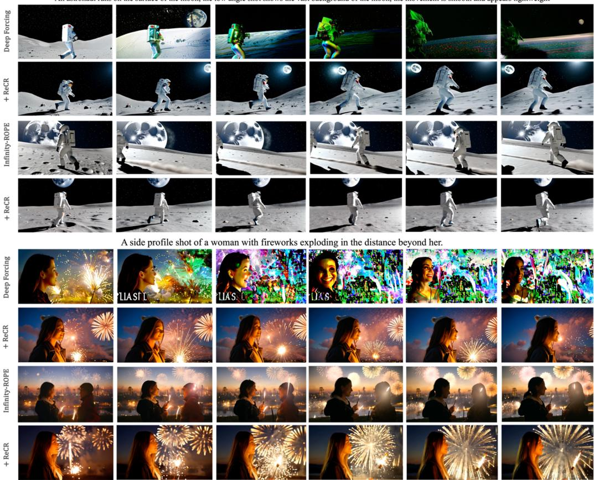  
Figure 3: ReCR further strengthens training-free decoding methods. Qualitative comparisons on two 60-second prompts. For both methods, ReCR improves temporal consistency and visual fidelity over time: it reduces drift and artifacts in Deep Forcing, and further improves the stability and text-alignment ability of Infinity-RoPE. These results show that ReCR is a complementary context-rewriting module that can be added on top of strong training-free methods.

Spatial-range exchange. Mean pooling in $u _ { j }$ discards how content is laid out within a frame. ReCR therefore tracks a scalar spatial-layout statistic $\rho _ { j } .$ , the size of the first-order spatial moments of the layer-ℓ tokens relative to their mean $( \mathbf { A p p . } \mathbf { A . } 3 )$ , and refines $\widetilde { C } _ { t }$ with at most one exchange per step. When $t - 1 > B$ and the latest $L$ units are all selected, the history extreme of $\rho _ { j }$ lying farthest outside the range covered by $\widetilde { C } _ { t }$ replaces the lowest-utility selected unit that is neither one of the latest L units nor temporally adjacent to another selected unit, provided that the covered range doe not shrink. The result is the selected visible context $C _ { t } .$ , with the same size as $\widetilde { C } _ { t } \mathrm { : }$ if no such pair exists, $C _ { t } = \widetilde { C } _ { t }$

## 3.3 Temporal Reindexing and Decoding

The selected visible context $C _ { t }$ is usually sparse in the generated history $H _ { t }$ . Directly feeding the original sparse positions can make the causal decoder interpret large temporal gaps as part of the visible sequence. ReCR therefore applies temporal reindexing.

Let $j _ { t } ^ { ( 1 ) } < j _ { t } ^ { ( 2 ) } < \cdots < j _ { t } ^ { ( N _ { t } ) }$ be the selected indices in chronological order, where $C _ { t } \ =$ $\left\{ y _ { j _ { t } ^ { \left( 1 \right) } } , y _ { j _ { t } ^ { \left( 2 \right) } } , . . . , y _ { j _ { t } ^ { \left( N _ { t } \right) } } \right\}$ and $N _ { t } ~ = ~ | C _ { t } |$ . The temporal reindexing map is $\pi _ { t } { \Big ( } y _ { j _ { t } ^ { ( i ) } } { \Big ) } ~ = ~ i$ for $1 \leq i \leq N _ { t }$ , and the current block follows at positions $N _ { t } + 1 , . . . , N _ { t } + L$ . The selected units keep their chronological order and are presented on a compact causal axis: ReCR stores keys and values before positional encoding and, at each use, applies RoPE to the selected keys at these compact positions. Let $\xi _ { t }$ denote the decoder input associated with predicting the current block. The final

Table 1: VBench-Long evaluation on the 30- and 60-second benchmarks, reported as 30s/60s. Higher is better. Best and second-best values are highlighted in bold and underlined, respectively.
<table><tr><td rowspan="2">Method</td><td colspan="8">Quality block: 30s / 60s</td></tr><tr><td>Total Score</td><td>Dynamic Degree</td><td>Subject Consistency</td><td>Background Consistency</td><td>Temporal Flickering</td><td>Motion Smoothness</td><td>Aesthetic Quality</td><td>Imaging Quality</td></tr><tr><td colspan="9">Training-based Baselines</td></tr><tr><td>Self-Forcing [26]</td><td>79.09 / 78.19</td><td>40.12 / 33.45</td><td>96.75 / 96.67</td><td>95.63 / 95.82</td><td>95.93 / 96.02</td><td>96.31 / 97.17</td><td>56.01 / 54.21</td><td>70.49 / 66.44</td></tr><tr><td>Self-Forcing++ [11]</td><td>79.56 / 79.59</td><td>39.45 / 38.67</td><td>96.71 / 96.43</td><td>95.76/ 95.96</td><td>95.10 / 96.63</td><td>97.83 / 97.25</td><td>56.64 / 56.13</td><td>70.15 / 69.20</td></tr><tr><td>LongLive [67]</td><td>81.32 / 80.72</td><td>36.74 / 35.43</td><td>97.63 / 97.42</td><td>96.15 / 96.08</td><td>97.77 / 97.21</td><td>98.25 / 98.17</td><td>58.82 / 58.21</td><td>70.57 / 70.02</td></tr><tr><td>Causal-Forcing [84]</td><td>80.77 / 77.41</td><td>62.64 / 56.82</td><td>95.78 / 94.86</td><td>95.30 / 95.27</td><td>96.10 / 95.20</td><td>97.64 / 96.44</td><td>54.43 / 48.22</td><td>68.35 / 63.26</td></tr><tr><td>HiAR [87]</td><td>79.76/ 79.36</td><td>32.83 / 30.34</td><td>97.62 / 97.62</td><td>95.12 / 94.64</td><td>96.48 / 96.48</td><td>98.11 / 98.35</td><td>56.25 / 55.41</td><td>70.27 / 69.63</td></tr><tr><td colspan="9">Training-free Methods</td></tr><tr><td>Deep Forcing [71]</td><td>81.96 / 81.42</td><td>55.21 / 55.45</td><td>97.01 / 96.21</td><td>96.15 / 96.05</td><td>96.25 / 95.73</td><td>98.18 / 98.18</td><td>60.15 / 59.27</td><td>69.22 / 68.92</td></tr><tr><td>Infinity-RoPE [70]</td><td>80.93 / 80.98</td><td>45.21 / 45.04</td><td>97.19 / 97.43</td><td>96.04 / 95.94</td><td>97.14 / 97.45</td><td>98.09 / 98.32</td><td>58.08 / 56.88</td><td>67.43 / 67.25</td></tr><tr><td colspan="9">Backbone + Ours</td></tr><tr><td>Self-Forcing + ReCR</td><td>82.05 / 81.60</td><td>55.83 / 56.88</td><td>96.69 / 96.43</td><td>95.99 / 95.76</td><td>96.78 / 96.68</td><td>98.23 / 98.08</td><td>58.05 / 56.99</td><td>70.58 / 69.61</td></tr><tr><td>Self-Forcing++ + ReCR</td><td>81.74/81.15</td><td>57.37 / 56.03</td><td>96.56 / 96.38</td><td>95.83 / 95.50</td><td>96.85 / 96.44</td><td>97.41 / 97.07</td><td>58.55 / 58.48</td><td>70.25 / 70.14</td></tr><tr><td>LongLive + ReCR</td><td>81.60 / 81.37</td><td>37.29 / 38.54</td><td>97.70 / 97.60</td><td>96.52 / 96.35</td><td>97.76 / 97.71</td><td>98.90 / 98.86</td><td>57.87 / 57.29</td><td>70.28 / 69.31</td></tr><tr><td>Causal-Forcing + ReCR</td><td>82.50 / 82.08</td><td>77.97 / 80.47</td><td>95.67 / 95.38</td><td>95.15 / 94.84</td><td>95.48 / 95.14</td><td>97.77 / 97.58</td><td>56.74 / 55.64</td><td>71.15/ 70.62</td></tr><tr><td>HiAR + ReCR</td><td>80.77 / 80.71</td><td>33.75 / 35.55</td><td>97.68 / 97.75</td><td>96.07 / 96.07</td><td>97.05 / 97.01</td><td>98.30 / 98.29</td><td>57.65 / 56.76</td><td>71.44 / 71.08</td></tr><tr><td colspan="9">Backbone Training-free Methods + Ours</td></tr><tr><td>Deep Forcing + ReCR</td><td>82.36 / 82.27</td><td>58.39 / 58.07</td><td>96.72 / 96.56 97.22 / 97.13</td><td>96.01 / 95.88 96.14 /95.99</td><td>96.73 / 96.84 97.17 / 97.03</td><td>98.24 / 98.30 98.51 / 98.42</td><td>58.44 /58.64</td><td>70.96 /70.17</td></tr><tr><td>Infinity-RoPE + ReCR</td><td>82.23 / 82.07</td><td>55.31 / 57.14</td><td></td><td></td><td></td><td></td><td>58.53 / 57.89</td><td>68.67 / 68.35</td></tr></table>

Table 2: Drift metrics on MovieGen-128 30-second videos. Best and second-best values in each column are highlighted in bold and underlined, respectively.
<table><tr><td rowspan="2">Method</td><td colspan="2">Semantic stability</td><td colspan="4">Appearance / low-level drift</td><td colspan="2">Temporal drift</td></tr><tr><td></td><td></td><td></td><td></td><td></td><td>TA overall ↑ TA tail ↓ Aes. drift ↓ AQ signed → 0 SAT shift → 0 SHARP tail → 0 LPIPS tail → 0 DINO tail → 0</td><td></td><td></td></tr><tr><td colspan="9">Training-based Baselines</td></tr><tr><td>Self-Forcing baseline</td><td>24.14</td><td>+2.47</td><td>5.81</td><td>-3.61</td><td>+5.76</td><td>-335.23</td><td>-4.74</td><td>-0.31</td></tr><tr><td>LongLive baseline</td><td>26.45</td><td>+0.37</td><td>3.05</td><td>-1.01</td><td>-2.11</td><td>+42.55</td><td>+1.30</td><td>+0.45</td></tr><tr><td>Causal-Forcing baseline</td><td>23.59</td><td>+4.11</td><td>9.70</td><td>-8.66</td><td>+7.02</td><td>-316.66</td><td>-3.18</td><td>+1.64</td></tr><tr><td>HiAR baseline</td><td>26.27</td><td>+0.45</td><td>3.67</td><td>-1.78</td><td>+1.72</td><td>-259.35</td><td>+1.52</td><td>+0.09</td></tr><tr><td colspan="9">Training-free Methods</td></tr><tr><td>Deep Forcing</td><td>25.69</td><td>+0.84</td><td>3.56</td><td>-1.60</td><td>-1.74</td><td>-44.67</td><td>+2.07</td><td>+0.93</td></tr><tr><td>Infinity-RoPE</td><td>25.92</td><td>+0.64</td><td>3.30</td><td>-1.48</td><td>+0.64</td><td>-9.12</td><td>-1.26</td><td>+0.12</td></tr><tr><td colspan="9">Backbone + Ours</td></tr><tr><td>Self-Forcing + ReCR</td><td>26.71</td><td>+1.00</td><td>3.99</td><td>-1.74</td><td>-1.44</td><td>+2.51</td><td>+0.82</td><td>+0.72</td></tr><tr><td>LongLive + ReCR</td><td>27.27</td><td>+1.05</td><td>3.27</td><td>-2.20</td><td>-2.21</td><td>+44.06 -185.74</td><td>+2.47 +2.89</td><td>+0.37 +1.39</td></tr><tr><td>Causal-Forcing + ReCR HiAR + ReCR</td><td>25.83 27.08</td><td>+1.50 +0.27</td><td>5.13 3.02</td><td>-4.24 -0.90</td><td>+3.41 +1.29</td><td>-287.90</td><td>+1.40</td><td>-0.08</td></tr><tr><td></td><td></td><td></td><td></td><td></td><td></td><td></td><td></td><td></td></tr><tr><td colspan="9">Backbone Training-free Methods + Ours</td></tr><tr><td>Deep Forcing + ReCR Infinity-RoPE + ReCR</td><td>27.08</td><td>+0.39</td><td>1.76</td><td>-0.09</td><td>-0.49</td><td>+6.55 +40.74</td><td>+1.66 +1.67</td><td>+0.50</td></tr><tr><td></td><td>26.59</td><td>+0.51</td><td>2.01</td><td>-0.62</td><td>-0.37</td><td></td><td></td><td>+0.45</td></tr></table>

decoding rule is

$$
\hat { y } _ { t : t + L - 1 } = D _ { \theta } \mathopen { } \mathclose \bgroup \left( \xi _ { t } , c , C _ { t } , \pi _ { t } \aftergroup \egroup \right) .
$$

ReCR therefore consists of four operations: compute unit representations from $H _ { t }$ , select $\widetilde { C } _ { t }$ with representation utility, boundary coverage, and the selected-set redundancy penalty, refine it into $C _ { t }$ with the spatial-range exchange, and decode after temporal reindexing. $\bar { C } _ { t }$ and $\pi _ { t }$ are computed once per block and shared by all decoder layers and all generator passes of that block. Additional implementation details and the explicit inference procedure are provided in App. A.

## 4 Experiments

## 4.1 Experimental Setup

We evaluate text-to-video decoding. Our primary benchmark contains 128 prompts from the MovieGen prompt suite. For each prompt, we report both 30- and 60-second rollouts. To make evaluation more diagnostic, we additionally measure drift-oriented indicators over the rollout trajectory,

(b) Composition of selected context  
(a) Selection frequency  
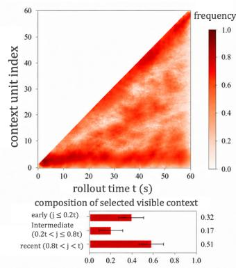

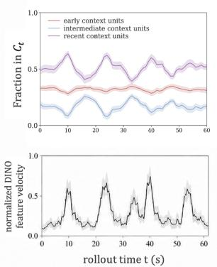  
(c) Representation utility space

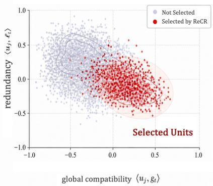  
Figure 4: Dynamic allocation of ReCR’s selected visible context. (a) Selection frequency over rollout time and context-unit index. (b) Composition of $C _ { t }$ and normalized DINO feature velocity over rollout. (c) Representation-utility space induced by $g _ { t }$ and $\ell _ { t } .$ , with selected units highlighted.

including text-alignment stability, aesthetic drift, color drift, sharpness drift, LPIPS-based temporal drift, and DINO-based feature drift. Details of the setup are provided in App. B.1.

## 4.2 Standard Long-Video Benchmarking and Qualitative Evaluation

We compare ReCR against both training-based and inference-time baselines. The training-oriented group includes Self-Forcing [26], Causal-Forcing [84], Self-Forcing++ [11], and HiAR [87]. The inference-time group includes Deep Forcing [71] and Infinity-RoPE [70]. Unless otherwise specified, all inference-time methods are reimplemented on the same 4-step chunk-wise causal diffusion backbone with identical text conditioning, tokenizer, and sampling schedule. Table 1 reports the main long-video benchmark. ReCR improves the aggregated quality score across all backbone families on both 30- and 60-second rollouts, with mean gains of 1.41 and 1.94 points, respectively, so the average benefit grows where long-horizon degradation is stronger. Dynamic Degree also rises for every backbone family, by up to 17.92 points on 30-second and 23.65 points on 60-second rollouts. Table 2 complements the benchmark averages with a head-to-tail drift analysis on 30-second videos. Here, ReCR reduces text-alignment drop and aesthetic drift, and also moves signed drift metrics closer to zero.

Table 3 in App. B.5 reports system efficiency on 60-second rollouts.

## 4.3 Mechanistic Analysis of Visible Context Allocation

We examine whether ReCR constructs $C _ { t }$ as a genuinely selected visible context rather than a longer contiguous recent context. For each rollout step, we record the selected mask, the temporal location of selected context units in $H _ { t } ,$ and the utility components derived from $u _ { j } , g _ { t }$ , and $\ell _ { t } .$ Figure 4 shows three consistent behaviors: ReCR preserves support from early and recent context units, dynamically assigns part of the budget to intermediate context units, and selects units with high compatibility to $g _ { t }$ while avoiding excessive redundancy with $\ell _ { t }$ . Detailed aggregation rules are in App. B.3.

## 4.4 Transition-count Prompt Switching

We test ReCR under directive changes, where the decoder must follow new instructions while preserving useful history. We build a transition-count benchmark with 24 prompt families. Each 60-second rollout is split into five 12-second directive segments, and the number of switches varies as $K \in \{ 0 , 1 , 2 , 3 , 4 \}$ under matched seeds, sampling schedules, and visible-token budgets. Figure 5 shows that ReCR variants better preserve recurring visual anchors and local motion across switches. Figure 6 suggests that cache flushing and selected visible context rewriting improve complementary aspects of prompt switching. Details are given in App. B.4.

  
A red paper lantern hangs above the vendor's food stall

  
The vendor serves a customer

  
The vendor serves a bowl of noodles to the customer

  
The vendor serves a bowl of noodles to another customer

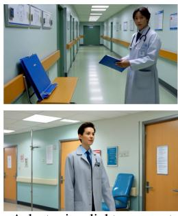  
A doctor in a light gray coat walking through hospital corridors. bright light, consistent face

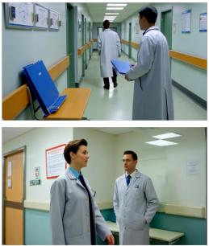  
The doctor passes a colleague

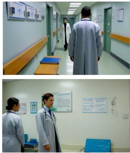  
The doctor passes another colleague

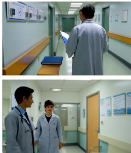  
The doctor passes another colleague

Figure 5: Qualitative transition examples. ReCR improves cross-segment consistency of persistent visual anchors and requested local actions under the same directive-switch schedules.  
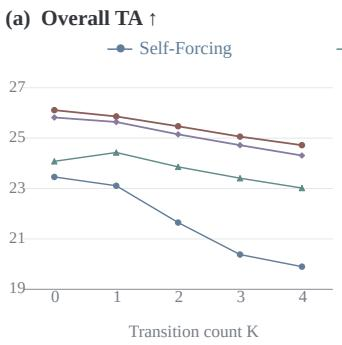

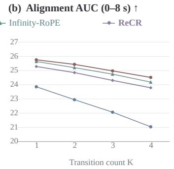

(c) DINO tail ↓  
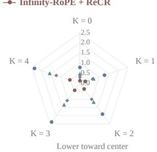  
Figure 6: Transition-count prompt-switch scaling. (a) Overall text alignment (TA) to the active directive versus transition count K. (b) Early post-switch alignment, summarized by AUC over 0–8 seconds, versus K. (c) Absolute DINO tail shown as a radial dot plot: each spoke corresponds to a transition count, and distance from the center represents the metric value; closer to the center is better. All panels share the same method colors and markers. Higher is better in (a,b), and lower is better in (c).

## 5 Conclusion and Discussion

We presented ReCR, a training-free decoding strategy that treats autoregressive video generation as selected visible context construction over the generated history. Starting from the question of what should remain visible under a fixed context budget, ReCR replaces the contiguous recent context with a selected visible context, scores context units, and stabilizes selection with boundary coverage, a selected-set redundancy penalty, a spatial-range exchange, and temporal reindexing. Across benchmark results, drift diagnostics, visible-context analyses, and transition-count prompt switching, ReCR improves long-horizon stability and motion evolution by changing which history the decoder reads.

ReCR suggests that autoregressive long-video decoding is not only a sampling problem or a cacheefficiency problem, but also a context-allocation problem. Existing long-context, KV-cache, sparseattention, and memory methods make longer rollouts more feasible; ReCR adds a complementary direction by deciding which parts of the generated history should be exposed at each step. Its current limitations are also clear. ReCR depends on whether internal decoder representations can reliably separate persistent visual anchors, evolving events, and redundant local continuation; it also makes myopic stepwise decisions and operates on whole latent frames rather than object- or scene-level memory. Future work could learn adaptive utility scoring, jointly decide which history to expose and how to place it on the causal timeline, and combine ReCR-style evidence allocation with cache-based prompt responsiveness.

## References

[1] Krish Agarwal, Zhuoming Chen, Cheng Luo, Yongqi Chen, Haizhong Zheng, Xun Huang, Atri Rudra, and Beidi Chen. MonarchRT: Efficient Attention for Real-Time Video Generation. arXiv preprint arXiv:2602.12271, 2026.

[2] Andreas Blattmann, Tim Dockhorn, Sumith Kulal, Daniel Mendelevitch, Maciej Kilian, Dominik Lorenz, Yam Levi, Zion English, Vikram Voleti, Adam Letts, Varun Jampani, and Robin Rombach. Stable Video Diffusion: Scaling Latent Video Diffusion Models to Large Datasets. arXiv preprint arXiv:2311.15127, 2023.

[3] Boyuan Chen, Diego Martí Monsó, Yilun Du, Max Simchowitz, Russ Tedrake, and Vincent Sitzmann. Diffusion Forcing: Next-token Prediction Meets Full-Sequence Diffusion. In Advances in Neural Information Processing Systems, volume 37, pages 24081–24125. Curran Associates, Inc., 2024.

[4] Guibin Chen, Dixuan Lin, Jiangping Yang, Chunze Lin, Junchen Zhu, Mingyuan Fan, Hao Zhang, Sheng Chen, Zheng Chen, Chengcheng Ma, Weiming Xiong, Wei Wang, Nuo Pang, Kang Kang, Zhiheng Xu, Yuzhe Jin, Yupeng Liang, Yubing Song, Peng Zhao, Boyuan Xu, Di Qiu, Debang Li, Zhengcong Fei, Yang Li, and Yahui Zhou. SkyReels-V2: Infinite-length Film Generative Model. arXiv preprint arXiv:2504.13074, 2025.

[5] Hanmo Chen, Chenghao Xu, Xu Yang, Xuan Chen, and Cheng Deng. Past- and Future-Informed KV Cache Policy with Salience Estimation in Autoregressive Video Diffusion. arXiv preprint arXiv:2601.21896, 2026.

[6] Kaijin Chen, Dingkang Liang, Xin Zhou, Yikang Ding, Xiaoqiang Liu, Pengfei Wan, and Xiang Bai. Out of Sight but Not Out of Mind: Hybrid Memory for Dynamic Video World Models. arXiv preprint arXiv:2603.25716, 2026.

[7] Shuo Chen, Cong Wei, Sun Sun, Tiancheng Shen, Ping Nie, Kai Zou, Ge Zhang, Ming-Hsuan Yang, and Wenhu Chen. Context Forcing: Consistent Autoregressive Video Generation with Long Context. In Proceedings of the 43rd International Conference on Machine Learning, volume 306 of Proceedings ofMachine Learning Research, pages 17329–17343. PMLR, 2026.

[8] Taiye Chen, Zihan Ding, Anjian Li, Christina Zhang, Zeqi Xiao, Yisen Wang, and Chi Jin. Recurrent Autoregressive Diffusion: Global Memory Meets Local Attention. In Computer Vision – ECCV 2026, volume 17029 of Lecture Notes in Computer Science, pages 492–511. Springer, 2026.

[9] Zhuokun Chen, Jianfei Cai, and Bohan Zhuang. FlashBlock: Attention Caching for Efficient Long-Context Block Diffusion. In Proceedings of the 43rd International Conference on Machine Learning, volume 306 of Proceedings of Machine Learning Research, pages 13603–13619. PMLR, 2026.

[10] Tianle Cheng, Zeyan Zhang, Kaifeng Gao, and Jun Xiao. Adaptive Begin-of-Video Tokens for Autoregressive Video Diffusion Models. arXiv preprint arXiv:2511.12099, 2025.

[11] Justin Cui, Jie Wu, Ming Li, Tao Yang, Xiaojie Li, Rui Wang, Andrew Bai, Yuanhao Ban, and Cho-Jui Hsieh. Self-Forcing++: Towards Minute-Scale High-Quality Video Generation. In International Conference on Learning Representations, pages 85802–85822, 2026.

[12] Karan Dalal, Daniel Koceja, Jiarui Xu, Yue Zhao, Shihao Han, Ka Chun Cheung, Jan Kautz, Yejin Choi, Yu Sun, and Xiaolong Wang. One-Minute Video Generation with Test-Time Training. In Proceedings of the IEEE/CVF Conference on Computer Vision and Pattern Recognition, pages 17702–17711, 2025.

[13] Ryan Fosdick. Adapting VACE for Real-Time Autoregressive Video Diffusion. arXiv preprint arXiv:2602.14381, 2026.

[14] Mohsen Ghafoorian and Amirhossein Habibian. ReHyAt: Recurrent Hybrid Attention for Video Diffusion Transformers. In Proceedings of the IEEE/CVF Conference on Computer Vision and Pattern Recognition, pages 40674–40684, 2026.

[15] Yuchao Gu, Weijia Mao, and Mike Zheng Shou. Long-Context Autoregressive Video Modeling with Next-Frame Prediction. arXiv preprint arXiv:2503.19325, 2025.

[16] Hang Guo, Zhaoyang Jia, Jiahao Li, Bin Li, Yuanhao Cai, Jiangshan Wang, Yawei Li, and Yan Lu. Efficient Autoregressive Video Diffusion with Dummy Head. arXiv preprint arXiv:2601.20499, 2026.

[17] Yuwei Guo, Ceyuan Yang, Anyi Rao, Zhengyang Liang, Yaohui Wang, Yu Qiao, Maneesh Agrawala, Dahua Lin, and Bo Dai. AnimateDiff: Animate Your Personalized Text-to-Image Diffusion Models without Specific Tuning. In International Conference on Learning Represen tations, pages 34630–34648, 2024.

[18] Yizhao Han, Tianxing Shi, Zhao Wang, Zifan Xu, Zhiyuan Pu, Mingxiao Li, Qian Zhang, Wei Yin, and Xiao-Xiao Long. Entropy-Guided k-Guard Sampling for Long-Horizon Autoregressive Video Generation. arXiv preprint arXiv:2601.19488, 2026.

[19] Dailan He, Guanlin Feng, Xingtong Ge, Yi Zhang, Bingqi Ma, Guanglu Song, Yu Liu, and Hongsheng Li. AR-CoPO: Align Autoregressive Video Generation with Contrastive Policy Optimization. In Computer Vision – ECCV 2026, volume 17047 of Lecture Notes in Computer Science, pages 57–73. Springer, 2026.

[20] Haoran He, Jiajun Liang, Xintao Wang, Pengfei Wan, Di Zhang, Kun Gai, and Ling Pan. Scaling Image and Video Generation via Test-Time Evolutionary Search. arXiv preprint arXiv:2505.17618, 2025.

[21] Roberto Henschel, Levon Khachatryan, Hayk Poghosyan, Daniil Hayrapetyan, Vahram Tadevosyan, Zhangyang Wang, Shant Navasardyan, and Humphrey Shi. StreamingT2V: Consistent, Dynamic, and Extendable Long Video Generation from Text. In Proceedings of the IEEE/CVF Conference on Computer Vision and Pattern Recognition, pages 2568–2577, 2025.

[22] Jonathan Ho, William Chan, Chitwan Saharia, Jay Whang, Ruiqi Gao, Alexey Gritsenko, Diederik P. Kingma, Ben Poole, Mohammad Norouzi, David J. Fleet, and Tim Salimans. Imagen Video: High Definition Video Generation with Diffusion Models. arXiv preprint arXiv:2210.02303, 2022.

[23] Jonathan Ho, Tim Salimans, Alexey Gritsenko, William Chan, Mohammad Norouzi, and David J. Fleet. Video Diffusion Models. In Advances in Neural Information Processing Systems, volume 35, pages 8633–8646. Curran Associates, Inc., 2022.

[24] Yicong Hong, Yiqun Mei, Chongjian Ge, Yiran Xu, Yang Zhou, Sai Bi, Yannick Hold-Geoffroy, Mike Roberts, Matthew Fisher, Eli Shechtman, Kalyan Sunkavalli, Feng Liu, Zhengqi Li, and Hao Tan. RELIC: Interactive Video World Model with Long-Horizon Memory. arXiv preprint arXiv:2512.04040, 2025.

[25] Junchao Huang, Xinting Hu, Boyao Han, Shaoshuai Shi, Zhuotao Tian, Tianyu He, and Li Jiang. Memory Forcing: Spatio-Temporal Memory for Consistent Scene Generation on Minecraft. arXiv preprint arXiv:2510.03198, 2025.

[26] Xun Huang, Zhengqi Li, Guande He, Mingyuan Zhou, and Eli Shechtman. Self Forcing: Bridging the Train-Test Gap in Autoregressive Video Diffusion. In Advances in Neural Information Processing Systems, volume 38, pages 167283–167308. Curran Associates, Inc., 2025.

[27] Yidong Huang, Zun Wang, Han Lin, Dong-Ki Kim, Shayegan Omidshafiei, Jaehong Yoon, Yue Zhang, and Mohit Bansal. Planning with Sketch-Guided Verification for Physics-Aware Video Generation. arXiv preprint arXiv:2511.17450, 2025.

[28] Longbin Ji, Xiaoxiong Liu, Junyuan Shang, Shuohuan Wang, Yu Sun, Hua Wu, and Haifeng Wang. VideoAR: Autoregressive Video Generation via Next-Frame & Scale Prediction. arXiv preprint arXiv:2601.05966, 2026.

[29] Sihui Ji, Xi Chen, Shuai Yang, Xin Tao, Pengfei Wan, and Hengshuang Zhao. MemFlow: Flowing Adaptive Memory for Consistent and Efficient Long Video Narratives. arXiv preprint arXiv:2512.14699, 2025.

[30] Weinan Jia, Yuning Lu, Mengqi Huang, Hualiang Wang, Binyuan Huang, Nan Chen, Mu Liu, Jidong Jiang, and Zhendong Mao. MoGA: Mixture-of-Groups Attention for End-to-End Long Video Generation. In International Conference on Learning Representations, pages 115944– 115964, 2026.

[31] Zeyinzi Jiang, Zhen Han, Chaojie Mao, Jingfeng Zhang, Yulin Pan, and Yu Liu. VACE: All-in-One Video Creation and Editing. In Proceedings of the IEEE/CVF International Conference on Computer Vision, pages 17191–17202, 2025.

[32] Xuan Ju, Weicai Ye, Quande Liu, Qiulin Wang, Xintao Wang, Pengfei Wan, Di Zhang, Kun Gai, and Qiang Xu. FullDiT: Video Generative Foundation Models with Multimodal Control via Full Attention. In Proceedings ofthe IEEE/CVF International Conference on Computer Vision, pages 15737–15747, 2025.

[33] Dan Kondratyuk, Lijun Yu, Xiuye Gu, José Lezama, Jonathan Huang, Grant Schindler, Rachel Hornung, Vighnesh Birodkar, Jimmy Yan, Ming-Chang Chiu, Krishna Somandepalli, Hassan Akbari, Yair Alon, Yong Cheng, Josh Dillon, Agrim Gupta, Meera Hahn, Anja Hauth, David Hendon, Alonso Martinez, David Minnen, Mikhail Sirotenko, Kihyuk Sohn, Xuan Yang, Hartwig Adam, Ming-Hsuan Yang, Irfan Essa, Huisheng Wang, David A. Ross, Bryan Seybold, and Lu Jiang. VideoPoet: A Large Language Model for Zero-Shot Video Generation. In Proceedings of the 41st International Conference on Machine Learning, volume 235 of Proceedings ofMachine Learning Research, pages 25105–25124. PMLR, 2024.

[34] Weijie Kong, Qi Tian, Zijian Zhang, Rox Min, Zuozhuo Dai, Jin Zhou, Jiangfeng Xiong, Xin Li, Bo Wu, Jianwei Zhang, Kathrina Wu, Qin Lin, Junkun Yuan, Yanxin Long, Aladdin Wang, Andong Wang, Changlin Li, Duojun Huang, Fang Yang, Hao Tan, Hongmei Wang, Jacob Song, Jiawang Bai, Jianbing Wu, Jinbao Xue, Joey Wang, Kai Wang, Mengyang Liu, Pengyu Li, Shuai Li, Weiyan Wang, Wenqing Yu, Xinchi Deng, Yang Li, Yi Chen, Yutao Cui, Yuanbo Peng, Zhentao Yu, Zhiyu He, Zhiyong Xu, Zixiang Zhou, Zunnan Xu, Yangyu Tao, Qinglin Lu, Songtao Liu, Dax Zhou, Hongfa Wang, Yong Yang, Di Wang, Yuhong Liu, Jie Jiang, and Caesar Zhong. HunyuanVideo: A Systematic Framework For Large Video Generative Models. arXiv preprint arXiv:2412.03603, 2024.

[35] Jia Li, Xiaomeng Fu, Xurui Peng, Weifeng Chen, Youwei Zheng, Tianyu Zhao, Jiexi Wang, Fangmin Chen, Xing Wang, and Hayden Kwok-Hay So. Train Short, Inference Long: Trainingfree Horizon Extension for Autoregressive Video Generation. arXiv preprint arXiv:2602.14027, 2026.

[36] Kunyang Li, Mubarak Shah, and Yuzhang Shang. PackCache: A Training-Free Acceleration Method for Unified Autoregressive Video Generation via Compact KV-Cache. arXiv preprint arXiv:2601.04359, 2026.

[37] Xingyang Li, Muyang Li, Tianle Cai, Haocheng Xi, Shuo Yang, Yujun Lin, Lvmin Zhang, Songlin Yang, Jinbo Hu, Kelly Peng, Maneesh Agrawala, Ion Stoica, Kurt Keutzer, and Song Han. Radial Attention: O(n log n) Sparse Attention with Energy Decay for Long Video Generation. In Advances in Neural Information Processing Systems, volume 38, pages 16822– 16852. Curran Associates, Inc., 2025.

[38] Bin Lin, Yunyang Ge, Xinhua Cheng, Zongjian Li, Bin Zhu, Shaodong Wang, Xianyi He, Yang Ye, Shenghai Yuan, Liuhan Chen, Tanghui Jia, Junwu Zhang, Zhenyu Tang, Yatian Pang, Bin She, Cen Yan, Zhiheng Hu, Xiaoyi Dong, Lin Chen, Zhang Pan, Xing Zhou, Shaoling Dong, Yonghong Tian, and Li Yuan. Open-Sora Plan: Open-Source Large Video Generation Model. arXiv preprint arXiv:2412.00131, 2024.

[39] Fangfu Liu, Hanyang Wang, Yimo Cai, Kaiyan Zhang, Xiaohang Zhan, and Yueqi Duan. Video-T1: Test-time Scaling for Video Generation. In Proceedings of the IEEE/CVF International Conference on Computer Vision, pages 18671–18681, 2025.

[40] Jinlai Liu, Jian Han, Bin Yan, Hui Wu, Fengda Zhu, Xing Wang, Yi Jiang, Bingyue Peng, and Zehuan Yuan. InfinityStar: Unified Spacetime AutoRegressive Modeling for Visual Generation. In Advances in Neural Information Processing Systems, volume 38, pages 170054–170072. Curran Associates, Inc., 2025.

[41] Jinxiu Liu, Xuanming Liu, Kangfu Mei, Yandong Wen, Ming-Hsuan Yang, and Weiyang Liu. Streaming Autoregressive Video Generation via Diagonal Distillation. In International Conference on Learning Representations, pages 133839–133869, 2026.

[42] Kunhao Liu, Wenbo Hu, Jiale Xu, Ying Shan, and Shijian Lu. Rolling Forcing: Autoregressive Long Video Diffusion in Real Time. In International Conference on Learning Representations, pages 91177–91196, 2026.

[43] Jiayi Luo, Jiayu Chen, Jiankun Wang, Cong Wang, Hanxin Zhu, Qingyun Sun, Chen Gao, Zhibo Chen, and Jianxin Li. Attention Sparsity is Input-Stable: Training-Free Sparse Attention for Video Generation via Offline Sparsity Profiling and Online QK Co-Clustering. In Proceedings of the 43rd International Conference on Machine Learning, volume 306 of Proceedings of Machine Learning Research, pages 82177–82195. PMLR, 2026.

[44] Xiangyang Luo, Qingyu Li, Xiaokun Liu, Wenyu Qin, Miao Yang, Meng Wang, Pengfei Wan, Di Zhang, Kun Gai, and Shao-Lun Huang. FilmWeaver: Weaving Consistent Multi-Shot Videos with Cache-Guided Autoregressive Diffusion. In Proceedings of the AAAI Conference on Artificial Intelligence, volume 40, pages 7689–7697, 2026.

[45] Yawen Luo, Xiaoyu Shi, Junhao Zhuang, Yutian Chen, Quande Liu, Xintao Wang, Pengfei Wan, and Tianfan Xue. ShotStream: Streaming Multi-Shot Video Generation for Interactive Storytelling. In Computer Vision – ECCV 2026, volume 17055 of Lecture Notes in Computer Science, pages 193–209. Springer, 2026.

[46] Chengtao Lv, Yumeng Shi, Yushi Huang, Ruihao Gong, Shen Ren, and Wenya Wang. Light Forcing: Accelerating Autoregressive Video Diffusion via Sparse Attention. In Proceedings of the 43rd International Conference on Machine Learning, volume 306 of Proceedings of Machine Learning Research, pages 83653–83672. PMLR, 2026.

[47] Guoqing Ma, Haoyang Huang, Kun Yan, Liangyu Chen, Nan Duan, Shengming Yin, Changyi Wan, Ranchen Ming, Xiaoniu Song, Xing Chen, Yu Zhou, Deshan Sun, Deyu Zhou, Jian Zhou, Kaijun Tan, Kang An, Mei Chen, Wei Ji, Qiling Wu, Wen Sun, Xin Han, Yanan Wei, Zheng Ge, Aojie Li, Bin Wang, Bizhu Huang, Bo Wang, Brian Li, Changxing Miao, Chen Xu, Chenfei Wu, Chenguang Yu, Dapeng Shi, Dingyuan Hu, Enle Liu, Gang Yu, Ge Yang, Guanzhe Huang, Gulin Yan, Haiyang Feng, Hao Nie, Haonan Jia, Hanpeng Hu, Hanqi Chen, Haolong Yan, Heng Wang, Hongcheng Guo, Huilin Xiong, Huixin Xiong, Jiahao Gong, Jianchang Wu, Jiaoren Wu, Jie Wu, Jie Yang, Jiashuai Liu, Jiashuo Li, Jingyang Zhang, Junjing Guo, Junzhe Lin, Kaixiang Li, Lei Liu, Lei Xia, Liang Zhao, Liguo Tan, Liwen Huang, Liying Shi, Ming Li, Mingliang Li, Muhua Cheng, Na Wang, Qiaohui Chen, Qinglin He, Qiuyan Liang, Quan Sun, Ran Sun, Rui Wang, Shaoliang Pang, Shiliang Yang, Sitong Liu, Siqi Liu, Shuli Gao, Tiancheng Cao, Tianyu Wang, Weipeng Ming, Wenqing He, Xu Zhao, Xuelin Zhang, Xianfang Zeng, Xiaojia Liu, Xuan Yang, Yaqi Dai, Yanbo Yu, Yang Li, Yineng Deng, Yingming Wang, Yilei Wang, Yuanwei Lu, Yu Chen, Yu Luo, Yuchu Luo, Yuhe Yin, Yuheng Feng, Yuxiang Yang, Zecheng Tang, Zekai Zhang, Zidong Yang, Binxing Jiao, Jiansheng Chen, Jing Li, Shuchang Zhou, Xiangyu Zhang, Xinhao Zhang, Yibo Zhu, Heung-Yeung Shum, and Daxin Jiang. Step-Video-T2V Technical Report: The Practice, Challenges, and Future of Video Foundation Model. arXiv preprint arXiv:2502.10248, 2025.

[48] Xin Ma, Yaohui Wang, Xinyuan Chen, Gengyun Jia, Ziwei Liu, Yuan-Fang Li, Cunjian Chen, and Yu Qiao. Latte: Latent Diffusion Transformer for Video Generation. Transactions on Machine Learning Research, 2025.

[49] Yuexiao Ma, Xuzhe Zheng, Jing Xu, Xiwei Xu, Feng Ling, Xiawu Zheng, Huafeng Kuang, Huixia Li, Xing Wang, Xuefeng Xiao, Fei Chao, and Rongrong Ji. Flow Caching for Autoregressive Video Generation. In International Conference on Learning Representations, pages 82825–82849, 2026.

[50] William Peebles and Saining Xie. Scalable Diffusion Models with Transformers. In Proceedings of the IEEE/CVF International Conference on Computer Vision, pages 4195–4205, 2023.

[51] Ryan Po, Eric Ryan Chan, Changan Chen, and Gordon Wetzstein. BAgger: Backwards Aggregation for Mitigating Drift in Autoregressive Video Diffusion Models. In Proceedings of

the IEEE/CVF Conference on Computer Vision and Pattern Recognition, pages 43727–43739, 2026.

[52] Adam Polyak, Amit Zohar, Andrew Brown, Andros Tjandra, Animesh Sinha, Ann Lee, Apoorv Vyas, Bowen Shi, Chih-Yao Ma, Ching-Yao Chuang, David Yan, Dhruv Choudhary, Dingkang Wang, Geet Sethi, Guan Pang, Haoyu Ma, Ishan Misra, Ji Hou, Jialiang Wang, Kiran Jagadeesh, Kunpeng Li, Luxin Zhang, Mannat Singh, Mary Williamson, Matt Le, Matthew Yu, Mitesh Kumar Singh, Peizhao Zhang, Peter Vajda, Quentin Duval, Rohit Girdhar, Roshan Sumbaly, Sai Saketh Rambhatla, Sam Tsai, Samaneh Azadi, Samyak Datta, Sanyuan Chen, Sean Bell, Sharadh Ramaswamy, Shelly Sheynin, Siddharth Bhattacharya, Simran Motwani, Tao Xu, Tianhe Li, Tingbo Hou, Wei-Ning Hsu, Xi Yin, Xiaoliang Dai, Yaniv Taigman, Yaqiao Luo, Yen-Cheng Liu, Yi-Chiao Wu, Yue Zhao, Yuval Kirstain, Zecheng He, Zijian He, Albert Pumarola, Ali Thabet, Artsiom Sanakoyeu, Arun Mallya, Baishan Guo, Boris Araya, Breena Kerr, Carleigh Wood, Ce Liu, Cen Peng, Dimitry Vengertsev, Edgar Schönfeld, Elliot Blanchard, Felix Juefei-Xu, Fraylie Nord, Jeff Liang, John Hoffman, Jonas Kohler, Kaolin Fire, Karthik Sivakumar, Lawrence Chen, Licheng Yu, Luya Gao, Markos Georgopoulos, Rashel Moritz, Sara K. Sampson, Shikai Li, Simone Parmeggiani, Steve Fine, Tara Fowler, Vladan Petrovic, and Yuming Du. Movie Gen: A Cast of Media Foundation Models. arXiv preprint arXiv:2410.13720, 2024.

[53] Haonan Qiu, Shikun Liu, Zijian Zhou, Zhaochong An, Weiming Ren, Zhiheng Liu, Jonas Schult, Sen He, Shoufa Chen, Yuren Cong, Tao Xiang, Ziwei Liu, and Juan-Manuel Perez-Rua. HiStream: Efficient High-Resolution Video Generation via Redundancy-Eliminated Streaming. In 2026 IEEE/CVF Conference on Computer Vision and Pattern Recognition – Findings Track (CVPRF), pages 4603–4613, 2026.

[54] Haonan Qiu, Menghan Xia, Yong Zhang, Yingqing He, Xintao Wang, Ying Shan, and Ziwei Liu. FreeNoise: Tuning-Free Longer Video Diffusion via Noise Rescheduling. In International Conference on Learning Representations, pages 5260–5274, 2024.

[55] Leigang Qu, Ziyang Wang, Na Zheng, Wenjie Wang, Liqiang Nie, and Tat-Seng Chua. TTOM: Test-Time Optimization and Memorization for Compositional Video Generation. In International Conference on Learning Representations, pages 70225–70247, 2026.

[56] Dvir Samuel, Issar Tzachor, Matan Levy, Michael Green, Gal Chechik, and Rami Ben-Ari. FAST-AR: Fast Autoregressive Video Diffusion and World Models with Temporal Cache Compression and Sparse Attention. In Proceedings of the 43rd International Conference on Machine Learning, volume 306 of Proceedings of Machine Learning Research, pages 107455–107471. PMLR, 2026.

[57] Ariel Shaulov, Eitan Shaar, Amit Edenzon, and Lior Wolf. TokenTrim: Inference-Time Token Pruning for Autoregressive Long Video Generation. arXiv preprint arXiv:2602.00268, 2026.

[58] Joonghyuk Shin, Zhengqi Li, Richard Zhang, Jun-Yan Zhu, Jaesik Park, Eli Shechtman, and Xun Huang. MotionStream: Real-Time Video Generation with Interactive Motion Controls. In International Conference on Learning Representations, pages 7381–7406, 2026.

[59] Team Wan, Ang Wang, Baole Ai, Bin Wen, Chaojie Mao, Chen-Wei Xie, Di Chen, Feiwu Yu, Haiming Zhao, Jianxiao Yang, Jianyuan Zeng, Jiayu Wang, Jingfeng Zhang, Jingren Zhou, Jinkai Wang, Jixuan Chen, Kai Zhu, Kang Zhao, Keyu Yan, Lianghua Huang, Mengyang Feng, Ningyi Zhang, Pandeng Li, Pingyu Wu, Ruihang Chu, Ruili Feng, Shiwei Zhang, Siyang Sun, Tao Fang, Tianxing Wang, Tianyi Gui, Tingyu Weng, Tong Shen, Wei Lin, Wei Wang, Wei Wang, Wenmeng Zhou, Wente Wang, Wenting Shen, Wenyuan Yu, Xianzhong Shi, Xiaoming Huang, Xin Xu, Yan Kou, Yangyu Lv, Yifei Li, Yijing Liu, Yiming Wang, Yingya Zhang, Yitong Huang, Yong Li, You Wu, Yu Liu, Yulin Pan, Yun Zheng, Yuntao Hong, Yupeng Shi, Yutong Feng, Zeyinzi Jiang, Zhen Han, Zhi-Fan Wu, and Ziyu Liu. Wan: Open and Advanced Large-Scale Video Generative Models. arXiv preprint arXiv:2503.20314, 2025.

[60] Jin Wang, Jianxiang Lu, Guangzheng Xu, Comi Chen, Haoyu Yang, Linqing Wang, Peng Chen, Mingtao Chen, Zhichao Hu, Longhuang Wu, Shuai Shao, Qinglin Lu, and Ping Luo. TAGRPO: Boosting GRPO on Image-to-Video Generation with Direct Trajectory Alignment. In Proceedings of the 43rd International Conference on Machine Learning, volume 306 of Proceedings of Machine Learning Research, pages 128810–128827. PMLR, 2026.

[61] Luozhou Wang, Zhifei Chen, Yihua Du, Dongyu Yan, Wenhang Ge, Guibao Shen, Xinli Xu, Leyi Wu, Man Chen, Tianshuo Xu, Peiran Ren, Xin Tao, Pengfei Wan, and Ying-Cong Chen. A Mechanistic View on Video Generation as World Models: State and Dynamics. arXiv preprint arXiv:2601.17067, 2026.

[62] Meiqi Wu, Jiashu Zhu, Xiaokun Feng, Chubin Chen, Chen Zhu, Bingze Song, Fangyuan Mao, Jiahong Wu, Xiangxiang Chu, and Kaiqi Huang. ImagerySearch: Adaptive Test-Time Search for Video Generation Beyond Semantic Dependency Constraints. In Proceedings ofthe AAAI Conference on Artificial Intelligence, volume 40, pages 10700–10708, 2026.

[63] Ruiqi Wu, Xuanhua He, Meng Cheng, Tianyu Yang, Yong Zhang, Zhuoliang Kang, Xunliang Cai, Xiaoming Wei, Chunle Guo, Chongyi Li, and Ming-Ming Cheng. Infinite-World: Scaling Interactive World Models to 1000-Frame Horizons via Pose-Free Hierarchical Memory. In Proceedings of the 43rd International Conference on Machine Learning, volume 306 of Proceedings ofMachine Learning Research, pages 135994–136007. PMLR, 2026.

[64] Xiaofei Wu, Guozhen Zhang, Zhiyong Xu, Yuan Zhou, Qinglin Lu, and Xuming He. Pack and Force Your Memory: Long-form and Consistent Video Generation. arXiv preprint arXiv:2510.01784, 2025.

[65] Haocheng Xi, Shuo Yang, Yilong Zhao, Muyang Li, Han Cai, Xingyang Li, Yujun Lin, Zhuoyang Zhang, Jintao Zhang, Xiuyu Li, Zhiying Xu, Jun Wu, Chenfeng Xu, Ion Stoica, Song Han, and Kurt Keutzer. Quant VideoGen: Auto-Regressive Long Video Generation via 2-Bit KV-Cache Quantization. In Proceedings of the 43rd International Conference on Machine Learning, volume 306 of Proceedings of Machine Learning Research, pages 138028–138040. PMLR, 2026.

[66] Steven Xiao, Xindi Zhang, Dechao Meng, Qi Wang, Peng Zhang, and Bang Zhang. Knot Forcing: Taming Autoregressive Video Diffusion Models for Real-time Infinite Interactive Portrait Animation. arXiv preprint arXiv:2512.21734, 2025.

[67] Shuai Yang, Wei Huang, Ruihang Chu, Yicheng Xiao, Yuyang Zhao, Xianbang Wang, Muyang Li, Enze Xie, Yingcong Chen, Yao Lu, Song Han, and Yukang Chen. LongLive: Real-time Interactive Long Video Generation. In International Conference on Learning Representations, pages 90037–90059, 2026.

[68] Yongqi Yang, Huayang Huang, Xu Peng, Xiaobin Hu, Donghao Luo, Jiangning Zhang, Chengjie Wang, and Yu Wu. Towards One-step Causal Video Generation via Adversarial Self-Distillation. In International Conference on Learning Representations, pages 34858–34876, 2026.

[69] Zhuoyi Yang, Jiayan Teng, Wendi Zheng, Ming Ding, Shiyu Huang, Jiazheng Xu, Yuanming Yang, Wenyi Hong, Xiaohan Zhang, Guanyu Feng, Da Yin, Yuxuan Zhang, Weihan Wang, Yean Cheng, Bin Xu, Xiaotao Gu, Yuxiao Dong, and Jie Tang. CogVideoX: Text-to-Video Diffusion Models with An Expert Transformer. In International Conference on Learning Representations, pages 83048–83077, 2025.

[70] Hidir Yesiltepe, Tuna Han Salih Meral, Adil Kaan Akan, Kaan Oktay, and Pinar Yanardag. Infinity-RoPE: Action-Controllable Infinite Video Generation Emerges From Autoregressive Self-Rollout. In Proceedings ofthe IEEE/CVF Conference on Computer Vision and Pattern Recognition, pages 40256–40265, 2026.

[71] Jung Yi, Wooseok Jang, Paul Hyunbin Cho, Jisu Nam, Heeji Yoon, and Seungryong Kim. Deep Forcing: Training-Free Long Video Generation with Deep Sink and Participative Compression. In Proceedings of the 43rd International Conference on Machine Learning, volume 306 of Proceedings ofMachine Learning Research, pages 148856–148886. PMLR, 2026.

[72] Tianwei Yin, Qiang Zhang, Richard Zhang, William T. Freeman, Fredo Durand, Eli Shechtman, and Xun Huang. From Slow Bidirectional to Fast Autoregressive Video Diffusion Models. In Proceedings of the IEEE/CVF Conference on Computer Vision and Pattern Recognition, pages 22963–22974, 2025.

[73] Yifei Yu, Xiaoshan Wu, Xinting Hu, Tao Hu, Yangtian Sun, Xiaoyang Lyu, Bo Wang, Lin Ma, Yuewen Ma, Zhongrui Wang, and Xiaojuan Qi. VideoSSM: Autoregressive Long Video Generation with Hybrid State-Space Memory. arXiv preprint arXiv:2512.04519, 2025.

[74] Jianhao Yuan, Xiaofeng Zhang, Felix Friedrich, Nicolas Beltran-Velez, Melissa Hall, Reyhane Askari-Hemmat, Xiaochuang Han, Nicolas Ballas, Michal Drozdzal, and Adriana Romero-Soriano. Inference-time Physics Alignment of Video Generative Models with Latent World Models. In Proceedings of the IEEE/CVF Conference on Computer Vision and Pattern Recogni tion, pages 16118–16129, 2026.

[75] Yuanhao Zhai, Kevin Lin, Zhengyuan Yang, Linjie Li, Jianfeng Wang, Chung-Ching Lin, David Doermann, Junsong Yuan, and Lijuan Wang. Motion Consistency Model: Accelerating Video Diffusion with Disentangled Motion-Appearance Distillation. In Advances in Neural Information Processing Systems, volume 37, pages 111000–111021. Curran Associates, Inc., 2024.

[76] Jingran Zhang, Ning Li, Yuanhao Ban, Andrew Bai, and Justin Cui. Reward-Forcing: Autoregressive Video Generation with Reward Feedback. arXiv preprint arXiv:2601.16933, 2026. Presented at the 2nd Workshop on World Models, ICLR 2026.

[77] Kaiwen Zhang, Liming Jiang, Angtian Wang, Jacob Zhiyuan Fang, Tiancheng Zhi, Qing Yan, Hao Kang, Xin Lu, and Xingang Pan. StoryMem: Multi-shot Long Video Storytelling with Memory. arXiv preprint arXiv:2512.19539, 2025.

[78] Liuzhou Zhang, Jiarui Ye, Yuanlei Wang, Ming Zhong, Mingju Cao, Wanke Xia, Bowen Zeng, Zeyu Zhang, and Hao Tang. EgoLCD: Egocentric Video Generation with Long Context Diffusion. arXiv preprint arXiv:2512.04515, 2025.

[79] Lvmin Zhang, Shengqu Cai, Muyang Li, Chong Zeng, Beijia Lu, Anyi Rao, Song Han, Gordon Wetzstein, and Maneesh Agrawala. TinyHistory: Lightweight Video History Embeddings via Two-Stage Context Learning. In Computer Vision – ECCV 2026, volume 17065 of Lecture Notes in Computer Science, pages 171–190. Springer, 2026.

[80] Zeyu Zhang, Jinyuan Mao, Shuning Chang, Yuanyu He, Yizeng Han, Jiasheng Tang, Fan Wang, and Bohan Zhuang. BIFE: Better Interaction, Fewer Errors for Minute-Long Video Generation. arXiv preprint arXiv:2511.22973, 2025.

[81] Dian Zheng, Ziqi Huang, Hongbo Liu, Kai Zou, Yinan He, Fan Zhang, Lulu Gu, Yuanhan Zhang, Jingwen He, Wei-Shi Zheng, Yu Qiao, and Ziwei Liu. VBench-2.0: Advancing Video Generation Benchmark Suite for Intrinsic Faithfulness. arXiv preprint arXiv:2503.21755, 2025.

[82] Zangwei Zheng, Xiangyu Peng, Yuxuan Lou, Chenhui Shen, Tom Young, Xinying Guo, Binluo Wang, Hang Xu, Hongxin Liu, Mingyan Jiang, Wenjun Li, Yuhui Wang, Anbang Ye, Gang Ren, Qianran Ma, Wanying Liang, Xiang Lian, Xiwen Wu, Yuting Zhong, Zhuangyan Li, Chaoyu Gong, Guojun Lei, Leijun Cheng, Limin Zhang, Minghao Li, Ruijie Zhang, Silan Hu, Shijie Huang, Xiaokang Wang, Yuanheng Zhao, Yuqi Wang, Ziang Wei, and Yang You. Open-Sora 2.0: Training a Commercial-Level Video Generation Model in \$200k. arXiv preprint arXiv:2503.09642, 2025.

[83] Jinsong Zhou, Yihua Du, Xinli Xu, Luozhou Wang, Zijie Zhuang, Yehang Zhang, Shuaibo Li, Xiaojun Hu, Bolan Su, and Ying cong Chen. VideoMemory: Toward Consistent Video Generation via Memory Integration. arXiv preprint arXiv:2601.03655, 2026.

[84] Hongzhou Zhu, Min Zhao, Guande He, Hang Su, Chongxuan Li, and Jun Zhu. Causal Forcing: Autoregressive Diffusion Distillation Done Right for High-Quality Real-Time Interactive Video Generation. In Proceedings ofthe 43rd International Conference on Machine Learning, volume 306 of Proceedings ofMachine Learning Research, pages 168030–168049. PMLR, 2026.

[85] Tianrui Zhu, Shiyi Zhang, Zhirui Sun, Jingqi Tian, and Yansong Tang. Memorize-and-Generate: Towards Long-Term Consistency in Real-Time Video Generation. arXiv preprint arXiv:2512.18741, 2025.

[86] Yixuan Zhu, Jiaqi Feng, Wenzhao Zheng, Yuan Gao, Xin Tao, Pengfei Wan, Jie Zhou, and Jiwen Lu. Astra: General Interactive World Model with Autoregressive Denoising. In International Conference on Learning Representations, pages 79167–79184, 2026.

[87] Kai Zou, Dian Zheng, Hongbo Liu, Tiankai Hang, Bin Liu, and Nenghai Yu. HiAR: Efficient Autoregressive Long Video Generation via Hierarchical Denoising. In Computer Vision – ECCV 2026, volume 17008 of Lecture Notes in Computer Science, pages 225–242. Springer, 2026.

## A Additional Details for the ReCR Algorithm

## A.1 Explicit Inference Procedure

At the first generator pass of the block that starts at $y _ { t }$ , ReCR constructs the selected visible context $C _ { t }$ from the generated history $H _ { t }$ as follows.

1. Load the stored unit representation $u _ { j }$ and spatial-layout statistic $\rho _ { j }$ of every committed context unit $y _ { j } \in H _ { t }$

2. Compute the early-biased weight $\omega _ { t , j } ^ { e }$ and recent-biased weight $\omega _ { t , j } ^ { r }$ for every $j < t .$

3. Compute the global summary $g _ { t }$ and recent summary $\ell _ { t }$

4. Compute the representation utility $s _ { t } ( j )$ for each candidate context unit.

5. Select a budgeted mask $m _ { t } ^ { \star }$ by greedily maximizing the objective with representation utility, boundary coverage $\Phi _ { t } .$ , and the selected-set redundancy penalty $\Psi _ { t }$ . When $t - 1 \leq B$ , keep the whole history instead.

6. Form the initial selection $\widetilde { C } _ { t } = \{ y _ { j } \in H _ { t } \ | \ m _ { t , j } ^ { \star } = 1 \}$

7. Apply the spatial-range exchange to obtain the selected visible context $C _ { t }$

8. Sort the selected context units chronologically, apply the temporal reindexing map $\pi _ { t }$ , and place the current block at positions $N _ { t } + 1 , . . . , N _ { t } + L$

9. Run the denoising passes of the block with $C _ { t }$ and $\pi _ { t }$ fixed, applying RoPE to the stored keys of $C _ { t }$ at their compact positions, to obtain $\hat { y } _ { t : t + L - 1 } = D _ { \theta } ( \xi _ { t } , c , C _ { t } , \pi _ { t } )$

10. Run the clean context pass with the same $C _ { t }$ and $\pi _ { t } ,$ , store the keys and values of the new units for every decoder layer, compute their $u _ { j }$ and $\rho _ { j }$ from the layer-ℓ output, append them to the generated history, and continue to the next block.

## A.2 Greedy Selection Approximation

The exact budgeted objective over all subsets can be expensive when $H _ { t }$ is long. In practice, we use a greedy approximation that follows the same scoring principle. Starting from an empty set, the algorithm repeatedly adds the candidate unit with the largest marginal gain

$$
\Delta _ { t } ( j \mid S ) = s _ { t } ( j ) + \mu \left[ \Phi _ { t } ( S \cup \{ j \} ) - \Phi _ { t } ( S ) \right] - \gamma \sum _ { i \in S } \langle u _ { i } , u _ { j } \rangle ,
$$

until $B$ context units are selected, with ties going to the earlier unit. Here S denotes the current selected set, and $\Phi _ { t } ( S )$ is evaluated by treating the units in $S$ as active mask entries. This approximation preserves the main structure of ReCR: high representation utility, boundary coverage, and suppression of repeated evidence inside the selected visible context.

## A.3 Spatial-Range Exchange

Let $\bar { z } _ { j }$ be the mean of the layer-ℓ output tokens of $y _ { j }$ before normalization, taken from the same clean context pass as $u _ { j }$ . Let $\bar { z } _ { j } ^ { x }$ and $\bar { z } _ { j } ^ { y }$ be the means of the same tokens weighted by their horizontal and vertical cell-center coordinates in $[ - 1 , 1 ]$ . With $\hat { z } _ { j } = \bar { z } _ { j } / \| \bar { z } _ { j } \| _ { 2 }$ and $r _ { j } ^ { a } = \bar { z } _ { j } ^ { a } - \langle \bar { z } _ { j } ^ { a } , \hat { z } _ { j } \rangle \hat { z } _ { j }$ for $a \in \{ x , y \}$ , the spatial-layout statistic is

$$
\rho _ { j } = \frac { \sqrt { \| r _ { j } ^ { x } \| _ { 2 } ^ { 2 } + \| r _ { j } ^ { y } \| _ { 2 } ^ { 2 } } } { \| \bar { z } _ { j } \| _ { 2 } } .
$$

This statistic is a reading of the layout of decoder features, not a measure of motion or identity.

Let $\rho ^ { - }$ and $\rho ^ { + }$ be the minimum and maximum of $\rho _ { j }$ over $\widetilde { C } _ { t }$ , and let $R _ { t }$ be the latest L history units. The exchange is considered only when $t - 1 > B , R _ { t } \subseteq \widetilde { C } _ { t }$ , and $\rho _ { j }$ is defined for every history unit. The incoming unit $y _ { j ^ { + } }$ is chosen from the minimizer and maximizer of $\rho _ { j }$ over $H _ { t } \colon$ a candidate must lie outside $\widetilde { C } _ { t }$ and outside $[ \rho ^ { - } , \rho ^ { + } ]$ , and the candidate farthest from this interval is taken. A selected unit $y _ { i }$ may leave only if $y _ { i } \notin R _ { t } .$ , neither $y _ { i - 1 } \operatorname { n o r } y _ { i + 1 }$ belongs to $\widetilde { C } _ { t }$ , and the range of $\rho$ over $( \widetilde { C } _ { t } \setminus \{ y _ { i } \} ) \cup \{ y _ { j ^ { + } } \}$ contains $[ \rho ^ { - } , \rho ^ { + } ]$ . Among these units, the one with the smallest utility $s _ { t } ( i )$ leaves. All ties go to the earlier unit. If there is no incoming unit or no eligible outgoing unit, $C _ { t } = \widetilde { C } _ { t }$ . The exchange uses stored statistics only and adds no decoder forward pass.

## A.4 Definition of Context Unit Regions

For analysis and visualization, context units in $H _ { t }$ can be grouped by their normalized coordinate $\tau _ { t } ( j )$ . We use early context units for small $\tau _ { t } ( j )$ , recent context units for large $\tau _ { t } ( j )$ , and intermediate context units for the remaining range. These groups are used only for diagnostics and ablations. The selection rule itself does not require a hard partition of $H _ { t }$ , because $C _ { t }$ is determined by $s _ { t } ( j ) , \Phi _ { t } ,$ $\Psi _ { t } ,$ , and the spatial-range exchange.

## A.5 Backbone Compatibility

ReCR requires only reusable unit representations, stored keys and values of committed units, and control over the context units visible to the decoder. It does not update model parameters or introduce an additional training objective. For a given autoregressive video backbone, the implementation uses the same text condition, decoder input, sampling schedule, and visible context budget as the corresponding baseline, while replacing the fixed context rule with the selected visible context $C _ { t }$ and temporal reindexing map $\pi _ { t }$ . The number of visible tokens never exceeds the native attention window.

To keep every past unit selectable, ReCR retains the keys and values of all committed units, before positional encoding and for every decoder layer, in a full-history bank on the GPU. The decoder reads this bank only through $C _ { t } ,$ , so the bank raises peak memory, in proportion to rollout length, but not the visible-token budget.

All backbones share $\ell = 2 0$ (zero-indexed, out of 30 decoder blocks), $\kappa = \lambda = \mu = \gamma = 1 , \beta = 4$ $\varepsilon = 1 0 ^ { - 6 }$ , and $L = 3$

## B Additional Experimental Details

## B.1 Experimental Setup

We evaluate ReCR on long-horizon text-to-video decoding. The primary benchmark contains 128 prompts from the MovieGen prompt suite. For each prompt, we generate both 30-second and 60-second rollouts. Unless otherwise specified, all methods compared within the same backbone family use the same text condition, random seed, sampling schedule, causal decoding protocol, and visible-token budget. This matched-budget design is important because ReCR changes which generated context units are visible to the decoder, rather than increasing the number of visible tokens.

We compare against two groups of baselines. The first group contains autoregressive or causal long-video backbones, including Self-Forcing, Self-Forcing++, LongLive, Causal-Forcing, and HiAR. The second group contains training-free inference-time methods, including Deep Forcing and Infinity-RoPE. For each applicable backbone, the corresponding ReCR variant keeps the backbone parameters fixed and replaces only the visible-context construction rule with selected visible context construction and temporal reindexing, as detailed in App. A.5. For inference-time comparisons, the backbone implementation uses the same chunk-wise causal diffusion setting, text conditioning, tokenizer, and sampling schedule as the corresponding baseline.

All reported main experiments are run on a single NVIDIA H200 GPU with batch size 1. We report block latency in Table 3. The efficiency numbers are measured on 60-second rollouts. ReCR introduces additional overhead from representation scoring, budgeted subset selection, and re-encoding the selected keys, and its full-history key–value bank accounts for its additional GPU memory, but it does not require training, fine-tuning, or additional model parameters.

## B.2 Evaluation Details

First, the main long-video benchmark follows the VBench-Long quality block and reports Total Score, Dynamic Degree, Subject Consistency, Background Consistency, Temporal Flickering, Motion

Smoothness, Aesthetic Quality, and Imaging Quality. Table 1 reports each entry as $\mathrm { 3 0 s / 6 0 s }$ . Higher values are better for all quality-block metrics.

Second, we compute drift-oriented diagnostics to measure how video quality changes along the rollout trajectory. We divide each generated video into temporal segments and compute head-to-tail statistics. The drift table reports semantic stability through $\mathrm { \dot { T A } }$ overall and TA tail, appearance and low-level drift through aesthetic drift, aesthetic-quality signed drift, saturation shift, and sharpness tail, and temporal drift through LPIPS tail and DINO tail. Lower is better for TA tail and aesthetic drift. For signed metrics and feature-tail metrics, values closer to zero indicate better stability.

For all tables, best and second-best values are highlighted following the rule stated in the table caption. For signed drift metrics, ranking is based on absolute distance to zero rather than raw numerical value. All post-processing and metric computation scripts use the same generated videos for baselines and ReCR variants, so differences come from the decoding method rather than from metric-side sampling.

## B.3 Visible Context Diagnostics

For the dynamic allocation analysis in Fig. 4, we aggregate ReCR selections over all prompts, seeds, and rollout steps. At each step t, the selected visible context $C _ { t }$ is represented by the binary selected mask $m _ { t } .$ . We record the normalized temporal coordinate of every selected context unit within the generated history $H _ { t }$ , together with the representation-utility components computed from the unit representation $u _ { j } .$ , the global summary $g _ { t } .$ , and the recent summary $\ell _ { t }$

To analyze the temporal composition of $C _ { t } .$ , we divide context units into three diagnostic groups according to their normalized position in $H _ { t } \colon$ early context units, intermediate context units, and recent context units. These groups are used only for visualization and aggregation. The ReCR selection objective itself does not impose this hard partition, since $C _ { t }$ is determined by representation utility $s _ { t } ( j )$ , boundary coverage $\Phi _ { t } .$ , the selected-set redundancy penalty $\Psi _ { t }$ , and the spatial-range exchange.

Panel (a) reports the selection frequency of each context-unit position over rollout time. The heatmap shows whether the selected visible context is concentrated near the recent boundary or distributed over the generated history. Panel (b) reports the fraction of $C _ { t }$ assigned to the three diagnostic groups at each rollout step, together with normalized DINO feature velocity. We use this velocity as a proxy for motion and event-change demand. Panel (c) projects candidate context units into the space defined by global compatibility $\langle u _ { j } , g _ { t } \rangle$ and redundancy with the recent summary $\langle u _ { j } , \ell _ { t } \rangle$ . This view tests whether selected units follow the intended representation-utility geometry while still satisfying boundary coverage, budget, and selected-set redundancy constraints.

All curves are averaged over prompts and seeds. Shaded regions denote variability across samples. DINO feature velocity is normalized within each rollout before aggregation so that the plot reflects relative motion demand rather than differences in absolute feature scale across videos.

## B.4 Transition-Count Prompt-Switch Benchmark

We build the transition-count benchmark from 24 controlled prompt families. Each family fixes a subject, scene, visual style, and persistent identity anchor, and provides five candidate segment directives. A 60-second rollout is divided into five 12-second segments. For a directive sequence $q = ( q _ { 1 } , \dots , q _ { 5 } )$ , the transition count is

$$
K ( q ) = \# \{ r \in \{ 1 , 2 , 3 , 4 \} : q _ { r } \neq q _ { r + 1 } \} .
$$

For each $K$ , we choose K switched boundaries among the four possible segment boundaries. With 24 prompt families, the switch locations are balanced: for $K = 1$ and $\bar { K } = 3 .$ , each of the four boundary patterns appears six times; for $K = 2$ , each of the six boundary pairs appears four times; $K = 0$ and $K = 4$ are deterministic. Given a boundary set $\boldsymbol { B } _ { K }$ , we start from the first directive and advance to the next unused directive only when a switched boundary is crossed. Formally, $z _ { 1 } = 1$ $z _ { r + 1 } = z _ { r } + \mathbf { 1 } [ b _ { r } \in B _ { K } ]$ , and $q _ { r } = D _ { z _ { r } }$ . The actual text condition for segment $S _ { r }$ is the shared family anchor concatenated with the active directive $q _ { r }$ . This keeps subject, scene, and style fixed while varying only the number and placement of directive switches.

For Fig. 6a, TA overall is computed by applying the same text-image alignment pipeline to each segment using its active directive and averaging over the five segments. For Fig. 6b, we align frames after each switch to the new active directive and plot the early post-switch AUC over 0–8 seconds against transition count $K \in \{ 1 , 2 , 3 , 4 \}$ . No post-switch AUC is shown for K = 0, since no directive switch occurs. For Fig. 6c, DINO tail is computed with the same tail-drift protocol used in Table 2, and we plot its absolute value because values closer to zero indicate less feature drift. All methods are evaluated with the same prompt schedules, random seeds, sampling schedule, and visible-token budget.

## B.5 Computational Resources

All experiments reported in the paper were conducted on a single NVIDIA H200 GPU. We use batch size 1 for long-video generation because autoregressive 60-second rollouts require maintaining the generated history, decoder-visible context, and intermediate activations over extended horizons. The block-latency measurements in Table 3 are obtained from the same hardware setting.

Table 3: System efficiency on 60-second rollouts.
<table><tr><td>Method</td><td>Block Latency ↓</td></tr><tr><td>Native Backbones</td><td></td></tr><tr><td>Self-Forcing [26] LongLive [67]</td><td>728 ms 685 ms</td></tr><tr><td>Causal-Forcing [84] Infinity-RoPE [70]</td><td>737 ms 667 ms</td></tr><tr><td>Backbone + ReCR</td><td></td></tr><tr><td>Self-Forcing + ReCR LongLive + ReCR Causal-Forcing + ReCR</td><td>712 ms 659 ms 711 ms</td></tr></table>

## C Additional Experimental Results

Mechanistic Robustness Under Perturbation This analysis tests whether the gains of ReCR come from a specific context-allocation mechanism rather than from simply exposing more history. We compare ReCR with three controlled alternatives. The contiguous recent context baseline exposes only the most recent generated units. Full Context exposes the generated history as broadly as the budget allows. The random intermediate context baseline samples non-recent context units without representation-guided scoring. ReCR uses the full selection objective with representation utility, boundary coverage, selected-set redundancy penalty, and temporal reindexing.

We perturb the visible history in four ways. Early-context-unit removal tests whether a method depends on units that stabilize persistent identity and scene layout. Intermediate-context-unit remova tests sensitivity to units that may carry event-evolution evidence. Recent-context-unit removal tests sensitivity to short-range temporal continuity. Shock applies a stronger one-shot perturbation and measures recovery afterward. For each method, we report the quality-score drop on 60-second rollouts, post-shock text alignment, and post-shock DINO tail. Lower quality-score drop and DINO tail indicate stronger robustness, while higher post-shock text alignment indicates better recovery.

The results show that ReCR is not equivalent to retaining the full history or sampling intermediate units at random. Fixed recent-context rules are vulnerable when local continuity is perturbed, fullcontext rules can still expose redundant or stale evidence, and random intermediate context lacks a mechanism for selecting useful evidence. ReCR is consistently more stable because it selects context units according to their representation utility while maintaining boundary coverage and suppressing repeated evidence inside the selected set.

## D Limitations

ReCR improves long-horizon decoding by deciding which generated context should remain visible, but it also has some limitations. First, the method depends on the quality of internal decoder

A stylish woman walks down a Tokyo street filled with warm glowing neon and animated city signage..

Animated scene features a close-up of a short fluffy monster kneeling beside a melting red candle...  
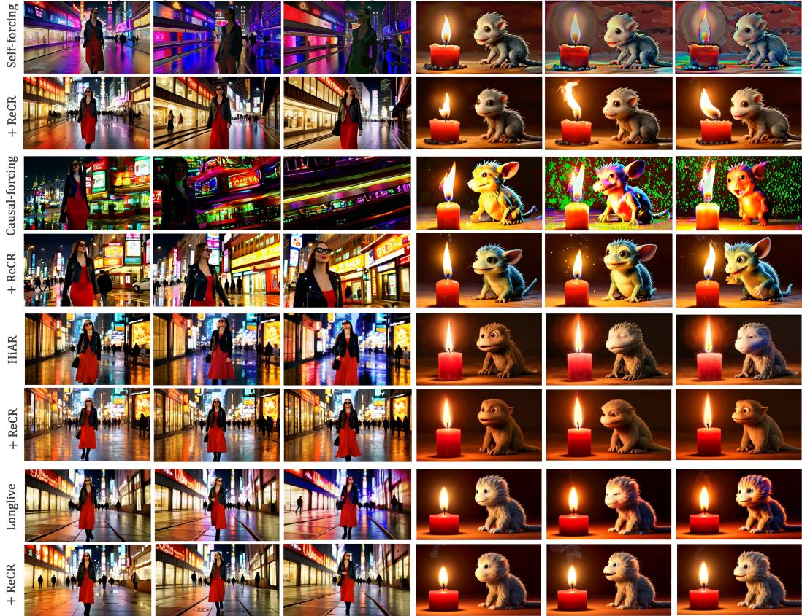  
Figure 7: ReCR’s results on more backbone and more frame.

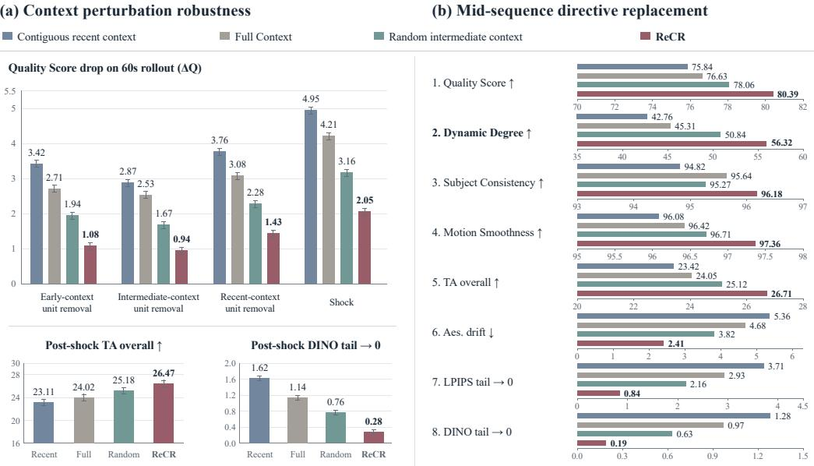  
Figure 8: Mechanistic robustness analysis. We compare four context construction rules under controlled perturbations: contiguous recent context, Full Context, random intermediate context, and ReCR.

representations. If the unit representations do not separate persistent visual anchors, evolving events, and redundant local continuation, the selected visible context may not reflect the evidence that is actually useful for future prediction. This limitation is more likely to appear in highly abstract prompts, rapidly changing scenes, or videos where the relevant evidence is spatially localized but weak at the unit level.

Second, ReCR makes local stepwise decisions. At each rollout step, it selects context units for the next prediction, but it does not explicitly plan which evidence may become important several segments later. This design keeps the method training-free and lightweight, but it may be suboptimal for long stories with delayed causal dependencies, repeated scene returns, or objects that disappear and reappear after long gaps.

## E Future Work

The main direction suggested by ReCR is to make the generated history a structured resource for future decoding. One natural extension is to learn adaptive utility scoring from rollout feedback. The current representation utility is hand-designed to balance compatibility with the broader rollout state against redundancy with the recent continuation. A learned scorer could adapt this balance across prompt types, motion patterns, and backbone architectures while preserving the same selected-visible-context formulation.

A second direction is predictive context planning. ReCR currently selects the context for the next decoding step, but long videos often require evidence that remains useful across many future steps. Future methods could select context not only for immediate prediction, but also for anticipated future needs, such as returning to a previous scene, maintaining a recurring object, or preserving a long-range action plan.

A third direction is finer-grained memory. ReCR selects whole latent frames as context units, which is simple and backbone-compatible. More structured variants could select objects, regions, motion tracks, or geometry-aware scene elements. Such memory could help when the important evidence occupies only a small part of a frame or when multiple objects evolve independently.

Finally, ReCR could be combined more tightly with cache-based prompt responsiveness. The transition-count experiments suggest that cache flushing and selected visible context rewriting address different failure modes: cache mechanisms help the decoder respond quickly to new directives, while ReCR improves which generated evidence remains available after the switch. A hybrid system could jointly decide when to flush, what to retain, and how to expose the retained history on the causal timeline.

## F Existing Assets and Licenses

This work uses existing research assets only for evaluation, comparison, and implementation of baselines. We use the MovieGen prompt suite for text-to-video prompts and cite the original MovieGen paper in the main text. We evaluate generated videos with standard long-video and drift metrics, including VBench-Long-style quality metrics and commonly used feature backbones or perceptual measures such as DINO, LPIPS, and text-image alignment models. We also compare against published autoregressive video generation and training-free inference methods, including Self-Forcing, Self-Forcing++, LongLive, Causal-Forcing, HiAR, Deep Forcing, and Infinity-RoPE, with citations provided in the main paper.

We do not claim ownership of these existing assets. All original datasets, prompts, codebases, model checkpoints, and evaluation tools remain subject to their original licenses and terms of use. Our use is limited to research evaluation and method comparison. When releasing code, we will provide clear instructions for users to obtain any third-party assets from their original sources and to follow the corresponding license terms. The released package will not redistribute third-party model weights or datasets unless their licenses explicitly permit redistribution.

The new asset introduced by this work is the ReCR implementation and associated evaluation scripts. The code is released through the repository listed in the abstract. The release includes the context selection implementation, metric reductions, tests, and instructions for integrating ReCR with a video backbone; backbone-specific integrations are not included. Generated videos shown in the paper are produced for research demonstration and are not intended as a standalone dataset for downstream training.

## G Broader Impact

ReCR is a decoding method for improving long-horizon autoregressive video generation. Its positive impact is to make long-video generation more stable under fixed visible-token budgets, which can support research on controllable video synthesis, simulation, creative tools, and diagnostic evaluation of autoregressive decoders. By focusing on test-time context allocation rather than retraining, ReCR may also make long-video improvements more accessible to researchers who cannot afford large-scale model training.

The same improvement in long-video coherence can also increase the quality of synthetic media. More stable long videos may be misused for misleading content, impersonation, or disinformation when combined with unsafe prompts, identity-conditioned generation, or downstream editing tools. ReCR itself does not introduce a new dataset, identity model, or deployment system, but it can improve the outputs of existing video generators. Responsible use therefore requires the same safeguards expected for generative video systems, including provenance tracking, watermarking when available, prompt and content filtering, and clear disclosure when generated videos are used in public-facing settings.

Our experiments use controlled text prompts and focus on generic scenes rather than real private individuals. The method is intended for research use and analysis of autoregressive decoding behavior. We do not recommend deploying ReCR-enhanced generation systems without the safety mechanisms, content policies, and misuse monitoring appropriate for the underlying video generator.

## H Use of Large Language Models

We used large language models only for editing and improving the clarity of the manuscript, including grammar, spelling and word choice,.

Specifically, we used Gemini 2.5 Pro and Gemini 3 Pro to polish early manuscript drafts. Example prompt include:

Please check the grammar, spelling, word choice, and sentence flow of the following LaTeX text. Keep all equations, labels, references, and macros unchanged, and avoid changing the scientific content.

## NeurIPS Paper Checklist

## 1. Claims

Question: Do the main claims made in the abstract and introduction accurately reflect the paper’s contributions and scope?

Answer: [Yes]

Justification: The abstract and introduction state that ReCR is a training-free method for representation-guided context rewriting under a fixed visible-context budget. These claims are supported by the method section, standard long-video benchmarks, drift diagnostics, visible-context analysis, and transition-count prompt-switch experiments.

Guidelines:

• The answer [N/A] means that the abstract and introduction do not include the claims made in the paper.

• The abstract and/or introduction should clearly state the claims made, including the contributions made in the paper and important assumptions and limitations. A [No] or [N/A] answer to this question will not be perceived well by the reviewers.

• The claims made should match theoretical and experimental results, and reflect how much the results can be expected to generalize to other settings.

• It is fine to include aspirational goals as motivation as long as it is clear that these goals are not attained by the paper.

## 2. Limitations

Question: Does the paper discuss the limitations of the work performed by the authors?

Answer: [Yes]

Justification:The paper discusses limitations in the Conclusion and Discussion and in App. D. These include dependence on internal decoder representations, local stepwise selection, coarse unit-level context granularity, and additional inference-time overhead.

Guidelines:

• The answer [N/A] means that the paper has no limitation while the answer [No] means that the paper has limitations, but those are not discussed in the paper.

• The authors are encouraged to create a separate “Limitations” section in their paper.

• The paper should point out any strong assumptions and how robust the results are to violations of these assumptions (e.g., independence assumptions, noiseless settings, model well-specification, asymptotic approximations only holding locally). The authors should reflect on how these assumptions might be violated in practice and what the implications would be.

• The authors should reflect on the scope of the claims made, e.g., if the approach was only tested on a few datasets or with a few runs. In general, empirical results often depend on implicit assumptions, which should be articulated.

• The authors should reflect on the factors that influence the performance of the approach. For example, a facial recognition algorithm may perform poorly when image resolution is low or images are taken in low lighting. Or a speech-to-text system might not be used reliably to provide closed captions for online lectures because it fails to handle technical jargon.

• The authors should discuss the computational efficiency of the proposed algorithms and how they scale with dataset size.

• If applicable, the authors should discuss possible limitations of their approach to address problems of privacy and fairness.

• While the authors might fear that complete honesty about limitations might be used by reviewers as grounds for rejection, a worse outcome might be that reviewers discover limitations that aren’t acknowledged in the paper. The authors should use their best judgment and recognize that individual actions in favor of transparency play an important role in developing norms that preserve the integrity of the community. Reviewers will be specifically instructed to not penalize honesty concerning limitations.

## 3. Theory assumptions and proofs

Question: For each theoretical result, does the paper provide the full set of assumptions and a complete (and correct) proof?

Answer: [N/A]

Justification: The paper does not present formal theoretical theorems or proofs. The mathematical content consists of definitions, scoring functions, and the ReCR selection objective used for the decoding algorithm.

Guidelines:

• The answer [N/A] means that the paper does not include theoretical results.

• All the theorems, formulas, and proofs in the paper should be numbered and crossreferenced.

• All assumptions should be clearly stated or referenced in the statement of any theorems.

• The proofs can either appear in the main paper or the supplemental material, but if they appear in the supplemental material, the authors are encouraged to provide a short proof sketch to provide intuition.

• Inversely, any informal proof provided in the core of the paper should be complemented by formal proofs provided in appendix or supplemental material.

• Theorems and Lemmas that the proof relies upon should be properly referenced.

## 4. Experimental result reproducibility

Question: Does the paper fully disclose all the information needed to reproduce the main experimental results of the paper to the extent that it affects the main claims and/or conclusions of the paper (regardless of whether the code and data are provided or not)?

Answer: [Yes]

Justification: The paper provides the ReCR objective, explicit inference procedure, greedy selection approximation, experimental setup, evaluation metrics, visible-context diagnostics, and transition-count benchmark construction. The core algorithm is provided through the repository linked in the abstract.

## Guidelines:

• The answer [N/A] means that the paper does not include experiments.

• If the paper includes experiments, a [No] answer to this question will not be perceived well by the reviewers: Making the paper reproducible is important, regardless of whether the code and data are provided or not.

• If the contribution is a dataset and/or model, the authors should describe the steps taken to make their results reproducible or verifiable.

• Depending on the contribution, reproducibility can be accomplished in various ways. For example, if the contribution is a novel architecture, describing the architecture fully might suffice, or if the contribution is a specific model and empirical evaluation, it may be necessary to either make it possible for others to replicate the model with the same dataset, or provide access to the model. In general. releasing code and data is often one good way to accomplish this, but reproducibility can also be provided via detailed instructions for how to replicate the results, access to a hosted model (e.g., in the case of a large language model), releasing of a model checkpoint, or other means that are appropriate to the research performed.

• While NeurIPS does not require releasing code, the conference does require all submissions to provide some reasonable avenue for reproducibility, which may depend on the nature of the contribution. For example

(a) If the contribution is primarily a new algorithm, the paper should make it clear how to reproduce that algorithm.

(b) If the contribution is primarily a new model architecture, the paper should describe the architecture clearly and fully.

(c) If the contribution is a new model (e.g., a large language model), then there should either be a way to access this model for reproducing the results or a way to reproduce the model (e.g., with an open-source dataset or instructions for how to construct the dataset).

(d) We recognize that reproducibility may be tricky in some cases, in which case authors are welcome to describe the particular way they provide for reproducibility. In the case of closed-source models, it may be that access to the model is limited in some way (e.g., to registered users), but it should be possible for other researchers to have some path to reproducing or verifying the results.

## 5. Open access to data and code

Question: Does the paper provide open access to the data and code, with sufficient instructions to faithfully reproduce the main experimental results, as described in supplemental material?

Answer: [Yes]

Justification: The repository linked in the abstract provides the core ReCR algorithm, evaluation reductions, tests, and integration instructions. Backbone-specific integrations are not included.

Guidelines:

• The answer [N/A] means that paper does not include experiments requiring code.

• Please see the NeurIPS code and data submission guidelines (https://neurips.cc/ public/guides/CodeSubmissionPolicy) for more details.

• While we encourage the release of code and data, we understand that this might not be possible, so [No] is an acceptable answer. Papers cannot be rejected simply for not including code, unless this is central to the contribution (e.g., for a new open-source benchmark).

• The instructions should contain the exact command and environment needed to run to reproduce the results. See the NeurIPS code and data submission guidelines (https: //neurips.cc/public/guides/CodeSubmissionPolicy) for more details.

• The authors should provide instructions on data access and preparation, including how to access the raw data, preprocessed data, intermediate data, and generated data, etc.

• The authors should provide scripts to reproduce all experimental results for the new proposed method and baselines. If only a subset of experiments are reproducible, they should state which ones are omitted from the script and why.

• At submission time, to preserve anonymity, the authors should release anonymized versions (if applicable).

• Providing as much information as possible in supplemental material (appended to the paper) is recommended, but including URLs to data and code is permitted.

## 6. Experimental setting/details

Question: Does the paper specify all the training and test details (e.g., data splits, hyperparameters, how they were chosen, type of optimizer) necessary to understand the results?

Answer: [Yes]

Justification: The paper specifies the MovieGen-128 prompt benchmark, 30- and 60-second rollout settings, compared backbone families, matched visible-token budget, shared seeds and sampling schedules, drift metrics, and transition-count benchmark. Additional details are provided in App. B.

Guidelines:

• The answer [N/A] means that the paper does not include experiments.

• The experimental setting should be presented in the core of the paper to a level of detail that is necessary to appreciate the results and make sense of them.

• The full details can be provided either with the code, in appendix, or as supplemental material.

## 7. Experiment statistical significance

Question: Does the paper report error bars suitably and correctly defined or other appropriate information about the statistical significance of the experiments?

Answer: [No]

Justification: The main quantitative tables report aggregate benchmark scores and drift metrics, and the diagnostic plots include variability visualization where applicable. However, due to computational constraint, the current version does not provide confidence intervals or formal statistical significance tests for main benchmark tables.

## Guidelines:

• The answer [N/A] means that the paper does not include experiments.

• The authors should answer [Yes] if the results are accompanied by error bars, confidence intervals, or statistical significance tests, at least for the experiments that support the main claims of the paper.

• The factors of variability that the error bars are capturing should be clearly stated (for example, train/test split, initialization, random drawing of some parameter, or overall run with given experimental conditions).

• The method for calculating the error bars should be explained (closed form formula, call to a library function, bootstrap, etc.)

• The assumptions made should be given (e.g., Normally distributed errors).

• It should be clear whether the error bar is the standard deviation or the standard error of the mean.

• It is OK to report 1-sigma error bars, but one should state it. The authors should preferably report a 2-sigma error bar than state that they have a 96% CI, if the hypothesis of Normality of errors is not verified.

• For asymmetric distributions, the authors should be careful not to show in tables or figures symmetric error bars that would yield results that are out of range (e.g., negative error rates).

• If error bars are reported in tables or plots, the authors should explain in the text how they were calculated and reference the corresponding figures or tables in the text.

## 8. Experiments compute resources

Question: For each experiment, does the paper provide sufficient information on the computer resources (type of compute workers, memory, time of execution) needed to reproduce the experiments?

Answer: [Yes]

Justification: The paper reports that all experiments are run on a single NVIDIA H200 GPU and provides block latency in Table 3. App. B.5 further describes the single-GPU inference setting and the additional overhead introduced by representation scoring and subset selection.

Guidelines:

• The answer [N/A] means that the paper does not include experiments.

• The paper should indicate the type of compute workers CPU or GPU, internal cluster, or cloud provider, including relevant memory and storage.

• The paper should provide the amount of compute required for each of the individual experimental runs as well as estimate the total compute.

• The paper should disclose whether the full research project required more compute than the experiments reported in the paper (e.g., preliminary or failed experiments that didn’t make it into the paper).

## 9. Code of ethics

Question: Does the research conducted in the paper conform, in every respect, with the NeurIPS Code of Ethics https://neurips.cc/public/EthicsGuidelines?

Answer: [Yes]

Justification: The research conforms to the NeurIPS Code of Ethics. The work uses controlled text prompts, evaluates generated videos, and includes discussion of societal risks, safeguards, and existing assets.

Guidelines:

• The answer [N/A] means that the authors have not reviewed the NeurIPS Code of Ethics.

• If the authors answer [No], they should explain the special circumstances that require a deviation from the Code of Ethics.

• The authors should make sure to preserve anonymity (e.g., if there is a special consideration due to laws or regulations in their jurisdiction).

## 10. Broader impacts

Question: Does the paper discuss both potential positive societal impacts and negative societal impacts of the work performed?

Answer: [Yes]

Justification: App. G discusses positive impacts such as improved long-video stability for research and creative tools, as well as negative impacts such as higher-quality synthetic media misuse, impersonation, and disinformation. It also discusses mitigation strategies including provenance tracking, watermarking, content filtering, and disclosure.

Guidelines:

• The answer [N/A] means that there is no societal impact of the work performed.

• If the authors answer [N/A] or [No], they should explain why their work has no societal impact or why the paper does not address societal impact.

• Examples of negative societal impacts include potential malicious or unintended uses (e.g., disinformation, generating fake profiles, surveillance), fairness considerations (e.g., deployment of technologies that could make decisions that unfairly impact specific groups), privacy considerations, and security considerations.

• The conference expects that many papers will be foundational research and not tied to particular applications, let alone deployments. However, if there is a direct path to any negative applications, the authors should point it out. For example, it is legitimate to point out that an improvement in the quality of generative models could be used to generate Deepfakes for disinformation. On the other hand, it is not needed to point out that a generic algorithm for optimizing neural networks could enable people to train models that generate Deepfakes faster.

• The authors should consider possible harms that could arise when the technology is being used as intended and functioning correctly, harms that could arise when the technology is being used as intended but gives incorrect results, and harms following from (intentional or unintentional) misuse of the technology.

• If there are negative societal impacts, the authors could also discuss possible mitigation strategies (e.g., gated release of models, providing defenses in addition to attacks, mechanisms for monitoring misuse, mechanisms to monitor how a system learns from feedback over time, improving the efficiency and accessibility of ML).

## 11. Safeguards

Question: Does the paper describe safeguards that have been put in place for responsible release of data or models that have a high risk for misuse (e.g., pre-trained language models, image generators, or scraped datasets)?

Answer: [N/A].

Justification: Although ReCR does not release a new generative model or dataset, the paper still discusses safeguards relevant to improved video generation.

Guidelines:

• The answer [N/A] means that the paper poses no such risks.

• Released models that have a high risk for misuse or dual-use should be released with necessary safeguards to allow for controlled use of the model, for example by requiring that users adhere to usage guidelines or restrictions to access the model or implementing safety filters.

• Datasets that have been scraped from the Internet could pose safety risks. The authors should describe how they avoided releasing unsafe images.

• We recognize that providing effective safeguards is challenging, and many papers do not require this, but we encourage authors to take this into account and make a best faith effort.

## 12. Licenses for existing assets

Question: Are the creators or original owners of assets (e.g., code, data, models), used in the paper, properly credited and are the license and terms of use explicitly mentioned and properly respected?

Answer: [Yes]

Justification: The paper identifies the existing assets used for prompts, evaluation, baselines, and feature metrics.

Guidelines:

• The answer [N/A] means that the paper does not use existing assets.

• The authors should cite the original paper that produced the code package or dataset.

• The authors should state which version of the asset is used and, if possible, include a URL.

• The name of the license (e.g., CC-BY 4.0) should be included for each asset.

• For scraped data from a particular source (e.g., website), the copyright and terms of service of that source should be provided.

• If assets are released, the license, copyright information, and terms of use in the package should be provided. For popular datasets, paperswithcode.com/datasets has curated licenses for some datasets. Their licensing guide can help determine the license of a dataset.

• For existing datasets that are re-packaged, both the original license and the license of the derived asset (if it has changed) should be provided.

• If this information is not available online, the authors are encouraged to reach out to the asset’s creators.

## 13. New assets

Question: Are new assets introduced in the paper well documented and is the documentation provided alongside the assets?

Answer: [Yes]

Justification: The new asset introduced by this work is the ReCR implementation and associated evaluation scripts, released through the repository linked in the abstract.

Guidelines:

• The answer [N/A] means that the paper does not release new assets.

• Researchers should communicate the details of the dataset/code/model as part of their submissions via structured templates. This includes details about training, license, limitations, etc.

• The paper should discuss whether and how consent was obtained from people whose asset is used.

• At submission time, remember to anonymize your assets (if applicable). You can either create an anonymized URL or include an anonymized zip file.

## 14. Crowdsourcing and research with human subjects

Question: For crowdsourcing experiments and research with human subjects, does the paper include the full text of instructions given to participants and screenshots, if applicable, as well as details about compensation (if any)?

Answer: [N/A]

Justification: The paper does not report crowdsourcing or research with human subjects.

Guidelines:

• The answer [N/A] means that the paper does not involve crowdsourcing nor research with human subjects.

• Including this information in the supplemental material is fine, but if the main contribution of the paper involves human subjects, then as much detail as possible should be included in the main paper.

• According to the NeurIPS Code of Ethics, workers involved in data collection, curation, or other labor should be paid at least the minimum wage in the country of the data collector.

## 15. Institutional review board (IRB) approvals or equivalent for research with human subjects

Question: Does the paper describe potential risks incurred by study participants, whether such risks were disclosed to the subjects, and whether Institutional Review Board (IRB) approvals (or an equivalent approval/review based on the requirements of your country or institution) were obtained?

Answer: [N/A]

Justification: The paper does not report research with human subjects.

Guidelines:

• The answer [N/A] means that the paper does not involve crowdsourcing nor research with human subjects.

• Depending on the country in which research is conducted, IRB approval (or equivalent) may be required for any human subjects research. If you obtained IRB approval, you should clearly state this in the paper.

• We recognize that the procedures for this may vary significantly between institutions and locations, and we expect authors to adhere to the NeurIPS Code of Ethics and the guidelines for their institution.

• For initial submissions, do not include any information that would break anonymity (if applicable), such as the institution conducting the review.

## 16. Declaration of LLM usage

Question: Does the paper describe the usage of LLMs if it is an important, original, or non-standard component of the core methods in this research? Note that if the LLM is used only for writing, editing, or formatting purposes and does not impact the core methodology, scientific rigor, or originality of the research, declaration is not required.

Answer: [N/A].

Justification: LLMs were used only for manuscript spelling and word choice.

Guidelines:

• The answer [N/A] means that the core method development in this research does not involve LLMs as any important, original, or non-standard components.

• Please refer to our LLM policy in the NeurIPS handbook for what should or should not be described.