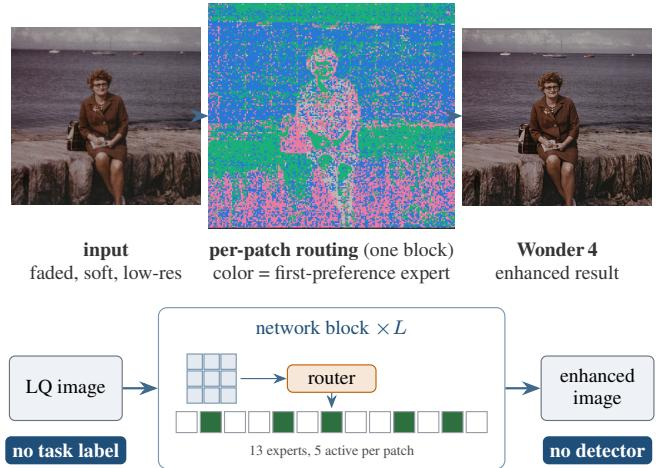
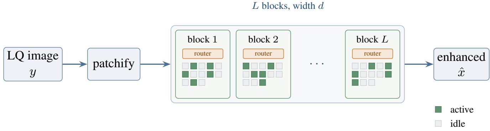
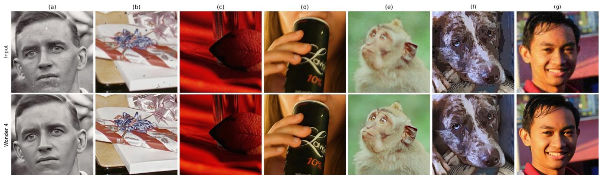
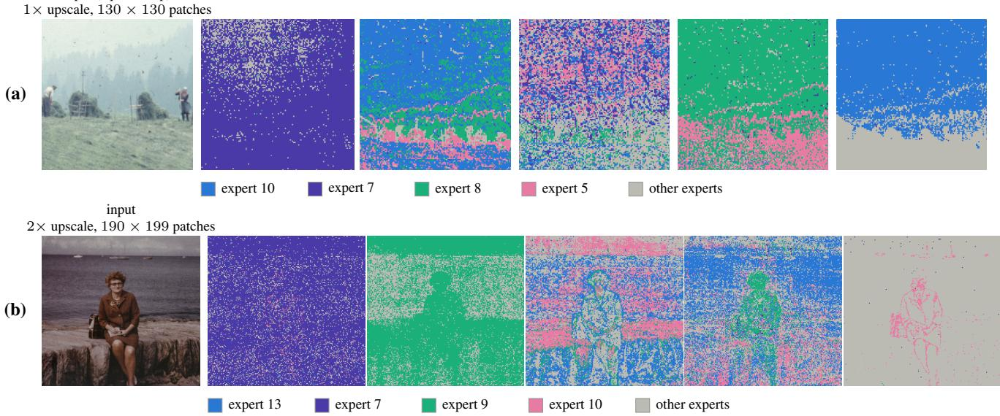

# Wonder 4: A Mixture-of-Experts Recipe for Image Quality Enhancement

Yunan Wu Bin Sun Partha Acharjee Xiaoyu Wang Topaz Labs Research

## Abstract

A real photograph is often blurry, grainy, compressed, scratched, and low-resolution at the same time. Each defect has its own severity and its own place in the image. The correctionsfor these defects conflict with each other. Existing models describe the whole image with one description, so they cannot say where each correction belongs. To solve this problem, we present Wonder 4, a mixture-of-experts (MoE) model for image quality enhancement. It corrects several defects ofa real photograph at the same time, each in the region where it occurs. Every block of the model holds a mixture of N = 13 experts. A router, trained with the model, sends every image patch to k = 5 of them. No degradation classifier, mask, prompt, detector, or task label is used. Another issue is that standard MoE training, taken from language models, pushes every expert toward equal use. Equal use applies every correction everywhere, even where it is not needed. We replace this rule with a bias that only sets a minimum share of use. Across all patches, an expert used less than this minimum gets higher router scores until it is selected again. An expert above the minimum is not changed, so no expert is forced to be used as often as the others. The bias needs no extra loss. The method adds no extra module and no extra processing step. We evaluate Wonder 4 on DIV2K and Flickr2K, against five published methods and three open-weight pipelines. It reaches the best LPIPS, DISTS, and NIQE on all three test settings (DIV2K ×4, DIV2K ×8, and Flickr2K ×4). The full version of the report will be released soon.

## 1. Introduction

A scanned family photograph is usually blurry from the lens and the scan, grainy from the film, marked by compression bands, covered by dust and scratches from the print, and much lower in resolution than people now want to view. Every defect is present at the same time. Each defect has its own severity and is limited to its own part of the image. This is the ordinary case in consumer photography, and we call it high-order mixed degradation. The required output quality is much higher. A result is acceptable only if it still looks correct at full resolution, with no softened edge, no invented texture, and no visible boundary between corrected and untouched regions. That is the quality a photo retoucher aims for, and the quality we mean by professional-grade. These corrections conflict with each other. Removing noise also removes film grain. Keeping the grain leaves the blur uncorrected. Removing a scratch adds false texture if the same correction is applied to a clean sky. A model that improves this photograph must decide not only how strongly to retouch each region but where, and it must apply incompatible corrections to different regions of one image.

  
Figure 1. Wonder 4 at a glance. Top: a low-quality (LQ) input photograph, a map showing which expert each patch (a small region of the image) prefers in one block, and the enhanced output. Colors are expert indices. Bottom: the LQ image passes through L blocks. In each block a router sends every patch to 5 of 13 experts (green cells). Because every patch chooses its own experts, a photograph with several defects is corrected in one pass with no task label and no degradation detector.

Task-specific models for super-resolution, denoising, deblurring, compression-artifact removal and damage repair are each trained on a degradation pipeline built for one task and have never seen this combination of defects. Running them one after another has three drawbacks: the order of the corrections must be chosen in advance, each model works on the invented detail of the one before it, and a detector is needed to decide which model runs. Unified models were introduced to solve this problem, but they all stop for the same reason. They condition on a global description of the degradation, whether inferred as a code [9] or prompt [10], borrowed from a vision–language model [11], written or planned as text [12, 13], predicted as the predominant class [20], or set by a task flag [21]. One description for the whole image cannot say which region each correction belongs to, and getting that description needs a second network, whose mistakes limit the whole result. This limitation also shows in how the field evaluates these models. The standard test combines denoising, deraining, dehazing, deblurring and low-light enhancement [22], and the corrections missing from that test are exactly the localized ones. Neither pipelines of separate models nor these unified models handle high-order mixed degradation. A pipeline never sees the combined defects and cannot apply conflicting corrections without detectors and a fixed order. A unified model that conditions on one global description cannot assign incompatible corrections to different regions of the picture.

Because the image can be split into patches, a mixture of experts (MoE) is a good match: it computes a combination of corrections at every patch, rather than one decision about which task is present. In language modeling the standard design is already fixed. An MoE network replaces each dense layer with an MoE layer of structurally identical experts and a linear router that selects a few experts for each input $[ 1 , 2 , 4 ,$ 6–8], and the same layer is used without change in generative image models [24]. Image restoration has not adopted it. Existing restoration mixtures either select experts once per image or replace the experts with prompts, adapters, or whole models chosen by an external degradation estimator [14–19]. Most of them also take a rule from language models: every expert should be used equally. This is right when the experts do the same job, and harmful when a correction belongs on only a few patches. Scratch removal is one such case, since a scratch covers only a small part of the image.

We propose Wonder 4, which is the first MoE architecture for image quality enhancement. Its experts are $N = 1 3$ structurally identical small networks, one MoE layer per block of the backbone, selected $k = 5$ at a time per patch by a router local to that block. The router needs no estimator, so each patch is routed where its own defect occurs. One rule adapts the recipe to photographs. We add a bias to the scores the router uses when it chooses experts [5, 6]. Each expert must be selected for at least a minimum share of the patches. If an expert is selected less often than this minimum, that bias increases until the router selects it often enough. Once an expert is above the minimum, the bias stops increasing, so a correction that belongs in only a few places stays there. Other models cover many defects by adding extra parts. Wonder 4 uses the standard mixture and adds nothing else: no second network to classify the damage, no prompts, no mask, no second processing step, and no separate path for each task. Wonder 4 is released in a consumer application.

## 2. Model

A photograph that needs several corrections, each in its own region, cannot be handled by one decision about the whole image. It needs a decision at every location, and a way to apply more than one correction there. A sparse mixture of experts does both, so Wonder 4 uses its standard form. An MoE layer of identical experts replaces the standard dense layer of each block. A linear router is placed in each layer. It selects the top k experts for each patch. To achieve better performance, we change one thing in Wonder 4: each expert is given a minimum share of use instead of an equal share, so a correction is applied only where it is needed (Sec. 2.4). This section first describes the architecture, then the MoE layer, the router, expert training, and the training objective.

## 2.1. Model Architecture

Figure 2 shows Wonder 4. It takes the low-quality input image y, resized to the target resolution, and produces the enhanced image xˆ. A backbone network with L blocks of width d does the work. It operates on patches of the image. An MoE layer with its own router replaces the standard dense layer in every block. This backbone fits a per-patch mixture. Splitting the image into patches gives every region its own unit, so each region can be routed separately. No second network is needed to estimate the damage.

## 2.2. Mixture-of-Experts Layer

In every block ℓ, an MoE layer of $N = 1 3$ experts replaces the ordinary dense layer. Each expert is a small network of intermediate width $d _ { \mathrm { f } }$ , in the gated form called SwiGLU,

$$
\begin{array} { r } { E _ { a } ^ { ( \ell ) } ( u ) \ = \ W _ { a , 3 } ^ { ( \ell ) } \Big ( \operatorname { S i L U } \big ( W _ { a , 1 } ^ { ( \ell ) } u \big ) \odot W _ { a , 2 } ^ { ( \ell ) } u \Big ) , } \end{array}\tag{1}
$$

Here a indexes the expert, ℓ the block, u is the input of the layer at one patch and the $W  { \mathbf { \bar { s } } }$ are learned matrices. SiLU is a smooth on–off function, and ⊙ multiplies two vectors entry by entry. All experts are built the same way and start from random weights. Each patch uses $k = 5$ of the 13. In each layer the router selects a new set of 5 experts. This lets the model hold more experts without using more computation at run time. Each expert is specialized for a specific type of defect. Five experts per patch let corrections combine where defects overlap.

## 2.3. Router and Top-k Selection

The router decides where each correction belongs. Each block has its own router, and the router works on one patch at a time. For patch i it applies one linear layer to the layer’s input $u _ { i } ^ { ( \ell ) }$

$$
o _ { i } ^ { ( \ell ) } = W _ { r } ^ { ( \ell ) } u _ { i } ^ { ( \ell ) } + b _ { r } ^ { ( \ell ) } , \qquad g _ { i } ^ { ( \ell ) } = \mathrm { s o f t m a x } \big ( o _ { i } ^ { ( \ell ) } \big ) .\tag{2}
$$

  
Figure 2. Wonder 4 inference path. The low-quality (LQ) input image y is split into patches (patchify) and passed through a backbone of L blocks of width d, which produces the enhanced image xˆ. Every block carries its own router and its own bank of N=13 experts (small cells). For each patch the router activates k=5 of them (green, active); the rest stay idle (grey). The active cells drawn differ between blocks because selection is made per patch and per block, not once per image.

Here i indexes the patch, and softmax turns the scores o into probabilities g over the experts. The routing decision is made by this one linear layer. The layer is not trained to classify the type of damage.

The choice of which experts a patch uses is kept separate from how much each selected expert contributes. The extra score $\beta _ { a } ^ { ( \ell ) }$ , a per-expert bias that raises the selection chance of under-used experts (Sec. 2.4), is added only to the scores used to choose experts. It is not added to the probabilities. In training, random noise is also added to those scores. The noise lets the router try other experts [1],

$$
\begin{array} { r } { \boldsymbol { A } _ { i } ^ { ( \ell ) } = \operatorname { T o p } { - k _ { a } \left( o _ { i , a } ^ { ( \ell ) } + \beta _ { a } ^ { ( \ell ) } + \sigma _ { \mathrm { e x } } \xi _ { i , a } \right) } , \quad \xi _ { i , a } \sim \mathcal { N } ( 0 , 1 ) , } \end{array}\tag{3}
$$

Here $\mathcal { A } _ { i } ^ { ( \ell ) }$ is the set of selected experts, Top -k keeps the k largest scores, and ξ is random noise of scale $\sigma _ { \mathrm { e x } }$ , with $\sigma _ { \mathrm { e x } } ~ = ~ 0$ at inference. The probabilities of the selected experts are scaled so they sum to one [4]. The layer returns their weighted sum in place of the dense layer’s output u˜,

$$
\tilde { u } _ { i } ^ { ( \ell ) } = \sum _ { a \in A _ { i } ^ { ( \ell ) } } w _ { i , a } ^ { ( \ell ) } E _ { a } ^ { ( \ell ) } \big ( u _ { i } ^ { ( \ell ) } \big ) , \quad w _ { i , a } ^ { ( \ell ) } = \frac { g _ { i , a } ^ { ( \ell ) } } { \sum _ { a ^ { \prime } \in A _ { i } ^ { ( \ell ) } } g _ { i , a ^ { \prime } } ^ { ( \ell ) } } .\tag{4}
$$

The weights always sum to one. The extra score can change which experts a patch uses, and the amount of correction stays the same. Equations (1) to (4) are the full computation of the MoE layer.

## 2.4. Expert Training

The usual rule pushes every expert toward equal use [2]. That rule is right when experts are meant to do the same job, but it is wrong in our case. Some experts are needed in only a small part of the images. Under an equal-use rule, an expert that is needed on only a small subset of patches, such as the physical-damage expert, is also applied to patches where it should not be used. Stars in a night sky are one such case. The same bright points are physical damage anywhere else in a photograph, and a user expects them to be removed, but in a photograph of the night sky they are the subject and must not be erased. Every expert then learns the same average correction. We keep the usual balancing mechanism, a bias on the selection scores, and change its target. Each expert has a minimum share of the routing weight, summed over all patches. The router still selects only $k = 5$ experts for each patch. An expert below its minimum gets higher selection scores until it is selected often enough, so no expert is left unused. An expert above its minimum is not changed, so no expert is forced to be used more often than the training images need.

The mechanism is a bias from DeepSeek-V3 [5, 6]. It needs no extra loss. It acts only on the scores used for selection, so this balancing step does not work against the main training loss. The load of expert a in block ℓ is the share of the routing weight it receives over the T patches of one training step, $\begin{array} { r } { f _ { a } ^ { ( \ell ) } = \frac { 1 } { T } \sum _ { i } w _ { i , a } ^ { ( \ell ) } } \end{array}$ . We track it with an exponential moving average $\bar { f } _ { a } ^ { ( \ell ) }$ , a running average that gives more weight to recent steps, with decay γ. The floor ϕ is a fraction $\rho$ of an equal share, $\rho / N$ . The bias grows with step size $\eta _ { \beta }$ and stops growing once an expert reaches the floor (clip limits the ratio to [0, 1]),

$$
\beta _ { a } ^ { ( \ell ) } \gets \beta _ { a } ^ { ( \ell ) } + \eta _ { \beta } \ \mathrm { c l i p } \left( \frac { \phi - \bar { f } _ { a } ^ { ( \ell ) } } { \phi } , 0 , 1 \right) .\tag{5}
$$

After each update, the biases of a block are shifted to average zero and limited to $[ - \kappa , \kappa ]$ . An expert below the floor is increased until that expert is selected often enough to be trained. An expert above the floor is not changed.

  
Figure 3. Showcase: several defects mixed in real photographs. Each column shows the same crop from the input (top) and Wonder 4 (bottom). (a) Scanned print with dust and scratches over a blurred region. (b) Dust and scratches on wrapping paper. (c) Heavy grain in a low-light photograph. (d) Grain and softness on fine detail and lettering. (e) Grain on fur. (f) Compression blocking and softness on fur. (g) Blur and grain together. Every column carries at least two defect families at once, and Wonder 4 corrects them in a single pass with no detector, mask or task label. Best viewed at full size.

## 2.5. Training Objective

The model is trained end to end in a single run. Three small loss terms are added to the enhancement loss. The ST-MoE router z-loss keeps the router’s scores from growing too large [3]. An entropy penalty on the routing weights, increased gradually during training, pushes each patch to give most of its weight to only a few of its five experts. A third penalty applies when the cosine similarity of two experts weights exceeds a threshold c0. This penalty keeps experts from learning the same correction. Experts can still overlap where their corrections should overlap. The enhancement loss is a weighted sum of mean squared error (MSE) terms, LPIPS [31] and an adversarial term, which rewards realistic images.

## 3. Experiments

The experiments compare Wonder 4 with existing methods on public benchmarks, test it on real photographs that carry several defects at once, and measure whether the router makes a separate decision at each location.

## 3.1. Experimental Settings

Benchmarks. We use three test settings. The first is DIV2K validation (100 images) under the mixed ×4 degradation of the NTIRE 2018 challenge, called wild ×4 [33, 34]. Blur, noise and compression are mixed, and their strength varies from image to image. The second is DIV2K validation at ×8 bicubic downsampling (100 images). At this scale, simply resizing the image is not enough, so methods must create the missing detail. The third is Flickr2K at ×4 (2 650 images) [35]. This set is large enough that a difference in the average score is reliable. No DIV2K or Flickr2K image was used to train Wonder 4. Several baselines, for example

Real-ESRGAN, include both datasets in their training data.

Metrics. We report PSNR on the Y (brightness) channel, where higher is better, and the perceptual metrics LPIPS [31], DISTS [32] and NIQE [30]. LPIPS and DISTS compare with the ground truth, the original sharp image. NIQE does not.

Compared methods. We compare against five published enhancement systems, Real-ESRGAN [25], StableSR [26] (the authors’ few-step Turbo variant), SeeSR [27], SUPIR [28] and OSEDiff [29], and three widely adopted open-weight pipelines, the FLUX.1 ControlNet upscaler [38], the Stable Diffusion ×4 upscaler [36] and Qwen-Image-Edit [37]. All baselines run at their authors’ default settings.

## 3.2. Quantitative Results

Table 1 gives the comparison. Wonder 4 reaches the best LPIPS, DISTS and NIQE on every test setting, against both the published methods and the open-weight pipelines. The gains are largest on Flickr2K. There it lowers LPIPS by 19% and DISTS by 27% relative to the strongest published baseline. Among the open-weight pipelines, Qwen-Image-Edit is the closest on the metrics that use the ground truth. Wonder 4 still improves on it by 18% in LPIPS and 16% in DISTS on DIV2K ×4, by 25% and 22% on DIV2K ×8, and by 10% and 15% on Flickr2K.

Wonder 4 does not have the highest PSNR. The methods with the highest PSNR change the input the least, and they rank in the lower half on the perceptual metrics. This is the usual trade-off. A model that adds detail looks better and gets a worse PSNR. SeeSR and OSEDiff, the closest published competitors, lead the learned scores that do not use the ground truth (MUSIQ, CLIP-IQA, MANIQA and TOPIQ) on DIV2K ×4 in the full tables. They add more fine detail than the ground-truth image contains. Those scores reward the extra detail, and metrics that compare with the ground truth give it a lower score.

  
Figure 4. Per-patch routing, drawn on the image. Rows (a) and (b) are two photographs; the first tile of each row is the input (a is a square center crop; the grid size is given in patches, and the upscale factor is 1× for (a) and 2× for (b)). Each other tile is a map of one block, numbered from 0 at the network input. A patch is colored by the expert the router ranks first for it, aligned with the input. Early blocks are flat; late blocks follow the scene patch by patch. Each row has its own color key: only its four most-used experts are colored, all others are grey, and experts are identified only by their index.

Table 1. Quantitative comparison on DIV2K validation (100 images, ×4 wild and ×8 bicubic) and Flickr2K (2 650 images, ×4 unknown degradation). Rows: five published enhancement methods (top), three open-weight pipelines (middle) and Wonder 4 (bottom). Columns: PSNR (dB, on the brightness channel), LPIPS and DISTS (both compare with the ground-truth image) and NIQE (needs no ground truth). ↑/↓: higher/lower is better. Best per column over all methods in bold, second best underlined. The full nine-metric tables are in the full report.
<table><tr><td></td><td colspan="4">DIV2K wild ×4</td><td colspan="4">DIV2K bicubic ×8</td><td colspan="4">Flickr2K unknown ×4</td></tr><tr><td>Method</td><td>PSNR↑</td><td>LPIPS↓</td><td>DISTS↓</td><td>NIQE↓</td><td>PSNR↑</td><td>LPIPS↓</td><td>DISTS↓</td><td>NIQE↓</td><td>PSNR↑</td><td>LPIPS↓</td><td>DISTS↓</td><td>NIQE↓</td></tr><tr><td>Real-ESRGAN [25]</td><td>18.96</td><td>0.4047</td><td>0.2107</td><td>4.36</td><td>23.43</td><td>0.3998</td><td>0.2016</td><td>5.80</td><td>22.07</td><td>0.3723</td><td>0.1887</td><td>4.46</td></tr><tr><td>StableSR (Turbo) [26]</td><td>19.09</td><td>0.4424</td><td>0.2186</td><td>6.05</td><td>24.09</td><td>0.4013</td><td>0.1998</td><td>5.78</td><td>22.04</td><td>0.3922</td><td>0.1950</td><td>5.83</td></tr><tr><td>SeeSR [27]</td><td>18.91</td><td>0.3641</td><td>0.1612</td><td>3.75</td><td>23.46</td><td>0.2927</td><td>0.1341</td><td>3.66</td><td>22.02</td><td>0.3387</td><td>0.1649</td><td>3.76</td></tr><tr><td>SUPIR [28]</td><td>19.07</td><td>0.3698</td><td>0.1849</td><td>3.82</td><td>23.42</td><td>0.3014</td><td>0.1490</td><td>3.66</td><td>22.64</td><td>0.3965</td><td>0.2194</td><td>4.75</td></tr><tr><td>OSEDiff [29]</td><td>18.67</td><td>0.3479</td><td>0.1629</td><td>3.59</td><td>23.10</td><td>0.2842</td><td>0.1355</td><td>3.61</td><td>21.24</td><td>0.3391</td><td>0.1618</td><td>4.02</td></tr><tr><td>FLUX.1 ControlNet Upscaler [38]</td><td>19.04</td><td>0.4094</td><td>0.1908</td><td>4.19</td><td>22.40</td><td>0.3382</td><td>0.1530</td><td>3.95</td><td>21.01</td><td>0.4152</td><td>0.1949</td><td>4.12</td></tr><tr><td>SD ×4 Upscaler [36]</td><td>18.07</td><td>0.6153</td><td>0.2892</td><td>3.94</td><td>22.49</td><td>0.4482</td><td>0.1977</td><td>3.85</td><td>21.66</td><td>0.4302</td><td>0.1914</td><td>3.68</td></tr><tr><td>Qwen-Image-Edit [37]</td><td>18.97</td><td>0.3991</td><td>0.1684</td><td>4.17</td><td>22.66</td><td>0.3092</td><td>0.1385</td><td>4.03</td><td>21.96</td><td>0.3061</td><td>0.1381</td><td>4.15</td></tr><tr><td>Wonder 4</td><td>18.69</td><td>0.3282</td><td>0.1419</td><td>3.53</td><td>23.62</td><td>0.2318</td><td>0.1075</td><td>2.93</td><td>20.41</td><td>0.2745</td><td>0.1177</td><td>3.24</td></tr></table>

## 3.3. Real Photographs with Mixed Defects

Figure 3 shows real photographs with several defects at once: dust and scratches on scanned prints, heavy grain from low light, compression blocks on fur, and blur together with grain. The test settings above are super-resolution settings. They test only one kind of correction. Real photographs test the mixture. Here, Wonder 4 applies the corrections each region needs, together with upscaling, in one pass. It uses no detector, mask or task label.

## 3.4. Localized Expert Routing

A mixture only helps if the router makes a separate decision at each location. A router that selects the same experts everywhere, or one set of experts for the whole image, could still get a good score while failing to do this. We inspect the routing directly. Each block makes one routing decision per patch, so the routing of a block can be drawn as one map. For every patch we take the expert with the highest routing probability, its first choice, and place it on the patch grid, lined up with the photograph (Figure 4). Experts are identified by index only. We assign no job to any of them.

The maps become more detailed in later blocks. The earliest blocks use almost the same expert everywhere and ignore the image content. In Fig. 4(a), block 0 makes expert 7 the first choice for 87% of patches. Structure that follows the image appears soon after. At block 2 of (b), expert 9 takes 85% of the patches on the person in photo (b) but only 67% of the sea and sky. The person forms one region, and the background is a mix of experts. In the later blocks the split follows the scene, patch by patch. In (a), blocks 24 and 29 both separate the meadow from the line of trees. The two blocks use different pairs of experts, and they keep the boundary within three patch rows of the same contour. In (b), at block 28, expert 10 follows the person’s outline, one patch wide. It takes 18% of patches on the person and under 1% in the sky. The router is never given a segmentation. Every boundary in the map is the router’s own estimate of where the image changes.

The same effect can be measured without the picture. Writing $w _ { i }$ for the routing weights of Eq. (4) and $\bar { w } =$ ${ \frac { 1 } { T } } \sum _ { i } w _ { i }$ for their average over the $T$ patches of one image, the within-image routing mutual information (H is entropy)

$$
\begin{array} { r } { I ^ { ( \ell ) } = H \big ( \bar { w } ^ { ( \ell ) } \big ) - \frac { 1 } { T } \sum _ { i } H \big ( w _ { i } ^ { ( \ell ) } \big ) \in \big [ 0 , \log N \big ] } \end{array}\tag{6}
$$

measures how much a patch’s routing depends on which patch it is, inside one image. Averaged over all L blocks, $I \approx 0 . 8 9$ nats (natural-log units), against a maximum of log $1 3 \approx 2 . 5 6$ . Being above zero matters as much as the exact value, because a value of zero would mean there is no per-patch decision. A router that ignores location, and one that decides once per image, both give $I \approx 0 .$ . A value clearly above zero can only come from patches of the same image being routed differently. A correction can change from place to place only when that is true.

## 4. Conclusion

A real photograph has several defects at the same time, and the corrections conflict. A single model for every defect was limited by two things. One description per image cannot say where a correction belongs. Equal use of experts applies every correction everywhere, even where it is not needed. Wonder 4 removes both limits. It keeps the standard sparse mixture: $N = 1 3$ experts per block, and $k = 5$ selected per patch by a router. Each expert gets a minimum share of use instead of equal use. No classifier, estimator, mask, or task label is used. On DIV2K and Flickr2K, Wonder 4 reaches the best LPIPS, DISTS, and NIQE on every test setting, against published methods and open-weight pipelines. The routing maps (Fig. 4) show decisions made inside each image. The method does not depend on our network, our data, or our set of defects. We offer it as a simple, effective baseline for sparse mixtures in image enhancement.

## References

[1] N. Shazeer, A. Mirhoseini, K. Maziarz, A. Davis, Q. Le, G. Hinton, and J. Dean. Outrageously large neural networks: The sparsely-gated mixture-of-experts layer. ICLR, 2017.

[2] W. Fedus, B. Zoph, and N. Shazeer. Switch Transformers: Scaling to trillion parameter models with simple and efficient sparsity. JMLR, 23(120):1–39, 2022.

[3] B. Zoph, I. Bello, S. Kumar, N. Du, Y. Huang, J. Dean, N. Shazeer, and W. Fedus. ST-MoE: Designing stable and transferable sparse expert models. arXiv:2202.08906, 2022.

[4] A. Q. Jiang et al. Mixtral of experts. arXiv:2401.04088, 2024.

[5] L. Wang, H. Gao, C. Zhao, X. Sun, and D. Dai. Auxiliaryloss-free load balancing strategy for mixture-of-experts. arXiv:2408.15664, 2024.

[6] DeepSeek-AI. DeepSeek-V3 technical report. arXiv:2412.19437, 2024.

[7] A. Yang, A. Li, B. Yang, B. Zhang, B. Hui, et al. Qwen3 technical report. arXiv:2505.09388, 2025.

[8] OpenAI. gpt-oss-120b & gpt-oss-20b model card. arXiv:2508.10925, 2025.

[9] B. Li, X. Liu, P. Hu, Z. Wu, J. Lv, and X. Peng. All-in-one image restoration for unknown corruption. CVPR, 2022.

[10] V. Potlapalli, S. W. Zamir, S. Khan, and F. S. Khan. PromptIR: Prompting for all-in-one blind image restoration. NeurIPS, 2023.

[11] Z. Luo, F. K. Gustafsson, Z. Zhao, J. Sjölund, and T. B. Schön. Controlling vision-language models for multi-task image restoration. ICLR, 2024.

[12] M. V. Conde, G. Geigle, and R. Timofte. InstructIR: High-quality image restoration following human instructions. ECCV, 2024.

[13] J. Liu, S. Xu, Q. Yang, Y. Wang, X. Chen, and Z. Ji. FAPE-IR: Frequency-aware planning and execution framework for all-in-one image restoration. CVPR, 2026.

[14] Y. Ren, X. Li, B. Li, X. Wang, M. Guo, S. Zhao, L. Zhang, and Z. Chen. MoE-DiffIR: Task-customized diffusion priors for universal compressed image restoration. ECCV, 2024.

[15] X. He, Z. Tu, K. Cheng, M. Zhu, J. Hu, N. Wang, and X. Gao. Mixture of ranks with degradation-aware routing for one-step real-world image super-resolution. AAAI, 2026. arXiv:2511.16024.

[16] L. Kong, J. Zhang, Z. Duan, X. Wu, Y. Yang, X. Wang, D. Zou, L. Lei, and J. Pan. MiM-DiT: MoE in MoE with diffusion transformers for all-in-one image restoration. arXiv:2603.02710, 2026.

[17] E. Zamfir, Z. Wu, N. Mehta, Y. Tan, D. P. Paudel, Y. Zhang, and R. Timofte. Complexity experts are task-discriminative learners for any image restoration. CVPR, 2025.

[18] Y. Wang, Y. Li, Z. Zheng, X.-P. Zhang, and M. Wei. M2Restore: Mixture-of-experts-based Mamba–CNN fusion framework for all-in-one image restoration. IEEE TIP, 34:8086–8100, 2025.

[19] J. Lin, Z. Zhang, W. Li, H. Xu, H. Zhang, and W. Zuo. UniRestorer: Universal image restoration via adaptively estimating image degradation at proper granularity. ICLR, 2026.

[20] Y. Jiang, Z. Zhang, T. Xue, and J. Gu. AutoDIR: Automatic all-in-one image restoration with latent diffusion. ECCV,

2024.

[21] X. Lin, J. He, Z. Chen, Z. Lyu, B. Dai, F. Yu, Y. Qiao, W. Ouyang, and C. Dong. DiffBIR: Toward blind image restoration with generative diffusion prior. ECCV, 2024.

[22] J. Jiang, Z. Zuo, G. Wu, K. Jiang, and X. Liu. A survey on all-in-one image restoration: Taxonomy, evaluation and future trends. IEEE TPAMI, 47(12):11892–11911, 2025.

[23] Z. Wan, B. Zhang, D. Chen, P. Zhang, D. Chen, J. Liao, and F. Wen. Bringing old photos back to life. CVPR, 2020.

[24] Z. Fei, M. Fan, C. Yu, D. Li, and J. Huang. Scaling diffusion transformers to 16 billion parameters. arXiv:2407.11633, 2024.

[25] X. Wang, L. Xie, C. Dong, and Y. Shan. Real-ESRGAN: Training real-world blind super-resolution with pure synthetic data. ICCVW, 2021.

[26] J. Wang, Z. Yue, S. Zhou, K. C. K. Chan, and C. C. Loy. Exploiting diffusion prior for real-world image super-resolution. IJCV, 2024.

[27] R. Wu, T. Yang, L. Sun, Z. Zhang, S. Li, and L. Zhang. SeeSR: Towards semantics-aware real-world image super-resolution. CVPR, 2024.

[28] F. Yu, J. Gu, Z. Li, J. Hu, X. Kong, X. Wang, J. He, Y. Qiao, and C. Dong. Scaling up to excellence: Practicing model scaling for photo-realistic image restoration in the wild. CVPR, 2024.

[29] R. Wu, L. Sun, Z. Ma, and L. Zhang. One-step effective diffusion network for real-world image super-resolution. NeurIPS, 2024.

[30] A. Mittal, R. Soundararajan, and A. C. Bovik. Making a “completely blind” image quality analyzer. IEEE Signal Processing Letters, 20(3):209–212, 2013.

[31] R. Zhang, P. Isola, A. A. Efros, E. Shechtman, and O. Wang. The unreasonable effectiveness of deep features as a perceptual metric. CVPR, 2018.

[32] K. Ding, K. Ma, S. Wang, and E. P. Simoncelli. Image quality assessment: Unifying structure and texture similarity. IEEE TPAMI, 44(5):2567–2581, 2022.

[33] E. Agustsson and R. Timofte. NTIRE 2017 challenge on single image super-resolution: Dataset and study. CVPRW, 2017.

[34] R. Timofte, S. Gu, J. Wu, L. Van Gool, L. Zhang, M.-H. Yang, et al. NTIRE 2018 challenge on single image super-resolution: Methods and results. CVPRW, 2018.

[35] B. Lim, S. Son, H. Kim, S. Nah, and K. M. Lee. Enhanced deep residual networks for single image super-resolution. CVPRW, 2017.

[36] R. Rombach, A. Blattmann, D. Lorenz, P. Esser, and B. Ommer. High-resolution image synthesis with latent diffusion models. CVPR, 2022.

[37] C. Wu, J. Li, J. Zhou, J. Lin, et al. Qwen-Image technical report. arXiv:2508.02324, 2025.

[38] Black Forest Labs. FLUX.1. github.com/black-forestlabs/flux, 2024. ControlNet upscaler weights: jasperai/ Flux.1-dev-Controlnet-Upscaler.