# WeLM-Image: A Unified Image Generation Model towards Visual Intelligence

WeChat Vision, Tencent Inc.

## Abstract

We present WeLM-Image, a unified image foundation model that integrates multimodal understanding into text-to-image generation, instruction-guided editing, and multi-reference synthesis. Designed for single-GPU deployment in WeChat’s large-scale consumer applications, the model processes text, reference images, and target latents as one interleaved sequence. A Mixture-of-Transformers (MoT) backbone combines shared attention with independent understanding and generation parameters to limit optimization interference. Equipping each path with Mixture-of-Experts (MoE) modules provides sparse capacity, with 31.7B stored parameters and approximately 5.4B generation parameters activated per target latent token. A generation-oriented data engine combines a knowledge-grounded visual vocabulary with large-scale visual clustering to balance semantic coverage and editing tasks, while training-time evaluation guides iterative data refinement. Bilingual annotations and verified editing supervision support progressive training up to native 1.5K resolution. We optimize generation and editing separately with rubric- and checklist-based rewards, then consolidate the specialized policies through noise-aware on-policy distillation. In the reported overall comparisons, the 1536-resolution model ranks first among the evaluated open-source models on PRISM-Bench, Qwen-Image-Bench, and UnicBench. MeanFlow-based few-step distillation yields WeLM-Image-Turbo, which generates a 1024 × 1024 image in 4.98 s on a single NVIDIA H20 GPU using eight guidance-free steps.

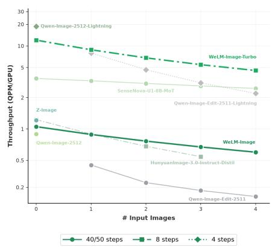

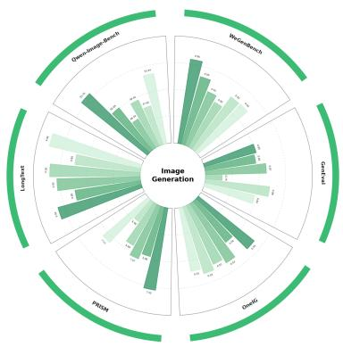  
WeLM-Image Owen-Image SenseNova-U1-BB-MoT Hunyuanlmage-3.0-Instruct-Distil Qwen-Image-2512 Emnie-Image-Turbo

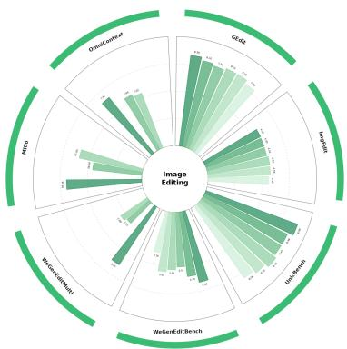  
WeLM-Image Owen-Image-Edit-2511 lovAl-Image-Edit HunyuanImage-3.0-Instruct-Distl FireRed-Image-EdIt-1.1 LongCat-Image-Edit

Figure 1: Performance and eficiency overview of WeLM-Image. Left: Throughput (QPM/GPU) compared with representative baselines as the number of input images increases. Middle: Aggregate performance on a suite of image-generation benchmarks. Right: Aggregate performance on a suite of image-editing benchmarks.

Text-to-image generation. Samples produced by WeLM-Image from text prompts alone, spanning photographic portraits and landscapes, illustration and paper-cut styles, and graphic-design layouts at several aspect ratios. Many of the examples set dense Chinese and English typography directly into posters, signage, and an annotated itinerary map.

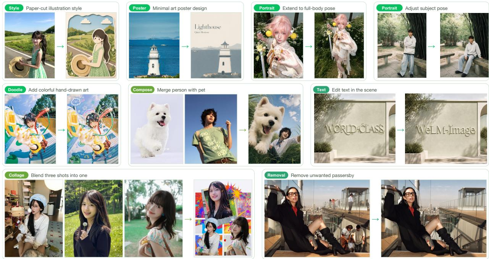

Instruction-guided image editing. Each block shows the input on the left and the result of a single natural-language instruction on the right, with the edit category tagged in green. The cases cover global restyling, pose and viewpoint change, local insertion and removal, and in-scene text replacement. The Compose and Collage panels additionally draw on two and three reference images, respectively.

## Contents

1 Introduction 1   
2 Model Architecture   
2.1 Architecture Overview   
2.2 Unified Interleaved Task Representation   
2.3 Visual Encoding . 3   
2.4 MoT–MoE Backbone   
2.5 Text-Compatible Unified 3D RoPE   
2.6 Output Heads and Joint Objectives 8   
3 Data   
3.1 Web-Scale Curation 9   
3.1.1 Infrastructure 9   
3.1.2 Data Schema 10   
3.1.3 Quality Filtering 10   
3.1.4 Visual Annotation 11   
3.2 Coverage and Balance . . 12   
3.2.1 Visual Vocabulary 12   
3.2.2 Visual Clustering 13   
3.3 Task Data 13   
3.3.1 Text-to-Image 13   
3.3.2 Image Editing . 14   
3.3.3 Multi-Reference 15   
3.3.4 Understanding Data . 15   
3.4 Training Mixtures and Feedback 16   
3.4.1 Stage-Wise Mixtures 16   
3.4.2 Feedback Loop 16   
Training 16   
4.1 Initialization . 16   
4.2 Pretraining and SFT 16   
4.3 Post-training . 18   
4.3.1 Text-to-Image Reinforcement Learning 18   
4.3.2 Image Editing Reinforcement Learning 19   
4.3.3 On-policy Distillation 20   
4.3.4 Few-step Distillation 20   
4.4 Training Infrastructure 20   
5 Eficiency 21   
6 Evaluation 22   
6.1 Quantitative Results 22   
6.1.1 Text-to-Image & Text Rendering 22   
6.1.2 Image Editing . 27   
6.2 Qualitative Results 31   
7 Conclusion 35   
8 Authors 35

## Introduction

Image generation and editing are important steps toward visual intelligence, requiring models to translate language and visual context into coherent, controllable images. Advances in difusion and flow-based transformers [1, 2] have substantially improved image quality and prompt alignment. As the scope of these models expands, their success increasingly depends on fine-grained control: interpreting long Chinese and English prompts with simultaneous constraints on objects, relations, counts, layout, and style [3]; rendering long Chinese and English text with accurate content and layout [4]; executing complex edits while preserving subject identity [5]; and combining multiple references without confusing their attributes or roles [6]. These requirements motivate a common representation in which instructions, reference images, and target latents interact throughout synthesis, allowing multimodal understanding to support fine-grained visual control.

Recent image foundation models illustrate diferent ways to incorporate such understanding into generation. Qwen-Image [4] uses a multimodal language model to condition image synthesis and combines semantic and reconstructive image features for consistent editing. HunyuanImage 3.0 [7] brings language modeling and image generation into a shared multimodal backbone, while SenseNova-U1 [8] further explores joint learning directly from pixels and words. Autoregressive language modeling and continuous image generation impose diferent optimization and capacity requirements. A scalable unified model must accommodate these diferences while maintaining efective interaction between instructions, reference images, and generated content.

For WeChat’s consumer-facing services, the design must also account for large request volumes and afordable serving costs. We therefore pursue resource eficiency as a primary design objective, treating single-GPU deployment and low per-request cost as constraints on model scale and inference design from the outset. Our goal is to maximize overall capability across generation, editing, multi-reference composition, and text rendering within a practical parameter and serving budget. This requires joint consideration of model capacity, the growing context of multiple references, and the number of inference steps.

To address these modeling and deployment requirements, we present WeLM-Image, a unified image foundation model that integrates multimodal understanding into text-to-image generation, instruction-guided editing, and multi reference synthesis. All three tasks are expressed as interleaved text and image sequences within one backbone. We adopt a dual-path Mixture-of-Transformers (MoT) [9, 10] design to give understanding and generation independent parameters, and equip each path with its own Mixture-of-Experts (MoE) modules [11, 12], forming a MoT–MoE backbone. In this design, MoT provides specialization across the two objectives to reduce optimization interference; MoE expands capacity within each path through sparse expert activation. Despite this parameter separation, shared attention connects both paths at every layer, allowing target latents to draw jointly on textual instructions, semantic image features, and detailed visual references. With greater active capacity assigned to generation, the model scales to 31.7B stored parameters while activating approximately 5.4B generation parameters per target latent token.

We complement the backbone with WeLM-Image-VAE, trained through reconstruction, semantic alignment, and text-oriented decoder fine-tuning to support visual fidelity and text rendering. Building on rotary position embeddings [13] and their multimodal extensions [14], our text-compatible unified three-dimensional rotary positional embedding (3D RoPE) preserves the pretrained language positional transformation while adding spatial structure to image latents. During sampling, conditioning tokens are computed once and cached, so each denoising step recomputes only the noisy target latents (Section 2).

To develop these capabilities through training, we organize data construction around semantic coverage, text accuracy, and edit controllability. Starting from a curated pool of approximately 0.6B images, a knowledge-grounded visual vocabulary makes named concepts retrievable, while large-scale visual clustering organizes coherent appearance patterns. Together, these structures guide semantic rebalancing and task-balanced editing construction. Bilingual captions enriched with OCR information describe visible text and layout; editing pairs are verified against the actual source–target changes, and multi-reference samples bind each input image to the attributes it contributes. Training-time evaluation feeds back into filtering, sampling, task assignment, and mixture ratios to address observed weaknesses. Progressive pretraining couples image-to-text and text-to-image learning in its early stages, then concentrates on generation, editing, and multi-reference tasks as resolution increases. High-resolution continuation and supervised fine-tuning extend the model to native 1.5K generation and complex visual instructions.

After supervised fine-tuning, we optimize generation and editing in separate reinforcement-learning branches to address their distinct quality criteria. Generation uses rubric-based prompt alignment [15] alongside aesthetic, textrendering, and visual-naturalness rewards. Editing uses instruction-specific checklists to assess the requested change, content preservation, and visual quality, with instruction following gating the reward. Noise-aware on-policy distil lation [16,17] then consolidates the specialized policies into one model: prompt-enhanced teacher predictions guide global semantics and layout at high noise levels, while standard RL teacher predictions supervise local refinement at low noise levels. Finally, MeanFlow-based few-step distillation [18] yields WeLM-Image-Turbo, which supports guidance-free generation and editing with eight sampling steps.

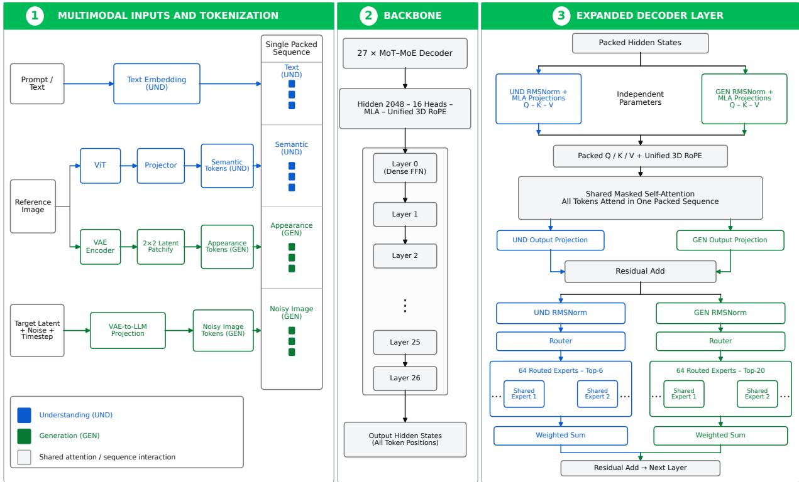  
Figure 2: Overview of the WeLM-Image architecture. Tokens on the understanding (UND) and generation (GEN) paths retain path-specific projections and experts while sharing masked self-attention over one packed multimodal sequence.

Across these stages, token-budget packing [19], fully sharded data parallelism (FSDP) [20], and context parallelism [21] jointly support the 30B-class model and packed sequences of up to 64K tokens (Section 4.4).

To assess both model capability and deployment eficiency, we evaluate WeLM-Image across image generation, bilingual text rendering, image editing, multi-reference composition, and inference cost. In the reported overall comparisons, the 1536-resolution model leads the evaluated open-source models on PRISM-Bench [22] and Qwen-Image-Bench [23] (Table 5), as well as UnicBench [24] and WeGenEditBench (Table 14). These results demonstrate strong generation and editing capabilities within a single model. Complementing these quality results, WeLM-Image-Turbo generates a 1024 × 1024 image in 4.98 s on one NVIDIA H20 GPU, an 11.4× speedup over the 50-step base model with classifier-free guidance [25]. On the same GPU, Turbo completes editing with one to four input images in 6.78–13.17 s, producing a 1024×1024 output in each case (Table 4). Through this report, we document the model design and the complete data, training, and deployment methodology behind WeLM-Image, providing a practical basis for further advances in unified visual intelligence.

## Model Architecture

## 2.1 Architecture Overview

WeLM-Image is a unified model for image creation, instruction-guided editing, and multi-reference generation. Its architecture combines an interleaved multimodal sequence representation with a dual-path Mixture-of-Transformers (MoT) backbone [9, 10] whose understanding (UND) and generation (GEN) paths each incorporate Mixture-of-Experts (MoE) feed-forward layers [11, 12]. We refer to this architecture as MoT–MoE. Understanding tokens (text and image ViT) take the UND path, and generation tokens (clean and noisy image VAE) take the GEN path, while learned routers select experts within the chosen path. Shared attention couples the two paths, which otherwise keep independent projections, normalization, and experts. As illustrated in Figure 2, heterogeneous multimodal inputs are normalized into a common interleaved representation. Text and visual elements are independently encoded, projected into model-width token sequences, and serialized in their original semantic order as typed segments within a single sequence. Task structure is therefore expressed through token arrangement and attention masks rather than task-specific input pipelines, allowing the same backbone to process all examples through one uniform sequence interface. The unified backbone connects to modality-specific output heads: a language-model head for discrete text prediction and a flow-matching head [2] for continuous image generation. This allows understanding and generation to share one representation space while retaining output mechanisms suited to each modality.

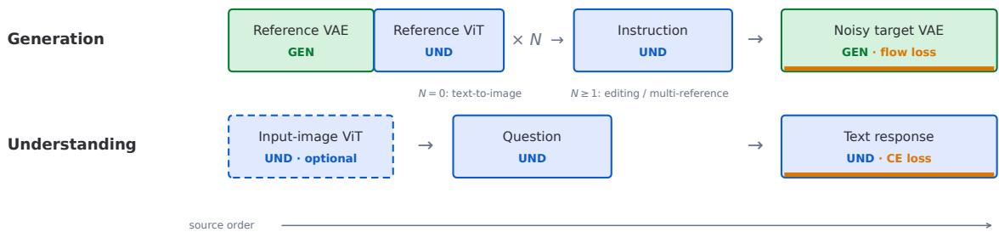  
Figure 3: Representative source-ordered sequences under the unified interleaved task representation. Blue and green denote the UND path and GEN path, respectively. Orange underlining marks supervised segments. The dashed ViT segment is optional.

## 2.2 Unified Interleaved Task Representation

WeLM-Image is trained jointly on text question answering, visual understanding, text-to-image synthesis, instructionguided editing, and multi-reference generation. Because these tasks difer in schema, sequence length, and image count, task-specific input pipelines are dificult to maintain, and image-resolution bucketing does not yield balanced compute. We therefore adopt a unified interleaved task representation in which the model, the packer, and the training losses operate on one ordered multimodal sequence rather than on task-specific formats. This shared interface removes the need for task-specific input pipelines, while packing by total token count balances computation using the complete multimodal sequence rather than image resolution alone.

Formally, each sample is serialized as typed text and visual segments that preserve source order,

$$
{ \mathcal { S } } = [ S _ { 1 } ; S _ { 2 } ; . . . ; S _ { K } ] , \qquad S _ { k } \in \{ { \mathrm { t e x t ~ s e g m e n t } } , { \mathrm { i m a g e ~ s e g m e n t } } \} .\tag{1}
$$

Here, K is the number of segments, $S _ { k }$ is the k-th segment, and S is the resulting source-ordered sequence; semicolons denote segment concatenation. In implementation, text is tokenized with the pretrained language-model tokenizer, while each visual segment is placed as continuous ViT or VAE embeddings. After embedding, all segments share the model hidden width and enter the same backbone.

Figure 3 illustrates how this shared interface instantiates two task families. In the generation template, each of the N reference images contributes an adjacent clean-VAE segment and ViT segment, which take the GEN path and UND path, respectively. The instruction subsequently takes the UND path, whereas the noisy target VAE takes the GEN path and receives flow-matching supervision. The number of reference images then determines the task instance. Setting $N = 0$ yields text-to-image generation, whereas $N \geq 1$ extends the same template to editing and multi-reference generation. In the understanding template, an optional input-image ViT segment and the question precede the response. All included segments take the UND path, while next-token cross-entropy is applied only to the response. Consequently, omitting the optional ViT segment reduces the same template to pure-text question answering.

At training time, these per-sample templates are concatenated into one packed sequence while preserving their segment structure and resetting position indices independently for each sample. Because concatenation would otherwise permit information leakage between samples, the shared-attention mask imposes cross-sample isolation and task-dependent visibility, as described in Section 2.4.

## 2.3 Visual Encoding

To instantiate these interleaved templates, each image segment is represented through two complementary visual encoders. A Vision Transformer (ViT) encoder [26, 27] captures high-level content such as objects, spatial relations, layout, and text, while WeLM-Image-VAE maps the image into compact continuous latents that retain the visual details needed for reconstruction and generation. Both representations are projected into backbone tokens and placed in the same interleaved sequence. Reference images therefore provide both content-level guidance and reconstruction level visual context, whereas target images are modeled as noisy VAE latents and recovered through flow matching.

<table><tr><td rowspan="2">Model</td><td rowspan="2" colspan="2">Architecture</td><td rowspan="2"></td><td colspan="6">Reconstruction</td><td colspan="2">Generation</td></tr><tr><td colspan="2">COCO 512</td><td colspan="2">ImageNet 512</td><td colspan="2">In-house posters 1024</td><td colspan="2">ImageNet 256</td></tr><tr><td></td><td>Params</td><td>Spatial Ch.</td><td></td><td>PSNR↑ SSIM↑</td><td></td><td>PSNR↑ SSIM↑</td><td></td><td>PSNR↑ SSIM↑|</td><td></td><td>FID↓</td><td>IS↑</td></tr><tr><td>Qwen-VAE [4]</td><td>126.89M</td><td>8×</td><td>16</td><td>33.60</td><td>0.9249</td><td>32.96</td><td>0.9165</td><td>37.98</td><td>0.9658</td><td>15.29</td><td>84.62</td></tr><tr><td>FLUX-VAE [30]</td><td>83.82M</td><td>8×</td><td>16</td><td>34.20</td><td>0.9486</td><td>33.91</td><td>0.9488</td><td>37.99</td><td>0.9771</td><td>27.63</td><td>55.10</td></tr><tr><td>FLUX.2-VAE [36]</td><td>84M</td><td>8×</td><td>32</td><td>34.61</td><td>0.9540</td><td>34.34</td><td>0.9562</td><td>37.13</td><td>0.9780</td><td>9.87</td><td>90.85</td></tr><tr><td>NextStep-VAE [31]</td><td>83.82M</td><td>8×</td><td>16</td><td>33.12</td><td>0.9263</td><td>32.65</td><td>0.9216</td><td>36.47</td><td>0.9644</td><td>22.94</td><td>62.80</td></tr><tr><td>Hunyuan-3.0-VAE [7]</td><td>1260.67M</td><td>16×</td><td>32</td><td>32.32</td><td>0.8998</td><td>31.74</td><td>0.8893</td><td>36.54</td><td>0.9536</td><td>一</td><td>一</td></tr><tr><td>WeLM-Image-VAE</td><td>83.75M</td><td>8×</td><td>16</td><td>34.89</td><td>0.9498</td><td>34.47</td><td>0.9482</td><td>38.49</td><td>0.9769</td><td>12.21</td><td>97.96</td></tr></table>

Table 1: VAE reconstruction and generation. Best results are in bold and second-best are underlined. A dash indicates that generation was not evaluated.

VAE training. We train the VAE with a principal-component compression strategy that encourages its compact latent space to preserve the dominant structure of the visual representation instead of allocating equal capacity to all pixel-level variation. This design is intended to retain semantically important content and fine visual detail under compression, providing latents that support both faithful reconstruction and generative modeling. Specifically, training proceeds in three stages: reconstruction pretraining, semantic alignment, and text-oriented decoder fine-tuning. Given an image x, the encoder E produces $z = \mathcal { E } ( x )$ and the decoder $\mathcal { D }$ reconstructs $\hat { x } = \mathcal { D } ( z )$ . The reconstruction and combined objectives are

$$
\begin{array} { r } { \mathcal { L } _ { \mathrm { r e c } } = \| x - \hat { x } \| _ { 1 } + \mathcal { L } _ { \mathrm { L P I P S } } , \qquad \mathcal { L } _ { \mathrm { V A E } } = 1 . 5 \mathcal { L } _ { \mathrm { r e c } } + 1 0 \mathcal { L } _ { \mathrm { r e p } } , } \end{array}\tag{2}
$$

where ${ \mathcal { L } } _ { \mathrm { L P I P S } }$ is the perceptual reconstruction loss [28] and $\mathcal { L } _ { \mathrm { r e p } }$ is the representation-alignment objective defined below. Stage I jointly optimizes E and D with ${ \mathcal { L } } _ { \mathrm { r e c } }$ . Stage II adds $\mathcal { L } _ { \mathrm { r e p } }$ and jointly trains the autoencoder and a representation predictor. Stage III freezes E and fine-tunes D on text-rich images with ${ \mathcal { L } } _ { \mathrm { r e c } }$

Stage II implements representation alignment by jointly training a lightweight difusion transformer $g _ { \phi } \left[ 1 \right]$ to recover high-level semantic features from corrupted latents and thereby inject them into the latent space. We draw a scalar $\epsilon _ { t } \sim \mathcal { N } ( 0 , 1 )$ and set $t = \sigma ( \epsilon _ { t } )$ , where σ is the logistic sigmoid. Independently, we sample latent-shaped nois $\epsilon \sim \mathcal { N } ( 0 , \mathbf { I } )$ , where I is the identity covariance, construct $z _ { t } = ( 1 - t ) z + t \epsilon$ , and predict $r _ { z } = g _ { \phi } ( z _ { t } , t )$ . Here, $\phi$ denotes the predictor parameters, $z _ { t }$ the corrupted latent, and $r _ { z }$ the predicted semantic feature. We align $r _ { z }$ with features r from a frozen DINOv2 encoder [29] by matching their normalized self-similarity matrices:

$$
\mathcal { L } _ { \mathrm { r e p } } = { \left. \bar { r } _ { z } \bar { r } _ { z } ^ { \top } - \bar { r } \bar { r } ^ { \top } \right. } _ { F } ^ { 2 } , \qquad \bar { r } = \frac { r } { \left. r \right. _ { 2 } } , \quad \bar { r } _ { z } = \frac { r _ { z } } { \left. r _ { z } \right. _ { 2 } } .\tag{3}
$$

For each image, $r , r _ { z } \in \mathbb { R } ^ { M \times d }$ are feature matrices over M aligned visual positions and d feature channels. The bars denote row-wise $\ell _ { 2 }$ normalization, ⊤ denotes transpose, and $\left\| \cdot \right\| _ { F }$ is the Frobenius norm. This objective preserves the pairwise semantic geometry of DINOv2 features [29] while remaining invariant to global scaling and orthogonal transformations of the feature space.

Reconstruction and generation results. To validate this staged training, we evaluate reconstruction with PSNR and SSIM on COCO and a 5k-image ImageNet subset at 512 resolution, and on an in-house set of text-rich posters at 1024, as summarized in Table 1. WeLM-Image-VAE attains the highest PSNR on all three reconstruction sets and, under the same 8× spatial compression and 16 latent channels used by Qwen-VAE [4], FLUX-VAE [30], and NextStep-VAE [31], remains competitive in SSIM. Reconstruction alone does not decide whether a tokenizer is a good generator, so we freeze each VAE and train a class-conditional LightningDiT-XL/2 [32] on ImageNet-1K at 256×256. The difusion head uses v-prediction [33] with a batch size of 256 and a learning rate of $1 0 ^ { - 4 }$ , without timestep shift. After 80 epochs we sample 50k images without classifier-free guidance [25] and report FID [34] and IS [35]. Hunyuan-3.0-VAE [7] is omitted from this comparison because the autoencoder is larger than LightningDiT XL/2 itself, so encoding and decoding would dominate the training loop and make the 80-epoch protocol impractical. Under this protocol WeLM-Image-VAE attains the highest IS and the lowest FID among 16-channel tokenizers. A controlled ablation further shows that WeLM-Image-VAE accelerates pretraining convergence relative to the alternative VAE, providing end-to-end evidence for its use in the main model.

<table><tr><td>Group</td><td>Configuration</td><td>UND path</td><td>GEN path</td></tr><tr><td rowspan="5">Backbone</td><td>Decoder layers</td><td>27</td></tr><tr><td>Hidden size</td><td>2,048</td></tr><tr><td>FFN layout</td><td>Layer 0 dense; Layers 1–26 MoE</td></tr><tr><td>Intermediate size</td><td>11,264 (dense); 1,408 (expert)</td></tr><tr><td>Experts per MoE layer</td><td>64 routed + 2 shared per path</td></tr><tr><td rowspan="2">Routing</td><td>Routed experts selected per token</td><td>6 20</td></tr><tr><td>Activated parameters per token</td><td>2.2B 5.4B</td></tr><tr><td>Scale</td><td>Full-model stored parameters</td><td>31.7B</td></tr></table>

Table 2: Configuration and parameter scale of the WeLM-Image MoT–MoE backbone. The UND path and GEN path use independent weights. The full-model total includes the ViT encoder and excludes the VAE.

## 2.4 MoT–MoE Backbone

MoT and MoE address two distinct requirements. MoT separates understanding and generation into independent parameter paths while retaining joint attention for cross-modal interaction. This separation reduces optimization interference between the two tasks, which difer substantially in their representations and training objectives [9, 10]. However, scaling a dense MoT backbone requires widening its feed-forward layers, increasing the parameters and computation activated by every token. MoE ofers a more eficient way to increase model capacity by adding experts while activating only a sparse subset for each token [11,12]. A single expert pool shared by understanding and generation would nevertheless weaken the task separation introduced by MoT and could reintroduce interference that hinders convergence. We therefore equip each MoT path with an independent MoE, preserving understanding–generation decoupling while enabling sparse parameter scaling. The resulting backbone retains standard ViT and VAE interfaces and does not rely on additional timestep-conditioned normalization modules such as AdaLN or AdaLN-Zero [1].

Operationally, the backbone contains 27 decoder layers with a hidden size of 2,048. The full multimodal model, including the ViT encoder, stores 31.7B parameters; the independent 83.7M-parameter VAE is excluded. Counts use $\mathbf { B } = 1 0 ^ { 9 }$ and include frozen parameters in stored totals (Table 2). The backbone instantiates this dual-path MoT design in every decoder layer: each layer keeps separate parameters for the UND path and GEN path and couples them through joint attention. The first layer (Layer 0) uses a path-specific dense FFN with intermediate size 11,264, whereas Layers 1–26 replace each dense FFN with a path-specific MoE sublayer. MoT therefore supplies the two computation paths of the backbone, while MoE provides sparse conditional capacity inside the feed-forward sublayer of each path.

With top-6 expert routing on the UND path and top-20 expert routing on the GEN path, each token on the former activates approximately 2.2B decoder parameters, while each latent token on the latter activates approximately 5.4B parameters in the generation component. During sampling, conditioning tokens are computed once and cached, whereas noisy target latents are recomputed at every denoising step; the 5.4B activated-parameter figure therefore refers to the generation component repeatedly evaluated for each target latent.

MoT paths and joint attention. Each token is assigned to a fixed path according to its representation type: text and ViT tokens use the UND path, while clean reference and noisy target VAE tokens use the GEN path. At each decoder layer, hidden states are gathered by path and mapped to queries, keys, and values through path-specific pre-attention RMSNorm [37] and Multi-head Latent Attention (MLA) projections [38]. These tensors are then scattered back to their original sequence positions, and a single masked scaled-dot-product attention operation is applied across both paths. Parameter specialization therefore does not partition the attention context. A noisy target query on the GEN path, for example, can attend to text and ViT keys/values from the UND path as well as clean reference keys/values from the GEN path. Which cross-path connections are visible is determined by the attention mask.

Figure 4 illustrates the block-structured attention mask for a representative prompt–condition–CoT–target sequence. The mask first isolates packed samples, producing independent diagonal blocks in which tokens can attend only within the same sample. Inside each block, text follows causal order: a query can read permitted earlier segments and only current-or-earlier positions within its own text segment. ViT and clean reference VAE tokens instead use bidirectional attention within their respective image segments while retaining access to permitted earlier context. Noisy-target VAE tokens likewise attend bidirectionally within the target latent grid and read all preceding nontarget conditions, but their keys and values remain invisible to every other segment. This asymmetry prevents target leakage while preserving full spatial interaction during denoising.

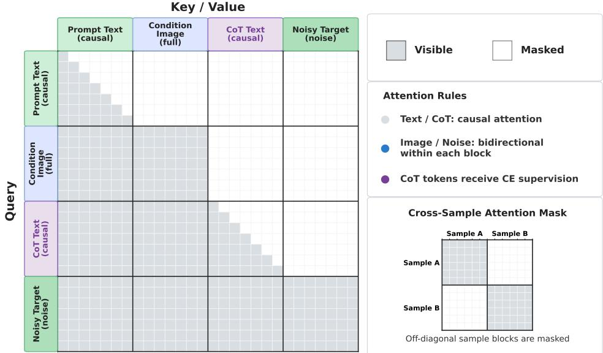  
Figure 4: Block-structured attention mask for a generation sequence containing prompt text, a condition image, CoT text, and a noisy target. Rows denote queries and columns denote keys/values; gray cells are visible and white cells are masked. Text blocks use causal attention, whereas the condition image and noisy target use bidirectional attention within their respective blocks. Each block can attend to preceding conditions, while noisy-target keys/values remain hidden from earlier blocks. Purple marks CoT tokens receiving cross-entropy supervision, and the inset shows isolation between packed samples.

After joint attention, the outputs are regrouped by path and passed through their respective output projections before the residual update. Each decoder layer therefore combines path-specific parameters with a shared attention context whose information flow is controlled by the mask.

MoE feed-forward sublayers. Following the shared-attention sublayer, MoE expands the feed-forward capacity of each MoT path without activating every parameter for every token. This allows the model to represent the heterogeneous concepts and appearance patterns present in multimodal data at tractable compute. Layers 1–26 use this sparse computation, while the first block retains path-specific dense FFNs.

A purely routed MoE is less suitable for computation required by most tokens. Recurring conditions, such as flowmatching timestep information and common language or visual concepts, benefit from a stable path, whereas load balancing deliberately distributes trafic across routed experts. Without shared experts, such common computation may be fragmented and redundantly learned throughout the routed pool. We therefore combine 64 routed experts with two always-active shared experts [38] in each path: the shared experts provide a common computational basis, while routing reserves most sparse capacity for specialized and long-tail patterns. For the hidden state $h _ { i }$ of token i at a sparse decoder layer and path $p \in \{ \mathrm { u n d } , \mathrm { g e n } \}$ , the feed-forward output is

$$
\mathrm { F F N } _ { p } ( h _ { i } ) = \sum _ { s = 1 } ^ { 2 } { E } _ { p , s } ^ { \mathrm { s h a r e d } } ( h _ { i } ) + \sum _ { e \in \mathcal { T } _ { p } ( i ) } \alpha _ { p , e } ( h _ { i } ) E _ { p , e } ^ { \mathrm { r o u t e d } } ( h _ { i } ) .\tag{4}
$$

Here, s and e index shared and routed experts, respectively; $E _ { p , s } ^ { \mathrm { s h a r e d } }$ and $E _ { p , e } ^ { \mathrm { r o u t e d } }$ are their feed-forward mappings, $\mathcal { T } _ { p } ( i )$ is the selected subset of the 64 routed experts, and $\alpha _ { p , e } ( h _ { i } )$ is the corresponding mixture weight. Each path owns its sigmoid-scored router and expert pool [39]. The shared experts are active for every token on that path. Here, “shared” means shared within a path, not shared between the UND path and GEN path. For token i on path $p ,$ routing uses

$$
u _ { i , e } = \sigma ( g _ { p , e } ( h _ { i } ) ) , \qquad \mathcal { T } _ { p } ( i ) = \mathrm { T o p K } _ { e } ( u _ { i , e } + b _ { p , e } , K _ { p } ) , \quad K _ { \mathrm { u n d } } = 6 , K _ { \mathrm { g e n } } = 2 0 ,\tag{5}
$$

where $h _ { i }$ is the hidden state of token $i , g _ { p , e } ( h _ { i } )$ is the router logit for expert $e , \sigma$ is the sigmoid function, $u _ { i , e }$ is the resulting routing score, $b _ { p , e }$ is a non-gradient correction bias, $K _ { p }$ is the number of selected experts, and $\mathcal { T } _ { p } ( i )$ is their index set. The mixture coeficients $\alpha _ { p , e }$ are obtained by normalizing the original sigmoid scores $u _ { i , e }$ over the selected experts and applying a routed scaling factor of 2.446. The correction bias changes expert selection but not the mixture weights. The asymmetric top-k assigns more active feed-forward capacity to appearance synthesis, while the disjoint routers and expert parameters prevent the two token populations from competing for one expert pool.

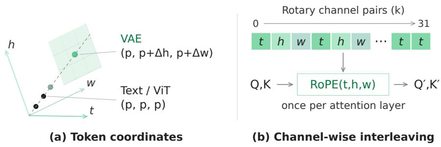  
Figure 5: Text-compatible unified 3D RoPE. (a) In token-coordinate space, text and ViT tokens remain on the diagonal $( p , p , p )$ whereas VAE tokens retain $t = p$ and occupy a centered local h–w grid $( p , p + \Delta h , p + \Delta w )$ . (b) The pretrained rotary channel pairs are assigned to t, h, and w in interleaved order, and the resulting three-axis RoPE is applied once to the rotary subspaces of queries and keys in each attention layer.

Beyond asymmetric capacity allocation, stable expert utilization requires an explicit balancing mechanism. The MoE on each path therefore maintains its own load statistics and a non-gradient correction bias. If $n _ { p , e }$ is the assignment count accumulated for expert e on path $p$ during the current balancing interval and $\bar { n } _ { p }$ is the mean over the 64 routed experts, the bias is updated by

$$
b _ { p , e }  b _ { p , e } + \eta \mathrm { ~ s i g n } ( \bar { n } _ { p } - n _ { p , e } ) , \qquad b _ { p , e }  b _ { p , e } - \mathrm { m e a n } _ { m } b _ { p , m } .\tag{6}
$$

Here, $\eta > 0$ is the bias-update step size, and ${ \mathrm { m e a n } } _ { m }$ averages over the 64 routed experts indexed by m. Overloaded experts become less likely to be selected and underloaded experts more likely to be selected. The subsequent zeromean projection prevents the bias drift observed when this constraint is omitted. A sequence-level auxiliary loss [39] with coeficient $1 0 ^ { - 4 }$ adds a weak diferentiable regularizer, but the bias update remains the primary assignment correction so that load balancing does not dominate the language or flow-matching objectives.

## 2.5 Text-Compatible Unified 3D RoPE

Text and visual tokens share one attention context but require diferent positional structures. The backbone inherits a pretrained one-dimensional RoPE [13]. Visual generation, however, requires intra-image spatial structure that a purely sequential index cannot express: patches in the same VAE latent grid often share one packed sequence position, so 1D RoPE does not distinguish height from width. Following multidimensional RoPE designs for multimodal inputs [14], we lift rotary embeddings to a single three-axis coordinate system $( t , h , w )$ , where t is the sequence-axis coordinate and h and w are the spatial row and column coordinates, and use one rotary operator in each attention layer rather than stacking a second spatial encoding on top of the language RoPE. Figure 5 presents the resulting construction from complementary token-coordinate and channel-allocation views.

Interleaved axis allocation. Panel (b) of Figure 5 shows the channel-wise mapping. The 64-dimensional rotary subspace of each query and key forms 32 channel pairs. We reuse their original inverse frequencies and assign 12 pairs to t and 10 pairs each to h and w. These assignments are interleaved across the frequency order rather than grouped into contiguous blocks. This interleaving keeps the range of rotary periods comparable across the three axes. By contrast, a grouped split would assign each axis a contiguous frequency band and therefore impose systematically diferent period ranges. This mismatch is particularly harmful when the temporal axis receives the higher-frequency pairs: its shorter periods wrap within long packed prompts, which in our experiments led to gradient-norm spikes and disrupted training. Distributing every axis across the full frequency spectrum avoids this imbalance while retaining axis-specific geometric coordinates.

Compatibility with pretrained text RoPE. Panel (a) shows why text compatibility is exact rather than approximate. Let $k \in \{ 1 , \ldots , 3 2 \}$ index the rotary channel pairs and $\omega _ { k }$ denote the inverse frequency of pair k. The 3D construction reuses these frequencies and assigns each pair to one axis $a ( k ) \in \{ t , h , w \}$ using the interleaved mapping defined above. For a text token, p is the same position index used by the pretrained language model, and its three coordinates are $( t , h , w ) = ( p , p , p )$ . The 3D phase and its reduction to the pretrained 1D phase can then be written together as

$$
\begin{array} { r l } & { \phi _ { k } ^ { \mathrm { 3 D } } ( t , h , w ) = \left\{ \begin{array} { l l } { t \omega _ { k } , } & { a ( k ) = t , } \\ { h \omega _ { k } , } & { a ( k ) = h , } \\ { w \omega _ { k } , } & { a ( k ) = w , } \end{array} \right. } \\ & { \phi _ { k } ^ { \mathrm { 3 D } } ( p , p , p ) = p \omega _ { k } = \phi _ { k } ^ { \mathrm { 1 D } } ( p ) , \qquad \forall k . } \end{array}\tag{7}
$$

Because RoPE applies the same sine and cosine rotations whenever the phases match, text tokens receive exactly the same positional transformation as in the pretrained language model. The interleaved axis assignment changes the rotation only for tokens with spatially ofset coordinates, namely VAE latent tokens. It therefore adds spatial structure to visual latents while preserving the pretrained positional encoding for text.

Visual-token coordinates. ViT and VAE tokens use diferent coordinate assignments within this scheme. All tokens in a ViT image segment retain the shared segment coordinate $( p , p , p )$ because their patch-level geometry has already been encoded by the vision encoder. The VAE grid likewise shares one packed position, but it has no such encoder-side spatial RoPE and therefore needs explicit height–width structure in the backbone. Consequently, only VAE appearance tokens keep the temporal index fixed while adding a centered spatial ofset,

$$
( t , h , w ) = ( p , p + \Delta h , p + \Delta w ) .\tag{8}
$$

For each latent token, $\Delta h$ and $\Delta w$ are its row and column ofsets from the center of the VAE latent grid; all tokens in the same image segment share the anchor $p .$ The local grid is centered so that images of diferent sizes share a common spatial origin and do not inherit a resolution-dependent top-left bias. Adding p as an anchor keeps the phase at text–image boundaries continuous, while intra-image relative geometry is carried by $( \Delta h , \Delta w )$ . Attention therefore sees a single rotary system in which text remains on the original 1D manifold, ViT tokens occupy a shared segment index, and VAE latents occupy a local 2D neighborhood around that index.

## 2.6 Output Heads and Joint Objectives

Modality-specific supervision. After the unified sequence has passed through the backbone, the resulting hidden states are decoded by separate modality-specific heads. Text states on the UND path are read by the language-model head and trained with autoregressive next-token prediction. Noisy target states on the GEN path are projected into the VAE latent space, where they parameterize a flow-matching velocity. Condition tokens—instructions, ViT features, and clean reference latents—enter attention as context and do not receive generation-head supervision.

Accordingly, generation supervision is implemented through conditional flow matching [2]. For a clean latent $z ,$ Gaussian noise $\epsilon \sim \mathcal { N } ( 0 , \mathbf { I } )$ , and a sampled timestep $t \in [ 0 , 1 ]$ , we define the interpolant $z _ { t }$ and target velocity $v ^ { \star }$ as

$$
z _ { t } = ( 1 - t ) z + t \epsilon , \qquad v ^ { \star } = \epsilon - z .\tag{9}
$$

The generation head predicts $\hat { v } _ { \theta } ( z _ { t } , c , t )$ , where $c$ is the conditioning context and $\theta$ denotes the model parameters, and is trained by

$$
\mathcal { L } _ { \mathrm { F M } } = \mathbb { E } \left[ \left. \hat { v } _ { \theta } - v ^ { \star } \right. _ { 2 } ^ { 2 } \right] .\tag{10}
$$

The expectation is taken over training latents, Gaussian noise, and sampled timesteps, and $\hat { v } _ { \theta }$ has the same shape as $v ^ { \star }$

Joint objective and loss normalization. Supervised response and CoT positions use standard autoregressive cross entropy $\mathcal { L } _ { \mathrm { C E } }$ . Together with the router regularizer, these two task losses form the joint objective

$$
\mathcal { L } = \lambda _ { \mathrm { C E } } \mathcal { L } _ { \mathrm { C E } } + \lambda _ { \mathrm { F M } } \mathcal { L } _ { \mathrm { F M } } + \lambda _ { \mathrm { a u x } } \mathcal { L } _ { \mathrm { r o u t e r } } .\tag{11}
$$

Here, ${ \mathcal { L } } _ { \mathrm { r o u t e r } }$ is the expert-load regularizer, and $\lambda _ { \mathrm { C E } } , \lambda _ { \mathrm { F M } }$ , and $\lambda _ { \mathrm { a u x } }$ weight the text, flow-matching, and router terms, respectively. In the current configuration, these weights are 0.25, 1, and $1 0 ^ { - 4 }$

Packed multi-resolution training uses diferent reduction units for the two primary objectives. The cross-entropy loss is averaged over supervised text tokens, whereas the flow-matching loss is first averaged over all VAE tokens within each target image and then aggregated at the image level. Consequently, a 1024 × 1024 target and a 1536 × 1536 target contribute equally to the flow-matching objective despite containing diferent numbers of latent tokens. This image-level normalization prevents larger images from receiving greater weight solely because of their resolution and ensures balanced optimization across image areas. The timestep schedule and remaining optimization details are given in Section 4.

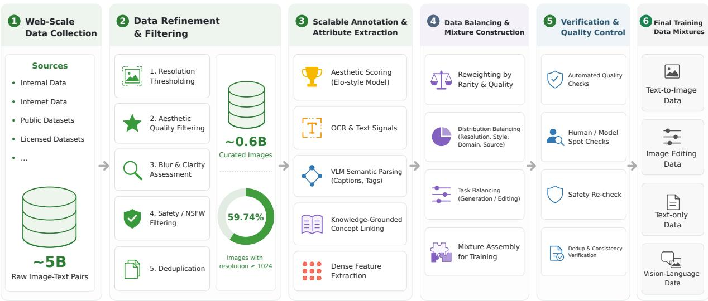  
Figure 6: Overview of the data refinement, annotation, and training-mixture construction pipeline.

## Data

Data plays a central role in WeLM-Image. The natural frequency of web-scale image-text pairs is not a usable recipe for controllable generation: head concepts dominate the pool, long-tail visual semantics remain under-exposed, and free-form editing construction collapses onto a few common operations. Prior work on billion-scale image-text datasets likewise shows that filtering and curation materially determine the value of a raw web pool [40, 41]. As shown in Figure 6, we therefore build a generation-oriented data engine that reorganizes this pool around what the model must learn to generate, edit, and compose, rather than around becoming a general vision–language assistant.

Specifically, the pipeline first refines noisy web data for quality, retaining a curated image pool with aesthetic, resolution, OCR, and safety signals. It then indexes the pool along two complementary structures: a knowledge-grounded vocabulary that makes named visual concepts addressable, and large-scale visual clustering that groups images by unnamed but coherent appearance. These two structures supply coverage and balance. On this organized pool we construct text-to-image data, instruction-guided editing and multi-reference generation data, and text-only together with vision-language instruction data, including VQA, that support the prompt interpretation on which generation depends. Finally, training-time evaluation feeds back into filtering, sampling, and mixture ratios, so that data composition remains an active optimization variable rather than a fixed recipe.

## 3.1 Web-Scale Curation

## 3.1.1 Infrastructure

Storage and Resource Scheduling. The raw data is stored as individual objects in cloud object storage (COS), using a bucketed layout that supports cross-region and cross-cluster access without packaging images into large archives. Ray services [42] dynamically schedule heterogeneous GPU and CPU workers, while Pulsar queues decouple storage I/O from data ingestion, cleaning, annotation and quality-control jobs. This compute- and message-driven design supports parallel processing and asynchronous result feedback at web scale.

Data Indexing. As shown in Figure 7, the processed results are synchronized to three complementary systems. Structured and semi-structured outputs are persistently stored in COS. Textual, vector, attribute, and metadata fields are indexed in Elasticsearch (ES) for sample-level inspection, retrieval, online queries, combined filtering, statistical analysis, and export. Dense annotation features are stored in a high-performance feature key–value store. A datamanagement system built on these services supports dynamic dataset assembly for diferent training and validation requirements. Targeted subsets with specific quality levels, sources, styles, or vertical domains can typically be selected and exported within half a day. The full pipeline sustains more than 15,000 QPS, with selected modules exceeding 100,000 QPS, and has remained stable over multi-month production runs. This shared infrastructure provides the foundation for consistently normalizing and processing heterogeneous data sources.

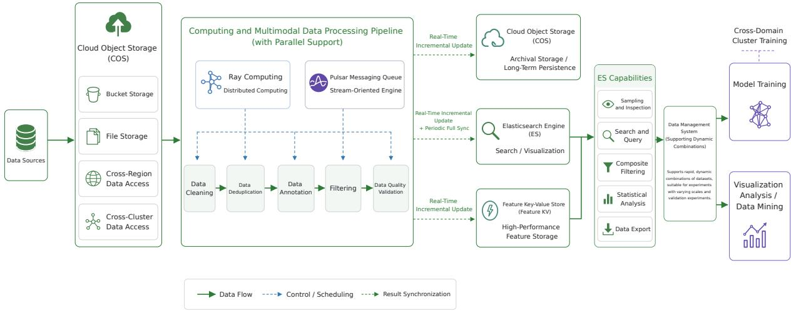  
Figure 7: Scalable data infrastructure based on distributed COS storage, Ray services, Pulsar queues, ES retrieval, feature KV storage, and dynamic dataset assembly.

## 3.1.2 Data Schema

On top of this infrastructure, each raw image-text sample is normalized into a unified schema that preserves image identity, source metadata, resolution, aspect ratio, raw text, and storage information. The shared representation gives filtering, annotation, retrieval, and task-construction stages access to the same sample identity and metadata fields, so the same quality-control and attribute-extraction operators can be applied consistently across otherwise heterogeneous sources.

## 3.1.3 Quality Filtering

Pool Refinement. Using this unified representation, we refine a raw pool of approximately 5 billion images collected from internal data, Internet data, public datasets, and licensed datasets. The pool is progressively refined through successive quality-control stages. After this process, approximately 0.6 billion images are retained as the curated image pool. Both the resolution and aesthetic statistics in Figure 8 are computed over this filtered 0.6B-image pool. Notably, 59.74% of the retained images fall into the 1024-or-higher resolution groups, providing a substantial highresolution foundation for subsequent training-data construction.

Quality and Safety. The raw pool is processed by scalable operators for resolution thresholding, blur and clar ity assessment, deduplication, and safety filtering, following quality-control dimensions established in large-scale image–text curation [40, 41]. Low-resolution, blurry, duplicated, unsafe, and otherwise low-quality samples are removed, and pornographic or other sexually explicit NSFW content is excluded before downstream annotation and training.

Aesthetic Scoring. For aesthetic quality assessment, we train an internal model inspired by Elo-style pairwise preference modeling, a formulation also used to learn preferences among text-to-image outputs [43]. Pairwise human or model judgments are aggregated into relative rankings and distilled into a scoring model that captures our internal criteria for visually appealing and trainable images. Figure 8 jointly summarizes the resolution and internal aesthetic distributions of the filtered pool. Most samples are concentrated in the middle aesthetic score ranges, while the continuous score provides a flexible signal for constructing mixtures with diferent quality and coverage requirements.

To make the aesthetic score qualitatively interpretable, we organize representative images into four broad score ranges. Figure 9 reserves four examples for each interval, allowing the visual characteristics captured by the aesthetic model to be inspected directly.

The filtering operators also act as attribute extractors rather than only as binary gates. Their fine-grained quality, resolution, safety, and content signals are retained for downstream sampling, routing, mixture construction, and distribution diagnosis.

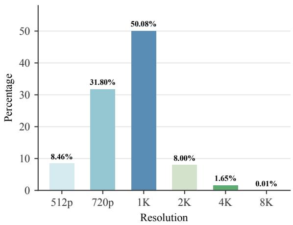  
(a) Resolution distribution.

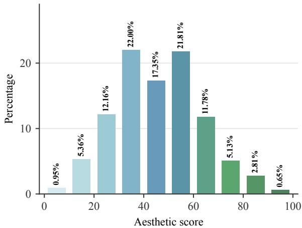  
(b) Aesthetic score distribution.

Figure 8: Resolution and internal aesthetic score distributions of the filtered 0.6B-image pool.  
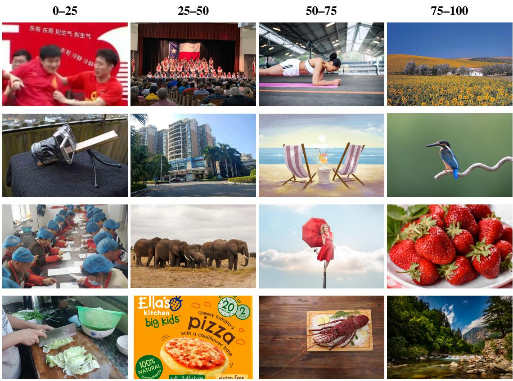  
Figure 9: Representative samples from four AES score ranges. Images are center-cropped to a common aspect ratio for comparison. Each column contains four examples from the corresponding interval.

## 3.1.4 Visual Annotation

VLM Annotation. With visual quality controlled, a large VLM produces structured annotations that describe the content of each retained image. These annotations provide a reusable semantic layer for retrieval, clustering analysis, knowledge-graph alignment, and later task-specific data construction.

OCR and Watermarks. OCR and watermark operators identify text-heavy content, including screenshots, posters, advertisements, documents, UI layouts, and other special cases. The extracted signals preserve textual and layout information that can later be incorporated into task-specific captions instead of being lost during quality filtering.

Semantic Tags. Tags capture entities, attributes, styles, scenes, and other compact visual semantics. Together with

{   
"word": "canonical visual concept name used as the primary node key",   
"category\_type": "entity or attribute",   
"ontology": {   
"level1": "coarse semantic category",   
"level2": "middle-level category",   
"level3": "fine-grained category",   
"description": "short visual definition"   
},   
"search\_queries": [   
"expanded image retrieval query"   
],   
"knowledge\_graph": {   
"synonyms": [   
"verified near-synonym"   
],   
"aliases": [   
"alternative name or common surface form"   
]   
},   
"confusable\_concepts": [   
"visually or semantically similar concept"   
]   
}  
Figure 10: Structured representation of a final visual concept node.

the structured VLM, OCR, and watermark outputs, they convert the curated image pool into quality-aware and semantically annotated assets from which downstream datasets can be retrieved, balanced, and constructed.

## 3.2 Coverage and Balance

After refinement and reusable annotation, we organize the curated pool along two complementary axes. The knowledgegrounded vocabulary makes named visual concepts explicitly addressable, while visual clustering captures coherent appearance patterns that may not yet have a stable semantic name. The two structures are maintained as a loop rather than as independent indexes: unnamed visual groups expose coverage gaps that can expand the vocabulary, and named concepts supply the semantic targets against which the clustered pool is retrieved and rebalanced.

## 3.2.1 Visual Vocabulary

Concept Selection. To improve semantic coverage beyond the natural frequency of web data, we construct a knowledge-grounded visual vocabulary from both open and internal sources. We start from open lexical resources such as Cilin [44] and filter them together with an internal WeChat Knowledge Graph (KG), retaining concepts that are visually meaningful for image generation. The resulting vocabulary contains both entities and attributes, covering objects, people, scenes, styles, materials, actions, relations, and other visually grounded concepts.

Concept Cleaning. During vocabulary construction, we preserve the entity / attribute distinction while applying extensive cleaning to improve concept purity. LLM-based checks remove abstract, ambiguous, non-visual, or noisy items. We further use a Qwen3-embedding [45] plus reranking pipeline to retrieve and verify near-synonyms, aliases, and visually similar expressions, allowing fragmented surface forms to be merged into cleaner concept nodes. This process turns a flat word list into a structured topology of concepts, synonym relations, and parent-child relations rather than a collection of isolated terms.

Concept Hierarchy. To reduce the singularity of individual words, we build a complete hierarchical structure for the vocabulary. Each concept is placed in a broader semantic context, with upper-level categories supporting distribution analysis and lower-level nodes preserving fine-grained visual distinctions.

Query Expansion. To quickly supplement data for any concept, we expand retrieval queries with aliases, descriptive phrases, visual keywords, and search-oriented expressions. The resulting vocabulary makes long-tail concepts addressable, retrievable, sampleable, and evaluable. As shown in Figure 10, each final node connects ontology, retrieval, and synonym knowledge in one structured representation.

## 3.2.2 Visual Clustering

Image Embeddings. In parallel with the knowledge vocabulary, we build a large-scale visual embedding space over the image pool. Images are encoded with Qwen3-VL-Embedding [45], and masks derived from filtering signals such as aesthetic scores select high-quality subsets for downstream clustering and analysis.

Hierarchical Clustering. We apply a balanced hierarchical variant of spherical k-means [46] to cluster hundreds of millions of images into a large number of visually coherent groups. The resulting hierarchy provides a structured coverage map over the image distribution.

Joint Coverage. Clustering is not used merely for indexing or compression. Together with the knowledge vocabulary, it organizes the same pool along complementary axes. The vocabulary makes named concepts addressable, retrievable, and quota-sampleable, so text-to-image construction can ground images in explicit semantic targets rather than in raw web frequency, as detailed in Section 3.3.1. Clusters provide the visual counterpart: they map unnamed but coherent appearance, make coverage gaps inspectable, and serve as routing units for downstream generation and editing. Representative images from each cluster can be classified by a VLM to estimate task suitability, which reduces the instability of per-image free-form construction and lets sampling and assignment operate on visually coherent groups rather than isolated samples.

Patterns that the vocabulary does not yet name become candidates for concept expansion, query refinement, and targeted supplementation, feeding newly discovered visual regularities back into the semantic scafold. Coverage therefore comes from making both named semantics and unnamed appearance addressable, while balance comes from reweighting long-tail concepts through the vocabulary and routing visually coherent groups through clusters instead of sampling by natural frequency.

## 3.3 Task Data

The semantic vocabulary and visual clusters turn the curated pool into an organized source from which task-specific supervision can be constructed. We use this common foundation to build text-to-image, instruction-guided editing, multi-reference generation, and understanding-oriented datasets with task-appropriate sampling and verification.

## 3.3.1 Text-to-Image

Semantic Sampling and Rebalancing. Building on the complementary semantic and visual organization introduced in Section 3.2, we use the KG vocabulary from Section 3.2.1 to define explicit semantic targets for text-to-image pretraining. Each KG node is encoded into a retrieval representation, and concept-to-image retrieval is used to recall candidate images from the large-scale image pool. To improve semantic precision, we further apply image-toconcept reverse verification: candidate images are matched back against the target concept vocabulary, and images with bidirectional semantic agreement are prioritized.

To convert this semantic coverage into a balanced training set, we assign per-concept quotas and select globally unique images for each KG word instead of sampling purely according to raw web frequency. This reduces repeated exposure to frequent concepts and gives long-tail entities and attributes greater training visibility. The resulting KG matching statistics, together with the cluster-side coverage map from Section 3.2.2, reveal which named concepts or coherent visual regions remain missing or under-covered. For these gaps, we use the expanded queries associated with each vocabulary node to retrieve and supplement additional data, prioritizing preferred sources when available and using fallback sources to maintain scale. This stage outputs sampled training rows, per-word statistics, unsatisfied concepts, and summary files, making it possible to distinguish well-covered concepts from those still limited by the underlying pool. Text-to-image data is therefore organized around semantic coverage and balance rather than raw frequency.

Caption Construction. The sampled images are paired with captions designed along multiple axes, including language, length, semantic granularity, and style awareness. Randomized bilingual templates diversify their surface form across neutral descriptions, concise user-like expressions, and generation-style prompts while preserving the same underlying visual semantics. This design follows evidence that recaptioning noisy web pairs with richer synthetic descriptions can substantially improve prompt following [47].

For text-heavy images, posters, documents, UI screenshots, and other special layouts, a later rewrite stage incorporates the reusable OCR and watermark signals from Section 3.1.4. Captions are produced at diferent levels of detail so that visible text, layout, and ordinary visual content can be described faithfully without forcing every sample into a maximal description.

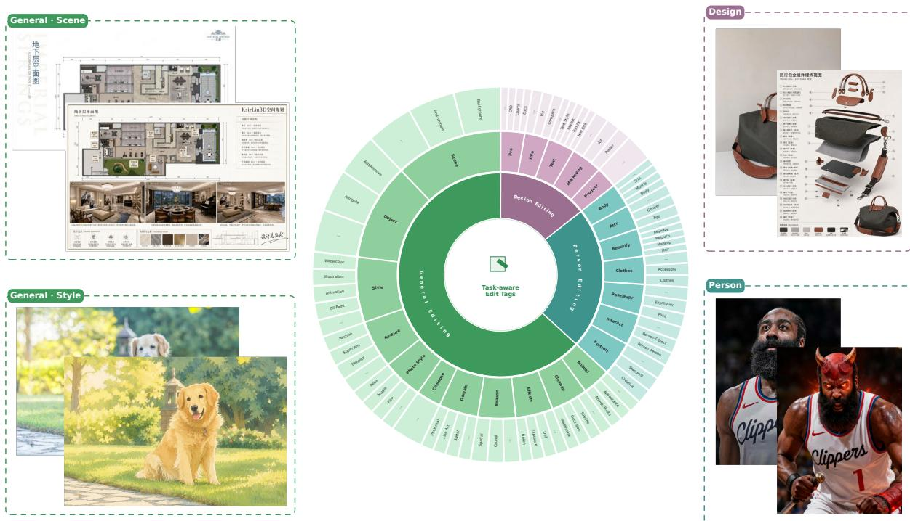  
Figure 11: Illustration of task-aware edit tags used to guide editing-instruction construction.

## 3.3.2 Image Editing

Task-Balanced Assignment. Image editing data is constructed around a structured editing ontology. We define editing tasks using a hierarchy of coarse- and fine-grained categories, including object addition, object removal, background replacement, local attribute modification, portrait editing, product editing, restoration, and reasoning oriented edits.

Recent general-purpose editing datasets and systems similarly organize supervision by operation type [5, 24, 48]. A key challenge is that free-form editing instruction generation naturally produces a long-tailed task distribution. Common operations such as removal, addition, background replacement, and global stylization tend to dominate, while more specific editing categories receive far fewer samples. To address this, we control task balance earlier, at the cluster assignment and sample selection stage, rather than relying on the prompt generator to choose tasks opportunistically.

We first classify visual clusters with a VLM, which predicts strong and possible editing-task afinities from representative images. These afinities form a candidate pool for a balanced cluster-to-task assignment algorithm that jointly considers task balance and visual suitability. Images sampled from the assigned clusters carry a fixed edit tag, as shown in Figure 11, which acts as a hard prior so that instruction generation follows the assigned task rather than selecting an operation opportunistically.

Pair Construction. After clusters are assigned to editing tasks, we construct editing pairs from two complementary sources. First, within a visually coherent cluster, we mine real-image pairs that share common transformation patterns, such as portrait changes, object changes, or viewpoint changes. Inspired by the graphical representation used in Z-Image [49], we treat an image and its related variants as a small graph. Pairwise combinations can expand the number of training pairs, create mixed-editing supervision, and produce useful inverse pairs. This turns cluster-level visual regularities into reusable editing supervision instead of relying only on independent free-form generation.

Second, we decompose editing tasks into vertical categories and use diferent expert models for object-level, background level, portrait-level, product-level, restoration, and reasoning-oriented edits. For many tasks, we construct pairs in a reverse direction: the target image is kept as a real image from the data pool, and the corresponding source image and instruction are derived around it. This reduces synthetic target artifacts and keeps the final target distribution grounded in real images.

Verification and Prompt Diversification. All constructed pairs pass through a VLM-based quality gate. The checker verifies whether the source-target diference is valid, detects no-change cases, and fixes instructions that miss or misdescribe edit points.

Finally, we use the verified diferences and refined instruction as the factual basis for prompt diversification. The same verified edit is rewritten into multiple semantically equivalent user prompts, covering concise commands, tag-like prompts, long narrative descriptions, spoken-style instructions, and noisy user-like phrasing. In this way, task-aware cluster assignment controls task balance, expert construction provides diverse pair sources, VLM checking guarantees correctness, and diference-grounded rewriting exposes the model to realistic user expressions while reducing semantic drift.

## 3.3.3 Multi-Reference

Construction Paths. Single-image editing pairs cannot capture requests that require cross-image consistency, such as preserving identity while transferring a garment, product, scene, or style from another image. Prior unified generators have likewise shown that mixed image–text conditioning can express subject-driven and visual-conditional generation tasks [6]. We therefore construct samples containing two to four source or reference images, an instruction grounded in their content, and one target image through two complementary paths. The reverse path retains a real target from the curated pool and derives suitable references and an instruction around it, reducing synthetic-target artifacts. The forward path instead assembles real source images and synthesizes the target with a multi-reference image editor.

Role-Aware Assembly. Each source is assigned a role, such as identity, garment, object, scene, style, or layout reference. Combinations of these roles define 18 tasks, including co-shoot, virtual try-on, product placement, and reference-guided relighting, together with constraints on source diversity and compatibility. For the forward path, a VLM annotates cluster representatives to form an entity pool of approximately 750,000 images, and a quota-based assembler selects compatible but visually diverse source combinations from the embedding space. Hard constraints remove invalid combinations before a VLM writes an instruction that explicitly binds each Image k to the attributes to preserve or change, after which the editor synthesizes the target.

Verification and Prompt Diversification. A VLM checker verifies reference roles, removes irrelevant inputs, renumbers image indices, and corrects inconsistent instructions. We retain facial and subject similarity, CLIP align ment [50], OCR, and aesthetic scores for diagnosis, but a controlled corruption study showed that thresholding these metrics rejects many valid samples, whereas a VLM judge detects nearly all introduced failures with a low falserejection rate. Production filtering therefore enforces resolution and deduplication requirements, rejects source-target copies, and requires a positive VLM usability verdict; the remaining metrics are advisory. The verified diferences and roles then support semantically equivalent prompt rewrites with varied lengths and styles while preserving the contribution of each reference. The resulting dataset contains several hundred thousand examples across the 18 tasks.

## 3.3.4 Understanding Data

WeLM-Image is designed around a unified model architecture. The current version still focuses primarily on image generation and image editing, but we believe the unified formulation has greater long-term potential. Adding understanding-oriented data can directly improve the model’s ability to interpret prompts, reason over visual semantics, and produce better images.

Text Data. We incorporate a proportion of text-only data to preserve the model’s general language capabilities and its ability to interpret complex textual instructions.

VLM Instructions. The current version primarily relies on open-source vision-language datasets, such as LLaVA-OneVision-1.5-Instruct [51], FineVision [52], and Honey-15M [53], together with proprietary captioning data. After dataset-level deduplication, cleaning, quality filtering, and training-recipe optimization, these sources are assembled into the vision-language instruction dataset.

Task Taxonomy. We establish a unified labeling taxonomy covering General VQA, Caption & Knowledge, Chart, OCR, Document, Grounding, Code, Math, Table, Science, Counting, GUI, Medical, Spatial, and Egocentric tasks. The filtering pipeline removes repetitive text, low-quality images, and images with extreme aspect ratios while mitigating language mixing and other sources of noise. Together, these procedures improve the quality, consistency, and diversity of understanding-oriented supervision.

Reverse Alignment. In addition to curated text-only and vision-language data, a large amount of text-to-image data can naturally become vision-language alignment data after reverse construction. By treating generated or retrieved images as visual inputs and deriving corresponding descriptions, judgments, or instructions, the same data pool can support both generation training and image-text understanding, consistent with recent unified multimodal pretraining studies [10, 54]. In the next version, we plan to further explore improvements to the model’s visual understanding capability while keeping generation and editing as the main application targets.

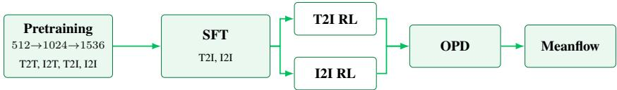  
Figure 12: Training pipeline of WeLM-Image. Pretraining uses T2T, I2T, T2I, and I2I. SFT retains T2I and I2I. Task-separated RL then specializes the two generation tasks before OPD and Meanflow distill the policies for deployment.

## 3.4 Training Mixtures and Feedback

After construction and task-specific verification within each data pipeline, the retained data is assembled into stagedependent training mixtures and continually updated using feedback from model evaluation.

## 3.4.1 Stage-Wise Mixtures

The verified and rebalanced data is assembled according to the capability contributed by each source. High-quality text-to-image samples provide broad visual coverage, KG-guided samples improve long-tail semantic exposure, edit ing and multi-reference data strengthen controllable and compositional generation, and text-only and vision-language supervision improve prompt understanding and visual semantic parsing.

Mixture ratios are scheduled by training stage rather than held fixed throughout the pipeline. Early pretraining retains understanding-oriented data to establish the shared multimodal interface, whereas high-resolution continuation and SFT concentrate the budget on text-to-image, editing, and multi-reference generation, as detailed in Table 3.

## 3.4.2 Feedback Loop

Data construction is treated as a training-time feedback loop rather than a one-shot filtering pipeline. Evaluations run throughout training to reveal data issues, capability regressions, semantic coverage gaps, and task-distribution biases. The resulting diagnostics are returned to the data engine to adjust filtering thresholds, retrieval queries, sampling quotas, task assignments, and mixture ratios, connecting observed model weaknesses to the stage of data construction that can address them. As new weaknesses emerge, the verified mixture is updated for the next training iteration, so data composition remains an active optimization variable rather than a fixed recipe. Overall, filtering, knowledgeand cluster-based rebalancing, task-specific construction, and training-time feedback are successive stages of the same generation-oriented objective: turning web-scale data into a mixture from which controllable generation can actually be learned.

## Training

WeLM-Image is trained as one pipeline from progressive pretraining through instruction SFT, task-separated reinforcement learning, and two distillation stages, as shown in Figure 12. Pretraining and SFT install the dual-path backbone and raise resolution. T2I RL and I2I RL then align generation and editing separately. On-policy distillation (OPD) consolidates the resulting policies, and Meanflow-based distillation shortens the sampling trajectory for deployment. Table 3 records the pretraining and SFT recipe.

## 4.1 Initialization

Both paths of the dual-path backbone are initialized from the same pretrained Kimi-VL [27] language–vision checkpoint. Token embeddings and the language-model head are loaded once and shared across the two paths. For every transformer layer, the understanding-path MLA projections, LayerNorms, and feed-forward weights—including the dense first layer and the full MoE of routed experts, shared experts, and the router—are taken from Kimi-VL, then replicated onto the generation path so that both paths start from the same pretrained snapshot. The final RMSNorm is copied in the same way. The ViT and its multimodal projector are loaded from the same checkpoint. Only the generation-specific VAE bridges and the timestep embedder start from random initialization.

## 4.2 Pretraining and SFT

Table 3 collects the four-stage recipe, including optimization, resolution, parallelism, and the task mixture.

<table><tr><td>Stage</td><td>512</td><td>1024</td><td>1536</td><td>SFT</td></tr><tr><td>Optimization</td><td></td><td></td><td></td><td></td></tr><tr><td>Optimizer</td><td colspan="4"> $\mathrm { A d a m W } \ [ 5 5 ] ( \beta _ { 1 } { = } 0 . 9 , \beta _ { 2 } { = } 0 . 9 5 , \epsilon { = } 1 0 ^ { - 1 5 } )$ </td></tr><tr><td>Learning rate</td><td> $1 0 ^ { - 4 }$ </td><td> $1 0 ^ { - 4 }$ </td><td> $1 0 ^ { - 4 }$ </td><td> $2 . 5 { \times } 1 0 ^ { - 5 }$ </td></tr><tr><td>LR scheduler</td><td>Constant</td><td>Constant</td><td>Constant</td><td>Constant</td></tr><tr><td>Warmup steps</td><td>2,500</td><td>500</td><td>500</td><td>500</td></tr><tr><td>Weight decay</td><td>0.01</td><td>0.01</td><td>0.01</td><td>0.01</td></tr><tr><td>Gradient clip</td><td>1.0</td><td>1.0</td><td>1.0</td><td>1.0</td></tr><tr><td>EMA decay</td><td>0.999</td><td>0.999</td><td>0.999</td><td>0.995</td></tr><tr><td>Loss (CE : MSE)</td><td>0.25:1</td><td>0.25:1</td><td>0.25:1</td><td>0.25:1</td></tr><tr><td>Timestep shift</td><td>1.0</td><td>4.0</td><td>4.0</td><td>4.0</td></tr><tr><td>Resolution</td><td></td><td></td><td></td><td></td></tr><tr><td>Context length</td><td>16K</td><td>32K</td><td>64K</td><td>64K</td></tr><tr><td>ViT resolution</td><td>224-560</td><td>≤ 896</td><td>≤ 1344</td><td>≤ 1344</td></tr><tr><td>Gen. pixels</td><td>5122</td><td>10242</td><td>15362</td><td>15362</td></tr><tr><td>Gen. long edge</td><td>512</td><td>1024</td><td>2048</td><td>2048</td></tr><tr><td>Parallelism</td><td></td><td></td><td></td><td></td></tr><tr><td>FSDP shard</td><td>32</td><td>32</td><td>16</td><td>16</td></tr><tr><td>Context parallel</td><td>1</td><td>1</td><td>2</td><td>2</td></tr><tr><td>Expert parallel</td><td>1</td><td>1</td><td>1</td><td>1</td></tr><tr><td>Activation checkpoint</td><td>22</td><td>22</td><td>27</td><td>27</td></tr><tr><td>Data mixture</td><td></td><td></td><td></td><td></td></tr><tr><td>Understanding</td><td>20%</td><td>20%</td><td>一</td><td>一</td></tr><tr><td>Text-to-image</td><td>50%</td><td>51%</td><td>67%</td><td>60%</td></tr><tr><td>Editing</td><td>30%</td><td>25%</td><td>25%</td><td>30%</td></tr><tr><td>Multi-reference</td><td>一</td><td>4%</td><td>8%</td><td>10%</td></tr></table>

Table 3: Training recipe of WeLM-Image. Generation pixels denotes the native-image area budget, and generation long edge gives the additional side cap. The product of FSDP shard and context-parallel size is held at 32 so that the parameter-shard width is unchanged when long-context training is enabled. Mixture percentages are normalized over understanding, text-to-image, editing, and multi-reference data.

The schedule progressively increases synthesis resolution and context length while shifting the data mixture toward generation. The 512 and 1024 stages retain a modest amount of understanding data, including reverse image-totext examples formed from the same image–caption pairs used for generation: the image becomes the input and its caption the prediction target. This reuse provides complementary visual–semantic supervision without requiring a separate data source. At 1536 resolution and during SFT, the mixture is restricted to text-to-image, editing, and multi-reference generation.

Stage 1: 512 pretraining. The first stage jointly trains understanding, text-to-image generation, and editing at moderate resolution and context length. It establishes the shared visual–semantic representation before higher-resolution continuation.

Stage 2: 1024 continual pretraining. The second stage increases both synthesis resolution and context length, adjusts the flow-matching timestep shift, and introduces multi-reference data. Understanding supervision is retained to preserve cross-modal alignment during this transition.

Stage 3: 1536 continual pretraining. The third stage moves to the final pretraining resolution and a 64K-token context. Understanding data is removed, and training focuses on text-to-image, editing, and multi-reference examples. Context parallelism is enabled to support the longer packed sequences.

Stage 4: supervised fine-tuning. SFT retains the resolution and context settings of Stage 3 while lowering the learning rate and using a curated instruction mixture of the same three generation tasks. Caption lengths follow a long/medium/short ratio of 4:3:3 to expose the model to varied prompt styles. The resulting checkpoint initializes the reinforcement-learning and distillation stages in Figure 12.

## 4.3 Post-training

After SFT, we optimize text-to-image generation (T2I) and image-to-image editing (I2I) as two separate reinforcement learning branches initialized from the same checkpoint, with independent training data, rewards, rollouts, and LoRA adapters [56]. In both branches, the pretrained backbone stays frozen and training updates only generation-side LoRA modules. In generation attention, LoRA is applied to the query, key–value, and output projections. In the dense and shared-expert feed-forward networks, it is applied to the gate, up, and down projections. The routed generation experts receive LoRA on the fused gate–up and down projections. Our ablations on the adapter scope show that jointly applying LoRA to the MoE layers consistently improves performance for both T2I generation and image editing. The understanding pathway, embeddings, normalization layers, and MoE router remain frozen. Each branch is optimized with DifusionNFT [57], which converts reward-scored rollouts from an EMA policy into optimality supervision for a forward-process objective over implicit positive and negative velocity fields. After the two RL branches converge, on-policy distillation (OPD) consolidates their capabilities into a single student checkpoint, eliminating the need to switch between separate T2I and I2I adapters at inference and preparing the merged policy for subsequent deployment distillation.

## 4.3.1 Text-to-Image Reinforcement Learning

For text-to-image generation, four independently trained VLM rewards measure image-text alignment, aesthetics, text rendering, and visual naturalness. We use GDPO [58] to normalize the heterogeneous reward dimensions separately within each rollout group before aggregation.

Image-text alignment reward. Rather than regressing a single opaque alignment score, we adopt a rubric-based reward in the spirit of RubricRL [15]. Before rollout, each training prompt is decomposed into a structured rubric, that is, a set of atomic and visually verifiable criteria, and the reward is obtained by judging the candidate image against these criteria and aggregating the item-level outcomes. Rubric construction is deliberately image-blind, and the resulting rubric is reused for every rollout of the prompt, so that all candidates within a group are scored under an identical standard.

Rubric generation is anchored on a curated criterion pool rather than produced free-form. The pool is organized around the dimensions of image–text consistency that matter in practice, including object presence and count, rendered text, attributes, spatial relations, actions, negation, and style or layout constraints. Given a prompt, the generator identifies the most relevant dimensions, instantiates criteria accordingly, applies prompt-adaptive weighting that emphasizes the salient dimensions, and caps the total number of criteria per prompt. Each prompt and each criterion carries a dimension tag. Because the entire construction pipeline runs ofline, these tags enable category-aware sampling and allow us to systematically resample the ofline training corpus toward failure modes observed in the current model. Since pass rates are tracked separately per dimension, gains in frequent categories cannot mask persistent failures in long-tail ones.

During RL training, we present all rollouts of the same prompt to the judge as a group rather than scoring each candidate independently. Group-wise scoring provides a shared comparison context, reduces cross-call calibration variance, and makes fine-grained diferences in rubric satisfaction easier to distinguish. The judge returns an item level decision with supporting evidence for every criterion and rollout, and we aggregate these decisions according to item assessability and importance. This itemized formulation yields both a scalar training signal and a fine-grained failure diagnosis.

Aesthetic reward. We first train a pairwise VLM to compare two same-prompt images in terms of composition, lighting, color harmony, texture, and overall visual appeal. Unlike scalar preference models such as PickScore, which learn a single score from pairwise choices [43], our pairwise model learns from structured comparison supervision comprising the preference verdict, visual evidence, per-image dimension scores, and dimension-importance weights. We then apply this teacher to multiple same-prompt opponents and aggregate its pairwise outputs into a stable absolute target for each image. Distilling these multi-opponent targets into a pointwise reward model preserves the reliability and interpretability of comparative reasoning while allowing each rollout image to be scored independently with a single forward pass during RL.

As a dedicated component of the aesthetic reward, we additionally train a visual-deformation detector. Generalpurpose VLMs remain relatively weak at recognizing malformed structures directly. We find, however, that conditioning a VLM on the candidate image together with a coarse deformation category elicits high-confidence chain-ofthought rationales that localize and explain the corresponding defect. These category-conditioned rationales provide dense supervision beyond the original coarse labels, allowing us to train an accurate deformation reward model with only a modest amount of annotated data.

Text-rendering reward. All prompts are pre-annotated according to whether rendered text may reasonably appear in the image. Under an elastic text constraint, rendered text is optional: if text appears, the evaluator checks whether it is semantically incorrect, structurally anomalous, illegible, or composed of pseudo-characters, while correct and legible text incurs no penalty. If a prompt is labeled as incompatible with rendered text, any visible text is penalized. Because open-source VLMs remain relatively weak at perceiving fine-grained glyph-level structural anomalies, particularly in rendered Chinese characters, we train a dedicated structural-anomaly perception model. It robustly detects glyph deformation, missing or redundant strokes, blurriness, and misalignment in both Chinese and English across challenging settings, including dense text, small text, rare Chinese characters, and artistic typography. The resulting structured judgments are aggregated into the text-rendering reward.

Visual-naturalness reward. The fourth VLM directly evaluates visual naturalness, focusing on recognizable syntheticimage cues such as plastic or over-smoothed textures, repeated micro-patterns, incoherent local details, and implausibly uniform lighting. This reward encourages natural textures, coherent local details, and physically plausible illumination.

Prompt curation and category-aware reward routing. We construct the T2I RL prompt pool with balanced sampling across semantic categories and short-, medium-, and long-form prompts. Before online training, we perform ofline rollouts with the base policy and estimate the mean and variance of the composite reward for each prompt. We retain prompts whose mean reward lies within a target range and whose reward variance exceeds a predefined threshold. This removes prompts that are either already solved or consistently fail across rollouts, concentrating RL updates on learnable cases that provide informative within-group contrasts. We further assign each prompt one or more category labels and use them to determine its reward-weight vector ofline. For example, typography prompts place greater emphasis on text rendering, whereas portrait prompts assign more weight to aesthetic and deformationrelated signals. This ofline routing aligns the optimization objective with the quality requirements of each category while avoiding a single reward dimension dominating the heterogeneous training mixture.

Mixed original/PE rollout groups. Prompt enhancement (PE) is applied inside the rollout group rather than as a separate training stream. For every canonical prompt, part of the group is generated from the original prompt and the remainder from its semantically constrained enhanced form. Mixing the two prompt forms in one relative group broadens visual coverage, increases within-group reward variance, and provides more informative positive and negative samples than repeatedly sampling only one formulation.

## 4.3.2 Image Editing Reinforcement Learning

Training data and action balancing. We categorize image editing instructions into 27 editing action types and use this taxonomy to filter the training data. First, we use multiple open-source reward models to evaluate and rank the dificulty of the instructions ofline. During instruction sampling, we set the target ratio of easy, medium, and hard samples to 3 : 5 : 2. Within each editing action category, we further exclude samples at the extremes of the dificulty spectrum, including those with near-zero success rates (excessively dificult) and those with near-saturated success rates (overly easy). This filtering retains more informative samples that provide stronger learning signals for policy optimization.

Checklist-based editing reward. We propose a category-aware, hierarchical checklist-based reward for evaluating image editing. Before training, an ofline checklist generator built on a VLM constructs an instruction-specific evaluation checklist. The generator conditions on the corresponding action label as task-level context, enabling it to define evaluation dimensions and criteria tailored to the specific editing category. During training, each instruction consistently reuses its precomputed checklist, ensuring consistent reward evaluation. Each checklist covers three dimensions: prompt following, consistency, and visual quality. The VLM-based evaluator assigns each criterion i a status $o _ { i } \in \{ \mathsf { p a s s } $ , fail, not-assessable} for each candidate edited image. Failed criteria additionally receive a mild, medium, or severe failure level. Within each dimension, failed criteria incur penalties determined jointly by criterion importance and failure severity. We subtract the accumulated penalties from a fixed score budget and normalize the result to obtain $r _ { P } , r _ { C } , r _ { Q } \in [ 0 , 1 ]$ for prompt following, consistency, and visual quality, respectively. Pass and not-assessable outcomes incur no penalty. We use prompt following as a multiplicative gate:

$$
r _ { \mathrm { e d i t } } = r _ { P } \left( 0 . 4 + 0 . 4 r _ { C } + 0 . 2 r _ { Q } \right) .\tag{12}
$$

This prevents high consistency or visual quality from compensating for failure to perform the editing instruction.

Editing-specific training strategies. We use moderate classifier-free guidance (CFG) [25] to rollout samples while excluding the unconditional branch from the training objective, thereby improving the reliability of rewards and training stability. To accelerate sampling, we use half the standard number of inference steps during rollout, while retaining the complete trajectories for training. In contrast to RL for T2I task, we find that training on complete trajectories yields improved performance for image editing tasks.

## 4.3.3 On-policy Distillation

Applying RL independently to T2I task and image editing task yields strong task-specific experts (Teacher), while training on mixed-task data provides balanced generalization but may not reach the performance ceiling of each domain. We therefore employ On-policy Distillation (OPD) [16, 17] to integrate the specialized capabilities of the two experts into a unified model.

We initialize the student model from an SFT checkpoint. During rollout, we employ CFG sampling to generate and record the student’s denoising trajectories. During training, the intermediate states along each trajectory are routed to the corresponding T2I or image-editing RL teacher according to the task category of each sample. Our supervision objective aligns both the student’s positive predictions and its conditional guidance directions with those produced by the corresponding teacher.

To further enhance the model’s semantic and structural planning capabilities, we introduce a PE teacher in addition to the RL teacher and propose a noise-aware OPD. This mechanism selects the supervision target according to the learning requirements at diferent stages of the denoising process. At high noise levels, the objective derived from the PE teacher guides the student in learning global semantics and content layout. At low noise levels, we retain the standard RL teacher to refine local attributes and visual quality. Let $q \in \{ \mathrm { T } 2 \mathrm { I } , \mathrm { E d i t } \}$ denote the task and $\mathbf { v } _ { T _ { q } } ( \mathbf { x } _ { t } , t , c )$ the conditional velocity predicted by the corresponding teacher. The noise-aware target is

$$
\widehat { \mathbf { v } } _ { T _ { q } } ( \mathbf { x } _ { t } , t , c ) = \mathbf { v } _ { T _ { q } } ( \mathbf { x } _ { t } , t , c ) + h _ { t } \left[ \mathbf { v } _ { T _ { q } } ( \mathbf { x } _ { t } , t , c _ { \mathrm { P E } } ) - \mathbf { v } _ { T _ { q } } ( \mathbf { x } _ { t } , t , c ) \right] ,\tag{13}
$$

where $h _ { t } = 1$ at high noise levels and $h _ { t } = 0$ at low noise levels, and c and $c _ { \mathrm { P E } }$ denote the original condition and its semantically constrained prompt-enhanced version, respectively.

## 4.3.4 Few-step Distillation

To improve inference eficiency, we introduce a scalable few-step distillation framework based on the average-velocity formulation of MeanFlow [18] in the final training stage. It compresses a full-step model with CFG into a guidancefree 8/4 step model. By transferring the teacher’s long-trajectory generative capability to a fixed few-step schedule and optimizing the student’s global transport behavior under large sampling steps, our framework preserves prompt adherence, global composition, and visual fidelity while substantially accelerating inference.

Our framework combines average-velocity MeanFlow consistency distillation with DMD-style online trajectory alignment [59]. Given a clean latent predicted by the student, an auxiliary predictor and the teacher independently estimate the mean flow over the same noise interval. Their discrepancy quantifies the transport gap between the teacher and student trajectories and serves as the optimization signal for the student.

To align training with the 8/4-step sampler, we introduce local trajectory anchoring. For each interval sampled from the inference schedule, fine-grained teacher integration provides a target mean flow that directly supervises the student’s initial velocity. Complementing random-interval alignment, this objective reduces Euler discretization errors and mitigates structural drift, texture loss, and detail degradation. Together, these objectives enable eficient few-step generation while preserving text rendering, semantic understanding, composition, and visual fidelity.

## 4.4 Training Infrastructure

The unified interface of WeLM-Image also simplifies its training infrastructure. Understanding, text-to-image generation, editing, and multi-reference synthesis are all represented as interleaved sequences of text tokens, semantic image tokens, and image latent tokens. Position IDs, attention masks, and loss masks describe the structure and supervision of each example. Although text and image targets use diferent objectives, the tasks share one Transformer training loop. Multi-task training therefore becomes a sequence-training problem that can reuse mature LLM infrastructure.

We apply several established LLM training techniques to this shared interface. Token packing [19] combines variablelength examples within a common token budget, reducing padding while keeping examples separate through attention masks. Fully sharded data parallelism (FSDP) [20] distributes parameters, gradients, and optimizer states across accelerators to reduce memory use per device. For high-resolution and multi-reference training, Ulysses context parallelism (CP) [21] splits a long sequence across devices while preserving attention within each example, supporting packed contexts of up to 64K tokens. BF16 mixed precision and activation checkpointing further reduce memory requirements.

The MoE backbone also ofers a natural path to expert parallelism (EP), which distributes experts across devices and sends tokens to their selected experts. The reported training recipe uses FSDP and CP, with EP size set to 1 (Table 3). These choices can be made at the training system level while retaining the same multi-task input interface.

<table><tr><td rowspan="2">Model Name</td><td rowspan="2">Steps</td><td colspan="3">Text-to-Image</td><td rowspan="2"></td><td colspan="4">Image Editing (# input images)</td></tr><tr><td>1024 × 576</td><td>1024 × 768</td><td>1024 × 1024</td><td>1 img</td><td>2 imgs</td><td>3 imgs</td><td>4 imgs</td></tr><tr><td>Qwen-Image-2512-Lightning [4]</td><td>4</td><td>1.79</td><td>2.33</td><td>3.21</td><td></td><td>一</td><td></td><td>一</td><td></td></tr><tr><td>Qwen-Image-2512 [4]</td><td>50</td><td>35.82</td><td>47.81</td><td>67.13</td><td></td><td></td><td></td><td></td><td></td></tr><tr><td>Qwen-Image-Edit-2511-Lightning [4]</td><td>4</td><td>一</td><td></td><td>一</td><td></td><td>7.52</td><td>12.82</td><td>19.56</td><td>27.35</td></tr><tr><td>Qwen-Image-Edit-2511 [4]</td><td>40</td><td></td><td></td><td></td><td></td><td>133.04</td><td>233.24</td><td>360.18</td><td>510.64</td></tr><tr><td>Z-Image [49]</td><td>50</td><td>26.67</td><td>35.82</td><td>49.43</td><td></td><td></td><td></td><td></td><td></td></tr><tr><td>SenseNova-U1-8B-MoT [8]</td><td>50</td><td>10.62</td><td>12.95</td><td>16.99</td><td></td><td>18.30</td><td>19.91</td><td>21.55</td><td>23.44</td></tr><tr><td>HunyuanImage-3.0-Instruct-Distil† [7]</td><td>8</td><td></td><td></td><td>12.20</td><td></td><td>16.79</td><td>21.97</td><td>27.65</td><td></td></tr><tr><td>WeLM-Image</td><td>50</td><td>32.89</td><td>43.26</td><td>56.99</td><td></td><td>67.71</td><td>78.43</td><td>89.24</td><td>100.18</td></tr><tr><td>WeLM-Image-Turbo-8step</td><td>8</td><td>2.90</td><td>3.80</td><td>4.98</td><td></td><td>6.78</td><td>8.78</td><td>10.92</td><td>13.17</td></tr></table>

Table 4: End-to-end inference latency (seconds, lower is better) on NVIDIA H20 GPUs. Each entry is the mean wall-clock time over three timed runs following one warm-up run, and excludes model loading. Steps denotes the number of sampling steps. Editing cases are indexed by the number of input images, so one input image corresponds to instruction-guided single-image editing and two to four input images to multi-reference composition. All cases produce a 1024 1024 output. Lightning denotes the 4-step distillation LoRA of the respective base model. The Lightning configurations and WeLM-Image-Turbo are sampled guidance-free with true\_cfg\_scale= 1, so they perform one forward pass per step rather than the two required under classifier free guidance. †Every configuration is served on a single GPU except HunyuanImage-3.0-Instruct-Distil, which requires a 4-way tensor-parallel instance spanning four GPUs. Its per-instance latency therefore corresponds to four times the accelerator cost of the other entries. It is run with bot\_task=image and without external chain-of-thought prompt rewriting.

## Eficiency

Inference cost determines whether a unified generation-and-editing model can be deployed at scale. Editing is the critical case because the visual context grows with the number of input images, and attention over the concatenated token sequence can make latency grow super-linearly. We therefore measure end-to-end latency on text-to-image generation and on instruction-guided editing with one to four input images, treating single-image editing and multi-reference composition as one family parameterized by the number of inputs. Table 4 compares the end-to-end inference latency of WeLM-Image against popular models.

Protocol. All measurements use NVIDIA H20 GPUs, a fixed random seed, and an identical software stack (PyTorch 2.9.1, Difusers 0.39.0, Transformers 5.2.0). Each configuration is served on a single GPU, except HunyuanImage-3.0-Instruct-Distil, which requires a 4-way tensor-parallel instance spanning four GPUs. For every model–case pair we execute one warm-up pass followed by three timed passes, and report the mean wall-clock time from the prompt and reference images to the decoded output, excluding model loading. Run-to-run variation is negligible, staying below 0.5% of the mean throughout.

We evaluate WeLM-Image at 50 sampling steps and its distilled variant WeLM-Image-Turbo at 8 steps. The baselines include Qwen-Image-2512 and Qwen-Image-Edit-2511, each in its released standard setting and with its oficial 4- step Lightning LoRA. We also include Z-Image, SenseNova-U1-8B-MoT, and HunyuanImage-3.0-Instruct-Distil. The latter, like our models and SenseNova-U1-8B-MoT, serves both generation and editing from one checkpoint. One sampling detail is important when reading the table. The Lightning configurations and WeLM-Image-Turbo are guidance-free (true\_cfg\_scale= 1) and evaluate the network once per step, whereas the standard configurations use classifier-free guidance and evaluate it twice. Step counts alone therefore understate the compute gap between the two regimes by a factor of two. Because the systems also difer in size, sampling schedule, and model parallelism, these results characterize the released inference settings rather than isolating architectural eficiency. Our models run through PyTorch scaled dot-product attention without kernel-level acceleration, quantization, step caching, or graph compilation, so their figures are an unoptimized upper bound.

Text-to-image latency. At a matched 50-step budget, WeLM-Image is consistently faster than Qwen-Image-2512, and its margin widens with resolution, from 8% at 1024 × 576 to 15% at 1024 × 1024. The diference reflects their scaling behaviour. Over this range, the pixel count grows by 1.78× while the latency of WeLM-Image grows by only 1.73×, against 1.87× for Qwen-Image-2512 and 1.85× for Z-Image. Cost is thus close to linear in the number of generated tokens, indicating that quadratic attention has not yet become the dominant term at megapixel resolution. It also depends on the token count rather than the spatial layout. Transposed portrait resolutions difer from their landscape counterparts by at most 0.3%, and we omit them from the table. Z-Image remains faster in absolute terms, as expected from its smaller backbone, while the few-step configurations belong to a separate regime discussed below.

Editing latency and input scaling. The advantage is largest on editing, where the input images dominate the sequence length. With one input image WeLM-Image is 1.96× faster than Qwen-Image-Edit-2511 despite using more sampling steps (50 versus 40), and the gap widens to 5.10× with four inputs. The marginal cost of an additional input stays near 10.8 s for WeLM-Image but rises from 100 s to 150 s for Qwen-Image-Edit-2511. Going from one to four inputs therefore costs 1.48× for our model against 3.84× for theirs. This near-linear growth in the visual context is what makes multi-reference composition practical at serving time, as reflected in the multi-image editing latencies reported in Table 4. SenseNova-U1-8B-MoT is faster in absolute terms with an even flatter marginal cost, consistent with its much smaller 8B backbone.

Few-step regime. WeLM-Image-Turbo moves our model into the distilled operating point. It generates a 1024 × 1024 image in 4.98 s, an 11.4× reduction over WeLM-Image, and is 7.6 to 10.0× faster on the editing cases. The gain exceeds the 6.25× reduction in sampling steps because guidance-free sampling also cuts network evaluations per image from 100 to 8. Against HunyuanImage-3.0-Instruct-Distil, the matched 8-step unified baseline, WeLM-Image-Turbo is roughly 2.5× faster on both generation and editing while running on one GPU instead of four, a tenfold reduction in accelerator time. It likewise beats Qwen-Image-Edit-2511-Lightning at every input count despite twic the step budget, with the margin growing from 1.11× to 2.08× as inputs are added, and it inherits the flat marginal cost of the base model at roughly 2.1 s per additional input. Qwen-Image-2512-Lightning is faster in absolute terms on text-to-image generation, as expected at half the step count, though WeLM-Image-Turbo is the cheaper of the two per sampling step (0.62 s versus 0.80 s).

## Evaluation

## 6.1 Quantitative Results

## 6.1.1 Text-to-Image & Text Rendering

To evaluate the foundational generation quality and the specific capability of rendering complex visual text, we benchmark WeLM-Image against a suite of leading open-source and proprietary text-to-image models, including Qwen-Image [4], Qwen-Image-2512 [4], Z-Image-Turbo [49], HunyuanImage-3.0 [7], ERNIE-Image-Turbo [60], GLM-Image [61], HiDream-O1-Image [62], SenseNova-U1-8B-MoT [8], Boogu-Image-0.1 [54] and FLUX.2-dev [63]. We report results on multiple widely-used benchmarks: GenEval [64], PRISM-Bench [22], OneIG-Bench [65], TIIF-Bench [3], DPG-Bench [66], Qwen-Image-Bench [23], WeGenBench [67], LongText-Bench [68], and CVTG-2K [69], which together cover compositional generation, long/complex text rendering, general image quality, and instruction-following ability. Table 5 summarizes the overall quantitative results. We can see that WeLM-Image ranks among the top-tier open-source models on both mainstream and emerging evaluation benchmarks.

GenEval GenEval [64] is designed to rigorously evaluate object-centric generation capabilities. Unlike benchmarks that rely on holistic image-text alignment scores, GenEval isolates specific compositional skills. It tests whether a model can accurately render single or multiple distinct objects, correctly bind attributes (e.g., colors) to specific entities, adhere to precise object counts, and understand complex spatial relations (e.g., “left of”, “below”). This fine-grained evaluation is crucial for determining if a model truly understands object composition rather than merely memorizing co-occurrences. Table 6 shows that the WeLM-Image family performs strongly on GenEval: WeLM-Image-Turbo-8step achieves a perfect score (tied for first) on single-object generation, while WeLM-Image attains the second-highest score on single-object generation and ranks third on attribute binding among open-source models, reflecting reliable compositional understanding and competitive object-level fidelity.

PRISM-Bench PRISM-Bench [22] is a comprehensive VLM-powered benchmark that goes beyond simple textimage matching. It evaluates models across diverse axes including Imagination (creative interpretation of abstract concepts), Entity (accurate rendering of specific subjects), Style (adherence to requested artistic mediums), and Composition (overall visual layout). By leveraging advanced Vision-Language Models as evaluators, PRISM-Bench ofers a holistic assessment that jointly considers the logical reasoning behind the prompt and the aesthetic quality of the generated image. As shown in Table 7, WeLM-Image ranks first among open-source models in Overall score as well as across Imagination, Style, and Composition, while placing third in Entity (with WeLM-Image-Turbo-8step also ranking second in Style and third in Overall), demonstrating strong and well-rounded performance across PRISM-Bench’s fine-grained dimensions.

<table><tr><td>Model Name</td><td>GenEval↑</td><td>OneIG↑</td><td>PRISM↑</td><td>LongText↑</td><td>Qwen-Image-Bench↑</td><td>WeGenBench↑</td></tr><tr><td>GPT-Image-2</td><td>0.886</td><td>0.515</td><td>8.039</td><td>0.972</td><td>63.165</td><td>0.969</td></tr><tr><td>Nano-Banana-Pro</td><td>0.781</td><td>0.568</td><td>7.679</td><td>0.914</td><td>59.803</td><td>0.959</td></tr><tr><td>Qwen-Image-3.0</td><td>0.857</td><td>0.549</td><td>7.685</td><td>0.980</td><td>61.692</td><td>0.962</td></tr><tr><td>Seedream-5.0-Pro</td><td>0.864</td><td>0.532</td><td>7.421</td><td>0.947</td><td>59.591</td><td>0.968</td></tr><tr><td>Qwen-Image [4]</td><td>0.871</td><td>0.530</td><td>7.072</td><td>0.934</td><td>46.325</td><td>0.909</td></tr><tr><td>Qwen-Image-2512 [4]</td><td>0.747</td><td>0.521</td><td>6.888</td><td>0.954</td><td>49.444</td><td>0.897</td></tr><tr><td>Z-Image-Turbo [49]</td><td>0.748</td><td>0.510</td><td>6.993</td><td>0.928</td><td>49.094</td><td>0.897</td></tr><tr><td>HunyuanImage-3.0-Instruct-Distil [7]</td><td>0.844</td><td>0.498</td><td>6.959</td><td>0.886</td><td>50.087</td><td>0.931</td></tr><tr><td>HunyuanImage-3.0-Instruct-Distil-CoT [7]</td><td>0.800</td><td>0.523</td><td>7.074</td><td>0.903</td><td>51.690</td><td>0.938</td></tr><tr><td>ERNIE-Image-Turbo [60]</td><td>0.845</td><td>0.521</td><td>7.111</td><td>0.965</td><td>53.335</td><td>0.923</td></tr><tr><td>ERNIE-Image-Turbo-PE [60]</td><td>0.838</td><td>0.554</td><td>7.163</td><td>0.967</td><td>55.309</td><td>0.920</td></tr><tr><td>GLM-Image [61]</td><td>0.721</td><td>0.516</td><td>6.524</td><td>0.942</td><td>45.186</td><td>0.854</td></tr><tr><td>HiDream-O1-Image [62]</td><td>0.881</td><td>0.504</td><td>6.830</td><td>0.965</td><td>44.750</td><td>0.868</td></tr><tr><td>SenseNova-U1-8B-MoT [8]</td><td>0.857</td><td>0.524</td><td>6.424</td><td>0.859</td><td>47.719</td><td>0.932</td></tr><tr><td>SenseNova-U1-8B-MoT-CoT [8]</td><td>0.882</td><td>0.531</td><td>6.462</td><td>0.885</td><td>47.605</td><td>0.922</td></tr><tr><td>Boogu-Image-0.1-Base [54]</td><td>0.812</td><td>0.547</td><td>7.500</td><td>0.961</td><td>52.591</td><td>0.930</td></tr><tr><td>Boogu-Image-0.1-Turbo [54]</td><td>0.779</td><td>0.529</td><td>7.246</td><td>0.958</td><td>51.349</td><td>0.934</td></tr><tr><td>FLUX.2-dev [63]</td><td>0.853</td><td>0.531</td><td>7.385</td><td>0.851</td><td>53.048</td><td>0.928</td></tr><tr><td>WeLM-Image WeLM-Image-Turbo-8step</td><td>0.851 0.836</td><td>0.534 0.520</td><td>7.555 7.482</td><td>0.931 0.933</td><td>54.155 55.992</td><td>0.948 0.948</td></tr></table>

Table 5: Quantitative evaluation results on Text-to-Image generation and Text Rendering benchmarks. Closed-source models including GPT-Image-2, Nano-Banana-Pro, Qwen-Image-3.0, and Seedream-5.0-Pro are excluded from rank highlighting. Darker cell colors indicate better performance, with the three highlighted shades denoting the 1st, 2nd, and 3rd best results, respectively.
<table><tr><td>Model Name</td><td>Single Obj.</td><td>Two Obj.</td><td>Counting</td><td>Colors</td><td>Position</td><td>Attr Bind.</td><td>Overall↑</td></tr><tr><td>GPT-Image-2</td><td>0.9969</td><td>0.9621</td><td>0.8844</td><td>0.9043</td><td>0.8325</td><td>0.7375</td><td>0.8863</td></tr><tr><td>Nano-Banana-Pro</td><td>0.9844</td><td>0.8914</td><td>0.7219</td><td>0.7606</td><td>0.8250</td><td>0.5000</td><td>0.7806</td></tr><tr><td>Qwen-Image-3.0</td><td>0.9969</td><td>0.9444</td><td>0.8250</td><td>0.9309</td><td>0.7550</td><td>0.6900</td><td>0.8570</td></tr><tr><td>Seedream-5.0-Pro</td><td>0.9938</td><td>0.9444</td><td>0.7469</td><td>0.9149</td><td>0.8775</td><td>0.7050</td><td>0.8637</td></tr><tr><td>Qwen-Image</td><td>0.9906</td><td>0.9545</td><td>0.8875</td><td>0.8989</td><td>0.7675</td><td>0.7275</td><td>0.8711</td></tr><tr><td>Qwen-Image-2512</td><td>0.9844</td><td>0.9242</td><td>0.6188</td><td>0.8750</td><td>0.4750</td><td>0.6075</td><td>0.7475</td></tr><tr><td>Z-Image-Turbo</td><td>0.9938</td><td>0.8990</td><td>0.7375</td><td>0.8404</td><td>0.4475</td><td>0.5675</td><td>0.7476</td></tr><tr><td>HunyuanImage-3.0-Instruct-Distil</td><td>0.9969</td><td>0.9621</td><td>0.7375</td><td>0.8697</td><td>0.7575</td><td>0.7400</td><td>0.8439</td></tr><tr><td>HunyuanImage-3.0-Instruct-Distil-CoT</td><td>0.9875</td><td>0.9318</td><td>0.7031</td><td>0.8431</td><td>0.6950</td><td>0.6400</td><td>0.8001</td></tr><tr><td>ERNIE-Image-Turbo</td><td>1.0000</td><td>0.9520</td><td>0.7844</td><td>0.8670</td><td>0.7825</td><td>0.6850</td><td>0.8452</td></tr><tr><td>ERNIE-Image-Turbo-PE</td><td>0.9906</td><td>0.9470</td><td>0.8156</td><td>0.8404</td><td>0.7850</td><td>0.6500</td><td>0.8381</td></tr><tr><td>GLM-Image</td><td>0.9969</td><td>0.8939</td><td>0.6906</td><td>0.6755</td><td>0.6200</td><td>0.4475</td><td>0.7207</td></tr><tr><td>HiDream-O1-Image</td><td>1.0000</td><td>0.9672</td><td>0.7438</td><td>0.9096</td><td>0.9150</td><td>0.7500</td><td>0.8809</td></tr><tr><td>SenseNova-U1-8B-MoT</td><td>0.9969</td><td>0.9369</td><td>0.7812</td><td>0.9309</td><td>0.8175</td><td>0.6775</td><td>0.8568</td></tr><tr><td>SenseNova-U1-8B-MoT-CoT</td><td>1.0000</td><td>0.9571</td><td>0.8625</td><td>0.9016</td><td>0.8800</td><td>0.6900</td><td>0.8819</td></tr><tr><td>Boogu-Image-0.1-Base</td><td>0.9938</td><td>0.9419</td><td>0.6312</td><td>0.8404</td><td>0.8250</td><td>0.6375</td><td>0.8116</td></tr><tr><td>Boogu-Image-0.1-Turbo</td><td>1.0000</td><td>0.9747</td><td>0.5531</td><td>0.7420</td><td>0.8875</td><td>0.5175</td><td>0.7791</td></tr><tr><td>FLUX.2-dev</td><td>0.9969</td><td>0.9192</td><td>0.7875</td><td>0.9468</td><td>0.7150</td><td>0.7550</td><td>0.8534</td></tr><tr><td>WeLM-Image</td><td>0.9969</td><td>0.9520</td><td>0.7594</td><td>0.9069</td><td>0.7475</td><td>0.7425</td><td>0.8509</td></tr><tr><td>WeLM-Image-Turbo-8step</td><td>1.0000</td><td>0.9444</td><td>0.7125</td><td>0.8670</td><td>0.8000</td><td>0.6900</td><td>0.8357</td></tr></table>

Table 6: Detailed evaluation results on GenEval across diferent object-centric compositional skills. Closed-source models are excluded from rank highlighting. Darker cell colors indicate better performance, with the three highlighted shades denoting the 1st, 2nd, and 3rd best results, respectively.

OneIG-Bench OneIG-Bench [65] provides a comprehensive evaluation of fine-grained text-to-image alignment. It assesses models across multiple dimensions, including semantic alignment, text rendering accuracy, reasoning capabilities, stylistic consistency, and generation diversity. This benchmark is particularly efective at identifying whether a model can precisely follow complex, multi-faceted instructions without hallucinating or omitting details. As reported in Table 8, WeLM-Image secures the second-best Alignment score and ranks third overall on OneIG-Bench among open-source models, balancing prompt fidelity with varied visual generation behavior, as reflected in its competitive Text and Diversity scores.

<table><tr><td>Model Name</td><td>Imagination</td><td>Entity</td><td>Style</td><td>Composition</td><td>Overall↑</td></tr><tr><td>GPT-Image-2</td><td>7.48</td><td>8.20</td><td>8.08</td><td>8.54</td><td>8.04</td></tr><tr><td>Nano-Banana-Pro</td><td>7.06</td><td>7.78</td><td>7.74</td><td>8.11</td><td>7.68</td></tr><tr><td>Qwen-Image-3.0</td><td>6.95</td><td>7.80</td><td>7.64</td><td>8.18</td><td>7.68</td></tr><tr><td>Seedream-5.0-Pro</td><td>7.24</td><td>7.82</td><td>7.94</td><td>8.48</td><td>7.42</td></tr><tr><td>Qwen-Image</td><td>6.33</td><td>7.15</td><td>7.00</td><td>7.97</td><td>7.07</td></tr><tr><td>Qwen-Image-2512</td><td>6.47</td><td>7.04</td><td>7.02</td><td>8.10</td><td>6.89</td></tr><tr><td>Z-Image-Turbo</td><td>5.90</td><td>6.92</td><td>6.72</td><td>7.78</td><td>6.99</td></tr><tr><td>HunyuanImage-3.0-Instruct-Distil</td><td>6.57</td><td>6.94</td><td>7.04</td><td>8.18</td><td>6.96</td></tr><tr><td>HunyuanImage-3.0-Instruct-Distil-CoT</td><td>6.40</td><td>7.05</td><td>6.91</td><td>7.92</td><td>7.07</td></tr><tr><td>ERNIE-Image-Turbo</td><td>6.48</td><td>6.58</td><td>7.14</td><td>8.04</td><td>7.11</td></tr><tr><td>ERNIE-Image-Turbo-PE</td><td>6.79</td><td>6.72</td><td>7.23</td><td>7.73</td><td>7.16</td></tr><tr><td>GLM-Image</td><td>5.71</td><td>6.68</td><td>6.31</td><td>7.50</td><td>6.52</td></tr><tr><td>HiDream-O1-Image</td><td>6.89</td><td>6.83</td><td>6.96</td><td>7.86</td><td>6.83</td></tr><tr><td>SenseNova-U1-8B-MoT</td><td>6.66</td><td>6.64</td><td>7.02</td><td>7.65</td><td>6.42</td></tr><tr><td>SenseNova-U1-8B-MoT-CoT</td><td>6.71</td><td>6.57</td><td>6.72</td><td>7.65</td><td>6.46</td></tr><tr><td>Boogu-Image-0.1-Base</td><td>6.74</td><td>7.51</td><td>7.32</td><td>8.37</td><td>7.50</td></tr><tr><td>Boogu-Image-0.1-Turbo</td><td>6.99</td><td>7.23</td><td>7.28</td><td>8.23</td><td>7.25</td></tr><tr><td>FLUX.2-dev</td><td>6.64</td><td>7.38</td><td>7.37</td><td>8.36</td><td>7.39</td></tr><tr><td>WeLM-Image</td><td></td><td></td><td></td><td></td><td></td></tr><tr><td>WeLM-Image-Turbo-8step</td><td>7.10 6.94</td><td>7.35 7.32</td><td>7.57 7.40</td><td>8.40 8.31</td><td>7.56 7.48</td></tr></table>

Table 7: Detailed evaluation results on PRISM-Bench across reasoning and aesthetic dimensions. Closed-source models are excluded from rank highlighting. Darker cell colors indicate better performance, with the three highlighted shades denoting the 1st, 2nd, and 3rd best results, respectively.
<table><tr><td>Model Name</td><td>Alignment</td><td>Text</td><td>Reasoning</td><td>Style</td><td>Diversity</td><td>Overall↑</td></tr><tr><td>GPT-Image-2</td><td>0.8716</td><td>0.8402</td><td>0.3354</td><td>0.3633</td><td>0.1661</td><td>0.5153</td></tr><tr><td>Nano-Banana-Pro</td><td>0.8741</td><td>0.9406</td><td>0.3225</td><td>0.4589</td><td>0.2416</td><td>0.5675</td></tr><tr><td>Qwen-Image-3.0</td><td>0.8634</td><td>0.9419</td><td>0.3193</td><td>0.3998</td><td>0.2210</td><td>0.5491</td></tr><tr><td>Seedream-5.0-Pro</td><td>0.8735</td><td>0.8361</td><td>0.3216</td><td>0.4267</td><td>0.2036</td><td>0.5323</td></tr><tr><td>Qwen-Image</td><td>0.8569</td><td>0.9215</td><td>0.2826</td><td>0.4180</td><td>0.1719</td><td>0.5302</td></tr><tr><td>Qwen-Image-2512</td><td>0.8542</td><td>0.9864</td><td>0.2818</td><td>0.3433</td><td>0.1391</td><td>0.5210</td></tr><tr><td>Z-Image-Turbo</td><td>0.8127</td><td>0.9743</td><td>0.2905</td><td>0.3261</td><td>0.1471</td><td>0.5101</td></tr><tr><td>HunyuanImage-3.0-Instruct-Distil</td><td>0.8362</td><td>0.8777</td><td>0.2248</td><td>0.3526</td><td>0.1964</td><td>0.4975</td></tr><tr><td>HunyuanImage-3.0-Instruct-Distil-CoT</td><td>0.8291</td><td>0.8547</td><td>0.3108</td><td>0.3483</td><td>0.2741</td><td>0.5234</td></tr><tr><td>ERNIE-Image-Turbo</td><td>0.8494</td><td>0.9668</td><td>0.2698</td><td>0.3981</td><td>0.1220</td><td>0.5212</td></tr><tr><td>ERNIE-Image-Turbo-PE</td><td>0.8256</td><td>0.9699</td><td>0.3303</td><td>0.4037</td><td>0.2392</td><td>0.5538</td></tr><tr><td>GLM-Image</td><td>0.7785</td><td>0.9578</td><td>0.2897</td><td>0.3304</td><td>0.2225</td><td>0.5158</td></tr><tr><td>HiDream-O1-Image</td><td>0.8152</td><td>0.9685</td><td>0.2905</td><td>0.3097</td><td>0.1359</td><td>0.5040</td></tr><tr><td>SenseNova-U1-8B-MoT</td><td>0.8423</td><td>0.9085</td><td>0.3059</td><td>0.3961</td><td>0.1674</td><td>0.5240</td></tr><tr><td>SenseNova-U1-8B-MoT-CoT</td><td>0.8419</td><td>0.9416</td><td>0.3106</td><td>0.3737</td><td>0.1897</td><td>0.5315</td></tr><tr><td>Boogu-Image-0.1-Base</td><td>0.8590</td><td>0.9733</td><td>0.2957</td><td>0.4018</td><td>0.2069</td><td>0.5473</td></tr><tr><td>Boogu-Image-0.1-Turbo</td><td>0.8737</td><td>0.9421</td><td>0.2989</td><td>0.3896</td><td>0.1428</td><td>0.5294</td></tr><tr><td>FLUX.2-dev</td><td>0.8583</td><td>0.9105</td><td>0.3084</td><td>0.4293</td><td>0.1505</td><td>0.5314</td></tr><tr><td>WeLM-Image</td><td>0.8632</td><td>0.9647</td><td>0.2833</td><td>0.3651</td><td>0.1922</td><td>0.5337</td></tr><tr><td>WeLM-Image-Turbo-8step</td><td>0.8542</td><td>0.9466</td><td>0.2759</td><td>0.3123</td><td>0.2089</td><td>0.5196</td></tr></table>

Table 8: Detailed evaluation results on OneIG-Bench across fine-grained alignment dimensions. Closed-source models are excluded from rank highlighting. Darker cell colors indicate better performance, with the three highlighted shades denoting the 1st, 2nd, and 3rd best results, respectively.

TIIF-Bench TIIF-Bench [3] systematically evaluates T2I models’ ability to interpret and follow intricate textual instructions, comprising 5,000 prompts across three dificulty levels, each provided in short and long versions with identical core semantics to test robustness to prompt length. It further introduces text rendering and style control as dedicated evaluation dimensions, along with 100 designer-level prompts covering diverse real-world scenarios, and proposes the Global Normalized Edit Distance (GNED) metric for robust typographic accuracy assessment, providing a fine-grained testbed for instruction-following evaluation in text-to-image generation. Table 9 shows that WeLM-Image reaches the top three on Basic short prompts while maintaining solid Designer and Overall performance, indicating reliable instruction following under varied prompt lengths. Its balanced short- and long-prompt scores suggest that WeLM-Image generalizes well across both simple and complex TIIF-Bench settings.

<table><tr><td rowspan="2">Model Name</td><td colspan="2">Basic</td><td colspan="2">Advanced</td><td colspan="2">Designer</td><td colspan="2">Overall</td></tr><tr><td>short↑</td><td>long↑</td><td>short↑</td><td>long↑</td><td>short↑</td><td>long↑</td><td>short↑</td><td>long↑</td></tr><tr><td>GPT-Image-2</td><td>0.8631</td><td>0.8568</td><td>0.8353</td><td>0.8347</td><td>0.9262</td><td>0.9139</td><td>0.8547</td><td>0.8509</td></tr><tr><td>Nano-Banana-Pro</td><td>0.8325</td><td>0.8473</td><td>0.7970</td><td>0.7994</td><td>0.8918</td><td>0.8769</td><td>0.8194</td><td>0.8240</td></tr><tr><td>Qwen-Image-3.0</td><td>0.8745</td><td>0.8417</td><td>0.8112</td><td>0.7847</td><td>0.8715</td><td>0.9157</td><td>0.8390</td><td>0.8183</td></tr><tr><td>Seedream-5.0-Pro</td><td>0.8410</td><td>0.8569</td><td>0.8057</td><td>0.8328</td><td>0.9067</td><td>0.9478</td><td>0.8287</td><td>0.8536</td></tr><tr><td>Qwen-Image</td><td>0.8217</td><td>0.8239</td><td>0.7995</td><td>0.8226</td><td>0.8694</td><td>0.8545</td><td>0.8146</td><td>0.8266</td></tr><tr><td>Qwen-Image-2512</td><td>0.7792</td><td>0.8034</td><td>0.7451</td><td>0.7656</td><td>0.8795</td><td>0.8769</td><td>0.7714</td><td>0.7906</td></tr><tr><td>Z-Image-Turbo</td><td>0.7503</td><td>0.7798</td><td>0.7552</td><td>0.7404</td><td>0.8358</td><td>0.8694</td><td>0.7625</td><td>0.7679</td></tr><tr><td>HunyuanImage-3.0-Instruct-Distil</td><td>0.8134</td><td>0.8248</td><td>0.7583</td><td>0.7363</td><td>0.8806</td><td>0.8284</td><td>0.7903</td><td>0.7760</td></tr><tr><td>HunyuanImage-3.0-Instruct-Distil-CoT</td><td>0.8202</td><td>0.8132</td><td>0.8054</td><td>0.7739</td><td>0.8694</td><td>0.8769</td><td>0.8175</td><td>0.7985</td></tr><tr><td>ERNIE-Image-Turbo</td><td>0.8206</td><td>0.7844</td><td>0.7659</td><td>0.7735</td><td>0.9036</td><td>0.8806</td><td>0.7994</td><td>0.7890</td></tr><tr><td>ERNIE-Image-Turbo-PE</td><td>0.8018</td><td>0.7848</td><td>0.7681</td><td>0.7975</td><td>0.8582</td><td>0.9030</td><td>0.7894</td><td>0.8050</td></tr><tr><td>GLM-Image</td><td>0.8060</td><td>0.7930</td><td>0.7082</td><td>0.7456</td><td>0.8209</td><td>0.7948</td><td>0.7533</td><td>0.7668</td></tr><tr><td>HiDream-O1-Image</td><td>0.8348</td><td>0.8435</td><td>0.7896</td><td>0.7856</td><td>0.8545</td><td>0.8433</td><td>0.8119</td><td>0.8113</td></tr><tr><td>SenseNova-U1-8B-MoT</td><td>0.8520</td><td>0.8154</td><td>0.8248</td><td>0.7544</td><td>0.8694</td><td>0.8694</td><td>0.8388</td><td>0.7875</td></tr><tr><td>SenseNova-U1-8B-MoT-CoT</td><td>0.8404</td><td>0.8264</td><td>0.7802</td><td>0.7708</td><td>0.8694</td><td>0.8433</td><td>0.8102</td><td>0.7974</td></tr><tr><td>Boogu-Image-0.1-Base</td><td>0.7939</td><td>0.8423</td><td>0.7695</td><td>0.7915</td><td>0.8731</td><td>0.8358</td><td>0.7892</td><td>0.8134</td></tr><tr><td>Boogu-Image-0.1-Turbo</td><td>0.8009</td><td>0.8226 0.8152</td><td>0.7704</td><td>0.7783</td><td>0.8806</td><td>0.8806</td><td>0.7928</td><td>0.8045</td></tr><tr><td>FLUX.2-dev</td><td>0.8081</td><td></td><td>0.7912</td><td>0.8087</td><td>0.8582</td><td>0.8806</td><td>0.8042</td><td>0.8188</td></tr><tr><td>WeLM-Image</td><td>0.8363</td><td>0.8151</td><td>0.7769</td><td>0.7714</td><td>0.8769</td><td>0.8619</td><td>0.8078</td><td>0.7960</td></tr><tr><td>WeLM-Image-Turbo-8step</td><td>0.8328</td><td>0.8047</td><td>0.7439</td><td>0.7661</td><td>0.8993</td><td>0.8657</td><td>0.7908</td><td>0.7901</td></tr></table>

Table 9: Detailed evaluation results on TIIF-Bench. Closed-source models are excluded from rank highlighting. Darker cell colors indicate better performance, with the three highlighted shades denoting the 1st, 2nd, and 3rd best results, respectively.
<table><tr><td>Model Name</td><td>Global</td><td>Entity</td><td>Attribute</td><td>Relation</td><td>Other</td><td>Overall↑</td></tr><tr><td>GPT-Image-2</td><td>0.8344</td><td>0.9290</td><td>0.8966</td><td>0.9522</td><td>0.8554</td><td>0.8709</td></tr><tr><td>Nano-Banana-Pro</td><td>0.8359</td><td>0.9252</td><td>0.8939</td><td>0.9496</td><td>0.8640</td><td>0.8684</td></tr><tr><td>Qwen-Image-3.0</td><td>0.8511</td><td>0.9237</td><td>0.8944</td><td>0.9524</td><td>0.8629</td><td>0.8656</td></tr><tr><td>Seedream-5.0-Pro</td><td>0.8426</td><td>0.9308</td><td>0.8997</td><td>0.9497</td><td>0.9120</td><td>0.8732</td></tr><tr><td>Qwen-Image Qwen-Image-2512</td><td>0.8389 0.8480</td><td>0.9383</td><td>0.9113</td><td>0.9516</td><td>0.8880</td><td>0.8881</td></tr><tr><td>Z-Image-Turbo</td><td>0.8055</td><td>0.9307 0.9152</td><td>0.8928 0.8830</td><td>0.9485 0.9354</td><td>0.8880 0.8600</td><td>0.8705 0.8509</td></tr><tr><td>HunyuanImage-3.0-Instruct-Distil</td><td>0.8024</td><td>0.9134</td><td>0.8894</td><td>0.9447</td><td>0.8200</td><td>0.8485</td></tr><tr><td>HunyuanImage-3.0-Instruct-Distil-CoT</td><td>0.8237</td><td>0.9061</td><td>0.8793</td><td>0.9350</td><td></td><td></td></tr><tr><td>ERNIE-Image-Turbo</td><td>0.8450</td><td>0.9250</td><td>0.8920</td><td>0.9470</td><td>0.8480 0.8640</td><td>0.8432 0.8653</td></tr><tr><td>ERNIE-Image-Turbo-PE</td><td>0.8389</td><td>0.9207</td><td>0.8962</td><td>0.9408</td><td>0.8480</td><td>0.8604</td></tr><tr><td>GLM-Image</td><td>0.8176</td><td>0.9132</td><td>0.8677</td><td>0.9315</td><td></td><td></td></tr><tr><td>HiDream-O1-Image</td><td>0.8450</td><td></td><td></td><td></td><td>0.8680</td><td>0.8424</td></tr><tr><td>SenseNova-U1-8B-MoT</td><td></td><td>0.9326</td><td>0.9042</td><td>0.9571</td><td>0.8440</td><td>0.8827</td></tr><tr><td>SenseNova-U1-8B-MoT-CoT</td><td>0.8389</td><td>0.9247</td><td>0.8972</td><td>0.9489</td><td>0.8720</td><td>0.8638</td></tr><tr><td></td><td>0.8511</td><td>0.9300</td><td>0.8930</td><td>0.9458</td><td>0.8600</td><td>0.8713</td></tr><tr><td>Boogu-Image-0.1-Base</td><td>0.8571</td><td>0.9284</td><td>0.9066</td><td>0.9493</td><td>0.8680</td><td>0.8733</td></tr><tr><td>Boogu-Image-0.1-Turbo</td><td>0.8632</td><td>0.9372</td><td>0.9030</td><td>0.9524</td><td>0.8560</td><td>0.8821</td></tr><tr><td>FLUX.2-dev</td><td>0.8328</td><td>0.9260</td><td>0.9044</td><td>0.9505</td><td>0.8680</td><td>0.8750</td></tr><tr><td>WeLM-Image</td><td>0.8480</td><td>0.9258</td><td>0.9048</td><td>0.9513</td><td>0.8640</td><td>0.8748</td></tr><tr><td>WeLM-Image-Turbo-8step</td><td>0.8571</td><td>0.9244</td><td>0.8978</td><td>0.9567</td><td>0.8480</td><td>0.8659</td></tr></table>

Table 10: Detailed evaluation results on DPG-Bench. Closed-source models are excluded from rank highlighting. Darker cell colors indicate better performance, with the three highlighted shades denoting the 1st, 2nd, and 3rd best results, respectively.

DPG-Bench DPG-Bench (Dense Prompt Graph Benchmark) [66] is introduced for evaluating text-to-image models’ ability to follow dense, complex prompts, consisting of 1,000 dense prompts covering multiple objects, detailed attributes, complex relationships, and long-text alignment. Compared to prompts used in earlier text-to-image benchmarks, DPG-Bench prompts are notably longer and more information-rich, making it particularly efective at evaluating multiple object compositions involving diverse attributes and relationships, and serving as a widely-adopted testbed for assessing dense prompt-following capability in modern text-to-image generation models. Table 10 shows that WeLM-Image achieves a top-three Attribute score among open-source models, reflecting strong fine-grained attribute understanding. Its consistently high Global, Relation, and Overall scores further demonstrate that WeLM-Image maintains competitive dense-prompt alignment across DPG-Bench.

<table><tr><td>Model Name</td><td>Quality</td><td>Aesthetics</td><td>Alignment</td><td>Creative Gen.</td><td>Overall↑</td></tr><tr><td>GPT-Image-2</td><td>57.06</td><td>66.31</td><td>64.40</td><td>72.94</td><td>63.17</td></tr><tr><td>Nano-Banana-Pro</td><td>56.05</td><td>61.55</td><td>60.49</td><td>65.97</td><td>59.80</td></tr><tr><td>Qwen-Image-3.0</td><td>56.96</td><td>63.80</td><td>63.08</td><td>69.41</td><td>61.69</td></tr><tr><td>Seedream-5.0-Pro</td><td>55.57</td><td>61.93</td><td>61.10</td><td>64.98</td><td>59.59</td></tr><tr><td>Qwen-Image</td><td>47.39</td><td>48.61</td><td>47.28</td><td>41.01</td><td>46.33</td></tr><tr><td>Qwen-Image-2512</td><td>51.68</td><td>51.85</td><td>49.71</td><td>43.60</td><td>49.44</td></tr><tr><td>Z-Image-Turbo</td><td>51.09</td><td>51.46</td><td>48.31</td><td>44.80</td><td>49.09</td></tr><tr><td>HunyuanImage-3.0-Instruct-Distil HunyuanImage-3.0-Instruct-Distil-CoT</td><td>50.30 50.14</td><td>52.41</td><td>51.02</td><td>47.41</td><td>50.09</td></tr><tr><td>ERNIE-Image-Turbo</td><td>53.24</td><td>53.74 55.08</td><td>52.69</td><td>53.21</td><td>51.69</td></tr><tr><td>ERNIE-Image-Turbo-PE</td><td>53.76</td><td>57.20</td><td>53.78 55.61</td><td>52.35</td><td>53.33</td></tr><tr><td>GLM-Image</td><td>47.99</td><td>47.20</td><td>44.68</td><td>59.00</td><td>55.31</td></tr><tr><td>HiDream-O1-Image</td><td>46.21</td><td></td><td></td><td>38.81</td><td>45.19</td></tr><tr><td>SenseNova-U1-8B-MoT</td><td></td><td>47.69</td><td>45.92</td><td>37.48</td><td>44.75</td></tr><tr><td></td><td>46.25</td><td>49.81</td><td>50.65</td><td>45.21</td><td>47.72</td></tr><tr><td>SenseNova-U1-8B-MoT-CoT</td><td>46.78</td><td>50.33</td><td>49.50</td><td>44.10</td><td>47.61</td></tr><tr><td>Boogu-Image-0.1-Base</td><td>52.73</td><td>54.72</td><td>53.80</td><td>49.55</td><td>52.59</td></tr><tr><td>Boogu-Image-0.1-Turbo</td><td>51.19</td><td>54.09</td><td>53.02</td><td>47.92</td><td>51.35</td></tr><tr><td>FLUX.2-dev</td><td>52.09</td><td>55.19</td><td>54.14</td><td>52.95</td><td>53.05</td></tr><tr><td>WeLM-Image</td><td>52.78</td><td></td><td></td><td></td><td></td></tr><tr><td>WeLM-Image-Turbo-8step</td><td>55.19</td><td>57.08 58.24</td><td>54.29 56.33</td><td>54.01 57.08</td><td>54.15 55.99</td></tr></table>

Table 11: Detailed evaluation results on Qwen-Image-Bench. Closed-source models are excluded from rank highlighting. Darker cell colors indicate better performance, with the three highlighted shades denoting the 1st, 2nd, and 3rd best results, respectively.
<table><tr><td rowspan="2">Model Name</td><td colspan="2">Alignments</td><td rowspan="2">Aesthetics</td><td colspan="5">Visual Text Rendering</td></tr><tr><td>QA↑</td><td>COT↑ AM↑</td><td> $\mathrm { S i m } _ { \mathrm { e d i t } } \uparrow$ </td><td> ${ \mathrm { A c c } } _ { \mathrm { s e n } } \uparrow$ </td><td> $\operatorname { S c o r e } _ { \mathrm { q u a } } \uparrow$ </td><td>GNED↑</td><td>CharF1↑</td></tr><tr><td>GPT-Image-2</td><td>0.97</td><td>8.95</td><td>2.84</td><td>0.50</td><td>0.57</td><td>0.88</td><td>0.52</td><td>0.56</td></tr><tr><td>Nano-Banana-Pro</td><td>0.97</td><td>8.71</td><td>2.77</td><td>0.38</td><td>0.55</td><td>0.86</td><td>0.45</td><td>0.49</td></tr><tr><td>Qwen-Image-3.0</td><td>0.96</td><td>8.76</td><td>2.76</td><td>0.51</td><td>0.46</td><td>0.92</td><td>0.55</td><td>0.58</td></tr><tr><td>Seedream-5.0-Pro</td><td>0.97</td><td>8.87</td><td>2.57</td><td></td><td></td><td></td><td></td><td></td></tr><tr><td>Qwen-Image</td><td>0.91</td><td>7.44</td><td>2.56</td><td>0.45</td><td>0.33</td><td>0.61</td><td>0.43</td><td>0.46</td></tr><tr><td>Qwen-Image-2512</td><td>0.90</td><td>7.43</td><td>2.70</td><td>0.62</td><td>0.43</td><td>0.72</td><td>0.57</td><td>0.59</td></tr><tr><td>Z-Image-Turbo</td><td>0.90</td><td>7.26</td><td>2.67</td><td>0.67</td><td>0.50</td><td>0.87</td><td>0.69</td><td>0.73</td></tr><tr><td>HunyuanImage-3.0-Instruct-Distil</td><td>0.93</td><td>8.00</td><td>2.62</td><td>0.66</td><td>0.50</td><td>0.85</td><td>0.67</td><td>0.70</td></tr><tr><td>HunyuanImage-3.0-Instruct-Distil-CoT</td><td>0.94</td><td>8.08</td><td>2.70</td><td>0.57</td><td>0.54</td><td>0.89</td><td>0.57</td><td>0.63</td></tr><tr><td>ERNIE-Image-Turbo</td><td>0.92</td><td>7.87</td><td>2.65</td><td>0.70</td><td>0.56</td><td>0.89</td><td>0.71</td><td>0.75</td></tr><tr><td>ERNIE-Image-Turbo-PE</td><td>0.92</td><td>7.72</td><td>2.59</td><td>0.60</td><td>0.56</td><td>0.90</td><td>0.61</td><td>0.65</td></tr><tr><td>GLM-Image</td><td>0.85</td><td>6.23</td><td>2.58</td><td>0.73</td><td>0.56</td><td>0.92</td><td>0.74</td><td>0.78</td></tr><tr><td>HiDream-O1-Image</td><td>0.87</td><td>6.11</td><td>2.30</td><td>0.49</td><td>0.54</td><td>0.79</td><td>0.56</td><td>0.57</td></tr><tr><td>SenseNova-U1-8B-MoT</td><td>0.93</td><td>7.72</td><td>2.41</td><td>0.68</td><td>0.51</td><td>0.88</td><td>0.70</td><td>0.72</td></tr><tr><td>SenseNova-U1-8B-MoT-CoT</td><td>0.92</td><td>7.81</td><td>2.38</td><td>0.68</td><td>0.52</td><td>0.90</td><td>0.70</td><td>0.74</td></tr><tr><td>Boogu-Image-0.1-Base</td><td>0.93</td><td>7.93</td><td>2.64</td><td>0.64</td><td>0.53</td><td>0.84</td><td>0.69</td><td>0.72</td></tr><tr><td>Boogu-Image-0.1-Turbo</td><td>0.93</td><td>8.01</td><td>2.54</td><td>0.55</td><td>0.51</td><td>0.86</td><td>0.65</td><td>0.70</td></tr><tr><td>FLUX.2-dev</td><td>0.93</td><td>7.91</td><td>2.69</td><td>0.51</td><td>0.38</td><td>0.76</td><td>0.55</td><td>0.58</td></tr><tr><td>WeLM-Image</td><td>0.95</td><td>7.96</td><td>2.65</td><td>0.76</td><td>0.64</td><td>0.84</td><td>0.74</td><td>0.73</td></tr><tr><td>WeLM-Image-Turbo-8step</td><td>0.95</td><td>8.02</td><td>2.69</td><td>0.70</td><td>0.58</td><td>0.86</td><td>0.61</td><td>0.64</td></tr></table>

Table 12: Detailed evaluation results on WeGenBench. Closed-source models are excluded from rank highlighting. Darker cell colors indicate better performance, with the three highlighted shades denoting the 1st, 2nd, and 3rd best results, respectively.

Qwen-Image-Bench Qwen-Image-Bench [23] is designed to evaluate comprehensive text-to-image generation capabilities, with a strong emphasis on bilingual (English and Chinese) prompt understanding and culturally relevant rendering. It tests the model’s ability to handle diverse scenarios, ranging from everyday objects to complex abstract concepts and culturally specific elements. Table 11 reveals that the best-performing WeLM-Image variant, WeLM-Image-Turbo-8step, achieves the top open-source Overall score on Qwen-Image-Bench, leading across Quality, Aesthetics, and Alignment while remaining highly competitive in Creative Generation.

WeGenBench WeGenBench [67] is a multidimensional diagnostic benchmark for fine-grained, multi-perspective evaluation of text-to-image generation. It comprises 4,000 prompts balanced between Chinese and English across two primary categories, each annotated with multi-dimensional, language-specific tags for sub-category evaluation.

<table><tr><td rowspan="2">Model Name</td><td colspan="3">LongText-Bench</td><td colspan="3">CVTG-2K</td></tr><tr><td>English</td><td>Chinese</td><td>Overall</td><td>NED</td><td>CLIPScore</td><td>Word Accuracy</td></tr><tr><td>GPT-Image-2</td><td>0.981</td><td>0.963</td><td>0.972</td><td>0.950</td><td>0.775</td><td>0.901</td></tr><tr><td>Nano-Banana-Pro</td><td>0.975</td><td>0.854</td><td>0.914</td><td>0.875</td><td>0.751</td><td>0.779</td></tr><tr><td>Qwen-Image-3.0</td><td>0.981</td><td>0.979</td><td>0.980</td><td>0.951</td><td>0.759</td><td>0.907</td></tr><tr><td>Seedream-5.0-Pro</td><td>0.943</td><td>0.951</td><td>0.947</td><td>0.860</td><td>0.761</td><td>0.762</td></tr><tr><td>Qwen-Image</td><td>0.936</td><td>0.932</td><td>0.934</td><td>0.915</td><td>0.813</td><td>0.834</td></tr><tr><td>Qwen-Image-2512</td><td>0.946</td><td>0.961</td><td>0.954</td><td>0.917</td><td>0.785</td><td>0.835</td></tr><tr><td>Z-Image-Turbo</td><td>0.920</td><td>0.935</td><td>0.928</td><td>0.921</td><td>0.802</td><td>0.846</td></tr><tr><td>HunyuanImage-3.0-Instruct-Distil</td><td>0.874</td><td>0.899</td><td>0.886</td><td>0.869</td><td>0.799</td><td>0.743</td></tr><tr><td>HunyuanImage-3.0-Instruct-Distil-CoT</td><td>0.914</td><td>0.893</td><td>0.903</td><td>0.918</td><td>0.792</td><td>0.857</td></tr><tr><td>ERNIE-Image-Turbo</td><td>0.964</td><td>0.966</td><td>0.965</td><td>0.927</td><td>0.775</td><td>0.852</td></tr><tr><td>ERNIE-Image-Turbo-PE</td><td>0.970</td><td>0.963</td><td>0.967</td><td>0.922</td><td>0.766</td><td>0.857</td></tr><tr><td>GLM-Image</td><td>0.912</td><td>0.972</td><td>0.942</td><td>0.943</td><td>0.791</td><td>0.886</td></tr><tr><td>HiDream-O1-Image</td><td>0.958</td><td>0.971</td><td>0.965</td><td>0.937</td><td>0.789</td><td>0.877</td></tr><tr><td>SenseNova-U1-8B-MoT</td><td>0.962</td><td>0.756</td><td>0.859</td><td>0.950</td><td>0.812</td><td>0.895</td></tr><tr><td>SenseNova-U1-8B-MoT-CoT</td><td>0.949</td><td>0.822</td><td>0.885</td><td>0.953</td><td>0.811</td><td>0.902</td></tr><tr><td>Boogu-Image-0.1-Base</td><td>0.951</td><td>0.971</td><td>0.961</td><td>0.931</td><td>0.801</td><td>0.868</td></tr><tr><td>Boogu-Image-0.1-Turbo</td><td>0.944</td><td>0.971</td><td>0.958</td><td>0.905</td><td>0.789</td><td>0.810</td></tr><tr><td>FLUX.2-dev</td><td>0.954</td><td>0.748</td><td>0.851</td><td>0.921</td><td>0.796</td><td>0.849</td></tr><tr><td>WeLM-Image</td><td>0.921</td><td>0.940</td><td>0.931</td><td>0.948</td><td>0.760</td><td>0.899</td></tr><tr><td>WeLM-Image-Turbo-8step</td><td>0.912</td><td>0.955</td><td>0.933</td><td>0.943</td><td>0.776</td><td>0.872</td></tr></table>

Table 13: Detailed evaluation results on LongText-Bench and CVTG-2K. Closed-source models are excluded from rank highlighting. Darker cell colors indicate better performance, with the three highlighted shades denoting the 1st, 2nd, and 3rd best results, respectively.

Combined with novel Vision-Language-Model-based metrics, this cross-dimensional mechanism enables precise diagnosis of model shortcomings, guiding text-to-image model optimization. Table 12 shows the WeLM-Image family leading in both QA score and sentence-level text accuracy, demonstrating strong performance on both alignmentoriented evaluation and visual text rendering.

LongText-Bench LongText-Bench [68] is a benchmark from the X-Omni project for evaluating long-text rendering in text-to-image generation, covering both English and Chinese. It comprises 320 prompts spanning eight content categories (e.g., road signs, posters, slides, dialogues) and two length tiers—short (10–30 English words / 20–40 Chinese characters) and long (30–50 English words / 60+ Chinese characters)—penalizing spelling errors, missing characters, and layout collapse in extended text sequences. Table 13 shows that WeLM-Image maintains balanced performance across English and Chinese long-text generation. Although the benchmark is highly competitive, its stable scores indicate reliable text rendering ability across languages.

CVTG-2K CVTG-2K [69] is a benchmark for Complex Visual Text Generation (CVTG), evaluating models’ ability to render multiple text regions within a single image. It contains 2,000 diverse prompts (e.g., posters, book covers, logos) with substantially longer text than prior benchmarks (avg. 8.10 words, 39.47 characters), and is the first to vary text region count (2–5 per image) while randomly assigning size, color, and font attributes to half the samples. Table 13 further demonstrates the strength of WeLM-Image on CVTG-2K, where it ranks among the top models in NED and Word Accuracy. These results suggest that WeLM-Image can generate visually grounded text with strong character-level correctness and semantic consistency.

## 6.1.2 Image Editing

Image editing requires a model to faithfully execute user instructions while preserving subjects, structures, and visual details that are not intended to change. To evaluate the image editing capability of WeLM-Image, we benchmark it against leading proprietary models, including GPT-Image-2, Nano-Banana-Pro, Qwen-Image-3.0, and Seedream-5.0-Pro, as well as a broad set of recent open-source editing models, such as HunyuanImage-3.0-Instruct-Distil [7], FireRed-Image-Edit-1.1 [70], Qwen-Image-Edit-2511 [4], JoyAI-Image-Edit [71], Boogu-Image-0.1-Edit [54], LongCat-Image-Edit [72], SenseNova-U1-8B-MoT [8], HiDream-O1-Image [62], and FLUX.2-dev [63].

Single-image Editing We report results on four complementary benchmarks, including GEdit [5], ImgEdit [48], UnicBench [24], and our internally developed WeGenEditBench, which together assess general editing quality, instruction following, and in-domain editing robustness. As summarized in Table 14, WeLM-Image achieves the best performance among open-source models on both UnicBench and WeGenEditBench, while ranking among the top three on GEdit and ImgEdit, demonstrating consistently strong and balanced editing capability.

<table><tr><td>Model Name</td><td>GEdit ↑</td><td>ImgEdit ↑</td><td>UnicBench ↑</td><td>WeGenEditBench ↑</td></tr><tr><td>GPT-Image-2</td><td>8.580</td><td>4.665</td><td>9.079</td><td>4.104</td></tr><tr><td>Nano-Banana-Pro</td><td>8.264</td><td>4.455</td><td>8.660</td><td>3.999</td></tr><tr><td>Qwen-Image-3.0</td><td>8.521</td><td>4.597</td><td>8.903</td><td>3.961</td></tr><tr><td>Seedream-5.0-Pro</td><td>8.460</td><td>4.650</td><td>8.906</td><td>4.160</td></tr><tr><td>HunyuanImage-3.0-Instruct-Distil [7]</td><td>8.101</td><td>4.552</td><td>8.481</td><td>3.791</td></tr><tr><td>HunyuanImage-3.0-Instruct-Distil-CoT [7]</td><td>8.385</td><td>4.523</td><td>8.577</td><td>3.872</td></tr><tr><td>FireRed-Image-Edit-1.1 [70]</td><td>8.130</td><td>4.616</td><td>8.723</td><td>3.580</td></tr><tr><td>Qwen-Image-Edit-2511 [4]</td><td>7.924</td><td>4.524</td><td>8.472</td><td>3.508</td></tr><tr><td>JoyAI-Image-Edit [71]</td><td>8.159</td><td>4.594</td><td>8.353</td><td>3.648</td></tr><tr><td>Boogu-Image-0.1-Edit [54]</td><td>7.532</td><td>4.351</td><td>7.885</td><td>3.523</td></tr><tr><td>LongCat-Image-Edit [72]</td><td>7.855</td><td>4.449</td><td>8.064</td><td>3.156</td></tr><tr><td>SenseNova-U1-8B-MoT-CoT [8]</td><td>7.600</td><td>4.162</td><td>8.030</td><td>3.649</td></tr><tr><td>SenseNova-U1-8B-MoT [8]</td><td>7.524</td><td>4.050</td><td>7.926</td><td>3.643</td></tr><tr><td>HiDream-O1-Image [62]</td><td>7.256</td><td>4.084</td><td>6.646</td><td>2.659</td></tr><tr><td>FLUX.2-dev [63]</td><td>4.347</td><td>2.890</td><td>3.156</td><td>1.984</td></tr><tr><td>WeLM-Image</td><td>8.381</td><td>4.581</td><td>8.992</td><td>4.005</td></tr><tr><td>WeLM-Image-Turbo-8step</td><td>8.314</td><td>4.537</td><td>8.664</td><td>3.947</td></tr></table>

Table 14: Quantitative comparison across single-image editing benchmarks. GEdit reports the average of the English and Chinese overall scores. ImgEdit and UnicBench report benchmark-level overall scores. WeGenEditBench reports the average of the text editing and single-image editing subset scores. Closed-source models are excluded from rank highlighting. Darker cell colors indicate better performance, with the three highlighted shades denoting the 1st, 2nd, and 3rd best results, respectively.

<table><tr><td rowspan="2">Model Name</td><td colspan="4">MICo</td><td colspan="3">OmniContext</td><td colspan="4">WeGenEditBench-Multi</td></tr><tr><td>W↑</td><td>SC↑</td><td>PQ↑</td><td>Overall ↑</td><td>PF↑</td><td>SC↑</td><td>Overall ↑</td><td>EG↑</td><td>PR↑</td><td>VQ↑</td><td>Overall ↑</td></tr><tr><td>GPT-Image-2</td><td>0.945</td><td>8.36</td><td>8.01</td><td>63.32</td><td>8.92</td><td>7.86</td><td>8.35</td><td>4.358</td><td>4.134</td><td>3.707</td><td>4.138</td></tr><tr><td>Nano-Banana-Pro</td><td>0.902</td><td>8.35</td><td>7.82</td><td>59.14</td><td>8.77</td><td>7.58</td><td>8.13</td><td>4.031</td><td>3.993</td><td>3.340</td><td>3.877</td></tr><tr><td>Qwen-Image-3.0</td><td></td><td></td><td></td><td></td><td>8.76</td><td>7.76</td><td>8.23</td><td></td><td></td><td></td><td></td></tr><tr><td>Seedream-5.0-Pro</td><td>0.938</td><td>8.19</td><td>7.86</td><td>60.56</td><td>8.74</td><td>7.62</td><td>8.13</td><td>4.270</td><td>4.093</td><td>3.750</td><td>4.095</td></tr><tr><td>HunyuanImage-3.0-Instruct-Distil</td><td>0.827</td><td>8.01</td><td>7.64</td><td>51.23</td><td>8.50</td><td>7.59</td><td>7.99</td><td>3.279</td><td>3.493</td><td>3.091</td><td>3.327</td></tr><tr><td>FireRed-Image-Edit-1.1</td><td>0.823</td><td>7.76</td><td>7.40</td><td>47.60</td><td>8.35</td><td>7.03</td><td>7.62</td><td>2.714</td><td>2.977</td><td>3.055</td><td>2.887</td></tr><tr><td>Qwen-Image-Edit-2511</td><td>0.727</td><td>6.63</td><td>6.97</td><td>36.49</td><td>8.48</td><td>7.07</td><td>7.69</td><td>2.589</td><td>2.884</td><td>3.093</td><td>2.808</td></tr><tr><td>WeLM-Image</td><td>0.853</td><td>8.22</td><td>7.84</td><td>55.35</td><td>8.43</td><td>7.64</td><td>7.97</td><td>4.004</td><td>4.004</td><td>3.511</td><td>3.905</td></tr><tr><td>WeLM-Image-Turbo-8step</td><td>0.926</td><td>8.11</td><td>7.71</td><td>58.18</td><td>8.23</td><td>7.84</td><td>8.00</td><td>3.756</td><td>3.930</td><td>3.629</td><td>3.800</td></tr></table>

Table 15: Quantitative comparison across three multi-image editing benchmarks: MICo, OmniContext, and WeGenEditBench Multi. Closed-source models are included for reference only and excluded from rank highlighting. Darker cell colors indicate better performance, with the three highlighted shades denoting the 1st, 2nd, and 3rd best results, respectively. “–” denotes unavailable results due to input image limits.

Multi-image Editing To provide a comprehensive assessment, we evaluate the models on MICo, OmniContext, and the multi-image subset of our WeGenEditBench (WeGenEditBench-Multi), covering multi-image reasoning, contextual consistency, reference grounding, and instruction-following quality. From Table 15, the WeLM-Image family ranks first among open-source models on all MICo metrics, with WeLM-Image also achieving the best EG, PR, and Overall scores on WeGenEditBench-Multi. When the strongest variant is considered for each metric, WeLM-Image-Turbo-8step further obtains the top VQ score on WeGenEditBench-Multi, highlighting robust multi-image editing quality across complementary settings.

GEdit GEdit [5] is a real-world instruction-based image editing benchmark that addresses the limitations of prior benchmarks relying on synthetic instructions. It contains 606 test samples (1,212 total across English and Chinese subsets) collected from genuine user editing requests, spanning 11 editing task categories, enabling authentic and comprehensive evaluation of image editing models. Table 16 shows that WeLM-Image consistently ranks among the top open-source models across both English and Chinese evaluations, even leading on the Chinese subset, highlighting its strong and balanced bilingual editing capability.

<table><tr><td rowspan="2">Model Name</td><td colspan="3">English</td><td colspan="3">Chinese</td></tr><tr><td>SC↑</td><td>PQ↑</td><td>Overall ↑</td><td>SC↑</td><td>PQ↑</td><td>Overall ↑</td></tr><tr><td>GPT-Image-2</td><td>9.310</td><td>8.296</td><td>8.657</td><td>9.134</td><td>8.330</td><td>8.503</td></tr><tr><td>Nano-Banana-Pro</td><td>8.927</td><td>8.129</td><td>8.253</td><td>8.760</td><td>8.331</td><td>8.276</td></tr><tr><td>Qwen-Image-3.0</td><td>9.181</td><td>8.204</td><td>8.536</td><td>9.207</td><td>8.163</td><td>8.506</td></tr><tr><td>Seedream-5.0-Pro</td><td>9.068</td><td>8.274</td><td>8.426</td><td>9.109</td><td>8.299</td><td>8.494</td></tr><tr><td>HunyuanImage-3.0-Instruct-Distil</td><td>8.908</td><td>8.052</td><td>8.169</td><td>8.692</td><td>8.105</td><td>8.033</td></tr><tr><td>HunyuanImage-3.0-Instruct-Distil-CoT</td><td>9.223</td><td>8.095</td><td>8.466</td><td>9.070</td><td>8.068</td><td>8.304</td></tr><tr><td>Qwen-Image-Edit-2511</td><td>8.768</td><td>7.631</td><td>7.903</td><td>8.782</td><td>7.621</td><td>7.945</td></tr><tr><td>JoyAI-Image-Edit</td><td>8.976</td><td>7.771</td><td>8.183</td><td>8.803</td><td>7.898</td><td>8.135</td></tr><tr><td>FireRed-Image-Edit-1.1</td><td>9.064</td><td>7.802</td><td>8.215</td><td>8.840</td><td>7.814</td><td>8.045</td></tr><tr><td>LongCat-Image-Edit</td><td>8.652</td><td>7.749</td><td>7.943</td><td>8.584</td><td>7.539</td><td>7.767</td></tr><tr><td>SenseNova-U1-8B-MoT</td><td>8.497</td><td>6.845</td><td>7.353</td><td>8.687</td><td>7.212</td><td>7.695</td></tr><tr><td>SenseNova-U1-8B-MoT-CoT</td><td>8.732</td><td>6.942</td><td>7.567</td><td>8.752</td><td>7.051</td><td>7.633</td></tr><tr><td>Boogu-Image-0.1-Edit</td><td>8.626</td><td>7.329</td><td>7.644</td><td>8.371</td><td>7.250</td><td>7.420</td></tr><tr><td>HiDream-O1-Image</td><td>8.363</td><td>7.115</td><td>7.392</td><td>7.796</td><td>7.428</td><td>7.121</td></tr><tr><td>FLUX.2-dev</td><td>4.446</td><td>7.615</td><td>4.442</td><td>4.226</td><td>7.482</td><td>4.252</td></tr><tr><td>WeLM-Image</td><td>9.149</td><td>8.015</td><td>8.352</td><td>9.172</td><td>8.051</td><td>8.410</td></tr><tr><td>WeLM-Image-Turbo-8step</td><td>8.682</td><td>8.408</td><td>8.297</td><td>8.722</td><td>8.421</td><td>8.332</td></tr></table>

Table 16: Quantitative comparison on GEdit. Closed-source models are included for reference only and excluded from rank highlighting. Darker cell colors indicate better performance, with the three highlighted shades denoting the 1st, 2nd, and 3rd bes results, respectively
<table><tr><td>Model Name</td><td>Action</td><td>Add</td><td>Adjust</td><td>BG</td><td>Compose</td><td>Extract</td><td>Remove</td><td>Replace</td><td>Style</td><td>|Overall</td></tr><tr><td>GPT-Image-2</td><td>4.89</td><td>4.87</td><td>4.75</td><td>4.70</td><td>3.88</td><td>4.40</td><td>4.83</td><td>4.76</td><td>4.89</td><td>4.665</td></tr><tr><td>Nano-Banana-Pro</td><td>4.72</td><td>4.62</td><td>4.64</td><td>4.40</td><td>3.78</td><td>3.79</td><td>4.73</td><td>4.53</td><td>4.87</td><td>4.455</td></tr><tr><td>Qwen-Image-3.0</td><td>4.90</td><td>4.68</td><td>4.71</td><td>4.50</td><td>4.14</td><td>4.19</td><td>4.78</td><td>4.75</td><td>4.73</td><td>4.597</td></tr><tr><td>Seedream-5.0-Pro</td><td>4.78</td><td>4.79</td><td>4.78</td><td>4.73</td><td>4.43</td><td>3.79</td><td>4.89</td><td>4.76</td><td>4.90</td><td>4.650</td></tr><tr><td>HunyuanImage-3.0-Instruct-Distil</td><td>4.81</td><td>4.70</td><td>4.74</td><td>4.51</td><td>3.74</td><td>3.97</td><td>4.83</td><td>4.78</td><td>4.88</td><td>4.552</td></tr><tr><td>HunyuanImage-3.0-Instruct-Distil-CoT</td><td>4.63</td><td>4.76</td><td>4.84</td><td>4.53</td><td>3.42</td><td>4.01</td><td>4.87</td><td>4.77</td><td>4.87</td><td>4.523</td></tr><tr><td>Qwen-Image-Edit-2511</td><td>4.86</td><td>4.73</td><td>4.59</td><td>4.43</td><td>3.96</td><td>4.29</td><td>4.71</td><td>4.44</td><td>4.70</td><td>4.524</td></tr><tr><td>JoyAI-Image-Edit</td><td>4.87</td><td>4.80</td><td>4.70</td><td>4.54</td><td>3.68</td><td>4.46</td><td>4.80</td><td>4.67</td><td>4.81</td><td>4.594</td></tr><tr><td>FireRed-Image-Edit-1.1</td><td>4.67</td><td>4.75</td><td>4.74</td><td>4.49</td><td>4.00</td><td>4.60</td><td>4.68</td><td>4.73</td><td>4.88</td><td>4.616</td></tr><tr><td>LongCat-Image-Edit</td><td>4.75</td><td>4.62</td><td>4.60</td><td>4.37</td><td>3.77</td><td>4.00</td><td>4.55</td><td>4.53</td><td>4.85</td><td>4.449</td></tr><tr><td>SenseNova-U1-8B-MoT</td><td>4.55</td><td>4.05</td><td>4.38</td><td>4.13</td><td>3.38</td><td>3.19</td><td>3.47</td><td>4.56</td><td>4.75</td><td>4.050</td></tr><tr><td>SenseNova-U1-8B-MoT-CoT</td><td>4.63</td><td>4.12</td><td>4.35</td><td>4.14</td><td>3.59</td><td>3.29</td><td>3.94</td><td>4.63</td><td>4.76</td><td>4.162</td></tr><tr><td>Boogu-Image-0.1-Edit</td><td>4.55</td><td>4.68</td><td>4.45</td><td>4.19</td><td>3.36</td><td>4.06</td><td>4.49</td><td>4.62</td><td>4.77</td><td>4.351</td></tr><tr><td>HiDream-O1-Image</td><td>4.56</td><td>4.52</td><td>4.28</td><td>4.32</td><td>3.35</td><td>2.19</td><td>4.16</td><td>4.57</td><td>4.81</td><td>4.084</td></tr><tr><td>FLUX.2-dev</td><td>3.31</td><td>3.52</td><td>2.60</td><td>3.10</td><td>2.32</td><td>1.90</td><td>2.28</td><td>3.02</td><td>3.98</td><td>2.890</td></tr><tr><td>WeLM-Image</td><td>4.36</td><td>4.89</td><td>4.73</td><td>4.53</td><td>4.20</td><td>4.28</td><td>4.63</td><td>4.73</td><td>4.87</td><td>4.581</td></tr><tr><td>WeLM-Image-Turbo-8step</td><td>4.28</td><td>4.78</td><td>4.67</td><td>4.60</td><td>4.07</td><td>4.22</td><td>4.52</td><td>4.80</td><td>4.89</td><td>4.537</td></tr></table>

Table 17: Quantitative comparison on ImgEdit. The nine subtask scores are reported with two decimal places, while Overall is reported with three decimal places. Closed-source models are included for reference only and excluded from rank highlighting. Darker cell colors indicate better performance, with the three highlighted shades denoting the 1st, 2nd, and 3rd best results, respectively.

<table><tr><td>Model Name</td><td>IF↑</td><td>NC↑</td><td>VQ↑</td><td>RA↑</td><td>Overall ↑</td></tr><tr><td>GPT-Image-2</td><td>9.626</td><td>8.979</td><td>8.877</td><td>9.000</td><td>9.079</td></tr><tr><td>Nano-Banana-Pro</td><td>9.233</td><td>8.693</td><td>8.473</td><td>8.210</td><td>8.660</td></tr><tr><td>Qwen-Image-3.0</td><td>9.252</td><td>9.264</td><td>8.643</td><td>8.040</td><td>8.903</td></tr><tr><td>Seedream-5.0-Pro</td><td>9.309</td><td>9.021</td><td>8.735</td><td>8.289</td><td>8.906</td></tr><tr><td>HunyuanImage-3.0-Instruct-Distil HunyuanImage-3.0-Instruct-Distil-CoT</td><td>8.783 8.934 9.011</td><td>9.085 9.104</td><td>8.261 8.263</td><td>7.264 7.644</td><td>8.481 8.577</td></tr><tr><td>Qwen-Image-Edit-2511</td><td></td><td>8.533</td><td>8.301</td><td>7.844</td><td>8.472</td></tr><tr><td>JoyAI-Image-Edit</td><td>8.883</td><td>8.418</td><td>8.221</td><td>7.896</td><td>8.353</td></tr><tr><td>FireRed-Image-Edit-1.1</td><td>9.124 8.572</td><td>9.013</td><td>8.446</td><td>8.048</td><td>8.723</td></tr><tr><td>LongCat-Image-Edit SenseNova-U1-8B-MoT</td><td></td><td>8.065</td><td>8.034</td><td>7.524</td><td>8.064</td></tr><tr><td>SenseNova-U1-8B-MoT-CoT</td><td>8.692</td><td>7.959</td><td>7.439</td><td>7.832</td><td>7.926</td></tr><tr><td></td><td>8.743</td><td>8.043</td><td>7.573</td><td>7.912</td><td>8.030</td></tr><tr><td>Boogu-Image-0.1-Edit</td><td>8.114</td><td>8.806</td><td>7.709</td><td>6.851</td><td>7.885</td></tr><tr><td>HiDream-O1-Image</td><td>7.212</td><td>7.245</td><td>6.582</td><td>5.208</td><td></td></tr><tr><td>FLUX.2-dev</td><td>2.985</td><td>5.066</td><td>4.336</td><td>1.512</td><td>6.646 3.156</td></tr><tr><td></td><td>9.381</td><td></td><td></td><td></td><td></td></tr><tr><td>WeLM-Image WeLM-Image-Turbo-8step</td><td>8.905</td><td>9.310 9.234</td><td>8.644 8.388</td><td>8.320 7.760</td><td>8.992 8.664</td></tr></table>

Table 18: Quantitative comparison on UnicBench. Closed-source models are included for reference only and excluded from rank highlighting. Darker cell colors indicate better performance, with the three highlighted shades denoting the 1st, 2nd, and 3rd bes results, respectively

ImgEdit ImgEdit [48] is a comprehensive benchmark comprising 811 test cases across 14 sub-tasks, organized into three suites of increasing dificulty: a Basic-Edit Suite (734 cases) covering nine common editing operations (e.g., addition, removal, replacement, style transfer, background change) across six object categories; a 47-case Understanding-Grounding-Editing Suite targeting complex spatial reasoning and multi-object edits; and a Multi-Turn Suite assessing content memory, content understanding, and version backtracking over three-turn dialogues. Together, these suites enable fine-grained evaluation of instruction adherence, editing quality, and detail preservation. Table 17 shows that the WeLM-Image family achieves top-three open-source performance on six ImgEdit subtasks and ranks third on the overall score. Notably, WeLM-Image-Turbo-8step leads Background, Replace, and Style, while WeLM-Image attains the best Add and Compose scores, demonstrating strong coverage across diverse editing operations.

UnicBench UnicBench [24] is a comprehensive image-editing benchmark covering 1,100 manually reviewed test cases across 22 sub-tasks spanning four major categories: Object, Attribute, Scene, and Reasoning Editing. Beyond conventional evaluation, it introduces Non-edit Consistency and Reasoning Accuracy metrics to enable fine-grained diagnosis of both basic and complex, reasoning-driven editing capabilities. Table 18 highlights that WeLM-Image ranks first among open-source models across all UnicBench metrics. Together with WeLM-Image-Turbo-8step placing second on NC and third on both VQ and Overall, the WeLM-Image family shows strong instruction alignment and visual quality.

WeGenEditBench Although public benchmarks provide broad comparisons, they remain limited in their coverage of long instructions, compositional editing goals, fine-grained text modification, and multi-reference image composition. Their VLM-based evaluators also commonly assess an edited image holistically without explicit sample-specific verification criteria, allowing a salient successful edit or high overall visual quality to obscure omitted operations, unintended modifications, or incorrect reference binding.

To address these limitations, we construct WeGenEditBench, comprising 2,740 manually collected and curated samples. It contains 1,008 single-image editing samples covering local manipulation, portrait and aesthetic editing, and reasoning-intensive editing. The benchmark further includes 1,000 text editing samples covering textual-content modification, text-style adjustment, and complex visual layouts, together with 732 multi-image editing samples designed to evaluate identity and product references, style transfer, and multi-reference composition.

For each sample, we generate and freeze a fine-grained checklist before evaluating model outputs. Complex instructions are decomposed into independently verifiable requirements specifying the editing target, operation, attribute, location, and expected change. These requirements are organized into four dimensions: Edit Goal (EG), Preservation (PR), Visual Quality (VQ), and Domain-specific Capability (DS). A fixed VLM judge provides an explicit rationale and deduction for every checklist item before assigning the dimensional scores. All models are evaluated using identical pre-generated checklists, ensuring consistent and traceable evaluation criteria.

<table><tr><td rowspan=1 colspan=3>Model Name</td><td rowspan=1 colspan=11>EG↑   PR↑   VQ↑   DS↑   Overall ↑</td></tr><tr><td rowspan=4 colspan=3>GPT-Image-2Nano-Banana-ProQwen-Image-3.0Seedream-5.0-Pro</td><td rowspan=1 colspan=11>4.298   4.049   4.463   4.182     4.076</td></tr><tr><td rowspan=1 colspan=2></td><td rowspan=1 colspan=11>4.159   3.752   4.370   4.050    3.882</td></tr><tr><td rowspan=1 colspan=1></td><td rowspan=1 colspan=11>4.120   3.469   4.331   4.126    3.813</td></tr><tr><td rowspan=1 colspan=11>4.207   4.084   4.434   4.206    4.029</td></tr><tr><td rowspan=11 colspan=3>HunyuanImage-3.0-Instruct-DistilHunyuanImage-3.0-Instruct-Distil-CoTFireRed-Image-Edit-1.1JoyAI-Image-EditQwen-Image-Edit-2511Boogu-Image-0.1-EditSenseNova-U1-8B-MoT-CoTSenseNova-U1-8B-MoTLongCat-Image-EditHiDream-O1-ImageFLUX.2-dev</td><td rowspan=1 colspan=3>4.020</td><td rowspan=1 colspan=8>4.175   4.280   3.952    3.841</td></tr><tr><td rowspan=1 colspan=3>4.071</td><td rowspan=1 colspan=1>4.065</td><td rowspan=1 colspan=3>4.265</td><td rowspan=1 colspan=1>4.008</td><td rowspan=1 colspan=1></td><td rowspan=1 colspan=1>3.862</td><td rowspan=1 colspan=1></td></tr><tr><td rowspan=1 colspan=3>4.091</td><td rowspan=1 colspan=1>3.550</td><td rowspan=1 colspan=1></td><td rowspan=1 colspan=2>4.227</td><td rowspan=1 colspan=1>3.902</td><td rowspan=1 colspan=1></td><td rowspan=1 colspan=1>3.736</td><td rowspan=1 colspan=1></td></tr><tr><td rowspan=1 colspan=3>4.042</td><td rowspan=1 colspan=1>3.547</td><td rowspan=1 colspan=1></td><td rowspan=1 colspan=2>4.169</td><td rowspan=1 colspan=1>3.794</td><td rowspan=1 colspan=1></td><td rowspan=1 colspan=1>3.667</td><td rowspan=1 colspan=1></td></tr><tr><td rowspan=1 colspan=1></td><td rowspan=1 colspan=2>3.963</td><td rowspan=1 colspan=1>3.567</td><td rowspan=1 colspan=1></td><td rowspan=1 colspan=2>4.095</td><td rowspan=1 colspan=1>3.708</td><td rowspan=1 colspan=1></td><td rowspan=1 colspan=1>3.588</td><td rowspan=1 colspan=1></td></tr><tr><td rowspan=1 colspan=1></td><td rowspan=1 colspan=1>3.850</td><td rowspan=1 colspan=1></td><td rowspan=1 colspan=1>3.718</td><td rowspan=1 colspan=1></td><td rowspan=1 colspan=1>4.092</td><td rowspan=1 colspan=1></td><td rowspan=1 colspan=1>3.768</td><td rowspan=1 colspan=1></td><td rowspan=1 colspan=1>3.564</td><td rowspan=1 colspan=1></td></tr><tr><td rowspan=1 colspan=1></td><td rowspan=1 colspan=1></td><td rowspan=1 colspan=1>3.948</td><td rowspan=1 colspan=1></td><td rowspan=1 colspan=1>3.636</td><td rowspan=1 colspan=1></td><td rowspan=1 colspan=1>3.932</td><td rowspan=1 colspan=1></td><td rowspan=1 colspan=1>3.605</td><td rowspan=1 colspan=1></td><td rowspan=1 colspan=1>3.535</td><td rowspan=1 colspan=1></td></tr><tr><td rowspan=1 colspan=2></td><td rowspan=1 colspan=3>4.030</td><td rowspan=1 colspan=1>3.408</td><td rowspan=1 colspan=1></td><td rowspan=1 colspan=1>3.917</td><td rowspan=1 colspan=1></td><td rowspan=1 colspan=1>3.674</td><td rowspan=1 colspan=1></td><td rowspan=1 colspan=1>3.552</td><td rowspan=1 colspan=1></td></tr><tr><td rowspan=1 colspan=1></td><td rowspan=1 colspan=2>3.761</td><td rowspan=1 colspan=1>3.439</td><td rowspan=1 colspan=1></td><td rowspan=1 colspan=1>4.003</td><td rowspan=1 colspan=1></td><td rowspan=1 colspan=1>3.643</td><td rowspan=1 colspan=1></td><td rowspan=1 colspan=1>3.410</td><td rowspan=1 colspan=1></td></tr><tr><td rowspan=1 colspan=1></td><td rowspan=1 colspan=2>3.158</td><td rowspan=1 colspan=1>2.942</td><td rowspan=1 colspan=1></td><td rowspan=1 colspan=1>3.855</td><td rowspan=1 colspan=1></td><td rowspan=1 colspan=1>3.231</td><td rowspan=1 colspan=1></td><td rowspan=1 colspan=1>2.816</td><td rowspan=1 colspan=1></td></tr><tr><td rowspan=1 colspan=3>2.056</td><td rowspan=1 colspan=1>3.343</td><td rowspan=1 colspan=1></td><td rowspan=1 colspan=1>3.393</td><td rowspan=1 colspan=1></td><td rowspan=1 colspan=1>1.975</td><td rowspan=1 colspan=1></td><td rowspan=1 colspan=1>1.828</td><td rowspan=1 colspan=1></td></tr><tr><td rowspan=2 colspan=3>WeLM-ImageWeLM-Image-Turbo-8step</td><td rowspan=1 colspan=2>4.216</td><td rowspan=1 colspan=1></td><td rowspan=1 colspan=1>4.043</td><td rowspan=1 colspan=1></td><td rowspan=1 colspan=1>4.374</td><td rowspan=1 colspan=1></td><td rowspan=1 colspan=1>4.116</td><td rowspan=1 colspan=1></td><td rowspan=1 colspan=1>3.992</td><td rowspan=1 colspan=1></td></tr><tr><td rowspan=1 colspan=3>4.033</td><td rowspan=1 colspan=1>4.201</td><td rowspan=1 colspan=1></td><td rowspan=1 colspan=1>4.548</td><td rowspan=1 colspan=1></td><td rowspan=1 colspan=1>4.176</td><td rowspan=1 colspan=1></td><td rowspan=1 colspan=1>3.963</td><td rowspan=1 colspan=1></td></tr></table>

Table 19: Quantitative comparison on WeGenEditBench-single. EG, PR, VQ, and DS denote Edit Goal, Preservation, Visual Quality, and Domain-specific Capability, respectively. Closed-source models are included for reference only and excluded from rank highlighting. Darker cell colors indicate better performance, with the three highlighted shades denoting the 1st, 2nd, and 3rd best results, respectively.

For single-image editing, the final score is defined as

$$
S _ { \mathrm { s i n g l e } } = \mathrm { c l i p } \left( 0 . 6 S _ { \mathrm { E G } } + 0 . 2 S _ { \mathrm { P R } } + 0 . 2 S _ { \mathrm { V Q } } - \frac { 1 } { | T | } \sum _ { t \in T } \frac { 5 - S _ { \mathrm { D S } , t } } { 4 } , 0 , 5 \right) .\tag{14}
$$

For text editing, text-side and image-side scores are evaluated separately. When image-side requirements are present, the final score is

$$
S _ { \mathrm { t e x t - e d i t } } = 0 . 7 5 S _ { \mathrm { t e x t } } + 0 . 2 5 S _ { \mathrm { i m a g e } } .\tag{15}
$$

For multi-image editing, the final score is

$$
S _ { \mathrm { m u l t i } } = 0 . 4 S _ { \mathrm { E G } } + 0 . 4 S _ { \mathrm { P R } } + 0 . 2 S _ { \mathrm { V Q } } .\tag{16}
$$

On the single-image subset (WeGenEditBench-single), WeLM-Image demonstrates strong and balanced complex editing capabilities. Table 19 shows that WeLM-Image leads EG and Overall, while the Turbo variant contributes the strongest PR, VQ, and DS results, indicating robust single-image editing quality. For the text-editing subset of WeGenEditBench, Table 20 jointly evaluates textual correctness and natural visual presentation. The WeLM-Image family secures the top two open-source Overall scores on WeGenEditBench-Text, with WeLM-Image delivering the strongest overall result—leading in text-side EG and DS as well as image-side DS—while WeLM-Image-Turbo-8step ranks second overall and tops both text-side and image-side PR and ${ \mathrm { V Q } } .$ , together demonstrating strong text-aware editing performance.

## 6.2 Qualitative Results

To provide a qualitative assessment of WeLM-Image, we present representative results on both text-to-image generation and instruction-guided image editing. These examples cover diverse visual domains, artistic styles, and task complexities, ofering insights into the model’s ability to translate natural-language instructions into visual outputs. In addition to generating images with rich details and coherent compositions, WeLM-Image supports precise content manipulation and the coordinated execution of multiple editing instructions. The following results illustrate thes capabilities across a variety of generation and editing scenarios.

Figure 13 presents qualitative results of WeLM-Image on text-to-image generation across a diverse range of prompts and visual domains. The model demonstrates strong versatility in synthesizing images with distinct artistic styles, ranging from photorealistic portraits and cinematic fashion photography to traditional Chinese ink paintings, fantasy illustrations, 3D clay artwork, and graphic posters. Beyond stylistic diversity, WeLM-Image captures fine-grained vi sual attributes, including subject appearance, clothing details, scene composition, lighting, and background elements. It also handles text-rich image generation, producing posters and character illustrations that integrate textual content with visual elements in a coherent layout. These results illustrate the model’s ability to translate diverse natural language descriptions into visually rich images while maintaining consistency with the specified content, style, and composition.

<table><tr><td rowspan="2">Model Name</td><td colspan="4">Text-side</td><td colspan="4">Image-side</td><td rowspan="2">Overall</td></tr><tr><td>EG</td><td>PR</td><td>VQ</td><td>DS</td><td>EG</td><td>PR</td><td>VQ</td><td>DS</td></tr><tr><td>GPT-Image-2</td><td>4.289</td><td>4.031</td><td>4.329</td><td>4.399</td><td>4.604</td><td>3.919</td><td>4.421</td><td>4.452</td><td>4.132</td></tr><tr><td>Nano-Banana-Pro</td><td>4.295</td><td>4.092</td><td>4.310</td><td>4.322</td><td>4.396</td><td>4.208</td><td>4.232</td><td>4.306</td><td>4.116</td></tr><tr><td>Qwen-Image-3.0</td><td>4.367</td><td>3.732</td><td>4.329</td><td>4.385</td><td>4.509</td><td>3.869</td><td>4.406</td><td>4.414</td><td>4.109</td></tr><tr><td>Seedream-5.0-Pro</td><td>4.415</td><td>4.327</td><td>4.416</td><td>4.504</td><td>4.362</td><td>4.207</td><td>4.455</td><td>4.429</td><td>4.291</td></tr><tr><td>SenseNova-U1-8B-MoT-CoT</td><td>4.039</td><td>3.880</td><td>3.844</td><td>3.943</td><td>4.340</td><td>4.092</td><td>3.935</td><td>4.090</td><td>3.762</td></tr><tr><td>HunyuanImage-3.0-Instruct-Distil</td><td>3.914</td><td>3.801</td><td>3.917</td><td>4.133</td><td>4.361</td><td>4.177</td><td>4.109</td><td>4.214</td><td>3.742</td></tr><tr><td>HunyuanImage-3.0-Instruct-Distil-CoT</td><td>4.090</td><td>3.807</td><td>4.102</td><td>4.188</td><td>4.422</td><td>4.258</td><td>4.194</td><td>4.323</td><td>3.882</td></tr><tr><td>SenseNova-U1-8B-MoT</td><td>4.013</td><td>3.809</td><td>3.902</td><td>3.924</td><td>4.408</td><td>3.830</td><td>3.895</td><td>4.099</td><td>3.733</td></tr><tr><td>JoyAI-Image-Edit</td><td>3.900</td><td>3.617</td><td>3.751</td><td>3.975</td><td>4.565</td><td>3.925</td><td>4.129</td><td>4.287</td><td>3.630</td></tr><tr><td>FireRed-Image-Edit-1.1</td><td>3.712</td><td>3.308</td><td>3.646</td><td>3.890</td><td>4.497</td><td>3.622</td><td>3.932</td><td>4.245</td><td>3.423</td></tr><tr><td>Qwen-Image-Edit-2511</td><td>3.658</td><td>3.583</td><td>3.655</td><td>3.820</td><td>4.384</td><td>3.830</td><td>3.969</td><td>4.112</td><td>3.429</td></tr><tr><td>Boogu-Image-0.1-Edit</td><td>3.842</td><td>3.180</td><td>3.732</td><td>3.915</td><td>4.412</td><td>3.459</td><td>3.898</td><td>4.197</td><td>3.482</td></tr><tr><td>LongCat-Image-Edit</td><td>3.027</td><td>3.560</td><td>3.385</td><td>3.320</td><td>4.187</td><td>3.639</td><td>3.789</td><td>3.949</td><td>2.901</td></tr><tr><td>HiDream-O1-Image</td><td>2.893</td><td>2.541</td><td>3.213</td><td>3.145</td><td>3.568</td><td>3.051</td><td>3.483</td><td>3.539</td><td>2.502</td></tr><tr><td>FLUX.2-dev</td><td>2.183</td><td>3.313</td><td>3.640</td><td>2.384</td><td>2.724</td><td>3.331</td><td>3.570</td><td>2.782</td><td>2.140</td></tr><tr><td>WeLM-Image</td><td>4.194</td><td>3.975</td><td>4.105</td><td>4.293</td><td>4.510</td><td>4.207</td><td>4.309</td><td>4.374</td><td>4.017</td></tr><tr><td>WeLM-Image-Turbo-8step</td><td>4.027</td><td>4.082</td><td>4.137</td><td>4.253</td><td>4.313</td><td>4.313</td><td>4.354</td><td>4.282</td><td>3.931</td></tr></table>

Table 20: Quantitative comparison on WeGenEditBench-text. Closed-source models are included for reference only and excluded from rank highlighting. Darker cell colors indicate better performance, with the three highlighted shades denoting the 1st, 2nd, and 3rd best results, respectively.

Figure 14 presents qualitative results of WeLM-Image on image editing, covering diverse editing operations and instruction complexities. The examples demonstrate the model’s ability to perform a wide range of edits, including attribute transfer, object insertion, multi-image composition, background transformation, and text modification. Beyond individual editing operations, several cases highlight its ability to follow multiple instructions simultaneously, requiring coordinated changes to diferent image elements while respecting their respective constraints. For example, the model can integrate specified visual elements from multiple reference images, modify designated content, and preserve other aspects of the original image within a single editing process. Such tasks require not only accurate instruction interpretation but also efective coordination among multiple editing objectives. The results illustrate WeLM-Image’s ability to handle compositional editing instructions, incorporate reference-image information, and generate coherent outputs that reflect the requested changes while maintaining consistency with the intended content and structure.

彝族少女和小羊转身回眸，仰拍，留白，画面通透干净

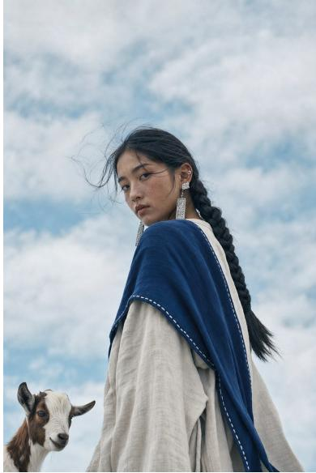  
gorgeous girl, long silver-white hair, luminous translucent peacock feather dress

高端中国时尚杂志封面，朱红长裙，主题“风从东方来”

  
hotel interior design, double-height living room, modern Oriental Zen minimalist style

  
草莓电商海报设计,主题“莓烦恼”

中国水墨风格，古老松树下一对仙鹤起舞，竖式“松鹤延年”，大师之作

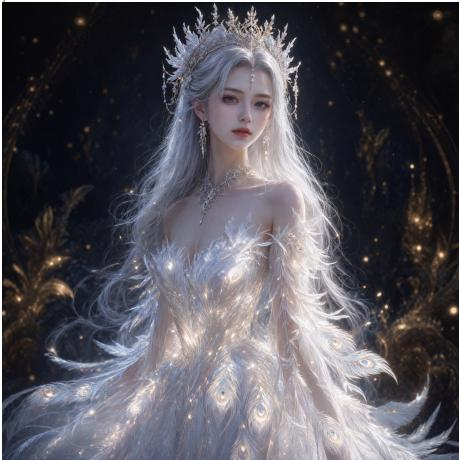

  
clay craft artwork, boy and white puppy, snow-dusted cabins, a large brown owl on roof, with trees, postbox, streetlamp, moon and stars

一组以西游记人物为主题的头像图标，简洁卡通风格。

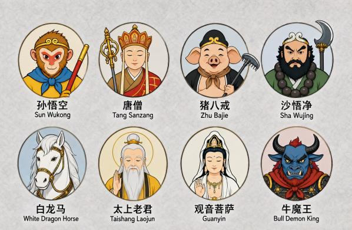  
Figure 13: Qualitative results of WeLM-Image on text-to-image generation.

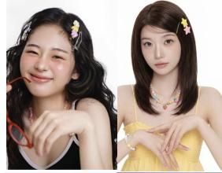

# Dress the girl from image 1 with clothes from image 2

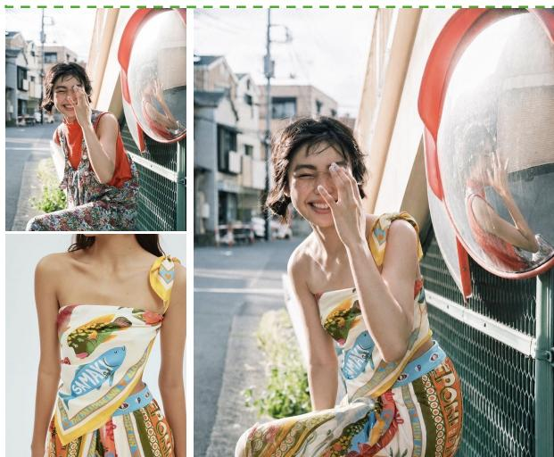  
用提供的4张人物图片生成一张竖版，可爱粉色系青春综艺海报，添加文字“元气少女社”

# 把图1中的鳄鱼公仔放到图2的沙发上，竖版出图

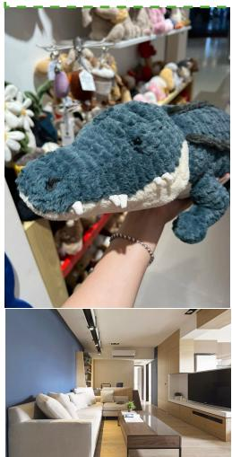

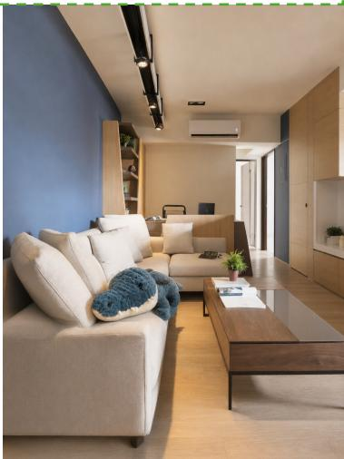  
女生加透明精灵翅膀，头发换淡紫色，背景改奇幻云海浮岛。

  
把标题从“高小花减脂餐建议”修改为“每日健康饮食计划”。

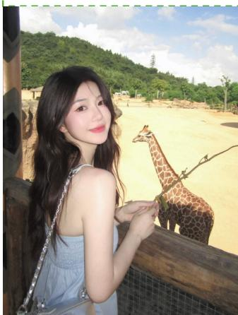

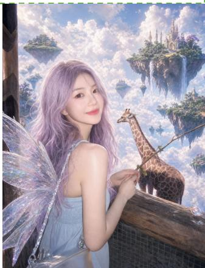  
Warm light filter, cinematic eye-level perspective, background changed to a nostalgic old market.

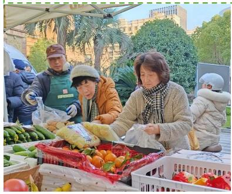

  
Figure 14: Qualitative results of WeLM-Image on image editing.

## Conclusion

We have presented WeLM-Image, a unified image foundation model that brings multimodal understanding into text to-image generation, instruction-guided editing, and multi-reference synthesis. Its MoT–MoE backbone combines specialized understanding and generation parameters with shared attention, allowing textual instructions and visual references to guide synthesis throughout the model. Sparse expert activation, a dedicated VAE, and text-compatible spatial encoding provide the capacity and visual representation needed for detailed, controllable image creation.

The data and training pipeline develops these capabilities together. A knowledge-grounded visual vocabulary and large-scale clustering guide semantic coverage, while bilingual captions, verified editing pairs, and training-time feedback improve the relevance and quality of supervision. Progressive pretraining and supervised fine-tuning extend the model to native 1.5K resolution. Task-specific reinforcement learning then refines generation and editing, and noise-aware on-policy distillation brings their specialized capabilities back into one checkpoint. This combines joint learning across tasks with targeted optimization of their distinct quality requirements.

The reported evaluations demonstrate strong performance in bilingual generation, text rendering, image editing, and multi-reference composition, including leading overall results among the evaluated open-source baselines on PRISM-Bench, Qwen-Image-Bench, and UnicBench. Few-step distillation extends this model family to eficient deployment: WeLM-Image-Turbo supports generation and editing with eight guidance-free steps and generates a 1024 × 1024 image in 4.98 s on a single NVIDIA H20 GPU.

Together with these results, the model, data pipeline, and training methodology provide a practical foundation for high-quality image creation in WeChat’s consumer services. Further work will focus on stronger visual reasoning, more reliable control under complex instructions, and continued improvements in eficiency.

## Authors

The list is organized by contribution role, with individuals listed alphabetically by their first name within each category. Authors marked with an asterisk (\*) denote individuals who are no longer afiliated with our team.

## Core Contributors:

Canmiao Fu, Chen Li, Guohui Zhang, Hao Lu, Hongyang Wei, Huadong Wu, Huaisong Zhang, Hubery Yin\*, Liyuan Cui, Qixin Yan, Tong Shao, Xiaoqiang Zhou, Xinhang Leng, Ying Zhang, Zhenhai Liu, Zhipeng Huang.

## Contributors:

Can Ouyang, Chao Dai, Feng Wang, Fengbin Guan, Hao Liu, Hongrui Li, Jialian Li\*, Jikang Cheng\*, Jingyang Lin, Jinming Liu, Jun He, Junyu Wu, Lihao Ni, Pujing Yang, Qian Liang\*, Qian Wang\*, Shaobin Zhuang, Siyu Liu\*, Sujie Hu, Tianyi Zhang\*, Wei Liu, Wenhao Su, Xiaomin Li, Xiaotao Liu, Yazhen Xie, Zhigeng Xu, Zhonglei Chen.

## Acknowledgements:

We would like to specially thank Hao Zhou, Sifan Liu, Leteng Weng and Jing Lyu for sponsoring this project. We would also like to thank Chong Sun, Fangyuan Li, Feng Lin, Guohui Lin, Guomin Chen, Huayang Sun, Jiaxin Zhang, Jing Nie, Jingjing Li, Junyi Pan, Ken Deng\*, Lei Qian\*, Pang Yue, Piexuan Chen, Shaomian Yao, Tiantian Cao, Wenjing Wang, William Ming\*, Wujie Zheng, Xiaodan Zeng, Yinan Li\*, Yuanyuan Zhao, Yunhao Bai\*, Zaizhou Gong, Zhendong Yang\* and Ziyang Ma for their valuable support, helpful discussions and contributions to this project.

## References

[1] William Peebles and Saining Xie. Scalable difusion models with transformers. In Proceedings of the IEEE/CVF International Conference on Computer Vision (ICCV), pages 4195–4205, 2023.

[2] Yaron Lipman, Ricky T. Q. Chen, Heli Ben-Hamu, Maximilian Nickel, and Matt Le. Flow matching for generative modeling. In International Conference on Learning Representations, 2023.

[3] Xinyu Wei, Jinrui Zhang, Zeqing Wang, Hongyang Wei, Zhen Guo, Bairui Li, and Lei Zhang. TIIF-Bench: How does your T2I model follow your instructions? arXiv preprint arXiv:2506.02161, 2025.

[4] Chenfei Wu et al. Qwen-Image technical report. arXiv preprint arXiv:2508.02324, 2025.

[5] Shiyu Liu, Yucheng Han, Peng Xing, Fukun Yin, Rui Wang, Wei Cheng, Jiaqi Liao, Yingming Wang, Honghao Fu, Chunrui Han, et al. Step1X-Edit: A practical framework for general image editing. arXiv preprint arXiv:2504.17761, 2025.

[6] Shitao Xiao, Yueze Wang, Junjie Zhou, Huaying Yuan, Xingrun Xing, Ruiran Yan, Chaofan Li, Shuting Wang, Tiejun Huang, and Zheng Liu. OmniGen: Unified image generation. In Proceedings ofthe IEEE/CVF Confer ence on Computer Vision and Pattern Recognition (CVPR), pages 13294–13304, 2025.

[7] Tencent Hunyuan Foundation Model Team. HunyuanImage 3.0 technical report. arXiv preprint arXiv:2509.23951, 2025.

[8] Haiwen Diao, Penghao Wu, Hanming Deng, Jiahao Wang, Shihao Bai, Silei Wu, Weichen Fan, Wenjie Ye, Wenwen Tong, Xiangyu Fan, et al. SenseNova-U1: Unifying multimodal understanding and generation with NEO-unify architecture. arXiv preprint arXiv:2605.12500, 2026.

[9] Weixin Liang, Lili Yu, Liang Luo, Srinivasan Iyer, Ning Dong, Chunting Zhou, Gargi Ghosh, Mike Lewis, Wentau Yih, Luke Zettlemoyer, and Xi Victoria Lin. Mixture-of-Transformers: A sparse and scalable architecture for multi-modal foundation models. Transactions on Machine Learning Research, 2025.

[10] Chaorui Deng et al. Emerging properties in unified multimodal pretraining. arXiv preprint arXiv:2505.14683, 2025.

[11] Noam Shazeer, Azalia Mirhoseini, Krzysztof Maziarz, Andy Davis, Quoc Le, Geofrey Hinton, and Jef Dean. Outrageously large neural networks: The sparsely-gated mixture-of-experts layer. In International Conference on Learning Representations, 2017.

[12] William Fedus, Barret Zoph, and Noam Shazeer. Switch transformers: Scaling to trillion parameter models with simple and eficient sparsity. Journal ofMachine Learning Research, 23(120):1–39, 2022.

[13] Jianlin Su, Murtadha H. M. Ahmed, Yu Lu, Shengfeng Pan, Wen Bo, and Yunfeng Liu. RoFormer: Enhanced transformer with rotary position embedding. Neurocomputing, 568:127063, 2024.

[14] Peng Wang, Shuai Bai, Sinan Tan, Shijie Wang, Zhihao Fan, Jinze Bai, Keqin Chen, Xuejing Liu, Jialin Wang, Wenbin Ge, Yang Fan, Kai Dang, Mengfei Du, Xuancheng Ren, Rui Men, Dayiheng Liu, Chang Zhou, Jingren Zhou, and Junyang Lin. Qwen2-VL: Enhancing vision-language model’s perception of the world at any resolution. arXiv preprint arXiv:2409.12191, 2024.

[15] Xuelu Feng, Yunsheng Li, Ziyu Wan, Zixuan Gao, Junsong Yuan, Dongdong Chen, and Chunming Qiao. RubricRL: Simple generalizable rewards for text-to-image generation. arXiv preprint arXiv:2511.20651, 2025.

[16] Wei Zhou, Xiongwei Zhu, Zelin Xu, Bo Dong, Lixue Gong, Yongyuan Liang, Meng Chu, Leigang Qu, Lingdong Kong, Wei Liu, et al. Danceopd: On-policy generative field distillation. arXiv preprint arXiv:2606.27377, 2026.

[17] Bingnan Li, Haozhe Wang, Haozhong Xiong, Fangtai Wu, Jinpeng Yu, Yang Shi, Jiaming Liu, and Ruihua Huang. Rethinking classifier-free guidance in on-policy difusion distillation. arXiv preprint arXiv:2607.24731, 2026.

[18] Zhengyang Geng, Mingyang Deng, Xingjian Bai, J. Zico Kolter, and Kaiming He. Mean flows for one-step generative modeling. In Advances in Neural Information Processing Systems, volume 38, 2025.

[19] Mario Michael Krell, Matej Kosec, Sergio P. Perez, and Andrew Fitzgibbon. Eficient sequence packing without cross-contamination: Accelerating large language models without impacting performance. arXiv preprint arXiv:2107.02027, 2021.

[20] Yanli Zhao, Andrew Gu, Rohan Varma, Liang Luo, Chien-Chin Huang, Min Xu, Less Wright, Hamid Shojanazeri, Myle Ott, Sam Shleifer, Alban Desmaison, Can Balioglu, Pritam Damania, Bernard Nguyen, Geeta Chauhan, Yuchen Hao, Ajit Mathews, and Shen Li. PyTorch FSDP: Experiences on scaling fully sharded data parallel. Proceedings ofthe VLDB Endowment, 16(12):3848–3860, 2023.

[21] Sam Ade Jacobs, Masahiro Tanaka, Chengming Zhang, Minjia Zhang, Shuaiwen Leon Song, Samyam Rajbhandari, and Yuxiong He. DeepSpeed Ulysses: System optimizations for enabling training of extreme long sequence transformer models. In Proceedings of the 53rd International Conference on Parallel Processing, pages 184–194, 2024.

[22] Rongyao Fang, Aldrich Yu, Chengqi Duan, Linjiang Huang, Shuai Bai, Yuxuan Cai, Kun Wang, Si Liu, Xihui Liu, and Hongsheng Li. FLUX-Reason-6M & PRISM-Bench: A million-scale text-to-image reasoning dataset and comprehensive benchmark. In International Conference on Learning Representations, 2026.

[23] Niantong Li, Guangzheng Hu, Weixu Qiao, Ying Ba, Qichen Hong, Shijun Shen, Jinlin Wang, Fan Zhou, Jianye Kang, Xin Shang, et al. Qwen-Image-Bench: From generation to creation in text-to-image evaluation. arXiv preprint arXiv:2605.28091, 2026.

[24] Keming Ye, Zhipeng Huang, Canmiao Fu, Qingyang Liu, Jiani Cai, Zheqi Lv, Chen Li, Jing Lyu, Zhou Zhao, and Shengyu Zhang. UnicEdit-10M: A dataset and benchmark breaking the scale-quality barrier via unified verification for reasoning-enriched edits. In Proceedings ofthe IEEE/CVF Conference on Computer Vision and Pattern Recognition, pages 37279–37289, 2026.

[25] Jonathan Ho and Tim Salimans. Classifier-free difusion guidance. arXiv preprint arXiv:2207.12598, 2022.

[26] Alexey Dosovitskiy, Lucas Beyer, Alexander Kolesnikov, Dirk Weissenborn, Xiaohua Zhai, Thomas Unterthiner, Mostafa Dehghani, Matthias Minderer, Georg Heigold, Sylvain Gelly, Jakob Uszkoreit, and Neil Houlsby. An image is worth 16x16 words: Transformers for image recognition at scale. In International Conference on Learning Representations, 2021.

[27] Kimi Team. Kimi-VL technical report. arXiv preprint arXiv:2504.07491, 2025.

[28] Richard Zhang, Phillip Isola, Alexei A. Efros, Eli Shechtman, and Oliver Wang. The unreasonable efectiveness of deep features as a perceptual metric. In Proceedings of the IEEE Conference on Computer Vision and Pattern Recognition (CVPR), pages 586–595, 2018.

[29] Maxime Oquab, Timothée Darcet, Théo Moutakanni, Huy V. Vo, Marc Szafraniec, Vasil Khalidov, Pierre Fernandez, Daniel Haziza, Francisco Massa, Alaaeldin El-Nouby, Mahmoud Assran, Nicolas Ballas, Wojciech Galuba, Russell Howes, Po-Yao Huang, Shang-Wen Li, Ishan Misra, Michael Rabbat, Vasu Sharma, Gabriel Synnaeve, Hu Xu, Hervé Jégou, Julien Mairal, Patrick Labatut, Armand Joulin, and Piotr Bojanowski. DINOv2: Learning robust visual features without supervision. Transactions on Machine Learning Research, 2024.

[30] Black Forest Labs. FLUX. https://github.com/black-forest-labs/flux, 2024.

[31] NextStep Team. NextStep-1: Toward autoregressive image generation with continuous tokens at scale. arXiv preprint arXiv:2508.10711, 2025.

[32] Jingfeng Yao, Bin Yang, and Xinggang Wang. Reconstruction vs. generation: Taming optimization dilemma in latent difusion models. arXiv preprint arXiv:2501.01423, 2025.

[33] Tim Salimans and Jonathan Ho. Progressive distillation for fast sampling of difusion models. In International Conference on Learning Representations, 2022.

[34] Martin Heusel, Hubert Ramsauer, Thomas Unterthiner, Bernhard Nessler, and Sepp Hochreiter. GANs trained by a two time-scale update rule converge to a local nash equilibrium. In Advances in Neural Information Processing Systems, volume 30, 2017.

[35] Tim Salimans, Ian Goodfellow, Wojciech Zaremba, Vicki Cheung, Alec Radford, and Xi Chen. Improved techniques for training GANs. In Advances in Neural Information Processing Systems, volume 29, 2016.

[36] Black Forest Labs. FLUX.2: Frontier visual intelligence. https://bfl.ai/blog/flux-2, 2025.

[37] Biao Zhang and Rico Sennrich. Root mean square layer normalization. In Advances in Neural Information Processing Systems, volume 32, pages 12381–12392, 2019.

[38] DeepSeek-AI. DeepSeek-V2: A strong, economical, and eficient mixture-of-experts language model. arXiv preprint arXiv:2405.04434, 2024.

[39] DeepSeek-AI. DeepSeek-V3 technical report. arXiv preprint arXiv:2412.19437, 2024.

[40] Christoph Schuhmann, Romain Beaumont, Richard Vencu, Cade Gordon, Ross Wightman, Mehdi Cherti, Theo Coombes, Aarush Katta, Clayton Mullis, Mitchell Wortsman, Patrick Schramowski, Srivatsa Kundurthy, Katherine Crowson, Ludwig Schmidt, Robert Kaczmarczyk, and Jenia Jitsev. LAION-5B: An open large-scale dataset for training next generation image-text models. In Advances in Neural Information Processing Systems, volume 35, 2022.

[41] Samir Yitzhak Gadre, Gabriel Ilharco, Alex Fang, Jonathan Hayase, Georgios Smyrnis, Thao Nguyen, Ryan Marten, Mitchell Wortsman, Dhruba Ghosh, Eyal Orgad, et al. DataComp: In search of the next generation of multimodal datasets. In Advances in Neural Information Processing Systems, volume 36, 2023.

[42] Philipp Moritz, Robert Nishihara, Stephanie Wang, Alexey Tumanov, Richard Liaw, Eric Liang, Melih Elibol, Zongheng Yang, William Paul, Michael I. Jordan, and Ion Stoica. Ray: A distributed framework for emerging AI applications. In 13th USENIX Symposium on Operating Systems Design and Implementation, pages 561–577. USENIX Association, 2018.

[43] Yuval Kirstain, Adam Polyak, Uriel Singer, Shahbuland Matiana, Joe Penna, and Omer Levy. Pick-a-Pic: An open dataset of user preferences for text-to-image generation. In Advances in Neural Information Processing Systems, volume 36, pages 36652–36663, 2023.

[44] Jiaju Mei, Yiming Zhu, Yunqi Gao, and Hongxiang Yin. Tongyici Cilin (Dictionary of Synonymous Words). Shanghai Cishu Publishing House, 1983.

[45] Mingxin Li, Yanzhao Zhang, Dingkun Long, Keqin Chen, Sibo Song, Shuai Bai, Zhibo Yang, Pengjun Xie, An Yang, Dayiheng Liu, Jingren Zhou, and Junyang Lin. Qwen3-VL-Embedding and Qwen3-VL-Reranker: A unified framework for state-of-the-art multimodal retrieval and ranking. arXiv preprint arXiv:2601.04720, 2026.

[46] Inderjit S. Dhillon and Dharmendra S. Modha. Concept decompositions for large sparse text data using clustering. Machine Learning, 42:143–175, 2001.

[47] James Betker, Gabriel Goh, Li Jing, Tim Brooks, Jianfeng Wang, Linjie Li, Long Ouyang, Juntang Zhuang, Joyce Lee, Yufei Guo, Wesam Manassra, Prafulla Dhariwal, Casey Chu, Yunxin Jiao, and Aditya Ramesh. Improving image generation with better captions. Technical report, OpenAI, 2023.

[48] Yang Ye, Xianyi He, Zongjian Li, Bin Lin, Shenghai Yuan, Zhiyuan Yan, Bohan Hou, and Li Yuan. ImgEdit: A unified image editing dataset and benchmark. In Advances in Neural Information Processing Systems, volume 38, 2025.

[49] Z-Image Team, Huanqia Cai, Sihan Cao, Ruoyi Du, Peng Gao, Aiming Hao, Steven Hoi, Zhaohui Hou, Shijie Huang, Dengyang Jiang, Yuming Jiang, et al. Z-Image: An eficient image generation foundation model with single-stream difusion transformer. arXiv preprint arXiv:2511.22699, 2025.

[50] Alec Radford, Jong Wook Kim, Chris Hallacy, Aditya Ramesh, Gabriel Goh, Sandhini Agarwal, Girish Sastry, Amanda Askell, Pamela Mishkin, Jack Clark, Gretchen Krueger, and Ilya Sutskever. Learning transferable visual models from natural language supervision. In Proceedings ofthe 38th International Conference on Machine Learning, volume 139 of Proceedings ofMachine Learning Research, pages 8748–8763. PMLR, 2021.

[51] Xiang An, Yin Xie, Kaicheng Yang, Wenkang Zhang, Xiuwei Zhao, Zheng Cheng, Yirui Wang, Songcen Xu, Changrui Chen, Chunsheng Wu, Huajie Tan, Chunyuan Li, Jing Yang, Jie Yu, Xiyao Wang, Bin Qin, Yumeng Wang, Zizhen Yan, Ziyong Feng, Ziwei Liu, Bo Li, and Jiankang Deng. Llava-onevision-1.5: Fully open framework for democratized multimodal training, 2025.

[52] Luis Wiedmann, Orr Zohar, Amir Mahla, Xiaohan Wang, Rui Li, Thibaud Frere, Leandro von Werra, Aritra Roy Gosthipaty, and Andrés Marafioti. Finevision: Open data is all you need, 2025.

[53] Yi Zhang, Bolin Ni, Xin-Sheng Chen, Heng-Rui Zhang, Yongming Rao, Houwen Peng, Qinglin Lu, Han Hu, Meng-Hao Guo, and Shi-Min Hu. Bee: A high-quality corpus and full-stack suite to unlock advanced fully open mllms, 2025.

[54] Guoxuan Chen, Chufeng Xiao, Haoran Yang, Siyue Xie, Binxiao Huang, Ming Zhang, Cheuk Him Chau, Xinyu Fu, Yingzhao Lian, Tom S. Y. Li, Jintao Lin, Bowen Dong, Zian Qian, Yuhao Liu, Yuxuan Hu, Weikang Shi, Bin Zou, Bowen Zheng, Haoxuan Che, Chang Chen, Yuyang He, Heyang Sun, Tianyu Huang, Chong Hou Choi, Cheng Gong, Han Shi, Haoli Bai, Xihui Liu, Hongsheng Li, Qifeng Chen, Chao Huang, Rui Liu, and Chenyang Lei. Boogu-Image-0.1: Boosting open agentic multimodal generation via understanding under a minimal budget. arXiv preprint arXiv:2607.13125, 2026.

[55] Ilya Loshchilov and Frank Hutter. Decoupled weight decay regularization. In International Conference on Learning Representations, 2019.

[56] Edward J. Hu, Yelong Shen, Phillip Wallis, Zeyuan Allen-Zhu, Yuanzhi Li, Shean Wang, Lu Wang, and Weizhu Chen. LoRA: Low-rank adaptation of large language models. In International Conference on Learning Representations, 2022.

[57] Kaiwen Zheng, Huayu Chen, Haotian Ye, Haoxiang Wang, Qinsheng Zhang, Kai Jiang, Hang Su, Stefano Ermon, Jun Zhu, and Ming-Yu Liu. DifusionNFT: Online difusion reinforcement with forward process. In International Conference on Learning Representations, 2026.

[58] Shih-Yang Liu, Xin Dong, Ximing Lu, Shizhe Diao, Peter Belcak, Mingjie Liu, Min-Hung Chen, Hongxu Yin, Yu-Chiang Frank Wang, Kwang-Ting Cheng, Yejin Choi, Jan Kautz, and Pavlo Molchanov. GDPO: Group reward-decoupled normalization policy optimization for multi-reward RL optimization. arXiv preprint arXiv:2601.05242, 2026.

[59] Tianwei Yin, Michaël Gharbi, Richard Zhang, Eli Shechtman, Frédo Durand, William T. Freeman, and Taesung Park. One-step difusion with distribution matching distillation. In Proceedings of the IEEE/CVF Conference on Computer Vision and Pattern Recognition (CVPR), 2024.

[60] Jiaxiang Liu, Zhida Feng, Pengyu Zou, Zhenyu Qian, Tianrui Zhu, Jun Xia, Yuehu Dong, Yanzheng Lin, Honglin Xiong, Anqi Chen, et al. ERNIE-Image technical report. arXiv preprint arXiv:2605.25347, 2026.

[61] Zhipu AI Team. GLM-Image: Auto-regressive for dense-knowledge and high-fidelity image generation. https: //z.ai/blog/glm-image, 2026.

[62] Qi Cai, Jingwen Chen, Chengmin Gao, Zijian Gong, Yehao Li, Yingwei Pan, Yi Peng, Zhaofan Qiu, Kai Yu, Yiheng Zhang, Hao Ai, Siying Bai, Yang Chen, Zhihui Chen, Fengbin Gao, Ying Guo, Dong Li, Zhen Shen, Leilei Shi, Jing Wang, Siyu Wang, Yimeng Wang, Rui Zheng, Ting Yao, and Tao Mei. HiDream-O1-Image: A natively unified image generative foundation model with pixel-level unified transformer. arXiv preprint arXiv:2605.11061, 2026.

[63] Black Forest Labs. FLUX.2: Frontier Visual Intelligence. https://bfl.ai/blog/flux-2, 2025.

[64] Dhruba Ghosh, Hannaneh Hajishirzi, and Ludwig Schmidt. GenEval: An object-focused framework for evaluating text-to-image alignment. In Advances in Neural Information Processing Systems, volume 36, pages 52132–52152, 2023.

[65] Jingjing Chang, Yixiao Fang, Peng Xing, Shuhan Wu, Wei Cheng, Rui Wang, Xianfang Zeng, Gang Yu, and Hai-Bao Chen. OneIG-Bench: Omni-dimensional nuanced evaluation for image generation. In Advances in Neural Information Processing Systems, volume 38, 2025.

[66] Xiwei Hu, Rui Wang, Yixiao Fang, Bin Fu, Pei Cheng, and Gang Yu. ELLA: Equip difusion models with LLM for enhanced semantic alignment. arXiv preprint arXiv:2403.05135, 2024.

[67] Qian Liang, Xiaomin Li, Ying Zhang, Jia Xu, Lihao Ni, Hongrui Li, Jingjing Li, Jing Lyu, and Chen Li. WeGenBench: A multidimensional diagnostic benchmark towards text-to-image model optimization. arXiv preprint arXiv:2606.20100, 2026.

[68] Zigang Geng, Yibing Wang, Yeyao Ma, Chen Li, Yongming Rao, Shuyang Gu, Zhao Zhong, Qinglin Lu, Han Hu, Xiaosong Zhang, et al. X-Omni: Reinforcement learning makes discrete autoregressive image generative models great again. arXiv preprint arXiv:2507.22058, 2025.

[69] Nikai Du, Zhennan Chen, Zhizhou Chen, Shan Gao, Xi Chen, Zhengkai Jiang, Jian Yang, and Ying Tai. TextCrafter: Accurately rendering multiple texts in complex visual scenes. arXiv preprint arXiv:2503.23461, 2025.

[70] Super Intelligence Team. FireRed-Image-Edit-1.0 technical report. arXiv preprint arXiv:2602.13344, 2026.

[71] Lin Song, Wenbo Li, Guoqing Ma, Wei Tang, Bo Wang, Yuan Zhang, Yijun Yang, Yicheng Xiao, Jianhui Liu, Yanbing Zhang, et al. JoyAI-Image: Awaking spatial intelligence in unified multimodal understanding and generation. arXiv preprint arXiv:2605.04128, 2026.

[72] Meituan LongCat Team, Hanghang Ma, Haoxian Tan, Jiale Huang, Junqiang Wu, Jun-Yan He, Lishuai Gao, Songlin Xiao, Xiaoming Wei, Xiaoqi Ma, Xunliang Cai, Yayong Guan, and Jie Hu. LongCat-Image technical report. arXiv preprint arXiv:2512.07584, 2025.