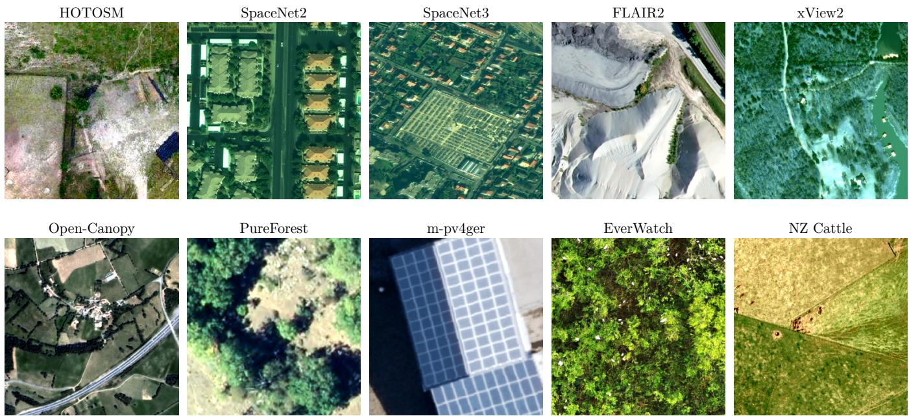
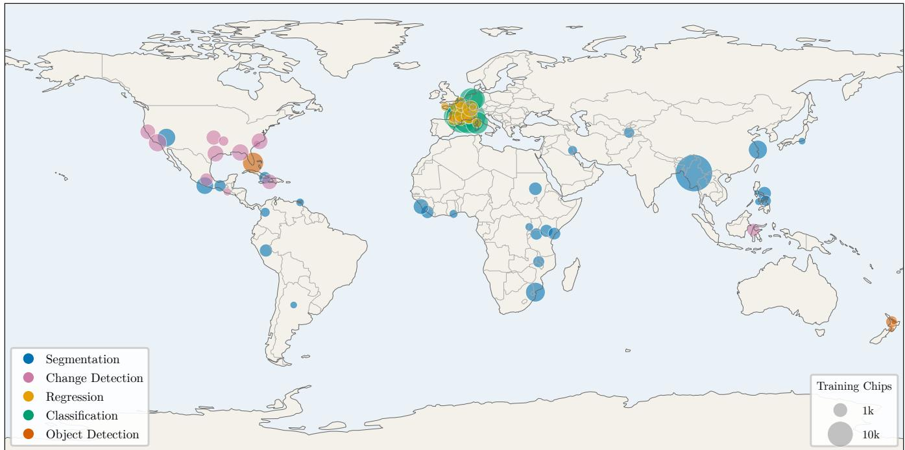
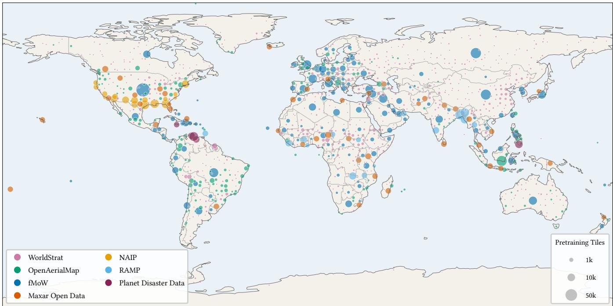
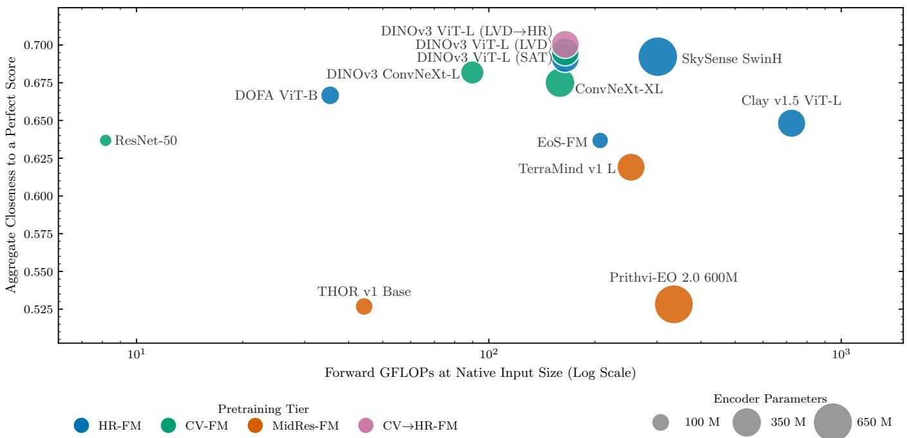
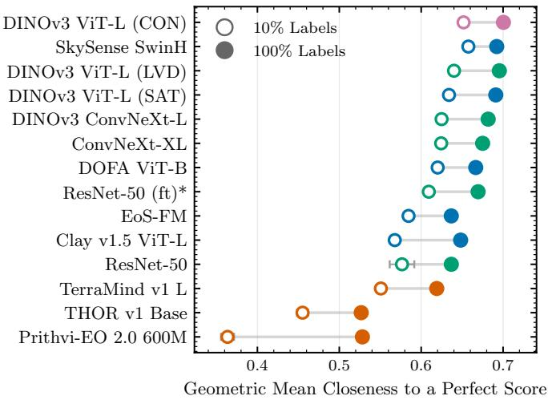

# When GeoFMs Meet VHR: Benchmarking Foundation Models on Very High Resolution Earth Observation Imagery

Kshitij Raj Sharma\*1, Pierre Adorni\*1, Minh-Tan Pham1, Dirk Tiede2, Sébastien Lefèvre1,3

Abstract—Geospatial foundation models are a widely adopted starting point for remote sensing tasks. Most are pretrained on Sentinel-1/2 and Landsat imagery at a ground sampling distance (GSD) of 10m or coarser. Many applications instead rely on very high resolution (VHR) imagery, where individual buildings, roads, and amenities are resolved. We study which pretraining regimes transfer well to this scale. We introduce VHR-Bench, a benchmark suite of ten datasets at 1.5m GSD or finer spanning five task families, eight application domains, and both satellite and aerial platforms. We evaluate twelve encoders in three pretraining tiers with frozen backbones at two training-data fractions. We find that both pretraining on large natural-image collections and VHR-specific pretraining transfer efectively to VHR tasks, with complementary strengths. SkySense leads when labels are scarce; at the full label fraction the web-pretrained DINOv3 ViT-L edges ahead, with the two close together there. Encoders pretrained only on Sentinel-scale imagery transfer least well under RGB input. Guided by these complementary results, we continue the self-supervised pretraining of DINOv3 ViT-L on 1.02 million held-out VHR tiles and evaluate the resulting encoder without changing the downstream protocol. The continued model gives a clear improvement over the released backbone when labels are scarce and a modest one at the full fraction, at no increase in inference parameters or compute. These findings support a generalizethen-specialize strategy: already strong, broad naturalimage pretraining can be further improved by a short VHR continuation stage while preserving its general visual features.

Index Terms—Very high resolution, geospatial foundation models, benchmarking.

## I. Introduction

Self-supervised pretraining on large satellite archives has made Geospatial Foundation Models (GeoFMs), also referred to as Earth Observation Foundation Models (EO-FMs), a common backbone for remote sensing tasks. Most rely on Sentinel-1 and Sentinel-2 imagery, which is openly available on a global scale with high temporal revisit, at a Ground Sampling Distance (GSD) of 10m or coarser. This large amount of medium to high-resolution data has driven substantial progress in broad-area scene analysis, but leaves an important resolution regime largely unad dressed: Very High Resolution (VHR).

We focus on the practical demand that lies in this regime. Applications from disaster response to infrastructure mapping depend on VHR imagery, acquired from satellite platforms such as WorldView, Pléiades, and SPOT, or from aerial and drone surveys. At such resolutions, finegrained features such as buildings, roads, amenities, and tree crowns are discriminated at the pixel level, enabling spatially precise tasks including building footprint extraction, road mapping, post-disaster damage assessment, canopy height regression, photovoltaic panel detection, tree species classification, and many more. Many disaster tasks are time-critical and demand object-level accurate spatial outputs.

Whether existing GeoFMs transfer well to this resolution regime has not been systematically evaluated. Our first hypothesis is that pretraining on medium to high resolution Sentinel archives may be insuficient at VHR, given the substantial scale mismatch between pretraining and inference conditions. Conversely, we hypothesize that computer-vision models pretrained on large RGB natural image corpora may transfer well to optical VHR imagery: beyond sharing the same three-channel representation, VHR imagery is closer to natural images than Sentinel-2 imagery in terms of spatial scale, texture, visual diversity, and fine-grained detail. We therefore investigate whether GeoFMs without VHR pretraining underperform on VHR tasks and whether generic RGB models provide a strong alternative to VHR-specific pretraining.

We make three contributions. First, we introduce VHR Bench, a benchmark of ten VHR datasets spanning five task families and covering eight application domains on both satellite and aerial optical sensors, under one common evaluation framework. Second, we evaluate twelve encoders organized into three pretraining tiers under a fixed protocol at two training-data fractions (10 and 100%). Third, as a design direction derived from the benchmark’s results, and to test whether label-free adaptation can improve an already strong natural image encoder on the VHR domain, we assemble 1.02 million VHR tiles from seven open sources and use them to continue DINOv3

TABLE I  
Datasets in the VHR suite with sensor, platform, resolution, and region. Some datasets carry extra bands (near-infrared and elevation in FLAIR 2, near-infrared in PureForest and Open-Canopy-Small); only their RGB is evaluated.
<table><tr><td># Dataset</td><td>Platform</td><td>Sensor</td><td>GSD</td><td>Region</td><td>Task</td><td>Train Val Test</td></tr><tr><td>1 SpaceNet 2 [1]</td><td>Satellite</td><td>WorldView-3</td><td>0.3m</td><td>4 cities</td><td>Segmentation (buildings)</td><td>5186  /  1461 2961</td></tr><tr><td>2 SpaceNet 3 [1]</td><td>Satellite</td><td>WorldView-3</td><td>0.3m</td><td>4 cities</td><td>Segmentation (roads)</td><td>1782 510 257</td></tr><tr><td>3 xView2 (xBD) [2]</td><td>Satellite</td><td>Mixed (Maxar)</td><td>&lt;0.8m</td><td>Global</td><td>Change detection (damage)</td><td>13384 /917 933</td></tr><tr><td>4 FLAIR 2 [3]</td><td>Aerial</td><td>Aerial RGBN</td><td>0.2m</td><td>France</td><td>Segmentation (land cover)</td><td>4049 1022 3022</td></tr><tr><td>5 Open-Canopy-Small [4]</td><td>Satellite</td><td>SPOT 6/7</td><td>1.5m</td><td>France</td><td>Regression (canopy height)</td><td>6634 737 13675</td></tr><tr><td>6 EverWatch [5]</td><td>Aerial</td><td>Aerial RGB</td><td>0.1m</td><td>United States</td><td>Object detection (birds)</td><td>4429  / 500 196</td></tr><tr><td>7 NZ Cattle [6]</td><td>Aerial</td><td>Aerial RGB (LINZ)</td><td>0.1m</td><td>New Zealand</td><td>Object detection (cattle)</td><td>524  / 66 /65</td></tr><tr><td>8 m-pv4ger [7]</td><td>Aerial</td><td>Aerial RGB</td><td>0.1m</td><td>Germany</td><td>Classification (PV)</td><td>11814 / 999 /999</td></tr><tr><td>9 PureForest [8]</td><td>Aerial</td><td>Aerial NRGB (IGN)</td><td>0.2m</td><td>France</td><td>Classification (tree species)</td><td>69111 / 13523 52935</td></tr><tr><td>10 HOTOSM Buildings [9] Mixed</td><td></td><td>Mixed (OpenAerialMap)</td><td></td><td>) 0.3-0.5m 15 countries</td><td>Segmentation (buildings)</td><td>57890  /  7237 /7236</td></tr></table>

ViT-L’s self-supervised pretraining. We will release1 the resulting model and its pretraining corpus. Together, VHR-Bench and this evaluation give the community a shared reference for how well current GeoFMs transfer to the VHR regime. The evaluation shows that generic naturalimage and VHR-pretrained encoders achieve the strongest performance, while Sentinel-only encoders consistently lag behind under RGB input. These findings challenge the assumption that geospatial pretraining is inherently preferable for VHR imagery, and provide a basis for assessing the additional value of VHR-specific pretraining.

## II. Related Work

## A. Geospatial foundation models

A foundation model is trained on broad data, generally with self-supervision at scale, and can be adapted to a wide range of downstream tasks [10, 11]. Geospatial foundation models apply this to Earth observation: they learn general purpose representations from large unlabeled Earth observation archives typically through self-supervised objec tives, then transfer to downstream tasks with limited su pervision. A large part of the published models target the Sentinel and Landsat archives where global coverage and frequent revisit provide plenty of pretraining data, for ex ample Prithvi-EO 2.0 [12] and TerraMind [13]. Others also include higher-resolution or multi-sensor imagery, varying the GSD of their pretraining data, such as DOFA [14], Panopticon [15], SkySense [16] and EoS-FM [17]. In parallel, general-purpose computer vision models such as DI-NOv3 [18] learn transferable features from large web-image collections without any remote-sensing-specific focus. This study benchmarks these pretraining-type families in the VHR regime.

A related line of work, represented by Tessera [19] and AlphaEarth Foundations [20], distributes precomputed annual geospatial embeddings at 10m resolution rather than a model intended for direct application to imagery. Although valuable for large-scale spatial and temporal analysis, these products cannot resolve several object-level or temporally narrow VHR tasks considered here, such as counting individual cattle or detecting localized postdisaster changes, and are therefore outside the scope of this benchmark. This study instead benchmarks transferable pretraining-model families in the VHR regime.

## B. Benchmarks for geospatial foundation models

Evaluation of GeoFMs has moved from heterogeneous selected-dataset studies to standardized multi-task benchmarks. The PANGAEA benchmark [21] defines a standardized evaluation protocol spanning a diverse set of datasets, tasks, resolutions, sensor modalities, and temporal settings, and reports that geospatial foundation models at the time did not consistently outperform supervised baselines such as U-Net and a vanilla ViT. GEO-Bench 2 [22] assembles nineteen permissively licensed datasets across five task families, classification, segmentation, regression, object detection, and instance segmentation, and introduces capability groups that rank models on datasets sharing characteristics such as resolution, spectral bands, and temporality; among its findings, models pretrained on natural images excel on high-resolution tasks, while Earth observation specific models are stronger on multispectral applications.

Both benchmarks span a wide range of resolutions, so only a small part of their coverage falls in the VHR regime: only four of GEO-Bench-2’s nineteen datasets are at 1.5m GSD or finer. GEO-Bench-2 partly addresses this through its capability groups, but the VHR datasets available within these suites are not assembled as a wide, task-balanced benchmark for VHR imagery on their own. VHR-Bench is designed to solve this problem and is complementary to these broader eforts. Beyond the resolution focus, our benchmark adds a controlled comparison that capability groups cannot provide: a matched pair of the same architecture and training scheme (DINOv3) pretrained on web images and on satellite imagery, which holds the architecture fixed and shows that VHR-specific pretraining comes close to strong natural-image pretraining at this scale, though the two difer in the scale of their pretraining data.

TABLE II  
Licenses, Original and Obtained Source for the ten datasets.
<table><tr><td>Dataset</td><td>License</td><td>Original source</td><td>Obtained from</td></tr><tr><td>SpaceNet 2</td><td>CC BY-SA 4.0</td><td>SpaceNet AWS Open Data</td><td>GEO-Bench-2 [22]</td></tr><tr><td>SpaceNet 3</td><td>CC BY-SA 4.0</td><td>SpaceNet AWS Open Data</td><td>Publisher release</td></tr><tr><td>xView2 (xBD)</td><td>CC BY-NC-SA 4.0</td><td>xview2.org</td><td>PANGAEA [21]</td></tr><tr><td>FLAIR 2</td><td>Open Licence 2.0 (Etalab)</td><td>IGN France</td><td>GEO-Bench-2 [22]</td></tr><tr><td>Open-Canopy-Small</td><td>Open Licence 2.0 (Etalab)</td><td>AI4Forest</td><td>Size-comparable subset</td></tr><tr><td>EverWatch</td><td>CC0 1.0</td><td>Zenodo</td><td>GEO-Bench-2 [22]</td></tr><tr><td>NZ Cattle</td><td>CC BY 4.0</td><td>Zenodo</td><td>GEO-Bench-2 [22]</td></tr><tr><td>m-pv4ger</td><td>MIT</td><td>Zenodo</td><td>GEO-Bench [23]</td></tr><tr><td>PureForest</td><td>Open Licence 2.0 (Etalab)</td><td>IGN France</td><td>Publisher release</td></tr><tr><td>HOTOSM Buildings</td><td>CC BY 4.0 / ODbL 1.0</td><td>Hugging Face</td><td>Publisher release</td></tr></table>

## C. Continual and domain-adaptive pretraining

Once a strong general-purpose encoder is available, domain specialization does not need to restart pretraining from random initialization. Continual pretraining instead resumes self-supervised training on data from the target domain. This strategy can add domain knowledge at a fraction of the cost of training a foundation model from scratch, but it also risks catastrophic forgetting or degrada tion of dense features. FINO [24], for example, adapts a visual foundation model while regularizing feature geometry, and related analyses show that unconstrained continued pretraining can afect global and dense representations diferently [25]. Our study uses the original DINOv3 self supervised objective for a short VHR continuation stage, evaluates the result with the same frozen protocol as the released encoders, and measures where its representation changes using centered kernel alignment [26].

III. Very High Resolution: Definition and Scope We define VHR as RGB optical imagery at a ground sampling distance (GSD) of 1.5m or finer, and adopt 1.5m as the upper bound for the suite. This threshold is set by the SPOT 6 and 7 sensors used in the Open-Canopy-Small dataset, the coarsest platform admitted; all other datasets are finer. At this resolution, in the terminology of Strahler et al. [27], the datasets fall in an H-resolution situation, in which scene elements are larger than the resolution cell and are individually identifiable, as opposed to the L resolution situation of medium-resolution imagery, where elements are smaller than the cell and are not individually detectable.

The bound is consistent with common usage. The European Space Agency describes very high resolution as imagery finer than 5m, with the finest commercial products below 1m.2 The 1.5m threshold sits within this range and excludes coarser medium-resolution products.

Since most public datasets only use the RGB bands, the study is restricted to RGB optical inputs. Nine of the ten datasets consist of single-date imagery; the exception is xView2, which provides bi-temporal pre-event and postevent image pairs to support building damage assessment.

Within this range, the suite spans native imagery at or below 1m GSD, such as WorldView-3 at 0.3m and aerial surveys at 0.1m, and pansharpened imagery between 1m and 1.5m, such as SPOT 6/7 at 1.5m, where a panchromatic band is fused with the multispectral channels. Both native and pansharpened products are admitted and noted per dataset.

## IV. Benchmark Datasets

VHR-Bench comprises ten optical-only datasets, all accessed through a common loading and evaluation interface so that every encoder is evaluated under the same pipeline. Table I lists each dataset with its sensor, platform, resolution, and region. The suite is balanced across five task families (Table III) and across sensing platforms: four satellite datasets, five aerial, and one mixed (HOTOSM Buildings), at spatial resolutions from 0.1m to 1.5m.

Table II records the license and source of each dataset. Each license was verified against the original publisher. Four datasets are reused from GEO-Bench-2, one from PANGAEA, and one from GEO-Bench. Three are taken directly from their original publication: SpaceNet 3, Pure-Forest, and HOTOSM Buildings. Finally, we create Open-Canopy-Small, a subset of AI4Forest’s Open-Canopy to minimize our benchmark’s computational footprint; it is published alongside the benchmark (details in Section IV-A). The splits, tiling, and label encoding follow the source each dataset was taken from. All ten licenses permit research use. Eight allow reuse subject to attribution; EverWatch is released into the public domain under CC0, and xView2 is released for non-commercial use. Share-alike terms apply to SpaceNet 2 and 3, to xView2, and to the OpenStreetMap-derived labels in HO TOSM Buildings. HOTOSM Buildings is the only dataset whose imagery and labels carry diferent licenses: imagery from OpenAerialMap is CC BY 4.0 with attribution to contributors of Open Imagery Network, and labels from OpenStreetMap are ODbL 1.0 with attribution to OpenStreetMap contributors. The license for m-pv4ger is recorded as MIT in the GEO-Bench license table and in the publishing repositories.

Table III summarizes the suite by task family and application domain. Fig. 2 displays the geographic coverage of the benchmark. Datasets range geographically from single-country coverage (France, Germany, New Zealand, the United States) to genuinely global sets: xView2 spans nineteen disaster events worldwide, and HOTOSM Build ings covers fifteen countries concentrated in the Global South, including Myanmar, Mozambique, Mexico, Kenya, and Liberia. The suite reaches six continents, although the volume is concentrated in a few places, and the Global North is slightly over-represented.

TABLE III  
Task-family and application-domain composition of VHR-Bench; the eight domains are buildings, roads, land cover, building damage, forestry, ecology, agriculture, and energy.
<table><tr><td>Task family</td><td>Count</td><td>Domain breakdown</td></tr><tr><td>Semantic segmentation</td><td>4</td><td>2 buildings (SpaceNet 2, HOTOSM Buildings), 1 roads (SpaceNet 3), 1 land cover (FLAIR 2, 13 classes)</td></tr><tr><td>Change detection</td><td>1</td><td>1 building damage (xView2)</td></tr><tr><td>Regression</td><td>1</td><td>1 forestry / canopy height (Open-Canopy-Small)</td></tr><tr><td>Object detection</td><td>2</td><td>1 ecology / wading birds (EverWatch), 1 agriculture / cattle</td></tr><tr><td>Classification</td><td>2</td><td>(NZ Cattle) 1 energy / PV panels (m-pv4ger, binary), 1 forestry / tree species (PureForest, 13 classes)</td></tr></table>

Fig. 1 shows one training chip per dataset, illustrating how diferent the scenes and targets are across the suite. Each task family fixes its decoder, criterion, and primary metric, described in Table V. Every encoder is thus evaluated under the same predetermined configuration. The two classification datasets, including the PureForest tree species dataset [8], are class-imbalanced, which is why macro F1 is their primary metric.

## A. Open-Canopy Subset

The original Open-Canopy dataset weighs approx. 360GB on disk. In an efort to make our benchmark more easily reproducible, we create a subset of the dataset by randomly sampling 10% of the training and validation patches, while leaving the test set as-is for comparability purposes. The obtained Open-Canopy-Small dataset3, weighing 25GB on disk, is used in all our experiments in place of the original Open-Canopy dataset. We also publish a 13GB Open-Canopy-Small Non-Comparable4 subset, for which we also reduce the test set to 10%, although it is not used in this benchmark.

## V. Encoders

Twelve encoders are evaluated, organized into three tiers defined by pretraining data resolution:

• HR-FM: the pretraining data include high-resolution satellite or aerial imagery finer than the Sentinel scale (not exclusively).

• CV-FM: pretrained only on natural or web images, with no significant exposure to remote sensing imagery beyond potential occurrences in web data.

• MidRes-FM: pretrained only on medium-resolution Sentinel-scale imagery at or above 10m GSD.

Table IV lists the twelve encoders together with their pretraining data, measured parameter counts, and forward GFLOPs at each encoder’s native input size.

The HR-FM tier contains five encoders; it captures whether an encoder has been exposed to high-resolution remote sensing imagery during pretraining: its threshold is therefore less strict than the 1.5m GSD bound used to define the evaluation data. DINOv3 ViT-L (SAT) [18] is the satellite variant of DINOv3, distilled from the DINOv3 ViT-7B model and pretrained on SAT-493M, a collection of Maxar RGB tiles at 0.6m GSD. DOFA [14] is a multimodal foundation model that uses a wavelength-conditioned dynamic hypernetwork and is pretrained across five Earth observation sensor modalities. SkySense [16] is a billion-scale multimodal remote sensing foundation model pretrained on 21.5 million multimodal temporal sequences of optical and SAR imagery. It is composed of several modality-specific encoders, which together make the full model billion-scale. We select only the high-resolution optical Swin-Huge backbone, and discard both Sentinel-2 and Sentinel-1 pretrained ViT-L backbones. Clay v1.5 [28] is a masked-autoencoder trained Vision Transformer trained on multi-sensor inputs including Sentinel-1/2, NAIP, and LINZ (Land Information New Zealand). EoS-FM [17] is an ensemble that fuses the features of multiple lightweight ConvNeXtV2 encoders, each pretrained on a diferent dataset spanning Sentinel-1/2 and high-resolution optical imagery.

The CV-FM tier contains four encoders. The DINOv3 ViT-L and ConvNeXt-L variants [18] share the DINOv3 selfsupervised objective and are trained on the LVD-1689M web-image collection. ConvNeXt-XL [29] and ResNet-50 [30] are standard ImageNet-pretrained convolutional baselines. This tier measures how far strong generalpurpose visual features transfer to VHR without any domain-specific pretraining.

The MidRes-FM tier contains three encoders. Terra-Mind [13] is a multimodal model pretrained on several co-registered Earth-observation modalities at medium resolution, including Sentinel-1 and Sentinel-2. Prithvi-EO 2.0 [12] is a Vision Transformer pretrained on Harmonized Landsat and Sentinel-2 imagery at 30m. THOR [31] is pretrained on Sentinel-1/2/3. These encoders have no exposure to high resolution imagery.

## VI. Evaluation Protocol

All encoders are evaluated under one fixed protocol. We freeze the backbone and train only an attached taskspecific decoder. Table V describes the decoder, loss, and primary metric attributed to each task family. Semantic segmentation and change detection report mean intersection over union (mIoU); change detection uses a Siamese UPerNet that concatenates the features of the pre-event and post-event images. Canopy height regression reports root mean squared error (RMSE, lower is better). Object detection reports mAP@50. Classification reports macro F1, chosen over accuracy because both classification datasets are class-imbalanced.

  
Fig. 1. One training chip per dataset, drawn through the same loader the encoders use.

TABLE IV  
Evaluated encoders. A dash in the Patch or Tokens column means the quantity does not apply, as for the convolutional encoders and for SkySense, whose windowed attention makes the token count vary by stage.
<table><tr><td>#</td><td>Tier</td><td>Encoder</td><td>Params (M)</td><td>GFLOPs</td><td>Input (px)</td><td>Patch</td><td></td><td>Tokens Pretraining data</td></tr><tr><td>1</td><td>HR-FM</td><td>Clay v1.5 ViT-L [28]</td><td>311</td><td>723.0</td><td>256</td><td>8</td><td>1024</td><td>Sentinel-1/2, NAIP, LINZ</td></tr><tr><td>2</td><td></td><td>DINOv3 ViT-L (ŠAT) [18]</td><td>303</td><td>164.7</td><td>256</td><td>16</td><td>256</td><td>SAT-493M (Maxar, 0.6m)</td></tr><tr><td>3</td><td></td><td>DOFA ViT-B [14]</td><td>111</td><td>35.4</td><td>224</td><td>16</td><td>196</td><td>Multi-sensor (sat + aerial)</td></tr><tr><td>4</td><td></td><td>EoS-FM [17]</td><td>78</td><td>206.9</td><td>256</td><td></td><td></td><td>Sentinel-1/2 and HR optical</td></tr><tr><td>5</td><td></td><td>SkySense SwinH [16]</td><td>655</td><td>301.6</td><td>256</td><td>4</td><td></td><td>WorldView 3/4, Sentinel-1/2</td></tr><tr><td>6</td><td>CV-FM</td><td>ConvNeXt-XL [29]</td><td>348</td><td>159.1</td><td>256</td><td></td><td></td><td>ImageNet-22k to 1k</td></tr><tr><td>7</td><td></td><td>DINOv3 ConvNeXt-L [18]</td><td>196</td><td>89.8</td><td>256</td><td></td><td></td><td>LVD-1689M (web)</td></tr><tr><td>8</td><td></td><td>DINOv3 ViT-L (LVD) [18]</td><td>303</td><td>164.7</td><td>256</td><td>16</td><td>256</td><td>LVD-1689M (web)</td></tr><tr><td>9</td><td></td><td>ResNet-50 [30]</td><td>24</td><td>8.2</td><td>224</td><td></td><td></td><td>ImageNet-1k</td></tr><tr><td>10</td><td>MidRes-FM</td><td>Prithvi-EO 2.0 600M [12]</td><td>631</td><td>335.0</td><td>224</td><td>14</td><td>256</td><td>HLS (Landsat + S2), 30m</td></tr><tr><td>11</td><td></td><td>THOR v1 Base [31]</td><td>94</td><td>44.2</td><td>224</td><td>16</td><td>196</td><td>Sentinel-1/2/3</td></tr><tr><td>12</td><td></td><td>TerraMind v1 L [13]</td><td>306</td><td>253.3</td><td>224</td><td>16</td><td>196</td><td>Sentinel-1/2, DEM, LULC</td></tr></table>

The UPerNet and Faster R-CNN decoders both consume a four-level feature pyramid; hierarchical encoders pass their four native stages, whereas features from single-scale vision transformers are extracted from four evenly distributed transformer blocks and resampled to four resolu tions using the Feature2Pyramid layer from PANGAEA’s implementation [21].

TABLE V  
Fixed decoder, loss, and primary metric per task family.
<table><tr><td>Task</td><td>Decoder</td><td>Loss</td><td>Metric</td></tr><tr><td>Segmentation</td><td>UPerNet</td><td>Cross-entropy</td><td>mIoU</td></tr><tr><td>Change detection</td><td>Siamese UPerNet</td><td>Cross-entropy</td><td>mIoU</td></tr><tr><td>Regression</td><td>UPerNet head</td><td>MSE</td><td>RMSE↓</td></tr><tr><td>Detection</td><td>Faster R-CNN</td><td>Cross-entropy + box reg.</td><td>mAP@50</td></tr><tr><td>Classification</td><td>Linear probe</td><td>Cross-entropy</td><td>Macro F1</td></tr></table>

The HR-FM and CV-FM encoders are RGB-native and consume the three RGB bands directly. The three MidRes-FM encoders natively expect multispectral input (Prithvi-EO 2.0 with 6, THOR with 10, and TerraMind with 14 channels); the missing non-RGB channels are filled with zeros, following PANGAEA’s band-padding protocol. The only real spectral signal seen by any encoder is therefore RGB.

  
Fig. 2. Geographic coverage of VHR-Bench. Chip centroids are coloured by task family and bubble size reflects the number of training chips in each area, so small sites stay visible alongside the largest.

Each encoder is used at its native input size; models supporting a variable image resolution use the fixed size reported in Table IV. During training, larger dataset patches are randomly cropped to the required dimensions. During validation, we perform sliding-window inference over the whole patch, averaging predictions where they overlap.

We train each decoder with AdamW (learning rate 1e-4, weight decay 0.05, batch size 8) and a multi-step learningrate schedule, for a fixed number of 80 epochs. Every configuration is repeated over three seeds (42, 1234, 2025) and evaluated both on the full datasets and on a 10% training-data fraction using a stratified subset.

## Aggregating scores

Because the suite combines higher-is-better metrics with one lower-is-better metric (Open-Canopy-Small RMSE), each per-dataset metric is mapped to a closeness to perfection score in [0, 1] before aggregation. For a dataset � with raw metric $m _ { d } ,$

$$
c _ { d } = \left\{ \begin{array} { l l } { m _ { d } / 1 0 0 , } & { \% \mathrm { { \small ~ v a l u e d ~ m e t r i c s } , } } \\ { \operatorname* { m a x } ( 1 - ( m _ { d } / r ) ^ { 2 } , \ \epsilon ) , } & { \mathrm { R M S E , } } \end{array} \right.
$$

where $\epsilon = 1 0 ^ { - 6 }$ ensures that the logarithm remains defined, and � is the population standard deviation of canopy height over the Open-Canopy-Small test split5. Since � is computed using the same samples and weighting as the RMSE, the unclipped Open-Canopy-Small score is the coeficient of determination $R ^ { 2 }$ ; predictions worse than the mean-target baseline are assigned �. The ten scores are combined per seed using their geometric mean,

$$
g = \left( \prod _ { d = 1 } ^ { 1 0 } c _ { d } \right) ^ { 1 / 1 0 } = \exp \left( \frac { 1 } { 1 0 } \sum _ { d = 1 } ^ { 1 0 } \ln c _ { d } \right) ,
$$

and the reported aggregate is the mean of � over the three seeds. For readability, we report the aggregate score as $G \ : = \ : 1 0 0 g \mathrm { . }$ , placing it on a 0–100 scale. Anchoring each score to a perfect result makes the aggregate independent of the set of encoders being compared: adding or removing an encoder does not rescale the scores of the others. More over, compared with an arithmetic mean, the geometric mean penalizes low performance on any individual dataset more strongly. The aggregate is computed at each label fraction, and encoders are ranked overall by the mean of their aggregate at the two fractions, so the low-label and full-label regimes count equally, while the per-fraction leaders are reported alongside.

## Reproducibility

We release a config-driven evaluation framework built as an extended fork of the PANGAEA codebase, intended for seamless reproducibility and upstream contribution. We content-hash and mirrored the datasets and the encoder checkpoints on Hugging Face, so the exact data and $^ { 5 } r = 8 5 . 9 0 7 $ , computed over the 13,675 test tiles.

weights can be verified. The evaluation code, configura tions, and dataset manifests will be released6 so the full suite can be re-run. The software environment is pinned and provided in the repository: Python 3.13 with PyTorch 2.12.0 (CUDA 13.0), torchvision 0.27.0, timm 1.0.27, and torchmetrics 1.9.0.

## VII. Continued VHR Pretraining

The released-encoder comparison (detailed results in Section VIII) identifies DINOv3 ViT-L (LVD) as the strongest encoder at the full label fraction and SkySense as the strongest when labels are scarce. It also shows a task level distinction between the two matched DINOv3 ViT-L variants: the web-pretrained model is stronger on semantic tasks, whereas the satellite-pretrained model retains an advantage on canopy-height regression and object detection. This motivates a benchmark-guided intervention: starting from the web model, we ask whether a short selfsupervised continuation on VHR imagery can add domain knowledge without discarding its broadly transferable features.

## A. VHR pretraining corpus

We assemble 1,018,163 non-overlapping 256 × 256 RGB tiles from seven sources (Table VI). Their GSDs range from 0.05 to 1.5m and include satellite, aerial, and drone imagery over six continents. The largest source, fMoW [32], is capped at approximately 500,000 tiles, and NAIP is capped at 100,000 tiles drawn from the SatlasPretrain pool [36], so neither archive dominates the mixture. Sources are sampled in proportion to the tile counts in Table VI. The resulting WebDataset shards include source, license, GSD, and tile-coordinate metadata. Because the most restrictive source terms apply to the combined collection, the corpus is released under CC BY-NC-SA 4.0. Separation from VHR-Bench: The ten benchmark datasets are not included as pretraining sources. We additionally exclude known intersections with the broader archives used to construct the corpus. Maxar disaster events appearing in xView2 are removed from Maxar Open Data; the RAMP Shanghai and Paris subsets are removed because SpaceNet 2 and 3 evaluate imagery from those cities; and OpenAerialMap mosaics used by HOTOSM Buildings are excluded. The other benchmark datasets originate from national mapping programs or acquisitions outside the corpus sources. These exclusions are performed using the available source and geographic metadata. Resid ual geographic overlap is still possible where an archive lacks complete tile-level provenance, but no benchmark images or labels are intentionally used during continued pretraining.

## B. Continued-pretraining method

We initialize the student and exponential-moving-average teacher from the released DINOv3 ViT-L LVD-1689M backbone. The released checkpoint does not contain the self-supervised projection heads, so the DINO and iBOT heads are reinitialized. We continue the original DINOv3 objective,

$$
\mathcal { L } _ { \mathrm { V H R } } = \mathcal { L } _ { \mathrm { D I N O } } + \mathcal { L } _ { \mathrm { i B O T } } + 0 . 1 \mathcal { L } _ { \mathrm { K o L e o } } ,\tag{1}
$$

which combines class-token self-distillation, masked-patch prediction, and an embedding-spread regularizer [18]. Task labels were not used in this objective. The reported model is the unconstrained continuation; feature-preservation anchors were tested separately but did not improve downstream transfer at the evaluated setting.

Randomly initialized heads can send destructive gradients into an already useful backbone. We therefore freeze the transformer for the first 1,000 steps while the heads stabilize, leaving only the patch-embedding stem trainable so it can adjust to VHR pixel statistics. The transformer then unfreezes through a 500-step linear warmup to the operating learning rate. Table VII gives the full configuration. Tiles are streamed with replacement; at an efective batch of 512, the first-pass checkpoint processes approximately one million tile draws and covers about 63% of the distinct corpus.

The operating learning rate is selected without VHR-Bench labels, using self-supervised loss stability, ImageNet nearest-neighbour retention, and feature standard deviation. Training-length checkpoints at approximately 2,000, 4,000, and 6,000 steps are then compared on the validation set of a four-task development subset at 10% labels. Classification degrades after the first pass while dense-task performance is flat or changes only slightly, so we report the first-pass checkpoint. The complete ten-dataset test suite is evaluated with the frozen-backbone protocol of Section VI; it is not used to update the continued model.

For direct comparison with the released encoders, the primary checkpoint is evaluated over the same three decoder seeds. We also repeat continued pretraining with seeds 42, 1234, and 2025 at the same data and compute budget, holding the decoder seed fixed, to measure run-to-run stability separately from decoder variability. We refer to the resulting encoder as DINOv3 ViT-L (LVD→HR), or the continued model.

## VIII. Results

The full-dataset benchmark ran for 1480 GPU-h on H100 GPUs, averaging 38h to test an encoder on the full suite once. The 10% data split took 309 GPU-h, averaging ∼8h for a single encoder to run once on the full suite.

## A. Released-encoder benchmark

Table VIII and Fig. 5 report the aggregate score for every encoder at both training-data fractions (10% and 100%). Besides our continued model, DINOv3 ViT-L (LVD) obtains the highest full-fraction average (69.5), followed by

TABLE VI  
VHR continued-pretraining corpus. Planet tiles are open disaster releases from Venezuela, the Philippines, and Jamaica.
<table><tr><td>Source</td><td>Tiles</td><td>Platform</td><td>Sensor</td><td>GSD</td><td>License</td><td>Obtained from</td></tr><tr><td>fMoW [32]</td><td>500,008</td><td>Satellite</td><td>QuickBird, GeoEye, WorldView</td><td>0.3-0.7m</td><td>fMoW Challenge (NC)</td><td>AWS Open Data</td></tr><tr><td>Maxar Open Data [33]</td><td>120,000</td><td>Satellite</td><td>WorldView</td><td>0.3m</td><td>CC BY-NC 4.0</td><td>Maxar STAC</td></tr><tr><td>OpenAerialMap [34]</td><td>100,000</td><td>Drone/aircraft</td><td>Mixed</td><td>0.05-1m</td><td>CC BY 4.0</td><td>OAM STAC</td></tr><tr><td>NAIP [35]</td><td>100,000</td><td>Aerial</td><td>Aerial RGB</td><td>1.25m</td><td>Public domain</td><td>SatlasPretrain [36]</td></tr><tr><td>RAMP [37]</td><td>95,333</td><td>Satellite</td><td>WorldView, GeoEye</td><td>0.3-0.5m</td><td>CC BY-NC 4.0</td><td>Source Cooperative</td></tr><tr><td>WorldStrat [38]</td><td>62,822</td><td>Satellite</td><td>SPOT 6/7</td><td>1.5m</td><td>CC BY-NC 4.0</td><td>Zenodo [38]</td></tr><tr><td>Planet Disaster Data [39]</td><td>40,000</td><td>Satellite</td><td>SkySat, Pelican</td><td>0.5m</td><td>CC BY-NC 4.0</td><td>Source Čooperative</td></tr></table>

  
Fig. 3. Geographic coverage of the continued-pretraining corpus. Tile footprints are aggregated on a coarse grid; bubble area is proportional to the number of tiles and colour identifies the dominant source in each cell.

TABLE VII  
Continued-pretraining configuration.
<table><tr><td>Setting</td><td>Value</td></tr><tr><td>Initialization</td><td>DINOv3 ViT-L (LVD-1689M)</td></tr><tr><td>Input</td><td>256 × 256 RGB</td></tr><tr><td>Effective batch</td><td>512</td></tr><tr><td>Objective</td><td>DINO + iBOT + 0.1 KoLeo</td></tr><tr><td>Schedule</td><td>Freeze 1,000; warm up 500 steps</td></tr><tr><td>Backbone learning rate</td><td> $5 \times 1 0 ^ { - 5 }$ </td></tr><tr><td>Reported checkpoint</td><td>First pass (~2,000 steps)</td></tr><tr><td>Hardware</td><td>2×A100 80GB</td></tr></table>

SkySense (69.2), and DINOv3 ViT-L (SAT) (69.1). These three top scores are separated by a few tenths of a point. At 10% labels, SkySense leads more clearly, at 65.8 points against 64.0 for DINOv3 ViT-L (LVD) and 63.4 for its SAT counterpart. The first six released positions are divided equally between CV-FM and HR-FM encoders, whereas the three MidRes-FM encoders occupy the last three positions. Every encoder improves from the reduced to the full label fraction, and the ordering is largely preserved.

The two DINOv3 ViT-L encoders provide a matched comparison in which the architecture, parameter count, input size, and evaluation protocol are held fixed while the pretraining data change. The web-pretrained LVD variant obtains a slightly higher aggregate score at both label fractions: 64.0 versus 63.4 at 10%, and 69.5 versus 69.1 at 100%. The aggregate proximity nevertheless masks a consistent task-level diference. At the full fraction, the LVD variant performs better on all four semanticsegmentation datasets, change detection, and both classification datasets, whereas the SAT variant performs better on canopy-height regression and both object-detection datasets. At the 10% fraction, LVD leads on eight datasets, while SAT leads on Open-Canopy-Small and NZ Cattle. In particular, SAT records the lowest Open-Canopy-Small RMSE at both fractions: 38.2 compared with 40.5 for the next-best encoder at 10%, and 35.1 compared with 36.6 at 100%.

  
Fig. 4. Aggregate closeness versus forward GFLOPs; marker size scales with parameter count, colour with the pretraining tier. Patch size sets the token count: Clay v1.5 (patch 8) carries 1024 tokens and 723 GFLOPs against DINOv3 ViT-L (patch 16) at 256 tokens and 164.7 GFLOPs.

## TABLE VIII

Overall ranking by geometric-mean closeness to a perfect score. The mean over three seeds and standard deviation are reported, with the best result per fraction in bold. CON designates our continual pretraining experiment (LVD→HR). Italics and ∗ denote fully fine-tuned models;   
otherwise, backbones are frozen. Closeness is scaled by 100.

<table><tr><td># Tier</td><td>Encoder</td><td>10%</td><td></td><td>100% Mean</td></tr><tr><td>1 CON</td><td>DINOv3 ViT-L (CON)</td><td> $6 5 . 2 _ { \pm 0 . 3 }$ </td><td> ${ \bf 7 0 . 0 _ { \pm 0 . 2 } }$ </td><td>67.6</td></tr><tr><td>2 HR</td><td>SkySense SwinH</td><td>65.8±0.4</td><td> $6 9 . 2 _ { \pm 0 . 1 }$ </td><td>67.5</td></tr><tr><td>3 CV</td><td>DÍNOv3 ViT-L (LVD)</td><td>64.0±0.3</td><td> $6 9 . 5 _ { \pm 0 . 1 } ^ { - }$ </td><td>66.8</td></tr><tr><td>4HR</td><td>DINOv3 ViT-L (SAT)</td><td> $6 3 . 4 _ { \pm 0 . 2 }$ </td><td> $6 9 . 1 _ { \pm 0 . 3 } ^ { - }$ </td><td>66.3</td></tr><tr><td>5 CV</td><td>DINOv3 ConvNeXt-L</td><td> $6 2 . 5 _ { \pm 0 . 1 }$ </td><td>68.2±0.2</td><td>65.3</td></tr><tr><td>6 CV</td><td>ConvNeXt-XL</td><td> $6 2 . 4 _ { \pm 0 . 0 } ^ { - }$ </td><td>67.5±0.2</td><td>65.0</td></tr><tr><td>7 HR</td><td>DOFA ViT-B</td><td> $6 2 . 0 _ { \pm 0 . 3 } ^ { - }$ </td><td> $6 6 . 7 _ { \pm 0 . 2 } ^ { - }$ </td><td>64.3</td></tr><tr><td>8 HR</td><td>EoS-FM</td><td> $5 8 . 5 _ { \pm 0 . 2 }$ </td><td> $6 3 . 7 _ { \pm 0 . 5 }$ </td><td>61.1</td></tr><tr><td>9 HR</td><td>Clay v1.5 ViT-L</td><td>56.8±0.5</td><td>64.8±0.2</td><td>60.8</td></tr><tr><td>10 CV</td><td>ResNet-50</td><td> $5 7 . 7 _ { \pm 1 . 5 }$ </td><td> $6 3 . 7 _ { + 0 . 1 } ^ { - }$ </td><td>60.7</td></tr><tr><td>11 MidRes</td><td>TerraMind v1 L</td><td> $5 5 . 1 \overline { { _ { \pm 0 . 5 } } }$ </td><td> $6 1 . 9 _ { \pm 0 . 2 } ^ { - }$ </td><td>58.5</td></tr><tr><td>12 MidRes</td><td>THOR v1 Base</td><td> $4 5 . 5 _ { \pm 0 . 7 } ^ { - }$ </td><td> $5 2 . 7 _ { \pm 0 . 2 }$ </td><td>49.1</td></tr><tr><td>13 MidRes</td><td>Prithvi-EO 2.0 600M</td><td> $3 6 . 4 _ { \pm 0 . 8 } ^ { - }$ </td><td> $5 2 . 8 _ { \pm 0 . 3 }$ </td><td>44.6</td></tr><tr><td colspan="2">Baseline ResNet-50  $( f t ) ^ { * }$ </td><td> $6 0 . 9 _ { \pm 0 . 1 }$ </td><td> $6 7 . 0 _ { \pm 0 . 3 }$ </td><td>63.9</td></tr></table>

## B. Efect of continued VHR pretraining

The continued model obtains the highest observed fullfraction aggregate, 70.0, compared with 69.5 for its released initialization, 69.2 for SkySense, and 69.1 for DI-NOv3 ViT-L (SAT). At 10% labels it reaches 65.2, ranking second behind SkySense at 65.8 and ahead of LVD at 64.0 and SAT at 63.4. Its two-fraction mean is 67.6, efectively tied with SkySense at 67.5 given the run-to-run spread. Since continued pretraining changes only the weights, its 303M parameters and 164.7 forward GFLOPs are identical

  
Fig. 5. Overall geometric-mean closeness at both training fractions, coloured by pretraining tier. Error bars are one standard deviation over three seeds. Encoders are ordered by the mean of the two fractions. (ft)\* means fully fine-tuned. CON designates our continual pretraining experiment (LVD→HR).

## to those of the two released DINOv3 ViT-L variants.

The aggregate gain over the initialization is larger when labels are scarce (+1.2 points) than at the full fraction (+0.5). At 10% labels, the largest per-dataset change is NZ Cattle detection, which rises from 59.1 to 67.0 mAP@50. At full labels, the clearest gains occur on FLAIR 2 landcover segmentation (54.3 to 55.4 mIoU) and PureForest classification (71.5 to 72.6 macro F1). Performance on the building, road, and change-detection datasets is largely preserved. The continuation does not uniformly inherit the SAT model’s geometric strengths: at full labels SAT remains ahead of LVD on Open-Canopy-Small and both detection datasets, while SkySense records the strongest detection results.

Tables IX and XII give the complete per-dataset results. The continued model is best or tied-best among frozen encoders on four datasets at 10% labels and five at full labels. Across the suite, the largest variance remains on NZ Cattle and the smallest on the saturated m-pv4ger classification task. The fully fine-tuned ResNet-50 reaches 60.9 and 67.0 in aggregate, improving over its frozen counterpart but remaining below the leading frozen encoders. It obtains the highest m-pv4ger score at both fractions and the highest full-fraction EverWatch score.

## C. Pretraining repeatability and feature retention

The primary ranking treats the continued checkpoint like every released checkpoint and reports variation over three decoder seeds. To separate this from continued-pretraining variability, we repeat the VHR continuation three times at a matched data and compute budget and evaluate each run with decoder seed 42 (Table X). The full-fraction aggregate remains 70.0 with a standard deviation of 0.1. At 10% labels it averages 64.8 with a standard deviation of 0.2, preserving its position between SkySense and the released LVD model. The exact two-fraction ordering of the continued model and SkySense is therefore not treated as a meaningful separation; the stable result is that both belong to the leading group and that continuation improves on its initialization.

Centered kernel alignment (CKA) between the continued and released encoders shows where specialization occurs. Patch-token similarity remains above 0.99 in the first half of the backbone, falls to 0.922 at layer 17, and reaches 0.789 at the last probed layer (Table XI). ImageNet nearest-neighbour accuracy is preserved, moving from 71.9% before continuation to 72.1% at the reported checkpoint. The continued model therefore retains the early and general-purpose representation while adapting primarily in its deepest layers.

## D. Ranking sensitivity and compute

We assess the sensitivity of the aggregate ranking by recomputing it after removing each dataset in turn. The fullsuite leader remains unchanged in nineteen of the twenty leave-one-out comparisons across the two label fractions (Table XIII). The only change occurs when NZ Cattle is removed at 10% labels, in which case the continued model replaces SkySense as the leader. The full-fraction lead of the continued model is unchanged under every single-dataset removal.

Figure 4 plots aggregate score against encoder computa tion. A top-tier result does not require the largest model: the three DINOv3 ViT-L checkpoints use roughly half the parameters and compute of SkySense, while the most expensive encoder, Clay, remains mid-ranked. Continued VHR pretraining moves DINOv3 upward on the accuracy axis without moving it on the inference-cost axis.

## IX. Discussion

## A. Interpretation of the findings

The released-encoder benchmark does not reveal a general performance separation between natural-image and high-resolution remote-sensing pretraining. The first six positions are divided equally between CV-FM and HR-FM encoders, and each tier contains both leading and mid-ranked models. Strong web-image pretraining is therefore a competitive alternative to high-resolution remotesensing pretraining for VHR RGB tasks. This conclusion concerns aggregate transfer performance, rather than equivalence between the two pretraining strategies: their per-dataset results show complementary strengths.

SkySense provides the strongest result when labels are scarce, scoring 65.8 at the 10% fraction compared with 64.0 for the best CV-FM, and it ranks first on the mean of the two fractions. At the full fraction, however, DINOv3 ViT-L (LVD) scores 69.5 and SkySense 69.2. The low-label result is consistent with the possibility that high-resolution remote-sensing pretraining improves sample eficiency, but the comparison cannot isolate the efect of pretraining data. SkySense uses a 655M-parameter hierarchical Swin-H backbone with 301.6 GFLOPs, whereas DINOv3 ViT L has 303M parameters and 164.7 GFLOPs. SkySense also provides a native multi-scale feature hierarchy, while features from the single-scale ViT, like DINOv3, are resampled for the decoder. Architecture, capacity, compute, and pretraining data are therefore all potential contributors to its low-label advantage.

The matched DINOv3 comparison gives more direct evidence about pretraining source. With architecture, training recipe and evaluation fixed, the web-pretrained LVD variant is slightly ahead in aggregate at both fractions. More specialized pretraining is thus not suficient on its own to improve average VHR transfer. Nevertheless, the per-task results contain interesting information: at the full fraction, the SAT variant is stronger on canopy-height regression and both object-detection datasets, whereas LVD is stronger on segmentation, change-detection, and classification. This pattern suggests that satellite pretraining may preserve useful spatial or physically grounded cues while large-scale web pretraining supports broader semantic discrimination.

Several properties of the pretraining corpora could explain the aggregate advantage of LVD, but the present experiments do not distinguish among them. LVD-1689M contains approximately 3.4 times as many images as SAT-493M and is likely to cover substantially greater visual and semantic diversity. SAT-493M, on the other hand, consists of imagery from one provider at a single nominal resolution. The observed diference could therefore reflect corpus size, visual diversity, sensor diversity, or their interaction, rather than a disadvantage of satellite imagery itself. Isolating the diferent factors would require controlled pretraining experiments with matched data volumes and training budgets.

TABLE IX  
Primary metric per dataset at 10 percent training data, frozen backbone except indicated. Segmentation and change detection report mIoU, classification macro F1, detection mAP@50, Open-Canopy-Small RMSE in decimetres (lower is better). Mean over three decoder seeds, subscript is the standard deviation; best frozen-encoder mean in bold. The fully fine-tuned baseline is not counted when bolding. Datasets: HOT: HOTOSM Buildings; SN2, SN3: SpaceNet 2, 3; FLR: FLAIR2; xV2: xView2; OpC: Open-Canopy-Small; PF: PureForest; PV: m-pv4ger; EvW: EverWatch; NZC: NZ Cattle.  
TABLE XI  
Patch-token CKA between the continued and released DINOv3 ViT-L encoders; mean and standard deviation over three continued-pretraining runs.
<table><tr><td>Layer</td><td>5</td><td>11</td><td>17</td><td></td></tr><tr><td>CKA</td><td> $0 . 9 9 8 _ { \pm 0 . 0 0 0 }$ </td><td> $0 . 9 9 6 _ { \pm 0 . 0 0 0 }$ </td><td> $0 . 9 2 2 _ { \pm 0 . 0 1 2 }$ </td><td> $0 . 7 8 9 _ { \pm 0 . 0 1 6 }$ </td></tr></table>

The MidRes-FM encoders occupy the final three positions, providing the clearest tier-level pattern in the benchmark. This supports the hypothesized dificulty of transferring representations learned on multi-spectral inputs and at Sentinel or Landsat scale to RGB imagery in which small individual objects and fine spatial boundaries are resolved. These encoders are designed for multispectral inputs but receive only RGB with their remaining channels set to zero, and their backbones are frozen. The experiments therefore show that the evaluated Sentinel-scale encoders transfer least efectively when repurposed as frozen RGB encoders for VHR imagery, not that medium-resolution pretraining is intrinsically inefective in its native modality. General benchmarks like PANGAEA [21], GEO-Bench [23] and GEO-Benchand 2 [22] are instead the right tool to evaluate MOdRes-FM encoders in their native modalities.

<table><tr><td>Tier</td><td>Encoder</td><td>HOT</td><td>SN2</td><td>SN3</td><td> $\mathrm { F L R }$ </td><td>xV2</td><td> $\mathrm { { { O p C } } }$ </td><td>PF</td><td>PV</td><td>EvW</td><td>NZC</td></tr><tr><td>CV→VHR</td><td>DINOv3 ViT-L (LVD→HR)</td><td> ${ \bf 6 6 . 5 _ { \pm 0 . 4 } }$ </td><td> ${ \bf 8 7 . 6 _ { \pm 0 . 0 } }$ </td><td> $6 9 . 7 _ { \pm 0 . 4 }$ </td><td> ${ \bf 5 3 . 9 _ { \pm 0 . 6 } }$ </td><td> ${ \bf 5 7 . 4 _ { \pm 0 . 6 } }$ </td><td> $3 9 . 8 _ { \pm 0 . 1 }$ </td><td> $6 6 . 2 _ { \pm 0 . 4 }$ </td><td>93.4±0.2</td><td> $3 3 . 9 _ { \pm 0 . 8 }$ </td><td> $6 7 . 0 _ { \pm 2 . 8 }$ </td></tr><tr><td>HR-FM</td><td>Clay v1.5 ViT-L</td><td> $6 1 . 2 _ { \pm 0 . 8 }$ </td><td> $7 9 . 9 _ { \pm 0 . 3 }$ </td><td> $5 8 . 8 _ { \pm 0 . 5 }$ </td><td> $4 3 . 9 _ { \pm 0 . 1 }$ </td><td> $5 1 . 8 _ { \pm 0 . 6 }$ </td><td> $4 2 . 8 _ { \pm 0 . 1 }$ </td><td> $4 5 . 7 _ { \pm 0 . 3 }$ </td><td> $8 2 . 2 _ { \pm 0 . 8 }$ </td><td> $2 8 . 3 _ { \pm 1 . 5 }$ </td><td> $6 6 . 8 _ { \pm 1 . 1 }$ </td></tr><tr><td></td><td>DINOv3 ViT-L (SAT) DOFA ViT-B</td><td> $6 5 . 4 _ { \pm 0 . 7 }$ </td><td> $8 5 . 3 _ { \pm 0 . 3 }$ </td><td> $6 8 . 6 _ { \pm 0 . 4 }$ </td><td> $5 1 . 2 _ { \pm 0 . 3 }$ </td><td> $5 5 . 9 _ { \pm 0 . 3 }$ </td><td> $\mathbf { 3 8 . 2 _ { \pm 0 . 1 } }$ </td><td> $6 3 . 0 _ { \pm 1 . 5 }$ </td><td> $9 0 . 2 _ { \pm 0 . 2 }$ </td><td> $3 1 . 9 _ { \pm 0 . 7 }$ </td><td> $6 6 . 0 _ { \pm 1 . 5 }$ </td></tr><tr><td></td><td></td><td> $6 3 . 1 _ { \pm 1 . 0 }$ </td><td> $8 3 . 8 _ { \pm 0 . 2 }$ </td><td> $6 5 . 5 _ { \pm 0 . 5 }$ </td><td> $4 8 . 9 _ { \pm 0 . 3 }$ </td><td> $5 3 . 7 _ { \pm 0 . 3 }$ </td><td> $4 2 . 7 _ { \pm 0 . 1 }$ </td><td> $6 1 . 4 _ { \pm 1 . 6 }$ </td><td> $9 2 . 3 _ { \pm 0 . 9 }$ </td><td> $3 2 . 2 _ { \pm 0 . 5 }$ </td><td> $6 7 . 6 _ { \pm 0 . 8 }$ </td></tr><tr><td></td><td>EoS-FM</td><td> $6 1 . 9 _ { \pm 0 . 5 }$ </td><td> $8 2 . 9 _ { \pm 0 . 1 } ^ { - }$ </td><td> $6 6 . 8 _ { \pm 0 . 7 }$ </td><td> $4 1 . 6 _ { \pm 0 . 8 } ^ { - }$ </td><td> $5 3 . 2 _ { \pm 0 . 3 }$ </td><td> $4 3 . 3 _ { \pm 0 . 1 }$ </td><td> $4 9 . 1 _ { \pm 1 . 2 }$ </td><td> $8 9 . 4 _ { \pm 0 . 7 }$ </td><td> $2 7 . 3 _ { \pm 0 . 6 }$ </td><td> $6 8 . 8 _ { \pm 1 . 2 }$ </td></tr><tr><td></td><td>SkySense SwinH</td><td> $6 5 . 9 _ { \pm 0 . 3 }$ </td><td> $8 6 . 5 _ { \pm 0 . 1 }$ </td><td> $6 7 . 5 _ { \pm 0 . 5 }$ </td><td> $5 2 . 0 _ { \pm 0 . 2 }$ </td><td> $5 7 . 1 _ { \pm 0 . 6 }$ </td><td> $4 0 . 5 _ { \pm 0 . 1 }$ </td><td> ${ \bf 6 7 . 1 _ { \pm 2 . 2 } }$ </td><td> $9 3 . 6 _ { \pm 0 . 7 }$ </td><td> $\mathbf { 3 5 . 9 _ { \pm 0 . 9 } }$ </td><td> ${ \bf 7 5 . 6 _ { \pm 0 . 7 } }$ </td></tr><tr><td>CV-FM</td><td>ConvNeXt-XL</td><td> $6 3 . 8 _ { \pm 0 . 3 }$ </td><td> $8 4 . 3 _ { \pm 0 . 3 }$ </td><td> $6 5 . 8 _ { \pm 0 . 4 }$ </td><td> $4 8 . 3 _ { \pm 0 . 2 }$ </td><td> $5 3 . 7 _ { \pm 0 . 5 }$ </td><td> $4 2 . 7 _ { \pm 0 . 1 }$ </td><td> $6 2 . 1 _ { \pm 2 . 6 }$ </td><td> $9 3 . 8 _ { \pm 1 . 0 }$ </td><td> $3 4 . 6 _ { \pm 0 . 4 }$ </td><td> $6 4 . 7 _ { \pm 2 . 6 }$ </td></tr><tr><td></td><td>DINOv3 ConvNeXt-L</td><td> $6 5 . 8 _ { \pm 0 . 3 }$ </td><td> $8 6 . 3 _ { \pm 0 . 1 }$ </td><td> $6 6 . 7 _ { \pm 0 . 1 }$ </td><td> $5 1 . 9 _ { \pm 0 . 1 }$ </td><td> $5 4 . 6 _ { \pm 0 . 5 }$ </td><td> $4 2 . 9 _ { \pm 0 . 1 }$ </td><td> $6 5 . 4 _ { \pm 0 . 5 }$ </td><td> $9 3 . 7 _ { \pm 0 . 3 }$ </td><td> $3 0 . 8 _ { \pm 0 . 6 }$ </td><td> $5 9 . 8 _ { \pm 0 . 3 }$ </td></tr><tr><td></td><td>DINOv3 ViT-L (LVD)</td><td> ${ \bf 6 6 . 5 _ { \pm 0 . 6 } }$ </td><td> ${ \bf 8 7 . 6 _ { \pm 0 . 1 } }$ </td><td> ${ \bf 6 9 . 8 _ { \pm 0 . 3 } }$ </td><td> $5 3 . 7 _ { \pm 0 . 1 }$ </td><td> $5 6 . 9 _ { \pm 0 . 3 }$ </td><td> $4 0 . 7 _ { \pm 0 . 1 }$ </td><td> $6 5 . 9 _ { \pm 0 . 9 } ^ { - }$ </td><td> $9 2 . 6 _ { \pm 0 . 6 }$ </td><td> $3 3 . 3 _ { \pm 1 . 1 } ^ { - }$ </td><td> $5 9 . 1 _ { \pm 2 . 0 }$ </td></tr><tr><td></td><td>ResNet-50</td><td> $5 8 . 8 _ { \pm 0 . 4 }$ </td><td> $8 0 . 7 _ { \pm 0 . 5 }$ </td><td> $6 4 . 5 _ { \pm 0 . 1 }$ </td><td> $4 4 . 6 _ { \pm 0 . 4 }$ </td><td> $4 9 . 2 _ { \pm 0 . 5 }$ </td><td> $5 3 . 4 _ { \pm 6 . 2 }$ </td><td> $5 4 . 7 _ { \pm 0 . 7 }$ </td><td> $9 1 . 0 _ { \pm 0 . 6 }$ </td><td> $2 8 . 4 _ { \pm 1 . 1 }$ </td><td> $\overline { { 7 1 . 2 _ { \pm 1 . 0 } ^ { - } } }$ </td></tr><tr><td>MidRes-FM</td><td>Prithvi-EO 2.0 600M</td><td> $5 7 . 6 _ { \pm 1 . 1 }$ </td><td> $7 4 . 9 _ { \pm 0 . 5 }$ </td><td> $5 7 . 4 _ { \pm 1 . 3 }$ </td><td> $3 6 . 1 _ { \pm 0 . 3 }$ </td><td> $3 6 . 6 _ { \pm 0 . 2 }$ </td><td> $^ { 5 1 . 9 _ { \pm 0 . 3 } } _ { \times \cdot { \bf { \sigma } } }$ </td><td> $4 0 . 9 _ { \pm 1 . 4 }$ </td><td> $8 8 . 6 _ { \pm 0 . 5 }$ </td><td> $8 . 8 _ { \pm 0 . 3 }$ </td><td> $6 . 2 _ { \pm 1 . 3 }$ </td></tr><tr><td></td><td>THOR v1 Base</td><td> $5 4 . 0 _ { \pm 1 . 3 }$ </td><td> $7 2 . 9 _ { \pm 0 . 3 }$ </td><td> $5 7 . 3 _ { \pm 1 . 1 }$ </td><td> $2 9 . 9 _ { \pm 1 . 2 }$ </td><td> $4 0 . 6 _ { \pm 0 . 3 }$ </td><td> $5 2 . 4 _ { \pm 0 . 1 }$ </td><td> $3 7 . 5 _ { \pm 1 . 1 }$ </td><td> $8 6 . 8 _ { \pm 0 . 6 }$ </td><td> $1 9 . 6 _ { \pm 1 . 6 } ^ { - }$ </td><td> $3 4 . 9 _ { \pm 0 . 7 }$ </td></tr><tr><td></td><td>TerraMind v1 L</td><td> $5 6 . 8 _ { \pm 2 . 0 }$ </td><td> $7 9 . 9 _ { \pm 0 . 1 }$ </td><td> $6 1 . 6 _ { \pm 0 . 1 }$ </td><td> $4 0 . 6 _ { \pm 0 . 1 }$ </td><td> $4 8 . 4 _ { \pm 0 . 2 }$ </td><td> $4 5 . 6 _ { \pm 0 . 0 }$ </td><td> $4 8 . 4 _ { \pm 2 . 6 }$ </td><td> $8 7 . 9 _ { \pm 1 . 9 }$ </td><td> $2 6 . 3 _ { \pm 0 . 9 }$ </td><td> $5 8 . 3 _ { \pm 1 . 0 }$ </td></tr><tr><td>Baseline</td><td>ResNet-50 (ft)*</td><td> $6 1 . 9 _ { \pm 0 . 6 }$ </td><td> $8 1 . 7 _ { \pm 0 . 8 }$ </td><td> $6 5 . 4 _ { \pm 0 . 1 }$ </td><td> $4 4 . 9 _ { \pm 0 . 5 }$ </td><td> $5 2 . 1 _ { \pm 0 . 6 }$ </td><td> $4 7 . 2 _ { \pm 2 . 9 }$ </td><td> $5 6 . 4 _ { \pm 1 . 4 }$ </td><td> $9 4 . 9 _ { \pm 0 . 9 }$ </td><td> $3 3 . 8 _ { \pm 1 . 2 }$ </td><td> $7 2 . 4 _ { \pm 0 . 7 }$ </td></tr></table>

<table><tr><td>Fraction</td><td>Seed 42</td><td>Seed 1234</td><td>Seed 2025</td><td>Mean ± std</td></tr><tr><td>10%</td><td>65.1</td><td>64.7</td><td>64.7</td><td> $6 4 . 8 _ { \pm 0 . 2 }$ </td></tr><tr><td>100%</td><td>69.9</td><td>69.9</td><td>70.1</td><td> $7 0 . 0 _ { \pm 0 . 1 } ^ { - }$ </td></tr></table>

continued-pretraining runs. The decoder seed is fixed at 42 to isolate pretraining variability.  
Aggregate closeness of three independent  
TABLE X

## B. Generalize, then specialize

The continued-pretraining experiment turns the releasedmodel comparison into a design test. Starting from the strongest web encoder and continuing the same selfsupervised objective on VHR imagery improves its aggregate at both fractions, with the clearest gain when labels are scarce. The continued model obtains the highest observed full-fraction score and remains second to SkySense at 10% labels, without changing its inference cost. Broad visual pretraining is therefore not merely a competing alternative to VHR pretraining; it is also a useful initialization for it.

The ordering of the three DINOv3 checkpoints suggests that the sequence of data regimes matters. Training on the specialized SAT-493M corpus alone does not exceed the web model in aggregate, whereas beginning from LVD-1689M and then specializing on a smaller, multi-source VHR corpus does. The most plausible interpretation is that the first stage learns broadly transferable semantic and visual structure and the second adjusts it to VHR texture, scale, and acquisition statistics. DINOv3’s original web pretraining was already extended at scale until downstream performance saturated [18]; the observed movement after switching to VHR data is therefore more naturally attributed to the new domain than to another short block of unchanged web training. The CKA and ImageNet-retention results support this reading: early features and general recognition performance remain stable while the deepest layers move.

The combination is nevertheless incomplete. At the full fraction, DINOv3-SAT retains the lowest canopy-height error and remains ahead of the continued model on both detection datasets; SkySense also remains the strongest detector. Continued pretraining improves the aggregate mainly by preserving already strong segmentation features, improving land-cover and tree-species recognition, and closing part of the low-label detection gap. It does not in-

position.  
TABLE XII  
Primary metric per dataset at 100 percent training data, frozen backbone except indicated. Metrics and dataset abbreviations as in Table IX. Mean over three decoder seeds, subscript is the standard deviation; best frozen-encoder mean in bold. The fully fine-tuned baseline is not counted when bolding.
<table><tr><td>Tier</td><td>Encoder</td><td>HOT</td><td>SN2</td><td>SN3</td><td>FLR</td><td>xV2</td><td> $\mathrm { { { O p C } } }$ </td><td>PF</td><td>PV</td><td>EvW</td><td>NZC</td></tr><tr><td>CV→VHR</td><td>DINOv3 ViT-L (LVD→HR)</td><td> ${ \bf 6 6 . 7 _ { \pm 0 . 2 } }$ </td><td> $\mathbf { 8 8 . 9 _ { \pm 0 . 0 } }$ </td><td> ${ \bf 7 3 . 2 _ { \pm 0 . 1 } }$ </td><td> ${ \bf 5 5 . 4 _ { \pm 0 . 1 } }$ </td><td> $6 1 . 4 _ { \pm 0 . 3 }$ </td><td> $3 6 . 1 _ { \pm 0 . 1 }$ </td><td> ${ \bf 7 2 . 6 _ { \pm 0 . 5 } }$ </td><td> $9 5 . 3 _ { \pm 0 . 1 }$ </td><td> $4 3 . 2 _ { \pm 0 . 5 }$ </td><td> $7 8 . 1 _ { \pm 0 . 4 }$ </td></tr><tr><td>HR-FM</td><td>Clay v1.5 ViT-L</td><td> $6 1 . 6 _ { \pm 0 . 5 }$ </td><td> $8 4 . 9 _ { \pm 0 . 1 }$ </td><td> $6 7 . 8 _ { \pm 0 . 1 }$ </td><td> $4 5 . 9 _ { \pm 0 . 1 }$ </td><td> $5 8 . 5 _ { \pm 0 . 3 }$ </td><td> $3 7 . 6 _ { \pm 0 . 0 }$ </td><td> $5 7 . 5 _ { \pm 0 . 0 }$ </td><td> $8 9 . 1 _ { \pm 0 . 1 }$ </td><td> $4 2 . 8 _ { \pm 0 . 6 }$ </td><td> $7 7 . 7 _ { \pm 0 . 7 }$ </td></tr><tr><td></td><td>DINOv3 ViT-L (SAT)</td><td> $6 4 . 8 _ { \pm 0 . 4 }$ </td><td> $8 8 . 0 _ { \pm 0 . 1 }$ </td><td> $7 2 . 5 _ { \pm 0 . 1 }$ </td><td> $5 2 . 4 _ { \pm 0 . 2 }$ </td><td> $6 0 . 9 _ { \pm 0 . 2 }$ </td><td> ${ \bf 3 5 . 1 _ { \pm 0 . 1 } }$ </td><td> $7 0 . 7 _ { \pm 1 . 4 }$ </td><td> $9 2 . 1 _ { \pm 0 . 2 }$ </td><td> $4 3 . 5 _ { \pm 0 . 9 }$ </td><td> $7 9 . 8 _ { \pm 0 . 4 }$ </td></tr><tr><td></td><td>DOFA ViT-B</td><td> $6 2 . 8 _ { \pm 1 . 2 }$ </td><td> $8 6 . 8 _ { \pm 0 . 1 }$ </td><td> $7 0 . 7 _ { \pm 0 . 1 }$ </td><td> $4 9 . 9 _ { \pm 0 . 2 }$ </td><td> $5 9 . 3 _ { \pm 0 . 1 }$ </td><td> $3 8 . 7 _ { \pm 0 . 0 }$ </td><td> $6 5 . 7 _ { \pm 0 . 7 }$ </td><td> $9 3 . 8 _ { \pm 0 . 1 }$ </td><td> $4 0 . 1 _ { \pm 0 . 2 }$ </td><td> $7 7 . 3 _ { \pm 0 . 3 }$ </td></tr><tr><td></td><td>EoS-FM</td><td> $6 3 . 0 _ { \pm 0 . 8 }$ </td><td> $8 5 . 3 _ { \pm 0 . 0 }$ </td><td> $7 1 . 1 _ { \pm 0 . 1 }$ </td><td> $4 4 . 3 _ { \pm 0 . 8 }$ </td><td> $5 6 . 9 _ { \pm 1 . 6 }$ </td><td> $3 9 . 2 _ { \pm 0 . 1 }$ </td><td> $5 4 . 9 _ { \pm 0 . 9 }$ </td><td> $9 0 . 9 _ { \pm 0 . 7 }$ </td><td> $3 6 . 7 _ { \pm 1 . 1 }$ </td><td> $7 8 . 6 _ { \pm 1 . 3 }$ </td></tr><tr><td>CV-FM</td><td>SkySense SwinH</td><td> $6 6 . 1 _ { \pm 0 . 4 }$ </td><td> $8 8 . 4 _ { \pm 0 . 0 }$ </td><td> $7 2 . 4 _ { \pm 0 . 1 }$ </td><td> $5 3 . 1 _ { \pm 0 . 2 }$ </td><td> ${ \bf 6 1 . 6 _ { \pm 0 . 1 } }$ </td><td> $3 6 . 6 _ { \pm 0 . 2 }$ </td><td> $6 6 . 2 _ { \pm 0 . 4 }$ </td><td> $9 4 . 3 _ { \pm 0 . 7 }$ </td><td> $\mathbf { 4 3 . 9 _ { \pm 0 . 4 } }$ </td><td> ${ \bf 8 1 . 4 _ { \pm 0 . 5 } }$ </td></tr><tr><td></td><td>ConvNeXt-XL</td><td> $6 4 . 4 _ { \pm 0 . 2 }$ </td><td> $8 7 . 7 _ { \pm 0 . 0 }$ </td><td> $7 1 . 7 _ { \pm 0 . 2 }$ </td><td> $4 9 . 3 _ { \pm 0 . 2 }$ </td><td> $5 9 . 0 _ { \pm 0 . 1 }$ </td><td> $3 8 . 0 _ { \pm 0 . 1 }$ </td><td> $6 7 . 8 _ { \pm 1 . 1 }$ </td><td> $9 4 . 8 _ { \pm 0 . 3 }$ </td><td> $4 1 . 6 _ { \pm 0 . 6 }$ </td><td> $7 7 . 6 _ { \pm 0 . 8 }$ </td></tr><tr><td></td><td>DINOv3 ConvNeXt-L</td><td> $6 5 . 8 _ { \pm 0 . 2 }$ </td><td> $8 8 . 4 _ { \pm 0 . 0 }$ </td><td> $7 1 . 8 _ { \pm 0 . 2 }$ </td><td> $5 2 . 4 _ { \pm 0 . 1 }$ </td><td> $6 0 . 1 _ { \pm 0 . 2 }$ </td><td> $3 8 . 4 _ { \pm 0 . 1 }$ </td><td> $6 9 . 8 _ { \pm 0 . 0 }$ </td><td> $\mathbf { 9 5 . 9 _ { \pm 0 . 1 } }$ </td><td> $4 0 . 0 _ { \pm 0 . 9 }$ </td><td> $7 7 . 1 _ { \pm 0 . 0 }$ </td></tr><tr><td></td><td>DINOv3 ViT-L (LVD)</td><td> $6 6 . 6 _ { \pm 0 . 4 }$ </td><td> $\mathbf { 8 8 . 9 _ { \pm 0 . 0 } }$ </td><td> ${ \bf 7 3 . 2 _ { \pm 0 . 1 } }$ </td><td> $5 4 . 3 _ { \pm 0 . 3 }$ </td><td> $6 1 . 3 _ { \pm 0 . 1 }$ </td><td> $3 6 . 7 _ { \pm 0 . 0 }$ </td><td> $7 1 . 5 _ { \pm 0 . 6 }$ </td><td> $9 5 . 5 _ { \pm 0 . 3 }$ </td><td> $4 2 . 7 _ { \pm 0 . 3 }$ </td><td> $7 6 . 8 _ { \pm 0 . 8 }$ </td></tr><tr><td>MidRes-FM</td><td>ResNet-50</td><td> $5 8 . 7 _ { \pm 0 . 9 }$ </td><td> $8 5 . 1 _ { \pm 0 . 4 }$ </td><td> $6 9 . 7 _ { \pm 0 . 1 }$ </td><td> $4 5 . 8 _ { \pm 0 . 3 }$ </td><td> $5 5 . 9 _ { \pm 0 . 6 }$ </td><td> $4 1 . 4 _ { \pm 0 . 1 }$ </td><td> $5 9 . 3 _ { \pm 0 . 1 }$ </td><td> $9 2 . 1 _ { \pm 0 . 2 }$ </td><td> $3 7 . 4 _ { \pm 0 . 3 }$ </td><td> $7 8 . 6 _ { \pm 0 . 3 }$ </td></tr><tr><td></td><td>Prithvi-EO 2.0 600M</td><td> $6 0 . 7 _ { \pm 0 . 7 }$ </td><td> $8 2 . 1 _ { \pm 0 . 1 }$ </td><td> $6 5 . 1 _ { \pm 0 . 0 }$ </td><td> $3 7 . 5 _ { \pm 0 . 5 }$ </td><td> $5 2 . 1 _ { \pm 0 . 2 }$ </td><td> $4 6 . 0 _ { \pm 0 . 2 }$ </td><td> $4 1 . 9 _ { \pm 0 . 2 }$ </td><td> $8 9 . 2 _ { \pm 0 . 8 }$ </td><td> $2 1 . 9 _ { \pm 0 . 2 }$ </td><td> $4 5 . 6 _ { \pm 0 . 7 }$ </td></tr><tr><td></td><td>THOR v1 Base</td><td> $5 6 . 5 _ { \pm 0 . 2 } ^ { - }$ </td><td> $7 8 . 9 _ { \pm 0 . 1 }$ </td><td> $6 3 . 0 _ { \pm 0 . 0 }$ </td><td> $3 2 . 3 _ { \pm 0 . 9 }$ </td><td> $5 0 . 8 _ { \pm 0 . 3 }$ </td><td> $4 6 . 6 _ { \pm 0 . 1 }$ </td><td> $4 2 . 1 _ { \pm 0 . 0 }$ </td><td> $8 8 . 1 _ { \pm 0 . 1 }$ </td><td> $2 7 . 8 _ { \pm 0 . 5 }$ </td><td> $4 9 . 1 _ { \pm 0 . 5 }$ </td></tr><tr><td></td><td>TerraMind v1 L</td><td> $5 9 . 7 _ { \pm 0 . 4 }$ </td><td> $8 4 . 3 _ { \pm 0 . 0 }$ </td><td> $6 8 . 1 _ { \pm 0 . 1 }$ </td><td> $4 3 . 7 _ { \pm 0 . 1 }$ </td><td> $5 6 . 6 _ { \pm 0 . 2 }$ </td><td> $4 0 . 4 _ { \pm 0 . 1 }$ </td><td> $5 6 . 3 _ { \pm 0 . 0 }$ </td><td> $8 7 . 9 _ { \pm 0 . 3 }$ </td><td> $3 5 . 6 _ { \pm 0 . 1 }$ </td><td> $7 1 . 0 _ { \pm 0 . 7 }$ </td></tr><tr><td>Baseline</td><td>ResNet-50 (ft)*</td><td> $6 3 . 8 _ { \pm 0 . 5 }$ </td><td> $8 7 . 0 _ { \pm 0 . 9 }$ </td><td> $7 1 . 7 _ { \pm 0 . 1 }$ </td><td> $4 6 . 6 _ { \pm 0 . 5 }$ </td><td> $6 1 . 0 _ { \pm 0 . 1 }$ </td><td> $3 8 . 0 _ { \pm 0 . 2 }$ </td><td> $5 8 . 1 _ { \pm 1 . 5 }$ </td><td> $9 6 . 0 _ { \pm 0 . 1 }$ </td><td> $4 4 . 2 _ { \pm 0 . 2 }$ </td><td> $8 0 . 7 _ { \pm 0 . 1 }$ </td></tr></table>

## C. Benchmark and model-development considerations

troduce every spatial or physically grounded prior learned by VHR-native models. A future continuation corpus or objective designed explicitly for geometry, scale, or sensor consistency may be needed to capture those remaining strengths.

The continued model introduces a related but transparent form of benchmark-guided development. VHR-Bench motivates the choice of initialization and a four-task devel

## TABLE XIII

Leave-one-out sensitivity after adding the continued model. � is the Spearman correlation with the full 13-encoder   
ranking. The leader column names an encoder only where it   
differs from the full-suite leader at that fraction; a dash means unchanged. No encoder moves by more than one

<table><tr><td rowspan="2">Removed</td><td colspan="2">10%</td><td colspan="2">100%</td></tr><tr><td>ρ</td><td>Leader</td><td>ρ</td><td>Leader</td></tr><tr><td>HOT</td><td>0.995</td><td></td><td>0.989</td><td></td></tr><tr><td>SN2</td><td>0.995</td><td></td><td>0.995</td><td></td></tr><tr><td>SN3</td><td>0.995</td><td></td><td>0.995</td><td></td></tr><tr><td>FLR</td><td>0.995</td><td></td><td>0.989</td><td></td></tr><tr><td>xV2</td><td>0.995</td><td></td><td>0.995</td><td></td></tr><tr><td> $\mathrm { O p C }$ </td><td>0.995</td><td></td><td>1.000</td><td></td></tr><tr><td>PF</td><td>0.989</td><td></td><td>0.989</td><td></td></tr><tr><td>PV</td><td>1.000</td><td></td><td>0.989</td><td></td></tr><tr><td>EvW</td><td>0.995</td><td></td><td>0.995</td><td></td></tr><tr><td>NZC</td><td>0.995</td><td>LVD→HR</td><td>0.995</td><td></td></tr></table>

opment subset informs the training-length analysis. The continued-pretraining objective itself uses no labels, and known image intersections between its corpus and VHR-Bench are excluded. We report the full per-dataset tables (Tables IX and XII) so that gains on development tasks and the remaining tasks can be distinguished. Stronger tile-level provenance across all broad imagery archives would further reduce the possibility of residual geographic overlap.

The Open-Canopy-Small result requires caution. DINOv3- SAT is the only released encoder to lead this dataset at both fractions, and Open-Canopy was also used as a downstream benchmark in the original DINOv3 study [18]. This creates model-development overlap but does not establish leakage: the DINOv3 paper reports a fixed satellitepretraining schedule and does not state that Open-Canopy selected the released checkpoint. The result should therefore be read as potentially afected by prior benchmark exposure rather than explained by it.

The pretraining tiers are descriptive groupings rather than controlled experimental conditions. Models within and across tiers difer in architecture, training objective, capacity, pretraining volume, modalities and sensor coverage. Except for the two DINOv3 ViT-L variants, performance diferences cannot be attributed solely to pretraining resolution or domain. Controlled comparisons that vary one property at a time would be required to separate the efects of resolution, data scale, architecture, and modality.

## D. Limitations

The study is restricted to RGB optical imagery. Nearinfrared, multispectral, and VHR SAR inputs are outside its scope. This restriction particularly afects the MidRes-FM encoders, which receive zero-filled non-RGB channels, and may also limit the forestry tasks, for which nearinfrared information is informative. The conclusions therefore characterize transfer to RGB VHR imagery rather than the full capabilities of the evaluated encoders.

The benchmark spans five task families but is not numerically balanced among them: four datasets address semantic segmentation and a fifth addresses a very similar task, pixel-level change detection. Classification, detection and regression consequently have narrower task and geographic coverage. The detection datasets both concern small animals over relatively uniform backgrounds and should not be treated as representative of vehicle, ship, or building detection. Likewise, classification is limited to France and Germany, regression to France, and detection to the United States and New Zealand. These limitations primarily reflect the scarcity of openly licensed VHR datasets.

The evaluation uses a frozen backbone, one predetermined decoder per task family, and a fixed training budget of 80 epochs. This supports a uniform comparison of representation quality but does not measure the models’ performance after end-to-end finetuning, their convergence speed, or their maximum possible performance with an architecturetailored decoder design. Native hierarchical features may also interact diferently with the selected decoders than resampled single-scale transformer features.

Finally, the aggregate assigns equal value to every dataset, irrespective of dataset size. This prevents large datasets from dominating the benchmark but allows highly discriminative datasets to afect the ordering of closely matched encoders. The leave-one-out analysis shows that the rank ing is generally stable, with only the full-fraction leader changing when PureForest is removed. Conversely, the near-saturation of m-pv4ger gives that dataset little ability to distinguish the strongest encoders. Future benchmark versions should retain per-dataset results alongside the aggregate and consider replacing or extending tasks that no longer separate state-of-the-art models.

## X. Conclusion

We introduced VHR-Bench, a benchmark for evaluating visual encoders on RGB very-high-resolution Earth obser vation imagery. The suite spans ten datasets, five task families, eight application domains, and both satellite and aerial platforms. Using a common frozen-backbone proto col, we evaluated twelve encoders at two label fractions to examine how pretraining domain and resolution relate to transfer at VHR.

Our results show that high-resolution remote-sensing and general-purpose computer-vision encoders both provide strong representations for VHR tasks but exhibit complementary task profiles, whereas encoders pretrained only at a Sentinel or Landsat scale transfer least efectively under RGB input. The matched DINOv3 comparison makes the complementarity especially visible: web pretraining is stronger in aggregate and on semantic tasks, while satellite pretraining retains advantages on canopy-height regression and object detection.

Guided by this diagnostic, we continued the selfsupervised training of the web-pretrained DINOv3 ViT-L on 1.02 million VHR tiles and returned the resulting encoder to the benchmark. The continued model improved on its initialization and obtains the highest observed full fraction aggregate, and ranks second only to SkySense at 10% labels. Because only the weights change, the gain adds no inference cost. Representation analysis further shows that the early layers and ImageNet recognition are preserved while the deepest layers specialize.

Overall, VHR-specific pretraining is not required to obtain strong performance on the tasks considered here, but neither is general web-image pretraining uniformly preferable. The strongest practical direction may therefore be to combine the scale and visual diversity of natural-image pretraining with the spatial, sensor, and physical priors available in high-resolution Earth observation imagery. As a first step in this direction, a short label-free run of continual VHR pretraining specializes a web-pretrained encoder, with the largest benefit when labels are scarce. VHR-Bench provides a reproducible basis for evaluating such models and for measuring whether future pretraining strategies improve performance consistently across VHR applications rather than on a narrow set of tasks.

## XI. Acknowledgments

This work has been developed in the framework of the Erasmus Mundus Joint Master (EMJM) “Copernicus Master in Digital Earth”, jointly coordinated by University of Salzburg, Department of Geoinformatics, Austria together with University of South Brittany, Mathematics, Computer Science, Statistics Department, France and Palacký University Olomouc, Department of Geoinformatics, Czechia.

The project was funded in part by the Université Bretagne Sud, the Centre National d’Etudes Spatiales (CNES), and the Agence Nationale de la Recherche (ANR) through two projects: DREAMS (ANR-25-CE56-4384-01) and Cluster SequoIA (ANR-23-IACL-0009). It was granted HPC computing and storage resources by GENCI-IDRIS under grant 2025-AD011015819R1 on the V100 and H100 partitions of the Jean Zay supercomputer.

The authors thank the providers of the datasets and imagery used in this study, including SpaceNet, IGN France (FLAIR 2, PureForest, and Open-Canopy), OpenAerialMap and the Humanitarian OpenStreetMap Team, and the other dataset publishers. The authors also acknowledge the earlier benchmarking eforts this work builds on, in particular the GEO-Bench, GEO-Bench-2, and PANGAEA benchmarks.

Generative AI was used to assist with language editing and with drafting parts of this manuscript. All AI-assisted sections were reviewed and verified by the authors.

## References

[1] A. Van Etten, D. Lindenbaum, and T. M. Bacastow, “Spacenet: A remote sensing dataset and challenge series,” arXiv preprint arXiv:1807.01232, 2018.

[2] R. Gupta, B. Goodman, N. Patel, R. Hosfelt, S. Sajeev, E. Heim, J. Doshi, K. Lucas, H. Choset, and M. Gaston, “Creating xbd: A dataset for assessing building damage from satellite imagery,” in Proceedings of the IEEE/CVF Conference on Computer Vision and Pattern Recognition (CVPR) Workshops. Carnegie Mellon University, 2019.

[3] A. Garioud, N. Gonthier, L. Landrieu, A. D. Wit, M. Valette, M. Poupée, S. Giordano, and B. Wattrelos, “Flair: a country-scale land cover semantic segmentation dataset from multi-source optical imagery,” in Advances in Neural Information Processing Systems (NeurIPS) 2023, 2023.

[4] F. Fogel, Y. Perron, N. Besic, L. Saint-André, A. Pellissier-Tanon, M. Schwartz, T. Boudras, I. Fayad, A. d’Aspremont, L. Landrieu, and P. Ciais, “Open-Canopy: Towards Very High Resolution Forest Monitoring,” in 2025 IEEE/CVF Conference on Computer Vision and Pattern Recognition (CVPR). IEEE, June 2025, p. 1395–1406.

[5] L. Garner, B. Weinstein, M. Rickershauser, M. Baldino, H. Coates, M. Commins, T. Faber, J. Gula, S. Van Ert, E. White et al., “Everwatch benchmark: training and evalutation data for detection and species classification of everglades wading birds from airborne imagery,” Zenodo, 2024.

[6] D. D. Abuaiadah and A. Switzer, “New zealand cattle detection,” Jan. 2022. [Online]. Available: https://doi.org/10.5281/zenodo.5908869

[7] K. Mayer, B. Rausch, M.-L. Arlt, G. Gust, Z. Wang, D. Neumann, and R. Rajagopal, “3d-pv-locator: Large-scale detection of rooftop-mounted photovoltaic systems in 3d,” Applied Energy, vol. 310, p. 118469, 2022.

[8] C. Gaydon and F. Roche, “Pureforest: A largescale aerial lidar and aerial imagery dataset for tree species classification in monospecific forests,” in 2025 IEEE/CVF Winter Conference on Applications of Computer Vision (WACV). IEEE, 2025, pp. 5895– 5904.

[9] H. O. Team, “Hot building segmentation dataset,” ht tps://huggingface.co/datasets/hotosm/vhr-buildingsegmentation, 2026.

[10] R. Bommasani, D. A. Hudson, E. Adeli, R. Altman, S. Arora, S. von Arx, M. S. Bernstein, J. Bohg, A. Bosselut, E. Brunskill, E. Brynjolf sson, S. Buch, D. Card, R. Castellon, N. Chatterji, A. Chen, K. Creel, J. Q. Davis, D. Demszky, C. Donahue, M. Doumbouya, E. Durmus, S. Ermon, J. Etchemendy, K. Ethayarajh, L. Fei-Fei, C. Finn, T. Gale, L. Gillespie, K. Goel, N. Goodman, S. Grossman, N. Guha, T. Hashimoto, P. Henderson, J. Hewitt, D. E. Ho, J. Hong, K. Hsu, J. Huang, T. Icard, S. Jain, D. Jurafsky, P. Kalluri, S. Karamcheti, G. Keeling, F. Khani, O. Khattab, P. W. Koh, M. Krass, R. Krishna, R. Kuditipudi, A. Kumar, F. Ladhak, M. Lee, T. Lee, J. Leskovec, I. Levent, X. L. Li, X. Li, T. Ma, A. Malik, C. D. Manning, S. Mirchandani, E. Mitchell, Z. Munyikwa, S. Nair, A. Narayan, D. Narayanan, B. Newman, A. Nie, J. C. Niebles, H. Nilforoshan, J. Nyarko, G. Ogut,

L. Orr, I. Papadimitriou, J. S. Park, C. Piech, E. Portelance, C. Potts, A. Raghunathan, R. Reich, H. Ren, F. Rong, Y. Roohani, C. Ruiz, J. Ryan, C. Ré, D. Sadigh, S. Sagawa, K. Santhanam, A. Shih, K. Srinivasan, A. Tamkin, R. Taori, A. W. Thomas, F. Tramèr, R. E. Wang, W. Wang, B. Wu, J. Wu, Y. Wu, S. M. Xie, M. Yasunaga, J. You, M. Zaharia, M. Zhang, T. Zhang, X. Zhang, Y. Zhang, L. Zheng, K. Zhou, and P. Liang, “On the Opportuni ties and Risks of Foundation Models,” arXiv preprint arXiv:2108.07258, 2021.

[11] A. Xiao, W. Xuan, J. Wang, J. Huang, D. Tao, S. Lu, and N. Yokoya, “Foundation Models for Remote Sensing and Earth Observation: A survey,” IEEE Geoscience and Remote Sensing Magazine, vol. 13, no. 4, p. 297–324, Dec 2025.

[12] D. Szwarcman, S. Roy, P. Fraccaro, Þ. E. Gíslason, B. Blumenstiel, R. Ghosal, P. H. de Oliveira, J. L. de Sousa Almeida, R. Sedona, Y. Kang, S. Chakraborty, S. Wang, C. Gomes, A. Kumar, V. Gaur, M. Truong, D. Godwin, S. Khallaghi, H. Lee, C.-Y. Hsu, A. A. Asanjan, B. Mujeci, D. Shidham, R. O. Balogun, V. Kolluru, T. Keenan, P. Arevalo, W. Li, H. Alemohammad, P. Olofsson, T. Mayer, C. Hain, R. Kennedy, B. Zadrozny, D. Bell, G. Cavallaro, C. Watson, M. Maskey, R. Ramachandran, and J. B. Moreno, “Prithvi-EO-2.0: A Versatile Multitemporal Foundation Model for Earth Observation Applications,” IEEE Transactions on Geoscience and Remote Sensing, vol. 64, p. 1–20, 2026.

[13] J. Jakubik, F. Yang, B. Blumenstiel, E. Scheurer, R. Sedona, S. Maurogiovanni, J. Bosmans, N. Dionelis, V. Marsocci, N. Kopp, R. Ramachandran, P. Fraccaro, T. Brunschwiler, G. Cavallaro, J. Bernabe-Moreno, and N. Longépé, “TerraMind: Large-Scale Generative Multimodality for Earth Observation,” in 2025 IEEE/CVF International Conference on Computer Vision (ICCV). IEEE, Oct 2025, p. 7383–7394.

[14] Z. Xiong, Y. Wang, F. Zhang, A. J. Stewart, J. Hanna, D. Borth, I. Papoutsis, B. L. Saux, G. Camps-Valls, and X. X. Zhu, “Neural Plasticity-Inspired Multimodal Foundation Model for Earth Observation,” arXiv preprint arXiv:2403.15356, 2024.

[15] L. Waldmann, A. Shah, Y. Wang, N. Lehmann, A. Stewart, Z. Xiong, X. X. Zhu, S. Bauer, and J. Chuang, “Panopticon: Advancing any-sensor foundation models for earth observation,” in Proceedings of the Computer Vision and Pattern Recognition Conference (CVPR) Workshops, 2025, pp. 2204–2214.

[16] X. Guo, J. Lao, B. Dang, Y. Zhang, L. Yu, L. Ru, L. Zhong, Z. Huang, K. Wu, D. Hu, H. He, J. Wang, J. Chen, M. Yang, Y. Zhang, and Y. Li, “SkySense: A Multi-Modal Remote Sensing Foundation Model Towards Universal Interpretation for Earth Observa-

tion Imagery,” in 2024 IEEE/CVF Conference on Computer Vision and Pattern Recognition (CVPR). IEEE, June 2024, p. 27662–27673.

[17] P. Adorni, M.-T. Pham, S. May, and S. Lefèvre, “EoS-FM: Can an Ensemble of Specialist Models act as a Generalist Feature Extractor?” in European Conference on Computer Vision (ECCV), 2026.

[18] O. Siméoni, H. V. Vo, M. Seitzer, F. Baldassarre, M. Oquab, C. Jose, V. Khalidov, M. Szafraniec, S. Yi, M. Ramamonjisoa, F. Massa, D. Haziza, L. Wehrstedt, J. Wang, T. Darcet, T. Moutakanni, L. Sentana, C. Roberts, A. Vedaldi, J. Tolan, J. Brandt, C. Couprie, J. Mairal, H. Jégou, P. Labatut, and P. Bojanowski, “DINOv3,” arXiv preprint arXiv:2508.10104, 2025.

[19] Z. Feng, C. Atzberger, S. Jafer, J. Knezevic, S. Sor munen, R. Young, M. C. Lisaius, M. Immitzer, T. Jackson, J. Ball et al., “Tessera: Temporal embeddings of surface spectra for earth representation and analysis,” in Proceedings of the IEEE/CVF Conference on Computer Vision and Pattern Recognition, 2026, pp. 34 818–34 831.

[20] C. F. Brown, M. R. Kazmierski, V. J. Pasquarella, W. J. Rucklidge, M. Samsikova, C. Zhang, E. Shelhamer, E. Lahera, O. Wiles, S. Ilyushchenko et al., “Alphaearth foundations: An embedding field model for accurate and eficient global mapping from sparse label data,” arXiv preprint arXiv:2507.22291, 2025.

[21] V. Marsocci, Y. Jia, G. L. Bellier, D. Kerekes, L. Zeng, S. Hafner, S. Gerard, E. Brune, R. Yadav, A. Shi bli, H. Fang, Y. Ban, M. Vergauwen, N. Audebert, and A. Nascetti, “PANGAEA: Assessing Geospatial Foundation Models Capabilities through a Global and Inclusive Benchmark,” IEEE Geoscience and Remote Sensing Magazine, vol. 14, no. 1, p. 245–285, Feb 2026.

[22] N. Simumba, N. Lehmann, P. Fraccaro, H. Alemohammad, G. De Mel, S. Khan, M. Maskey, N. Longepe, X. X. Zhu, H. Kerner, J. Bernabe-Moreno, and A. Lacoste, “GEO-Bench-2: From Performance to Capability, Rethinking Evaluation in Geospatial AI,” arXiv preprint arXiv:2511.15658, 2025.

[23] A. Lacoste, N. Lehmann, P. Rodriguez, E. Sherwin, H. Kerner, B. Lütjens, J. Irvin, D. Dao, H. Alemohammad, A. Drouin, M. Gunturkun, G. Huang, D. Vazquez, D. Newman, Y. Bengio, S. Ermon, and X. Zhu, “GEO-Bench: Toward Foundation Models for Earth Monitoring,” in Advances in Neural Information Processing Systems (NeurIPS) 36, 2023, p. 51080–51093.

[24] E. Gardès, S. E. Yi, K. Ahuja, T. Moutakanni, H. V. Vo, P. Bojanowski, W. M. Pernice, L. Landrieu, and C. Couprie, “Who needs labels? adapting vision foun-

dation models with the metadata you already have,” arXiv preprint arXiv:2606.05107, 2026.

[25] S. Khanna, M. Irgau, D. B. Lobell, and S. Ermon, “ExPLoRA: Parameter-eficient extended pre-training to adapt vision transformers under domain shifts,” in Forty-second International Conference on Machine Learning, 2025. [Online]. Available: https://openrevi ew.net/forum?id=OtxLhobhwb

[26] S. Kornblith, M. Norouzi, H. Lee, and G. Hinton, “Similarity of neural network representations revisited,” in International conference on machine learning. PMLR, 2019, pp. 3519–3529.

[27] A. H. Strahler, C. E. Woodcock, and J. A. Smith, “On the nature of models in remote sensing,” Remote Sensing of Environment, vol. 20, no. 2, p. 121–139, Oct 1986.

[28] Clay Foundation, “Clay Foundation Model v1.5,” ht tps://clay-foundation.github.io/model/release-note s/specification.html, 2024, open masked-autoencoder Vision Transformer geospatial foundation model.

[29] Z. Liu, H. Mao, C.-Y. Wu, C. Feichtenhofer, T. Darrell, and S. Xie, “A ConvNet for the 2020s,” in 2022 IEEE/CVF Conference on Computer Vision and Pattern Recognition (CVPR). IEEE, June 2022, p. 11966–11976.

[30] K. He, X. Zhang, S. Ren, and J. Sun, “Deep residual learning for image recognition,” in Proceedings of the IEEE Conference on Computer Vision and Pattern Recognition (CVPR), 2016, pp. 770–778.

[31] T. Forgaard, J. H. Reksten, A. U. Waldeland, V. Marsocci, N. Longépé, M. Kampfmeyer, and A.-B. Salberg, “THOR: A Versatile Foundation Model for Earth Observation Climate and Society Applications,” arXiv preprint arXiv:2601.16011, 2026.

[32] G. Christie, N. Fendley, J. Wilson, and R. Mukherjee, “Functional Map of the World,” in 2018 IEEE/CVF Conference on Computer Vision and Pattern Recognition (CVPR), 2018.

[33] Maxar, “Maxar open data program,” https://regist ry.opendata.aws/maxar-open-data/, accessed: Aug. 24, 2026.

[34] Humanitarian OpenStreetMap Team, “Openaerialmap,” https://openaerialmap.org/, accessed: Aug. 24, 2026.

[35] Earth Resources Observation and Science (EROS) Center, “National agriculture imagery program: 2003– present,” https://naip-usdaonline.hub.arcgis.com/, 2023, accessed: Sept. 2, 2026.

[36] F. Bastani, P. Wolters, R. Gupta, J. Ferdinando, and A. Kembhavi, “Satlaspretrain: A large-scale dataset for remote sensing image understanding,” in 2023

IEEE/CVF international conference on computer vision (ICCV). IEEE, 2023, pp. 16 726–16 736.

[37] DevGlobal Partners, “Replicable AI for microplanning (RAMP): Data labeling specifications,” https: //rampml.global/, 2022, accessed: Aug. 24, 2026.

[38] J. Cornebise, I. Oršolić, and F. Kalaitzis, “Open High-Resolution Satellite Imagery: The WorldStrat Dataset – With Application to Super-Resolution,” in Advances in Neural Information Processing Systems 35 (NeurIPS 2022) Datasets and Benchmarks Track, 2022.

[39] Planet Labs PBC, “Planet disaster data,” https:// www.planet.com/disasterdata/, 2026, accessed: Aug. 24, 2026.