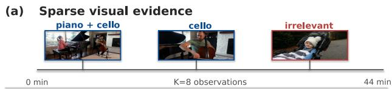
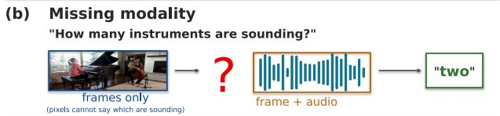
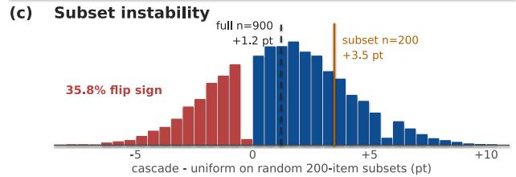
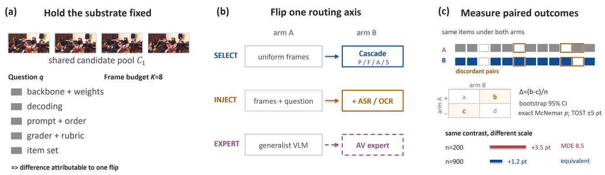
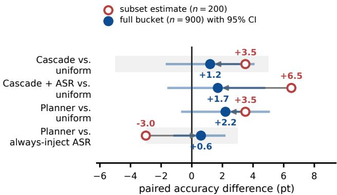
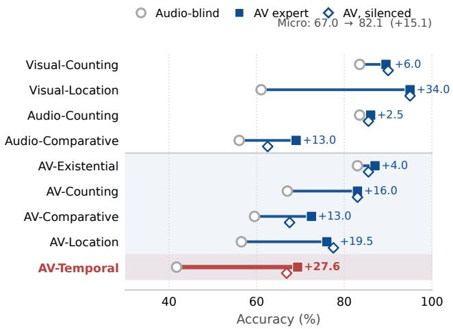
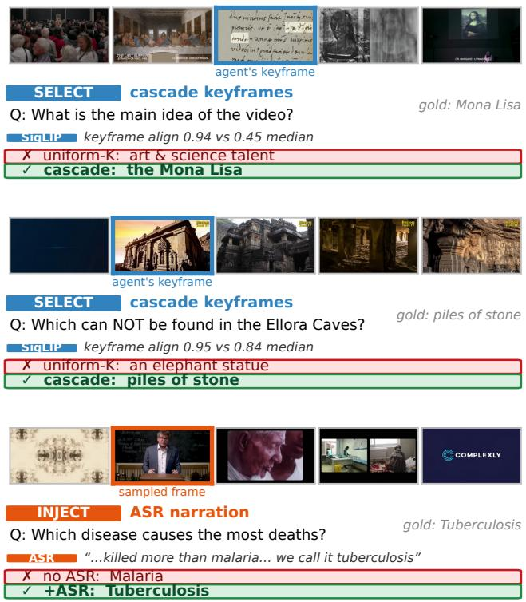
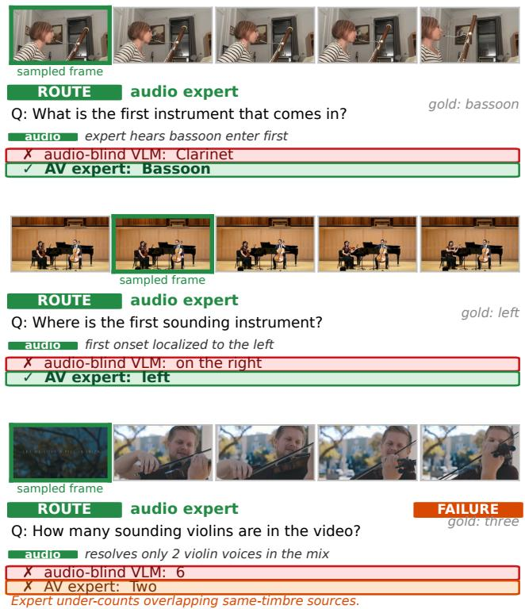
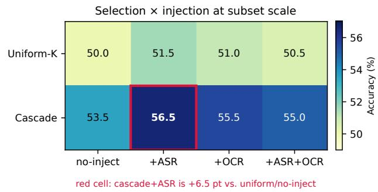
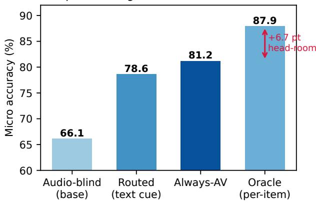

# Where Do Reported Long-Video QA Gains Come From? A Controlled Audit of Frame Selection, Evidence Injection, and Expert Routing

Shih-Yao Lin Independent Researcher mikeslin.research@gmail.com

## Abstract

Long-video question answering is usually studied as frame selection: which few frames should a vision–language model see? We introduce VideoRouteAudit, a controlled audit that separates this choice from two alternatives: injecting non-visual evidence and routing to another answering model. It holds the backbone, frame budget, decoding, prompt and grader fixed while varying one decision at a time. On the full Video-MME long bucket (n=900, K=8), no tested selector significantly improves over uniform sampling: the largest tested selection-only estimate is +1.9pt (95% CI [−1.2, +5.0]) and our cascade is +1.2pt [−1.7, +4.1]; all are equivalent to uniform within ±5pt. Yet three offour matched contrasts are up to 3.8× larger on commonly used n=200 subsets, one reverses sign, and subsampling thefull bucket reverses thefull-bucket effect’s sign in 35.8% ofdraws. The audit also corrects our ownfirst results: the anomaly-domain “+ASR” arms injected no text, so the pooled +4.7pt gain was selectionplus a development prefix; with transcripts, ASR lowers XD-Violence accuracy by 10.0pt when appended after the question and not at all when placed before it, and UCF-Crime by 13.0pt either way, while on Video-MMEplacing itfirst adds about 4 (7 on Qwen2-VL) pt to uniform sampling and to the cascade alike (post hoc, unadjusted). Swapping the answering model produces the largest contrast (+15.1pt on MUSIC-AVQA, +33.3 pt on its worst type), but the same audio-visual expert with its soundtrack silenced keeps 92% of the gain (69% with a mismatched one): mostly a model swap. Code, peritem predictions and scripts that recompute every statistic are available at https://github.com/mikeslinir/long-video-qa-audit.

## 1. Introduction

Long-video question answering is, at its core, a problem of getting the right evidence in front of the model. A long video cannot be fed wholesale to a vision–language model (VLM): the standard pipeline samples a small set of K frames—typically K=8—and forwards them. But for event-sparse video, where the evidence that answers a question is concentrated in a handful of frames among thousands, the question the literature has focused on—which K frames to pick—is only half of the problem. Even with the right frames, an MCQ that asks about narration, on-screen text or off-screen events can be unanswerable from pixels alone (Fig. 1).

  
Figure 1. Three obstacles to long-video QA claims. (a) K frames must cover a 44-minute timeline. (b) The real MUSIC-AVQA question needs sound, not pixels alone. (c) Across 20,000 random n=200 subsets of our cached n=900 outcomes, 35.8% reverse the full-bucket effect’s sign.

Three places to spend a decision. A long-video pipeline decides (i) which frames the VLM sees, (ii) which non-visual signals (Whisper transcript, on-frame OCR) are injected into its prompt, and (iii) which model answers. The community has invested heavily in (i)—learned and submodular selectors, agentic tool calls, tree-structured search—while (ii) is an implementation detail of captionaugmented baselines and (iii) is rarely treated as a routing choice. This paper measures all three under one protocol.

An audit, not a leaderboard entry. Comparing published long-video QA systems is close to impossible: they differ simultaneously in reasoner capacity, frame budget, prompt content, answer-scoring protocol, and evaluation subset. We therefore introduce VideoRouteAudit, a single training-free harness in which each axis is an ablatable stage—a four-stage propose–filter–align–select cascade for the visual axis, an inject stage for the textual axis, and an expert-dispatch step for the model axis—and vary one decision at a time with everything else, including the grader, held fixed. The audit protocol and its measurements come first, the reusable harness second; we claim no universally superior selector or planner.

## What we find.

• (F1) At full Video-MME-long scale, no tested selection rule significantly improves on uniform sampling. On the full bucket (n=900, K=8) our best selection-only cascade is +1.2 pt, 95% CI [−1.7, +4.1], and a ±5 pt equivalence test against uniform excludes gains of that size—a bounded effect, not merely an absent one—while a gain of a few points is not excluded.

• (F2) Few-hundred-item subset estimates are unstable. On our n=200 development prefix three of four contrasts are up to 3.8× larger than at n=900 (cascade+ASR vs. uniform +6.5→ + 1.7 pt) and one reverses sign. Resampling 200-item subsets from the full-bucket predictions flips the full-bucket effect’s sign in 35.8% of draws, and the minimum detectable effect is 8.3–10.4 pt, larger than the 1–5 pt gains this literature reports from a few hundred questions: in our setting such subsets cannot establish an effect or certify a tight null. We take this as the central result; F1 and F3 support it.

• (F3) Routing gains are domain-, protocol- and modeldependent, and smaller than they first appear. The pooled selection+injection gain over uniform on three n=200 subsets (+4.7 pt, stratified McNemar p=0.0017) is not an injection effect: the anomaly-domain “+ASR” arms injected no text, and outside the Video-MME development prefix the pooled contrast is +1.6 pt (p=0.24). With transcripts, ASR appended after the question lowers XD-Violence accuracy by 10.0 pt, and placing the same text before the question removes that harm, though not on UCF-Crime, where hallucinated transcripts of silent footage cost 13.0 pt either way. On Video-MME, text placed first adds about 4 pt to uniform and cascade frames alike (p=0.002, 0.024; post hoc, unadjusted). Larger still is which model answers: dispatching MUSIC-AVQA to an audio-visual expert lifts its worst type by +33.3 pt and the micro-average by +15.1 pt (n=9,129), yet the same expert with its soundtrack silenced keeps 92% of that gain (69% with another video’s soundtrack), so this is mostly a model swap, not evidence about audio.

Contributions.

• (C1) VideoRouteAudit, a matched-conditions audit harness for long-video QA. Backbone, budget K, decoding, prompt scaffold, grader and items are held fixed while one routing decision varies; candidate pools and anchors may differ, so pipelines, not rules alone, are compared. The harness, the per-item predictions of every reported run and a script that recomputes every statistic in this paper offline are released (link in the abstract).

• (C2) A scale-controlled measurement of three routing axes on Video-MME long, UCF-Crime, XD-Violence (Fighting/Normal), MUSIC-AVQA and EgoSchema, at both the subset scale the literature uses and full-bucket scale, with paired McNemar tests, bootstrap CIs, minimum detectable effects and TOST verdicts (Sec. 4).

• (C3) An actionable re-allocation of effort. At K=8 on narrative long video the tested selection rules are indistinguishable within ±5 pt, injection effects hinge on domain and prompt placement, and the answering model, which frame selectors hold fixed, produces the largest contrast. We give the effect sizes, costs and failure modes needed to act on this (Sec. 4.4, 5).

Scope. Everything here is training-free: off-theshelf encoders (SigLIP, Whisper, EasyOCR) and a small instruction-tuned planner LLM (Qwen2.5-3B-Instruct) reading a one-page markdown memory that was written after inspecting our development prefix, so planner rows are diagnostics. Video-MME and EgoSchema use Qwen2.5- VL-7B and the MUSIC-AVQA base is Qwen2-VL-7B; every table states its backbone.

## 2. Related Work

Question-agnostic and single-signal selection. Uniform sampling and shot-based selectors ignore the question and remain the de facto baseline for long-video VLMs; generic video summarization [10] treats the task as diversity-only subset selection. Learned and language-based variants each commit to one signal—SeViLA [45] trains a localizer, Q-ViD [31] writes question-conditioned frame captions for an LLM, LLoVi [46] captions densely and then queries— which is brittle when evidence is localized and invisible to that signal. The released default proposer is STACFP [23], a content-adaptive spatio-temporal clustering sampler that self-adapts between long-take clustering and shot-boundary snapping; the audited runs predate it (Sec. 3.3).

Caption- and prompt-aware frame scorers. KeyScore [23] computes a contextual drop signal at CLIP/PE embedding level for caption- and query-aware frame scoring, and combines it with semantic similarity and temporal representativeness via a closed-form scalar. AKS [38] formulates prompt-aware adaptive keyframe sampling as an optimization of prompt relevance and temporal coverage. KeyVideoLLM [21] selects keyframes by text–frame similarity to compress VideoLLM data. Logic-in-Frames [9] adds visual–logical dependencies. The 2025–2026 wave keeps the same embedding-space premise while varying the rule: top-K scoring [11], temporal curvature [28], wavelet semantic boundaries [3], prediction surprise [14], event anchors [2], semantic– visual consensus [35], rethinking-based question-aware selection [15], and entropy-gated budget scheduling [19]. Closest to our cascade, Zhang et al. [48] and Huang et al. [12] cast selection as monotone submodular coverage with a greedy approximation guarantee, the latter also routing each question to a preset by its type. Our contribution is not a better rule: at K=8 on the full Video-MME long bucket the three rules we ported do not separate from uniform (Sec. 4.2); we did not test the rest of this family.

  
Figure 2. Matched contrasts are the unit of measurement. (a) Backbone, budget, decoding, prompt, grader and items stay fixed (the ported selectors share one candidate pool; the cascade scores its own, Sec. 4.1). (b) Exactly one axis flips: SELECT to the cascade, INJECT to ASR/OCR, or EXPERT to another model; EXPERT is analyzed separately. (c) Paired outcomes yield ∆, bootstrap CIs, exact McNemar p and TOST. See Sec. 3.

Agentic / tool-using video reasoning. VideoAgent [41], MoReVQA [27], TraveLER [33], and VideoTree [42] use LLMs to plan, caption, retrieve and re-localize over several stages or rounds, often at many model calls per question. These systems are evaluated end-to-end, so the controller’s contribution is not separated from that of the extra evidence it pulls in. Our planner is much lighter (one planner call, ≤ 1 s, against a fixed tool registry), and we isolate its contribution with an inject only ablation (Sec. 3.7) making the no-inject branch bitwise identical to the nonagentic baseline—a control we did not find reported in prior agentic-video work.

Audits, and moving past selection. Our position follows work that re-measures published gains under controlled conditions and finds them smaller or absent—in recommendation [6] and metric learning [29]. Long-video QA is unusually exposed: evaluation sets are sometimes small, reasoners are expensive enough that few papers rerun baselines, and open-ended grading adds a protocol degree of freedom. Closest to us is KFS-Bench [20], which likewise argues that frame sampling is assessed only indirectly through QA accuracy, and answers with scene-level ground truth. We take the complementary route: we keep QA accuracy—the quantity the literature actually claims— and control the protocol around it, then ask whether reported differences are measurable at the sample sizes used. Concurrent method-side work also moves beyond one fixed frame set— VideoRouter [13] coordinates global and local evidence views and GenEvA [25] aggregates evidence after selection—or routes by question: VisualRouter [47] picks a sampling strategy per query type and HiMu [1] dispatches predicates to vision, OCR and audio experts, a palette close to ours. Those works propose mechanisms; we supply a controlled measurement and extend it to an axis they hold fixed: which model answers.

Text-evidence injection and caption-augmented video QA. A parallel line gives an LLM text evidence: LLoVi [46] and Q-ViD [31] feed frame captions, and the agentic systems above add captioned and retrieved text, often instead of frames. These systems bundle injection with the rest of their pipeline; we treat it as an ablatable stage in a controlled selection×injection factorial (Sec. 4.3) and show that where the block sits in the prompt changes its effect (Sec. 4.4).

Procedural memory, MoE, and submodular selection. Memory-augmented LLM agents—ReAct [44], Reflexion [36], Voyager-style skill libraries [39]—accumulate experience across episodes; our procedural memory is a one-page markdown of priors written from outcomes on our own development prefix and appended verbatim, with no gradient updates. Token-level MoE [34] and toolusing LLMs [32] share the gating-over-experts flavour but operate inside one network or over homogeneous tools, whereas our expert axis dispatches across separately-trained multimodal models. The select stage uses lazy-greedy monotone submodular maximization, which is $( 1 - 1 / e ) \cdot$ approximable [30].

Long-video and audio-visual MLLMs. Qwen2- VL [40] and LLaVA-NeXT-Video are vision-centric; audiolanguage models [5, 7] specialize in acoustic understanding; audio–visual LLMs such as VideoLLaMA2-AV [4] integrate both at heavier cost. Routing across this heterogeneous pool is not addressed by prior selection methods.

## 3. Method

We are given a video $V ,$ a question $q ,$ and a frame budget K. A standard long-video QA pipeline selects a subset ${ \mathcal { F } } \subseteq V$ of at most K frames and forwards $( \mathcal { F } , q )$ through a fixed vision–language model (VLM) eVLM. We treat “what to put in front of the $\mathrm { V L M } ^ { \mathrm { \Omega } }$ as a richer choice than “which frames to pick”: non-visual evidence (Whisper transcript, on-frame OCR) is a second, orthogonal placement axis. VideoRouteAudit realizes both as a single trainingfree pipeline orchestrated by a lightweight LLM planner reading a procedural memory of past outcomes.

## 3.1. Overview: a Five-Stage, Two-Axis Pipeline

VideoRouteAudit (Fig. 2) progressively narrows thousands of candidate frames to K, then augments the resulting visual context with text evidence before the VLM call:

$$
\begin{array} { r c l } { { V } } & { { \xrightarrow { \mathrm { p r o p o s e } } \mathcal { C } _ { 1 } } } & { { \xrightarrow { \mathrm { f l l t e r } } \mathcal { C } _ { 2 } } } & { { \xrightarrow { \mathrm { a l i g n } } \left( u _ { q } \right) \xrightarrow { \mathrm { s e l e c t } } \mathcal { F } , } } \\ { { \left( \mathcal { F } , q , V \right) } } & { { \xrightarrow { \mathrm { i n j e c t } } \left( \mathcal { F } , q \oplus \mathcal { E } \right) } } & { { \xrightarrow { e _ { \mathrm { V L M } } } \hat { a } , } } \end{array}
$$

with $| { \mathcal { F } } | \leq K$ and E a (possibly empty) bundle of text snippets appended to the prompt. Stages 1–4 form the visual axis; stage 5 (inject) is the textual axis. A small LLM planner emits a JSON plan that decides, per question, which proposers, aligners, and injection sources to use. No component is trained; every selector and inject policy in our experiments feeds the same $e _ { \mathbf { V L M } }$ at the same budget K, so differences are not due to the reasoner; they reflect the whole pipeline (candidate pool, filter, anchors), not one rule alone.

## 3.2. Skill Library and Planner

The cascade draws on reusable skills behind a uniform interface. Propose and filter use cheap skills (O(N) per frame, no GPU encoder): an always-on uniform stride backbone, event audio/visual proposers (EARS [22]), the content-adaptive stacfp proposer, a motion-difference filter and a redundancy filter; PySceneDetect shot boundaries are optional. Align skills score each candidate against $q \mathrm { : } \quad s \mathrm { e m a n t i c . } s \mathrm { i } 9 1 \mathrm { i } \mathrm { p } ,$ object, ocr text, asr whisper, clap alm and audio energy. A single fixed VLM answers. A run’s planner profile fixes which cheap skills it enables; every audited Video-MME, XD-Violence and UCF-Crime run uses the audit profile of Sec. 3.3.

A planner emits a JSON plan over this fixed registry: proposers and aligners, fusion weights $\mathbf { w } ^ { \mathrm { e v } }$ , the diversity bandwidth $\tau ,$ the uniform-anchor fraction, and the inject sources $S ^ { \mathrm { i n j } } \subseteq \left\{ \mathsf { a s r } , \mathsf { o c r } \right\}$ . The rule-based planner (CPUbound, the fallback) maps (q, dataset id) to a plan by keyword matching. The LLM planner (Qwen2.5-3B-Instruct, one call per question, $\leq 1 \mathrm { s } )$ additionally reads a markdown procedural memory (Sec. 3.7) and falls back to the rule-based plan when its JSON is malformed. The supplementary gives the registry, the keyword rules, the planner prompt and the schema.

## 3.3. Propose and Filter

Propose unions the enabled proposers’ outputs into a candidate pool $\mathcal { C } _ { 1 }$ . In the audit profile a video longer than 120 s gets 66 event-attention peaks and 66 evenly spaced frames (132 candidates; 64 evenly spaced frames for shorter clips). This proposer fuses audio energy with optical-flow magnitude, but its motion signal covers only a video’s first 4,096 frames, so its peaks fall in the opening minutes while the uniform half spans the whole video. The runs were also planned with a PySceneDetect shot-boundary proposer, but PySceneDetect was not installed, the router skipped the proposer silently, and we found this only when re-running the pipeline for release. The released audit profile reproduces the executed pool (identical selected frames on 24 of 24 re-checked items), and the router now warns whenever a planned tool fails.

Filter then keeps the 32 candidates with the largest grayscale change from their predecessor in the pool (long videos only). This frame-difference rule favours highmotion frames and can discard static evidence such as a motionless speaker or an on-screen sign. The released default profile instead proposes with STACFP [23], which clusters colour-histogram-plus-timestamp descriptors and adapts between long takes and edited video, and removes near-duplicate frames while keeping static-butdistinct ones. At full scale (n=900) it scores 46.4%, +0.2 pt over uniform ([−2.7, +3.2], equivalent within ±5 pt) and −1.0 pt against the audited cascade.

## 3.4. Align: Question-Conditioned Utility

For each candidate $n \in \mathcal { C } _ { 2 }$ , every enabled alignment skill $s _ { i }$ produces a normalized relevance score $\tilde { \sigma } _ { i } ( n ) \in [ 0 , 1 ]$ against the question. The planner’s fusion weights combine them into a per-frame utility

$$
u _ { q } ( n ) = \sum _ { i \in S ^ { \mathrm { e v } } } w _ { i } ^ { \mathrm { e v } } \tilde { \sigma } _ { i } ( n ) + \lambda _ { u } U ( n ) ,
$$

where $U ( n )$ is an optional generic informativeness prior (e.g. frame entropy) and $\lambda _ { u }$ a small weight. Whether fusing

several cues here actually produces better frames is one of the questions this paper measures (Sec. 4.2).

## 3.5. Select: Submodular Maximization

Given the utility $u _ { q } ,$ we define a temporal coverage kernel $k _ { \tau } ( t , t ^ { \prime } ) = \exp \big ( - ( t - t ^ { \prime } ) ^ { 2 } / 2 \tau ^ { 2 } \big )$ and the facility-location set utility

$$
f _ { q } ( \mathcal { F } ) = \sum _ { n } u _ { q } ( n ) \operatorname* { m a x } _ { m \in \mathcal { F } } k _ { \tau } ( t _ { n } , t _ { m } ) , \quad | \mathcal { F } | \leq K .
$$

$f _ { q }$ is monotone non-decreasing and submodular; lazy greedy [30] returns $\hat { \mathcal { F } }$ with $f _ { q } ( \hat { \mathcal { F } } ) \geq ( 1 - 1 / e ) f _ { q } ( \mathcal { F } ^ { * } )$ . The hard-indicator special case $( k _ { \tau } \in \{ 0 , 1 \} )$ recovers temporal NMS; the Gaussian kernel makes the relevance/diversity trade-off continuous. Every audited cascade reserves a uniform floor: round $( K / 2 )$ of the K frames are evenly spaced anchors that ignore the alignment scores (Python rounding), so at $K { = } 8$ four frames come from facility-location and four are uniform, while at $K { = } 1$ no anchor is reserved. The floor guarantees baseline temporal coverage when alignment scores are flat, and it bounds how far any cascade can move from uniform sampling.

## 3.6. Text-Evidence Injection

The inject stage appends a short text block to the VLM prompt. For asr, the cached Whisper (tiny.en) transcript chunks within $\pm w _ { \mathrm { i n j } }$ seconds of each selected frame $( w _ { \mathrm { i n j } } { = } 4$ throughout) become “[mm:ss]” lines of at most 240 characters, followed by a transcript summary of at most 400; for ocr, EasyOCR reads each selected frame (at most 160 characters per frame). The block follows the question and options, introduced by “Additional evidence extractedfrom the video (treat as context, not ground truth):”; placement is a protocol choice that Sec. 4.4 ablates by moving the identical block before the question. Over the n=900 runs ASR injection adds on average 1,344 characters (median 1,320, 95th percentile 1,724; 865 of 900 items non-empty) and OCR 274 (782 non-empty). A video with no cached transcript receives no text, and the harness now reports how many items were injected. Injection is ablatable and matched in visual budget and decoding configuration: the visual context, K, the backbone and the decoding configu ration are held fixed across all inject policies, so accuracy deltas reflect the prompt-side text only. Total context is deliberately not matched—the injected text is the intervention.

## 3.7. Procedural Memory and Inject-Only Isolation

A na¨ıve LLM planner may rewrite every plan field, conflating “what cascade do I want?” with “should I inject text on this question?” We therefore use two constructs. Procedural memory is a one-page markdown file of priors—which inject sources help on which question phenotypes (“inject ASR for narration or dialogue; suppress it for purely visual questions”) and which combinations hurt (ASR+OCR on Video-MME long)—appended verbatim to the planner prompt; no parameters are updated. Every planner run loads this one file (reproduced in the supplementary); v1 and v3 name planner configurations (free plan; inject only mode). The file quotes outcomes on the n=200 Video-MME evaluation prefix, so planner numbers are test-set-informed diagnostics, not evidence of generalisation. Inject-only isolation hard-overrides every plan field except $S ^ { \mathrm { i n j } }$ with the rule-based cascade, so only the LLM’s per-question inject decision is used and the no-inject branch is bitwise identical to the no-inject baseline; without it the LLM silently swapped aligners in 113 of 200 plans.

## 3.8. Inference

Inference runs the five stages of Sec. 3.1 in order. The VLM call dominates the cost of the stages that we time; the planner adds $\leq 1 \mathrm { s } ,$ , and decoding the candidate frames takes about a third of the VLM call. One-time preprocessing is not in the per-item times: Whisper transcripts take about 94 s per Video-MME long video and are then cached, so per-question ASR injection is string concatenation, whereas EasyOCR runs on the selected frames at inference time (≈ 9 s per item; plus ≈ 31 s/question end-to-end; supplementary, Computational Cost).

## 4. Experiments

## 4.1. Setup

Benchmarks. We evaluate the selection and injection axes on three long-video evaluation domains spanning the narrative–anomaly axis: Video-MME long [8] (full bucket, n=900; plus the n=200 subset used for the paired factorial ablations), UCF-Crime [37] and XD-Violence [43] (n=200 balanced binary event-QA each; XD: Fighting/Normal). We use MUSIC-AVQA [16] for the expert axis and EgoSchema [26] (n=500) as a cross-benchmark check (supplementary, Extended Experiments).

What is held fixed. Every contrast is paired and matched: the same questions, backbone, frame budget K (unless noted, $K { = } 8 )$ , prompt scaffold, greedy decoding and grader; only the routing decision under test varies. The three ported selectors score one 256-frame pool strided over the whole video, whereas our cascade scores at most 32 keyframes from its own proposal pool (Sec. 3.3) and keeps half of its frames as uniform anchors, so the pools differ by design. Uniform-K uses endpoint-inclusive evenly spaced frames (at K=1 the video’s first frame); a segmentmidpoint variant is checked at K=8 and K=1. We port the selection rule of AKS, KeyScore and VideoTree, not the published systems (their candidate generation, backbone and prompt are replaced); the KeyScore port reproduces the reference scores, and because the AKS budget $\lfloor K / 2 ^ { d } \rfloor$ vanishes at depth $d { \ge } 4$ for $K { = } 8$ , its port is a binned top-K (supplementary, Selector ports). These rows bound the selection component, not the end-to-end pipelines. Video-MME and EgoSchema use Qwen2.5-VL-7B-Instruct and MUSIC-AVQA Qwen2-VL-7B-Instruct; a cross-backbone check is in the supplementary.

Statistics. Pairwise significance is two-sided exact Mc-Nemar on per-item correctness. Headline contrasts also get a 95% paired bootstrap CI (10,000 resamples), the discordant-pair count with its minimum detectable effect (MDE) and, where a null is claimed, a TOST verdict on the 90% CI. The ±5 pt margin is the top of the range of selection-axis gains this literature claims (1–5 pt); it is a choice, not a noise floor, so “equivalent” means only that gains of that size are excluded. We also report ±3 pt, which no full-bucket selection contrast passes. Video-MME long asks three questions per video, so every full-bucket interval was recomputed with a video-clustered bootstrap: its standard error is at most 1.02× the item-level one and no verdict changes (supplementary). F1’s full-bucket contrasts and F3’s expert contrast are confirmatory; the cells of Table 2, the pooled F3(a) contrast (confirmatory only outside the 200-item development prefix), the placement contrasts, the budget sweep and the supplementary sweeps are exploratory, with unadjusted p-values. $\mathrm { \Delta A } p { > } 0 . 0 5$ is never described as a win.

Grading. Multiple-choice benchmarks (Video-MME, EgoSchema, UCF-Crime, XD-Violence) are scored by exact match of the parsed option letter. Open-ended answers (MUSIC-AVQA) are graded by a greedy LLM judge (Qwen2.5-VL-32B text path, the standard GPT-assisted prompt of VideoLLaMA 2). On 150 stratified decisions it matches a blind human re-annotation at 94.0% (κ=0.88): 100% (90/90; 95% Wilson interval [95.9, 100]) on MUSIC-AVQA, which carries Sec. 4.4, and 85.0% (51/60) on Ego-TextVQA, which supports no claim here (supplementary, Judge Validation).

## 4.2. F1 — At Full Scale, No Tested Selection Rule Separates from Uniform Sampling

Table 1 is the paper’s primary result: all methods evaluated on the entire Video-MME long bucket, paired across methods. No tested selection rule significantly improves on uniform sampling. The largest selection-only effect is +1.9 pt (ported AKS, p=0.273) and our cascade is +1.2 pt $( 9 5 \% \mathrm { C I } [ - 1 . 7 , + 4 . 1 ] )$ ; both pass a TOST equivalence test against uniform at ±5 pt (TOST uses the 90% CI, which is why AKS passes despite a 95% upper bound of $+ 5 . 0 ) -$ a bounded effect, not merely an absent one. The bound is not arbitrarily tight: at ±3 pt no selection-only row passes (cascade 90% CI [−1.2, +3.7], AKS $[ - 0 . 8 , + 4 . 6 ] )$ , so the full bucket rules out a literature-scale $( \geq 5 \mathrm { { p t } ) }$ selection gain while leaving a small one unresolved. A segment-midpoint uniform baseline scores the same, and the cascade and AKS stay equivalent to it. The rows below $\scriptstyle { p = 0 . 0 5 }$ are not selection rules but post hoc injection variants: the ASR block placed first, with cascade or uniform frames alike (Sec. 4.4).

Table 1. F1: the full-scale audit. All methods on the complete Video-MME long bucket (n=900, K=8, $\mathrm { Q w e n } 2 . 5 \mathrm { - } \mathrm { V L } \mathrm { - } 7 \mathrm { B } )$ paired across methods; $\Delta$ and CI are against uniform and p is exact McNemar, unadjusted. No tested selection rule significantly improves on uniform, and every selection-only row is equivalent to it within ±5 pt (none within ±3). †Post hoc placement variant of ASR injection (Sec. 4.4); the only rows with p<0.05. Wall: mean elapsed sec/n on one GB10, shared with other jobs, excluding one-time Whisper (≈ 31 s/question) and including EasyOCR.
<table><tr><td>Method  $( K { = } 8 , n { = } 9 0 0 )$ </td><td>Acc. (%)</td><td>∆</td><td>95% CI</td><td>p</td><td>Wall s/item</td></tr><tr><td>Uniform-K</td><td>46.2</td><td></td><td></td><td></td><td>10.0</td></tr><tr><td>Midpoint uniform-K</td><td>46.2</td><td>0.0</td><td> $[ - 2 . 8 , + 2 . 9 ]$ </td><td>1.000</td><td></td></tr><tr><td>AKS [38] (port)</td><td>48.1</td><td>+1.9</td><td>[−1.2, +5.0]</td><td>0.273</td><td>22.3</td></tr><tr><td>KeyScore [23] (port)</td><td>47.1</td><td>+0.9</td><td>[−2.2, +4.0]</td><td>0.624</td><td>22.4</td></tr><tr><td>VideoTree [42] (port)</td><td>47.8</td><td>+1.6</td><td>[−1.6, +4.8]</td><td>0.360</td><td>22.3</td></tr><tr><td>Cascade (selection only)</td><td>47.4</td><td>+1.2</td><td>1  $- 1 . 7 , + 4 . 1 \dot { ] }$ </td><td>0.452</td><td>13.3</td></tr><tr><td>Cascade + OCR</td><td>47.2</td><td>+1.0</td><td>1  $- 1 . 9 , + 4 . 0 \dot { ] }$ </td><td>0.552</td><td>21.6</td></tr><tr><td>Cascade + ASR</td><td>47.9</td><td>+1.7</td><td>1  $^ { - 1 . 6 , + 4 . 8 ] }$ </td><td>0.337</td><td>12.8</td></tr><tr><td> $\mathrm { C a s c a d e + A S R , t e x t \ f i r s t ^ { \dagger } }$ </td><td>50.2</td><td>+4.0</td><td> $[ + 0 . 6 , + 7 . 3 ]$ </td><td>0.024</td><td></td></tr><tr><td>Uniform + ASR, text first†</td><td>50.7</td><td>+4.4</td><td> $[ + 1 . 8 , + 7 . 2 ]$ </td><td>0.002</td><td></td></tr><tr><td>ProcMem planner</td><td>48.4</td><td>+2.2</td><td> $[ - 0 . 7 , + 5 . 1 ]$ </td><td>0.154</td><td>15.7</td></tr></table>

F1 says that at $K { = } 8$ on dense narrative long video the tested selection rules produce near-equivalent accuracy on this backbone. We can bound the effect but not attribute it: coverage saturation (uniform sampling may already place enough answer-relevant evidence in the prompt) and reasoner insensitivity (the VLM does not reliably exploit better frames) both fit the data. Two design facts also bound how far the cascade can move from uniform: half of its frames are uniform anchors and its pool has 132 candidates (Sec. 3.3); the ported selectors score a 256-frame pool and land in the same place, but at $K { = } 8$ the official AKS rule returns no frame, so its port is a binned top-K (supplementary, Selector ports). F1 does not say selection never matters: the cascade’s point estimates on the two anomaly domains $( + 4 . 0 \mathrm { a n d } + 3 . 5 $ pt at $n { = } 2 0 0$ , neither significant) remain hypotheses. At K=1 the $n { = } 2 0 0$ gain (+10.0 pt, p=0.009) shrinks to +2.7 pt at n=900 ([−0.7, +6.0], p=0.13), and a middle-frame uniform baseline beats uniform’s first frame by +5.1 pt $\scriptstyle ( p = 0 . 0 0 3 )$ and the cascade by 2.4 pt (n.s.): that effect was a weak baseline. On EgoSchema (n=500) the cascade is −1.6 pt ([−4.6, +1.4]) and the AKS, KeyScore and VideoTree ports −2.6, −4.0 and −0.2 pt: none helps.

## 4.3. F2 — Subset-Scale Effect Estimates Are Unstable

Component-level contrasts in this area are often measured on a few hundred questions (supplementary, Where the 1– 5 pt range comes from), and our own development prefix has 200. Fig. 3 places our subset-scale measurements next to the full-bucket measurement of the same contrast, on the same pipeline, with the same grader. Three of the four subset estimates exceed their full-bucket counterparts—by 1.6–3.8×—and the fourth (planner vs. always-inject ASR) reverses: −3.0 pt at n=200, +0.6 pt at n=900. Had we reported only the subset, we would have drawn the opposite conclusion about our own planner.

  
Figure 3. Subset-scale effect estimates are unstable. Matched contrasts at n=200 and n=900. Segments show full-bucket paired-bootstrap 95% CIs; grey bands mark the equivalence margin of the contrast (±3 pt for planner vs. always-inject ASR, ±5 pt for cascade vs. uniform). One contrast reverses sign.

The gap is sampling variability, not an unlucky subset. Our $n { = } 2 0 0$ set is a deterministic prefix of the $n { = } 9 0 0$ set (the first 67 of 300 videos), so the full-bucket predictions already contain it and we can ask, with no new inference, what a differently drawn subset would have shown. Over B=20,000 random 200-item subsets our prefix is unremarkable (+3.5 pt, 82nd percentile); the width is the finding: a 10.5 pt 95% range, a sign flip of the full-bucket effect in 35.8% of draws, and $p { < } 0 . 0 5$ in only 2.8%. Drawing videos rather than items (three questions per video; 67 of 300 clusters) gives $[ - 4 . 0 , + 6 . 5 ]$ and 35.7%, so withinvideo correlation does not explain it. For cascade+ASR (+6.5→+1.7 pt) the range is [−4.5, +7.5] with 31.9% sign flips (supplementary).

The arithmetic behind it. McNemar’s test uses only the discordant items: cascade vs. uniform at n=200 has 37 (b=22, c=15) and a minimum detectable effect (MDE) of 8.5 pt at 80% power; across the four selection-axis contrasts the MDE is 8.3–10.4 pt (supplementary). Such a comparison can neither establish a few-point effect nor certify a tight null, so such claims need full-bucket scale or a reported MDE.

## 4.4. F3 — Routing Gains Depend on Domain and Answering Model

If neither selection nor injection separates at full scale on Video-MME, what does? Two things, both different from what the subset-scale numbers suggest.

(a) Injection depends on the domain and on where the text sits in the prompt. Our protocol appends the evidence block after the question, options and answer instruction. On narrative video, ASR so appended adds +3.0 pt within the cascade on the 200-item development prefix $\scriptstyle ( p = 0 . 1 8 )$ and $+ 0 . 4 \mathrm { p t }$ on the full bucket $( [ - 1 . 6 , + 2 . 4 ] , p { = } 0 . 7 5 ) \colon$ no effect is established. On the anomaly clips the published $" + \mathrm { A S R } "$ arms injected nothing: no transcript had been computed for them, so their +4.0 and +3.5 pt over uniform are selection effects of the plain cascade (Table 2). With Whisper transcripts built for all 400 clips, the appended block lowers XD-Violence accuracy from 91.0 to 81.0% (−10.0 pt, 95% CI $[ - 1 4 . 5 , - 5 . 5 ] , \ b / c = 2 / 2 2 , \ p < 1 0 ^ { - 4 } )$ and UCF-Crime from 85.0 to 72.0% $( - 1 3 . 0 \mathrm { p t } , [ - 1 8 . 0 , - 8 . 5 ] , b / c \mathrm { = } 1 / 2 7 )$ On XD the harm is a placement effect: the identical text placed before the question leaves accuracy at 91.0%, the cascade’s (0.0 pt, $[ - 3 . 0 , + 3 . 0 ] ; + 1 0 . 0$ pt over appending, $\scriptstyle p = 0 . 0 0 0 3 )$ . On UCF-Crime it is not: placing the text first gives the same 72.0%, because 160 of the 200 transcripts of that silent surveillance footage contain Whisper’s hallucinated “thank you for watching”. On Video-MME the text placed first lifts the cascade to 50.2% (+2.8 pt, p=0.055) and uniform sampling to 50.7% (+4.4 pt, [+1.8, +7.2], $\scriptstyle p = 0 . 0 0 2 )$ , the two being indistinguishable (p=0.83), where appending gave +0.4 pt: the gain follows the text and its position, not the frames. With uniform frames, text between the question and the options, or between the options and the instruction, gives only +1.0 and +1.9 pt (n.s.), like appending (+1.6); only text before the question gives +4.4 (supplement). On Qwen2-VL-7B it replicates: 52.7% text first $( + 7 . 2 \mathrm { p t } , p \mathrm { < } 1 0 ^ { - 6 } ) .$ , 47.2% appended (+1.8, $\scriptstyle { p = 0 . 0 9 ) }$ . Placement was varied after the anomaly results (unadjusted); injection effects are protocol- and transcriptsensitive in sign, not just size.

The published pooled estimate was not an injection effect either. Over the three n=200 subsets cascade+ASR beat uniform by +4.7 pt (95% CI $[ + 1 . 8 , + 7 . 7 ]$ ; stratified McNemar $p { = } 0 . 0 0 1 7 )$ , but the anomaly arms were the plain cascade, and the first 200 Video-MME items are the prefix on which the cascade and planner memory were developed. Outside that prefix (n=1,100) the contrast is +1.6 pt $\scriptstyle ( p = 0 . 2 4 )$ , and with transcripts in the anomaly arms −3.0 pt $( [ - 6 . 2 , 0 . 0 ] )$ . The planner never injected on the anomaly clips, so its ±2 pt differences there lie inside the noise band F2 quantifies.

(b) Changing which model answers yields the largest measured contrast, but little of it is audio. On the full MUSIC-AVQA split $scriptstyle ( n = 9 , 1 2 9 ,$ , same questions, both models at K=8, same judge) a generalist visual VLM (Qwen2-VL-7B) reaches 37.6% on AV-Temporal—“which instrument sounds first”—while the audio-visual expert VideoLLaMA2-AV [4] reaches 70.9% $( + 3 3 . 3 \mathrm { p t } ,$ 95% CI $[ + 2 9 . 6 , + 3 7 . 1 ]$ , exact McNemar $ { p { = } } 2 . 8 \times 1 0 ^ { - 5 4 } )$ , and the micro-average moves from 66.1 to $8 1 . 2 \%$ Every type improves, but this is a model swap: purely visual Visual-Location moves +27.3 pt, and the expert’s audiovisual training mix includes ≈ 35k AVQA-music (MUSIC-AVQA) entries [4]. We therefore re-ran the same expert with its soundtrack replaced by digital silence on 200 questions per type (1,799 usable), all three arms on the same questions and graded by the same judge (Fig. 4). Poststratified to the full split’s type mix, the silenced expert scores 80.9%, against 82.1% with sound and 67.0% for the audio-blind model: silencing removes 1.3 pt (95% CI [−0.1, +2.6]) of the +15.1 pt swap, so 92% of the gain comes with the model. Giving each video another video’s soundtrack scores 77.5%: the expert does read the audio (the wrong soundtrack costs 3.4 pt against silence, $\scriptstyle { p = 1 0 ^ { - 5 } }$ and the right one adds 4.7 over it), yet it still beats the audioblind model by +10.5 pt (69% of the swap). The contrast is mostly a model swap with a smaller audio part.

Table 2. F3(a): the sign of an ASR effect depends on the domain and on placement. Qwen2.5-VL-7B, K=8, n=200 per domain (Video-MME: first 200 items). After: block appended after the question and options (audited protocol); before: ahead of the question. †No transcript existed: nothing injected. Planner row: domain-specific configurations (never injected on anomaly clips). Cells are exploratory.
<table><tr><td>Method (K=8, n=200)</td><td>Video-MME long</td><td>XD F/N</td><td>UCF-Crime</td></tr><tr><td>Uniform-K (no inject)</td><td>50.0</td><td>87.0</td><td>81.5</td></tr><tr><td>Cascade (no inject)</td><td>53.5</td><td>91.0</td><td>85.0</td></tr><tr><td>Cascade + ASR, as published</td><td>56.5</td><td>91.0†</td><td>85.0†</td></tr><tr><td>Cascade + ASR, after the question</td><td>56.5</td><td>81.0</td><td>72.0</td></tr><tr><td>Cascade + ASR, before the question</td><td>57.0</td><td>91.0</td><td>72.0</td></tr><tr><td>Cascade + always-inject OCR</td><td>55.5</td><td>89.5</td><td>83.0</td></tr><tr><td>ProcMem planner</td><td>53.5</td><td>92.5</td><td>83.0</td></tr></table>

Question-only dispatch. A fixed audio/speech keyword rule picks the expert from the question text alone; replayed on both passes it reaches 78.6%, +12.5 pt over the visual base (95% CI [+11.5, +13.5]) but 2.6 pt below always using the AV expert, to which it sends 84.9% of questions: on this modality-homogeneous benchmark routing collapses to that expert, an accuracy gain, not a cost saving.

## 5. Discussion and Limitations

Interpreting the audit. Coverage saturation and reasoner insensitivity both fit F1; we do not separate them. F2 concerns the precision of our controlled contrasts, not a re-run of prior systems under their original protocols. F3’s accuracy headroom from the answering model does not establish cheaper inference.

Limitations. (i) The expert contrast is a model swap: VideoLLaMA2-AV and Qwen2-VL-7B differ in far more than audio access, the expert trained on MUSIC-AVQA data, and the audio controls (silenced, mismatched) cover a type-stratified subset, one expert, one random soundtrack assignment. (ii) F1 is established on Video-MME long at

  
Figure 4. Answering-model choice produces the largest measured contrast, and little of it is audio. MUSIC-AVQA, K=8, same judge, the same 200 questions per type: audio-blind Qwen2- VL-7B (circle), the audio-visual expert (square) and the same expert with its soundtrack silenced (diamond). Labels give the swap (circle to square).

K=8, n=900, with Qwen2.5-VL-7B; equivalence holds at ±5 but not ±3 pt. (iii) The audited cascade is one configuration (event-attention and uniform proposals, a motion filter, 50% uniform anchors; Sec. 3.3); the released default profile differs. The ported selectors reimplement selection rules only; results do not bear on the originals. (iv) The planner’s memory was written after inspecting the n=200 development prefix, so planner numbers are test-set-informed, and Table 2 and the placement variants are post hoc and unadjusted; the anomaly-QA sets are binary conversions; generalization beyond these datasets, models and K is untested.

## 6. Conclusion

We audit long-video QA by separating frame selection, evidence injection and answering-model choice. At K=8 on full Video-MME long, no tested selector improves significantly over uniform (equivalent within ±5, not ±3 pt), and subset estimates are unstable. The audit also overturned our own first results: the anomaly-domain “+ASR” arms injected nothing, the pooled gain shrinks outside the development prefix, and an injection effect depends on where the text sits in the prompt. The largest expert contrast is mostly a model swap (92% survives a silenced soundtrack, 69% a mismatched one), and question-only dispatch recovers accuracy without a demonstrated saving.

The next step is not simply to select better frames, inject more evidence or route to stronger models, but to identify which decision limits performance, measure its contribution under matched conditions, and add complexity only where the gain is reliable.

## Supplementary Material

## A. Procedural Memory: Extended Analysis

## What the memory is (and is not)

The procedural memory is a single markdown file of 2,028 characters (configs/procedural memory v1.md, reproduced below) appended verbatim to the planner LLM’s system prompt before the few-shot examples. It is not a learned parameter, an embedding store or a retrieval index: the LLM reads the text anew for each question. Every reported planner run loads this one file. The labels “v1”, “v2” and “v3” in the main paper and in our run names denote planner configurations, not different memory texts: v1 lets the LLM rewrite the whole plan, v2 freezes the aligner mix, and v3 is inject only mode. A second file, procedural memory v4.md, was drafted but no reported run uses it. The memory text is:

Past empiricalfindings (HIGH PRIORITY—override your default conservatism). (1) Long documentary or educational videos (duration >120 s) almost always contain narration that carries the answer even when the question does not mention a narrator; for “what is the video about”, “what does the speaker explain”, “why” or “how” questions default to inject text=["asr"]. “In our logs this gave +6.5 pt accuracy (p=0.066) versus no injection. Skipping injection lost 4 pt.” (2) For purely visual attribute questions (colour, count, position, clothing, who holds what), ASR adds noise: use []. (3) Never inject ASR and OCR together: “the combo ASR+OCR lost 1.5 pt versus ASR alone (0.550 vs 0.565)”; pick at most one stream. (4) For on-screen-text questions use ["ocr"] only. (5) For short (≤120 s) anomaly clips, OCR of captions sometimes helps and ASR is usually too sparse; prefer ["ocr"] when in doubt. Decision shortcut for long videos: visual-attribute question → []; on-screen text $\begin{array} { r l } {  } & { { } [ " \circ \mathsf { c r } ^ { \mathsf { n } } ] ; } \end{array}$ otherwise → ["asr"].

The file header states that it was mined from Video-MME long execution logs at n=200, K=8 with Qwen2.5-VL-7B, and the quoted figures (+6.5 pt, 0.550 vs 0.565) are outcomes on the same first 200 items that the n=900 evaluation contains.

## The single controlled degree of freedom

To attribute accuracy changes to the LLM’s routing decision cleanly, we deploy inject only mode: every plan field except per-question inject text is hard-overridden by the rule-based cascade. This ensures the no-inject branch of the LLM planner is bitwise identical to the noinject cascade baseline. Without this isolation, the LLM was observed to silently swap aligners (113 of 200 plans on Video-MME long switched semantic siglip to object siglip), which would contaminate the attribution to the planner’s inject decision.

Evaluation independence. The memory is test-setinformed: it was written after inspecting outcomes on the n=200 Video-MME evaluation prefix, and its text quotes them. The v2 and v3 configurations were also revised after inspecting that prefix. The n=900 planner row therefore mixes 200 development items with 700 items that neither the memory nor the configuration saw. On those 700 items the planner scores 47.0% against 45.4% for alwaysinject ASR (+1.6 pt, exact p=0.17) and 45.1% for uniform (+1.9 pt, p=0.31); on the 200 development items it scores 53.5% against 56.5% for always-inject ASR. Neither heldout difference is significant, so planner accuracy is not evidence of generalisation, and the matched selector and injection contrasts carry the audit findings.

## When the planner pays for itself

The planner makes one call per question (≤ 1 second), but is not established as better than always-inject ASR: on the n=200 prefix the differences are −3.0 pt on Video-MME, +1.5 pt on the XD-Violence Fighting/Normal subset and −2.0 pt on UCF-Crime, with neither anomaly-domain contrast significant. On the anomaly clips the planner never chose to inject (none of the 400 questions), so those differences reflect the tools the LLM chose, not its injection decisions; no ASR transcript existed for those clips either (Sec. H). At n=900 the planner is numerically strongest (48.4%) but equivalent to always-inject ASR within ±3 pt. The per-item decisions of every planner run are released with the predictions, so the planner row can be recomputed without calling the LLM.

## B. Judge Validation Data

Where a judge is used. Video-MME, EgoSchema, UCF-Crime and XD-Violence are multiple choice: the answering model’s reply is parsed to an option letter and compared to the key by exact match, with no judge. Only open-ended answers (MUSIC-AVQA, and EgoTextVQA in an auxiliary study) are graded by the judge: Qwen2.5-VL-32B-Instruct used through its text path, greedy decoding, with the GPTassisted evaluation prompt of VideoLLaMA 2 and Ego-TextVQA (question, correct answer and predicted answer in; “yes”/“no” and a 0–5 score out).

Protocol and result. One author blindly re-annotated 150 stratified accept/reject decisions without seeing the judge’s labels. Agreement was 94.0% with Cohen’s κ=0.88 (95% bootstrap CI [0.80, 0.95]). It differs sharply by dataset:

<table><tr><td>Subset</td><td>n</td><td>Agree</td><td>FA/FR</td><td>κ</td></tr><tr><td>MUSIC-AVQA</td><td>90</td><td>100% [95.9,100]</td><td>0/0</td><td>1.00</td></tr><tr><td>EgoTextVQA</td><td>60</td><td>85.0% [73.9,91.9]</td><td>2/7</td><td>0.70</td></tr><tr><td>All</td><td>150</td><td>94.0% [89.0,96.8]</td><td>2/7</td><td>0.88</td></tr></table>

(brackets: 95% Wilson intervals; FA/FR: false accepts / false rejects.) All nine disagreements are on Ego-TextVQA, which supports no headline claim; the 90 MUSIC-AVQA decisions behind the expert-axis analysis all agreed. The judge errs conservatively where it errs (7 false rejects vs. 2 false accepts). These annotations validate grader behavior only; they are not benchmark results. The per-decision table is released (results/judge validation/judge vs human.c and scripts/judge validation report.py recomputes the table.

## C. Cross-Backbone Robustness

To check that F1 and F2 are not specific to one reasoner we repeat the Video-MME long contrasts on a second vision– language backbone, Qwen2-VL-7B-Instruct, through the identical cascade and injection code path at full scale $( n { = } 9 0 0 , K { = } 8 )$

Table 3. Second backbone, full bucket. Qwen2-VL-7B-Instruct on Video-MME long $( n { = } 9 0 0 , K { = } 8 ) ; \Delta$ is against uniform with its 95% paired-bootstrap interval, p is exact McNemar. ∗The original +ASR arm was executed after PySceneDetect had been installed, so it scored 198 candidates against 132 for the other arms; the pool-matched re-run uses the audited profile like the cascade.
<table><tr><td>Arm</td><td></td><td>Pool Acc. (%)</td><td></td><td>Δ</td><td>p</td></tr><tr><td>Uniform-K</td><td></td><td>45.4</td><td></td><td></td><td></td></tr><tr><td>Cascade</td><td>132</td><td>44.8</td><td></td><td> $- 0 . 7 \ [ - 3 . 4 , + 2 . 0 ]$ </td><td>0.685</td></tr><tr><td> $\mathrm { C a s c a d e } + \mathrm { A S R } ^ { * }$  (original)</td><td>198</td><td>48.0</td><td></td><td> $+ 2 . 6 \ [ - 0 . 4 , + 5 . 6 ]$ </td><td>0.107</td></tr><tr><td> $\mathrm { C a s c a d e + A S R }$  (pool-matched)</td><td>132</td><td>44.6</td><td></td><td> $- 0 . 9 \left[ - 3 . 8 , + 2 . 1 \right]$ </td><td>0.614</td></tr></table>

The selection-only contrast replicates the F1 null on the second backbone: the cascade is −0.7 pt below uniform $( b / c { = } 7 3 / 7 9 , 9 0 \% \mathbf { C I } \left[ - 2 . 9 , + 1 . 6 \right] )$ , equivalent within ±5 pt. The original +ASR arm was not comparable: its pool differed, and its +3.2 pt gain over the cascade (p=0.007) disappears when the arm is re-run with the same 132-candidate pool (44.6%; −0.2 pt within the cascade, $[ - 2 . 3 , + 1 . 9 ] , p { = } 0 . 9 2 ; - 0 . 9$ pt against uniform, p=0.61), so that gain was the candidate pool, not the injected text. On the first 200 items the same runs score 45.0, 49.5 and 50.5% (uniform, cascade, cascade+ASR): the cascade’s +4.5 pt on the development prefix becomes −0.7 pt on the full bucket, the F2 pattern on a second backbone. The n=200 planner arm (45.0%) ran with a different candidate pool from its comparison arms (the STACFP profile, 197 candidates), so we make no claim that the planner does or does not transfer across backbones.

## D. Construction of the Anomaly-QA Evaluations

UCF-Crime and XD-Violence are anomaly-recognition datasets rather than native QA benchmarks. We convert them deterministically to binary QA; the construction below defines the exact evaluated subsets.

UCF-Crime. We read the official Anomaly Test.txt split. Of 290 resolvable videos, 140 are anomalous and 150 normal. We alternate the two groups in their native split order and take the first 200, yielding 100 anomalous and 100 normal videos. The anomalous subset contains Abuse (2), ) Arrest (5), Arson (9), Assault (3), Burglary (13), Explosion (21), Fighting (5), RoadAccidents (23), Robbery (5), and Shooting (14). Every video receives one question: “Does this video contain any unusual, dangerous, or criminal activity?” with choices {A: Yes, B: No}; every anomaly maps to A and every normal video to B.

XD-Violence. The local test split contains 120 Fighting, 84 Shooting, and 300 Normal videos. Files are sorted within folders ordered Fighting, Shooting, Normal; positive and normal lists are then alternated before truncation. Consequently, the reported n=200 deterministic prefix contains 100 Fighting and 100 Normal videos and no Shooting videos. Each receives “Does this video contain violent activity such as fighting or shooting?” with {A: Yes, B: No}; Fighting/Shooting map to A and Normal to B. We therefore interpret this result as a Fighting-vs.-Normal XD-Violence subset, not full category coverage.

Common controls. Both conversions use one item per video, exact A/B scoring, and identical wording and choices across labels, preventing question text from leaking the answer. No video is duplicated in either evaluated subset. We do not use temporal annotations, create multiple questions, or localize events; multi-event identity is collapsed to the video-level positive label. Paths absent on disk are skipped before deterministic interleaving.

## E. Qualitative Examples

## F. Computational Cost Breakdown

## Per-stage runtime in the audited runs (NVIDIA GB10, Qwen2.5-VL-7B)

One-time preprocessing, excluded from the main-paper numbers. Whisper tiny.en transcription took 94 s per Video-MME long video on average (78 s median; 228 videos, about 6 GPU-hours as logged), which is ≈ 31 s per question at three questions per video. A cold EARS proposal took 33–35 s on a 30–53 min video (measured while other jobs shared the machine); its peaks fall within the first

  
Figure 5. Qualitative wins on the SELECT and INJECT axes. Each panel shows a strip of the agent’s sampled frames (top-scored keyframe highlighted), the dispatched tool, and the answer (baseline × → tool-routed ✓). The first two panels show SELECT cases where cascade sampling surfaces an answer-bearing Video-MME frame; the third shows an INJECT case where cached ASR supplies evidence absent from the frames. All answers are from actual judged runs. These cases illustrate mechanisms and are not representative of the average item.

Table 4. Measured per-item runtime (mean over the n=900 cascade+ASR run on one NVIDIA GB10, from the per-item timing records; ms). EARS and uniform proposals, and SigLIP embeddings, were already cached; model loading and the one-time preprocessing listed below are excluded.
<table><tr><td>Stage</td><td>ms/item</td><td>Notes</td></tr><tr><td>Plan (rule-based)</td><td>0.1</td><td>keyword match</td></tr><tr><td>Propose (EARS, uniform)</td><td>9</td><td>cached proposals</td></tr><tr><td>Decode candidate frames</td><td>3,058</td><td>132 frames, CPU</td></tr><tr><td>Filter (motion diff.)</td><td>15</td><td rowspan="3">cached embeddings*</td></tr><tr><td>Align (SigLIP)</td><td>18</td></tr><tr><td>Select (facility loc.)</td><td>91</td></tr><tr><td>Selection pipeline total</td><td>3,220</td><td>median 3,135</td></tr><tr><td>VLM call (8 frames+text)</td><td>9,580</td><td>median 10,750</td></tr><tr><td>Wall clock per item</td><td>12,800</td><td>uniform 10,100; cascade 13,300</td></tr></table>

∗In the selection-only cascade run, which filled some of the cache, SigLIP alignment averaged 613 ms.

  
Figure 6. Answering-model successes and failure. The first two MUSIC-AVQA cases show the audio-visual expert correcting answers from the audio-blind VLM; they illustrate the swap and do not show that audio was needed (the silenced-soundtrack control is in the extended F3(b) analysis below). In the third, the expert under-counts overlapping same-timbre sources and remains wrong. All answers are from actual scored runs; snippets are the cached read-outs.

137–168 s. EasyOCR runs on the selected frames at inference time and is not free: cascade+OCR took 21.6 s/item against 13.3 for the cascade (the per-item selection and VLM timers sum to only 12.6 s, so the extra ≈ 9 s is OCR extraction, including filling its cache). Counting transcription, always-inject ASR costs about 12.8 + 31 ≈ 44 s per question, roughly four times uniform sampling (10.1 s), and the selection pipeline itself (3.2 s, dominated by decoding) adds about a third to the VLM call.

End-to-end timing protocol. The main paper reports mean wall-clock seconds per QA item, elapsed sec/n, over each n=900 run on the same GB10. Timing starts after model initialization and includes selection, cached evidence lookup, image loading, the VLM call, and loop I/O. For every run except cascade+OCR it equals the sum of the per-item selection and VLM timers to within 0.05 s. The runs were separate and not isolated from other jobs on the machine, so these are not isolated component timings; runlevel variance was not recorded.

## G. Method Details

The main paper specifies proposal, filtering, alignment, selection and reasoner routing. This section gives the configuration the audited runs executed, the tool registry, the plan schema, the planner prompt, the injection template and the selector ports.

## Candidate pools: what the audited runs executed

A video is long if it exceeds 120 s. The rule-based plan sets $K _ { \mathrm { p r o p o s a l } } { = } 2 0 0$ (split evenly over the planned proposers), $K _ { \mathrm { k e y f r a m e } } { = } 3 2 , K _ { \mathrm { f i n a l } } { = } K , \tau { = } 2 \operatorname { s }$ and a uniform-anchor fraction of 0.5. Table 5 lists the two planner profiles of the released code. The audit profile is what the published Video-MME long, XD-Violence and UCF-Crime cascade runs executed. The plans of the audited runs listed a PySceneDe-

Table 5. Planner profiles. “Planned” is what the plan listed; “pool” is the number of candidate frames per long video the router actually received (median over items; 64 evenly spaced frames and no filter for clips of 120 s or less).
<table><tr><td></td><td>audit (published runs)</td><td>stacfp (released default)</td></tr><tr><td>Planned proposers</td><td>shot, EARS, uniform</td><td>STACFP, EARS, uniform</td></tr><tr><td>Executed</td><td>EARS, uniform</td><td>STACFP, EARS, uniform</td></tr><tr><td>Pool (long video)</td><td>132 (2×66)</td><td>197 (3×66)</td></tr><tr><td>Filter</td><td>motion-difference</td><td>redundancy</td></tr><tr><td>Alignment</td><td>SigLIP (+ keyword aligners)</td><td>same</td></tr><tr><td>Select</td><td>K|2 facility-location + K|2 uniform</td><td>same</td></tr></table>

tect shot-boundary proposer, but PySceneDetect was not installed, so the proposer raised and the router skipped it without a message (the shot-boundary cache files first appear on the day it was installed; 132 proposals is $2 \times 6 6$ , whereas three active proposers give 198). We found this by rerunning the pipeline for release; the router now warns when a planned tool fails, and the audit profile omits the proposer so that it reproduces the published runs whether or not PySceneDetect is installed (identical selected frames on 24 of 24 re-checked items; a full re-run of 16 items through the planner pipeline reproduced every inject decision, injectedtext length and prediction, and 12 uniform items reproduced every prediction). Two further facts bound what the cascade can retrieve. (i) The EARS proposer’s motion signal is computed from the first 4,096 frames of the video (stride 15), so its event peaks lie within the first ≈ 164 s of a 25 fps video while its audio signal spans the whole clip. (ii) The anchors are round $( K / 2 )$ evenly spaced frames chosen without looking at any alignment score (Python rounding: K=1, 2, 4, 6, 8 give 0, 1, 2, 3, 4 anchors), so at K=8 the cascade decides only four frames. The Qwen2-VL n=900 cascade+ASR run in our first cross-backbone table was executed after PySceneDetect had been installed (198 proposals) while its cascade and uniform arms were not, so Sec. C does not interpret the ASR contrast there.

Uniform baselines. uniform takes endpoint-inclusive evenly spaced indices round $. ( i ( N { - } 1 ) / ( K { - } 1 ) )$ , so it spends two of eight frames on the first and last frame of the video and the single frame at K=1 is frame 0. uniform center takes the midpoint of each of K equal segments. At K=8 and n=900 it scores 46.2%, identical to uniform (0.0 pt, 95% CI [−2.8, +2.9], $b / c { = } 8 3 / 8 3 ;$ 90% CI [−2.3, +2.3], equivalent within ±3 pt), and against it the cascade is +1.2 pt $( [ - 1 . 9 , + 4 . 3 ] , p { = } 0 . 4 9 )$ and the AKS port +1.9 pt ([−1.3, +5.1], p=0.28), both equivalent within ±5 pt, so F1 does not depend on the endpoint-inclusive spacing. At K=1 the two differ (Sec. H).

## Tool registry

Table 6. Registered tools by pipeline stage, as exposed to the planners.
<table><tr><td>Tool</td><td>Stage</td><td>Behaviour</td></tr><tr><td>uniform_stride</td><td>Propose</td><td>evenly spaced frames, endpoints included</td></tr><tr><td>ears_event</td><td>Propose</td><td>audio-energy + optical-flow event attention; top peaks</td></tr><tr><td>shot_boundary</td><td>Propose</td><td>PySceneDetect ContentDetector (threshold 30); inactive in audited runs</td></tr><tr><td>stacfp</td><td>Propose</td><td>colour-histogram clustering, cut-density adaptive</td></tr><tr><td>motion.diff</td><td>Filter</td><td>keep the 32 frames with the largest grayscale change from their predecessor</td></tr><tr><td>redundancy</td><td>Filter</td><td>drop near-duplicate frames by histogram similarity</td></tr><tr><td>semantic_siglip</td><td>Align</td><td>SigLIP-base-patch16-224, max cosine over prompts</td></tr><tr><td>object_siglip</td><td>Align</td><td>SigLIP object/attribute prompts</td></tr><tr><td>ocr_text</td><td>Align</td><td>EasyOCR on candidate frames</td></tr><tr><td>asr_whisper</td><td>Align</td><td>Whisper tiny.en transcript overlap</td></tr><tr><td>clap-alm, audio-energy</td><td>Align</td><td>audio-language / loudness (not used in audited runs)</td></tr></table>

## Plan schema and rule-based planner

Both planners emit one JSON object with the keys proposers, filters, aligners (lists of registry names), weights (a map over the aligners, renormalized to sum to one), evidence prompts (text prompts for the SigLIP aligner), K proposal, K keyframe, K final, tau sec, uniform anchor frac, inject text (⊆ {asr, ocr}), expected expert and reasoning. The rule-based planner lowercases the question and, by substring match, adds ocr text (weight 0.5) for text, sign, subtitle, license plate, letter, word, written; asr whisper (0.4) for say, said, speak, spoken, talk, dialog(ue), conversation, shout, yell; and object siglip (0.4) for color, wearing, holding, on the table, in the room, near the, next to, behind, in front of. semantic siglip always gets max(0.3, 1 − P others). The evidence prompt defaults to the first 80 characters of the question. The rule-based planner never sets inject text.

## LLM planner prompt

The planner is Qwen2.5-3B-Instruct with greedy decoding and at most 384 new tokens; malformed JSON falls back to the rule-based plan. In inject only mode only the inject text field of the reply is used. The prompt of the audited runs is, in order: the instruction “You are an agentic video understanding planner. Pick the MINIMAL set of tools that answers the question; every extra tool costs compute. The VLM will see the selectedframes as pixels. Ifyou set inject text=[”asr”] the cached speech transcript near the selected frames will ALSO be inserted into the VLM prompt as text (highly effective when the answer is spoken). Use inject text=[”ocr”] for on-screen text questions.”; the memory block (Sec. A) under “PROCEDURAL MEMORY (priors learned from past execution logs; treat as strong defaults, not absolute rules)”; the question, the dataset id and the duration tagged LONG/SHORT; the list of available tools with relative cost hints; six guidelines (always include uniform stride and semantic siglip; add object siglip, asr whisper or ocr text only for object, speech or on-screen-text questions; 1–3 aligners; weights sum to one); three few-shot plans (a colour question with inject text=[], a narration question with $[ { \bf \ " } \exists \substack { \bf { s } } \bf { \underline { { { r } } } } { \bf \ " } ]$ , a sign question with ["ocr"]); and the request to reply with one JSON object. The exact text is LLMCascadePlanner. build prompt paper in the released code. The prompt in the code of the first public snapshot additionally described STACFP, CLAP and audioenergy tools; the released planner defaults to the audited prompt (prompt version="paper").

Question: . . .   
Options:   
A. . . . B. . . . . . .   
Answer with the single letter (A/B/C/D) of the best op  
tion, and nothing else.

## Injection prompt template

The inject stage appends a text block to the VLM prompt after the question and options. The multiple-choice prompt is

followed, when text is injected, by

Additional evidence extracted from the video (treat as context, not ground truth):

Transcript near the selected frames:

\- [mm:ss] passage (≤ 240 chars) . . .

Overall transcript (truncated): summary (≤ 400 chars)

[On-screen text detected in the selectedframes:

\- [mm:ss] text (≤ 160 chars perframe)]

Passages are the cached Whisper chunks overlapping $\pm 4 \ : s$ of a selected frame. Over the n=900 runs ASR injection adds on average 1,344 characters (median 1,320; 95th percentile 1,724; maximum 5,053) and OCR 274. The block is built from cached transcripts: a video without one receives no text, and the harness reports how many items were injected (qa summary.json, injection). Injection is ablatable and matched in visual budget and decoding configuration; the total context is deliberately not matched, because the text is the intervention under test. Cached evidence lookup is negligible relative to the VLM forward pass; the one-time extraction cost is excluded as described in Sec. F.

## Selector ports

All three ports consume the same front end: SigLIP-base image and text embeddings of a pool of 256 frames whose stride makes them span the entire video (an earlier pool covered only the first ≈ 42 s of each video; the published port rows are from the re-run after that fix), and relevance is the maximum cosine similarity to the question prompt. AKS: relevance is min–max normalized, the official bisection runs with $t _ { 1 } { = } 0 . 8 , t _ { 2 } { = } - 1 0 0$ and depth 5, and each terminal segment of depth d contributes its top max(1, $\lfloor K / 2 ^ { d } \rfloor )$ frames; the result is trimmed to K by score or padded with evenly spaced frames. KeyScore: $\alpha { = } 0 . 8 5$ (semantic), β=0.05 (similarity to the mean-pooled video embedding) and $\gamma { = } 0 . 1 0$ (drop impact, in closed form), each min–max normalized, top K by score. VideoTree: Kmeans (K clusters, 4 initializations, seed 0) over the image embeddings, clusters ranked by peak relevance, the most relevant frame of each of the top K clusters; its iterative LLM-guided expansion and captions are not ported. scripts/port fidelity.py compares the rules with their references on identical score arrays. On 100 real SigLIP score tracks from Video-MME long (a 256-frame pool each) the KeyScore port matches the reference implementation’s scores to $3 . 5 \times 1 0 ^ { - 5 }$ and selects the identical top-8 set on all 100; its weights are the reference FrameScorer defaults, and the reference API’s current defaults (0.70/0.10/0.20) change 4% of the top-8 set. For AKS the official routine, run at its default depth 5 with $K { = } 8$ , returns no frame at all on 100 of 100 tracks: no segment reaches the $t _ { 1 } { = } 0 . 8$ peakiness threshold on min– max-normalized scores, so every segment splits to depth $5 ,$ where $\lfloor 8 / 2 ^ { 5 } \rfloor = 0$ frames remain. The official routine is designed for budgets of 32–64 frames. The port therefore differs by construction: it is a temporally binned top-K (the best frame in each of 32 depth-5 bins, trimmed to the bes K=8 by score), which overlaps the naive top-8 by a Jaccard index of 0.66 and the official routine at depth 3 (the deepest setting that still emits 8 frames) by 0.47. VideoTree has no released selection routine to compare against. The AKS and VideoTree rows therefore bound a selection rule adapted to K=8, not the published systems.

## H. Extended Experiments

This section holds the detailed results condensed in the main paper’s experiments: the subset-scale selector ablation, the selection×injection factorial, judge validation, the full statistical-robustness table, cross-model context, and the extended expert-routing analysis.

## Subset-scale selector ablation (n=200)

Table 7 is the matched visual-budget selector comparison at our n=200 development scale. Single-cue content-aware selectors do not beat uniform sampling, and the forced multi-cue selector does not improve over the anchored cascade. This subset is underpowered; the full-bucket comparison and formal equivalence tests are reported in the main paper and below.

Table 7. Subset-scale selector ablation. Matched-budget selectors on Video-MME long (n=200, K=8, Qwen2.5-VL-7B). No selector separates from uniform at this scale; the forced multi-cue planner costs 5× more without a significant gain.
<table><tr><td>Selector (K=8)</td><td>n</td><td>Acc. (%)</td><td>Wall s/item</td><td>p vs. ours</td></tr><tr><td>Random-K</td><td>200</td><td>48.5</td><td>10.0</td><td>0.154</td></tr><tr><td>Uniform-K</td><td>200</td><td>50.0</td><td>10.0</td><td>0.324</td></tr><tr><td>Motion (motion-diff only)</td><td>200</td><td>46.5</td><td>20.1</td><td>0.049</td></tr><tr><td>CLIP (SigLIP only)</td><td>200</td><td>49.5</td><td>20.9</td><td>0.312</td></tr><tr><td>Forced multi-cue (Obj+ASR+SigLIP)</td><td>200</td><td>50.5</td><td>76.9</td><td>0.327</td></tr><tr><td>Cascade (anchored relevance)</td><td>200</td><td>53.5</td><td>14.3</td><td>1</td></tr></table>

## Selection × injection factorial (n=200)

Figure 7 reports the controlled 2×4 grid on Video-MME long. At this scale, always-inject ASR adds +1.5 pt over uniform frames and +3.0 pt over cascade frames. The combined cascade+ASR cell is +6.5 pt above uniform-noinject, but this attenuates to +1.7 pt on the full n=900 bucket. The grid is therefore illustrative rather than evidence of a stable interaction.

  
Figure 7. Apparent selection × injection interaction at n=200. Accuracy (%) on Video-MME long (K=8, Qwen2.5-VL-7B). ASR and OCR are injected into the VLM prompt. OCR adds +2.0 pt over cascade-no-inject but is redundant once ASR is present; stacking both scores below either alone.

## Anomaly-domain ASR, and where the text sits in the prompt

What the published anomaly arms did. The n=200 “cascade+ASR” arms on XD-Violence and UCF-Crime matched the plain cascade on every item: the evidencetext length recorded for all 400 questions is zero, there are 0 discordant pairs against the cascade (91.0→91.0 and 85.0→85.0), and the per-question planner chose inject text=[] for all 400 questions. No Whisper transcript had been computed for those clips, and the injection code silently injects nothing for a video without one; it now warns and reports how many items received text. Every number that attributes an anomaly-domain gain to “+ASR” in earlier versions of this work is therefore a selection effect.

Re-run with transcripts. We transcribed all 400 clips with Whisper tiny.en (CPU, five shards) and re-ran the arm with the published configuration (audit profile, $K { = } 8 ,$ ±4 s windows, same prompt). Every question received text (1.6k characters on average). Table 8 reports it next to the same arm with the identical block placed before the question (--evidence position before); frames, transcripts, backbone and decoding are unchanged between the two. Appended after the options and the answer instruction, ASR lowers XD-Violence from 91.0 to 81.0% (b/c=2/22); the loss is entirely on the violent class (62 of 100 Fighting clips correct against 83 without text, 100 of 100 Normal clips against 99): the model reads the speech as evidence of an ordinary scene. Placed before the question, the same text leaves XD at the cascade’s accuracy. On UCF-Crime both placements give 72.0% against 85.0% without text $( b / c { = } 1 / 2 7$ , identical predictions on 190 of 200 clips); the violent clips are the ones that flip to “no unusual activity” (55 of 100 answered “No” against 28 without text).

Why UCF-Crime differs. The UCF-Crime clips are silent surveillance footage, and Whisper tiny.en fills silence with its characteristic hallucination: 160 of the 200 transcripts contain “thank you for watching” at least three times and 190 are dominated by repetition (fewer than 20% distinct words), against 9 and 126 of 200 for XD-Violence. The injected “evidence” there is mostly artefact, and it pushes answers toward “no unusual activity” in either placement. We did not filter hallucinated transcripts (for example with voice-activity detection), so these arms measure the injection protocol as audited, not the best attainable ASR evidence.

Consequences. The planner arms on the anomaly clips never injected, so they say nothing about injection there. The audited Video-MME injection arms all use the appended placement; the table shows what the alternative placement does on the same selected frames, and the main paper treats the sign of an injection effect as protocol-dependent. On Video-MME the beforequestion arm injected the same text into the same 865 of 900 questions as the appended arm (identical evidence length on all 900), so the two differ in placement alone. Placing the text first is +2.3 pt over appending ([−0.2, +4.9], p=0.087) and +4.0 pt over uniform sampling $( [ + 0 . 7 , + 7 . 3 ] ;$ ; video-clustered $[ + 0 . 9 , + 7 . 2 ] ;$ ; exact McNemar $\scriptstyle { p = 0 . 0 2 4 , \ b / c = 1 3 9 / 1 0 3 } )$ . Its gain over the notext cascade is positive in each part of the bucket (+3.5, +4.8 and +1.3 pt on items 1–200, 201–450 and 451–900; p=0.30, 0.13, 0.55). Uniform sampling with the text first, run afterwards, scores $5 0 . 7 \% \colon + 4 . 4$ pt over plain uniform ([+1.8, +7.2], p=0.002, $b / c { = } 1 0 0 / 6 0 )$ and indistinguishable from the cascade with the text first $\scriptstyle ( p = 0 . 8 3 ,$ $b / c { = } 9 1 / 9 5 )$ , so the gain comes from the text and not from the cascade’s frames. A four-position control with uniform frames (Table 9) shows the gain is specific to putting the text before the question: between the question and the options it is +1.0 pt, between the options and the answer instruction +1.9 pt and after the instruction (audited) +1.6 pt, none significant, while before the question it is +4.4 pt. The two other positions do not differ from the audited one $\mathrm { ( } p { \ge } 0 . 7 5 \mathrm { ) }$ whereas before vs. between question and options is +3.4 pt $( [ + 1 . 0 , + 6 . 0 ] , p { = } 0 . 0 0 8 )$ . All four prompts carry the same 900 evidence blocks (identical evidence length on every item), and all but one of the 3,600 answers across the four arms start with an option letter, so the differences are not format failures. On Qwen2-VL-7B (same 900 items, uniform sampling, 45.4%) the text first gives 52.7% $( + 7 . 2 \mathrm { p t } .$ $[ + 4 . 4 , + 9 . 9 ] , p < 1 0 ^ { - 6 } , b / c = 1 1 1 / 4 6 )$ and the appended text 47.2% (+1.8 pt, [−0.1, +3.8], p=0.093); first vs. appended is +5.4 pt ([+2.7, +8.3], p=0.0002). Placement was varied after the anomaly results and these contrasts are unadjusted (the Bonferroni level for four is 0.0125, which uniform textfirst vs. no text, $\scriptstyle p = 0 . 0 0 2$ , and before vs. between question and options pass; before vs. audited, $\scriptstyle p = 0 . 0 3 8 ,$ , does not).

Table 8. Evidence placement. Qwen2.5-VL-7B, K=8, auditprofile cascade; accuracy (%), ∆ is the paired difference to the cascade without text with its 95% bootstrap interval and exact Mc-Nemar $p .$ After is the audited protocol (block appended after the question, options and answer instruction); before puts the identical block ahead of the question. †The published anomaly arms injected nothing.
<table><tr><td>Domain</td><td>Arm</td><td>n</td><td>Acc.</td><td>∆ vs. cascade</td><td> $b / c , p$ </td></tr><tr><td>XD F/N</td><td>Cascade, no text</td><td>200</td><td>91.0</td><td></td><td></td></tr><tr><td></td><td>+ASR, as published†</td><td>200</td><td>91.0</td><td>0.0</td><td> $0 / 0 , 1$ </td></tr><tr><td></td><td>+ASR, after the question</td><td>200</td><td>81.0</td><td>−10.0 [−14.5, −5.5]</td><td> $2 / 2 2 , < 1 0 ^ { - 4 }$ </td></tr><tr><td></td><td>+ASR, before the question</td><td>200</td><td>91.0</td><td> $0 . 0 \ [ - 3 . 0 , + 3 . 0 ]$ </td><td> $5 / 5 , 1$ </td></tr><tr><td>UCF-Crime</td><td>Cascade, no text</td><td>200</td><td>85.0</td><td></td><td></td></tr><tr><td></td><td>+ASR, as published†</td><td>200</td><td>85.0</td><td>0.0</td><td>0/0,1</td></tr><tr><td></td><td>+ASR, after the question</td><td>200</td><td>72.0</td><td>−13.0 [−18.0, −8.5]</td><td> $1 / 2 7 , < 1 0 ^ { - 5 }$ </td></tr><tr><td></td><td>+ASR, before the question</td><td>200</td><td>72.0</td><td>-13.0 [−18.0, -8.5]</td><td> $1 / 2 7 , < 1 0 ^ { - 5 }$ </td></tr><tr><td>Video-MME long</td><td>Cascade, no text</td><td>900</td><td>47.4</td><td></td><td></td></tr><tr><td></td><td>+ASR, after the question</td><td>90047.9</td><td></td><td> $+ 0 . 4 \ [ - 1 . 6 , + 2 . 4 ]$ </td><td> $4 5 / 4 1 , 0 . 7 5$ </td></tr><tr><td></td><td>+ASR, before the question</td><td>900</td><td>50.2</td><td>+2.8 [+0.1, +5.6]</td><td>91/66,0.055</td></tr></table>

The pooled analysis of Sec. H (stratified McNemar over the three domains) is recomputed with the transcribed arms by scripts/pooled sensitivity.py: with the transcribed arms the pooled cascade+ASR contrast over the three $n { = } 2 0 0$ subsets is −3.0 pt (95% CI [−6.2, 0.0];

Table 9. Where the text goes: four prompt positions (Qwen2.5- $\mathrm { V L } { - } 7 \mathrm { B } ,$ , uniform frames, $K = 8 , n = 9 0 0 .$ , same ASR block). $\Delta$ is the paired difference to uniform without text, with exact McNemar $p .$
<table><tr><td>Position of the ASR block</td><td> $\operatorname { A c c } .$ </td><td> $\Delta$ </td><td>p</td></tr><tr><td>No text</td><td>46.2</td><td></td><td></td></tr><tr><td>After the answer instruction (audited)</td><td>47.8</td><td> $+ 1 . 6$ </td><td>0.15</td></tr><tr><td>Between options and instruction</td><td>48.1</td><td>+1.9</td><td>0.082</td></tr><tr><td>Between question and options</td><td>47.2</td><td>+1.0</td><td>0.57</td></tr><tr><td>Before the question</td><td>50.7</td><td>+4.4</td><td>0.002</td></tr></table>

stratified McNemar $\scriptstyle { p = 0 . 0 6 3 } ;$ per domain $+ 6 . 5 , \ - 6 . 0$ and −9.5 pt), and weighting the three domains equally gives −4.6 pt ([−7.1, −2.1], sign-flip $\scriptstyle { p = 0 . 0 0 0 3 ) } .$ : once the anomaly arms actually inject, the pooled gain disappears. The pooled within-cascade ASR effect is −6.7 pt $( [ - 9 . 3 , - 4 . 2 ] )$ on that pool and −3.2 pt ([−5.0, −1.5]) with all 900 Video-MME items.

## Budget sweep and the K=1 result

Table 10. Budget sweep at $n { = } 2 0 0 .$ Cascade vs. uniform on Video-MME long (no inject, Qwen2.5-VL-7B); p is two-sided exact McNemar, unadjusted across the five budgets. Accuracy need not be monotone in $K \colon$ decoding is greedy, so the $K { = } 6 {  } 8$ dip is deterministic and consistent with context dilution, although the experiment does not isolate its cause.
<table><tr><td>K</td><td>1</td><td>2</td><td>4</td><td>6</td><td>8</td></tr><tr><td>Uniform-K</td><td>38.0</td><td>43.0</td><td>49.0</td><td>52.5</td><td>50.0</td></tr><tr><td>Cascade</td><td>48.0</td><td>47.0</td><td>50.0</td><td>51.0</td><td>53.5</td></tr><tr><td> $\Delta$ </td><td>+10.0</td><td>+4.0</td><td>+1.0</td><td>-1.5</td><td>+3.5</td></tr><tr><td> $p$ </td><td>0.009</td><td>0.302</td><td>0.875</td><td>0.728</td><td>0.324</td></tr></table>

Two properties of the baselines matter for the $K { = } 1$ cell. The cascade reserves round(K/2) uniform anchors, which is 0 at $K { = } 1 \left( \mathsf { S e c . G } \right)$ , so at $K { = } 1$ the cascade is a pure selector while at every larger budget half of its frames are uniform. And the endpoint-inclusive uniform baseline places its single frame at frame of the video, which is often a title or black frame. A full-scale K=1 run (n=900, Qwen2.5- VL-7B) confirms both points: uniform 37.0%, cascade 39.7% (+2.7 pt, [−0.7, +6.0], p=0.13, b/c=126/102), and the middle-frame baseline (uniform center) 42.1%, which is +5.1 pt over first-frame uniform $( [ + 1 . 9 , + 8 . 4 ]$ $\scriptstyle { p = 0 . 0 0 3 ) }$ and 2.4 pt above the cascade $( [ - 5 . 7 , + 0 . 8 ]$ $\scriptstyle { p = 0 . 1 6 ) }$ . The +10.0 pt of the $n { = } 2 0 0$ prefix is thus a subset estimate against a weak baseline (the prefix gain is 3.7× the full-scale one).

## Statistical robustness (F1 null + F3 effects)

We are explicit that a non-significant p-value is not by itself evidence of equivalence. The “Pow.” column of Table 12 is post-hoc power computed at the observed effect, which is a monotone transform of the p-value and is reported for completeness only; the evidence we rely on is the discordant-pair count, the paired CI, the MDE and the TOST verdict. $\mathrm { { A t } \ n { = } 2 0 0 }$ the forced-multi-cue-vs-uniform contrast has 95% CI $[ - 5 . 5 , + 6 . 5 ] \mathrm { p t } .$ , so the subset is underpowered to certify the null (its MDE at 80% power is 8.3 pt; see Sec. H for the derivation and for the per-contrast values). The formal equivalence evidence therefore comes from the full n=900 bucket, where selection-only cascade sits at +1.2 pt over uniform (95% CI [−1.7, +4.1]) and the per-question planner is statistically equivalent to alwaysinject ASR (+0.6 pt, 90% CI [−0.9, +2.0] within a ±3 pt margin).

Equivalence-margin sensitivity. The ±5 pt margin used in the main paper is set to the top of the range of selection-axis gains this literature claims (1–5 pt), so passing it means the full bucket rules out a literature-scale improvement. It is not a margin the data chose: at ±3 pt no full-bucket selection contrast passes (cascade 90% CI [−1.2, +3.7]; AKS [−0.8, +4.6]; KeyScore [−1.7, +3.4]; VideoTree [−1.1, +4.1]; cascade+OCR [−1.6, +3.4]). We therefore distinguish three verdicts throughout: failure to reject a difference (p>0.05), demonstrated equivalence at a stated margin (±5 pt here), and insufficient precision for a tighter margin (±3 pt here).

Where the 1–5 pt range comes from. Table 11 transcribes selection-axis contrasts from the published tables of the two selectors we port, together with the size of the evaluation set each number is measured on. Headline selector-vs.-uniform gains on Video-MME are 0.9–2.3 pt, and the component-level contrasts these papers report on few-hundred-item evaluation sets span 0.2–5.0 pt. The single value above 5 pt compares VideoTree against LLoVi and also changes the reasoner and the caption budget, so it is not a selection-only number. This is the evidence behind the 1–5 pt effect range we quote and behind the ±5 pt equivalence margin, and it is why the n=200 MDE of 8.3–10.4 pt (Sec. H) is the central problem: the effects this literature reports are smaller than the evaluation sizes it uses can resolve.

Video-clustered re-analysis. Video-MME long asks three questions per video, so item-level resampling could understate uncertainty. We recompute every full-bucket interval with a video-clustered bootstrap that resamples the 300 videos with replacement rather than the 900 items, and repeat the F2 subset experiment by drawing 67 of 300 videos (the same ≈ 200 questions) instead of 200 items. The effect is negligible: the clustered bootstrap standard deviation is 0.996–1.02× the itemlevel one, every 95% CI moves by $\leq \ 0 . 3 \mathrm { p t } .$ , and no TOST verdict changes (cascade vs. uniform clustered 95% CI [−1.8, +4.1]; cascade+ASR [−1.7, +4.9]; planner vs. always-ASR [−1.2, +2.3]). The clustered subset draws give a 95% range of $[ - 4 . 0 , + 6 . 5 ]$ pt with a 35.7% sign-flip rate for cascade vs. uniform, against [−4.0, +6.5] and 36.0% item-level. Within-video outcome correlation is thus not what drives F2. The anomaly domains contribute one question per video, so no clustering correction applies to them. Script: scripts/cluster robustness.py.

Table 11. Reported selection-axis contrasts and the evaluation sizes they are measured on. Values are transcribed from the cited papers’ own tables; n is the number of scored questions in the evaluation set that number comes from, and K is the frame budget given to the answering model. Each gain is against that paper’s own baseline and is not comparable across rows. The VideoTree rows contrast the full pipeline, or one ablated component of it, against that paper’s baseline, so they are not pure selection-rule swaps.
<table><tr><td>Source</td><td>Contrast</td><td>n</td><td>K</td><td>Gain</td></tr><tr><td>AKS [38] T1</td><td>vs. uniform, Qwen2-VL-7B</td><td>2700</td><td>32</td><td>+2.3</td></tr><tr><td>AKS [38] T1</td><td>vs. uniform, LLaVA-OV-7B</td><td>2700</td><td>32</td><td>+1.9</td></tr><tr><td>AKS [38] T2</td><td>ADA vs. UNI, LLaVA-Video-7B</td><td>2700</td><td>64</td><td>+0.9</td></tr><tr><td>VideoTree [42] T2</td><td>vs. LLoVi, Video-MME long</td><td>900</td><td>adapt.</td><td>+5.4</td></tr><tr><td>VideoTree [42] T11</td><td>vs. uniform, EgoSchema sub.</td><td>500</td><td>adapt.</td><td>+5.0</td></tr><tr><td>VideoTree [42] T5</td><td>depth-expansion component</td><td>500</td><td>adapt.</td><td>+1.8</td></tr><tr><td>VideoTree [42] T10</td><td>8B vs. 88M vision encoder</td><td>500</td><td>adapt.</td><td>+0.2</td></tr><tr><td>This paper</td><td>best port vs. uniform, V-MME long</td><td>900</td><td>8</td><td>+1.9</td></tr></table>

The pooled stratified test. The n=600 result in the main paper is a Mantel–Haenszel-style stratified McNemar over three strata (one per domain), weighted equally by item: $~ Z ~ = ~ \left( \sum _ { k } b _ { k } - \sum _ { k } c _ { k } \right) / { \sqrt { \sum _ { k } ( b _ { k } + c _ { k } ) } }$ with $b _ { k } , c _ { k }$ the discordant counts of stratum k. For cascade+ASR vs. uniform-no-inject the strata are $b / c = 2 8 / 1 5$ (Video-MME long), 14/6 (XD-Violence F/N) and 12/5 (UCF-Crime), giving b=54, c=26, Z=3.13 and p=0.0017 two-sided; with a continuity correction $\scriptstyle p = 0 . 0 0 2 5$ The paired deltas are +6.5, +4.0 and +3.5 pt and no single domain is significant on its own (p=0.066, 0.115, 0.144)—the pooled test is what carries F3(a). The 95% CI [+1.8, +7.7] is a stratified percentile bootstrap resampling within domains.

Sensitivity of the pooled estimate to the development prefix. The published pool takes the first 200 Video-MME items, the prefix on which the cascade and the planner memory were developed, plus the two 200-item anomaly sets. Replacing the prefix by all 900 items (n=1,300) gives +2.31 pt (95% CI [−0.1, +4.7]; b/c =

140/110, Z=1.90, p=0.058); using only items outside the prefix (700 Video-MME and 400 anomaly items, n=1,100) gives +1.55 pt $( [ - 1 . 1 , + 4 . 1 ] ; 1 1 2 / 9 5 , p { = } 0 . 2 4 )$ The 700 held-out Video-MME items alone show +0.29 pt (86/84, exact $\scriptstyle { p = 0 . 9 4 ) }$ The selection-only cascade follows the same pattern (+3.67 pt on the published pool, +2.00 on all data, +1.73 on held-out items). Weighting the three domains equally $( 1 / 3$ each, within-domain bootstrap, sign-flip test) gives +3.06 pt $( [ + 0 . 9 , + 5 . 3 ]$ $\scriptstyle p = 0 . 0 0 7 6 )$ with all 900 Video-MME items and +2.60 pt ([+0.3, +5.0], $\scriptstyle { p = 0 . 0 3 3 ) }$ without the prefix, because the two anomaly domains carry the largest point estimates and receive 2/3 of the weight. Within the cascade, ASR adds +3.00 pt on the prefix (10/4, p=0.18) and −0.29 pt on the other 700 items (35/37, p=0.91). Script: scripts/pooled sensitivity.py.

Table 12. Paired ∆ (pt), 95% CI, McNemar p, power. Formal null from the n=900 bucket.
<table><tr><td>Contrast (K=8)</td><td>n</td><td>∆</td><td>95% CI</td><td>p</td><td>Pow.</td><td>Equiv.</td></tr><tr><td colspan="7">F1 — selection-only is null (equivalence wanted)</td></tr><tr><td>Motion vs uniform</td><td>200</td><td>-3.5</td><td> $[ - 9 . 5 , + 3 . 0 ]$ </td><td>0.349</td><td>0.19</td><td>一</td></tr><tr><td>Clip vs uniform</td><td>200</td><td>-0.5</td><td> $[ - 8 . 0 , + 6 . 5 ]$ </td><td>1.000</td><td>0.05</td><td>一</td></tr><tr><td>Forced-multicue vs unif.</td><td>200</td><td>+0.5</td><td> $[ - 5 . 5 , + 6 . 5 ]$ </td><td>1.000</td><td>0.05</td><td>=</td></tr><tr><td>Cascade vs uniform</td><td>200</td><td>+3.5</td><td> $[ - 2 . 5 , + 9 . 5 ]$ </td><td>0.324</td><td>0.21</td><td>n/a</td></tr><tr><td colspan="7">F3(a) — injection effect (effect wanted)</td></tr><tr><td>Uniform: +ASR</td><td>200</td><td>+1.5</td><td>[−2.0, +5.5]</td><td>0.607</td><td>0.12</td><td>n/a</td></tr><tr><td>Cascade: +ASR</td><td>200</td><td>+3.0</td><td>[−0.5, +6.5]</td><td>0.180</td><td>0.36</td><td>n/a</td></tr><tr><td>Headline casc+ASR/unif</td><td>200</td><td>+6.5</td><td>[+0.5, +13.0]</td><td>0.066</td><td>0.51</td><td>n/a</td></tr><tr><td>ASR+OCR vs ASR</td><td>200</td><td>-1.5</td><td>[−4.0, +0.5]</td><td>0.375</td><td>0.27</td><td>√</td></tr><tr><td colspan="7">Full bucket n=900 (formal null evidence)</td></tr><tr><td>Selection-only casc/unif</td><td>900</td><td>+1.2</td><td> $[ - 1 . 7 , + 4 . 1 ]$ </td><td>0.452</td><td>0.13</td><td>±5</td></tr><tr><td>Cascade+ASR vs uniform</td><td>900</td><td>+1.7</td><td> $[ - 1 . 6 , + 4 . 8 ]$ </td><td>0.337</td><td>0.18</td><td>n/a</td></tr><tr><td>Planner vs uniform</td><td>900</td><td>+2.2</td><td> $[ - 0 . 7 , + 5 . 1 ]$ </td><td>0.154</td><td>0.32</td><td>n/a</td></tr><tr><td>Planner vs always-ASR</td><td>900</td><td>+0.6</td><td> $[ - 1 . 2 , + 2 . 2 ]$ </td><td>0.615</td><td>0.10</td><td>√</td></tr></table>

## Minimum detectable effect: derivation and percontrast values

McNemar’s test conditions on the discordant pairs—items that one arm answers correctly and the other does not. Concordant items (both correct, or both wrong) carry no information about which arm is better, so the effective sample size of a paired comparison is not n but $b { + } c .$ . Writing $\scriptstyle p _ { \mathrm { d i s c } } = ( b + c ) / n$ , the variance of the paired accuracy difference is approximately $p _ { \mathrm { d i s c } } / n$ , and the usual normal approximation to McNemar power gives a minimum detectable effect

$$
\mathrm { M D E } \ : = \ : \left( z _ { 1 - \alpha / 2 } + z _ { \beta } \right) \sqrt { \frac { p _ { \mathrm { d i s c } } } { n } } \times 1 0 0 \ : \ : \ : \ : \mathrm { p t } ,\tag{1}
$$

with $z _ { 0 . 9 7 5 } { = } 1 . 9 6 0$ and $z _ { 0 . 8 0 } { = } 0 . 8 4 2$ at $\alpha { = } 0 . 0 5$ (two-sided) and 80% power. Worked example for the forced-multicue-vs-uniform contrast quoted in the main text: b=18 and $c { = } 1 7 ,$ so 35 of 200 items are discordant $( p _ { \mathrm { d i s c } } { = } 0 . 1 7 5 )$ and $\mathrm { M D E { = } 2 . 8 0 2 { \sqrt { 0 . 1 7 5 / 2 0 0 } \times 1 0 0 { = } } 8 . 3 p t }$

Because the MDE scales with $\sqrt { p _ { \mathrm { d i s c } } }$ it is a property of a contrast, not of n alone: two arms that seldom disagree can be separated at a smaller effect size than two arms that disagree often. Table 13 therefore reports $b , c$ and the resulting MDE for every contrast we run rather than a single number. The pattern that matters for F1 and F2 is that all four selection-axis contrasts at $n { = } 2 0 0$ sit between 8.3 and 10.4 pt, while every selection-axis gain reported in this literature is 1–5 pt; moving to n=900 roughly halves the MDE, to 4.1–4.5 pt. The injection contrasts have much lower discordant rates (2.5–7.5%) and correspondingly smaller MDEs, which is why $\mathrm { a + 3 . 0 p t }$ injection effect is more informative at the same n than $\mathrm { a + 3 . 5 }$ pt selection effect.

An MDE is not a significance threshold. It is the effect size at which a study would reject the null 80% of the time; smaller effects are not undetectable, only more often missed than found. The consequence for reading this literature is asymmetric and worth stating plainly: at $n { = } 2 0 0$ on the selection axis, a report of “no significant difference” establishes very little. Significant subset estimates can also be unstable and should be read with paired intervals and MDEs.

Table 13. Discordant-pair counts and minimum detectable effect (Eq. 1; 80% power, $\alpha { = } 0 . 0 5 )$ . b counts items only the second arm answers correctly, c only the first; just b+c carries information. Computed from cached per-item predictions.
<table><tr><td>Contrast  $( K { = } 8 )$ </td><td>n</td><td>b</td><td>C</td><td> $p { \mathrm { d i s c } }$ </td><td>MDE</td></tr><tr><td>Selection axis</td><td></td><td></td><td></td><td></td><td></td></tr><tr><td>Motion vs uniform</td><td>200</td><td>17</td><td>24</td><td>20.5%</td><td>9.0</td></tr><tr><td>CLIP vs uniform</td><td>200</td><td>27</td><td>28</td><td>27.5%</td><td>10.4</td></tr><tr><td>Forced-multicue vs unif. Cascade vs uniform</td><td>200 200</td><td>18</td><td>17</td><td>17.5% 18.5%</td><td>8.3 8.5</td></tr><tr><td>Cascade vs uniform</td><td>900</td><td>22 94</td><td>15 83</td><td>19.7%</td><td>4.1</td></tr><tr><td>Injection axis</td><td></td><td></td><td></td><td></td><td></td></tr><tr><td>Uniform: +ASR</td><td>200</td><td>9</td><td>6</td><td>7.5%</td><td>5.4</td></tr><tr><td>Cascade: +ASR</td><td>200</td><td></td><td>4</td><td>7.0%</td><td></td></tr><tr><td>ASR+OCR vs ASR</td><td>200</td><td>10</td><td>4</td><td></td><td>5.2</td></tr><tr><td></td><td></td><td>1</td><td></td><td>2.5%</td><td>3.1</td></tr><tr><td>Combined</td><td></td><td></td><td></td><td></td><td></td></tr><tr><td>Cascade+ASR vs unif.</td><td>200</td><td>28</td><td>15</td><td>21.5%</td><td>9.2</td></tr><tr><td>Cascade+ASR vs unif.</td><td>900</td><td>114</td><td>99</td><td>23.7%</td><td>4.5</td></tr></table>

## Is the subset–full-bucket gap sampling noise?

The main paper reports that our $n { = } 2 0 0$ estimates are 2–4× larger than the $n { = } 9 0 0$ estimates of the same contrast. Two explanations compete: the subset is systematically unrepresentative, or a 200-item paired estimate is simply too noisy to be reported as an effect. We can separate them without running any inference, because the $n { = } 2 0 0$ item set is a deterministic prefix of the $n { = } 9 0 0$ set (the loader truncates the benchmark in its native order, so the subset covers 67 of the

300 long videos), and the full-bucket predictions therefore already contain the subset.

We draw B=20,000 random 200-item subsets without replacement from the 900 paired outcomes and recompute the delta and the exact McNemar p on each (scripts/subset stability.py, seed 20270101); Table 14 summarises the result. The resampling distribution contains the paper’s own prefix estimate comfortably— +3.5 pt sits at the 82nd percentile and +6.5 pt at the 94th— so neither is an outlier, and the gap is sampling variability rather than a pathological subset.

The width of that distribution is the actual finding. A 200-item draw reverses the sign of the full-bucket effect 32–36% of the time, and its 95% range spans about 10.5 pt, wider than the entire range of effect sizes this literature reports. At the same time only 2.8% of draws reach nominal p<0.05, consistent with an MDE of 8.5 pt and a full-bucket effect of 1.2 pt. In this regime a subset-scale comparison is close to a coin flip on sign and nearly silent on significance.

Table 14. Repeated subsampling of 200 items from the n=900 paired outcomes (B=20,000 draws; post-processing of cached predictions only, no new inference).
<table><tr><td></td><td>Cascade vs unif.</td><td>Cascade+ASR vs unif.</td></tr><tr><td>Full-bucket  $\Delta \left( n { = } 9 0 0 \right)$ </td><td>+1.2</td><td>+1.7</td></tr><tr><td>Paper&#x27;s prefix  $\Delta \left( n { = } 2 0 0 \right)$ </td><td>+3.5</td><td>+6.5</td></tr><tr><td>Median over 200-subsets</td><td>+1.5</td><td>+1.5</td></tr><tr><td>95% range Standard deviation</td><td>[-4.0, +6.5]</td><td>[−4.5, +7.5]</td></tr><tr><td></td><td>2.8</td><td>3.0</td></tr><tr><td>Sign flips vs full bucket</td><td>35.8%</td><td>31.9%</td></tr><tr><td> $\mathrm { P r } ( \Delta \geq + 5 \mathrm { p t } )$ </td><td>8.3%</td><td>13.0%</td></tr><tr><td>Draws reaching  $p { < } 0 . 0 5$ </td><td>2.8%</td><td>3.5%</td></tr><tr><td>Percentile of paper&#x27;s prefix</td><td>81.8</td><td>93.6</td></tr></table>

## Cross-model context

The pipeline is VLM-agnostic by construction; headline numbers use Qwen2.5-VL-7B and the selection-only null is checked on a same-code-path Qwen2-VL-7B backbone (Cross-Backbone Robustness section above). For a con trolled selector comparison, the AKS port consumes identical SigLIP scores and differs only in the selection rule; under this control it scores 48.1% vs. uniform 46.2% (p=0.27, n.s.), consistent with the F1 prediction that a selectionrule change alone leaves accuracy flat in this regime. For published-number context, VideoTree [42] reports 54.2 on Video-MME long but uses a GPT-4 reasoner with dense captions; AKS [38] reports +0.9 to +2.3 pt selection-only gains on Video-MME overall. Both live on the selection axis, which F1 finds does not separate at full scale in our matched setting. Table 15 summarises why absolute crosspaper numbers are not comparable and which variables each method controls.

Table 15. Why absolute cross-paper numbers are not comparable. Published systems differ on training, reasoner capacity, frame budget, and scoring protocol, so a leaderboard num ber cannot isolate the selection/injection/expert routing decision VideoRouteAudit studies. We therefore run controlled matchedbackbone, matched-budget contrasts (AKS reproduced under our exact SigLIP features and K=8), rather than competing on an entangled leaderboard.
<table><tr><td>Method</td><td>Train-free</td><td>Reasoner</td><td>Frames</td><td>Scoring</td></tr><tr><td>TSPM [18] (AVQA)</td><td>X</td><td>specialist</td><td>60</td><td>closed/exact</td></tr><tr><td>VideoTree [42]</td><td>√</td><td>GPT-4</td><td>dense</td><td>open</td></tr><tr><td>AKS [38]</td><td>√</td><td>7B</td><td>8</td><td>open</td></tr><tr><td>VideoRouteAudit (ours)</td><td>√</td><td>7B</td><td>8</td><td>open+judge</td></tr></table>

Cross-benchmark (EgoSchema). On EgoSchema (n=500, K=8, Qwen2.5-VL-7B) the audit-profile cascade scores 66.2% against 67.8% for uniform sampling (−1.6 pt, 95% CI [−4.6, +1.4], b/c=24/32, p=0.35; 90% CI [−4.0, +0.8], equivalent within ±5 but not ±3 pt); the early-pipeline run gave the same 66.2 vs. 67.8% $( b / c { = } 2 7 / 3 5 , p { = } 0 . 3 7 )$ , although the two cascade runs disagree on 60 of the 500 questions (30 in each direction), so the equal accuracies are partly coincidental. Neither run shows a gain from selection. The three ported selectors, run through the same harness (Table 16), do not help either: AKS −2.6 pt, KeyScore −4.0 pt and VideoTree −0.2 pt against uniform. Only VideoTree and the cascade are equivalent to uniform within ±5 pt; the KeyScore port is nominally below it (95% CI [−7.8, −0.2], p=0.049), which does not survive a correction for the four selector contrasts, and the AKS interval is wider than the margin.

Table 16. EgoSchema, n=500, K=8, Qwen2.5-VL-7B. ∆ is against uniform with its 95% paired-bootstrap interval; p is exact McNemar, unadjusted. ‡Equivalent to uniform within ±5 pt (TOST on the 90% CI).
<table><tr><td>Method</td><td>Acc. (%)</td><td>∆ 95% CI</td><td></td><td>p</td></tr><tr><td>Uniform-K</td><td>67.8</td><td></td><td></td><td></td></tr><tr><td>Cascade‡</td><td>66.2</td><td>-1.6</td><td>[−4.6, +1.4]</td><td>0.350</td></tr><tr><td>AKS (port)</td><td>65.2</td><td>-2.6</td><td>[−6.2, +0.8]</td><td>0.182</td></tr><tr><td>KeyScore (port)</td><td>63.8</td><td>-4.0</td><td>[−7.8, −0.2]</td><td>0.049</td></tr><tr><td>VideoTree (port)‡</td><td>67.6</td><td>-0.2</td><td>[−3.6, +3.2]</td><td>1.000</td></tr></table>

## Extended F3(b): expert-routing analysis

Silenced-soundtrack control. To separate audio from the model swap we ran VideoLLaMA2.1-7B-AV a second time with its waveform replaced by digital silence (a zero waveform, the model’s own no-audio input) on 200 questions of each type, drawn once with a fixed seed (1,800 requested,

Table 17. Per-type MUSIC-AVQA breakdown on the full split $_ { ( n = 9 , 1 2 9 }$ , both models at K=8, same questions aligned by qid, same LLM judge). Audio-blind is the visual-only Qwen2-VL-7B; AV expert routes the same question to VideoLLaMA2-AV [4]. p is two-sided exact McNemar. Every type improves, including the purely visual ones, so the swap is not an audio ablation (the silenced-soundtrack control is below).
<table><tr><td>Question type</td><td>n</td><td>Audio-blind</td><td>AV expert</td><td>∆</td><td>p</td></tr><tr><td>Visual-Counting</td><td>1197</td><td>83.0</td><td>89.1</td><td>+6.1</td><td> $1 . 9 \times 1 0 ^ { - 8 }$ </td></tr><tr><td>Visual-Location</td><td>1225</td><td>65.7</td><td>93.1</td><td>+27.3</td><td> $7 . 3 \times 1 0 ^ { - 7 5 }$ </td></tr><tr><td>Audio-Counting</td><td>1017</td><td>85.6</td><td>88.1</td><td>+2.5</td><td>0.013</td></tr><tr><td>Audio-Comparative</td><td>594</td><td>52.2</td><td>69.0</td><td>+16.8</td><td> $2 . 6 \times 1 0 ^ { - 1 0 }$ </td></tr><tr><td>AV-Existential</td><td>988</td><td>81.1</td><td>83.8</td><td>+2.7</td><td>0.014</td></tr><tr><td>AV-Counting</td><td>1265</td><td>66.7</td><td>81.0</td><td>+14.3</td><td> $1 . 8 \times 1 0 ^ { - 2 0 }$ </td></tr><tr><td>AV-Comparative</td><td>1101</td><td>52.6</td><td>69.2</td><td>+16.6</td><td> $1 . 3 \times 1 0 ^ { - 1 6 }$ </td></tr><tr><td>AV-Location</td><td>920</td><td>57.1</td><td>76.2</td><td>+19.1</td><td> $6 . 1 \times 1 0 ^ { - 2 2 }$ </td></tr><tr><td>AV-Temporal</td><td>822</td><td>37.6</td><td>70.9</td><td>+33.3</td><td> $2 . 8 \times 1 0 ^ { - 5 4 }$ </td></tr><tr><td>Micro-average (all)</td><td>9129</td><td>66.1</td><td>81.2</td><td>+15.1</td><td> $1 . 5 \times 1 0 ^ { - 1 6 7 }$ </td></tr><tr><td>Macro-average (types)</td><td></td><td>64.6</td><td>80.1</td><td> $+ 1 5 . 4$ </td><td></td></tr></table>

1,799 usable: one video has no audio track, so there is nothing to silence). The audio-blind and audio-on arms are the full-split runs restricted to the same questions, and one judge grades all three arms (Table 18). Because the judge sees only the question, the gold answer and the predicted answer and decodes greedily, 1,631 of the 1,799 si lenced answers reused the verdict of an identical, already judged audio-on or audio-blind answer; the other 168 were judged anew, and re-judging 30 reused verdicts reproduced all 30. Silencing costs 1.3 pt (paired bootstrap 95% CI $[ - 0 . 1 , + 2 . 6 ] )$ ) of the +15.1 pt swap (micro-averages poststratified to the full split’s type mix; the swap on the subset equals the full split’s), so 8% of the gain (CI [−0.5, 16.4]) is audio and 92% is not. The in-loop string matcher gives the same picture (+16.8 pt swap, +1.4 [+0.1, +2.7] audio, 8% [0.5, 15.7]). Per type, no audio effect is individually significant (exact McNemar p≥0.085 at n=200; the largest are Audio-Comparative, $+ 6 . 5 \ [ - 0 . 5 , + 1 3 . 0 ]$ , and AV-Comparative, $+ 5 . 0 ~ [ - 1 . 0 , + 1 1 . 5 ] )$ , and AV-Temporal gains +25.1 of its +27.6 pt without sound.

Mismatched-soundtrack control. Silence is a neutral input; to test whether the expert reads the soundtrack’s content we also gave each video the soundtrack of a different video (a fixed shuffle of the 6,399 videos with no video keeping its own, so every video lends and receives one; same 1,800 questions, no failures; the swapped tensors differ from the originals and have the same shape). Poststratified and judge-graded, the arms score 67.0 (audio blind), 77.5 (mismatched), 80.9 (silenced) and 82.1% (true soundtrack). The wrong soundtrack is 3.4 pt below silence $( [ - 4 . 8 , - 2 . 0 ] , b / c = 6 6 / 1 2 8 , p = 1 0 ^ { - 5 } )$ and 4.7 pt below the true soundtrack $( [ + 3 . 2 , + 6 . 2 ] , p { = } 1 0 ^ { - 9 } )$ , so the expert does use the audio, and can be misled by it; the right audio adds 1.3 pt over silence $( [ - 0 . 1 , + 2 . 6 ] )$ . Against the audioblind model even the wrong soundtrack leaves +10.5 pt ([+8.1, +12.9]), 69% of the swap, versus 92% with silence; the in-loop matcher gives the same numbers within 1.6 pt. The share of the swap that is audio therefore depends on the counterfactual (silence: 8%; wrong audio: 31%), and it is at most about a third. This is one expert, one random assignment of soundtracks and a ±3 pt resolution per type, and the expert’s in-domain MUSIC-AVQA training makes it likely that the visual stream suffices for most questions.

Table 18. Same expert, soundtrack silenced (VideoLLaMA2.1- 7B-AV, K=8; 200 questions per type, same questions in all three arms, same judge). AV−blind is the swap and AV−silenced the part of it that is audio. The micro row weights types by their share of the full split.
<table><tr><td>Question type</td><td>n</td><td>Blind</td><td>Silenced</td><td>AV</td><td>AV-blind</td><td>AV—silenced</td></tr><tr><td>Visual-Counting</td><td>200</td><td>83.5</td><td>90.0</td><td>89.5</td><td>+6.0</td><td>-0.5</td></tr><tr><td>Visual-Location</td><td>200</td><td>61.0</td><td>95.0</td><td>95.0</td><td>+34.0</td><td>+0.0</td></tr><tr><td>Audio-Counting</td><td>200</td><td>83.5</td><td>85.5</td><td>86.0</td><td>+2.5</td><td>+0.5</td></tr><tr><td>Audio-Comparative</td><td>200</td><td>56.0</td><td>62.5</td><td>69.0</td><td>+13.0</td><td>+6.5</td></tr><tr><td>AV-Existential</td><td>200</td><td>83.0</td><td>85.5</td><td>87.0</td><td>+4.0</td><td>+1.5</td></tr><tr><td>AV-Counting</td><td>200</td><td>67.0</td><td>83.0</td><td>83.0</td><td>+16.0</td><td>+0.0</td></tr><tr><td>AV-Comparative</td><td>200</td><td>59.5</td><td>67.5</td><td>72.5</td><td>+13.0</td><td>+5.0</td></tr><tr><td>AV-Location</td><td>200</td><td>56.5</td><td>77.5</td><td>76.0</td><td>+19.5</td><td>-1.5</td></tr><tr><td>AV-Temporal</td><td>199</td><td>41.7</td><td>66.8</td><td>69.3</td><td>+27.6</td><td>+2.5</td></tr><tr><td>Micro (post-stratified)</td><td>1799</td><td>67.0</td><td>80.9</td><td>82.1</td><td>+15.1</td><td>+1.3</td></tr></table>

A deployable text-only dispatcher. Table 17 reports the headroom of expert routing under a gold-type oracle. We now ask the deployable question: if a singlepass dispatcher had to choose the expert from the question text alone—no gold question-type label—how close to that headroom does it get? We apply the planner’s fixed keyword rule (audio/speech cue words, mirroring cascade/planner.py) to each question, route to the audio expert iff a cue fires, and read the answer of the selected expert from the two pre-computed passes aligned by qid. This is exactly the input–output behaviour of a live single-pass dispatcher; the pre-computation only saves wall-clock, not information. On the full n=9,129 split the text-only dispatcher reaches 78.6%—2.6 pt below the always-on audio expert (81.2%) and +12.5 pt over the audio-blind base (66.1%; exact McNemar $\scriptstyle p = 6 . 6 \times 1 0 ^ { - 1 3 0 }$ 95% bootstrap CI $[ + 1 1 . 5 , + 1 3 . 5 ] )$ , capturing 57% of the oracle headroom without access to any gold label. Expert routing is thus deployable for accuracy, not merely an oracle bound.

Cost is not yet recovered (honest scope). The same trace exposes the limit. The keyword rule routes 84.9% of questions to the expensive audio expert (precision 0.22, recall 0.86 against the “audio-actually-helped” set), because MUSIC-AVQA is overwhelmingly audio-visual— almost every question mentions an audio cue. So on this benchmark the dispatcher is accuracy-preserving but not cost-saving: it behaves close to always-on. A genuinely cost-aware dispatcher would need to predict the per-item event “the base model will fail and audio will fix it,” which is entangled with base-model competence and is not a property of the question text (the 1,990 helped items are diffuse across every question type, each of which also contains items the audio expert hurts). Recovering cost therefore requires a mixed-modality benchmark with a non-trivial fraction of audio-irrelevant questions to gate on; we leave costaware dispatch on such a benchmark to future work and make no cost-saving claim here.

Significance. Every per-type contrast in Table 17 is significant at the 0.05 level and seven of nine at $p { < } 1 0 ^ { - 7 }$ . The headline cells: AV-Temporal gains +33.3 pt (exact McNemar $p { = } 2 . 8 \ \times \ 1 0 ^ { - 5 4 }$ ; bootstrap 95% CI $[ + 2 9 . 6 , + 3 7 . 1 ] \mathrm { p t } )$ , the micro-average +15.1 pt $( p { = } 1 . 5 \times$ $1 0 ^ { - 1 6 7 }$ , CI $[ + 1 4 . 0 , + 1 6 . 1 ] )$ and the pooled audio-visual types +16.5 pt $( p { = } 1 . 6 \times 1 0 ^ { - 9 6 }$ , CI $[ + 1 5 . 0 , + 1 8 . 1 ] )$ . We stress that the purely visual types also move (+6.1 and +27.3 pt), which is why the main paper reads this axis as a model swap that upper-bounds, rather than isolates, the value of audio evidence.

SOTA context (directional, not controlled). For the hardest AV-Temporal type, specialist audio-visual systems—trained end-to-end with a closed 42-way answer vocabulary and exact-match scoring—report 65.8 (AVST [16]), 69.0 (PSTP-Net [17]), 68.0 (LAVISH [24]), and 71.2 (TSPM [18], the non-LLM SOTA). Our routed open-ended generation lands at 70.9 on the same type. This is directional context, not an apples-to-apples comparison: those systems classify over a fixed vocabulary scored by exact match, whereas VideoRouteAudit generates free-form answers scored by an LLM judge. The directional comparison shows that answering-model choice can approach reported specialist accuracy, but the protocols are not commensurate.

Routing from question text alone. A deployable router that decides the expert from the question text only (planner’s audio/speech keyword cue, no gold type label) sends 84.9% of questions to the audio expert and reaches 78.6% micro—2.6 pt short of the always-audio number (81.2%) and +12.5 pt over the audio-blind backbone $( p { = } 6 . 6 \times$ $1 0 ^ { - 1 3 0 } )$ . MUSIC-AVQA is modality-homogeneous, so a per-question router largely collapses to “use the audio expert for this dataset”; the per-question cost-saving value of routing can only be shown on a modality-mixed benchmark. On MUSIC-AVQA the contribution is the routing headroom (a per-item oracle reaches 87.9%, leaving +6.7 pt above always-audio).

Expert-routing head-room (MUSIC-AVQA)  
  
Figure 8. Expert-routing headroom (F3(b)). A deployable router reading the question text only (Routed, 78.6) recovers most of the always-audio accuracy (81.2) and +12.5 pt over the audioblind base (66.1). A per-item oracle reaches 87.9, leaving +6.7 pt of headroom above always-audio.

## References

[1] Dan Ben-Ami, Gabriele Serussi, Kobi Cohen, and Chaim Baskin. HiMu: Hierarchical multimodal frame selection for long video question answering. arXiv preprint arXiv:2603.18558, 2026.

[2] Wang Chen, Yongdong Luo, Yuhui Zeng, Luojun Lin, Tianyu Xie, Fei Chao, Rongrong Ji, and Xiawu Zheng. Event-anchored frame selection for effective long-video understanding. arXiv preprint arXiv:2603.00983, 2026.

[3] Wang Chen, Yuhui Zeng, Yongdong Luo, Tianyu Xie, Luojun Lin, Jiayi Ji, Yan Zhang, and Xiawu Zheng. Waveletbased frame selection by detecting semantic boundary for long video understanding. In CVPR, 2026.

[4] Zesen Cheng, Sicong Leng, Hang Zhang, Yifei Xin, Xin Li, Guanzheng Chen, Yongxin Zhu, Wenqi Zhang, Ziyang Luo, Deli Zhao, and Lidong Bing. VideoLLaMA 2: Advancing spatial-temporal modeling and audio understanding in video-LLMs. arXiv preprint arXiv:2406.07476, 2024.

[5] Yunfei Chu, Jin Xu, Xiaohuan Zhou, Qian Yang, Shiliang Zhang, Zhijie Yan, Chang Zhou, and Jingren Zhou. Qwen-Audio: Advancing universal audio understanding via unified large-scale audio-language models. arXiv preprint arXiv:2311.07919, 2023.

[6] Maurizio Ferrari Dacrema, Paolo Cremonesi, and Dietmar Jannach. Are we really making much progress? A worrying analysis of recent neural recommendation approaches. In RecSys, 2019.

[7] Soham Deshmukh, Benjamin Elizalde, Rita Singh, and Huaming Wang. Pengi: An audio language model for audio tasks. In NeurIPS, 2023.

[8] Chaoyou Fu, Yuhan Dai, Yongdong Luo, Lei Li, Shuhuai Ren, Renrui Zhang, Zihan Wang, Chenyu Zhou, Yunhang Shen, Mengdan Zhang, Peixian Chen, Yanwei Li, Shaohui Lin, Sirui Zhao, Ke Li, Tong Xu, Xiawu Zheng, Enhong Chen, Caifeng Shan, Ran He, and Xing Sun. Video-MME: The first-ever comprehensive evaluation benchmark of multimodal LLMs in video analysis. In CVPR, 2025.

[9] Weiyu Guo, Ziyang Chen, Shaoguang Wang, Jianxiang He, Yijie Xu, Jinhui Ye, Ying Sun, and Hui Xiong. Logicin-Frames: Dynamic keyframe search via visual semanticlogical verification for long video understanding. arXiv preprint arXiv:2503.13139, 2025.

[10] Michael Gygli, Helmut Grabner, and Luc Van Gool. Video summarization by learning submodular mixtures of objectives. In CVPR, 2015.

[11] De-An Huang, Subhashree Radhakrishnan, Zhiding Yu, and Jan Kautz. FRAG: Frame selection augmented generation for long video and long document understanding. arXiv preprint arXiv:2504.17447, 2025.

[12] Yuning Huang, Xiaoyu Ji, Joseph Huang, Yichi Zhang, and Fengqing Zhu. Adaptive greedy frame selection for long video understanding. arXiv preprint arXiv:2603.20180, 2026.

[13] Ziling Huang, Yuki M. Asano, and Shin’ichi Satoh. Beyond frame selection: Rethinking long-video understanding with MLLMs. arXiv preprint arXiv:2608.05592, 2026.

[14] Dahye Kim, Bhuvan Sachdeva, Karan Uppal, Naman Gupta, Vineeth N. Balasubramanian, and Deepti Ghadiyaram. Swift sampling: Selecting temporal surprises via Taylor series. arXiv preprint arXiv:2605.22678, 2026.

[15] Minkuk Kim, Suyong Yun, Young Tae Kim, Jinyoung Moon, Jinwoo Choi, and Seong Tae Kim. ReQuest: Rethinking based question-aware frame selection for long-form video QA. In ECCV, 2026.

[16] Guangyao Li, Yake Wei, Yapeng Tian, Chenliang Xu, Ji-Rong Wen, and Di Hu. Learning to answer questions in dy namic audio-visual scenarios. In CVPR, 2022.

[17] Guangyao Li, Wenxuan Hou, and Di Hu. Progressive spatiotemporal perception for audio-visual question answering. In ACM MM, 2023.

[18] Guangyao Li, Henghui Du, and Di Hu. Boosting audio visual question answering via key semantic-aware cues. In ACM MM, 2024.

[19] Ke Li, Jiayu Chen, Maoliang Li, Zihao Zheng, Hailong Zou, Hengyi Zhang, Xuanzhe Liu, and Xiang Chen. When and where to look: Adaptive visual evidence scheduling for efficient long video understanding. arXiv preprint arXiv:2608.03918, 2026.

[20] Zongyao Li, Kengo Ishida, Satoshi Yamazaki, Xiaotong Ji, and Jianquan Liu. KFS-Bench: Comprehensive evaluation of key frame sampling in long video understanding. In WACV, 2026.

[21] Hao Liang, Jiapeng Li, Tianyi Bai, Xijie Huang, Linzhuang Sun, Zhengren Wang, Conghui He, Bin Cui, Chong Chen, and Wentao Zhang. KeyVideoLLM: Towards large-scale video keyframe selection. arXiv preprint arXiv:2407.03104, 2024.

[22] Shih-Yao Lin. EARS: Evidence-aware retrieval via sound and motion for budgeted video reasoning. arXiv preprint arXiv:2610.35536, 2026.

[23] Shih-Yao Lin, Sibendu Paul, and Caren Chen. KeyScore: Training-free query-conditioned frame selection for video understanding. In WACV Workshops (MAVU), 2027.

[24] Yan-Bo Lin, Yi-Lin Sung, Jie Lei, Mohit Bansal, and Gedas Bertasius. Vision transformers are parameter-efficient audiovisual learners. In CVPR, 2023.

[25] Bowen Liu, Shuning Wang, Xinpeng Ding, Zhiheng Wu, Bodong Du, and Xiaomeng Li. Beyond frame selection: Generative latent evidence aggregation for long-video under standing. arXiv preprint arXiv:2607.28516, 2026.

[26] Karttikeya Mangalam, Raiymbek Akshulakov, and Jitendra Malik. EgoSchema: A diagnostic benchmark for very longform video language understanding. In NeurIPS Datasets and Benchmarks Track, 2023.

[27] Juhong Min, Shyamal Buch, Arsha Nagrani, Minsu Cho, and Cordelia Schmid. MoReVQA: Exploring modular reasoning models for video question answering. In CVPR, 2024.

[28] Mehrajul Abadin Miraj, Abdul Mohaimen Al Radi, Shariful Islam Rayhan, Md. Tanvir Alam, Ismat Rahman, Yu Tian, and Md Mosaddek Khan. CREST: Curvature-regulated event-centric sampling for efficient long-video understand ing. arXiv preprint arXiv:2605.09223, 2026.

[29] Kevin Musgrave, Serge Belongie, and Ser-Nam Lim. A metric learning reality check. In ECCV, 2020.

[30] George L. Nemhauser, Laurence A. Wolsey, and Marshall L. Fisher. An analysis of approximations for maximizing submodular set functions—I. Mathematical Programming, 14 (1):265–294, 1978.

[31] David Romero and Thamar Solorio. Question-instructed visual descriptions for zero-shot video question answering. In Findings ofACL, 2024.

[32] Timo Schick, Jane Dwivedi-Yu, Roberto Dess\`ı, Roberta Raileanu, Maria Lomeli, Eric Hambro, Luke Zettlemoyer, Nicola Cancedda, and Thomas Scialom. Toolformer: Language models can teach themselves to use tools. In NeurIPS, 2023.

[33] Chuyi Shang, Amos You, Sanjay Subramanian, Trevor Darrell, and Roei Herzig. TraveLER: A modular multi-LMM agent framework for video question-answering. In EMNLP, 2024.

[34] Noam Shazeer, Azalia Mirhoseini, Krzysztof Maziarz, Andy Davis, Quoc Le, Geoffrey Hinton, and Jeff Dean. Outrageously large neural networks: The sparsely-gated mixtureof-experts layer. In ICLR, 2017.

[35] Yuan Sheng, Yanbin Hao, Chenxu Li, Shuo Wang, and Xiangnan He. SeViCES: Unifying semantic-visual evidence consensus for long video understanding. arXiv preprint arXiv:2510.20622, 2025.

[36] Noah Shinn, Federico Cassano, Ashwin Gopinath, Karthik Narasimhan, and Shunyu Yao. Reflexion: Language agents with verbal reinforcement learning. In NeurIPS, 2023.

[37] Waqas Sultani, Chen Chen, and Mubarak Shah. Real-world anomaly detection in surveillance videos. In CVPR, 2018.

[38] Xi Tang, Jihao Qiu, Lingxi Xie, Yunjie Tian, Jianbin Jiao, and Qixiang Ye. Adaptive keyframe sampling for long video understanding. In CVPR, 2025.

[39] Guanzhi Wang, Yuqi Xie, Yunfan Jiang, Ajay Mandlekar, Chaowei Xiao, Yuke Zhu, Linxi Fan, and Anima Anandkumar. Voyager: An open-ended embodied agent with large language models. TMLR, 2024.

[40] Peng Wang, Shuai Bai, Sinan Tan, Shijie Wang, Zhihao Fan, Jinze Bai, Keqin Chen, Xuejing Liu, Jialin Wang, Wenbin Ge, Yang Fan, Kai Dang, Mengfei Du, Xuancheng Ren, Rui Men, Dayiheng Liu, Chang Zhou, Jingren Zhou, and Junyang Lin. Qwen2-VL: Enhancing vision-language model’s perception of the world at any resolution. arXiv preprint arXiv:2409.12191, 2024.

[41] Xiaohan Wang, Yuhui Zhang, Orr Zohar, and Serena Yeung Levy. VideoAgent: Long-form video understanding with large language model as agent. In ECCV, 2024.

[42] Ziyang Wang, Shoubin Yu, Elias Stengel-Eskin, Jaehong Yoon, Feng Cheng, Gedas Bertasius, and Mohit Bansal. VideoTree: Adaptive tree-based video representation for LLM reasoning on long videos. In CVPR, 2025.

[43] Peng Wu, Jing Liu, Yujia Shi, Yujia Sun, Fangtao Shao, Zhaoyang Wu, and Zhiwei Yang. Not only look, but also listen: Learning multimodal violence detection under weak supervision. In ECCV, 2020.

[44] Shunyu Yao, Jeffrey Zhao, Dian Yu, Nan Du, Izhak Shafran, Karthik Narasimhan, and Yuan Cao. ReAct: Synergizing reasoning and acting in language models. In ICLR, 2023.

[45] Shoubin Yu, Jaemin Cho, Prateek Yadav, and Mohit Bansal. Self-chained image-language model for video localization and question answering. In NeurIPS, 2023.

[46] Ce Zhang, Taixi Lu, Md Mohaiminul Islam, Ziyang Wang, Shoubin Yu, Mohit Bansal, and Gedas Bertasius. A simple LLM framework for long-range video question-answering. In EMNLP, 2024.

[47] Haiyue Zhang, Yi Bin, Xun Jiang, Zeyu Ma, Duo Peng, Guoqing Wang, Yang Yang, and Heng Tao Shen. VisualRouter: Query-grounded visual sampling for long video understand ing. arXiv preprint arXiv:2607.28463, 2026.

[48] Junyang Zhang, Puhan Luo, Chen Tang, Yuxi Shi, and Xiang-Yang Li. Coverage-driven adaptive keyframe selection for video understanding. arXiv preprint arXiv:2608.00714, 2026.