# XM4D: 4D Reconstruction through Certifiable Geometric Optimization

Haoyu Han1, Jack Benarroch Jedlicki1, Jiahui Lei2, Heng Yang1

1Harvard University, 2UC Berkeley

Accurate 4D reconstruction remains challenging: jointly estimating camera motion, scene geometry, and non-rigid deformation entails highly nonconvex optimization, making global optimality difficult to guarantee. We present XM4D, a framework for accurate and efficient 4D reconstruction built upon certifiably globally optimal geometric optimization. By separating the estimation of camera motion from non-rigid deformation, we formulate both stages as structured quadratically constrained quadratic programs (QCQP) that admit semidefinite programming (SDP) relaxations and verifiable global optimality certificates. For camera motion estimation, we lift static point tracks into 3D using foundational depth prediction models and formulate a scaled bundle adjustment problem that jointly estimates camera poses, depth scales, and static landmarks. By analytically eliminating translations and landmarks, we reduce the problem to a QCQP over scaled rotations. For non-rigid reconstruction, we represent dynamic motion using an embedded deformation graph (EDG) and show that its tracking, rigidity, and temporal regularization objectives similarly reduce to a rotation-only QCQP. Both problems admit SDP relaxations that we solve efficiently with a GPU-accelerated Burer–Monteiro solver based on Riemannian optimization. The recovered geometry further initializes dynamic Gaussian splatting for photometric refinement. Extensive experiments across seven benchmarks demonstrate accurate camera motion estimation on both static and dynamic scenes, efficient optimization that scales to thousands of frames, and state-of-the-art novel-view rendering quality.

Keywords: 4D reconstruction, embedded deformation graph, semidefinite relaxation, structure from motion

Website: https://computationalrobotics.seas.harvard.edu/XM4D/

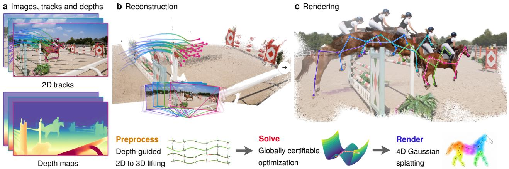  
Figure 1 XM4D overview. From (a) 2D tracks and monocular depth, a solver with certified global optimality followed by refinement recovers (b) the cameras, the static geometry (points), and the 3D trajectories of dynamic points (colored curves), which initialize (c) 4D Gaussian splatting for rendering. The skeleton in (c) is a subsampled embedded deformation graph (EDG).

b View graph instantiated on a dynamic scene  
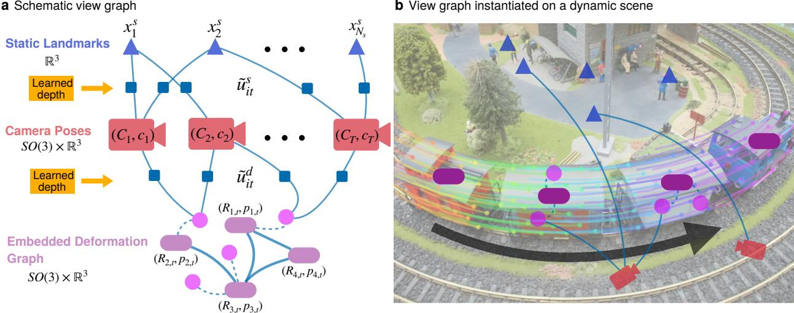  
Figure 2 The XM4D view graph. (a) Schematic view graph. Camera poses $( C _ { t } , \mathbf { c } _ { t } ) \in \mathrm { S O } ( 3 ) \times \mathbb { R } ^ { 3 }$ (red) observe static landmarks $\mathbf { x } _ { i } ^ { s } \in \mathbb { R } ^ { 3 }$ (blue triangles) and dynamic points (pink circles) through the depth-lifted measurements $\tilde { \mathbf { u } } _ { i t } ^ { s }$ and $\tilde { \mathbf { u } } _ { i t } ^ { d }$ (blue squares). Each dynamic keypoint is attached by skinning edges (dashed) to its neighboring nodes $( R _ { j , t } , \mathbf { p } _ { j , t } )$ of the embedded deformation graph (EDG) (purple capsules), whose nodes are connected by EDG edges (thick solid lines). (b) The view graph instantiated on a dynamic scene: a train moves along a circular track (black arrow), colored curves show the dynamic point tracks, and each part of the train is an EDG node with a free SE(3) pose.

## 1 Introduction

4D reconstruction aims to recover the time-varying 3D structure of a scene from visual observations. It supports applications including dynamic novel-view rendering [36, 42], deformable and articulated object reconstruction [24, 48, 74], digital humans and digital twins [25, 53, 70], and motion retargeting for humanoid control [3, 21, 40]. Despite its broad utility, reconstructing a dynamic scene from monocular images or videos remains highly challenging [17, 18]. Camera and object motion are entangled in the visual observations [15], while dynamic geometry itself is weakly constrained and may undergo complex non-rigid deformation. Long sequences introduce further difficulties, including fragmented point tracks, noisy and scale-inconsistent monocular depth, and temporally incomplete observations of the dynamic scene [35, 68].

Recent 4D reconstruction methods commonly rely on coupled nonconvex optimization over camera poses, scene geometry, deformation, and appearance [35, 68]. Such formulations have achieved impressive results, but their strong coupling makes the optimization difficult: the objective is highly nonconvex and local optimization may therefore be sensitive to initialization and converge to undesired local minima. As illustrated in Fig. 3, local optimization of the motion of an embedded deformation graph (EDG) can converge to an inferior solution whereas the certifiable solver presented in this work achieves an accurate reconstruction. Similar failures of local optimization in static reconstruction were demonstrated in XM [20] (Fig. 10). This raises a natural question:

## Can we achieve accurate and efficient 4D reconstruction through globally certifiable geometric optimization?

In this work, we present XM4D, a framework for accurate and efficient 4D reconstruction based on globally certifiable geometric optimization. Our approach separates camera motion estimation from non-rigid deformation, allowing both stages to be formulated as structured (nonconvex) quadratically constrained quadratic programs (QCQPs) and solved through (convex) semidefinite programming (SDP) relaxations. Fig. 2(a) illustrates this decomposition as a view graph and Fig. 2(b) instantiates it on a real scene: static and dynamic point tracks share the same cameras and predicted depth, but static tracks constrain time-invariant landmarks and camera poses, while dynamic tracks constrain the motion of an EDG. In the following, we overview the problem formulation and solution approach for both stages.

I: Static stage. As shown in Fig. 2, let $t \in \{ 1 , \ldots , T \}$ index video frames and $i \in \{ 1 , \ldots , N _ { s } \}$ index static points. The visibility set $\mathcal { E } _ { s }$ contains the tracked point-frame pairs, and $\tilde { \mathbf { u } } _ { i t } ^ { s } \in \mathbb { R } ^ { 3 }$ denotes the corresponding 2D observation lifted to 3D using predicted monocular depth. Because monocular depth predictions are noisy and their scale drifts from frame to frame, we introduce a per-frame scale $s _ { t } > 0$ that corrects this frame-dependent scale error in the predicted depth. Weighting each observation by an optional confidence $\omega _ { i t } > 0$ , we jointly estimate camera poses, depth scales, and static landmarks via

$$
\operatorname* { m i n } _ { \substack { C _ { t } \in \mathrm { S O } ( 3 ) , \ \mathbf { c } _ { t } \in \mathbb { R } ^ { 3 } } , \ ( i , t ) \in \mathcal { E } _ { s } } \omega _ { i t } \left\| C _ { t } \big ( s _ { t } \tilde { \mathbf { u } } _ { i t } ^ { s } \big ) + \mathbf { c } _ { t } - \mathbf { x } _ { i } ^ { s } \right\| ^ { 2 } .\tag{SBA}
$$

The objective enforces that observations of the same static point, after correcting the predicted depth scale and transforming them into the world frame, agree on a common 3D landmark. Without a scale constraint, the objective admits a degenerate solution as all variables shrink toward zero. The original XM formulation [20] prevents this collapse by anchoring the first-frame scale to $s _ { 1 } = 1$ , making the reconstruction overfit onto the first frame. We instead impose a uniform sphere constraint, $\textstyle \sum _ { t } s _ { t } ^ { 2 } = T$ , which fixes the global scale without privileging any frame. We formulate this problem as a quadratically constrained quadratic program (QCQP), relax it to a semidefinite program (SDP), and solve it efficiently using Burer–Monteiro (BM) factorization together with a Riemannian staircase, following the certifiable optimization framework of XM and SE-Sync [20, 60].

II: Dynamic stage. After fixing the recovered camera trajectory, we transform dynamic observations into the world frame and model non-rigid motion with an EDG. Each dynamic point $\mathbf { x } _ { i } ^ { d }$ is warped by the rigid transformations $( R _ { j , t } , \mathbf { p } _ { j , t } )$ of its neighboring EDG nodes, where $\mathbf { g } _ { j }$ denotes the rest position of node $j$ and $w _ { i j }$ the skinning weight. Let $\mathbf { y } _ { i t } ^ { d } = C _ { t } ( s _ { t } \tilde { \mathbf { u } } _ { i t } ^ { d } ) + \mathbf { c } _ { t }$ denote the corresponding depth-lifted observation in the world frame. The tracking loss is

$$
\begin{array} { r l } & { \mathcal { L } _ { \mathrm { t r a c k } } = \displaystyle \sum _ { ( i , t ) \in \mathcal { E } _ { d } } \left\| \Phi _ { t } ( \mathbf { x } _ { i } ^ { d } ) - \mathbf { y } _ { i t } ^ { d } \right\| ^ { 2 } , } \\ & { \Phi _ { t } ( \mathbf { x } _ { i } ^ { d } ) = \displaystyle \sum _ { j \in \mathcal { N } ( i ) } w _ { i j } \left[ R _ { j , t } ( \mathbf { x } _ { i } ^ { d } - \mathbf { g } _ { j } ) + \mathbf { g } _ { j } + \mathbf { p } _ { j , t } \right] . } \end{array}\tag{1}
$$

We optimize the EDG node transformations with tracking loss, as-rigid-as-possible (ARAP) and temporal smoothness regularization. Unlike MoSca [35], which models deformation through relative transformations between frames, we express all node transformations relative to a fixed rest frame. With fixed EDG structure and skinning weights, this choice makes the tracking, ARAP, and temporal smoothness objectives quadratic in the node transformations. Eliminating node translations then yields a rotation-only QCQP that admits the same SDP-based certifiable optimization framework as the static stage. The recovered geometry then initializes dynamic Gaussian splatting for rendering.

In summary, XM4D makes the following contributions:

• For static reconstruction, we build on the QCQP–SDP–BM framework of our conference version, XM [20], retaining its efficient optimization and global optimality certificates. We introduce a uniform sphere constraint that resolves the scale ambiguity without anchoring any individual frame.

• For dynamic reconstruction, we design an EDG-based non-rigid reconstruction formulation that incorporates tracking, rigidity, and temporal smoothness into a structured QCQP. This formulation admits the same globally certifiable optimization framework.

• We build XM4D, an accurate and efficient 4D reconstruction pipeline that combines certifiable geometric optimization with dynamic Gaussian splatting. Extensive experiments across seven benchmarks demonstrate leading camera accuracy, fast and scalable optimization, and the best average novel-view rendering performance on all three dynamic benchmarks (DyCheck, NVIDIA, and Syn4D).

Outline. The remainder of this paper is organized as follows. Section 2 reviews related work. Section 3 presents the static stage: the rotation-only QCQP and SDP relaxation, the BM solver with its optimality certificate, and the sphere constraint. Section 4 extends this machinery to the EDG-based dynamic reconstruction and shows that it admits the same certifiable solver. Section 5 describes the complete pipeline. Section 6 evaluates camera accuracy, runtime, and novel-view rendering on seven benchmarks. Proofs and implementation details are given in the appendices. Visualizations and code are available on the project page:

https://computationalrobotics.seas.harvard.edu/XM4D/.

## 2 Related Work

## 2.1 Dynamic Scene Reconstruction

Existing dynamic scene reconstruction methods can be grouped by how they constrain the reconstruction. Rendering based methods fit time-varying scene representations to images, while geometry-driven methods use measurements such as depth and point tracks to estimate structure and motion. Rendering-based methods represent dynamics using time-varying (volumetric) fields [36, 42], deformable canonical radiance fields and their higher-dimensional extensions [51, 52, 57], or moving Gaussians [44, 62, 72]. Many of them incorporate geometric regularization, and some jointly estimate camera motion [41]. However, recovering object or part level SE(3) motion for downstream scene understanding generally requires additional motion estimation. Moreover, many methods rely on accurate camera poses, carefully designed initialization, and heavy per-scene optimization.

Geometry-based methods use geometric measurements and motion priors to constrain dynamic reconstruction. Earlier non-rigid structure-from-motion methods recover 3D shape from monocular point tracks using low-rank or subspace priors [19, 88], while RGB-D methods use depth observations with deformation graphs or volumetric models to track motion and reconstruct geometry [9, 24, 48]. More recently, MoSca [35] lifts learned depth and point-track priors into a motion scaffold and anchors Gaussians to it for photometric reconstruction. Shape of Motion [68] represents scene motion using shared SE(3) motion bases, with per-point weights combining the bases to recover persistent trajectories from monocular depth and long-range 2D tracks. XM4D also uses explicit local SE(3) transformations as an EDG. Unlike them, XM4D estimates camera poses and temporally coupled graph transformations from depth and tracks with a certifiable geometric solver, making local rigid motions explicit without involving Gaussians.

## 2.2 Learning-Assisted Geometric Reconstruction

Learned geometric priors have become important components of reconstruction pipelines. Monocular depth models [5, 23, 38, 55, 79] predict dense scene depth, while point trackers [16, 30, 32, 73, 85] establish correspondences across frames. Together, depth and correspondence estimates provide complementary constraints for geometric reconstruction: depth informs scene structure, while tracks connect observations over time.

Recent feed-forward methods predict richer 3D scene representations directly from images. DUSt3R [69] predicts pointmaps for image pairs and aligns them in a shared coordinate frame, and MUSt3R [13] extends it to many views, and VGGT [67] jointly predicts camera parameters, depth maps, pointmaps, and 3D point tracks. In XM4D, learned depth and tracks are measurements for an explicit geometric optimization.

## 2.3 Certifiable Geometric Optimization

Certifiable geometric optimization solves nonconvex estimation problems, such as bundle adjustment, while verifying global optimality [33, 78, 84]. Semidefinite relaxations provide such certificates for pose synchronization [60, 82], outlier-robust registration [77], and general polynomial formulations of robust estimation [76].

Our prior conference work, XM [20], introduced depth-assisted scaled bundle adjustment with a scalable solver based on BM factorization [11] and Riemannian optimization [8], which XM4D extends to dynamic scenes.

## 3 Static Reconstruction with XM

This section presents the static stage of XM4D. Section 3.1 reviews scaled bundle adjustment and its QCQP reformulation (Propositions 1–2); Section 3.2 relaxes the QCQP to a convex SDP (Proposition 3); Section 3.3 solves the SDP with certified global optimality via the Riemannian staircase method (Algorithm 1). Section 3.4 highlights our main contribution compared to XM [20]: a uniform sphere constraint on the depth scales that replaces the first-frame anchor.

## 3.1 Bundle Adjustment with Learned Depth

The static observations originate from 2D correspondences, obtained by point trackers [16, 30, 85] or by classical keypoint detection and matching [43, 61], and $\mathbf { u } _ { i t } ^ { s } \in \mathbb { R } ^ { 2 }$ denotes the normalized image coordinate of static point i in

frame t obtained with the camera intrinsics, which are either calibrated or estimated by a foundation model [38, 67]. Each observation is lifted to a noisy 3D measurement using its predicted depth $d _ { i t } > 0$

$$
\widetilde { \mathbf { u } } _ { i t } ^ { s } = d _ { i t } \left[ \mathbf { u } _ { i t } ^ { s } \right] \in \mathbb { R } ^ { 3 } ,\tag{2}
$$

which constitutes the depth-lifted observation of Eq. (SBA).

The translations $\{ \mathbf { c } _ { t } \}$ and landmarks $\{ \mathbf { x } _ { i } ^ { s } \}$ in Eq. (SBA) are unconstrained variables and thus can be eliminated analytically to get a reduced scaled-rotation-only problem.

Proposition 1 (Scaled-Rotation-Only Formulation, adapted from [20]). Problem (SBA) is equivalent to

$$
\begin{array} { r } { \rho _ { \mathrm { S R O } } ^ { \star } = \underset { s _ { t } > 0 , ~ C _ { t } \in \mathrm { S O } ( 3 ) } { \operatorname* { m i n } } \ \mathrm { t r } \big ( Q U ^ { \top } U \big ) , \ ~ } \\ { \boldsymbol { U } = \big [ s _ { 1 } C _ { 1 } \quad \cdot \cdot \quad s _ { T } C _ { T } \big ] , \ ~ } \end{array}\tag{SRO}
$$

where $Q \in \mathbb { S } ^ { 3 T } , Q \succeq 0$ , is a data matrix built from the lifted measurements through the Moore–Penrose pseudoinverse of the view-graph Laplacian. In particular, the optimal values coincide: $\rho _ { \mathrm { S B A } } ^ { \star } = \rho _ { \mathrm { S R O } } ^ { \star }$ , where $\rho _ { \mathrm { S B A } } ^ { \star }$ denotes the optimal value of (SBA). The closed form of $Q _ { i }$ , the proof, and the recovery of the optimal translations and landmarks are given in Appendix B.1.

The objective of (SRO) vanishes as $U  0$ , a collapse of the global scale. XM excludes it by anchoring the first frame;   
we instead exclude it with the uniform sphere constraint $\left. U \right. _ { F } ^ { 2 } = 3 T$ motivated in Section 3.4.

By defining the set of scaled orthogonal matrices through the quadratic constrain

$$
\begin{array} { r l } & { \mathrm { s O ( 3 ) } = \left\{ \bar { R } \in \mathbb { R } ^ { 3 \times 3 } \mid \bar { R } ^ { \top } \bar { R } = \alpha I _ { 3 } , \alpha \geq 0 \right\} } \\ & { \quad \quad = \left\{ s R \mid s \geq 0 , R \in \mathrm { O ( 3 ) } \right\} , } \end{array}\tag{3}
$$

which contains the scaled rotation $\bar { C } _ { t } = s _ { t } C _ { t }$ of each frame, (SRO) reduces to the following QCQP.

Proposition 2 (QCQP Formulation, adapted from [20]). Consider the QCQP

$$
\begin{array} { r l } & { \rho _ { \mathrm { Q C Q P } } ^ { \star } = \underset { \bar { C } _ { t } \in \mathrm { s O } ( 3 ) } { \mathrm { m i n } } \ \mathrm { t r } \left( Q U ^ { \top } U \right) , } \\ & { ~ \quad \quad \quad \quad \quad t = 1 , . . . , T } \\ & { U = \left[ \bar { C } _ { 1 } \quad . . . \quad \bar { C } _ { T } \right] , \quad \quad \left\| U \right\| _ { F } ^ { 2 } = 3 T , } \end{array}\tag{QCQP}
$$

and let $U ^ { \star } = [ \bar { C } _ { 1 } ^ { \star } , \dots , \bar { C } _ { T } ^ { \star } ]$ be a global optimizer. If det $\bar { C } _ { t } ^ { \star } > 0$ for all t, then $U ^ { \star }$ is a global minimizer of (SRO) under the same sphere constraint. The proof is given in Appendix B.2.

Otherwise, rotations in $\mathrm { S O ( 3 ) }$ are recovered by projecting each block onto the scaled rotations through its singular value decomposition (Appendix C.1).

## 3.2 Convex SDP Relaxation

Since local solvers for the QCQP may stall in suboptimal minima, we use a semidefinite relaxation [75, Chapter 3]. The basic idea is fairly simple: creating a matrix variable

$$
{ \boldsymbol { X } } =  { \boldsymbol { U } } ^ { \top }  { \boldsymbol { U } } \in \mathbb { S } ^ { 3 T } ,\tag{4}
$$

which is quadratic in the original variable $U _ { : }$ makes the objective of (QCQP) linear in X, namely $\operatorname { t r } ( Q U ^ { \top } U ) = \langle Q , X \rangle$ The convex relaxation then enforces the matrix variable $X$ through convex constraints. Partition X into $3 \times 3$ blocks $X _ { t t ^ { \prime } }$ with $t , t ^ { \prime } \in \{ 1 , \ldots , T \}$ }. Since each $\bar { C } _ { t } = s _ { t } C _ { t }$

$$
X _ { t t } = \bar { C } _ { t } ^ { \top } \bar { C } _ { t } = s _ { t } ^ { 2 } I _ { 3 } = \alpha _ { t } I _ { 3 } , \qquad \alpha _ { t } = s _ { t } ^ { 2 } .\tag{5}
$$

All diagonal blocks play identical roles, and the sphere constraint becomes the linear equality $\operatorname { t r } ( X ) = 3 T$ . Ignoring the rank-3 constraint on X yields Shor’s SDP relaxation.

Proposition 3 (SDP Relaxation, adapted from [20]). The semidefinite program

$$
\begin{array} { r l } { \rho _ { \mathrm { S D P } } ^ { \star } = \underset { X } { \mathrm { m i n } } } & { \langle Q , X \rangle } \\ { s . t . } & { X \succeq 0 , } \\ & { X _ { t t } = \alpha _ { t } I _ { 3 } , \qquad t = 1 , \ldots , T , } \\ & { \mathrm { t r } ( X ) = 3 T , } \end{array}\tag{SDP}
$$

where each scalar $\alpha _ { t }$ is not a separate variable but the common diagonal entry of the block $X _ { t t } ,$ , is a convex relaxation of (QCQP), $i . e . , \rho _ { \mathrm { S D P } } ^ { \star } \le \rho _ { \mathrm { Q C Q P } } ^ { \star }$ . If a global minimizer $X ^ { \star }$ has rank $\left( X ^ { \star } \right) = 3$ , then it factorizes as $X ^ { \star } = ( U ^ { \star } ) ^ { \top } U ^ { \star }$ with $U ^ { \star } = [ \bar { C } _ { 1 } ^ { \star } , \ldots , \bar { C } _ { T } ^ { \star } ] \in \mathrm { s O } ( 3 ) ^ { T }$ , unique up to multiplication by $\mathrm { O ( 3 ) }$ , and $U ^ { \star }$ is a global optimizer of (QCQP). In this case, the relaxation is said to be tight or exact (proof in Appendix B.3).

In practice the relaxation is empirically tight [20]; when a minimizer has rank above three, it is projected to rank three through its three largest eigenpairs, a process known as rounding (Appendix C.1).

## 3.3 Burer–Monteiro Optimization

Although (SDP) is convex, explicitly storing and optimizing the $3 T \times 3 T$ matrix X becomes prohibitive for long videos with a large T: interior-point solvers already struggle beyond a few thousand frames [20]. When the relaxation is tight, however, the optimal $X ^ { \star }$ has rank three (Proposition 3), so its effective dimension is only $3 \times 3 T$ . BM factorization [11] exploits this low-rank structure: for a chosen rank $r \geq 3$ , we substitute

$$
X = U ^ { \top } U , \qquad U = \left[ U _ { 1 } \quad \cdot \cdot \quad U _ { T } \right] \in \mathbb { R } ^ { r \times 3 T } ,\tag{6}
$$

with blocks $U _ { t } \in \mathbb { R } ^ { r \times 3 }$ into (SDP), which yields the rank-r BM problem

$$
\begin{array} { r l } { \rho _ { \mathrm { B M } , r } ^ { \star } = \underset { U \in \mathbb R ^ { r \times 3 T } } { \mathrm { m i n } } } & { \mathrm { t r } \big ( Q U ^ { \top } U \big ) } \\ { \mathsf { s . t . } } & { U _ { t } ^ { \top } U _ { t } = \alpha _ { t } I _ { 3 } , \quad t = 1 , \ldots , T , } \\ & { \sum _ { t = 1 } ^ { T } \alpha _ { t } = T . } \end{array}\tag{BM}
$$

At first glance, (BM) looks like a nonconvex constrained problem, but its constraints define a smooth manifold.

Proposition 4 (BM Riemannian Optimization, adapted from [20]). Problem (BM) is equivalent to the unconstrained Riemannian optimization problem

$$
\operatorname* { m i n } _ { ( \mathbf { s } , Y _ { 1 } , \ldots , Y _ { T } ) \in \mathcal { M } } \mathrm { t r } \big ( Q U ^ { \top } U \big ) , \qquad U _ { t } = s _ { t } Y _ { t } ,\tag{7}
$$

over the product manifold

$$
\mathcal { M } = \mathbb { S } _ { \sqrt { T } } ^ { T - 1 } \times \mathrm { S t } ( r , 3 ) ^ { T } ,\tag{8}
$$

where $\mathbb { S } _ { \sqrt { T } } ^ { T - 1 } = \left\{ \mathbf { s } \in \mathbb { R } ^ { T } : \left\| \mathbf { s } \right\| _ { 2 } ^ { 2 } = T \right\}$ is the radius- $- \sqrt { T }$ sphere, ${ \mathrm { S t } } ( r , 3 ) = \{ Y \in \mathbb { R } ^ { r \times 3 } : Y ^ { \top } Y = I _ { 3 } \}$ is the Stiefel manifold, and $\alpha _ { t } = s _ { t } ^ { 2 }$ . The proofis given in Appendix B.4.

We solve (7) with the Riemannian trust-region method with truncated conjugate gradients (RTR-TCG) [7], using the $\mathsf { C } { + } { + } / \mathsf { C } \mathsf { U } \mathsf { D } \mathsf { A }$ implementation from XM [20].

Three observations are in order [11, 75]. First, $X = U ^ { \top } U \succeq 0$ holds by construction, so the PSD constraint disappears. Second, at $r = 3$ , problem (BM) is exactly (QCQP) and hence nonconvex. Third, increasing the rank cannot increase the optimal objective value, since any feasible rank-r factor remains feasible at rank $r { \mathrm { + 1 } }$ by appending a zero row; hence

$$
\rho _ { \mathrm { B M } , 3 } ^ { \star } \ \geq \ \rho _ { \mathrm { B M } , 4 } ^ { \star } \ \geq \ \cdot \cdot \ \geq \ \rho _ { \mathrm { S D P } } ^ { \star } ,\tag{9}
$$

with equality $\rho _ { \mathrm { B M } , r } ^ { \star } = \rho _ { \mathrm { S D P } } ^ { \star }$ as soon as $r \geq r ^ { \star }$ , the minimum rank among optimal solutions of (SDP) [11, 75]. We emphasize that (9) is a statement about global minima: each $\rho _ { \mathrm { B M } , r } ^ { \star }$ is the optimal value of the nonconvex problem (BM),

which a local Riemannian solver alone is not guaranteed to attain. Attaining it—and thereby $\rho _ { \mathrm { S D P } } ^ { \star }$ —is precisely the role of the Riemannian staircase [8, 60] developed below.

Global optimality certification. Write (SDP) in standard primal form,

$$
\operatorname* { m i n } _ { X \in { \mathbb S } ^ { 3 T } } \quad \operatorname { t r } ( Q X )\tag{10a}
$$

$$
{ \mathsf { s . t . } } \quad \langle A _ { i } , X \rangle = b _ { i } , \quad i = 1 , \ldots , m ,\tag{10b}
$$

$$
X \succeq 0 .\tag{10c}
$$

The associated dual standard SDP is

$$
\operatorname* { m a x } _ { y \in \mathbb { R } ^ { m } } \quad \sum _ { i = 1 } ^ { m } b _ { i } y _ { i }\tag{11a}
$$

$$
{ \mathsf { s . t . } } Z ( y ) : = Q - \sum _ { i = 1 } ^ { m } y _ { i } A _ { i } \succeq 0 .\tag{11b}
$$

Since Slater’s condition holds $( X = I _ { 3 T }$ is feasible for (SDP)), strong duality holds between (10) and (11) [71].

Theorem 5 (Dual Optimality Certificate, adapted from [20]). Let $U _ { r } ^ { \star }$ be a locally optimal solution of (BM) with $\alpha _ { t } > 0$ for all t. Then there exists a unique multiplier $y _ { r } \in \mathbb { R } ^ { m }$ satisfying the first-order condition

$$
Z ( y _ { r } ) ( U _ { r } ^ { \star } ) ^ { \top } = 0 .\tag{12}
$$

If, furthermore, $Z ( y _ { r } ) \succeq 0$ , then $U _ { r } ^ { \star }$ is a global optimizer of (BM), and $( U _ { r } ^ { \star } ) ^ { \top } U _ { r } ^ { \star } , y _ { r } , Z ( y _ { r } )$ are optimal for the primal–dual pair $( 1 0 ) \mathrm { - } ( 1 1 )$ . The proofis given in Appendix B.5.

Theorem 5 gives a simple certification recipe: solve the linear system (12) for $y _ { r }$ (recall $Z ( y )$ is linear in y), form $Z ( y _ { r } )$ and check its positive semidefiniteness. If the check fails, the next theorem provides an escape route.

Theorem 6 (Negative-Curvature Direction, adapted from [20]). Let $U _ { r } ^ { \star }$ be a local minimizer of (BM) with multiplier $y _ { r _ { i } }$ , and suppose $Z ( y _ { r } ) \Zdash 0$ . Let v be an eigenvector of $Z ( y _ { r } )$ associated with a negative eigenvalue. Then, for the rank-(r+1) problem,

$$
D = \left[ \begin{array} { c c } { { 0 } } \\ { { v ^ { \top } } } \end{array} \right] \quad i s a s e c o n d - o r d e r d e s c e n t d i r e c t i o n a t \quad \bar { U } = \left[ \begin{array} { c c } { { U _ { r } ^ { \star } } } \\ { { 0 } } \end{array} \right] :\tag{13}
$$

along the feasible retraction curve through $\bar { U }$ in the direction $D ,$ , the objective f satisfies $f ^ { \prime } ( 0 ) = 0$ and $f ^ { \prime \prime } ( 0 ) = 2 v ^ { \top } Z ( y _ { r } ) v < 0$ . The proof is given in Appendix B.6.

Since the objective decreases to second order along $D ,$ the halving line search in Algorithm 1 terminates with a strictly lower objective, and the optimization escapes the rank-r local minimizer by climbing one step of the rank “staircase”.

Theorem 7 (Global Convergence, adapted from [20]). Algorithm 1 returns a globally optimal solution of the SDP pair (10)–(11), regardless of the initialization $U _ { r } ^ { 0 }$ (proof in Appendix B.7).

Theorem 7 makes the approach initialization-free. In practice, Algorithm 1 terminates at $r = 3$ or 4 [20], so the worst case $r = 3 T$ is never approached and the scalability advantage of the low-rank factorization is retained.

## 3.4 Anchoring via a Uniform Sphere Constraint

As discussed in Section 3.1, the original XM formulation removes the scale and rotation ambiguities of (SBA) by anchoring the first frame $( C _ { 1 } = I _ { 3 } , \mathbf { c } _ { 1 } = \mathbf { 0 } , s _ { 1 } = 1 )$ . This pins the reconstruction to the first depth prediction, so the solver overfits to it when the first-frame observations are noisy, and XM’s scale-regularization adds a hyperparameter that must be tuned for each video. We instead fix the global scale with a constraint rather than a penalty: the uniform

Algorithm 1: Riemannian Staircase   
Input: data matrix $Q \in \mathbb { S } ^ { 3 T }$   
Output: certified optimizer $U ^ { \star }$ of (BM)   
1 $r  3 ; U _ { r } ^ { 0 }  [ I _ { 3 } \ { \cdot } \ { \cdot } \ { \cdot } \ I _ { 3 } ] ;$   
2 while true do   
3 $U _ { r } ^ { \star } \gets \mathsf { R T R - T C G } ( Q , U _ { r } ^ { 0 } )$ // local minimizer of (BM)   
4 solve (12) for $y _ { r }$ and form $Z ( y _ { r } ) ;$   
5 if $Z ( y _ { r } ) \succeq 0$ then   
6 return $U ^ { \star } = U _ { r } ^ { \star }$ // certified global optimum   
7 end   
8 v ← eigenvector of the most negative eigenvalue of $Z ( y _ { r } )$   
9 $\alpha  1 ; \bar { U }  [ { U _ { r } ^ { \star } } ] ; D  [ { 0 } ] ;$   
10 $U _ { r + 1 } \gets \mathrm { R e t r } _ { \bar { U } } ( \alpha D ) ;$   
11 while tr $\left( Q U _ { r + 1 } ^ { \top } U _ { r + 1 } \right) \geq \operatorname { t r } \left( Q ( U _ { r } ^ { \star } ) ^ { \top } U _ { r } ^ { \star } \right)$ do   
12 $| \Uparrow \alpha  \overleftarrow { \alpha / 2 } ; U _ { r + 1 } \overleftarrow {  } \thinspace \mathrm { R e t r } _ { \bar { U } } ( \alpha D ) ;$   
13 end   
14 $r  r + 1 ; U _ { r } ^ { 0 }  U _ { r + 1 } ;$   
15 end

sphere constraint

$$
\sum _ { t = 1 } ^ { T } s _ { t } ^ { 2 } = T\tag{14}
$$

excludes the collapse toward zero while treating every frame symmetrically. It is quadratic in the scales, so (QCQP) remains a QCQP, and after relaxation it is the trace constraint $\operatorname { t r } ( X ) = 3 T$ already in (SDP) and (BM).

Suboptimality gap. Since the staircase runs with finite tolerances, we report the relative gap

$$
\eta = \frac { \hat { \rho } - \rho _ { \mathrm { d } } } { 1 + \vert \hat { \rho } \vert + \vert \rho _ { \mathrm { d } } \vert } , \qquad \rho _ { \mathrm { d } } = \mathbf { b } ^ { \top } y _ { r } + 3 T \lambda _ { \mathrm { m i n } } ( Z ( y _ { r } ) ) ,\tag{15}
$$

where $\hat { \rho } = \mathrm { t r } ( Q \hat { U } ^ { \top } \hat { U } )$ is the objective of the solution $\hat { U }$ rounded to (SRO) under the sphere constraint (Appendix C.1), $\mathbf { b } = ( b _ { 1 } , \dots , b _ { m } )$ and $Z ( y )$ are defined in (10)–(11b), and $y _ { r }$ solves (12). By Theorem 11 (Appendix C), $\hat { \rho } \geq \rho _ { \mathrm { S R O } } ^ { \star } \geq$ $\rho _ { \mathrm { S D P } } ^ { \star } \geq \rho _ { \mathrm { d } } , \mathsf { s o } \eta  0$ certifies that $\hat { U }$ is numerically globally optimal for (SRO). Table 6 reports $\eta$ per dataset: all static solves satisfy $\eta < 1 0 ^ { - 3 }$ , where for the partial sphere constraint $\eta$ uses the trace-restricted bound of Appendix C.

## Summary

The static stage lifts 2D point tracks to 3D with learned depth, eliminates translations and landmarks to obtain (SRO), and relaxes it through (QCQP) to the convex program (SDP), solved by the Riemannian staircase with a certificate of global optimality and a suboptimality gap (15). Unlike XM, a sphere constraint fixes the global scale without anchoring any frame. The recovered camera poses $\left( C _ { t } , \mathbf { c } _ { t } , s _ { t } \right)$ define the world frame in which dynamic tracks are lifted for the non-rigid stage.

## 4 Dynamic Reconstruction with XM

We extend the globally certifiable optimization framework of Section 3 to the dynamic part of the view graph. Section 4.1 introduces the EDG motion model and dynamic objective; Section 4.2 analytically eliminates the unconstrained variables to obtain a rotation-only QCQP, as in the static case; and Section 4.3 describes how the XM solver of Section 3.3 solves the resulting problem.

## 4.1 EDG Model and the Dynamic Objective

Dynamic motion is represented by an EDG [65], $\mathcal { G } _ { \mathrm { E D G } } = ( \mathcal { V } _ { \mathrm { E D G } } , \mathcal { E } _ { \mathrm { E D G } } )$ , consisting of J sparse control nodes $( \mathsf { E q . } ( 1 ) )$ Each node $j$ has a rest position $\mathbf { g } _ { j } \in \mathbb { R } ^ { 3 }$ and a rigid transformation $( R _ { j , t } , \mathbf { p } _ { j , t } ) \in \mathrm { S O } ( 3 ) \times \mathbb { R } ^ { 3 }$ describing its motion at frame t. Dynamic points are attached to nearby nodes and deformed using linear blend skinning. In this section, the graph (its nodes, edges, rest positions, and skinning weights) is taken as given; Section 5.3 describes how it is built from the lifted dynamic tracks.

We first describe the EDG model for a single temporal window W. Within this window, we choose a reference frame $t _ { 0 } \in \mathcal { W }$ , typically the frame with the most observed EDG nodes, and define the rest positions in that frame, which keeps the skinning offsets and ARAP constraints consistent. We anchor the node transformations at $t _ { 0 }$ by

$$
R _ { j , t _ { 0 } } = I _ { 3 } , \qquad { \bf p } _ { j , t _ { 0 } } = { \bf 0 } , \qquad j = 1 , \ldots , J ,\tag{16}
$$

so that $\Phi _ { t _ { 0 } }$ is the identity. This is a local reference-frame convention for one solve; it does not require a single rest frame for the entire video (Section 5.3).

Since the cameras and depth scales are fixed at their static-stage estimates, the lifted observations $\mathbf { y } _ { i t } ^ { d }$ are constants, and the dynamic problem estimates the node transformations alone,

$$
\begin{array} { r l } { \underset { R _ { j , t } \in \mathrm { S O } ( 3 ) } { \operatorname* { m i n } } } & { \lambda _ { \mathrm { t r a c k } } \mathcal { L } _ { \mathrm { t r a c k } } + \lambda _ { \mathrm { A R A P } } \mathcal { L } _ { \mathrm { A R A P } } + \lambda _ { \mathrm { t e m p } } \mathcal { L } _ { \mathrm { t e m p } } . } \\ { \mathbf { p } _ { j , t } \in \mathbb { R } ^ { 3 } } \end{array}\tag{DYN}
$$

Here $\mathcal { L } _ { \mathrm { t r a c k } }$ is the tracking loss (1), which asks the warped rest positions to match the lifted observations; the as-rigid-as-possible (ARAP) energy over the EDG edges,

$$
\begin{array}{c} \mathcal { L } _ { \mathrm { A R A P } } = \sum _ { t = 1 } ^ { T } \sum _ { ( j , k ) \in \mathcal { E } _ { \mathrm { E D G } } } \left\| \mathbf { r } _ { j k , t } ^ { \mathrm { a r a p } } \right\| ^ { 2 } ,  \\ { \mathbf { r } _ { j k , t } ^ { \mathrm { a r a p } } = R _ { j , t } \big ( \mathbf { g } _ { k } - \mathbf { g } _ { j } \big ) + \mathbf { g } _ { j } + \mathbf { p } _ { j , t } - \mathbf { g } _ { k } - \mathbf { p } _ { k , t } , } \end{array}\tag{17}
$$

asks the transformation of node $j$ to also explain the motion of its neighbor $k ,$ and the temporal smoothness energy

$$
\mathcal { L } _ { \mathrm { t e m p } } = \sum _ { t = 1 } ^ { T - 1 } \sum _ { j = 1 } ^ { J } \left. R _ { j , t } - R _ { j , t + 1 } \right. _ { F } ^ { 2 } + \left. \mathbf { p } _ { j , t } - \mathbf { p } _ { j , t + 1 } \right. ^ { 2 }\tag{18}
$$

discourages large inter-frame deformation.

## 4.2 Rotation-Only QCQP

Every residual in (DYN) is affine: the tracking residual is affine in $( R _ { j , t } , \mathbf { p } _ { j , t } )$ for fixed skinning weights and rest positions, the ARAP residual is affine in $( R _ { j , t } , \mathbf { p } _ { j , t } , \mathbf { p } _ { k , t } )$ with the constant offset $\mathbf { g } _ { j } - \mathbf { g } _ { k }$ , and the smoothness residuals are linear. The objective is thus quadratic in the stacked variables, and (DYN) is a QCQP whose only constraints are the orthogonality of the EDG blocks.

As in the static case, the node translations $\mathbf { p } _ { j , t }$ t are unconstrained Euclidean variables and can be eliminated analytically, leaving a problem over the EDG rotations alone.

Proposition 8 (Rotation-Only Formulation of the Dynamic Problem). Under the rest-frame convention (16), Problem (DYN) is equivalent to

$$
\begin{array} { r l } & { \rho _ { \mathrm { D Y N - R O } } ^ { \star } = \underset { R _ { j , t } \in \mathrm { S O } ( 3 ) } { \operatorname* { m i n } } \ \mathrm { t r } ( Q U ^ { \top } U ) + 2 \left. P , U \right. + c _ { 0 } , } \\ & { \qquad \quad \stackrel { t e \ t _ { 0 } } { \mathstrut } } \\ & { \qquad U = \left[ R _ { j , t } \right] _ { t \neq t _ { 0 } } , } \end{array}\tag{DYN-RO}
$$

where $Q \in \mathbb { S } ^ { 3 J ( T - 1 ) } , Q \succeq 0 , P \in \mathbb { R } ^ { 3 \times 3 J ( T - 1 ) }$ , and $c _ { 0 } \in \mathbb { R }$ are built from the lifted observations, the skinning weights, and the rest positions through the Moore–Penrose pseudo-inverse of a node-translation Laplacian. In particular, the optimal values coincide: $\rho _ { \mathrm { D Y N } } ^ { \star } = \rho _ { \mathrm { D Y N - R O } } ^ { \star }$ , where $\rho _ { \mathrm { D Y N } } ^ { \star }$ denotes the optimal value of (DYN). The closed forms of $Q , P ,$ and $c _ { 0 } ,$ , the proof, and the recovery of the node translations are in Appendix B.8.

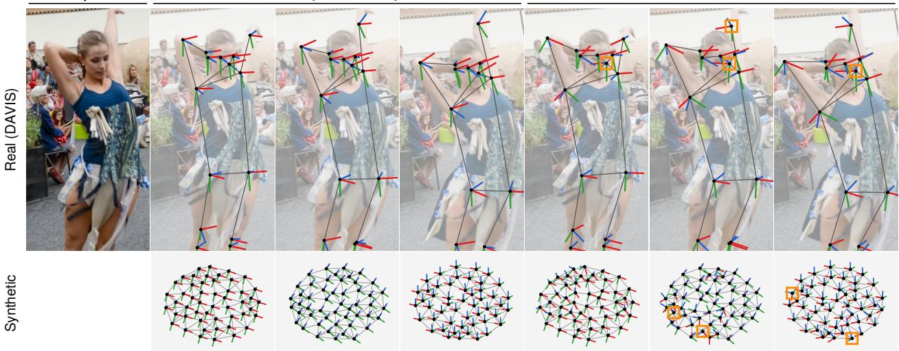  
Figure 3 Certified versus local optimization. Results on a real DAVIS video [54] (top) and a synthetic deformation graph (bottom). Each panel shows the EDG nodes, their estimated rotations (red, green, and blue axes), and the graph edges at different frames. The local solver converges to a local minimum with wrong node rotations (orange boxes), whereas the certified XM solution recovers consistent rotations.

Two differences from the static problem (SRO) are worth noting. First, a linear term $\langle P , U \rangle$ appears: the ARAP and tracking residuals carry the constant offsets $\mathbf { g } _ { j } - \mathbf { g } _ { k } , \sum _ { j } w _ { i j } \mathbf { g } _ { j }$ , and $\mathbf { y } _ { i t } ^ { d }$ , which survive the elimination. Second, every block is a unit-scale rotation, whose relaxed block constraint is $X _ { j j } = I _ { 3 }$ rather than α $\left. I _ { 3 } \right. ,$ , so no sphere normalization is needed.

Homogenization. The XM solver operates on a homogeneous quadratic objective, so we absorb the linear term and the constant of (DYN-RO) into a single matrix by introducing one auxiliary rotation $V \in \mathrm { S O ( 3 ) }$ and defining

$$
U _ { h } = \left[ V \quad U \right] , \qquad Q _ { h } = \left[ { \begin{array} { l l } { { { \frac { c _ { 0 } } { 3 } } I _ { 3 } } } & { { P } } \\ { { P ^ { \top } } } & { { Q } } \end{array} } \right] .\tag{19}
$$

The auxiliary block adds no physical degree of freedom; after solving, the EDG rotations are taken relative to it.

Proposition 9 (Homogeneous Formulation of the Dynamic Problem). Problem (DYN-RO) is equivalent to

$$
\rho _ { \mathrm { D Y N - H } } ^ { \star } = \underset { { V \in \mathrm { S O } ( 3 ) , R _ { j , t } \in \mathrm { S O } ( 3 ) } } { \operatorname* { m i n } } \mathrm { t r } \left( Q _ { h } U _ { h } ^ { \top } U _ { h } \right) ,\tag{DYN-H}
$$

in the following sense: the optimal values coincide, $\rho _ { \mathrm { D Y N - R O } } ^ { \star } = \rho _ { \mathrm { D Y N - H } } ^ { \star } ; i f \left( V ^ { \star } , U ^ { \star } \right)$ is optimal for (DYN-H), then $V ^ { \star \top } U ^ { \star }$ is optimal for (DYN-RO); and i $\tilde { U } ^ { \star }$ is optimal for (DYN-RO), then $( I _ { 3 } , \widetilde { U } ^ { \star } )$ is optimal for (DYN-H) (proof in Appendix B.9).

## 4.3 Solving with the XM Solver

As in Proposition 2, we drop the determinant constraints of (DYN-H), replacing SO(3) by O(3). The resulting QCQP has orthogonal blocks only, so Section 3.3 carries over with n + 1 unit-scale blocks, $n = J ( T - 1 )$ , and no sphere constraint.

Proposition 10 (Certifiable Optimization of the Dynamic Problem). The SDP

$$
\rho _ { \mathrm { D Y N - S D P } } ^ { \star } = \operatorname* { m i n } _ { X \in \mathbb { S } ^ { 3 ( n + 1 ) } } \quad \langle Q _ { h } , X \rangle
$$

$$
s . t . \quad X \succeq 0 ,\tag{DYN-SDP}
$$

$$
X _ { i i } = I _ { 3 } , \quad i = 0 , \ldots , n ,
$$

is a convex relaxation of (DYN-H). Its rank-r BM factorization $X = U _ { h } ^ { \top } U _ { h }$ is equivalent to the unconstrained Riemannian problem

$$
\operatorname* { m i n } _ { U _ { h } \in \mathrm { S t } ( r , 3 ) ^ { n + 1 } } \mathrm { t r } \big ( Q _ { h } U _ { h } ^ { \top } U _ { h } \big ) .\tag{DYN-BM}
$$

Theorems 5–7 still hold for (DYN-SDP)–(DYN-BM), so Algorithm 1 returns a certified global optimum of (DYN-SDP), and hence of (DYN-H) whenever the relaxation is tight and the recovered relative rotation blocks lie in SO(3). The proof is given in Appendix B.10.

Global optimality matters in practice. Fig. 3 compares the certified solution with that of a local solver on the same input: the local solver converges to a local minimum in which some nodes are rotated incorrectly, whereas the certified solution recovers consistent node rotations.

Suboptimality gap. The gap (15) applies verbatim to (DYN-SDP), with Q replaced by $Q _ { h } , A _ { i }$ and $b _ { i }$ now encoding $X _ { i i } = I _ { 3 } ,$ , and 3T replaced by $\operatorname { t r } ( X ) = 3 ( n + 1 )$ (Appendix C). Every segment solve on DyCheck, NVIDIA, and Syn4D is certified (Table 6).

## Summary

The dynamic stage models non-rigid motion within each temporal segment with an EDG whose transformations are expressed relative to a single rest frame, which makes the tracking, ARAP, and temporal smoothness objective (DYN) quadratic. Eliminating the node translations yields the rotation-only problem (DYN-RO), whose linear term is absorbed by one auxiliary rotation into the homogeneous problem (DYN-H). Its SDP relaxation is solved with the same BM staircase as the static stage, with a certificate of global optimality and a suboptimality gap, whereas a local solver can stall in a wrong local minimum.

## 5 The XM4D Pipeline

This section describes the end-to-end system that recovers both the static and the dynamic structure of the view graph in Fig. 2. We present it for a monocular video, but the formulation only requires that each image carry a time tag, and an image collection without time tags reduces the pipeline to static 3D reconstruction. The stages are preprocessing and tracking (Section 5.1), the static stage (Section 5.2), EDG construction, segment solving and completion (Section 5.3), and the final photometric stage (Section 5.4).

## 5.1 Preprocessing: Depth, Intrinsics, Masks, and Tracks

Every frame is processed by a monocular depth foundation model, with Depth Anything 3 (DA3) [38] as the default, which provides the metric depths $d _ { i t }$ used in the lift (2) and, for uncalibrated videos, the camera intrinsics. Per-frame masks of the moving objects are obtained with SAM 3 [14], prompted either by a text description or by a few handselected keypoints on the dynamic object and then tracked across the video. Finally, both static and dynamic 2D correspondences are produced by point trackers, with TAPNext [85] as the default. The trackers are operated in an online fashion: as each frame arrives, new query points are sampled only at locations farther than a threshold from existing tracks. Unreliable observations are discarded (Appendix E). Optionally, dynamic tracks can be assembled into long-range trajectories for the EDG (Appendix E.5).

## 5.2 Static Stage: Certified Solve

The static stage solves (SBA) with the solver of Section 3, augmented with two robustness steps. First, we run XM2 [20]: the solver is applied twice, with an outlier filter in between that keeps only the observations with the smallest residuals under the first solution, so tracking failures or inaccurate depth predictions do not corrupt the final estimate.

Table 1 Mean camera accuracy $( \times 1 0 ^ { - 3 } )$ of eight solver configurations of Section 5.2, each determined by the sphere fraction $\rho$ and the weight normalization: (1)–(5) raw weights at $\rho = 0 . 1 , 0 . 3 , 0 . 5 , 0 . 9$ , and $1 ; ( 6 ) \rho = 0 . 9$ with the per-frame normalization $\omega _ { i t } / w _ { t } ;$ $( 7 ) \rho = 0 . 9$ with the softer normalization $\omega _ { i t } / \sqrt { w _ { t } }$ and (8) the original XM solver [20] with raw weights. Configuration 6, our default, achieves the best or second-best accuracy in eight of the twelve rows.
<table><tr><td rowspan="2">Dataset</td><td rowspan="2">Metric</td><td colspan="8">Configuration</td></tr><tr><td>1</td><td>2</td><td>3</td><td>4</td><td>5</td><td>6</td><td>7</td><td>8</td></tr><tr><td rowspan="3">BAL</td><td>ATE-T</td><td>2.243</td><td>2.194</td><td>2.163</td><td>2.185</td><td>2.218</td><td>2.155</td><td>2.181</td><td>2.283</td></tr><tr><td>RPE-T</td><td>4.003</td><td>3.942</td><td>3.934</td><td>3.936</td><td>3.935</td><td>3.957</td><td>3.949</td><td>3.979</td></tr><tr><td>RPE-R</td><td>1.674</td><td>1.661</td><td>1.650</td><td>1.667</td><td>1.655</td><td>1.660</td><td>1.712</td><td>1.690</td></tr><tr><td rowspan="3">Sintel</td><td>ATE-T</td><td>53</td><td>53</td><td>54</td><td>51</td><td>52</td><td>56</td><td>49</td><td>74</td></tr><tr><td>RPE-T</td><td>72</td><td>71</td><td>75</td><td>69</td><td>71</td><td>74</td><td>69</td><td>105</td></tr><tr><td>RPE-R</td><td>76</td><td>71</td><td>70</td><td>66</td><td>67</td><td>52</td><td>56</td><td>121</td></tr><tr><td rowspan="3">Sintel (Ceres)</td><td>ATE-T</td><td>29</td><td>30</td><td>29</td><td>16</td><td>18</td><td>18</td><td>29</td><td>30</td></tr><tr><td>RPE-T</td><td>35</td><td>37</td><td>37</td><td>25</td><td>28</td><td>26</td><td>36</td><td>43</td></tr><tr><td>RPE-R</td><td>62</td><td>63</td><td>61</td><td>48</td><td>56</td><td>41</td><td>49</td><td>107</td></tr><tr><td rowspan="3">TUM (Ceres)</td><td>ATE-T</td><td>9.45</td><td>8.80</td><td>10.48</td><td>8.70</td><td>9.21</td><td>5.72</td><td>7.33</td><td>11.42</td></tr><tr><td>RPE-T</td><td>12.85</td><td>12.22</td><td>14.51</td><td>12.42</td><td>12.99</td><td>8.02</td><td>10.04</td><td>16.23</td></tr><tr><td>RPE-R</td><td>6.63</td><td>6.18</td><td>7.69</td><td>6.28</td><td>6.64</td><td>5.98</td><td>5.87</td><td>7.05</td></tr></table>

Second, the result is refined with Ceres [2], warm-started at the certified $\mathsf { X } \mathsf { M } ^ { 2 }$ outputs and minimizing the classical 2D reprojection error. Further implementation details of the static stage are collected in Appendix E.

Partial sphere constraint. In practice, some videos contain a small fraction of outlier frames—strong blur or large inter-frame motion, or depth predictions whose scale is far off—and forcing such frames onto the sphere lets them distort the global scale. We therefore use a mixed-manifold variant of the solver: frames are ranked by the trace of their diagonal block of $Q ,$ the top $\lceil \rho T \rceil$ frames are constrained to the sphere of Section 3.4, and the scales of the remaining frames are optimized freely. Formally, with $s$ the set of these frames, the sphere constraint becomes $\textstyle \sum _ { t \in S } s _ { t } ^ { 2 } = | S |$ i.e., $\textstyle \sum _ { t \in { \mathcal { S } } } \operatorname { t r } ( X _ { t t } ) = 3 | S |$ in (SDP), which is still linear, so the SDP relaxation and the certificate of Theorem 5 carry over. The suboptimality gap (15) is adapted accordingly in Appendix C. In the same spirit, we optionally normalize the observation weights per frame: with $\begin{array} { r } { w _ { t } = \sum _ { i } \omega _ { i t } } \end{array}$ the total weight of frame t, the solver uses the raw weights $\omega _ { i t }$ equalizes every frame’s influence $( \omega _ { i t } / w _ { t } )$ , or applies a softer normalization $( \omega _ { i t } / \sqrt { w _ { t } } )$ . Table 1 compares eight such configurations; configuration (6) is our default.

## 5.3 EDG Construction, Segment Solve, and Completion

Starting from the lifted dynamic tracks of Section 4, we first build a time-independent graph connecting tracks that remain spatially close over time. We then subsample this graph to obtain sparse EDG nodes and inherit its connectivity to define the EDG edges. Because no single frame observes all nodes in long videos, we solve the EDG motion independently on short overlapping segments using the certified solver of Section 4.3, and fuse the segment solutions. Finally, missing EDG poses are filled by a completion step.

Track graph. The track graph $\mathcal { G } _ { \mathrm { t r } }$ records which tracks stay on the same part of the object. A single-frame distance cannot decide this, since points on different parts may pass close to each other in some frames. We therefore measure the distance of two tracks over their whole common lifetime. Let $\mathcal { T } _ { i }$ be the frames in which track i is reliable, $\mathcal { T } _ { i i ^ { \prime } } = \mathcal { T } _ { i } \cap \mathcal { T } _ { i ^ { \prime } }$ the frames in which tracks i and $i ^ { \prime }$ are co-visible, and $\pi _ { i t } \in \mathbb { R } ^ { 2 }$ the pixel position of track i in frame t. We define the percentile distance of two tracks as the $\beta - \mathtt { t h }$ percentile of their per-frame distance over co-visible frames,

$$
\begin{array} { r } { d _ { i i ^ { \prime } } = \mathrm { p e r c } _ { \beta } \left\{ \left\| \mathbf { y } _ { i t } ^ { d } - \mathbf { y } _ { i ^ { \prime } t } ^ { d } \right\| \right\} _ { t \in \mathcal { T } _ { i i ^ { \prime } } } , } \\ { d _ { i i ^ { \prime } } ^ { \mathrm { 2 D } } = \mathrm { p e r c } _ { \beta } \left\{ \left\| \pmb { \pi } _ { i t } - \pmb { \pi } _ { i ^ { \prime } t } \right\| \right\} _ { t \in \mathcal { T } _ { i i ^ { \prime } } } , } \end{array}\tag{20}
$$

in the world frame and in the image, respectively. We write $i \sim _ { ( \tau , \tau _ { \mathrm { 2 D } } ) } i ^ { \prime }$ if

$$
\begin{array} { r l } & { | \mathcal { T } _ { i i ^ { \prime } } | \geq \operatorname* { m a x } \bigl ( n _ { \operatorname* { m i n } } , \gamma \operatorname* { m i n } ( | \mathcal { T } _ { i } | , | \mathcal { T } _ { i ^ { \prime } } | ) \bigr ) , } \\ & { \qquad d _ { i i ^ { \prime } } \leq \tau \quad \mathsf { o r } \quad d _ { i i ^ { \prime } } ^ { \mathrm { 2 D } } \leq \tau _ { \mathrm { 2 D } } , } \end{array}\tag{21}
$$

Table 2 Camera accuracy averaged per dataset. MoSca [35] crashes on IMC [28] (–), whose unordered photo collections are not video data. VGGT [67] is run on subsampled frames on DyCheck [18] (Section 6.3).
<table><tr><td rowspan="2">Dataset</td><td rowspan="2">Metric</td><td colspan="5">Method</td></tr><tr><td>COLMAP</td><td>VGGT</td><td>MegaSAM</td><td>MoSca</td><td>Ours</td></tr><tr><td rowspan="4">IMC</td><td>ATE-T</td><td>0.003</td><td>0.075</td><td>0.871</td><td>一</td><td>0.047</td></tr><tr><td>RPE-T</td><td>0.005</td><td>0.121</td><td>1.221</td><td>一</td><td>0.074</td></tr><tr><td>RPE-R</td><td>0.002</td><td>0.033</td><td>0.703</td><td>一</td><td>0.044</td></tr><tr><td>ATE-T</td><td>0.009</td><td>0.014</td><td>0.067</td><td>0.060</td><td>0.002</td></tr><tr><td rowspan="3">Replica</td><td>RPE-T</td><td>0.012</td><td>0.019</td><td>0.087</td><td>0.072</td><td>0.002</td></tr><tr><td>RPE-R</td><td>0.015</td><td>0.005</td><td>0.574</td><td>0.007</td><td>0.001</td></tr><tr><td>ATE-T</td><td>0.006</td><td>0.008</td><td>0.007</td><td>0.009</td><td>0.006</td></tr><tr><td rowspan="3">TUM</td><td>RPE-T</td><td>0.009</td><td>0.012</td><td>0.009</td><td>0.013</td><td>0.008</td></tr><tr><td>RPE-R</td><td>0.006</td><td>0.006</td><td>0.006</td><td>0.007</td><td>0.006</td></tr><tr><td>ATE-T</td><td>0.359</td><td>0.066</td><td>0.049</td><td>0.067</td><td>0.018</td></tr><tr><td rowspan="3">Sintel</td><td>RPE-T</td><td>0.462</td><td>0.095</td><td>0.058</td><td>0.094</td><td>0.026</td></tr><tr><td>RPE-R</td><td>0.081</td><td>0.057</td><td>0.019</td><td>0.056</td><td>0.041</td></tr><tr><td>ATE-T</td><td>0.035</td><td>0.009</td><td>0.001</td><td>0.022</td><td>0.002</td></tr><tr><td rowspan="3">Syn4D</td><td>RPE-T</td><td>0.060</td><td>0.011</td><td>0.001</td><td>0.031</td><td>0.002</td></tr><tr><td>RPE-R</td><td>0.022</td><td>0.012</td><td>0.001</td><td>0.057</td><td>0.002</td></tr><tr><td>ATE-T</td><td>0.150</td><td>0.111</td><td></td><td></td><td></td></tr><tr><td rowspan="3">NVIDIA</td><td>RPE-T</td><td></td><td>0.168</td><td>0.024</td><td>0.174</td><td>0.038 0.056</td></tr><tr><td>RPE-R</td><td>0.206</td><td></td><td>0.036</td><td>0.259 0.107</td><td></td></tr><tr><td></td><td>0.010</td><td>0.010</td><td>0.005</td><td></td><td>0.005</td></tr><tr><td rowspan="3">DyCheck</td><td>ATE-T</td><td>0.006</td><td>0.019</td><td>0.005</td><td>0.048</td><td>0.008</td></tr><tr><td>RPE-T</td><td>0.008</td><td>0.026</td><td>0.007</td><td>0.065</td><td>0.011</td></tr><tr><td>RPE-R</td><td>0.009</td><td>0.035</td><td>0.007</td><td>0.024</td><td>0.012</td></tr></table>

that is, the tracks overlap in time and stay close in 3D or 2D, and connect them in $\mathcal { G } _ { \mathrm { t r } } ;$ the thresholds τ and $\tau _ { \mathrm { 2 D } }$ are proportional to the median nearest-neighbor distance of the tracks in 3D and in the image. Each track keeps at most $D _ { \mathrm { m a x } }$ edges with the smallest $d _ { i i ^ { \prime } }$

EDG nodes and edges. The same criterion selects the EDG nodes. Tracks are ranked by their length $| \mathcal { T } _ { i } |$ , and the longest remaining track j becomes a node and suppresses every remaining track i that stays on the same part of the object during their common lifetime, i.e., with $i \sim _ { ( \tau _ { \mathrm { E } } , \tau _ { \mathrm { E } , \mathrm { 2 D } } ) } ~ j$ in (21), with thresholds and overlap fraction that differ from those of the track graph, until every track is either a node or suppressed by one. If this yields more than $J _ { \mathrm { m a x } }$ nodes, $J _ { \mathrm { m a x } }$ of them are kept by farthest-point sampling under the same percentile distance. Two nodes ${ j , j ^ { \prime } }$ are connected if they are within k hops on the track graph, which keeps independently moving parts apart. A node left with fewer than three edges is connected to its nearest nodes that are reachable on the track graph.

Skinning. Every other dynamic track i is attached to nodes $\mathcal { N } ( i )$ chosen among the nodes within two hops of it on the track graph; an isolated track with no node within two hops falls back to its nearest node in percentile distance. The skinning weights $w _ { i j }$ are the normalized inverse distances from the track to its nodes at the rest frame. The graph and weights are fixed before solving, so the certificate covers the EDG motion given this graph.

Segment solve and fusion. For a long sequence, we apply the single-window formulation of Section 4 to overlapping windows $\{ \mathcal { W } _ { k } \}$ . Each window has its own reference frame $t _ { 0 } ^ { ( k ) }$ , rest positions, and locally estimated transformations $( R _ { j , t } ^ { ( k ) } , \mathbf { p } _ { j , t } ^ { ( k ) } )$ , obtained by solving (DYN) to certified global optimality with Proposition 10. We fuse the estimates over overlapping windows by averaging the estimated world-space node positions for each frame. We recover globally consistent rotations by synchronizing the relative rotations estimated within each window; see Appendix E.4.

Completion. Node-frame pairs that remain empty after fusion are filled by a local version of (DYN): over all nodes and frames, we minimize the same objective, with a robust 2D reprojection error as the tracking term, plus an initialization loss that keeps the solution close to the fused table, using a local solver initialized from it. This yields a complete trajectory $( R _ { j , t } , \mathbf { p } _ { j , t } )$ for every node and frame.

Table 3 Runtime of camera estimation. Top: runtime per scene in seconds, averaged per dataset and split into preprocessing (depth, masks, tracking) and the solver. Bottom: wall-clock time in seconds on Replica [63] room0 as the number of input frames N grows (contiguous prefix); a run is invalid if it exceeds the GPU memory (OOM), runs longer than 1 h (>1h), or crashes (err). Best in bold, second best underlined.
<table><tr><td rowspan="2">Dataset</td><td rowspan="2">Stage</td><td colspan="5">Method</td></tr><tr><td>COLMAP</td><td>VGGT</td><td>MegaSAM</td><td>MoSca</td><td>Ours</td></tr><tr><td>IMC</td><td>Total</td><td>227.7</td><td>38.7</td><td>136.8</td><td>一</td><td>23.2</td></tr><tr><td rowspan="3">Replica</td><td>Total</td><td>125.4</td><td>54.4</td><td>83.5</td><td>1054.4</td><td>115.1</td></tr><tr><td>Preprocess</td><td>一</td><td>一</td><td>49.6</td><td>888.5</td><td>100.5</td></tr><tr><td>Solver</td><td>一</td><td>一</td><td>33.9</td><td>165.9</td><td>14.6</td></tr><tr><td rowspan="3">TUM</td><td>Total</td><td>1743.7</td><td>52.8</td><td>79.5</td><td>403.8</td><td>83.7</td></tr><tr><td>Preprocess</td><td>一</td><td>一</td><td>50.8</td><td>288.3</td><td>73.7</td></tr><tr><td>Solver</td><td>一</td><td>一</td><td>28.5</td><td>115.3</td><td>10.0</td></tr><tr><td rowspan="3">Sintel</td><td>Total</td><td>206.0</td><td>29.3</td><td>48.4</td><td>410.2</td><td>62.0</td></tr><tr><td>Preprocess</td><td>一</td><td>一</td><td>34.1</td><td>363.2</td><td>47.2</td></tr><tr><td>Solver</td><td>一</td><td>一</td><td>14.3</td><td>47.0</td><td>14.8</td></tr><tr><td rowspan="3">Syn4D</td><td>Total</td><td>605.0</td><td>55.0</td><td>82.6</td><td>1729.3</td><td>110.3</td></tr><tr><td>Preprocess</td><td>一</td><td>一</td><td>52.0</td><td>724.6</td><td>88.4</td></tr><tr><td>Solver</td><td>一</td><td>一</td><td>30.6</td><td>1004.6</td><td>21.9</td></tr><tr><td rowspan="3">NVIDIA</td><td>Total</td><td>25</td><td>17</td><td>35</td><td>111</td><td>28</td></tr><tr><td>Preprocess</td><td>一</td><td>一</td><td>28</td><td>92</td><td>25</td></tr><tr><td>Solver</td><td>一</td><td>一</td><td>7</td><td>18</td><td>3</td></tr><tr><td rowspan="3">DyCheck</td><td>Total</td><td>843</td><td>38</td><td>316</td><td>942</td><td>96</td></tr><tr><td>Preprocess</td><td>211</td><td>一</td><td>149</td><td>555</td><td>78</td></tr><tr><td>Solver</td><td>631</td><td>一</td><td>167</td><td>387</td><td>18</td></tr><tr><td rowspan="6">Replica room0</td><td>N=100</td><td>36.4</td><td>37.6</td><td>89.6</td><td>468.5</td><td>73.7</td></tr><tr><td>N=200</td><td>225.8</td><td>OOM</td><td>149.0</td><td>892.6</td><td>131.3</td></tr><tr><td>N=500</td><td>1451.9</td><td>一</td><td>345.0</td><td>2140.1</td><td>383.5</td></tr><tr><td>N=800</td><td>3230.0</td><td>一</td><td>568.6</td><td>err</td><td>862.3</td></tr><tr><td>N=1200</td><td>&gt;1h</td><td>一</td><td>err</td><td>一</td><td>1656.2</td></tr><tr><td>N=2000</td><td>一</td><td>一</td><td>一</td><td>一</td><td>3322.4</td></tr></table>

## 5.4 Photometric Stage

The recovered geometry initializes a dynamic Gaussian-splatting representation [31]. We use gsplat [80] as the photometric training engine and add an EDG wrapper on top of it, which warps every dynamic Gaussian to frame t by linear blend skinning with the EDG transformations. During training, the rest positions of the dynamic Gaussians are optimized together with the EDG transformations $( R _ { j , t } , \mathbf { p } _ { j , t } )$ , initialized from the certified solve, under a photometric loss and depth supervision.

## 6 Experiments

We compare XM4D with Structure-from-Motion (SfM) and 4D reconstruction baselines on seven static and dynamic benchmarks in camera accuracy, runtime, and novel-view rendering, and extend the qualitative evaluation to additional videos (Fig. 4); Fig. 5 summarizes the quantitative comparison.

## 6.1 Setup

Datasets. We use seven benchmarks. On four of them—IMC [28], Replica [63, 89], TUM [64], and Sintel [12]—we evaluate camera accuracy only. IMC and Replica are static, while TUM and Sintel contain moving objects. On the remaining three—Syn4D, NVIDIA [81], and the DyCheck iPhone dataset [18]—we additionally run the EDG solve and the photometric reconstruction of Section 5. Syn4D is a synthetic benchmark that we assemble from Replica [63] and RoboCasa [47]. Each dataset is described in Appendix D. The solver-configuration study in Table 1 additionally uses three problems from BAL [1].

Table 4 Novel-view rendering averaged over the scenes of each dataset; (w)/(w/o): with/without ground-truth camera poses. XM4D is the best on every metric although it estimates its camera poses.
<table><tr><td>DyCheck</td><td colspan="3">mPSNR↑ mSSIM ↑ mLPIPS↓</td></tr><tr><td>T-NeRF (w)</td><td>16.96</td><td>0.577</td><td>0.379</td></tr><tr><td>NSFF (w)</td><td>15.46</td><td>0.551</td><td>0.396</td></tr><tr><td>Nerfies (w)</td><td>16.45</td><td>0.570</td><td>0.339</td></tr><tr><td>HyperNeRF (w)</td><td>16.81</td><td>0.569</td><td>0.332</td></tr><tr><td>DynPoint (w)</td><td>16.89</td><td>0.573</td><td>一</td></tr><tr><td>PGDVS (w)</td><td>15.88</td><td>0.548</td><td>0.340</td></tr><tr><td>DyBluRF (w)</td><td>17.37</td><td>0.591</td><td>0.373</td></tr><tr><td>CTNeRF (w)</td><td>17.69</td><td>0.531</td><td></td></tr><tr><td>Shape of Motion (w)</td><td>17.32</td><td>0.598</td><td>0.296</td></tr><tr><td>Gaussian Marbles (w)</td><td>16.72</td><td></td><td>0.413</td></tr><tr><td>RoDynRF (w/o)</td><td>17.10</td><td>0.534</td><td>0.517</td></tr><tr><td>MoSca (w/o)</td><td>18.91</td><td>0.677</td><td>0.284</td></tr><tr><td>Ours (w/o)</td><td>19.51</td><td>0.725</td><td>0.163</td></tr></table>

<table><tr><td>NVIDIA</td><td>PSNR↑</td><td>LPIPS↓</td></tr><tr><td>NSFF (w)</td><td>24.33</td><td>0.199</td></tr><tr><td>HyperNeRF (w)</td><td>17.60</td><td>0.367</td></tr><tr><td>DynPoint (w)</td><td>26.53</td><td>0.068</td></tr><tr><td>CTNeRF (w)</td><td>26.13</td><td>0.082</td></tr><tr><td>RoDynRF (w)</td><td>25.89</td><td>0.067</td></tr><tr><td>RoDynRF (w/o)</td><td>25.38</td><td>0.079</td></tr><tr><td>MoSca (w/o)</td><td>26.54</td><td>0.073</td></tr><tr><td>Ours (w/o)</td><td>27.01</td><td>0.063</td></tr><tr><td>Syn4D</td><td>mPSNR↑</td><td>mLPIPS ↓</td></tr><tr><td>Gaussian Marbles (w)</td><td>19.48</td><td>0.348</td></tr><tr><td>Shape of Motion (w/o) MoSca (w/o)</td><td>16.72</td><td>0.418</td></tr><tr><td></td><td>19.49</td><td>0.235</td></tr><tr><td>Ours (w/o)</td><td>21.73</td><td>0.148</td></tr></table>

Table 5 Per-scene runtime of the full dynamic reconstruction in minutes (averages over the scenes of each dataset), split into preprocessing (depth, masks, static and dynamic tracking) and optimization (camera estimation, the motion model, and photometric training). Best in bold.
<table><tr><td>Dataset</td><td>Method</td><td>Preprocess</td><td>Optimization</td><td>Total</td></tr><tr><td rowspan="3">DyCheck</td><td>Shape of Motion</td><td>230.0</td><td>282.4</td><td>512.4</td></tr><tr><td>MoSca</td><td>9.2</td><td>31.3</td><td>40.5</td></tr><tr><td>Ours</td><td>8.8</td><td>25.8</td><td>34.6</td></tr><tr><td rowspan="3">NVIDIA</td><td>Shape of Motion</td><td>0.6</td><td>48.3</td><td>48.8</td></tr><tr><td>MoSca</td><td>1.5</td><td>32.1</td><td>33.6</td></tr><tr><td>Ours</td><td>1.5</td><td>20.4</td><td>21.9</td></tr><tr><td rowspan="3">Syn4D</td><td>Shape of Motion</td><td>20.0</td><td>50.9</td><td>71.0</td></tr><tr><td>MoSca</td><td>12.1</td><td>32.3</td><td>44.5</td></tr><tr><td>Ours</td><td>6.6</td><td>10.4</td><td>16.9</td></tr></table>

Baselines. For camera estimation, we compare against the classical SfM pipeline COLMAP [61], the feed-forward geometry model VGGT [67], and MegaSAM [37], which adapts DROID-SLAM [66] for camera pose and depth estimation in casual dynamic videos. For dynamic reconstruction, we compare against the geometry-based methods MoSca [35] and Shape of Motion [68]. For novel-view rendering, we additionally compare against rendering-based methods that use time-varying fields (T-NeRF [18], NSFF [36], CTNeRF [45], DyBluRF [10], and RoDynRF [41]), deformable canonical radiance fields (Nerfies [51], HyperNeRF [52]), or moving Gaussians (Gaussian Marbles [62]), and against DynPoint [86] and PGDVS [83], which render from depth-warped points.

Hardware. All experiments run on a workstation with an AMD Ryzen Threadripper PRO 7985WX CPU (64 cores, 128 threads), 256 GB of RAM, and two 48 GB NVIDIA RTX 6000 Ada GPUs, under Ubuntu 22.04 with CUDA 12.8. Every method, including ours, runs on a single GPU.

Metrics. We report the absolute trajectory error in translation (ATE-T) and the relative pose error in translation and rotation (RPE-T, RPE-R). The estimated camera centers $\hat { \mathbf { c } } _ { t }$ are first aligned to the ground-truth centers $\mathbf { c } _ { t }$ by a similarity transformation $( \sigma , R , \bf { t } )$ estimated robustly with TEASER++ [77]. The translation errors are normalized by $d + 1$ , where $\begin{array} { r } { d = \frac { 1 } { T } \sum _ { t } \left. \mathbf { c } _ { t } - \bar { \mathbf { c } } \right. } \end{array}$ is the mean distance of the ground-truth centers from their centroid:

$$
\begin{array} { r l } & { \mathsf { A T E \mathrm { - } T } = \displaystyle \frac { 1 } { d + 1 } \frac { 1 } { T } \sum _ { t } \| \sigma R \hat { \mathbf { c } } _ { t } + \mathbf { t } - \mathbf { c } _ { t } \| , } \\ & { \mathsf { R P E \mathrm { - } T } = \displaystyle \frac { 1 } { d + 1 } \frac { 1 } { | \mathcal { P } | } \sum _ { ( t , t ^ { \prime } ) \in \mathcal { P } } \| ( \mathbf { c } _ { t } - \mathbf { c } _ { t ^ { \prime } } ) - \sigma R ( \hat { \mathbf { c } } _ { t } - \hat { \mathbf { c } } _ { t ^ { \prime } } ) \| , } \end{array}
$$

where $\mathcal { P }$ contains all frame pairs, and RPE-R is the mean angle, in radians, of the relative rotation error over the same

Input  
Input Reconstruction Trajectories Novel view Rendered depth  
Reconstruction Trajectories  
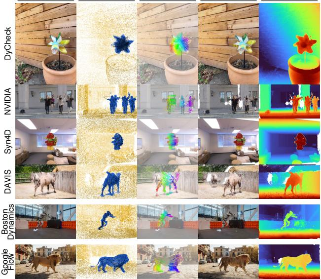

Novel view Rendered depth  
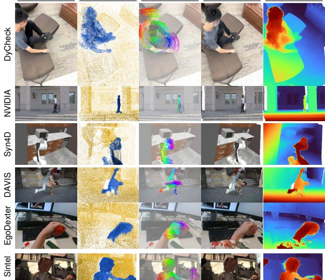  
Figure 4 Qualitative results of XM4D. Sequences from DyCheck [18], NVIDIA [81], Syn4D, DAVIS [54], Sintel [12], EgoDexter [46], a Boston Dynamics video [6], and a generated video from Google Flow. For each sequence, from left to right: an input frame, the reconstructed static and dynamic structure, the 3D trajectories of the dynamic points over the video, a rendered novel view, and the rendered depth.

pairs. The constant 1, in ground-truth units, prevents division by a near-zero d when the camera barely moves. For novel-view synthesis on DyCheck, NVIDIA, and Syn4D we report mPSNR, mSSIM, and mLPIPS or their alternates. Following MoSca [35], we refine each test camera photometrically against its test image with the scene frozen.

## 6.2 Camera Accuracy

Table 2 summarizes camera accuracy across all seven benchmarks. XM4D is the most accurate method on Replica and TUM, and in translation on Sintel; on Syn4D, NVIDIA, and DyCheck it is close to the best method, MegaSAM; and on the unordered image collections of IMC, XM4D is outperformed only by the dedicated SfM pipeline COLMAP. Fig. 6 shows the trajectories on one scene per benchmark.

COLMAP is the most accurate on IMC, the unordered setting it is designed for, and remains competitive on Replica and TUM, but degrades sharply on Sintel, Syn4D, and NVIDIA, where its ATE-T is 4–20× that of XM4D. The feed-forward VGGT is roughly three times less accurate in translation. MegaSAM, designed for dynamic videos, is the most accurate on Syn4D, NVIDIA, and DyCheck, with XM4D close behind, but is less accurate on Replica and TUM and in translation on Sintel and fails on IMC, whose images lack the temporal continuity its optical-flow front end relies on. MoSca is 3–10× less accurate than XM4D in ATE-T on the dynamic benchmarks and also fails on IMC; we attribute the gap to the XM solver, which recovers the cameras by a certifiably optimal SDP on static tracks alone, so errors in the deformation model cannot propagate into the trajectory. Overall, XM4D ranks first on Replica and TUM and in translation on Sintel, second on Syn4D, NVIDIA, and in translation on IMC.

## 6.3 Runtime

Static stage. Table 3 reports the runtime of camera estimation and, where available, its split into preprocessing (depth, masks, and tracking) and the solver. End to end, XM4D is faster than MoSca on every benchmark and up to 9× faster than COLMAP on the long sequences, while the feed-forward VGGT is the fastest overall, as expected for a single network pass. Against MegaSAM the totals are mixed: XM4D is faster on IMC, NVIDIA, and DyCheck, and slower on Replica, TUM, Sintel, and Syn4D.

The preprocessing relies on foundation models and will speed up as they improve, so we focus on the solver, where XM4D is the fastest on every benchmark but Sintel.

Dynamic stage. Table 5 reports the runtime of the full dynamic reconstruction against MoSca and Shape of Motion.

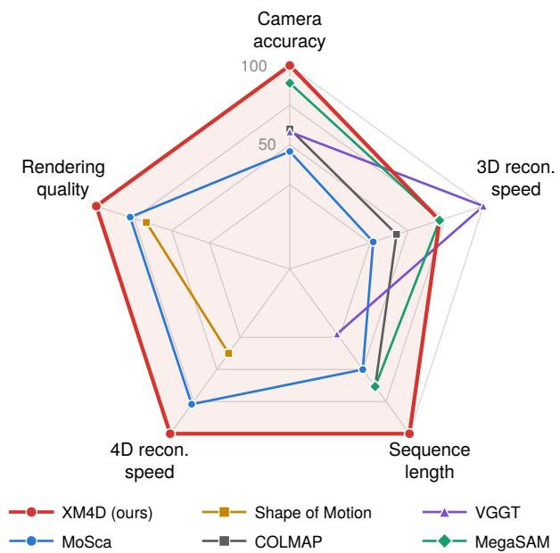  
Figure 5 Performance overview. Each axis is the square-root-compressed ratio to the best method, averaged over the datasets of Tables 2–5. Open polygons mark axes a method does not report. Farther out is better. XM4D performs best overall, leading on four of the five axes.

XM4D is the fastest end to end and in optimization on all three benchmarks. Shape of Motion is the slowest, mainly because its dense point tracking takes about four hours per scene on DyCheck.

Sequence length. Table 3 (bottom) reports the runtime on Replica room0 versus the number of frames N. VGGT runs out of GPU memory at N = 200, MoSca fails beyond N = 500, and beyond N = 800 COLMAP exceeds one hour and MegaSAM its 1024-frame buffer, whereas XM4D completes every length, reaching N = 2000 in 55 minutes. VGGT’s limit is also why it runs on subsampled frames on DyCheck, whose sequences exceed 100 frames.

## 6.4 Novel-View Rendering

Table 4 and Fig. 7 evaluate novel-view synthesis on DyCheck, NVIDIA, and Syn4D. XM4D attains the best average score on every metric of all three datasets. This holds although most baselines are given the ground-truth camera poses (all except MoSca and RoDynRF, and Shape of Motion on Syn4D), and Gaussian Marbles on Syn4D additionally the ground-truth depth, whereas XM4D estimates all cameras. The margins are largest on Syn4D, where XM4D improves PSNR by more than 2 dB over the best baseline, and on DyCheck, where it has the best mSSIM and mLPIPS on all seven scenes and the best mPSNR on three. As Fig. 7 shows, the baselines lose mainly because inaccurate geometry misaligns their renderings with the test view and blurs the dynamic parts. Since the recovered dynamic motion is hard to compare directly across methods, we further evaluate the geometry on Syn4D, whose moving objects have ground-truth geometry, through the Chamfer distance of the dynamic object and the error of the rendered depth (Table 7); XM4D is the most accurate on every scene.

## 6.5 Qualitative Results

Fig. 4 shows XM4D on dynamic videos beyond the benchmarks: in-the-wild videos from DAVIS [54], Sintel [12], egocentric hand–object interaction videos from EgoDexter [46], a Boston Dynamics humanoid robot performing a flip [6], and a generated video of a walking lion from Google Flow. These videos span real, synthetic, and generated footage, third-person and egocentric viewpoints, and the motion of animals, people, hands, and a robot; XM4D handles all of them, demonstrating the robustness of the pipeline.

For videos of human body and hands, we build the EDG from keypoints instead of subsampling the track graph. For hands, WiLoR [56] predicts a MANO [59] hand in every frame; we keep only its 21 3D joints and connect them by the kinematic skeleton of the hand. For bodies, RTMPose [26] detects the 17 COCO [39] keypoints in 2D within the

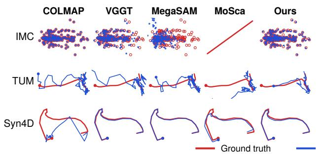  
Ours

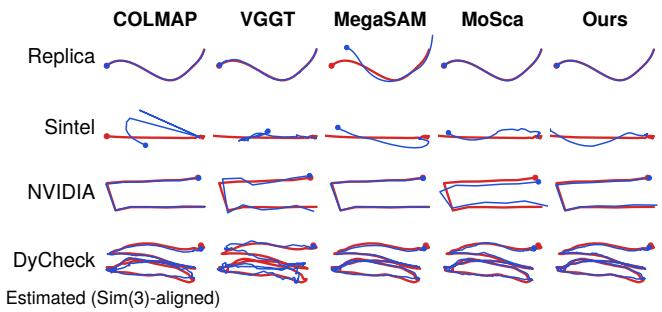  
Figure 6 Estimated camera trajectories. Estimated camera poses (blue) after Sim(3) alignment to the ground truth (red), shown for one scene per benchmark. IMC [28] consists of unordered images, whereas all other benchmarks contain temporally ordered sequences.

MoSca  
SoM  
Gauss. Marbles  
HyperNeRF  
RoDynRF  
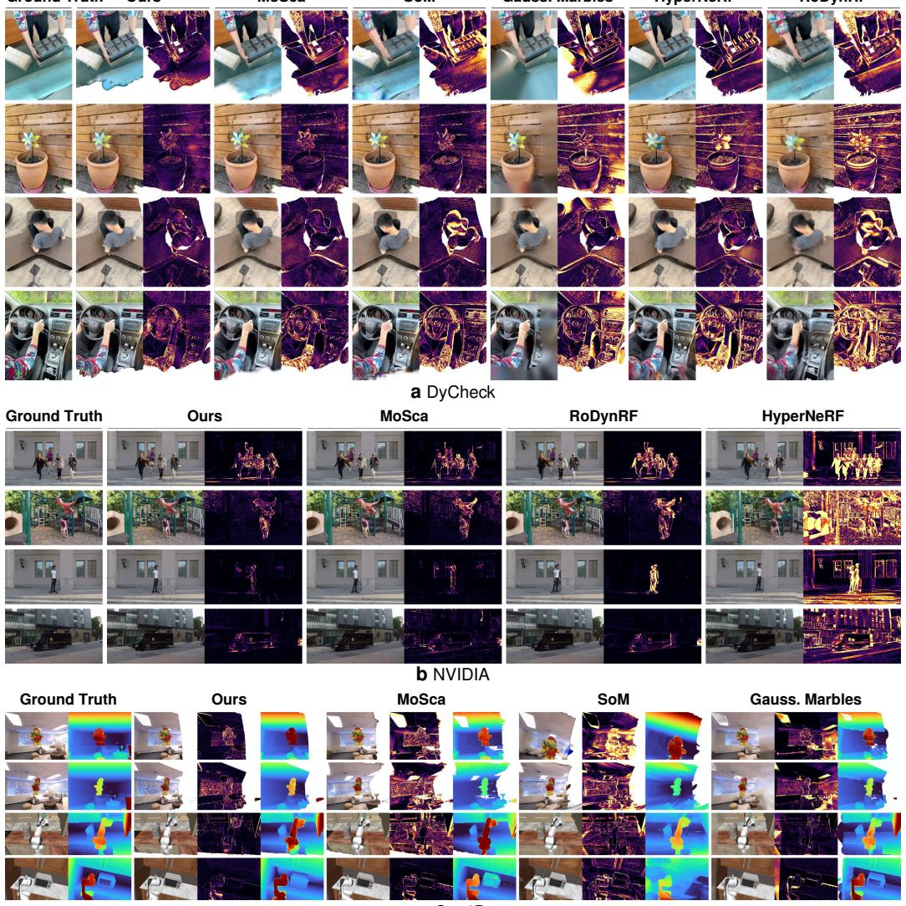  
c Syn4D  
Figure 7 Novel-view rendering on DyCheck [18], NVIDIA [81], and Syn4D. For each method, the rendered test view is shown with its error map with respect to the ground truth (brighter is larger error). (a) DyCheck: from top to bottom, block, paper-windmill, spin, and wheel, with error maps displayed only inside the co-visibility mask. The other methods score lower mainly because inaccurate 3D geometry misaligns their renderings with the test view, and because they blur the dynamic parts. (b) NVIDIA: from top to bottom, Jumping, Playground, Skating, and Truck, with error maps over the full frame. (c) Syn4D: from top to bottom, two Bear [4] and two RoboCasa [47] sequences, with the rendered depth also shown.

d  
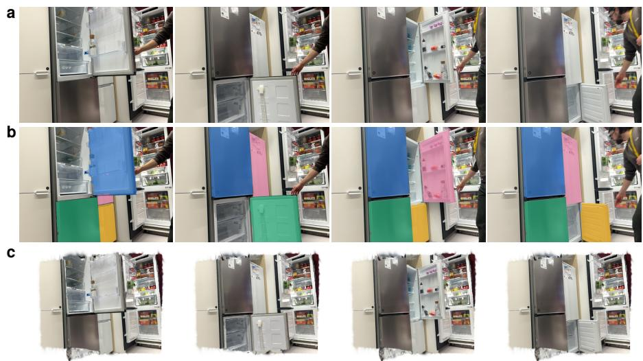

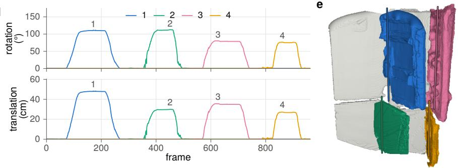

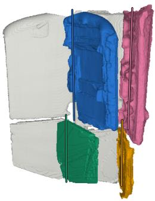  
Figure 8 Articulated object reconstruction with XM4D. A person opens the four doors of a refrigerator in turn in a casual monocular video. (a) Input frames. (b) The four moving doors, color-coded. (c) Rendered views of the reconstruction at the same time instants. (d) Rotation angle and translation of each door over the video. (e) Reconstructed geometry with the four doors and their estimated hinge axes.

bounding box of the person’s mask.

Because the EDG represents motion with explicit SE(3) transformations, XM4D recovers the part-level rigid motion of objects without an extra motion-estimation step. Such part-level articulation is what simulation-ready digital twins of articulated objects require, especially in robotics [22, 27, 34, 58, 87]. Fig. 8 shows a refrigerator whose four doors are opened in turn: the reconstruction yields the opening angle and displacement of every door over time and its hinge axis.

## Summary

XM4D gives the best overall results for three reasons. First, its certified cameras make it the most accurate on Replica and TUM and in translation on Sintel, and close to the best elsewhere. Second, its solver is the fastest on nearly every benchmark, making XM4D the fastest 4D reconstruction end to end, and scales to 2000 frames. Third, its cameras and EDG motion give the photometric stage an accurate scaffold, yielding the best novel views on all three dynamic benchmarks, even against methods with ground-truth poses.

## 7 Conclusions

We presented XM4D, a 4D reconstruction framework that recovers camera motion and non-rigid deformation through certifiably globally optimal geometric optimization. Separating the two stages turns both into QCQPs over (scaled) rotations: the static stage estimates camera poses, depth scales, and static landmarks, and the dynamic stage estimates the motion of an embedded deformation graph. Both QCQPs are relaxed to SDPs and solved by a GPU solver that returns a certificate of global optimality. Across seven benchmarks, XM4D estimates accurate cameras on both dynamic videos and unordered photo collections, scales to thousands of frames, and initializes dynamic Gaussian

splatting for state-of-the-art novel-view rendering.

Limitations. The certificate covers the optimization, not its inputs: XM4D relies on the predicted monocular depth and point tracks, and errors that survive the filters of Appendix E.2 bias the certified solution. The solver stores the data matrices densely, so its memory grows quadratically with the number of frames; exploiting their sparsity [50] is a natural next step. Finally, the EDG structure and skinning weights are fixed before the solve; estimating the graph jointly with its motion is future work.

## Acknowledgements

This work was partially funded by Office of Naval Research grant N00014-25-1-2322.

## References

[1] Sameer Agarwal, Noah Snavely, Steven M Seitz, and Richard Szeliski. Bundle adjustment in the large. In European Conference on Computer Vision (ECCV), pages 29–42. Springer, 2010. 14, 30

[2] Sameer Agarwal, Keir Mierle, and The Ceres Solver Team. Ceres Solver, 10 2023. URL https://github.com/ ceres-solver/ceres-solver. 12

[3] Arthur Allshire, Hongsuk Choi, Junyi Zhang, David McAllister, Anthony Zhang, Chung Min Kim, Trevor Darrell, Pieter Abbeel, Jitendra Malik, and Angjoo Kanazawa. Visual imitation enables contextual humanoid control. Conference on Robot Learning (CoRL), 2025. 2

[4] Artec 3D. Christmas Bear. 3D model. URL https://www.artec3d.com/3d-models/christmas-bear. Licensed under CC BY 4.0. 18, 30

[5] Alexey Bochkovskiy, Amaël Delaunoy, Hugo Germain, Marcel Santos, Yichao Zhou, Stephan Richter, and Vladlen Koltun. Depth pro: Sharp monocular metric depth in less than a second. In International Conference on Learning Representations (ICLR), volume 2025, pages 75602–75637, 2025. 4

[6] Boston Dynamics. Atlas Airborne. YouTube video, February 2026. URL https://www.youtube.com/watch?v= UNorxwlZlFk. 16, 17

[7] N. Boumal, B. Mishra, P.-A. Absil, and R. Sepulchre. Manopt, a MATLAB Toolbox for Optimization on Manifolds. Journal of Machine Learning Research, 15(1):1455–1459, 2014. 6

[8] Nicolas Boumal. A Riemannian low-rank method for optimization over semidefinite matrices with block-diagonal constraints. arXiv preprint arXiv:1506.00575, 2015. 4, 7

[9] Aljaz Bozic, Pablo Palafox, Michael Zollhofer, Justus Thies, Angela Dai, and Matthias Nießner. Neural deformation graphs for globally-consistent non-rigid reconstruction. In Conference on Computer Vision and Pattern Recognition (CVPR), pages 1450–1459, 2021. 4

[10] Minh-Quan Viet Bui, Jongmin Park, Jihyong Oh, and Munchurl Kim. DyBluRF: Dynamic Deblurring Neural Radiance Fields for Blurry Monocular Video. arXiv preprint arXiv:2312.13528, 2023. 15

[11] Samuel Burer and Renato DC Monteiro. A nonlinear programming algorithm for solving semidefinite programs via low-rank factorization. Mathematical Programming, 95(2):329–357, 2003. 4, 6, 27, 28

[12] D. J. Butler, J. Wulff, G. B. Stanley, and M. J. Black. A naturalistic open source movie for optical flow evaluation. In A. Fitzgibbon et al. (Eds.), editor, European Conference on Computer Vision (ECCV), Part IV, LNCS 7577, pages 611–625. Springer-Verlag, October 2012. 14, 16, 17, 30

[13] Yohann Cabon, Lucas Stoffl, Leonid Antsfeld, Gabriela Csurka, Boris Chidlovskii, Jerome Revaud, and Vincent Leroy. Must3r: Multi-view network for stereo 3d reconstruction. In Conference on Computer Vision and Pattern Recognition (CVPR), pages 1050–1060. IEEE, 2025. 4

[14] Nicolas Carion, Laura Gustafson, Yuan-Ting Hu, Shoubhik Debnath, Ronghang Hu, Didac Suris, Chaitanya Ryali, Kalyan Va sudev Alwala, Haitham Khedr, Andrew Huang, et al. Sam 3: Segment anything with concepts. arXiv preprint arXiv:2511.16719, 2025. 11

[15] Weirong Chen, Ganlin Zhang, Felix Wimbauer, Rui Wang, Nikita Araslanov, Andrea Vedaldi, and Daniel Cremers. Back on track: Bundle adjustment for dynamic scene reconstruction. In International Conference on Computer Vision (ICCV), pages 4951–4960. IEEE, 2025. 2

[16] Carl Doersch, Pauline Luc, Yi Yang, Dilara Gokay, Skanda Koppula, Ankush Gupta, Joseph Heyward, Ignacio Rocco, Ross Goroshin, Joao Carreira, et al. Bootstap: Bootstrapped training for tracking-any-point. In Proceedings of the Asian Conference on Computer Vision, pages 3257–3274, 2024. 4

[17] Chen Gao, Ayush Saraf, Johannes Kopf, and Jia-Bin Huang. Dynamic view synthesis from dynamic monocular video. In International Conference on Computer Vision (ICCV), pages 5692–5701. IEEE, 2021. 2

[18] Hang Gao, Ruilong Li, Shubham Tulsiani, Bryan Russell, and Angjoo Kanazawa. Monocular dynamic view synthesis: A reality check. Conference on Neural Information Processing Systems (NeurIPS), 35:33768–33780, 2022. 2, 13, 14, 15, 16, 18, 30

[19] Ravi Garg, Anastasios Roussos, and Lourdes Agapito. Dense variational reconstruction of non-rigid surfaces from monocular video. In Conference on Computer Vision and Pattern Recognition (CVPR), pages 1272–1279, 2013. 4

[20] Haoyu Han and Heng Yang. Building Rome with Convex Optimization. In Robotics: Science and Systems (RSS), 2025. 2, 3 4, 5, 6, 7, 11, 12, 26, 29

[21] Tairan He, Zhengyi Luo, Xialin He, Wenli Xiao, Chong Zhang, Weinan Zhang, Kris Kitani, Changliu Liu, and Guanya Shi. Omnih2o: Universal and dexterous human-to-humanoid whole-body teleoperation and learning. Conference on Robot Learning (CoRL), 2024. 2

[22] Luke Hollis, Tianxing Fan, and Heng Yang. SceneAgent: An Agentic Pipeline from 3D and 4D Captures to Simulation Environments. arXiv preprint arXiv:2610.34745, 2026. 19

[23] Mu Hu, Wei Yin, Chi Zhang, Zhipeng Cai, Xiaoxiao Long, Hao Chen, Kaixuan Wang, Gang Yu, Chunhua Shen, and Shaojie Shen. Metric3d v2: A versatile monocular geometric foundation model for zero-shot metric depth and surface normal estimation. IEEE Transactions on Pattern Analysis and Machine Intelligence, 46(12):10579–10596, 2024. 4

[24] Matthias Innmann, Michael Zollhöfer, Matthias Nießner, Christian Theobalt, and Marc Stamminger. Volumedeform: Real-time volumetric non-rigid reconstruction. In European Conference on Computer Vision (ECCV), pages 362–379. Springer, 2016. 2, 4

[25] Hanxiao Jiang, Hao-Yu Hsu, Kaifeng Zhang, Hsin-Ni Yu, Shenlong Wang, and Yunzhu Li. Phystwin: Physics-informed reconstruction and simulation of deformable objects from videos. In International Conference on Computer Vision (ICCV), pages 7219–7230. IEEE, 2025. 2

[26] Tao Jiang, Peng Lu, Li Zhang, Ningsheng Ma, Rui Han, Chengqi Lyu, Yining Li, and Kai Chen. Rtmpose: Real-time multi-person pose estimation based on mmpose. arXiv preprint arXiv:2303.07399, 2023. 17

[27] Zhenyu Jiang, Cheng-Chun Hsu, and Yuke Zhu. Ditto: Building digital twins of articulated objects from interaction. In Conference on Computer Vision and Pattern Recognition (CVPR), pages 5606–5616. IEEE, 2022. 19

[28] Yuhe Jin, Dmytro Mishkin, Anastasiia Mishchuk, Jiri Matas, Pascal Fua, Kwang Moo Yi, and Eduard Trulls. Image Matching across Wide Baselines: From Paper to Practice. International Journal of Computer Vision, 2020. 13, 14, 18, 30

[29] Michel Journée, Francis Bach, P-A Absil, and Rodolphe Sepulchre. Low-rank optimization on the cone of positive semidefinite matrices. SIAM Journal on Optimization, 20(5):2327–2351, 2010. 28

[30] Nikita Karaev, Yuri Makarov, Jianyuan Wang, Natalia Neverova, Andrea Vedaldi, and Christian Rupprecht. CoTracker3: Simpler and Better Point Tracking by Pseudo-Labeling Real Videos. In International Conference on Computer Vision (ICCV), pages 1–10. IEEE, 2025. 4

[31] Bernhard Kerbl, Georgios Kopanas, Thomas Leimkühler, and George Drettakis. 3D Gaussian splatting for real-time radiance field rendering. ACM Transactions on Graphics, 42(4):139–1, 2023. 14

[32] Zihang Lai, Eldar Insafutdinov, Edgar Sucar, and Andrea Vedaldi. Cowtracker: Tracking by warping instead of correlation. arXiv preprint arXiv:2602.04877, 2026. 4, 32

[33] Jean B Lasserre. Convergent SDP-relaxations in polynomial optimization with sparsity. SIAM Journal on optimization, 17(3): 822–843, 2006. 4

[34] Long Le, Jason Xie, William Liang, Hung-Ju Wang, Yue Yang, Yecheng Jason Ma, Kyle Vedder, Arjun Krishna, Dinesh Jayaraman, and Eric Eaton. Articulate-anything: Automatic modeling of articulated objects via a vision-language foundation model. In International Conference on Learning Representations (ICLR), volume 2025, pages 17578–17602, 2025. 19

[35] Jiahui Lei, Yijia Weng, Adam W Harley, Leonidas Guibas, and Kostas Daniilidis. Mosca: Dynamic gaussian fusion from casual videos via 4d motion scaffolds. In Conference on Computer Vision and Pattern Recognition (CVPR), pages 6165–6177. IEEE, 2025. 2, 3, 4, 13, 15, 16, 25

[36] Zhengqi Li, Simon Niklaus, Noah Snavely, and Oliver Wang. Neural scene flow fields for space-time view synthesis of dynamic scenes. In Conference on Computer Vision and Pattern Recognition (CVPR), pages 6498–6508, 2021. 2, 4, 15

[37] Zhengqi Li, Richard Tucker, Forrester Cole, Qianqian Wang, Linyi Jin, Vickie Ye, Angjoo Kanazawa, Aleksander Holynski, and Noah Snavely. Megasam: Accurate, fast, and robust structure and motion from casual dynamic videos. In Conference on Computer Vision and Pattern Recognition (CVPR), pages 10486–10496. IEEE, 2025. 15

[38] Haotong Lin, Sili Chen, Junhao Liew, Donny Y Chen, Zhenyu Li, Guang Shi, Jiashi Feng, and Bingyi Kang. Depth anything 3: Recovering the visual space from any views. arXiv preprint arXiv:2511.10647, 2025. 4, 5, 11, 25

[39] Tsung-Yi Lin, Michael Maire, Serge Belongie, James Hays, Pietro Perona, Deva Ramanan, Piotr Dollár, and C Lawrence Zitnick. Microsoft coco: Common objects in context. In European Conference on Computer Vision (ECCV), pages 740–755. Springer, 2014. 17

[40] Yang Liu, Tong Wang, Yiming Bao, and Heng Yang. GRASP: Gradient-Guided Sampling for Contact-Rich Physics-Based Motion Retargeting. arXiv preprint arXiv:2611.05754, 2026. 2

[41] Yu-Lun Liu, Chen Gao, Andreas Meuleman, Hung-Yu Tseng, Ayush Saraf, Changil Kim, Yung-Yu Chuang, Johannes Kopf, and Jia-Bin Huang. Robust dynamic radiance fields. In Conference on Computer Vision and Pattern Recognition (CVPR), pages 13–23. IEEE, 2023. 4, 15

[42] Stephen Lombardi, Tomas Simon, Jason Saragih, Gabriel Schwartz, Andreas Lehrmann, and Yaser Sheikh. Neural volumes: Learning dynamic renderable volumes from images. ACM Trans. Graph., 38(4):65:1–65:14, July 2019. 2, 4

[43] David G Lowe. Distinctive image features from scale-invariant keypoints. International journal of computer vision, 60(2): 91–110, 2004. 4

[44] Jonathon Luiten, Georgios Kopanas, Bastian Leibe, and Deva Ramanan. Dynamic 3d gaussians: Tracking by persistent dynamic view synthesis. In 2024 International Conference on 3D Vision (3DV), pages 800–809. IEEE, 2024. 4

[45] Xingyu Miao, Yang Bai, Haoran Duan, Fan Wan, Yawen Huang, Yang Long, and Yefeng Zheng. Ctnerf: Cross-time transformer for dynamic neural radiance field from monocular video. Pattern Recognition, 156:110729, 2024. 15

[46] Franziska Mueller, Dushyant Mehta, Oleksandr Sotnychenko, Srinath Sridhar, Dan Casas, and Christian Theobalt. Real-time hand tracking under occlusion from an egocentric rgb-d sensor. In International Conference on Computer Vision (ICCV), pages 1163–1172. IEEE, 2017. 16, 17

[47] Soroush Nasiriany, Abhiram Maddukuri, Lance Zhang, Adeet Parikh, Aaron Lo, Abhishek Joshi, Ajay Mandlekar, and Yuke Zhu. RoboCasa: Large-Scale Simulation of Everyday Tasks for Generalist Robots. In Robotics: Science and Systems (RSS), 2024. 14, 18, 30

[48] Richard A Newcombe, Dieter Fox, and Steven M Seitz. Dynamicfusion: Reconstruction and tracking of non-rigid scenes in real-time. In Conference on Computer Vision and Pattern Recognition (CVPR), pages 343–352, 2015. 2, 4

[49] NVIDIA Corporation. cuBLAS Library User Guide, Version 12.9, 2025. NVIDIA Developer Documentation. 32

[50] Alan Papalia, Nikolas Sanderson, Haoyu Han, Heng Yang, Hanumant Singh, and Michael Everett. Sparse variable projection in robotic perception: Exploiting separable structure for efficient nonlinear optimization. In IEEE International Conference on Robotics and Automation (ICRA), pages 11826–11833. IEEE, 2026. 20, 32

[51] Keunhong Park, Utkarsh Sinha, Jonathan T Barron, Sofien Bouaziz, Dan B Goldman, Steven M Seitz, and Ricardo Martin Brualla. Nerfies: Deformable neural radiance fields. In International Conference on Computer Vision (ICCV), pages 5845–5854. IEEE, 2021. 4, 15

[52] Keunhong Park, Utkarsh Sinha, Peter Hedman, Jonathan T Barron, Sofien Bouaziz, Dan B Goldman, Ricardo Martin-Brualla, and Steven M Seitz. Hypernerf: A higher-dimensional representation for topologically varying neural radiance fields. arXiv preprint arXiv:2106.13228, 2021. 4, 15

[53] Sida Peng, Yuanqing Zhang, Yinghao Xu, Qianqian Wang, Qing Shuai, Hujun Bao, and Xiaowei Zhou. Neural body: Implicit neural representations with structured latent codes for novel view synthesis of dynamic humans. In Conference on Computer Vision and Pattern Recognition (CVPR), pages 9050–9059. IEEE, 2021. 2

[54] Federico Perazzi, Jordi Pont-Tuset, Brian McWilliams, Luc Van Gool, Markus Gross, and Alexander Sorkine-Hornung. A benchmark dataset and evaluation methodology for video object segmentation. In Conference on Computer Vision and Pattern Recognition (CVPR), pages 724–732, 2016. 10, 16, 17

[55] Luigi Piccinelli, Yung-Hsu Yang, Christos Sakaridis, Mattia Segu, Siyuan Li, Luc Van Gool, and Fisher Yu. Unidepth: Universa monocular metric depth estimation. In Conference on Computer Vision and Pattern Recognition (CVPR), pages 10106–10116, 2024. 4

[56] Rolandos Alexandros Potamias, Jinglei Zhang, Jiankang Deng, and Stefanos Zafeiriou. Wilor: End-to-end 3d hand localization and reconstruction in-the-wild. In Conference on Computer Vision and Pattern Recognition (CVPR), pages 12242–12254. IEEE, 2025. 17

[57] Albert Pumarola, Enric Corona, Gerard Pons-Moll, and Francesc Moreno-Noguer. D-NeRF: Neural Radiance Fields for Dynamic Scenes. arXiv preprint arXiv:2011.13961, 2020. 4

[58] Han Qi, Changhe Chen, and Heng Yang. Compose by Focus: Scene Graph-based Atomic Skills. In IEEE Internationa Conference on Robotics and Automation (ICRA), 2026. 19

[59] Javier Romero, Dimitrios Tzionas, and Michael J Black. Embodied hands: Modeling and capturing hands and bodies together. arXiv preprint arXiv:2201.02610, 2022. 17

[60] David M Rosen, Luca Carlone, Afonso S Bandeira, and John J Leonard. SE-Sync: A certifiably correct algorithm for synchronization over the special Euclidean group. International Journal of Robotics Research (IJRR), 38(2-3):95–125, 2019. 3, 4, 7

[61] Johannes L Schonberger and Jan-Michael Frahm. Structure-from-motion revisited. In Conference on Computer Vision and Pattern Recognition (CVPR), pages 4104–4113, 2016. 4, 15

[62] Colton Stearns, Adam Harley, Mikaela Uy, Florian Dubost, Federico Tombari, Gordon Wetzstein, and Leonidas Guibas. Dynamic gaussian marbles for novel view synthesis of casual monocular videos. In SIGGRAPH Asia 2024 Conference Papers, pages 1–11, 2024. 4, 15

[63] Julian Straub, Thomas Whelan, Lingni Ma, Yufan Chen, Erik Wijmans, Simon Green, Jakob J. Engel, Raul Mur-Artal, Carl Ren, Shobhit Verma, Anton Clarkson, Mingfei Yan, Brian Budge, Yajie Yan, Xiaqing Pan, June Yon, Yuyang Zou, Kimberly Leon, Nigel Carter, Jesus Briales, Tyler Gillingham, Elias Mueggler, Luis Pesqueira, Manolis Savva, Dhruv Batra, Hauke M. Strasdat, Renzo De Nardi, Michael Goesele, Steven Lovegrove, and Richard Newcombe. The Replica Dataset: A Digital Replica of Indoor Spaces. arXiv preprint arXiv:1906.05797, 2019. 14, 30

[64] J. Sturm, N. Engelhard, F. Endres, W. Burgard, and D. Cremers. A Benchmark for the Evaluation of RGB-D SLAM Systems. In International Conference on Intelligent Robots and Systems (IROS), Oct. 2012. 14, 30

[65] Robert W Sumner, Johannes Schmid, and Mark Pauly. Embedded deformation for shape manipulation. In ACM siggraph 2007 papers, pages 80–es, 2007. 9

[66] Zachary Teed and Jia Deng. Droid-slam: Deep visual slam for monocular, stereo, and rgb-d cameras. Conference on Neural Information Processing Systems (NeurIPS), 34:16558–16569, 2021. 15

[67] Jianyuan Wang, Minghao Chen, Nikita Karaev, Andrea Vedaldi, Christian Rupprecht, and David Novotny. Vggt: Visual geometry grounded transformer. In Conference on Computer Vision and Pattern Recognition (CVPR), pages 5294–5306. IEEE, 2025. 4, 5, 13, 15

[68] Qianqian Wang, Vickie Ye, Hang Gao, Weijia Zeng, Jake Austin, Zhengqi Li, and Angjoo Kanazawa. Shape of motion: 4d reconstruction from a single video. In International Conference on Computer Vision (ICCV), pages 9660–9672. IEEE, 2025. 2, 4, 15, 25

[69] Shuzhe Wang, Vincent Leroy, Yohann Cabon, Boris Chidlovskii, and Jerome Revaud. Dust3r: Geometric 3d vision made easy. In Conference on Computer Vision and Pattern Recognition (CVPR), pages 20697–20709. IEEE, 2024. 4

[70] Chung-Yi Weng, Brian Curless, Pratul P Srinivasan, Jonathan T Barron, and Ira Kemelmacher-Shlizerman. Humannerf: Free-viewpoint rendering of moving people from monocular video. In Conference on Computer Vision and Pattern Recognition (CVPR), pages 16210–16220, 2022. 2

[71] Henry Wolkowicz, Romesh Saigal, and Lieven Vandenberghe, editors. Handbook of Semidefinite Programming: Theory, Algorithms, and Applications, volume 27 of International Series in Operations Research & Management Science. Kluwer Academic Publishers, Boston, MA, 2000. doi: 10.1007/978-1-4615-4381-7. 7

[72] Guanjun Wu, Taoran Yi, Jiemin Fang, Lingxi Xie, Xiaopeng Zhang, Wei Wei, Wenyu Liu, Qi Tian, and Xinggang Wang. 4d gaussian splatting for real-time dynamic scene rendering. In Conference on Computer Vision and Pattern Recognition (CVPR), pages 20310–20320. IEEE, 2024. 4

[73] Yuxi Xiao, Qianqian Wang, Shangzhan Zhang, Nan Xue, Sida Peng, Yujun Shen, and Xiaowei Zhou. Spatialtracker: Tracking any 2d pixels in 3d space. In Conference on Computer Vision and Pattern Recognition (CVPR), pages 20406–20417. IEEE, 2024. 4

[74] Gengshan Yang, Deqing Sun, Varun Jampani, Daniel Vlasic, Forrester Cole, Huiwen Chang, Deva Ramanan, William T Freeman, and Ce Liu. Lasr: Learning articulated shape reconstruction from a monocular video. In Conference on Computer Vision and Pattern Recognition (CVPR), 2021. 2

[75] Heng Yang. Semidefinite Optimization and Relaxation. Lecture notes: https://hankyang.seas.harvard.edu/ Semidefinite/, 2024. 5, 6, 27, 28

[76] Heng Yang and Luca Carlone. Certifiably optimal outlier-robust geometric perception: Semidefinite relaxations and scalable global optimization. IEEE Transactions on Pattern Analysis and Machine Intelligence (TPAMI), 45(3):2816–2834, 2022. 4

[77] Heng Yang, Jingnan Shi, and Luca Carlone. Teaser: Fast and certifiable point cloud registration. IEEE Transactions on Robotics (TRO), 37(2):314–333, 2020. 4, 15

[78] Heng Yang, Ling Liang, Luca Carlone, and Kim-Chuan Toh. An inexact projected gradient method with rounding and lifting by nonlinear programming for solving rank-one semidefinite relaxation of polynomial optimization. Mathematical Programming, 201(1):409–472, 2023. 4

[79] Lihe Yang, Bingyi Kang, Zilong Huang, Xiaogang Xu, Jiashi Feng, and Hengshuang Zhao. Depth anything: Unleashing the power of large-scale unlabeled data. In Conference on Computer Vision and Pattern Recognition (CVPR), pages 10371–10381, 2024. 4

[80] Vickie Ye, Ruilong Li, Justin Kerr, Matias Turkulainen, Brent Yi, Zhuoyang Pan, Otto Seiskari, Jianbo Ye, Jeffrey Hu, Matthew Tancik, and Angjoo Kanazawa. gsplat: An open-source library for Gaussian splatting. Journal of Machine Learning Research (JMLR), 26(34):1–17, 2025. 14

[81] Jae Shin Yoon, Kihwan Kim, Orazio Gallo, Hyun Soo Park, and Jan Kautz. Novel view synthesis of dynamic scenes with globally coherent depths from a monocular camera. In Conference on Computer Vision and Pattern Recognition (CVPR), pages 5335–5344. IEEE, 2020. 14, 16, 18, 30

[82] Xihang Yu and Heng Yang. SIM-Sync: From Certifiably Optimal Synchronization over the 3D Similarity Group to Scene Reconstruction with Learned Depth. IEEE Robotics and Automation Letters (RAL), 2024. URL https://arxiv.org/abs/ 2309.05184. 4

[83] Xiaoming Zhao, R Colburn, Fangchang Ma, Miguel Angel Bautista, Joshua Susskind, and Alex Schwing. Pseudo-generalized dynamic view synthesis from a video. In International Conference on Learning Representations (ICLR), volume 2024, pages 42726–42748, 2024. 15

[84] Zhenjun Zhao, Heng Yang, Bangyan Liao, Yingping Zeng, Shaocheng Yan, Yingdong Gu, Peidong Liu, Yi Zhou, Haoang Li, and Javier Civera. Advances in global solvers for 3d vision. arXiv preprint arXiv:2602.14662, 2026. 4

[85] Artem Zholus, Carl Doersch, Yi Yang, Skanda Koppula, Viorica Patraucean, Xu Owen He, Ignacio Rocco, Mehdi S. M. Sajjadi, Sarath Chandar, and Ross Goroshin. TAPNext: Tracking Any Point (TAP) as Next Token Prediction. International Conference on Computer Vision (ICCV), 2025. 4, 11, 32

[86] Kaichen Zhou, Jia-Xing Zhong, Sangyun Shin, Kai Lu, Yiyuan Yang, Andrew Markham, and Niki Trigoni. Dynpoint: Dynamic neural point for view synthesis. Conference on Neural Information Processing Systems (NeurIPS), 36:69532–69545, 2023. 15

[87] Yifeng Zhu, Zhenyu Jiang, Peter Stone, and Yuke Zhu. Learning generalizable manipulation policies with object-centric 3d representations. arXiv preprint arXiv:2310.14386, 2023. 19

[88] Yingying Zhu, Dong Huang, Fernando De La Torre, and Simon Lucey. Complex non-rigid motion 3d reconstruction by union of subspaces. In Conference on Computer Vision and Pattern Recognition (CVPR), pages 1542–1549, 2014. 4

[89] Zihan Zhu, Songyou Peng, Viktor Larsson, Weiwei Xu, Hujun Bao, Zhaopeng Cui, Martin R. Oswald, and Marc Pollefeys. NICE-SLAM: Neural Implicit Scalable Encoding for SLAM. In Conference on Computer Vision and Pattern Recognition (CVPR), 2022. 14, 30

## Appendix

## A Additional Tables

Table 6 reports the suboptimality gaps per dataset. Table 7 compares the reconstructed geometry on Syn4D with MoSca [35], Shape of Motion [68], and Depth Anything 3 [38]. For the Chamfer distance, the dynamic object at frame t is represented by the centers of the dynamic Gaussians at t (for XM4D, warped by the EDG); 1000 points are drawn uniformly at random from them and from the ground-truth object point cloud, and the distance is the sum of the two mean squared nearest-neighbor distances, averaged over the 100 frames.

Table 6 Median relative suboptimality η of (15) over every scene of each dataset. $n _ { \mathrm { o k } }$ counts solves with $\eta < 1 0 ^ { - 3 }$ . When $Z ( y _ { r } )$ is PSD and the solution has rank three with all blocks of positive determinant, the solve is certified optimal for the original problem, and we report $\eta = 1 0 ^ { - 1 2 }$ , the numerical resolution of the eigenvalue solve. Otherwise, the static η uses the trace-restricted bound of Appendix C. For the dynamic solver, each entry is one segment solve (its final certificate), and the median and $n _ { \mathrm { o k } }$ are over all segment solves.
<table><tr><td rowspan="2">Dataset</td><td colspan="3">Static</td><td colspan="3">Dynamic (EDG)</td></tr><tr><td>scenes</td><td>median η</td><td> $n _ { \mathrm { o k } }$ </td><td>scenes</td><td>median η</td><td> $n _ { \mathrm { o k } }$ </td></tr><tr><td>Sintel</td><td>23</td><td> $9 . 9 \times 1 0 ^ { - 1 2 }$ </td><td>23/23</td><td>一</td><td>一</td><td>一</td></tr><tr><td>TUM</td><td>6</td><td> $3 . 6 \times 1 0 ^ { - 1 1 }$ </td><td>6/6</td><td>一</td><td>一</td><td>一</td></tr><tr><td>Replica</td><td>8</td><td> $9 . 7 \times 1 0 ^ { - 1 0 }$ </td><td>8/8</td><td>一</td><td>一</td><td>一</td></tr><tr><td>BAL</td><td>3</td><td> $3 . 9 \times 1 0 ^ { - 5 }$ </td><td>3/3</td><td>一</td><td>一</td><td>一</td></tr><tr><td>IMC</td><td>6</td><td> $5 . 5 \times 1 0 ^ { - 1 2 }$ </td><td>6/6</td><td>一</td><td>一</td><td></td></tr><tr><td>DyCheck</td><td>7</td><td> $1 0 ^ { - 1 2 }$ </td><td>717</td><td>7</td><td> $1 0 ^ { - 1 2 }$ </td><td>700/700</td></tr><tr><td>NVIDIA</td><td>7</td><td> $1 0 ^ { - 1 2 }$ </td><td>7/7</td><td>7</td><td> $3 . 5 \times 1 0 ^ { - 1 1 }$ </td><td>511/511</td></tr><tr><td>Syn4D</td><td>8</td><td> $1 0 ^ { - 1 2 }$ </td><td>8/8</td><td>8</td><td> $1 0 ^ { - 1 2 }$ </td><td>800/800</td></tr></table>

Table 7 Geometry accuracy on Syn4D per scene: Chamfer distance $( \times 1 0 ^ { - 3 } )$ between the reconstructed and the ground-truth dynamic object, and relative $L _ { 1 }$ error of the rendered depth in the training and novel views; lower is better. All methods are scored with the same protocol: the Chamfer distance follows the camera-based similarity alignment with one global scale per scene chosen to minimize it, and the depth uses one median scale per scene, fitted on the training views and reused for the novel views. SoM is Shape of Motion [68], and DA renders the Depth Anything 3 [38] depth lifted with its cameras.

<table><tr><td>Metric</td><td>Method bear1</td><td></td><td>bear2</td><td>bear3</td><td>bear4 casa1</td><td></td><td>casa2</td><td>casa3</td><td>casa4</td><td>Mean</td></tr><tr><td rowspan="3"></td><td>Ours</td><td>6.1</td><td>5.4</td><td>6.4</td><td>4.6</td><td>11.2</td><td>9.2</td><td>7.6</td><td>8.6</td><td>7.4</td></tr><tr><td>Chamfer MoSca</td><td>27.3</td><td>29.1</td><td>75.2</td><td>45.6</td><td>112.0</td><td>125.1</td><td>50.2</td><td>60.4</td><td>65.6</td></tr><tr><td>SoM</td><td>34.4</td><td>214.7</td><td>90.8</td><td>172.4</td><td>38.3</td><td>33.3</td><td>69.3</td><td>2429.9</td><td>385.4</td></tr><tr><td rowspan="5">Train depth</td><td>Ours</td><td>0.012</td><td>0.012</td><td>0.026</td><td>0.015</td><td>0.077</td><td>0.029</td><td>0.054</td><td>0.045</td><td>0.034</td></tr><tr><td>MoSca</td><td>0.031</td><td>0.029</td><td>0.035</td><td>0.029</td><td>0.123</td><td>0.049</td><td>0.081</td><td>0.069</td><td>0.056</td></tr><tr><td>SoM</td><td>0.102</td><td>0.096</td><td>0.104</td><td>0.096</td><td>0.193</td><td>0.082</td><td>0.158</td><td>0.139</td><td>0.121</td></tr><tr><td>DA</td><td>0.204</td><td>0.208</td><td>0.260</td><td>0.240</td><td>0.469</td><td>0.237</td><td>0.315</td><td>0.220</td><td>0.269</td></tr><tr><td>Ours</td><td>0.050</td><td>0.094</td><td>0.094</td><td>0.085</td><td>0.101</td><td>0.038</td><td>0.055</td><td>0.053</td><td>0.071</td></tr><tr><td rowspan="3">Novel depth</td><td>MoSca</td><td>0.296</td><td>0.329</td><td>0.099</td><td>0.292</td><td>0.171</td><td>0.182</td><td>0.121</td><td>0.087</td><td>0.197</td></tr><tr><td>SoM</td><td>0.321</td><td>0.322</td><td>0.273</td><td>0.334</td><td>0.253</td><td>0.143</td><td>0.188</td><td>0.210</td><td>0.255</td></tr><tr><td>DA</td><td>0.210</td><td>0.286</td><td>0.368</td><td>0.296</td><td>0.458</td><td>0.255</td><td>0.357</td><td>0.262</td><td>0.312</td></tr></table>

## B Proofs

## B.1 Proof of Proposition 1

Proof. Let ${ \bf e } _ { t } \in \mathbb { R } ^ { T }$ and $\bar { \bf e } _ { i } \in \mathbb { R } ^ { N _ { s } }$ denote standard basis vectors. All vectors are columns; collect the unknown translations and landmarks as the columns of the matrix

$$
Y = \left[ \mathbf { c } _ { 1 } \cdots \quad \mathbf { c } _ { T } \quad \mathbf { x } _ { 1 } ^ { s } \cdots \quad \mathbf { x } _ { N _ { s } } ^ { s } \right] \in \mathbb { R } ^ { 3 \times ( T + N _ { s } ) } .\tag{22}
$$

For each observation $( i , t ) \in \mathcal { E } _ { s }$ define

$$
\mathbf { a } _ { i t } = \mathbf { e } _ { t } \otimes \tilde { \mathbf { u } } _ { i t } ^ { s } \in \mathbb { R } ^ { 3 T } , \qquad \mathbf { b } _ { i t } = \left[ \mathbf { \bar { e } } _ { t } \right] \in \mathbb { R } ^ { T + N _ { s } } ,\tag{23}
$$

so that, with $U = [ s _ { 1 } C _ { 1 } ~ \cdot \cdot \cdot ~ s _ { T } C _ { T } ]$ , each residual of Eq. (SBA) reads $C _ { t } \big ( s _ { t } \tilde { \mathbf { u } } _ { i t } ^ { s } \big ) + \mathbf { c } _ { t } - \mathbf { x } _ { i } ^ { s } = U \mathbf { a } _ { i t } + Y \mathbf { b } _ { i t }$ t. The objective of Eq. (SBA) is therefore the quadratic form

$$
\begin{array} { r } { f ( U , Y ) = \mathrm { t r } ( Q _ { 1 } U ^ { \top } U ) + 2 \mathrm { t r } ( V ^ { \top } U ^ { \top } Y ) + \mathrm { t r } ( L _ { \mathcal { G } } Y ^ { \top } Y ) , } \end{array}\tag{24}
$$

with

$$
\begin{array} { r } { Q _ { 1 } = \sum _ { ( i , t ) \in \mathscr { E } _ { s } } \omega _ { i t } \mathbf { a } _ { i t } \mathbf { a } _ { i t } ^ { \top } \in \mathbb { S } ^ { 3 T } , } \end{array}\tag{25}
$$

$$
\begin{array} { r } { V = \sum _ { ( i , t ) \in { \mathcal E } _ { s } } \omega _ { i t } { \bf a } _ { i t } { \bf b } _ { i t } ^ { \top } \in { \mathbb R } ^ { 3 T \times ( T + N _ { s } ) } , } \end{array}\tag{26}
$$

$$
\begin{array} { r } { L _ { \mathcal { G } } = \sum _ { ( i , t ) \in \mathcal { E } _ { s } } \omega _ { i t } \mathbf { b } _ { i t } \mathbf { b } _ { i t } ^ { \top } \in \mathbb { S } ^ { T + N _ { s } } . } \end{array}\tag{27}
$$

By construction, $L _ { \mathcal { G } }$ is the weighted Laplacian of the bipartite view graph G on the $T + N _ { s }$ vertices {frames} ∪ {landmarks} with edge weights ω (cf. $[ 2 0 ] ) \colon \mathbf { b } _ { i t } ^ { \top } \mathbf { 1 } = 0$ implies $L _ { \mathcal { G } } \mathbf { 1 } = \mathbf { 0 }$ , and when $\mathcal { G }$ is connected the nullspace of $L _ { \mathcal { G } }$ is exactly span(1). Likewise, $V \mathbf { 1 } = \sum \omega _ { i t } \mathbf { a } _ { i t } ( \mathbf { b } _ { i t } ^ { \top } \mathbf { 1 } ) = \mathbf { 0 }$

For fixed $U , f$ is a convex quadratic in $Y$ , bounded below by zero, so its minimizers are the solutions of the stationarity condition $Y L _ { \mathcal { G } } = - U V$ . This linear system is consistent: $V \mathbf { 1 } = \mathbf { 0 }$ places the rows of $- U V$ in the range of $L _ { \mathcal { G } }$ . Its minimum-norm solution is

$$
{ \cal Y } ^ { \star } = - U V { \cal L } _ { g } ^ { + } ,\tag{28}
$$

and every other solution differs by $\mathbf { v 1 } ^ { \top }$ . Substituting (28) into (24) and using $L _ { \mathcal { G } } ^ { + } L _ { \mathcal { G } } L _ { \mathcal { G } } ^ { + } = L _ { \mathcal { G } } ^ { + }$ gives

$$
\operatorname* { m i n } _ { Y } f ( U , Y ) = \operatorname { t r } \left( Q U ^ { \top } U \right) , \qquad Q = Q _ { 1 } - V L _ { \mathcal { G } } ^ { + } V ^ { \top } ,\tag{29}
$$

the generalized Schur complement of $L _ { \mathcal { G } }$ in $\sum \omega _ { i t } [ \mathbf { a } _ { i t } ; \mathbf { b } _ { i t } ] [ \mathbf { a } _ { i t } ; \mathbf { b } _ { i t } ] ^ { \top } \succeq 0$ ; since the columns of $V ^ { \top }$ lie in $\mathrm { r a n g e } ( L _ { \mathcal { G } } ) , Q \succeq 0$ Minimizing both sides of (29) over $\{ s _ { t } > 0 , \ C _ { t } \ \in \ \mathrm { S O } ( 3 ) \}$ } proves the claimed equivalence, and (28) recovers the optimal translations and landmarks from $U ^ { \star }$

## B.2 Proof of Proposition 2

Writing a generic $3 \times 3$ matrix as $\bar { C } = [ \mathbf { a } _ { 1 } , \mathbf { a } _ { 2 } , \mathbf { a } _ { 3 } ]$ , membership in the set (3) of scaled orthogonal matrices is described by the quadratic equalities

$$
\mathbf { a } _ { 1 } ^ { \top } \mathbf { a } _ { 1 } = \mathbf { a } _ { 2 } ^ { \top } \mathbf { a } _ { 2 } = \mathbf { a } _ { 3 } ^ { \top } \mathbf { a } _ { 3 } ,\tag{30}
$$

$$
\mathbf { a } _ { 1 } ^ { \top } \mathbf { a } _ { 2 } = \mathbf { a } _ { 2 } ^ { \top } \mathbf { a } _ { 3 } = \mathbf { a } _ { 3 } ^ { \top } \mathbf { a } _ { 1 } = 0 ,\tag{31}
$$

which, together with the quadratic sphere constraint $\| U \| _ { F } ^ { 2 } = 3 T$ , are the constraints of (QCQP).

Proof. We first characterize the feasible set. I $\bar { C } = [ \mathbf { a } _ { 1 } , \mathbf { a } _ { 2 } , \mathbf { a } _ { 3 } ]$ satisfies the quadratic equalities (30)–(31), then $\bar { C } ^ { \top } \bar { C } = \sigma ^ { 2 } I _ { 3 }$ with $\sigma ^ { 2 } = \mathbf { a } _ { 1 } ^ { \top } \mathbf { a } _ { 1 } \geq 0$ . If $\sigma > 0$ , then $\bar { C } / \sigma \in \mathrm { O ( 3 ) }$ and $\bar { C } = \sigma R ; { \mathfrak { i } } { \mathfrak { f } } \sigma = 0$ , then $\bar { C } = 0$ . The quadratic constraints therefore describe exactly the set $( 3 ) ,$ , including the zero matrix, and the feasible set of $( \mathsf { Q C Q P } )$ is $\{ U : \bar { C } _ { t } \in \mathrm { s O ( 3 ) } , \ \| U \| _ { F } ^ { 2 } = 3 T \}$ . This set contains the feasible set of (SRO) under the sphere constraint: for $s _ { t } > 0$ and $C _ { t } \in \mathrm { S O } ( 3 )$ , each block $\bar { C } _ { t } = s _ { t } C _ { t }$ lies in $\mathrm { s O } ( 3 )$ and $\begin{array} { r } { \left. U \right. _ { F } ^ { 2 } = \sum _ { t } 3 s _ { t } ^ { 2 } = 3 T } \end{array}$ holds if and only i $\textstyle \int _ { t } s _ { t } ^ { 2 } = T$ . The QCQP thus relaxes (SRO) in exactly two ways: reflections are admitted (SO(3) is relaxed to $\mathrm { O ( 3 ) } )$ ), and individual blocks may vanish. Since the objectives coincide on the common feasible set,

$$
\begin{array} { r } { \rho _ { \mathrm { Q C Q P } } ^ { \star } = \operatorname { t r } \Big ( Q ( U ^ { \star } ) ^ { \top } U ^ { \star } \Big ) \leq \rho _ { \mathrm { S R O } } ^ { \star } . } \end{array}\tag{32}
$$

Now let $U ^ { \star }$ be a global optimizer of (QCQP) with det $\bar { C } _ { t } ^ { \star } > 0$ for all t. The determinant condition rules out both relaxations at once: every block is nonzero, so $\bar { C } _ { t } ^ { \star } = s _ { t } ^ { \star } C _ { t } ^ { \star }$ with $s _ { t } ^ { \star } = \left\| \bar { C } _ { t } ^ { \star } \right\| _ { F } / \sqrt { 3 } > 0$ and $C _ { t } ^ { \star } \in \mathrm { O } ( 3 )$ ), and

$$
\operatorname* { d e t } { C _ { t } ^ { \star } } = \frac { \operatorname* { d e t } { \bar { C } _ { t } ^ { \star } } } { ( s _ { t } ^ { \star } ) ^ { 3 } } > 0 ,\tag{33}
$$

$\mathsf { i . e . , C } _ { t } ^ { \star } \in \mathrm { S O } ( 3 )$ . Moreover, $\begin{array} { r } { \sum _ { t } ( s _ { t } ^ { \star } ) ^ { 2 } = \| U ^ { \star } \| _ { F } ^ { 2 } / 3 = T } \end{array}$ , so $\{ s _ { t } ^ { \star } , C _ { t } ^ { \star } \} _ { t = } ^ { T }$ is feasible for (SRO) under the sphere constraint, which gives $\mathrm { t r } ( Q ( U ^ { \star } ) ^ { \top } U ^ { \star } ) \geq \rho _ { \mathrm { S R O } } ^ { \dot { \star } }$ . Combined with (32), equality holds, and $U ^ { \star }$ is a global minimizer of (SRO). Finally, since $\left( G U \right) ^ { \top } ( G U ) = U ^ { \top } U , G U ^ { \star }$ is equally optimal for every $G \in \mathrm { O } ( 3 )$ , and by (28) the recovered translations and landmarks rotate with it; the normalization $U ^ { \star } \gets ( C _ { 1 } ^ { \star } ) ^ { \top } U ^ { \star }$ selects the representative that aligns the first camera with the identity. □

## B.3 Proof of Proposition 3

Proof. Relaxation. Let $U = [ \bar { C } _ { 1 } , \dots , \bar { C } _ { T } ]$ be feasible for $( \mathsf { Q C Q P } )$ and set $X = U ^ { \top } U$ . Then each diagonal block is $X _ { t t } = \bar { C } _ { t } ^ { \top } \bar { C } _ { t } =$ $\alpha _ { t } I _ { 3 }$ by $( 3 ) ;$ and $\operatorname { t r } ( X ) = \left\| { \dot { U } } \right\| _ { F } ^ { 2 } = 3 T$ . Hence $X$ is feasible for (SDP) with the same objective value $\langle Q , X \rangle = \operatorname { t r } ( Q U ^ { \top } U )$ , and minimizing over U gives $\rho _ { \mathrm { S D P } } ^ { \star } \le \rho _ { \mathrm { Q C Q P } } ^ { \star }$

Tightness. Let $X ^ { \star }$ be a global minimizer of (SDP) with rank $\left( X ^ { \star } \right) = 3$ , and write its eigendecomposition as $\begin{array} { r } { X ^ { \star } = \sum _ { k = 1 } ^ { 3 } \lambda _ { k } \mathbf { v } _ { k } \mathbf { v } _ { k } ^ { \top } } \end{array}$ with $\lambda _ { k } \ > \ 0$ . The matrix $U ^ { \star } \in \mathbb { R } ^ { 3 \times 3 T }$ with rows $\sqrt { \lambda _ { k } } \mathbf { v } _ { k } ^ { \top }$ satisfies $X ^ { \star } = ( U ^ { \star } ) ^ { \top } U ^ { \star }$ . Partitioning $U ^ { \star } = [ \bar { C } _ { 1 } ^ { \star } , \ldots , \bar { C } _ { T } ^ { \star } ]$ into $3 \times 3$ blocks, the block constraints give $( \bar { C } _ { t } ^ { \star } ) ^ { \top } \bar { C } _ { t } ^ { \star } = X _ { t t } ^ { \star } = \alpha _ { t } I _ { 3 } , { \sf s o } \bar { C } _ { t } ^ { \star } \in { \sf s O } ( 3 )$ by (3), and the trace constraint gives $\left\| U ^ { \star } \right\| _ { F } ^ { 2 } = \mathrm { t r } ( X ^ { \star } ) = 3 T$ . Thus $U ^ { \star }$ is feasible for (QCQP), and

$$
\begin{array} { r } { \rho _ { \mathrm { Q C Q P } } ^ { \star } \leq \operatorname { t r } \Big ( Q ( U ^ { \star } ) ^ { \top } U ^ { \star } \Big ) = \langle Q , X ^ { \star } \rangle = \rho _ { \mathrm { S D P } } ^ { \star } \leq \rho _ { \mathrm { Q C Q P } } ^ { \star } , } \end{array}\tag{34}
$$

so equality holds and $U ^ { \star }$ is a global optimizer of (QCQP).

## B.4 Proof of Proposition 4

Proof. Let U be feasible for (BM). Each block satisfies $U _ { t } ^ { \top } U _ { t } = \alpha _ { t } I _ { 3 }$ with $\alpha _ { t } \geq 0 ;$ set $s _ { t } = \sqrt { \alpha _ { t } }$ . If $s _ { t } > 0$ , then $Y _ { t } = U _ { t } / s _ { t }$ satisfies $Y _ { t } ^ { \top } Y _ { t } = I _ { 3 } , { \mathsf { i . e . , } } Y _ { t } \in { \mathrm { S t } } ( r , 3 ) ; { \mathsf { i f } } s _ { t } = 0$ , then $U _ { t } = 0$ and any $Y _ { t } \in \mathrm { S t } ( r , 3 )$ gives $U _ { t } = s _ { t } Y _ { t }$ . The trace constraint $\textstyle \sum _ { t } \alpha _ { t } = T$ reads $\| \mathbf { s } \| _ { 2 } ^ { 2 } = T , \mathbf { s } _ { 0 } ( \mathbf { s } , Y _ { 1 } , \ldots , Y _ { T } ) \in \mathcal { M }$ . Conversely, every point of M gives blocks $U _ { t } = s _ { t } Y _ { t }$ with $U _ { t } ^ { \top } U _ { t } = s _ { t } ^ { 2 } I _ { 3 }$ and $\textstyle \sum _ { t } s _ { t } ^ { 2 } = T$ , which is feasible for (BM) with $\alpha _ { t } = s _ { t } ^ { 2 }$ . The map $( \mathbf { s } , Y _ { 1 } , \dots , Y _ { T } ) \mapsto U$ is therefore onto the feasible set of (BM), and the two problems share the objective $\mathrm { t r } ( Q U ^ { \top } U )$ , so they are equivalent. □

## B.5 Proof of Theorem 5

Proof. We first make the constraint matrices $\{ A _ { i } \} _ { i = 1 } ^ { m }$ of (10) explicit. For each frame t, the block constraint $X _ { t t } = \alpha _ { t } I _ { 3 }$ for some $\alpha _ { t }$ is equivalent to the five homogeneous equations $\langle A _ { 5 ( t - 1 ) + \ell } , X \rangle = 0 , \ell = 1 , \ldots , 5 ,$ , where $A _ { 5 ( t - 1 ) + \ell } \in \mathbb { S } ^ { 3 T }$ is zero except for its t-th diagonal $3 \times 3$ block, which equals

$$
\begin{array} { r l } & { \boldsymbol { B } ^ { 1 } = \left[ \begin{array} { l l } { 1 } & { 0 } & { 0 } \\ { 0 } & { - 1 } & { 0 } \\ { 0 } & { 0 } & { 0 } \end{array} \right] , \boldsymbol { B } ^ { 2 } = \left[ \begin{array} { l l } { 0 } & { 0 } \\ { 0 } & { 1 } & { 0 } \\ { 0 } & { 0 } & { - 1 } \end{array} \right] , \boldsymbol { B } ^ { 3 } = \left[ \begin{array} { l l } { 0 } & { 1 } & { 0 } \\ { 1 } & { 0 } & { 0 } \\ { 0 } & { 0 } & { 0 } \end{array} \right] , } \\ & { \boldsymbol { B } ^ { 4 } = \left[ \begin{array} { l l } { 0 } & { 0 } & { 1 } \\ { 0 } & { 0 } & { 0 } \\ { 1 } & { 0 } & { 0 } \end{array} \right] , \boldsymbol { B } ^ { 5 } = \left[ \begin{array} { l l } { 0 } & { 0 } & { 0 } \\ { 0 } & { 0 } & { 1 } \\ { 0 } & { 1 } & { 0 } \end{array} \right] . } \end{array}\tag{35}
$$

The $\{ B ^ { \ell } \} _ { \ell = 1 } ^ { 5 }$ form a basis of the traceless symmetric $3 \times 3$ matrices. The trace constraint $\mathrm { t r } ( X ) = 3 T$ of (SDP) corresponds to $A _ { m } = I _ { 3 T }$ with $b _ { m } = 3 T$

LICQ. The gradient of the i-th constraint of the BM problem at $U \ \mathrm { i } \thinspace \mathbf { s } \ 2 A _ { i } U ^ { \top }$ . Suppose $\begin{array} { r } { \sum _ { i = 1 } ^ { m } \gamma _ { i } A _ { i } U ^ { \top } = 0 } \end{array}$ for some coefficients $\gamma \in \mathbb { R } ^ { m }$ , evaluated at $U = U _ { r } ^ { \star }$ . The matrix $A _ { 5 ( t - 1 ) + \ell } U ^ { \top }$ is supported on rows $3 t - 2 , \ldots , 3 t$ t only, while $A _ { m } U ^ { \top } = U ^ { \top }$ contributes $\boldsymbol { U } _ { t } ^ { \top }$ to those same rows; collecting the rows of block t therefore gives

$$
\left( \sum _ { \ell = 1 } ^ { 5 } \gamma _ { t \ell } B ^ { \ell } + \gamma _ { m } I _ { 3 } \right) \boldsymbol { U } _ { t } ^ { \top } = 0 , \qquad t = 1 , \ldots , T ,\tag{36}
$$

where $\gamma _ { t \ell } = \gamma _ { 5 ( t - 1 ) + \ell } .$ . Since $\alpha _ { t } > 0$ , the block $U _ { t }$ has full column rank; multiplying (36) on the right by $U _ { t }$ and using $U _ { t } ^ { \top } U _ { t } = \alpha _ { t }$ I3 yields $\begin{array} { r } { \sum _ { \ell } \gamma _ { t \ell } B ^ { \ell } + \gamma _ { m } I _ { 3 } = 0 } \end{array}$ . Taking the trace gives $3 \gamma _ { m } = 0$ because every $B ^ { \ell }$ is traceless, so $\gamma _ { m } = 0 ;$ ; linear independence of $\{ B ^ { \ell } \}$ then forces $\gamma _ { t \ell } = 0$ for all $t , \ell .$ . Hence the constraint gradients $\{ 2 A _ { i } U ^ { \top } \} _ { i = 1 } ^ { m }$ are linearly independent, and LICQ holds at $U _ { r } ^ { \star }$

First-order condition. By LICQ, there exists a unique Lagrange multiplier $y _ { r } \in \mathbb { R } ^ { m }$ at which the Lagrangian of (BM) is stationary:

$$
Q ( U _ { r } ^ { \star } ) ^ { \top } - \sum _ { i = 1 } ^ { m } ( y _ { r } ) _ { i } A _ { i } ( U _ { r } ^ { \star } ) ^ { \top } = Z ( y _ { r } ) ( U _ { r } ^ { \star } ) ^ { \top } = 0 ,\tag{37}
$$

which is exactly (12).

Global optimality. Suppose in addition $Z ( y _ { r } ) \succeq 0$ . Then $y _ { r }$ is feasible for the dual (11), and $X ^ { \star } = ( U _ { r } ^ { \star } ) ^ { \top } U _ { r } ^ { \star }$ is feasible for the primal (10). Their objective values coincide:

$$
\begin{array} { r l r } {  { \mathrm { t r } ( Q X ^ { \star } ) - \sum _ { i = 1 } ^ { m } b _ { i } ( y _ { r } ) _ { i } = \langle Z ( y _ { r } ) , X ^ { \star } \rangle } } \\ & { } & { = \mathrm { t r } \Big ( Z ( y _ { r } ) ( U _ { r } ^ { \star } ) ^ { \top } U _ { r } ^ { \star } \Big ) = 0 , } \end{array}\tag{38}
$$

using primal feasibility in the first equality and (12) in the last. The duality gap is zero, so $X ^ { \star }$ and $y _ { r }$ are optimal for the primal–dual pair, and $U _ { r } ^ { \star }$ attains $\rho _ { \mathrm { S D P } } ^ { \star } \leq \rho _ { \mathrm { B M } , r } ^ { \star } ,$ , hence it is a global optimizer of (BM) [11, 75]. □

## B.6 Proof of Theorem 6

Proof. See [11] or [75].

## B.7 Proof of Theorem 7

Proof. In the worst case $r = 3 T$ , every local optimizer of (BM) corresponds to a globally optimal solution of the SDP [29, Corollary 8]: if the local optimizer is rank-deficient, global optimality follows from [11, Proposition $^ { 4 ] ; }$ if it is full-rank, then (12) forces $Z ( y _ { r } ) = 0$ which is positive semidefinite and again certifies global optimality. □

## B.8 Proof of Proposition 8

Proof. Let $\Omega = \{ ( j , t ) : j = 1 , \ldots , J , t \neq t _ { 0 } \}$ be the free node-frame pairs of $( \mathsf { D } \mathsf { Y } \mathsf { N } ) , n = | \Omega | = J ( T - 1 )$ , and fix an ordering of Ω, the one used in U. Let $\mathbf { e } _ { j t } \in \mathbb { R } ^ { n }$ denote the standard basis vector of the pai $( j , t ) \in \Omega$ , set $\mathbf { e } _ { j t _ { 0 } } = \mathbf { 0 }$ , and let $\delta _ { t t _ { 0 } }$ be the Kronecker delta. Collect the unknown node translations as the columns of

$$
Y = \left[ { \bf p } _ { j , t } \right] _ { ( j , t ) \in \Omega } \in \mathbb { R } ^ { 3 \times n } ,\tag{39}
$$

in the same order as $U .$ Then, for every node $j ,$ frame $t ,$ and vector $\mathbf { v } \in \mathbb { R } ^ { 3 }$ , the rest-frame convention (16) gives

$$
R _ { j , t } \mathbf { v } = U ( \mathbf { e } _ { j t } \otimes \mathbf { v } ) + \delta _ { t t _ { 0 } } \mathbf { v } , \qquad \mathbf { p } _ { j , t } = Y \mathbf { e } _ { j t } ,\tag{40}
$$

so the fixed rest-frame blocks contribute constants only.

Residuals. By (40), every residual ℓ of (DYN) has the form

$$
\mathbf { r } _ { \ell } = U \mathbf { a } _ { \ell } + Y \mathbf { b } _ { \ell } + \mathbf { c } _ { \ell } , \qquad \mathbf { a } _ { \ell } \in \mathbb { R } ^ { 3 n } , \ \mathbf { b } _ { \ell } \in \mathbb { R } ^ { n } , \ \mathbf { c } _ { \ell } \in \mathbb { R } ^ { 3 } ,\tag{41}
$$

with weight $\lambda _ { \ell }$ equal to the coefficient of its term in (DYN). Using $\begin{array} { r } { \sum _ { j \in \mathcal { N } ( i ) } w _ { i j } = 1 } \end{array}$ , the three terms give the following.

• Tracking, one residual per $( i , t ) \in \mathcal { E } _ { d }$ with weight $\lambda _ { \mathrm { t r a c k } }$

$$
\begin{array} { r l } & { \mathbf { a } = \sum _ { j \in \mathcal { N } ( i ) } w _ { i j } \mathbf { e } _ { j t } \otimes \big ( \mathbf { x } _ { i } ^ { d } - \mathbf { g } _ { j } \big ) , } \\ & { \mathbf { b } = \sum _ { j \in \mathcal { N } ( i ) } w _ { i j } \mathbf { e } _ { j t } , } \\ & { \mathbf { c } = \bar { \mathbf { g } } _ { i } + \delta _ { t t _ { 0 } } \big ( \mathbf { x } _ { i } ^ { d } - \bar { \mathbf { g } } _ { i } \big ) - \mathbf { y } _ { i t } ^ { d } , \quad \bar { \mathbf { g } } _ { i } = \sum _ { j \in \mathcal { N } ( i ) } w _ { i j } \mathbf { g } _ { j } . } \end{array}\tag{42}
$$

$A R A P ,$ one residual per edge $( j , k ) \in \mathcal { E } _ { \mathrm { E D G } }$ and frame $t \ne t _ { 0 }$ with weight $\lambda _ { \mathrm { A R A P } } \ ( \mathsf { a t } \ t \ = \ t _ { 0 }$ the residual vanishes identically):

$$
\mathbf { a } = \mathbf { e } _ { j t } \otimes \big ( \mathbf { g } _ { k } - \mathbf { g } _ { j } \big ) , \qquad \mathbf { b } = \mathbf { e } _ { j t } - \mathbf { e } _ { k t } , \qquad \mathbf { c } = \mathbf { g } _ { j } - \mathbf { g } _ { k } .\tag{43}
$$

• Temporal smoothness, for every node $j$ and $t = 1 , \dots , T - 1$ with weight $\lambda _ { \mathrm { t e m p } } .$ writing

$$
\Vert R _ { j , t } - R _ { j , t + 1 } \Vert _ { F } ^ { 2 } = \sum _ { m = 1 } ^ { 3 } \Vert ( R _ { j , t } - R _ { j , t + 1 } ) \epsilon _ { m } \Vert ^ { 2 }
$$

with $\epsilon _ { m }$ the standard basis of $\mathbb { R } ^ { 3 }$ , three rotation residuals $( m = 1 , 2 , 3 )$ and one translation residual,

$$
\begin{array} { l } { { \bf a = ( e } _ { j t } - { \bf e } _ { j , t + 1 } ) \otimes \epsilon _ { m } , \ : \ : { \bf b = 0 } , } \\ { { \bf c = ( } \delta _ { t t _ { 0 } } - \delta _ { t + 1 , t _ { 0 } } ) \epsilon _ { m } , } \\ { { \bf a = 0 } , \ : \ : { \bf b = e } _ { j t } - { \bf e } _ { j , t + 1 } , \ : \ : { \bf c = 0 } , } \end{array}\tag{44}
$$

The node term of the implementation (Appendix E.3) has the same form, with $\mathbf { a } = \mathbf { 0 } , \mathbf { b } = \mathbf { e } _ { j t }$ , and $\mathbf { c } = \mathbf { g } _ { j } - \mathbf { y } _ { j t } ^ { d }$ , so the reduction below applies unchanged when it is included.

Quadratic form. Summing $\lambda _ { \ell } \left\| \mathbf { r } _ { \ell } \right\| ^ { 2 }$ over all residuals, the objective of (DYN) is

$$
\begin{array} { r l } & { f ( U , Y ) = \mathrm { t r } ( Q _ { 1 } U ^ { \top } U ) + 2 \mathrm { t r } ( W ^ { \top } U ^ { \top } Y ) + \mathrm { t r } ( L Y ^ { \top } Y ) } \\ & { ~ + ~ 2 \langle P _ { 1 } , U \rangle + 2 \langle P _ { Y } , Y \rangle + c _ { 1 } , } \end{array}\tag{45}
$$

with

$$
\begin{array} { r } { Q _ { 1 } = \sum _ { \ell } \lambda _ { \ell } \mathbf { a } _ { \ell } \mathbf { a } _ { \ell } ^ { \top } \in \mathbb S ^ { 3 n } , \quad \quad \quad \quad \quad \quad \quad \quad \quad \quad \quad \quad \quad \quad W = \sum _ { \ell } \lambda _ { \ell } \mathbf { a } _ { \ell } \mathbf { b } _ { \ell } ^ { \top } \in \mathbb R ^ { 3 n \times n } , } \end{array}\tag{46}
$$

$$
\begin{array} { r } { L = \sum _ { \ell } \lambda _ { \ell } \mathbf { b } _ { \ell } \mathbf { b } _ { \ell } ^ { \top } \in \mathbb { S } ^ { n } , \quad \quad \quad \quad P _ { 1 } = \sum _ { \ell } \lambda _ { \ell } \mathbf { c } _ { \ell } \mathbf { a } _ { \ell } ^ { \top } \in \mathbb { R } ^ { 3 \times 3 n } , } \end{array}\tag{47}
$$

$$
\begin{array} { r } { P _ { Y } = \sum _ { \ell } \lambda _ { \ell } \mathbf { c } _ { \ell } \mathbf { b } _ { \ell } ^ { \top } \in \mathbb { R } ^ { 3 \times n } , \qquad \ ~ } \\ { \quad c _ { 1 } = \sum _ { \ell } \lambda _ { \ell } \left. \mathbf { c } _ { \ell } \right. ^ { 2 } . } \end{array}\tag{48}
$$

Elimination. For fixed $U , f$ is a convex quadratic in ${ \cal Y } ,$ bounded below by zero, so its minimizers solve the stationarity condition $Y L = - ( U W + P _ { Y } )$ . This system is consistent: the rows of $\begin{array} { r } { U W + P _ { Y } = \sum _ { \ell } \lambda _ { \ell } ( U \mathbf { a } _ { \ell } + \mathbf { c } _ { \ell } ) \mathbf { b } _ { \ell } ^ { \top } } \end{array}$ lie in span $\{ { \bf b } _ { \ell } \} = \mathrm { r a n g e } ( L )$ . Its minimum-norm solution is

$$
Y ^ { \star } = - ( U W + P _ { Y } ) L ^ { + } ,\tag{49}
$$

which is unique when $L \succ 0 , \mathsf { e . g }$ ., whenever $\lambda _ { \mathrm { t e m p } } > 0 ;$ , since every node’s temporal chain then reaches the fixed rest frame. Substituting (49) into (45) and using $L ^ { + } L L ^ { + } = L ^ { + }$ gives minY $f ( U , Y ) = \mathrm { t r } ( Q U ^ { \top } U ) + 2 \langle P , U \rangle + c _ { 0 }$ with

$$
\begin{array} { r l } & { Q = Q _ { 1 } - W L ^ { + } W ^ { \top } , } \\ & { P = P _ { 1 } - P _ { Y } L ^ { + } W ^ { \top } , } \\ & { c _ { 0 } = c _ { 1 } - \mathrm { t r } \left( P _ { Y } L ^ { + } P _ { Y } ^ { \top } \right) . } \end{array}\tag{50}
$$

The matrix $Q$ is the generalized Schur complement of L in $\begin{array} { r } { \sum _ { \ell } \lambda _ { \ell } [ { \bf a } _ { \ell } ; { \bf b } _ { \ell } ] [ { \bf a } _ { \ell } ; { \bf b } _ { \ell } ] ^ { \top } \succeq 0 } \end{array}$ , and the columns of $W ^ { \top }$ lie in range(L), so $Q \succeq 0$ . Minimizing both sides over $\{ R _ { j , t } \in \mathrm { S O } ( 3 ) \} _ { ( j , t ) \in \Omega }$ proves the claimed equivalence, and (49) recovers the optimal node translations from $U ^ { \star }$ □

## B.9 Proof of Proposition 9

Proof. Since $V ^ { \top } V = I _ { 3 }$

$$
\boldsymbol { U } _ { h } ^ { \top } \boldsymbol { U } _ { h } = \left[ \begin{array} { c c } { \boldsymbol { I } _ { 3 } } & { \boldsymbol { V } ^ { \top } \boldsymbol { U } } \\ { \boldsymbol { U } ^ { \top } \boldsymbol { V } } & { \boldsymbol { U } ^ { \top } \boldsymbol { U } } \end{array} \right] ,\tag{51}
$$

and therefore

$$
\begin{array} { r l } & { \mathrm { t r } \Big ( Q _ { h } \boldsymbol { U } _ { h } ^ { \top } \boldsymbol { U } _ { h } \Big ) = \frac { c _ { 0 } } { 3 } \mathrm { t r } \big ( I _ { 3 } \big ) + \mathrm { t r } \Big ( P \boldsymbol { U } ^ { \top } \boldsymbol { V } \Big ) } \\ & { \qquad + \mathrm { t r } \Big ( P ^ { \top } \boldsymbol { V } ^ { \top } \boldsymbol { U } \Big ) + \mathrm { t r } \Big ( Q \boldsymbol { U } ^ { \top } \boldsymbol { U } \Big ) } \\ & { \qquad = \mathrm { t r } \Big ( Q \boldsymbol { U } ^ { \top } \boldsymbol { U } \Big ) + 2 \langle P , \boldsymbol { V } ^ { \top } \boldsymbol { U } \rangle + c _ { 0 } . } \end{array}\tag{52}
$$

Let $\widetilde { \boldsymbol { U } } = \boldsymbol { V } ^ { \intercal } \boldsymbol { U }$ . Orthogonality of V gives $U ^ { \top } U = \widetilde { U } ^ { \top } \widetilde { U }$ , so by (52)

$$
\mathrm { t r } \Big ( Q _ { h } U _ { h } ^ { \top } U _ { h } \Big ) = \mathrm { t r } \Big ( Q \widetilde { U } ^ { \top } \widetilde { U } \Big ) + 2 \langle P , \widetilde { U } \rangle + c _ { 0 } ,\tag{53}
$$

which is the objective of (DYN-RO) evaluated at $\widetilde { U } .$ . The blocks of $\widetilde { U }$ are $V ^ { \top } R _ { j , t }$ , which lie in $\mathrm { S O ( 3 ) }$ whenever $V$ and $R _ { j , t }$ do, so $\widetilde { U }$ is feasible for (DYN-RO). Hence every feasible (V, U) of (DYN-H) attains the objective value of a feasible point of (DYN-RO), and $\rho _ { \mathrm { D Y N - H } } ^ { \star } \ \ge \ \rho _ { \mathrm { D Y N - R O } } ^ { \star }$ . Conversely, every feasible $\widetilde { U }$ of (DYN-RO) is attained by the feasible pair $( V , U ) = ( I _ { 3 } , \widetilde { U } )$ , so $\rho _ { \mathrm { D Y N - H } } ^ { \star } \le \rho _ { \mathrm { D Y N - R O } } ^ { \star }$ . The two optimal values therefore coincide, and the correspondence of minimizers follows from the equality of objective values along the map $( V , U ) \mapsto V ^ { \top } U$ . The same argument applies verbatim with O(3) in place of SO(3). □

## B.10 Proof of Proposition 10

Proof. Identical to Propositions 3–4 and Theorems 5–7, with every block constraint $X _ { i i } = \alpha _ { i } I _ { 3 }$ fixed to $X _ { i i } = I _ { 3 }$ and the trace constraint removed: $X = I$ remains strictly feasible, so strong duality holds, and each block contributes six linear equalities, so LICQ holds as in Appendix B.5. □

## C Suboptimality Gap for the Sphere-Constrained SDP

Algorithm 1 is run with finite gradient tolerances, so the returned $Z ( y _ { r } )$ may have a slightly negative minimum eigenvalue even when the solution is essentially optimal. Adapting the suboptimality analysis of XM [20] to the sphere-constrained relaxation (10), the following bound quantifies the resulting optimality gap.

Theorem 11 (Suboptimality Bound, adapted from [20]). Let $\hat { X }$ be any feasible point of (10) with objective value $\hat { \rho } = \mathrm { t r } ( Q \hat { X } )$ let $\mathbf { b } = ( b _ { 1 } , \dots , b _ { m } )$ collect the right-hand sides of (10b), let $Z ( y )$ be the dual slack of (11b), and let $\boldsymbol { y } \in \mathbb { R } ^ { m }$ be arbitrary. Then

$$
\widehat { \rho } \geq \rho _ { \mathrm { S D P } } ^ { \star } \geq \mathbf { b } ^ { \intercal } y + 3 T \lambda _ { \mathrm { m i n } } ( Z ( y ) ) .\tag{54}
$$

Proof. The first inequality holds because $\hat { X }$ is feasible. For the second, let X be any feasible point of (10). Using $\langle A _ { i } , X \rangle = b _ { i }$

$$
\mathrm { t r } ( Q X ) = \langle Z ( y ) , X \rangle + \sum _ { i = 1 } ^ { m } y _ { i } \langle A _ { i } , X \rangle = \langle Z ( y ) , X \rangle + \mathbf { b } ^ { \top } y .\tag{55}
$$

Since $X ~ \succeq ~ 0$ , we have $\langle Z ( y ) , X \rangle ~ \ge ~ \lambda _ { \operatorname* { m i n } } ( Z ( y ) ) \operatorname { t r } ( X )$ , and the trace constraint fixes $\mathrm { t r } ( X ) \ = \ 3 T$ ; hence $\operatorname { t r } ( Q X ) \ \geq$ $\mathbf { b } ^ { \top } y + 3 T \lambda _ { \operatorname* { m i n } } ( Z ( y ) )$ . Minimizing over all feasible X yields the claim. □

In the static stage we apply (54) with $\hat { X } = \hat { U } ^ { \top } \hat { U }$ , the rounded solution of Appendix C.1, and $y = y _ { i }$ r from the certification step (12); the resulting relative gap η is defined in (15) (Section 3.4). The same argument applies to the dynamic relaxation (DYN-SDP), whose block constraints $X _ { i i } = I _ { 3 } \mathrm { { f i x } \mathrm { { t r } } } ( X ) = 3 ( n + 1 )$ ; there the bound reads b $^ \top y + 3 ( n + 1 ) \lambda _ { \mathrm { m i n } } ( Z ( y ) )$ .

Partial sphere constraint. The partial sphere of Section 5.2 fixes only $\textstyle \sum _ { t \in S } \operatorname { t r } ( X _ { t t } )$ , so tr(X) is no longer constant. Restricting the partial-sphere variant of (10) to $\operatorname { t r } ( X ) \leq \tau$ , the same proof gives $\rho _ { \tau } ^ { \star } \geq \mathbf { b } ^ { \top } y + \tau \operatorname* { m i n } \{ 0 , \lambda _ { \operatorname* { m i n } } ( Z ( y ) ) \}$ , and without the restriction when $Z ( y ) \succeq 0$ . In our implementation we take $\tau = 2 \mathrm { t r } ( \hat { X } )$ , which bounds the suboptimality of Xˆ among feasible points whose trace does not exceed twice its own

## C.1 Rounding to the Scaled-Rotation Problem

Let $U _ { r } ^ { \star } \in \mathbb { R } ^ { r \times 3 T }$ be the output of Algorithm 1. We round it to a feasible point $\hat { U } = [ s _ { 1 } C _ { 1 } ~ \cdot \cdot \cdot ~ s _ { T } C _ { T } ]$ of (SRO) under the sphere constraint $\left. \hat { U } \right. _ { F } ^ { 2 } = 3 T$ in three steps.

1. Rank-three factor. Let $( \Lambda _ { 3 } , V _ { 3 } )$ be the three largest eigenpairs of $( U _ { r } ^ { \star } ) ^ { \top } U _ { r } ^ { \star }$ and set $\tilde { U } = \Lambda _ { 3 } ^ { 1 / 2 } V _ { 3 } ^ { \top } \in \mathbb { R } ^ { 3 \times 3 T }$ , with blocks $\tilde { U } _ { t } \in \mathbb { R } ^ { 3 \times 3 }$

2. Projection. Each block is projected onto the scaled rotations: with the singular value decomposition $\tilde { U } _ { t } = A _ { t } \Sigma _ { t } B _ { t } ^ { \top }$ , we set $\begin{array} { r } { C _ { t } = A _ { t } \mathrm { d i a g } \big ( 1 , 1 , \mathrm { d e t } ( A _ { t } B _ { t } ^ { \top } ) \big ) B _ { t } ^ { \top } \in \mathrm { S O ( 3 ) } } \end{array}$ and $s _ { t } = \langle \tilde { U } _ { t } , C _ { t } \rangle / 3$

3. Sphere. We rescale all scales by the common factor ${ \sqrt { T } } / \left. \mathbf { s } \right. _ { 2 }$

Under the partial sphere constraint, step 3 uses the factor $\sqrt { | { \cal { S } } | } / \| { \bf { s } } _ { S } \| _ { 2 }$ , where $\mathbf { s } _ { s }$ collects the scales of the frames in S. This enforces $\textstyle \sum _ { t \in S } s _ { t } ^ { 2 } = | S |$

## D Dataset Details

IMC. Six scenes of the IMC PhotoTourism benchmark [28]—gate\_00, gate\_01, rome\_00, rome\_04, temple\_00, and temple\_01— each an unordered collection of internet photographs of a static landmark, subsampled from the original collection to about 200 images per scene.

Replica. Eight synthetic indoor sequences rendered from the Replica dataset [63] as in NICE-SLAM [89]: office1, office2, room1, and room2, two sequences each. Each sequence is subsampled from the original 2000 frames to 100 frames. The scenes are static.

TUM. Six sequences from the TUM RGB-D benchmark [64], each subsampled from the original sequence to 100 frames. The sequences contain moving objects; only camera accuracy is evaluated.

BAL. Three problems of the Bundle Adjustment in the Large dataset [1], BAL-93, BAL-394, and BAL-1936, used only for the solver-configuration study.

Sintel. Twenty-three synthetic sequences of the MPI Sintel dataset [12] with up to 50 frames each, containing fast articulated motion and large camera motion.

NVIDIA. The seven scenes of the NVIDIA dynamic scene dataset [81]—Balloon1, Balloon2, Jumping, Playground, Skating, Truck, and Umbrella—each with 12 frames.

DyCheck. The seven scenes of the DyCheck iPhone dataset [18]—apple, block, paper-windmill, space-out, spin, teddy, and wheel—with 277 to 473 frames each, captured by a handheld iPhone with realistic camera motion and evaluated from two static tes cameras.

Syn4D. A synthetic benchmark of eight 100-frame sequences with ground-truth cameras and geometry, in two sub-datasets, Bear and RoboCasa. The four Bear sequences (bear1–bear4) place a scanned Christmas-bear model from Artec 3D [4] in a Replica [63] background, each with a different motion of the bear. The four RoboCasa sequences (casa1–casa4) are rendered from RoboCasa [47] scenes.

## E Implementation Details

Throughout, ${ \bf u } _ { i t } \in \mathbb { R } ^ { 2 }$ is the pixel of track i at frame t.

## E.1 Online Tracking and Query Management

Online query sampling. At every frame, candidate queries c are drawn uniformly and accepted iff

$$
\operatorname* { m i n } _ { \mathbf { p } \in \mathcal { R } _ { t } } \left\| \mathbf { c } - \mathbf { p } \right\| > r ,\tag{56}
$$

where $\mathcal { R } _ { t }$ contains all tracks visible at frame t and all queries added in recent frames.

Mask filter. On the static side, a track whose observations fall inside the mask more than 20% of the time leaves the static set (meaning it lives on the moving object); otherwise only its masked observations are dropped. On the dynamic side the masks play the opposite role.

## E.2 Observation Filtering

Large 2D drift (static tracks). A static track that suddenly disagrees with the motion of its neighbors should be excluded. For every transition $t - 1  t$ and every track i visible at both frames, define the flow and its local reference,

$$
\mathbf { f } _ { i t } = \mathbf { u } _ { i t } - \mathbf { u } _ { i , t - 1 } , \qquad \bar { \mathbf { f } } _ { i t } = \operatorname* { m e d i a n } _ { k \in \mathcal { N } _ { i t } } \mathbf { f } _ { k t } ,\tag{57}
$$

where $\mathcal { N } _ { i t }$ collects the other tracks visible at both frames whose position lies in a $w \times w$ window centered on $\mathbf { u } _ { i t }$ , and the median is taken component-wise. A transition is bad iff the relative-motion error exceeds a threshold,

$$
e _ { i t } = \left\| \mathbf { f } _ { i t } - \bar { \mathbf { f } } _ { i t } \right\| > \theta _ { t } .\tag{58}
$$

The threshold adapts to the motion speed of the frame: with $m _ { t } = { \mathrm { m e d i a n } } _ { k } \left\| \mathbf { f } _ { k t } \right\|$ the median flow magnitude over all tracks visible at the transition,

$$
\theta _ { t } = \operatorname* { m a x } \left( \theta _ { \operatorname* { m i n } } , \kappa m _ { t } \right) .\tag{59}
$$

For every track with at least one bad transition, the visible timeline is split at the bad transitions and only the longest contiguous segment is kept.

Depth filters. Each surviving observation, static or dynamic, is assigned the depth $d _ { i t }$ of its nearest depth-map pixel when lifted to 3D. Observations with excessive depth,

$$
d _ { i t } > \tau _ { z } ~ ( { \tt t y p i c a l l y } ~ \tau _ { z } = 1 0 0 ) ,\tag{60}
$$

are discarded, as monocular depth is unreliable far from the camera. Observations on depth discontinuities, detected by thresholding the second-order Sobel gradient magnitude of the depth map at the sample location, are discarded as well, since the nearest-pixe depth lookup is unreliable there.

$\mathsf { x m } ^ { 2 }$ residual trim. After the first solve of the static problem, the per-observation residual

$$
r _ { i t } = \omega _ { i t } \left. C _ { t } \big ( s _ { t } \tilde { \mathbf { u } } _ { i t } ^ { s } \big ) + \mathbf { c } _ { t } - \mathbf { x } _ { i } ^ { s } \right. ^ { 2 }\tag{61}
$$

is computed, observations above the P-th percentile of $\left\{ r _ { i t } \right\}$ are removed $( P = 9 5 $ in our experiments), and the system is re-solved as described in Section 5.2.

## E.3 Node Observation Term in the Dynamic Solve

Each EDG node is itself a tracked point with lifted observations $\mathbf { y } _ { j t } ^ { d }$ at the frames $( j , t ) \in \mathcal { E } _ { \mathrm { n o d } }$ e where it is observed. In the implementation, the segment solves add to (DYN) a node term that asks every node to follow its own observations,

$$
\lambda _ { \mathrm { n o d e } } \mathcal { L } _ { \mathrm { n o d e } } , \qquad \mathcal { L } _ { \mathrm { n o d e } } = \sum _ { ( j , t ) \in \mathcal { E } _ { \mathrm { n o d e } } } \left\| \mathbf { g } _ { j } + \mathbf { p } _ { j , t } - \mathbf { y } _ { j t } ^ { d } \right\| ^ { 2 } .\tag{62}
$$

Propositions 8 and 10 hold unchanged (Appendix B.8).

## E.4 Fusion of Segment Solutions

Positions are averaged over all sequences that solved node $j$ at frame t, each solution weighted by $1 / ( 1 + \delta )$ , where $\delta$ is the number of frames from t to the nearest frame in which node $j$ is directly observed within that sequence, so that extrapolated poses count less than observed ones. Rotations cannot be averaged directly, since each sequence fixes its own gauge at its rest frame, but their relative motion does not depend on that choice: every sequence s that contains frames t and $\bar { t ^ { \prime } }$ provides the relative rotation $\bar { R } _ { j , t t ^ { \prime } } ^ { s } = R _ { j , t ^ { \prime } } ^ { s } ( R _ { j , t } ^ { s } ) ^ { \top }$ . For each node we recover all its rotations at once by rotation synchronization,

$$
\operatorname* { m i n } _ { \{ R _ { j , t } \} \subset \mathrm { S O } ( 3 ) } \sum _ { s } \sum _ { t , t ^ { \prime } } \left. R _ { j , t ^ { \prime } } - \bar { R } _ { j , t t ^ { \prime } } ^ { s } R _ { j , t } \right. _ { F } ^ { 2 } ,\tag{63}
$$

which we solve with a local solver, fixing the gauge by setting $R _ { j , t } = I _ { 3 }$ at the first frame in which node $j$ is observed. Solving (63) with XM is left to future work.

## E.5 Long-Range Dynamic Tracks

Raw dynamic tracks are short and, on repetitive motion, swap the identity of similar-looking parts, so we optionally assemble them into long-range tracks in three steps. (a) Skeleton. A sparse but more reliable long-range tracker, CoWTracker [32], is restarted periodically from a grid inside the object mask and run forward and backward, so that every skeleton track spans the whole video; tracks with large 2D jumps, inconsistent color, or low coverage are filtered out. (b) Attachment. Short online tracks [85] are attached to every skeleton point whose percentile distance to them is small. (c) Averaging. Each skeleton point is replaced by the per-frame mean of its attached tracks, giving one long track per skeleton point; unattached online tracks are kept as additional shorter tracks

## E.6 GPU Solver

XM4D implements RTR-TCG and the Riemannian staircase of Algorithm 1 on the GPU in double precision. The data matrices Q and $Q _ { h }$ are obtained by eliminating the linearly entering translations, landmarks, and node translations, an instance of variable projection that stays efficient when sparsity is exploited [50]. We store $Q$ densely, so each inner conjugate-gradient iteration costs one dense matrix product for the Euclidean Hessian action $2 \dot { U } Q$ , computed with cuBLAS [49]. The tangent-space projections and the retractions, a batched Gram–Schmidt QR for the Stiefel blocks and a renormalization onto the sphere for the scales, are custom CUDA kernels; the dynamic problem (DYN-BM) reuses them without the scale variables.